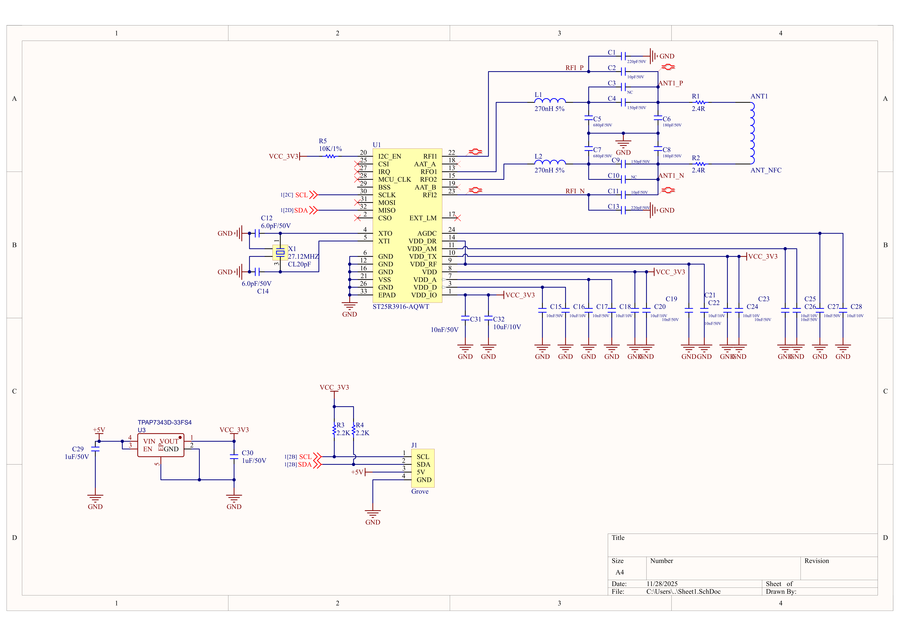

# M5Stack Unit NFC U216 I2C and Tag Development Guide


[**View M5Stack Unit NFC U216 on OpenELAB**](https://openelab.io/products/m5stack-nfc-universal-unit-st25r3916)

**Model:** Unit NFC U216 · **SKU:** `M5-U216`


## Product overview <a href="#product-and-scope" id="product-and-scope"></a>

**Unit NFC U216** is a13.56MHz ST25R3916-AQWT reader/writer frontend connected to an external host over **I2C at0x50**. It is not an autonomous controller or a USB reader. Its NFC-A/B/F/V reader modes and NFC-A/F emulation modes need the appropriate host library and protocol layer.

This guide uses an **AtomS3R C126 host on Grove SDA2/SCL1**, matching the current manufacturer tutorial. It starts with read-only UID/type detection before any tag-memory write or emulation project. Cap CC1101 U219 uses a related NFC chip over SPI but a different class/transport; do not substitute its setup here. [Exact U216 reference](https://docs.m5stack.com/en/unit/Unit_NFC).

## Applications

Use U216 to identify owned test tags, read a supported NDEF record, prototype asset labeling or explore a protocol-specific emulated tag with a controlled reader. An NFC UID is an identifier, not proof of authenticity or authorization. The frontend does not supply keys for protected applications and does not by itself implement a payment or access-control backend.

## Specifications

| Parameter           | Unit NFC U216                                                                       |
| ------------------- | ----------------------------------------------------------------------------------- |
| Chip / carrier      | ST25R3916-AQWT /13.56MHz                                                            |
| Host transport      | I2C address0x50;100kHz or400kHz                                                     |
| Reader/writer       | NFC-A/B, NFC-F FeliCa, NFC-V ISO15693                                               |
| Emulation           | NFC-A / NFC-F; exact capabilities depend on library mode                            |
| Read/write distance | Manufacturer≤40mm; tag/placement/environment-dependent                              |
| Power observations  | 5V19.33µA sleep;5V67.65mA continuous reading; not universal application consumption |
| Supply / signals    | Grove5V supply; schematic I2C pull-ups to3.3V                                       |
| Envelope / mass     | 48×24×8mm;5.9g                                                                      |
| Contents            | Unit NFC and20cm HY2.0-4P cable                                                     |

[Manufacturer specification](https://docs.m5stack.com/en/unit/Unit_NFC). The≤40mm figure is not a guaranteed distance for every phone/card or metal-mounted tag.

## Hardware and connections <a href="#hardware-and-technical-documents" id="hardware-and-technical-documents"></a>

### Power and Grove wiring

| Cable color | Unit function | AtomS3R C126 host |
| ----------- | ------------- | ----------------- |
| Black       | GND           | GND               |
| Red         | 5V input      | Grove5V output    |
| Yellow      | SDA           | GPIO2             |
| White       | SCL           | GPIO1             |

Power off the host before connecting the supplied cable. The exact U216 schematic shows a5V-to3.3V regulator, ST25R3916 VDD\_IO at3.3V and **R3/R4=2.2kΩ I2C pull-ups to VCC\_3V3**. This distinction matters:5V is the Unit's supply, while the bus signals use the3.3V domain shown in that drawing. Check additional devices' pull-ups before combining them, and do not add a5V-pulled I2C device to this bus. [Reviewed U216 circuit](https://m5stack-doc.oss-cn-shenzhen.aliyuncs.com/1229/SCH_Unit_NFC_V0.1_2025_11_28_12_15_35.pdf).

The Grove connector shape does not assign the same GPIO pair on every host. AtomS3R/AtomS3-Lite use2/1; Core2's Grove is32/33 and original ATOM Lite's is26/32. The sketch below deliberately uses the documented AtomS3R2/1 path. Change host target and verified pins together when porting. The NFC sensing face shown by M5Stack is the correct placement surface; begin with one tag flat against that face, away from metal and other tags. [Official host/placement tutorial](https://docs.m5stack.com/en/arduino/projects/unit/unit_nfc).



_M5Stack official technical illustration:_ [_original_](https://m5stack-doc.oss-cn-shenzhen.aliyuncs.com/1229/SCH_Unit_NFC_V0.1_2025_11_28_12_15_35_page_01.png)_. Verify drawing and physical revision together._

## Software and development resources <a href="#development-software-and-recovery" id="development-software-and-recovery"></a>

Select **M5AtomS3R** for the C126 host and install M5Unified/M5GFX. Install **M5Unit-NFC**, **M5UnitUnified**, **M5Utility** and **M5HAL** as declared dependencies. The reviewed M5Unit-NFC **0.1.2** metadata explicitly names `UnitNFC SKU:U216` and `CapCC1101NFC SKU:U219`. Its include is **M5UnitUnifiedNFC.h**. [Observed library metadata](https://raw.githubusercontent.com/m5stack/M5Unit-NFC/main/library.properties).

Create `m5::unit::UnitNFC` for the I2C frontend and `m5::nfc::NFCLayerA` for the initial NFC-A test. The manager handles transport; detect, identify, activate/authenticate and read/write are distinct protocol operations. UID detection does not establish readable user-memory size. NFC-B, NFC-F and NFC-V need their own supported layer/examples rather than forcing a card into NFC-A.

UiFlow2 runs on the **host**, with the [Unit NFC API](https://uiflow-micropython.readthedocs.io/en/latest/unit/nfc.html); U216 has no separate application image or USB bootloader. The [official detailed tutorial](https://docs.m5stack.com/en/arduino/projects/unit/unit_nfc) covers card identity, memory read/dump, NDEF, emulation and image data. Start with the small identity-only program below.

## Getting started

### Original read-only identity first result

1. Establish that AtomS3R C126 can upload/run its own display example; then power it off and connect U216 to Grove2/1.
2. Choose M5AtomS3R and install the libraries above, retaining resolved versions. Upload this original sketch with the normal C126 green-LED boot procedure if automatic upload fails.
3. Open a115200-baud serial monitor. Confirm `U216_READY` before presenting an owned NFC-A test tag.
4. Place one tag against the marked sensing face, remove/re-present it and compare UID/type. This program performs no memory write, format or emulation.

```cpp
#include <M5Unified.h>
#include <M5UnitUnified.h>
#include <M5UnitUnifiedNFC.h>
#include <Wire.h>
using namespace m5::nfc::a;
m5::unit::UnitUnified units;
m5::unit::UnitNFC frontend;
m5::nfc::NFCLayerA reader(frontend);
bool ready=false;
uint32_t previousScan=0;
void setup() {
  M5.begin();
  Serial.begin(115200);
  Wire.end();
  Wire.begin(2,1,400000);
  ready=units.add(frontend,Wire) && units.begin();
  Serial.println(ready ? "U216_READY" : "U216_INIT_FAILED");
}
void loop() {
  M5.update();
  if (!ready) { delay(100); return; }
  units.update();
  if (millis()-previousScan<750) return;
  previousScan=millis();
  PICC tag{};
  if (reader.detect(tag)) {
    if (reader.identify(tag))
      Serial.printf("uid=%s,type=%s,user_bytes=%u\n",
        tag.uidAsString().c_str(),tag.typeAsString().c_str(),tag.userAreaSize());
    else Serial.println("DETECTED_BUT_NOT_IDENTIFIED");
    reader.deactivate();
  }
  delay(2);
}
```

Expected result is initialization success and the actual presented tag's UID/type/user-memory capacity. No tag produces no identity line. If initialization fails, power off and recheck supply and2/1 wiring, then use a read-only I2C scan to look for0x50. An address ACK proves transport only; `identify()` is the protocol checkpoint. Source methods: [official NFC-A tutorial](https://docs.m5stack.com/en/arduino/projects/unit/unit_nfc), [NFC-A header](https://raw.githubusercontent.com/m5stack/M5Unit-NFC/main/src/nfc/layer/a/nfc_layer_a.hpp).

### Read memory and NDEF without conflating protocols

After identity works, read the tag type, user-memory bounds and lock/configuration state. For MIFARE Classic, authentication requires the applicable key; a default all-ones key is only valid where that is actually the tag's key. Do not interpret a failed authentication as a failed RF chip. Use a known spare tag and read a small permitted user block before a complete dump. Keep UID/manufacturer, lock, configuration and trailer pages out of a generic user-data write loop.

For NDEF, first read the capability/container and message length, then parse records according to that tag/protocol's supported mapping. Compare the decoded URL/text with a second compatible reader. If experimenting with writes, save the original user data, choose an explicitly writable spare tag and stay within the identified user area. Formatting and lock-bit changes have different reversibility from ordinary data writes; do not combine them with the first identity test. Deactivate/release the card after a transaction so a re-presented tag starts from a known state.

### Emulation, other protocols and application data

For NFC-A emulation, prepare the matching PICC type, UID and memory layout, including the correct BCC/check bytes and NDEF length/container. Service `emu_a.update()` frequently as in the official example and test with a controlled external reader. A phone showing a URL verifies that message path, not arbitrary card cloning or secure application support. NFC-F uses its own emulation protocol/identifier rules.

Select NFC-B/F/V examples only after confirming the tag family; their discovery and memory-command conventions differ. For image/file examples, identify available user bytes, encode a bounded payload with format/length metadata and verify the read-back checksum before rendering. An example PNG stored on a tag is application data, not a new hardware display capability. With UIFlow2 initialize the exact Unit class, bus2/1 and address0x50, run one read operation, then download and restart the host program to establish persistence.

## Troubleshooting and FAQs <a href="#faqs" id="faqs"></a>

| Symptom                             | Ordered checks                                                                                                                           |
| ----------------------------------- | ---------------------------------------------------------------------------------------------------------------------------------------- |
| No0x50 ACK                          | Host5V output/common ground →2/1 wiring → connector orientation → short known cable; isolate other bus devices.                          |
| ACK but init fails                  | Exact UnitNFC I2C class, M5Unit-NFC0.1.2-compatible dependencies,100/400kHz and correct host target.                                     |
| Detects but cannot identify/read    | Tag family, single-tag placement, protocol-specific layer and any required keys; UID is not memory authorization.                        |
| Range short                         | Use marked face, flat known tag, remove metal/stacked tags, then compare with another reader;≤40mm is not universal.                     |
| Emulation recognized inconsistently | Supported type/UID/memory/BCC/NDEF length, frequent update calls and reader compatibility.                                               |
| Need recovery                       | Disconnect power, remove tag/other Units, restore a known host sketch and retest0x50; there is no separate U216 firmware image to erase. |

## Downloads and technical documents

The exact U216 circuit, mechanical PDF and structure directory below are the integration references. The detailed tutorial links protocol-specific examples; its long upstream programs are linked rather than republished. The source license is MIT for the reviewed M5Unit-NFC code; keep notices if redistributing library source.

| Official file or repository                                                                                                | Use                                                                                          |
| -------------------------------------------------------------------------------------------------------------------------- | -------------------------------------------------------------------------------------------- |
| [Unit NFC Schematics PDF](https://m5stack-doc.oss-cn-shenzhen.aliyuncs.com/1229/SCH_Unit_NFC_V0.1_2025_11_28_12_15_35.pdf) | Manufacturer-listed exact model document / maintained source; use the scope described above. |
| [Unit NFC Model Size PDF](https://m5stack-doc.oss-cn-shenzhen.aliyuncs.com/1229/u216unitnfc-model-size.pdf)                | Manufacturer-listed exact model document / maintained source; use the scope described above. |
| [Unit NFC Structure Files](https://github.com/m5stack/M5_Hardware/tree/master/Products/U216_Unit_NFC/Structures)           | Manufacturer-listed exact model document / maintained source; use the scope described above. |
| [Unit NFC Arduino Library](https://github.com/m5stack/M5Unit-NFC)                                                          | Manufacturer-listed exact model document / maintained source; use the scope described above. |
| [Unit NFC UiFlow2 Docs](https://uiflow-micropython.readthedocs.io/en/latest/unit/nfc.html)                                 | Manufacturer-listed exact model document / maintained source; use the scope described above. |
| [ST25R3916](https://m5stack-doc.oss-cn-shenzhen.aliyuncs.com/1229/st25r3916_datasheet.pdf)                                 | Manufacturer-listed exact model document / maintained source; use the scope described above. |

### Additional model references <a href="#official-documentation-and-development-resources" id="official-documentation-and-development-resources"></a>

* [Read mechanical / cad files](https://github.com/m5stack/M5_Hardware/blob/master/Products/U216_Unit_NFC/Structures/Unit_NFC.stl)

## References and validation <a href="#sources-and-validation" id="sources-and-validation"></a>

This guide uses the exact sold SKU and the [manufacturer reference](https://docs.m5stack.com/en/unit/Unit_NFC). Specifications are manufacturer-reported; diagnostic order and first-result programs are original engineering work. The schematic was inspected at full resolution to confirm the5V regulator and3.3V2.2kΩ bus pull-ups. Model/transport support was checked in M5Unit-NFC0.1.2 metadata. No physical tag read/write or emulation was performed.

**Review:** 24 November 2026. Manufacturer documentation and the linked SDK interfaces were reviewed. **Compilation, firmware flashing and hardware operation: not run.** Expected results above are commissioning checkpoints, not observed bench measurements.
