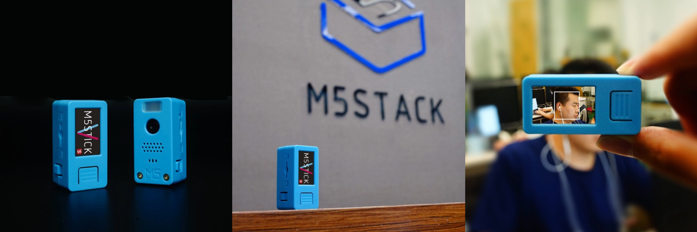
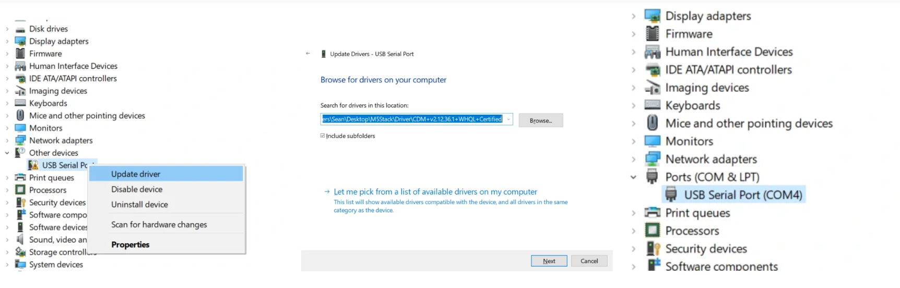
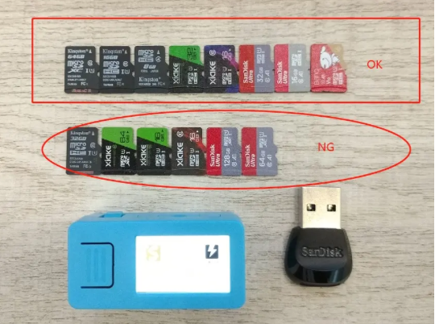
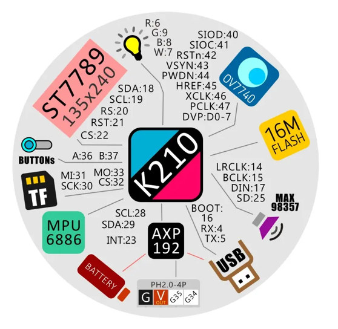

---
layout:
  width: default
  title:
    visible: false
  description:
    visible: false
  tableOfContents:
    visible: true
  outline:
    visible: true
  pagination:
    visible: true
  metadata:
    visible: true
  tags:
    visible: true
  actions:
    visible: true
  anchors:
    visible: true
---

# M5StickV K210 AI Camera


**Manufacturer reference.** A matching current OpenELAB global-store listing has not been verified for this model/revision. Use the hardware label and the exact official reference below; do not select firmware or wiring from a similar store product.


### M5Stack M5StickV K210 AI Camera (Without Wifi)

### Description 

M5Stack recently launched the new AIoT(AI+IoT) Camera powered by Kendryte K210 -an edge computing system-on-chip(SoC) with dual-core 64bit RISC-V CPU and advanced neural network processor..\
\
M5StickV AI Camera possesses machine vision capabilities, equips OmniVision OV7740 image sensor, adopts OmniPixel®3-HS technology, provides optimum low light sensitivity, supports various vision identification capabilities. (e.g. Real-time acquisition of the size, type and coordinates of the detected target ) In addition to an OV7740 sensor, M5StickV features more hardware resources such as a speaker with built-in I2S Class-D DAC, IPS screen, 6-axis IMU, 200mAh Li-po battery, and more.\
\
It is able to perform convolutional neural network calculations at low power consumption, so M5StickV will be a good zero-threshold machine vision embedded solution. It is in support with MicroPython, which makes your code to be more concise when you use M5stick-V for programming.

### Features 

* Dual-Core 64-bit RISC-V RV64IMAFDC (RV64GC) CPU / 400Mhz(Normal)
* Dual Independent Double Precision FPU
* Neural Network Processor(KPU) / 0.8Tops
* Field-Programmable IO Array (FPIOA)
* Dual hardware 512-point 16bit Complex FFT
* SPI, I2C, UART, I2S, RTC, PWM, Timer Support
* AES, SHA256 Accelerator
* Direct Memory Access Controller (DMAC)
* Micropython Support
* Firmware encryption support
* Case Material: PC + ABS

### Applications 

* Face recognition/detection
* Object detection/classification
* Obtaining size and coordinates of the target in real-time
* Obtaining the type of detected target in real-time
* Shape recognition
* Video/Display
* Game simulator

### Specification 

| Resources                            | Parameter                                                        |
| ------------------------------------ | ---------------------------------------------------------------- |
| Kendryte K210                        | Dual core 64-bit RISC-V RV64IMAFDC (RV64GC) CPU / 400Mhz(Normal) |
| SRAM                                 | 8MiB                                                             |
| Flash                                | 16M                                                              |
| Power input                          | 5V @ 500mA                                                       |
| KPU Parameter size of neural network | 5.5MiB - 5.9MiB                                                  |
| Port                                 | TypeC x 1, GROVE(I2C+I/0+UART) x 1                               |
| RGB LED                              | RGBW x 1                                                         |
| Button                               | Custom button x 2                                                |
| IPS screen                           | 1.14 TFT, 135\*240, ST7789                                       |
| Camera                               | OV7740(30W pixels)                                               |
| FOV                                  | 55deg                                                            |
| PMU                                  | AXP192                                                           |
| Battery                              | 200mAh                                                           |
| External storage                     | TF-card(microSD)                                                 |
| MEMS                                 | MPU6886                                                          |
| Net weight                           | 23g                                                              |
| Gross weight                         | 82g                                                              |
| Product Size                         | 48\*24\*22mm                                                     |
| Package Size                         | 144\*44\*43mm                                                    |
| Case Material                        | Plastic ( PC )                                                   |

<figure><figcaption></figcaption></figure>

### Driver Installation 

Connect the device to the PC, open the device manager to install [FTDI driver ](https://ftdichip.com/drivers/vcp-drivers/)for the device. Take the win10 environment as an example, download the driver file that matches the operating system, unzip it, and install it through the device manager. (Note: In some system environments, the driver needs to be installed twice for the driver to take effect. The unrecognized device name is usually `M5Stack` or `USB Serial`. Windows recommends using the driver file to install directly in the device manager (custom Update), the executable file installation method may not work properly). [Click here to download FTDI driver](https://ftdichip.com/drivers/vcp-drivers/)

<figure><figcaption></figcaption></figure>

#### TF-card(microSD) test 

M5StickV does not currently recognize all types of TF-card(microSD). We have tested some common TF-card(microSD). The test results are as follows.

<figure><figcaption></figcaption></figure>

| Brand    | Storage | Type | Class   | Format | Test Results |
| -------- | ------- | ---- | ------- | ------ | ------------ |
| Kingston | 8G      | HC   | Class4  | FAT32  | OK           |
| Kingston | 16G     | HC   | Class10 | FAT32  | OK           |
| Kingston | 32G     | HC   | Class10 | FAT32  | NO           |
| Kingston | 64G     | XC   | Class10 | exFAT  | OK           |
| SanDisk  | 16G     | HC   | Class10 | FAT32  | OK           |
| SanDisk  | 32G     | HC   | Class10 | FAT32  | OK           |
| SanDisk  | 64G     | XC   | Class10 | /      | NO           |
| SanDisk  | 128G    | XC   | Class10 | /      | NO           |
| XIAKE    | 16G     | HC   | Class10 | FAT32  | OK(purple)   |
| XIAKE    | 32G     | HC   | Class10 | FAT32  | OK           |
| XIAKE    | 64G     | XC   | Class10 | /      | NO           |
| TURYE    | 32G     | HC   | Class10 | /      | NO           |

### EasyLoader 

EasyLoader is a concise and fast program writer, which has a built-in case program related to the product. It can be burned to the main control by simple steps to perform a series of function verification.



**Charging current measured value**

| charging current | Fully charged current(Power OFF) | Fully charged current(Power ON） |
| ---------------- | -------------------------------- | ------------------------------- |
| 0.376A           | 0.078A                           | 0.255A                          |

#### FUNCTIONAL DESCRIPTION 

#### KENDRYTE K210 

The Kendryte K210 is a system-on-chip (SoC) that integrates machine vision. Using TSMC’s ultra-low-power 28-nm advanced process with dual core 64-bit processors for better power efficiency, stability and reliability. The SoC strives for ”zero threshold” development and to be deployable in the user’s products in the shortest possible time, giving the product artificial intelligence

* Machine Vision
* Better low power vision processing speed and accuracy
* KPU high performance Convolutional Neural Network (CNN) hardware accelerator
* Advanced TSMC 28nm process, temperature range -40°C to 125°C
* Firmware encryption support
* Unique programmable IO array maximizes design flexibility
* Low voltage, reduced power consumption compared to other systems with the same processing power
* 3.3V/1.8V dual voltage IO support eliminates need for level shifters

#### CPU 

The chip contains a high-performance, low power RISC-V ISA-based dual core 64-bit CPU with the following features:

* Core Count: Dual-core processor
* Bit Width: 64-bit CPU 400MHz
* Frequency: 400MHz
* ISA extensions: IMAFDC
* FPU: Double Precision
* Platform Interrupts: PLIC
* Local Interrupts: CLINT
* I-Cache: 32KiB x 2
* D-Cache: 32KiB x 2
* On-Chip SRAM: 8MiB

#### OV7740 

* support for output formats: RAW RGB and YUV
* support for image sizes: VGA, QVGA, CIF and any size smaller
* support for black sun cancellation
* support for internal and external frame synchronization
* standard SCCB serial interface
* digital video port (DVP) parallel output interface
* embedded one-time programmable (OTP) memory
* on-chip phase lock loop (PLL)
* embedded 1.5 V regulator for core
* Sophisticated Edge Rate Control Enables Filter less Class D Outputs
* 77dB PSRR at 1kHz
* Low RF Susceptibility Rejects TDMA Noise from GSM Radios
* Extensive Click-and-Pop Reduction Circuitry
* array size: 656 x 488
* power supply: – core: 1.5VDC ± 5% – analog: 3.3V ± 5% – I/O: 1.7 \~ 3.47V
* temperature range: – operating: -30° C to 70°C – stable image: 0° C to 50° C
* output format: – 8-/10-bit raw RGB data – 8-bit YUV
* lens size: 1/5"
* input clock frequency: 6 \~ 27 MHz
* max image transfer rate: VGA (640x480): 60 fps – QVGA (320 x 240): 120 fp
* sensitivity: 6800 mV/(Lux-sec)
* maximum exposure interval: 502 x tROW
* pixel size: 4.2 μm x 4.2 μm
* image area: 2755.2 μm x 2049.6 μm
* package/die dimensions: – CSP3: 4185 μm x 4345 μm – COB: 4200 μm x 4360 μm

#### MAX98357 

* Single-Supply Operation (2.5V to 5.5V).
* 3.2W Output Power into 4Ω at 5V
* 2.4mA Quiescent Current
* 92% Efficiency (RL = 8Ω, POUT = 1W)
* 22.8µVRMS Output Noise (AV = 15dB)
* Low 0.013% THD+N at 1kHz
* No MCLK Required
* Sample Rates of 8kHz to 96kHz
* Supports Left, Right, or (Left/2 + Right/2) Output
* Sophisticated Edge Rate Control Enables Filter less Class D Outputs
* 77dB PSRR at 1kHz
* Low RF Susceptibility Rejects TDMA Noise from GSM Radios
* Extensive Click-and-Pop Reduction Circuitry

#### AXP192 

* Operation Voltage: 2.9V - 6.3V(AMR:-0.3V\~15V)
* Configurable Intelligent Power Select system
* Current and voltage limit of adaptive USB or AC adapter input
* The resistance of internal ideal diode lower than 100mΩ

#### MPU6886 

**GYROSCOPE FEATURES**

* Digital-output X-, Y-, and Z-axis angular rate sensors (gyroscopes) with a user-programmable full-scale range of ±250 dps, ±500 dps, ±1000 dps, and ±2000 dps and integrated 16-bit ADCs
* Digitally-programmable low-pass filter
* Low-power gyroscope operation
* Factory calibrated sensitivity scale factor
* lens size: 1/5"
* Self-test

**ACCELEROMETER FEATURES**

* Digital-output X-, Y-, and Z-axis accelerometer with a programmable full scale range of ±2g, ±4g, ±8g and ±16g and integrated 16-bit ADCs
* User-programmable interrupts
* Wake-on-motion interrupt for low power operation of applications processor
* Self-test

**SPI/I2C dual communication mode**

Note: There are two versions of M5StickV currently released by M5Stack. When programming, users need to configure differently according to their corresponding pin mapping. The specific differences are as follows.

* In the M2StickV circuit design of the I2C single-mode (blue PCB) version, MPU6886 only supports the user to configure its communication mode to I2C, and its pin mapping is SCL-28, SDA-29.
* In the SPI/I2C dual mode (black PCB) version of the M5StickV circuit design, MPU6886 supports the user to configure its communication mode to SPI or I2C, and its pin mapping is SCL-26, SDA-27., when using, you can switch CS Pin level to switch modes (high level 1 is I2C mode, low level 0 is SPI mode)
* The specific pin mapping is shown below:

<figure><figcaption></figcaption></figure>

### Schematic 

<figure><figcaption></figcaption></figure>

[K210\_CAM](https://m5stack.oss-cn-shenzhen.aliyuncs.com/resource/docs/schematic/Core/k210_CAMv2.pdf)

### Related Link 

* **datasheet**
  * [MPU6886](https://m5stack.oss-cn-shenzhen.aliyuncs.com/resource/docs/datasheet/core/MPU-6886-000193%2Bv1.1_GHIC_en.pdf)
  * [SH200Q](https://m5stack.oss-cn-shenzhen.aliyuncs.com/resource/docs/datasheet/core/SH200Q_en.pdf)
  * [OV7740](https://m5stack.oss-cn-shenzhen.aliyuncs.com/resource/docs/datasheet/core/stickv/OV7740_datasheet.pdf)
* **Maixpy Docs**
  * [Sipeed](https://maixpy.sipeed.com/en/)

### V-Training 

* [V-Training](https://docs.m5stack.com/en/guide/ai_camera/unitv/v-training)

### Version Change 

| Release Date | Product Change                                                                                                                  | Note:                                                                                                        |
| ------------ | ------------------------------------------------------------------------------------------------------------------------------- | ------------------------------------------------------------------------------------------------------------ |
| 2019.7       | Initial public release                                                                                                          | /                                                                                                            |
| 2020.3       | The circuit supports configuring MPU6886 to use SPI or I2C protocol for communication.I2C pin change SCL (28=>26), SDA (29=>27) | Program to drive the chip select pin CS for modification, high level 1 is I2C mode, low level 0 is SPI mode. |
| 2020.3       | Add with Microphone                                                                                                             | /                                                                                                            |
| 2020.4       | Standard package add with bracket                                                                                               | /                                                                                                            |

## Official documentation and development resources

Use [StickV](https://docs.m5stack.com/en/core/StickV) for the manufacturer's complete model reference, diagrams and maintained examples. The official product code is **`K027`**; match the board/Unit label before choosing a firmware or host example. The references below complement this guide's local instructions.

| Development need     | Model-specific reference                                                                                              |
| -------------------- | --------------------------------------------------------------------------------------------------------------------- |
| Electrical schematic | [Read electrical schematic](https://m5stack.oss-cn-shenzhen.aliyuncs.com/resource/docs/schematic/Core/k210_CAMv2.pdf) |

Keep the example's host model, interface pins and dependency versions together when reproducing a result. A schematic or SDK link does not establish that another revision uses the same wiring. Official model pages and accessible tutorial links reviewed **23 November 2026**. Other downloads above are manufacturer-listed resources; listing a file is not a test of its contents. Compilation, firmware flashing and hardware operation were **not performed** in this review.
