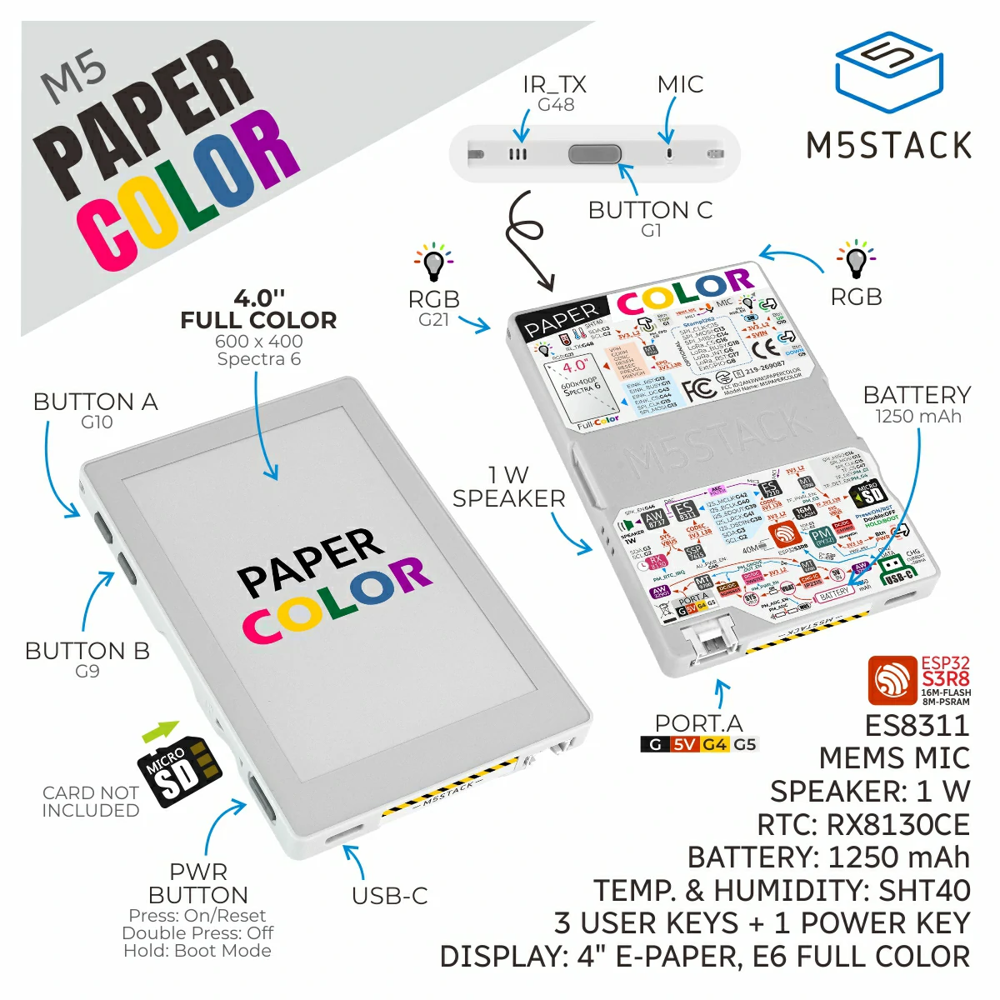

# M5Stack PaperColor C151 Development Guide


[**View M5Stack PaperColor C151 on OpenELAB**](https://openelab.io/products/m5stack-m5paper-color-esp32s3-dev-kit)

**Model:** PaperColor C151 · **SKU:** `M5-C151`


## Product overview



_Manufacturer image: M5Stack._ [_Image source_](https://m5stack-doc.oss-cn-shenzhen.aliyuncs.com/1239/C151_main-pictures_01.webp)_._

[Product at OpenELAB](https://openelab.io/products/m5stack-m5paper-color-esp32s3-dev-kit) · [Manufacturer wiki hub](./)

### Product and model scope

**M5Stack PaperColor C151** is an ESP32-S3 ePaper development device for color information displays, artwork, environmental dashboards and low-update signage. It is separate from the original M5Paper and PaperS3; those boards' display drivers, pin maps and power arrangements must not be assumed compatible.

## Applications

Use PaperColor C151 for static color signage, art and periodic environmental dashboards. E-paper is a low-update display; use a buffered one-shot render rather than animation.

## Specifications

### Hardware specifications

| Item              | PaperColor                                                                |
| ----------------- | ------------------------------------------------------------------------- |
| MCU/memory        | ESP32-S3R8; 16 MB flash; 8 MB octal PSRAM                                 |
| Display           | 4-inch E Ink Spectra 6 full color; 400 × 600 pixels                       |
| Local input       | Three user buttons; no touchscreen listed in the reviewed specification   |
| Wireless          | 2.4 GHz Wi-Fi                                                             |
| Battery           | 1250 mAh                                                                  |
| First-run supply  | USB-C, 5 V                                                                |
| Other peripherals | SHT40, RTC, microphone/audio output, microSD, infrared and RGB indicators |

Source: [manufacturer hardware reference](https://docs.m5stack.com/en/core/PaperColor). Use the schematic and dimensions linked below for wiring and mechanical work. Battery capacity is a component specification, not a measured application runtime.

## Hardware and connections

### Display, storage and audio ownership

| Function                 | PaperColor route                                                     |
| ------------------------ | -------------------------------------------------------------------- |
| E-paper SPI              | clock15, MOSI13, CS44, DC43, BUSY11, reset12                         |
| E-paper supply           | M5PM1 PYG0; do not treat GPIO0 as the panel-power pin                |
| microSD                  | CS47, clock15, MOSI13, MISO14; shared SPI with panel                 |
| System I2C               | SDA3 / SCL2; SHT400x44, RTC0x32, codecs0x18/0x40, M5PM10x6E          |
| Button A/B/C             | GPIO10 /9 /1                                                         |
| Grove                    | GND /5V /GPIO4 /GPIO5                                                |
| Audio                    | MCLK42, LRCK41, BCLK40, microphone ADC data39, codec playback data38 |
| Audio rails / indicators | codec power45, amp enable46; IR48, RGB data21                        |

RGB power and Grove direction are PMIC-managed. SD power and detection use PMIC channels3/4/1; a missing card can be a power/detection issue before filesystem initialization. [PaperColor pin map](https://docs.m5stack.com/en/core/PaperColor#pinmap).


_M5Stack official technical illustration:_ [_original_](https://m5stack-doc.oss-cn-shenzhen.aliyuncs.com/1239/C151-SCH_PaperColor_V0.5_SCH_PDF_20260424_EN_2026_04_24_11_01_17_page_01.png)_. Verify drawing and physical revision together._

## Software and development resources

### Development environment

Install Arduino IDE and the [M5Stack board package](https://docs.m5stack.com/en/arduino/arduino_board), then select **M5PaperColor**. Install **M5Unified and M5GFX; add M5PM1 for explicit power-management work** and accept their dependencies. Record the board-package and library versions alongside your project.

The [PaperColor Arduino guide](https://docs.m5stack.com/en/arduino/papercolor/program) is the primary reference for the preset, download mode and current dependency requirements. A generic ESP32-S3 preset can build a sketch while selecting the wrong display/power configuration. UiFlow2 and the factory firmware are alternative applications with their own setup procedures.

## Getting started

### Getting started: one static display update

Prepare the device, a USB-C data cable and a computer. This example needs no Wi-Fi account. It replaces the application currently on the device; keep a recovery reference and export needed settings first.

1. Connect USB-C and select the board's actual port in Arduino IDE. If it is not visible, use the manufacturer's power/reset download-mode operation and check again.
2. Select **M5PaperColor** and the installed compatible M5Unified/M5GFX libraries. Retain the model preset's memory settings for the first test.
3. Create a new sketch with the following code. It draws into an off-screen canvas and pushes a single static page, avoiding an application loop that continuously redraws ePaper.

```cpp
#include <M5Unified.h>

M5Canvas canvas(&M5.Display);

void setup() {
    auto cfg = M5.config();
    cfg.clear_display = false;
    M5.begin(cfg);
    M5.Display.setEpdMode(epd_mode_t::epd_quality);

    canvas.createSprite(M5.Display.width(), M5.Display.height());
    canvas.fillSprite(WHITE);
    canvas.setTextColor(BLACK);
    canvas.setTextSize(2);
    canvas.setCursor(16, 16);
    canvas.println("PaperColor ready");
    canvas.pushSprite(0, 0);
}

void loop() {
    M5.update();
    delay(100);
}
```

4. Verify and upload, restart into the application if necessary, and wait for the complete refresh. Check that the new label is legible with the intended orientation. Change the label and upload again to distinguish a new frame from an old retained image.

Expected result: a settled white page with the black test label. A retained image after power-off is normal ePaper behavior. This checks the upload/display path, not every fitted peripheral. The API sequence is based on the official M5Unified/M5GFX example pattern; it remains uncompiled and untested on physical hardware for this guide.

### Color rendering and refresh behavior

The manufacturer's color example draws six color bands and text. Use it after the monochrome label works, then inspect the actual six-color palette before importing arbitrary RGB artwork. The product guide gives a typical full-refresh interval of approximately 15–30 seconds depending on content. Wait for the settled result; do not judge a still-refreshing panel or use an LCD animation loop as a power/performance expectation.

Add SHT40, buttons, RTC and audio one subsystem at a time using the model's examples. Voice applications need their own software/backend. For low power, follow M5PM1 rail and wake-source handling rather than assuming that an ESP32 sleep call alone powers down every peripheral.

### Environmental, RTC and audio extensions

After one static panel image works, scan the **internal** SDA3/SCL2 route for SHT400x44 using the vendor initialization and read a temperature/humidity sample with the exact SHT4x driver. Record units and sensor-heating conditions; an e-paper board's local sensor can differ from room air. Keep sensor sampling faster than display refresh and redraw only when a meaningful value changes.

For scheduled updates, set/read RX8130CE time, verify one alarm wake and finish the panel refresh before entering low power. Gate the panel and SD supplies through M5PM1 only after those transactions finish. For audio, test the speaker alone, then ES7210 microphone samples; the presence of an AEC circuit does not validate your firmware's echo cancellation. IR on48 and the RGB chain on21 are independent outputs; enable their supplies explicitly through the model's driver.

The six-color display is not an RGB LCD: compose a whole image off-screen, choose a deliberate six-color palette/dither strategy and send one completed frame. An old image persisting after shutdown is expected; label a new frame distinctly to prove live operation. UiFlow2 requires PaperColor firmware, a matching controller and Run Always for a stored program. [Hardware and power reference](https://docs.m5stack.com/en/core/PaperColor), [power API](https://docs.m5stack.com/en/arduino/papercolor/m5pm1).

## Troubleshooting and FAQs

### Recovery and troubleshooting

| Symptom                              | Check and next step                                                                                     |
| ------------------------------------ | ------------------------------------------------------------------------------------------------------- |
| No serial port                       | Known data cable, power, correct model's download-mode sequence and host USB/driver status.             |
| Sketch builds but panel is unchanged | Exact board preset, compatible library versions, normal application boot and time for full refresh.     |
| Canvas allocation or graphics fails  | PSRAM/preset selection and buffer size; begin with the model's stock example.                           |
| Old image remains when switched off  | Expected retained-image behavior; verify live operation with a deliberately changed label.              |
| Peripheral is absent                 | Match fitted hardware, power rail, pin map and model-specific example before combining features.        |
| Need original behavior               | Follow the manufacturer's factory restoration path for C151; save needed configuration before flashing. |

For support, provide board revision, board-package/library versions, firmware/commit, the minimal failing sketch and actual compiler/serial output.

## Downloads and technical documents

### Technical documents and software

| Resource                                                                                                                                | Use                                           |
| --------------------------------------------------------------------------------------------------------------------------------------- | --------------------------------------------- |
| [Hardware reference](https://docs.m5stack.com/en/core/PaperColor)                                                                       | Model specifications, pin map and peripherals |
| [Arduino quick-start](https://docs.m5stack.com/en/arduino/papercolor/program)                                                           | Exact board preset and dependencies           |
| [Schematic](https://m5stack-doc.oss-cn-shenzhen.aliyuncs.com/1239/C151-SCH_PaperColor_V0.5_SCH_PDF_20260424_EN_2026_04_24_11_01_17.pdf) | Revision-specific electrical reference        |
| [Dimension drawing](https://m5stack-doc.oss-cn-shenzhen.aliyuncs.com/1239/C151PaperColor_model_size.pdf)                                | Mechanical envelope                           |
| [CAD/structure files](https://github.com/m5stack/M5_Hardware/tree/master/Products/C151_PaperColor/Structures)                           | Mechanical integration                        |
| [M5Unified](https://github.com/m5stack/M5Unified)                                                                                       | Arduino device API and examples               |
| [M5GFX](https://github.com/m5stack/M5GFX)                                                                                               | Display/canvas APIs                           |
| [Factory firmware source](https://github.com/m5stack/M5PaperColor-UserDemo)                                                             | Manufacturer application reference            |

**Review date:** 17 November 2026. **Validation:** official documentation and the cited software interfaces reviewed. Commands and examples have not been compiled or run on physical hardware by OpenELAB for this guide. Record your hardware revision, firmware, software versions and actual results when reproducing it.

### Official documentation and development resources

Use [PaperColor](https://docs.m5stack.com/en/core/PaperColor) for the manufacturer's complete model reference, diagrams and maintained examples. The official product code is **`C151`**; match the board/Unit label before choosing a firmware or host example. The references below complement this guide's local instructions.

| Development need                       | Model-specific reference                                                                                                             |
| -------------------------------------- | ------------------------------------------------------------------------------------------------------------------------------------ |
| Arduino development tutorial           | [Read arduino development tutorial](https://docs.m5stack.com/en/arduino/papercolor/program)                                          |
| Mechanical / CAD files                 | [Read mechanical / cad files](https://github.com/m5stack/M5_Hardware/tree/master/Products/C151_PaperColor/Structures)                |
| Mechanical / CAD files                 | [Read mechanical / cad files](https://github.com/m5stack/M5_Hardware/blob/master/Products/C151_PaperColor/Structures/PaperColor.stl) |
| Arduino development tutorial           | [Read arduino development tutorial](https://docs.m5stack.com/en/arduino/papercolor/m5pm1)                                            |
| Official source: M5PM1                 | [Read official source: m5pm1](https://github.com/m5stack/M5PM1)                                                                      |
| Official source: M5Unified             | [Read official source: m5unified](https://github.com/m5stack/M5Unified)                                                              |
| Official source: M5GFX                 | [Read official source: m5gfx](https://github.com/m5stack/M5GFX)                                                                      |
| Official source: M5PaperColor-UserDemo | [Read official source: m5papercolor-userdemo](https://github.com/m5stack/M5PaperColor-UserDemo)                                      |

Keep the example's host model, interface pins and dependency versions together when reproducing a result. A schematic or SDK link does not establish that another revision uses the same wiring. Official model pages and accessible tutorial links reviewed **23 November 2026**. Other downloads above are manufacturer-listed resources; listing a file is not a test of its contents. Compilation, firmware flashing and hardware operation were **not performed** in this review.

| Official file or repository                                                                                                                             | Use                                                                                          |
| ------------------------------------------------------------------------------------------------------------------------------------------------------- | -------------------------------------------------------------------------------------------- |
| [PaperColor Schematics PDF](https://m5stack-doc.oss-cn-shenzhen.aliyuncs.com/1239/C151-SCH_PaperColor_V0.5_SCH_PDF_20260424_EN_2026_04_24_11_01_17.pdf) | Manufacturer-listed exact model document / maintained source; use the scope described above. |
| [PaperColor Model Size PDF](https://m5stack-doc.oss-cn-shenzhen.aliyuncs.com/1239/C151PaperColor_model_size.pdf)                                        | Manufacturer-listed exact model document / maintained source; use the scope described above. |
| [PaperColor Structure Files](https://github.com/m5stack/M5_Hardware/tree/master/Products/C151_PaperColor/Structures)                                    | Manufacturer-listed exact model document / maintained source; use the scope described above. |
| [ESP32S3](https://m5stack-doc.oss-cn-shenzhen.aliyuncs.com/477/esp32-s3_technical_reference_manual_en.pdf)                                              | Manufacturer-listed exact model document / maintained source; use the scope described above. |
| [ES8311](https://m5stack.oss-cn-shenzhen.aliyuncs.com/resource/docs/products/atom/Atomic%20Echo%20Base/ES8311.pdf)                                      | Manufacturer-listed exact model document / maintained source; use the scope described above. |
| [RX8130CE](https://m5stack-doc.oss-cn-shenzhen.aliyuncs.com/1132/RX8130CE_cn.pdf)                                                                       | Manufacturer-listed exact model document / maintained source; use the scope described above. |
| [M5PM1 Arduino Library](https://github.com/m5stack/M5PM1)                                                                                               | Manufacturer-listed exact model document / maintained source; use the scope described above. |
| [PaperColor Arduino M5Unified Driver Library](https://github.com/m5stack/M5Unified)                                                                     | Manufacturer-listed exact model document / maintained source; use the scope described above. |
| [PaperColor Arduino M5GFX Driver Library](https://github.com/m5stack/M5GFX)                                                                             | Manufacturer-listed exact model document / maintained source; use the scope described above. |
| [M5PM1 Power Management IC](https://m5stack-doc.oss-cn-shenzhen.aliyuncs.com/1207/M5PM1_Datasheet_EN.pdf)                                               | Manufacturer-listed exact model document / maintained source; use the scope described above. |
| [PaperColor Factory Firmware Source Code](https://github.com/m5stack/M5PaperColor-UserDemo)                                                             | Manufacturer-listed exact model document / maintained source; use the scope described above. |
| [download](https://m5stack-doc.oss-cn-shenzhen.aliyuncs.com/1239/C151-papercolor-factory-fw.exe)                                                        | Manufacturer-listed exact model document / maintained source; use the scope described above. |

## References and validation

Exact-model [manufacturer hardware reference](https://docs.m5stack.com/en/core/PaperColor) and model-specific software links in the procedures establish this guide's hardware scope. Electrical values are manufacturer-reported; external-project behavior and diagnostic order are original engineering guidance.

**Review:** 24 November 2026. Manufacturer documentation and the linked SDK interfaces were reviewed. **Compilation, firmware flashing and hardware operation: not run.** Expected results above are commissioning checkpoints, not observed bench measurements.
