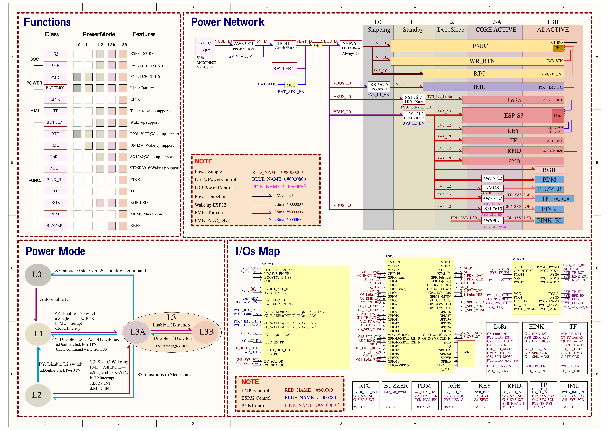

# M5Stack PaperMono C153 Development Guide


[**View M5Stack PaperMono C153 on OpenELAB**](https://openelab.io/products/m5stack-m5papermono-with-lora-nfc-800x480-3-97-eink-display)

**Model:** PaperMono C153 · **SKU:** `M5-C153`


## Product overview


_Manufacturer image: M5Stack._ [_Image source_](https://m5stack-doc.oss-cn-shenzhen.aliyuncs.com/1267/C153_PaperMono_main_pictures_01.webp)_._

[Product at OpenELAB](https://openelab.io/products/m5stack-m5papermono-with-lora-nfc-800x480-3-97-eink-display) · [Manufacturer wiki hub](./)

### Product and model scope

**M5Stack PaperMono C153** is an ESP32-S3 ePaper development device for reading interfaces, battery information terminals, identification prototypes and radio-linked status displays. It is separate from the original M5Paper and PaperS3; those boards' display drivers, pin maps and power arrangements must not be assumed compatible.

## Applications

Use PaperMono C153 for a grayscale reader, NFC identification terminal or low-update LoRa dashboard. Separate radio commissioning from panel refresh to localize errors.

## Specifications

### Hardware specifications

| Item              | PaperMono                                                              |
| ----------------- | ---------------------------------------------------------------------- |
| MCU/memory        | ESP32-S3R8; 16 MB flash; 8 MB octal PSRAM                              |
| Display           | 3.97-inch monochrome, four gray levels; 480 × 800 pixels; SSD1677      |
| Local input       | FT6336G touch, two user buttons and frontlight                         |
| Wireless          | 2.4 GHz Wi-Fi                                                          |
| Battery           | 1150 mAh                                                               |
| First-run supply  | USB-C, 5 V                                                             |
| Other peripherals | BMI270, RTC, microphone/buzzer, microSD, NFC ST25R3916 and SX1262 LoRa |

Source: [manufacturer hardware reference](https://docs.m5stack.com/en/core/PaperMono). Use the schematic and dimensions linked below for wiring and mechanical work. Battery capacity is a component specification, not a measured application runtime.

## Hardware and connections

### PaperMono bus and rail map

| Peripheral              | Exact C153 routing                                                          |
| ----------------------- | --------------------------------------------------------------------------- |
| Display                 | MOSI14, clock15, CS16, DC17, BUSY18; M5IOE1 PYG5 reset / PYG3 panel power   |
| System I2C              | SDA47/SCL48: touch0x38, RTC0x32, BMI2700x68, NFC0x50, M5PM10x6E, M5IOE10x4F |
| Touch                   | interrupt4; expander PYG6 reset / PYG13 supply                              |
| microSD SDIO            | CMD12, CLK13, DAT0–3=11/10/9/8; expander PYG14 supply / PYG1 detect         |
| User A/B                | GPIO2/3                                                                     |
| PDM microphone / buzzer | data46, clock45 / PWM42; PDM supply expander PYG12                          |
| LoRa SPI                | MOSI38, MISO40, clock39, NSS41, BUSY21, IRQ5                                |
| LoRa control            | expander PYG10 reset, PYG2 RF switch; M5PM1 channel2 radio power            |
| Frontlight              | PMIC channel3 PWM, separate from display pixels                             |

The charging IP23150x75 is conditionally connected to system I2C through M5IOE1 PYG11. Low VBAT can upset its I2C mode; connect it only for the required transaction and disconnect promptly. A system-bus failure after charger access can require a short power-button reset. [C153 electrical notes](https://docs.m5stack.com/en/core/PaperMono#pinmap).



_M5Stack official technical illustration:_ [_original_](https://m5stack-doc.oss-cn-shenzhen.aliyuncs.com/1267/PaperMono_SCH_V0.6.2_20260522_page_01.png)_. Verify drawing and physical revision together._

## Software and development resources

### Development environment

Install Arduino IDE and the [M5Stack board package](https://docs.m5stack.com/en/arduino/arduino_board), then select **M5PaperMono**. Install **M5Unified, M5GFX, M5PM1 and M5IOE1; add M5UnitUnified/M5Unit-NFC/RadioLib for their peripherals** and accept their dependencies. Record the board-package and library versions alongside your project.

The [PaperMono Arduino guide](https://docs.m5stack.com/en/arduino/papermono/program) is the primary reference for the preset, download mode and current dependency requirements. A generic ESP32-S3 preset can build a sketch while selecting the wrong display/power configuration. UiFlow2 and the factory firmware are alternative applications with their own setup procedures.

The current Arduino quick-start explicitly installs **M5Unified, M5GFX, M5PM1, M5IOE1, M5UnitUnified, M5Unit-NFC and RadioLib** for **M5PaperMono**. Keep the full dependency set with the model target. Manufacturer notes prefer the [OTP refresh example](https://github.com/m5stack/M5PaperMono-OTP-Demo) because current M5GFX panel waveforms are unstable; treat the M5GFX timing table as vendor laboratory observations, not validated lifetime or guaranteed frame rate.

## Getting started

### Getting started: one static display update

Prepare the device, a USB-C data cable and a computer. This example needs no Wi-Fi account. It replaces the application currently on the device; keep a recovery reference and export needed settings first.

1. Connect USB-C and select the board's actual port in Arduino IDE. If it is not visible, use the manufacturer's power/reset download-mode operation and check again.
2. Select **M5PaperMono** and the installed compatible M5Unified/M5GFX libraries. Retain the model preset's memory settings for the first test.
3. Create a new sketch with the following code. It draws into an off-screen canvas and pushes a single static page, avoiding an application loop that continuously redraws ePaper.

```cpp
#include <M5Unified.h>

M5Canvas canvas(&M5.Display);

void setup() {
    auto cfg = M5.config();
    cfg.clear_display = false;
    M5.begin(cfg);
    M5.Display.setEpdMode(epd_mode_t::epd_quality);

    canvas.createSprite(M5.Display.width(), M5.Display.height());
    canvas.fillSprite(WHITE);
    canvas.setTextColor(BLACK);
    canvas.setTextSize(2);
    canvas.setCursor(16, 16);
    canvas.println("PaperMono ready");
    canvas.pushSprite(0, 0);
}

void loop() {
    M5.update();
    delay(100);
}
```

4. Verify and upload, restart into the application if necessary, and wait for the complete refresh. Check that the new label is legible with the intended orientation. Change the label and upload again to distinguish a new frame from an old retained image.

Expected result: a settled white page with the black test label. A retained image after power-off is normal ePaper behavior. This checks the upload/display path, not every fitted peripheral. The API sequence is based on the official M5Unified/M5GFX example pattern; it remains uncompiled and untested on physical hardware for this guide.

### Touch, NFC, LoRa and refresh limits

This guide covers **C153**, including its NFC and LoRa hardware. PaperMono-Lite is a separate configuration and must not inherit those capabilities. Use the maintained NFC and RadioLib examples for the fitted hardware; confirm radio configuration and antenna requirements before transmitting.

M5Stack's panel guidance recommends a full refresh after roughly ten partial fast refreshes. Use the supplied waveform behavior and avoid indefinite rapid partial refresh. The documented active touch area is inset from the panel edges; keep controls away from extreme edge coordinates and test the actual reachable area.

For sleep/frontlight control, follow the M5PM1/M5IOE1 guide and record which rails remain enabled. A working display does not by itself validate NFC, LoRa, microphone or measured sleep current.

### Refresh and partial-area discipline

Use the panel manufacturer's OTP example as the preferred waveform baseline. For a custom GUI, group changes and perform a full clear after roughly10 rapid partial refreshes, as M5Stack recommends. Its M5GFX table reports4.71s quality,0.45s text,0.34s fast and0.07s fastest per laboratory refresh. Content, temperature and waveform differ; do not schedule every application frame from the shortest number. After deposited/ghosted pixels accumulate, allow the panel to rest, then perform one full clear. Do not repeatedly force fast full-screen updates to diagnose it.

The visible panel and touch active area must be compared using the official touch-area illustration; place test markers inside the active region and record coordinates at multiple positions. RGB red belongs to PMIC LED\_EN\_PP and cannot be PWM-controlled like the green/blue expander channels; a NeoPixel program is not the correct driver.

Test NFC with one owned supported tag before LoRa. For radio, leave the built-in FPC antenna unobstructed, initialize power/reset/RF-switch through the model driver and choose legal region/modem settings on two matching nodes. A successful radio-chip initialization does not establish peer delivery. The C153 guide covers full PaperMono with NFC/LoRa; PaperMono-Lite firmware and hardware omit capabilities and must not silently substitute for it. [Panel usage notes](https://docs.m5stack.com/en/core/PaperMono), [first-run dependencies](https://docs.m5stack.com/en/arduino/papermono/program).

## Troubleshooting and FAQs

### Recovery and troubleshooting

| Symptom                              | Check and next step                                                                                     |
| ------------------------------------ | ------------------------------------------------------------------------------------------------------- |
| No serial port                       | Known data cable, power, correct model's download-mode sequence and host USB/driver status.             |
| Sketch builds but panel is unchanged | Exact board preset, compatible library versions, normal application boot and time for full refresh.     |
| Canvas allocation or graphics fails  | PSRAM/preset selection and buffer size; begin with the model's stock example.                           |
| Old image remains when switched off  | Expected retained-image behavior; verify live operation with a deliberately changed label.              |
| Peripheral is absent                 | Match fitted hardware, power rail, pin map and model-specific example before combining features.        |
| Need original behavior               | Follow the manufacturer's factory restoration path for C153; save needed configuration before flashing. |

For support, provide board revision, board-package/library versions, firmware/commit, the minimal failing sketch and actual compiler/serial output.

## Downloads and technical documents

### Technical documents and software

| Resource                                                                                                     | Use                                           |
| ------------------------------------------------------------------------------------------------------------ | --------------------------------------------- |
| [Hardware reference](https://docs.m5stack.com/en/core/PaperMono)                                             | Model specifications, pin map and peripherals |
| [Arduino quick-start](https://docs.m5stack.com/en/arduino/papermono/program)                                 | Exact board preset and dependencies           |
| [Schematic](https://m5stack-doc.oss-cn-shenzhen.aliyuncs.com/1267/PaperMono_SCH_V0.6.2_20260522.pdf)         | Revision-specific electrical reference        |
| [Dimension drawing](https://m5stack-doc.oss-cn-shenzhen.aliyuncs.com/1267/C153_PaperMono_model_size.pdf)     | Mechanical envelope                           |
| [CAD/structure files](https://github.com/m5stack/M5_Hardware/tree/master/Products/C153_PaperMono/Structures) | Mechanical integration                        |
| [M5Unified](https://github.com/m5stack/M5Unified)                                                            | Arduino device API and examples               |
| [M5GFX](https://github.com/m5stack/M5GFX)                                                                    | Display/canvas APIs                           |
| [Factory firmware source](https://github.com/m5stack/M5PaperMono-UserDemo)                                   | Manufacturer application reference            |

**Review date:** 17 November 2026. **Validation:** official documentation and the cited software interfaces reviewed. Commands and examples have not been compiled or run on physical hardware by OpenELAB for this guide. Record your hardware revision, firmware, software versions and actual results when reproducing it.

### Official documentation and development resources

Use [PaperMono](https://docs.m5stack.com/en/core/PaperMono) for the manufacturer's complete model reference, diagrams and maintained examples. The official product code is **`C153`**; match the board/Unit label before choosing a firmware or host example. The references below complement this guide's local instructions.

| Development need                      | Model-specific reference                                                                                                           |
| ------------------------------------- | ---------------------------------------------------------------------------------------------------------------------------------- |
| Arduino development tutorial          | [Read arduino development tutorial](https://docs.m5stack.com/en/arduino/papermono/program)                                         |
| Mechanical / CAD files                | [Read mechanical / cad files](https://github.com/m5stack/M5_Hardware/tree/master/Products/C153_PaperMono/Structures)               |
| Mechanical / CAD files                | [Read mechanical / cad files](https://github.com/m5stack/M5_Hardware/blob/master/Products/C153_PaperMono/Structures/PaperMono.stl) |
| Arduino development tutorial          | [Read arduino development tutorial](https://docs.m5stack.com/en/arduino/papermono/m5pm1_m5ioe1)                                    |
| Official source: M5PM1                | [Read official source: m5pm1](https://github.com/m5stack/M5PM1)                                                                    |
| Official source: M5IOE1               | [Read official source: m5ioe1](https://github.com/m5stack/M5IOE1)                                                                  |
| Official source: M5Unified            | [Read official source: m5unified](https://github.com/m5stack/M5Unified)                                                            |
| Official source: M5GFX                | [Read official source: m5gfx](https://github.com/m5stack/M5GFX)                                                                    |
| Official source: M5PaperMono-UserDemo | [Read official source: m5papermono-userdemo](https://github.com/m5stack/M5PaperMono-UserDemo)                                      |
| Official source: M5PaperMono-OTP-Demo | [Read official source: m5papermono-otp-demo](https://github.com/m5stack/M5PaperMono-OTP-Demo)                                      |

Keep the example's host model, interface pins and dependency versions together when reproducing a result. A schematic or SDK link does not establish that another revision uses the same wiring. Official model pages and accessible tutorial links reviewed **23 November 2026**. Other downloads above are manufacturer-listed resources; listing a file is not a test of its contents. Compilation, firmware flashing and hardware operation were **not performed** in this review.

| Official file or repository                                                                                              | Use                                                                                          |
| ------------------------------------------------------------------------------------------------------------------------ | -------------------------------------------------------------------------------------------- |
| [PaperMono Schematics PDF](https://m5stack-doc.oss-cn-shenzhen.aliyuncs.com/1267/PaperMono_SCH_V0.6.2_20260522.pdf)      | Manufacturer-listed exact model document / maintained source; use the scope described above. |
| [PaperMono Model Size PDF](https://m5stack-doc.oss-cn-shenzhen.aliyuncs.com/1267/C153_PaperMono_model_size.pdf)          | Manufacturer-listed exact model document / maintained source; use the scope described above. |
| [PaperMono Structure Files](https://github.com/m5stack/M5_Hardware/tree/master/Products/C153_PaperMono/Structures)       | Manufacturer-listed exact model document / maintained source; use the scope described above. |
| [ESP32-S3](https://m5stack-doc.oss-cn-shenzhen.aliyuncs.com/472/esp32-s3_datasheet_en.pdf)                               | Manufacturer-listed exact model document / maintained source; use the scope described above. |
| [NFC ST25R3916](https://m5stack-doc.oss-cn-shenzhen.aliyuncs.com/1205/ST25R3916_EN.pdf)                                  | Manufacturer-listed exact model document / maintained source; use the scope described above. |
| [SSD1677 Display Driver](https://m5stack-doc.oss-cn-shenzhen.aliyuncs.com/1267/SSD1677.pdf)                              | Manufacturer-listed exact model document / maintained source; use the scope described above. |
| [3.97-inch Touchscreen](https://m5stack-doc.oss-cn-shenzhen.aliyuncs.com/1267/EPD_Module_User_Manual.pdf)                | Manufacturer-listed exact model document / maintained source; use the scope described above. |
| [RX8130CE Register Datasheet](https://m5stack-doc.oss-cn-shenzhen.aliyuncs.com/1132/RX8130CE_cn-Register-Datasheet.pdf)  | Manufacturer-listed exact model document / maintained source; use the scope described above. |
| [BMI270](https://m5stack.oss-cn-shenzhen.aliyuncs.com/resource/docs/products/app/Stamp%20Fly/BMI270.PDF)                 | Manufacturer-listed exact model document / maintained source; use the scope described above. |
| [SX1262](https://m5stack-doc.oss-cn-shenzhen.aliyuncs.com/1177/DS_SX1261_2_V2-2.pdf)                                     | Manufacturer-listed exact model document / maintained source; use the scope described above. |
| [M5PM1 Arduino Library](https://github.com/m5stack/M5PM1)                                                                | Manufacturer-listed exact model document / maintained source; use the scope described above. |
| [M5IOE1 Arduino Library](https://github.com/m5stack/M5IOE1)                                                              | Manufacturer-listed exact model document / maintained source; use the scope described above. |
| [M5Unified Arduino Library](https://github.com/m5stack/M5Unified)                                                        | Manufacturer-listed exact model document / maintained source; use the scope described above. |
| [M5GFX Arduino Library](https://github.com/m5stack/M5GFX)                                                                | Manufacturer-listed exact model document / maintained source; use the scope described above. |
| [M5PM1 Power Management Chip](https://m5stack-doc.oss-cn-shenzhen.aliyuncs.com/1207/M5PM1_Datasheet_EN.pdf)              | Manufacturer-listed exact model document / maintained source; use the scope described above. |
| [M5IOE1 IO Expander Management Chip](https://m5stack-doc.oss-cn-shenzhen.aliyuncs.com/1210/IO_Expander_Datasheet_EN.pdf) | Manufacturer-listed exact model document / maintained source; use the scope described above. |
| [PaperMono Factory Firmware Source Code](https://github.com/m5stack/M5PaperMono-UserDemo)                                | Manufacturer-listed exact model document / maintained source; use the scope described above. |
| [PaperMono OTP Example](https://github.com/m5stack/M5PaperMono-OTP-Demo)                                                 | Manufacturer-listed exact model document / maintained source; use the scope described above. |
| [PaperMono Low-Power Test Example](https://github.com/m5stack/M5PaperMono-PowerDemo)                                     | Manufacturer-listed exact model document / maintained source; use the scope described above. |
| [download](https://m5stack-doc.oss-cn-shenzhen.aliyuncs.com/1267/C153-PaperMono-UserDemo_0x00.exe)                       | Manufacturer-listed exact model document / maintained source; use the scope described above. |

## References and validation

Exact-model [manufacturer hardware reference](https://docs.m5stack.com/en/core/PaperMono) and model-specific software links in the procedures establish this guide's hardware scope. Electrical values are manufacturer-reported; external-project behavior and diagnostic order are original engineering guidance.

**Review:** 24 November 2026. Manufacturer documentation and the linked SDK interfaces were reviewed. **Compilation, firmware flashing and hardware operation: not run.** Expected results above are commissioning checkpoints, not observed bench measurements.
