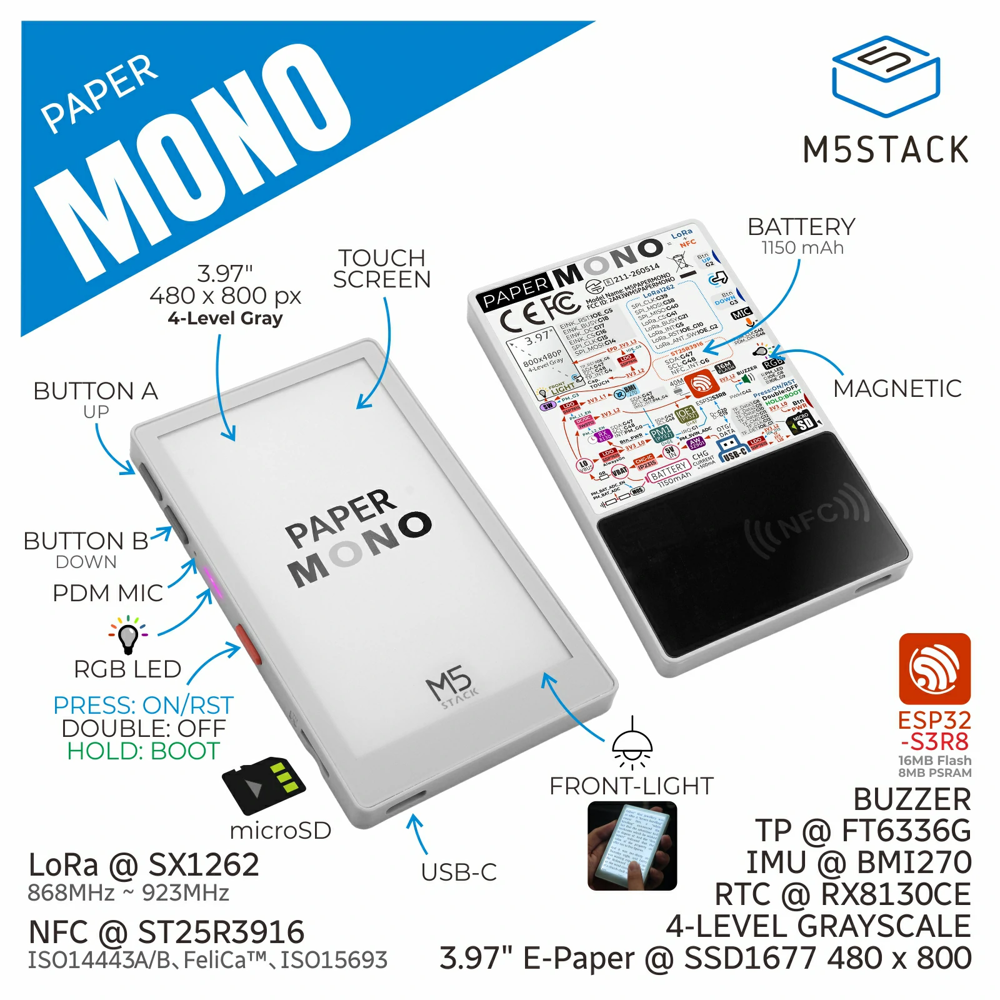

# M5Stack PaperMono C153 Development Guide


[**View M5Stack M5Paper Mono C153 on OpenELAB**](https://openelab.io/products/m5stack-m5papermono-with-lora-nfc-800x480-3-97-eink-display)

**Model/family:** M5Stack M5Paper Mono C153 · **OpenELAB SKU:** `M5-C153`




_Manufacturer image: M5Stack._ [_Image source_](https://m5stack-doc.oss-cn-shenzhen.aliyuncs.com/1267/C153_PaperMono_main_pictures_01.webp)_._

[Product at OpenELAB](https://openelab.io/products/m5stack-m5papermono-with-lora-nfc-800x480-3-97-eink-display) · [Manufacturer wiki hub](./)

## Product and model scope

**M5Stack PaperMono C153** is an ESP32-S3 ePaper development device for reading interfaces, battery information terminals, identification prototypes and radio-linked status displays. It is separate from the original M5Paper and PaperS3; those boards' display drivers, pin maps and power arrangements must not be assumed compatible.

## Hardware specifications

| Item              | PaperMono                                                              |
| ----------------- | ---------------------------------------------------------------------- |
| MCU/memory        | ESP32-S3R8; 16 MB flash; 8 MB octal PSRAM                              |
| Display           | 3.97-inch monochrome, four gray levels; 480 × 800 pixels; SSD1677      |
| Local input       | FT6336G touch, two user buttons and frontlight                         |
| Wireless          | 2.4 GHz Wi-Fi                                                          |
| Battery           | 1150 mAh                                                               |
| First-run supply  | USB-C, 5 V                                                             |
| Other peripherals | BMI270, RTC, microphone/buzzer, microSD, NFC ST25R3916 and SX1262 LoRa |

Source: [manufacturer hardware reference](https://docs.m5stack.com/en/core/PaperMono). Use the schematic and dimensions linked below for wiring and mechanical work. Battery capacity is a component specification, not a measured application runtime.

## Development environment

Install Arduino IDE and the [M5Stack board package](https://docs.m5stack.com/en/arduino/arduino_board), then select **M5PaperMono**. Install **M5Unified, M5GFX, M5PM1 and M5IOE1; add M5UnitUnified/M5Unit-NFC/RadioLib for their peripherals** and accept their dependencies. Record the board-package and library versions alongside your project.

The [PaperMono Arduino guide](https://docs.m5stack.com/en/arduino/papermono/program) is the primary reference for the preset, download mode and current dependency requirements. A generic ESP32-S3 preset can build a sketch while selecting the wrong display/power configuration. UiFlow2 and the factory firmware are alternative applications with their own setup procedures.

## Getting started: one static display update

Prepare the device, a USB-C data cable and a computer. This example needs no Wi-Fi account. It replaces the application currently on the device; keep a recovery reference and export needed settings first.

1. Connect USB-C and select the board's actual port in Arduino IDE. If it is not visible, use the manufacturer's power/reset download-mode operation and check again.
2. Select **M5PaperMono** and the installed compatible M5Unified/M5GFX libraries. Retain the model preset's memory settings for the first test.
3. Create a new sketch with the following code. It draws into an off-screen canvas and pushes a single static page, avoiding an application loop that continuously redraws ePaper.

```cpp
#include <M5Unified.h>

M5Canvas canvas(&M5.Display);

void setup() {
    auto cfg = M5.config();
    cfg.clear_display = false;
    M5.begin(cfg);
    M5.Display.setEpdMode(epd_mode_t::epd_quality);

    canvas.createSprite(M5.Display.width(), M5.Display.height());
    canvas.fillSprite(WHITE);
    canvas.setTextColor(BLACK);
    canvas.setTextSize(2);
    canvas.setCursor(16, 16);
    canvas.println("PaperMono ready");
    canvas.pushSprite(0, 0);
}

void loop() {
    M5.update();
    delay(100);
}
```

4. Verify and upload, restart into the application if necessary, and wait for the complete refresh. Check that the new label is legible with the intended orientation. Change the label and upload again to distinguish a new frame from an old retained image.

Expected result: a settled white page with the black test label. A retained image after power-off is normal ePaper behavior. This checks the upload/display path, not every fitted peripheral. The API sequence is based on the official M5Unified/M5GFX example pattern; it remains uncompiled and untested on physical hardware for this guide.

## Touch, NFC, LoRa and refresh limits

This guide covers **C153**, including its NFC and LoRa hardware. PaperMono-Lite is a separate configuration and must not inherit those capabilities. Use the maintained NFC and RadioLib examples for the fitted hardware; confirm radio configuration and antenna requirements before transmitting.

M5Stack's panel guidance recommends a full refresh after roughly ten partial fast refreshes. Use the supplied waveform behavior and avoid indefinite rapid partial refresh. The documented active touch area is inset from the panel edges; keep controls away from extreme edge coordinates and test the actual reachable area.

For sleep/frontlight control, follow the M5PM1/M5IOE1 guide and record which rails remain enabled. A working display does not by itself validate NFC, LoRa, microphone or measured sleep current.

## Recovery and troubleshooting

| Symptom                              | Check and next step                                                                                     |
| ------------------------------------ | ------------------------------------------------------------------------------------------------------- |
| No serial port                       | Known data cable, power, correct model's download-mode sequence and host USB/driver status.             |
| Sketch builds but panel is unchanged | Exact board preset, compatible library versions, normal application boot and time for full refresh.     |
| Canvas allocation or graphics fails  | PSRAM/preset selection and buffer size; begin with the model's stock example.                           |
| Old image remains when switched off  | Expected retained-image behavior; verify live operation with a deliberately changed label.              |
| Peripheral is absent                 | Match fitted hardware, power rail, pin map and model-specific example before combining features.        |
| Need original behavior               | Follow the manufacturer's factory restoration path for C153; save needed configuration before flashing. |

For support, provide board revision, board-package/library versions, firmware/commit, the minimal failing sketch and actual compiler/serial output.

## Technical documents and software

| Resource                                                                                                     | Use                                           |
| ------------------------------------------------------------------------------------------------------------ | --------------------------------------------- |
| [Hardware reference](https://docs.m5stack.com/en/core/PaperMono)                                             | Model specifications, pin map and peripherals |
| [Arduino quick-start](https://docs.m5stack.com/en/arduino/papermono/program)                                 | Exact board preset and dependencies           |
| [Schematic](https://m5stack-doc.oss-cn-shenzhen.aliyuncs.com/1267/PaperMono_SCH_V0.6.2_20260522.pdf)         | Revision-specific electrical reference        |
| [Dimension drawing](https://m5stack-doc.oss-cn-shenzhen.aliyuncs.com/1267/C153_PaperMono_model_size.pdf)     | Mechanical envelope                           |
| [CAD/structure files](https://github.com/m5stack/M5_Hardware/tree/master/Products/C153_PaperMono/Structures) | Mechanical integration                        |
| [M5Unified](https://github.com/m5stack/M5Unified)                                                            | Arduino device API and examples               |
| [M5GFX](https://github.com/m5stack/M5GFX)                                                                    | Display/canvas APIs                           |
| [Factory firmware source](https://github.com/m5stack/M5PaperMono-UserDemo)                                   | Manufacturer application reference            |

**Review date:** 17 November 2026. **Validation:** official documentation and the cited software interfaces reviewed. Commands and examples have not been compiled or run on physical hardware by OpenELAB for this guide. Record your hardware revision, firmware, software versions and actual results when reproducing it.
