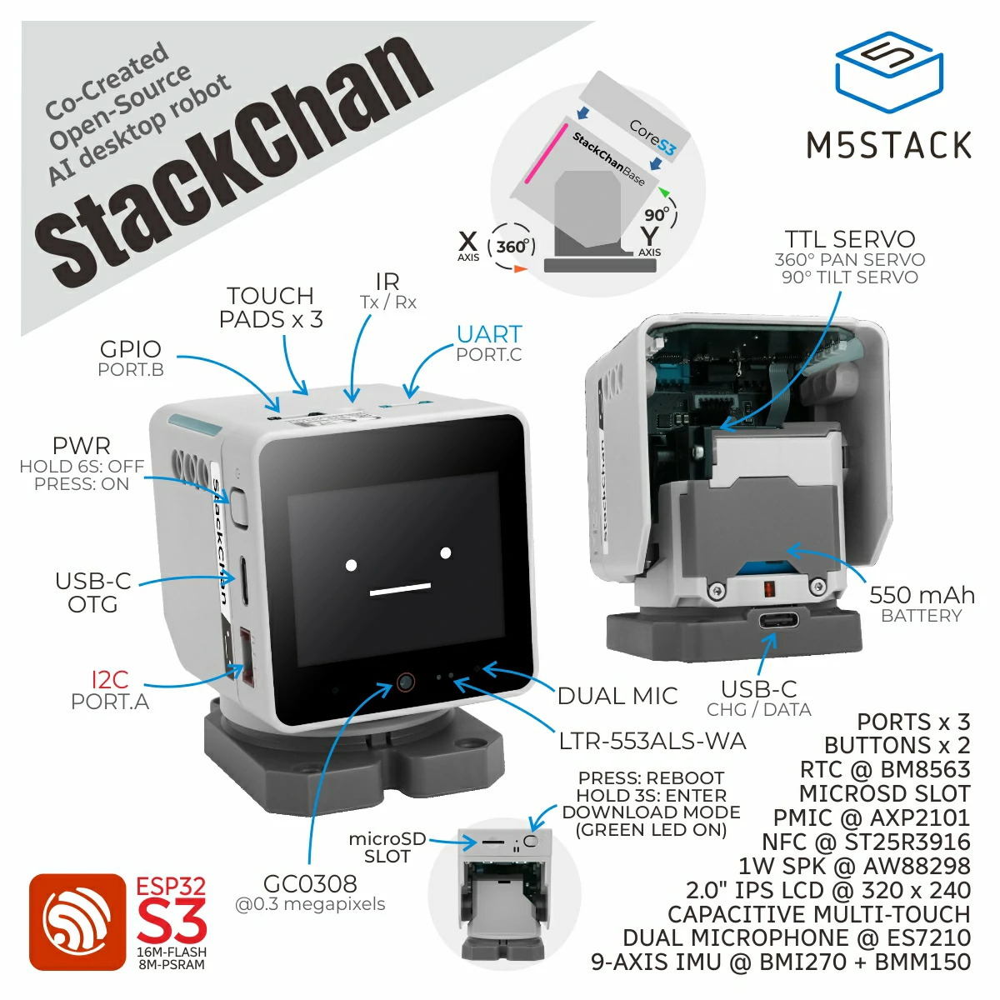
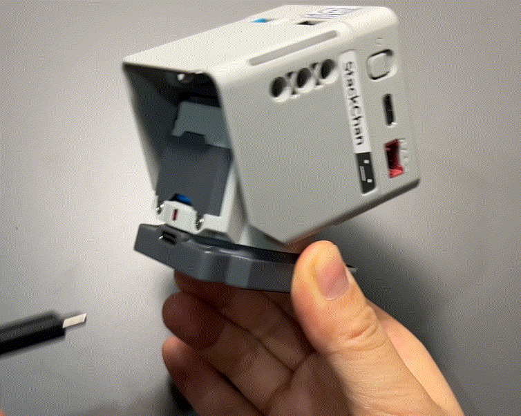
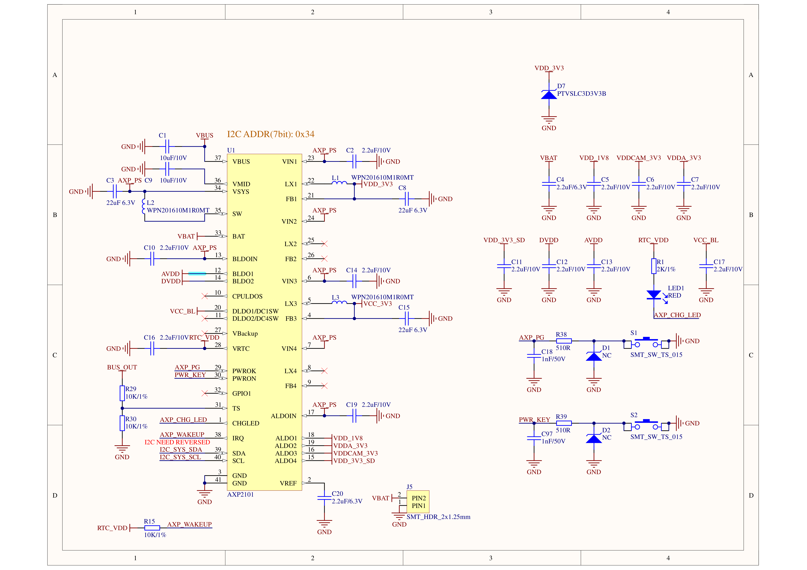

# M5Stack StackChan K151 Development Guide


[**View M5Stack StackChan K151 on OpenELAB**](https://openelab.io/products/m5stack-stackchan-open-source-ai-desktop-robot)

**Model:** StackChan K151 · **SKU:** `M5-K151`


## Product overview

**Build a programmable desktop character with an ESP32-S3 controller, touch display, camera, audio, RGB lighting and two motorized axes.** This guide covers the **M5Stack StackChan K151**. It starts with an offline LED test, then points to motion, sensing and connected applications.



_Product photograph: M5Stack._ [_Original image_](https://m5stack-doc.oss-cn-shenzhen.aliyuncs.com/1205/K151_stack_chan_main_pictures_01.webp)_._

[Buy StackChan at OpenELAB](https://openelab.io/products/m5stack-stackchan-open-source-ai-desktop-robot) · [M5Stack wiki hub](./) · [Manufacturer documentation](https://docs.m5stack.com/en/StackChan)

### Product overview and applications

StackChan combines a CoreS3 main controller with a robot body containing feedback servos, a battery, lighting and additional interfaces. Developers can combine facial animation, touch input, sound and physical movement in one device. The official Arduino board support package exposes the body peripherals alongside M5Unified's controller functions.

Useful development directions include a touch-operated desk assistant, an expressive notification terminal, an interactive classroom robot and a prototype interface for a connected service. These are project ideas; each requires its own application code and integration work.

The factory application offers a separate connected experience. An ESP32-S3 controller and microphone do not by themselves provide an offline large language model. Check the selected firmware's network, account and backend requirements before planning a voice assistant deployment. A self-contained Arduino application, including the LED example below, can run without an AI service.

**Model scope:** K151 is the robot. K151-R is a different package with remote-control accessories. Check the purchased package before following accessory-specific instructions. A generic CoreS3 replacement should not be assumed to have the original StackChan controller's factory provisioning.

Sources: [official BSP overview](https://github.com/m5stack/StackChan-BSP/blob/e2f3b02dbe7f28e26a02adc72bef3aa2c545e4a0/README.md), [factory firmware project](https://github.com/m5stack/StackChan), [manufacturer model notes](https://docs.m5stack.com/en/StackChan).

## Applications

Use StackChan K151 for expressive desktop interfaces, interactive exhibits and a local sensor-driven character. Commission motion, audio and cloud services as separate subsystems.

## Specifications

### Key specifications

| Item              | Specification                                                                       |
| ----------------- | ----------------------------------------------------------------------------------- |
| Main controller   | CoreS3 with ESP32-S3, dual-core processor up to 240 MHz                             |
| Memory            | 16 MB flash; 8 MB PSRAM                                                             |
| Wireless          | 2.4 GHz Wi-Fi and Bluetooth Low Energy                                              |
| Display           | 2.0-inch, 320 × 240 capacitive touch display                                        |
| Camera            | GC0308, VGA 640 × 480                                                               |
| Audio             | Two microphones and a 1 W speaker                                                   |
| Main-unit sensors | Nine-axis inertial sensing; proximity and ambient-light sensing                     |
| Movement          | Two feedback servos; continuous horizontal rotation and nominal 90° vertical travel |
| Body interaction  | 12 RGB LEDs, three-zone top touch input, infrared transmitter/receiver and NFC      |
| Battery           | 550 mAh built-in battery                                                            |
| Connections       | Two USB-C interfaces for power/data; Grove expansion ports                          |
| Envelope and mass | 54 × 70.5 × 61.5 mm; 187.2 g                                                        |

Sources: [BSP overview](https://github.com/m5stack/StackChan-BSP/blob/e2f3b02dbe7f28e26a02adc72bef3aa2c545e4a0/README.md), [CoreS3 specifications](https://docs.m5stack.com/en/core/CoreS3), [mechanical dimensions](https://m5stack-doc.oss-cn-shenzhen.aliyuncs.com/1205/Model_Size.pdf). Dimensions are the manufacturer's nominal product dimensions; use the drawing/CAD for enclosure design. Battery capacity is not a runtime guarantee.

## Hardware and connections

### Hardware orientation and expansion

Use the **USB-C connector on the robot base** for the first programming session. Route the cable so it cannot catch when the head moves. Place the robot on a clear, stable surface; the factory application can move the head during startup. Keep fingers and cables clear of the moving joints.

The bottom RST button also enters download mode. Its location and the green indicator are shown in the manufacturer's animation:



_Animation: M5Stack._ [_Original download-mode demonstration_](https://m5stack-doc.oss-cn-shenzhen.aliyuncs.com/1205/stackchan-download-mode-demo.gif)_._

For external modules, match the signal pins as well as the connector shape:

| Grove port | Black | Red | Yellow signal | White signal |
| ---------- | ----- | --- | ------------- | ------------ |
| A          | GND   | 5 V | G2            | G1           |
| B          | GND   | 5 V | G9            | G8           |
| C          | GND   | 5 V | G17           | G18          |

The red wire's supply voltage does not establish the allowable voltage on a GPIO signal. Check the controller and attached module's electrical requirements before connecting an external circuit. Internal peripherals already occupy other pins; use the manufacturer's pin map and schematics when extending the hardware.

Source: [StackChan interfaces and pin map](https://docs.m5stack.com/en/StackChan).

### LCD revision and M5GFX compatibility

StackChan units using the LCD change dated **7 August 2026** switch from ILI9342C to ILI9342E. M5Stack specifies **M5GFX 0.2.27 or later** for that revision. Record the actual unit revision and library version when diagnosing a blank display after an otherwise successful upload. This minimum applies to the documented newer LCD; it is not a substitute for checking the rest of the project dependencies. [Manufacturer version history](https://docs.m5stack.com/en/StackChan).

### Body bus allocation

| Body function                 | Route / condition                                     |
| ----------------------------- | ----------------------------------------------------- |
| Servo serial                  | ESP32-S3 TX6, RX7; separate from Grove serial         |
| IR send / receive             | GPIO5 / GPIO10                                        |
| Body I2C                      | SDA12 / SCL11, shared with CoreS3 internal system bus |
| Body expander                 | PY32L020, default address0x6F; strap alternative0x71  |
| Battery monitor / NFC / touch | INA2260x41 / ST25R39160x50 / Si12T0x68                |
| Expander outputs              | IO1 servo power, IO14 RGB data control                |

Use the BSP to initialize these functions; an ACK from0x6F is not proof of safe servo calibration. The top touch sensor and screen touch are different input devices. [Exact body pin map](https://docs.m5stack.com/en/StackChan#pinmap).



_M5Stack official technical illustration:_ [_original_](https://m5stack-doc.oss-cn-shenzhen.aliyuncs.com/490/Sch_M5_CoreS3_v1.0_page_01.png)_. Verify drawing and physical revision together._

## Software and development resources

### Choose a software path

| Path                  | Use it for                                                         | Start here                                                                                                                                                                        |
| --------------------- | ------------------------------------------------------------------ | --------------------------------------------------------------------------------------------------------------------------------------------------------------------------------- |
| Arduino C++           | Custom behavior and direct peripheral control                      | This guide and the [official Arduino setup](https://docs.m5stack.com/en/arduino/stackchan/program)                                                                                |
| UiFlow2 / MicroPython | Block-based exploration or Python scripting                        | [UiFlow2 setup](https://docs.m5stack.com/en/uiflow2/stackchan/program) and [StackChan Python API](https://uiflow-micropython.readthedocs.io/en/latest/controllers/stackchan.html) |
| Factory application   | Manufacturer demos, supported app functions and connected services | [Factory usage guide](https://docs.m5stack.com/en/StackChan) and [firmware download](https://burner.m5stack.com/device/stackchan)                                                 |

Uploading an Arduino sketch replaces the application currently running on the controller. Record the current firmware/package first if you plan to return to it. Configuration and account requirements depend on the application; consult that application's restoration instructions.

## Getting started

### Getting started: an offline RGB test

**Goal:** compile and upload a small C++ application, initialize the robot body and cycle its LEDs. This provides a first checkpoint before adding networking, audio or movement.

1. **Prepare the hardware and tools**

You need a K151 robot, a computer, a USB-C **data** cable and Arduino IDE 2.x. No cloud account or Wi-Fi connection is required by this sketch. Charge/power the device before testing.

In Arduino IDE, add the following URL to **Preferences → Additional Boards Manager URLs**:

```
https://static-cdn.m5stack.com/resource/arduino/package_m5stack_index.json
```

In Boards Manager, install the **M5Stack** board package. The manufacturer's StackChan RGB guide specifies **3.2.2 or later**. Select **M5Stack → M5CoreS3** and the port belonging to the connected robot. Begin with that board preset's defaults; if uploading fails, follow the download-mode procedure below before changing unrelated options.

Sources: [official board-package installation](https://docs.m5stack.com/en/arduino/arduino_board), [StackChan board selection](https://docs.m5stack.com/en/arduino/stackchan/program), [RGB example requirements](https://docs.m5stack.com/en/arduino/stackchan/rgb).

2. **Install the board support library**

Install **M5StackChan** through Library Manager and accept its dependencies: **M5Unified**, **IRremoteESP8266** and **M5Unit-NFC**. This guide's API checks use M5StackChan **1.1.1**, as declared in the source snapshot below. Record the actual versions installed when reproducing the example.

If that version is unavailable in Library Manager, the [pinned BSP source ZIP](https://github.com/m5stack/StackChan-BSP/archive/e2f3b02dbe7f28e26a02adc72bef3aa2c545e4a0.zip) can be installed through **Sketch → Include Library → Add .ZIP Library**. Install the dependencies separately if prompted. Keep one installation of each library to avoid selecting an older duplicate.

Sources: [library metadata and dependencies](https://github.com/m5stack/StackChan-BSP/blob/e2f3b02dbe7f28e26a02adc72bef3aa2c545e4a0/library.properties), [BSP public API](https://github.com/m5stack/StackChan-BSP/blob/e2f3b02dbe7f28e26a02adc72bef3aa2c545e4a0/src/M5StackChan.h).

3. **Upload the example**

Create a new sketch and paste the following code. It sends no movement commands and disables servo power immediately after initialization. **Initialization itself enables servo power temporarily**, so keep the mechanism unobstructed even for this LED test.

```cpp
#include <Arduino.h>
#include <M5StackChan.h>

// OpenELAB example using M5Stack's MIT-licensed StackChan BSP.
// API reference: M5StackChan 1.1.1, commit e2f3b02.

const uint8_t COLORS[3][3] = {
    {24, 0, 0},  // red
    {0, 24, 0},  // green
    {0, 0, 24}   // blue
};

void setup() {
    M5StackChan.begin();
    M5StackChan.setServoPowerEnabled(false);
    M5StackChan.showRgbColor(0, 0, 0);
}

void loop() {
    M5StackChan.update();

    static uint32_t previous = 0;
    static uint8_t color = 0;
    const uint32_t now = millis();

    if (now - previous >= 1000) {
        previous = now;
        M5StackChan.showRgbColor(
            COLORS[color][0], COLORS[color][1], COLORS[color][2]);
        color = (color + 1) % 3;
    }
    delay(5);
}
```

Click **Verify**, then **Upload**. If the device does not enter the bootloader automatically, use the recovery procedure in the next section and select the port again. After upload, reset/power-cycle the robot if the IDE leaves it in download mode.

4. **Check the result**

The expected result is that all 12 body LEDs change together, cycling red → green → blue approximately once per second. This sketch does not draw a face, play sound or connect to Wi-Fi; a blank display is compatible with this particular test.

A successful test checks the application upload path and RGB control. It does not validate the camera, microphones, NFC, battery runtime or servo mechanics. Add those subsystems individually using the official examples so a failure has a clear starting point.

The source calls and initialization behavior were checked against [M5StackChan.h](https://github.com/m5stack/StackChan-BSP/blob/e2f3b02dbe7f28e26a02adc72bef3aa2c545e4a0/src/M5StackChan.h) and [M5StackChan.cpp](https://github.com/m5stack/StackChan-BSP/blob/e2f3b02dbe7f28e26a02adc72bef3aa2c545e4a0/src/M5StackChan.cpp). This example still requires compilation and physical-device validation before it can be described as tested.

### Developing movement and other peripherals

For motion, read the [official servo guide](https://docs.m5stack.com/en/arduino/stackchan/servo) before enabling servo power. Its API uses **0.1° units**: a command value of 450 represents 45°. M5Stack recommends keeping vertical movement within **5–85°**; convert this to **50–850** when using that API. Mechanical travel limits are different from safe starting positions.

Begin with a small movement near the current position, a clear workspace and conservative speed. Do not copy an endpoint-sweeping example into an assembled or modified mechanism without checking its limits. Never force a powered joint by hand. Re-homing/calibration changes the coordinate reference; follow the official calibration procedure only when needed.

For the next development steps, use the BSP's [examples directory](https://github.com/m5stack/StackChan-BSP/tree/e2f3b02dbe7f28e26a02adc72bef3aa2c545e4a0/examples) for body peripherals and [M5Unified](https://github.com/m5stack/M5Unified) for controller functions. Keep one small, reproducible test per subsystem before combining movement, sound and networking into a larger application.

### Commission each subsystem before a character application

| Test              | Procedure and expected result                                                                                                                                                                                                           |
| ----------------- | --------------------------------------------------------------------------------------------------------------------------------------------------------------------------------------------------------------------------------------- |
| Display and touch | Use the CoreS3/M5Unified display/touch example; render corner markers and compare touched coordinates after changing rotation. Newer ILI9342E units need M5GFX≥0.2.27.                                                                  |
| Top touch         | Start with the BSP touch example and touch each of the three top zones separately; log one press/release cycle per gesture. Do not use screen coordinates for these zones.                                                              |
| Body NFC          | Use the BSP/NFC example with an owned supported test tag. Record protocol/UID and remove/re-present the tag. Tag detection does not prove a protected block can be read.                                                                |
| Audio/camera      | Test a moderate speaker tone, then microphone capture and a static GC0308 frame separately. Compare image dimensions before adding network streaming.                                                                                   |
| Battery/current   | Read INA226 status with servo power disabled, then compare another known load state; record whether USB is present. Do not infer remaining runtime from one current sample.                                                             |
| Motion            | Keep the cable clear, establish the current home reference, then request a small movement near mid-travel. `Motion.move` uses tenths of degrees; speed is a driver value, not degrees/second. Stop motion before disabling servo power. |

The servo guide's example includes endpoints at0° and90° while its accompanying note recommends5–85° vertical operation. Use the conservative50–850 API-unit boundary for custom vertical commands, with a smaller starting move; do not interpret the example sweep as a continuous safe operating range. [Official servo API](https://docs.m5stack.com/en/arduino/stackchan/servo).

### Factory application, pairing and recovery checkpoints

Restore **StackChan-UserDemo** only after saving needed configuration, then use the current manufacturer's mobile-app setup with Bluetooth and local-network permissions enabled. Pair the robot and select an authorized2.4GHz network; establish its connected state before testing a voice agent. The factory UI separates AI Agent, Avatar communication, App Center, EZData, Dance and Setup. Start with a local face/menu interaction, then one connected feature. ESP-NOW remote operation requires the K151-R controller or separately configured compatible hardware; K151 itself does not include that remote.

For a pairing failure, restart both app and device, confirm permissions and network band, and use the app's actual bind/unbind flow. For a poor voice response, check microphone pickup, wake-word state, backend/account provisioning and Wi-Fi separately. A replacement generic CoreS3 may lack the original product provisioning. Factory service names and enrollment steps can change, so follow the [current factory-use and troubleshooting sections](https://docs.m5stack.com/en/StackChan) when changing account bindings. Never erase calibration merely to fix network pairing.

## Troubleshooting and FAQs

### Firmware recovery and return to factory software

If no upload port appears, first try a known data cable and a direct computer USB connection. To enter download mode, connect through the base USB-C port and hold the bottom **RST** button until the green indicator appears. Release the button, recheck the port list and retry the upload. The manufacturer's animation above shows the physical operation.

To restore the manufacturer's application, open **M5Burner**, select the official **StackChan-UserDemo** entry for K151/K151-R, and follow its current flashing instructions. After a successful flash, restart the robot and complete the setup for that firmware. Avoid an indiscriminate full flash erase: retain configuration/calibration information unless the manufacturer specifically instructs you to erase it.

References: [download-mode instructions](https://docs.m5stack.com/en/arduino/stackchan/program), [official StackChan firmware entry](https://burner.m5stack.com/device/stackchan). M5Stack notes that its [public factory-project repository](https://github.com/m5stack/StackChan) may lag released firmware, so distinguish repository builds from the application distributed through M5Burner.

### Symptom checks

| Symptom or question                                        | Check and next action                                                                                                                                                                                                                                                        |
| ---------------------------------------------------------- | ---------------------------------------------------------------------------------------------------------------------------------------------------------------------------------------------------------------------------------------------------------------------------- |
| No USB port appears                                        | Check power, use a data cable, connect directly to the computer, then enter download mode. Re-select the port after the bootloader enumerates.                                                                                                                               |
| `M5StackChan.h` is missing                                 | Install M5StackChan and its declared dependencies. Check for duplicate/old library folders and confirm the M5CoreS3 board selection.                                                                                                                                         |
| Upload succeeds but there is no face                       | The RGB test does not render a display interface. Check the LED sequence first; use the manufacturer's application for its animated interface.                                                                                                                               |
| LEDs remain off                                            | Confirm the new sketch starts after reset. Recheck the correct BSP/version and the body connection with power off. The BSP logs `IO expander init timeout` if body I/O initialization does not complete; inspect the initialization path before adding application features. |
| Servos do not move with this sketch                        | Servo power is intentionally disabled. Use the servo tutorial as a separate test and respect the vertical limits.                                                                                                                                                            |
| Factory app cannot join Wi-Fi                              | Use a 2.4 GHz network and check the app's Bluetooth/local-network permissions. Follow the factory pairing flow; the Arduino test does not implement pairing.                                                                                                                 |
| Is the factory AI experience available offline?            | Check the particular firmware's service requirements. The offline RGB example demonstrates local hardware control, not offline conversational AI.                                                                                                                            |
| Can another CoreS3 simply replace the supplied controller? | Physical compatibility does not establish factory-app provisioning compatibility. Check M5Stack's controller-replacement guidance first.                                                                                                                                     |
| What information helps reproduce a failure?                | Record K151/K151-R, board package and library versions, firmware name, USB port used, the smallest failing sketch, and actual compiler/serial output. Never include Wi-Fi passwords or service credentials.                                                                  |

References: [BSP initialization source](https://github.com/m5stack/StackChan-BSP/blob/e2f3b02dbe7f28e26a02adc72bef3aa2c545e4a0/src/M5StackChan.cpp), [factory setup and FAQ](https://docs.m5stack.com/en/StackChan), [Arduino setup](https://docs.m5stack.com/en/arduino/stackchan/program).

## Downloads and technical documents

### Drawings, software and technical resources

| Resource                                                                                                               | Engineering use                                                               |
| ---------------------------------------------------------------------------------------------------------------------- | ----------------------------------------------------------------------------- |
| [StackChan documentation](https://docs.m5stack.com/en/StackChan)                                                       | Product identity, interfaces, setup notes and manufacturer FAQ                |
| [CoreS3 reference](https://docs.m5stack.com/en/core/CoreS3)                                                            | Main-controller hardware, onboard devices and electrical references           |
| [CoreS3 schematic, PDF](https://m5stack-doc.oss-cn-shenzhen.aliyuncs.com/490/Sch_M5_CoreS3_v1.0.pdf)                   | Controller circuit reference; verify the revision against the actual hardware |
| [Adapter schematic, PDF](https://m5stack-doc.oss-cn-shenzhen.aliyuncs.com/1205/SCH_Adapter.pdf)                        | Adapter circuitry                                                             |
| [Power schematic, PDF](https://m5stack-doc.oss-cn-shenzhen.aliyuncs.com/1205/SCH_Power.pdf)                            | Body power circuitry                                                          |
| [Ring schematic, PDF](https://m5stack-doc.oss-cn-shenzhen.aliyuncs.com/1205/SCH_Ring.pdf)                              | RGB/peripheral ring circuitry                                                 |
| [Touch schematic, PDF](https://m5stack-doc.oss-cn-shenzhen.aliyuncs.com/1205/SCH_Touch.pdf)                            | Top touch-board circuitry                                                     |
| [Dimension drawing, PDF](https://m5stack-doc.oss-cn-shenzhen.aliyuncs.com/1205/Model_Size.pdf)                         | Mechanical dimensions                                                         |
| [Official structural/CAD files](https://github.com/m5stack/M5_Hardware/tree/master/Products/K151_StackChan/Structures) | Mechanical integration and enclosure work                                     |
| [Arduino BSP, pinned source](https://github.com/m5stack/StackChan-BSP/tree/e2f3b02dbe7f28e26a02adc72bef3aa2c545e4a0)   | Reproduce the API snapshot used for this draft                                |
| [Latest Arduino BSP](https://github.com/m5stack/StackChan-BSP)                                                         | Releases, issue tracking and current examples; upstream is MIT licensed       |
| [UiFlow2 StackChan API](https://uiflow-micropython.readthedocs.io/en/latest/controllers/stackchan.html)                | MicroPython peripheral programming                                            |
| [Factory application source](https://github.com/m5stack/StackChan)                                                     | Advanced application investigation; observe upstream release caveats          |
| [Official factory firmware](https://burner.m5stack.com/device/stackchan)                                               | Return to the manufacturer-distributed application                            |

**Documentation review:** 17 November 2026. **Opening product-link and heading update:** 18 November 2026. **Validation status:** manufacturer documentation, drawings and SDK source reviewed; the example has not yet been compiled or run on physical hardware. Bench validation remains pending.

### Official documentation and development resources

Use [StackChan](https://docs.m5stack.com/en/StackChan) for the manufacturer's complete model reference, diagrams and maintained examples. The official product code is **`K151/K151-R`**; match the board/Unit label before choosing a firmware or host example. The references below complement this guide's local instructions.

| Development need             | Model-specific reference                                                                                                                     |
| ---------------------------- | -------------------------------------------------------------------------------------------------------------------------------------------- |
| UIFlow2 workflow             | [Read uiflow2 workflow](https://docs.m5stack.com/en/uiflow2/stackchan/program)                                                               |
| Arduino development tutorial | [Read arduino development tutorial](https://docs.m5stack.com/en/arduino/stackchan/program)                                                   |
| Electrical schematic         | [Read electrical schematic](https://m5stack-doc.oss-cn-shenzhen.aliyuncs.com/490/Sch_M5_CoreS3_v1.0.pdf)                                     |
| Electrical schematic         | [Read electrical schematic](https://m5stack-doc.oss-cn-shenzhen.aliyuncs.com/1205/SCH_Adapter.pdf)                                           |
| Electrical schematic         | [Read electrical schematic](https://m5stack-doc.oss-cn-shenzhen.aliyuncs.com/1205/SCH_Power.pdf)                                             |
| Electrical schematic         | [Read electrical schematic](https://m5stack-doc.oss-cn-shenzhen.aliyuncs.com/1205/SCH_Ring.pdf)                                              |
| Electrical schematic         | [Read electrical schematic](https://m5stack-doc.oss-cn-shenzhen.aliyuncs.com/1205/SCH_Touch.pdf)                                             |
| Mechanical / CAD files       | [Read mechanical / cad files](https://github.com/m5stack/M5_Hardware/tree/master/Products/K151_StackChan/Structures)                         |
| Mechanical / CAD files       | [Read mechanical / cad files](https://github.com/m5stack/M5_Hardware/blob/master/Products/K151_StackChan/Structures/StackChan-Base.stl)      |
| Mechanical / CAD files       | [Read mechanical / cad files](https://github.com/m5stack/M5_Hardware/blob/master/Products/K151_StackChan/Structures/StackChan-BaseCover.stl) |

Keep the example's host model, interface pins and dependency versions together when reproducing a result. A schematic or SDK link does not establish that another revision uses the same wiring. Official model pages and accessible tutorial links reviewed **23 November 2026**. Other downloads above are manufacturer-listed resources; listing a file is not a test of its contents. Compilation, firmware flashing and hardware operation were **not performed** in this review.

| Official file or repository                                                                                                                                   | Use                                                                                          |
| ------------------------------------------------------------------------------------------------------------------------------------------------------------- | -------------------------------------------------------------------------------------------- |
| [StackChan Host CoreS3 Schematic PDF](https://m5stack-doc.oss-cn-shenzhen.aliyuncs.com/490/Sch_M5_CoreS3_v1.0.pdf)                                            | Manufacturer-listed exact model document / maintained source; use the scope described above. |
| [StackChan Base Adapter Board Schematic PDF](https://m5stack-doc.oss-cn-shenzhen.aliyuncs.com/1205/SCH_Adapter.pdf)                                           | Manufacturer-listed exact model document / maintained source; use the scope described above. |
| [StackChan Base Power Board Schematic PDF](https://m5stack-doc.oss-cn-shenzhen.aliyuncs.com/1205/SCH_Power.pdf)                                               | Manufacturer-listed exact model document / maintained source; use the scope described above. |
| [StackChan Base Ring Board Schematic PDF](https://m5stack-doc.oss-cn-shenzhen.aliyuncs.com/1205/SCH_Ring.pdf)                                                 | Manufacturer-listed exact model document / maintained source; use the scope described above. |
| [StackChan Base Touch Board Schematic PDF](https://m5stack-doc.oss-cn-shenzhen.aliyuncs.com/1205/SCH_Touch.pdf)                                               | Manufacturer-listed exact model document / maintained source; use the scope described above. |
| [StackChan Whole Device Model Size PDF](https://m5stack-doc.oss-cn-shenzhen.aliyuncs.com/1205/Model_Size.pdf)                                                 | Manufacturer-listed exact model document / maintained source; use the scope described above. |
| [StackChan Remote Controller Model Size PDF](https://m5stack-doc.oss-cn-shenzhen.aliyuncs.com/1205/u156hatminijoyc.pdf)                                       | Manufacturer-listed exact model document / maintained source; use the scope described above. |
| [StackChan Structure Files](https://github.com/m5stack/M5_Hardware/tree/master/Products/K151_StackChan/Structures)                                            | Manufacturer-listed exact model document / maintained source; use the scope described above. |
| [Main Controller ESP32-S3](https://m5stack-doc.oss-cn-shenzhen.aliyuncs.com/490/esp32-s3_technical_reference_manual_en.pdf)                                   | Manufacturer-listed exact model document / maintained source; use the scope described above. |
| [Camera GC0308](https://m5stack.oss-cn-shenzhen.aliyuncs.com/resource/docs/datasheet/core/K128%20CoreS3/GC0308.PDF)                                           | Manufacturer-listed exact model document / maintained source; use the scope described above. |
| [Proximity and Ambient Light Sensor LTR-553ALS-WA](https://m5stack.oss-cn-shenzhen.aliyuncs.com/resource/docs/datasheet/core/K128%20CoreS3/LTR-553ALS-WA.PDF) | Manufacturer-listed exact model document / maintained source; use the scope described above. |
| [Accelerometer + Gyroscope BMI270](https://m5stack.oss-cn-shenzhen.aliyuncs.com/resource/docs/datasheet/core/K128%20CoreS3/BMI270.PDF)                        | Manufacturer-listed exact model document / maintained source; use the scope described above. |
| [Geomagnetic Sensor BMM150](https://m5stack.oss-cn-shenzhen.aliyuncs.com/resource/docs/datasheet/core/K128%20CoreS3/BMM150.PDF)                               | Manufacturer-listed exact model document / maintained source; use the scope described above. |
| [I2S Audio Amplifier AW88298](https://m5stack.oss-cn-shenzhen.aliyuncs.com/resource/docs/datasheet/core/K128%20CoreS3/AW88298.PDF)                            | Manufacturer-listed exact model document / maintained source; use the scope described above. |
| [Audio Codec ES7210](https://m5stack.oss-cn-shenzhen.aliyuncs.com/resource/docs/datasheet/core/K128%20CoreS3/ES7210.PDF)                                      | Manufacturer-listed exact model document / maintained source; use the scope described above. |
| [Power Management AXP2101](https://m5stack.oss-cn-shenzhen.aliyuncs.com/resource/docs/datasheet/core/K128%20CoreS3/AXP2101_Datasheet_V1.0_en.pdf)             | Manufacturer-listed exact model document / maintained source; use the scope described above. |
| [RTC BM8563](https://m5stack.oss-cn-shenzhen.aliyuncs.com/resource/docs/datasheet/core/K128%20CoreS3/BM8563.PDF)                                              | Manufacturer-listed exact model document / maintained source; use the scope described above. |
| [IO Expander AW9523B](https://m5stack.oss-cn-shenzhen.aliyuncs.com/resource/docs/products/core/CoreS3/AW9523B-EN.pdf)                                         | Manufacturer-listed exact model document / maintained source; use the scope described above. |
| [ILI9342E](https://m5stack-doc.oss-cn-shenzhen.aliyuncs.com/644/ILI9342E.pdf)                                                                                 | Manufacturer-listed exact model document / maintained source; use the scope described above. |
| [Servo Motor SCS0009](https://m5stack-doc.oss-cn-shenzhen.aliyuncs.com/1205/SCS0009.pdf)                                                                      | Manufacturer-listed exact model document / maintained source; use the scope described above. |
| [NFC ST25R3916](https://m5stack-doc.oss-cn-shenzhen.aliyuncs.com/1205/ST25R3916_EN.pdf)                                                                       | Manufacturer-listed exact model document / maintained source; use the scope described above. |
| [Touch Controller Si12T](https://m5stack-doc.oss-cn-shenzhen.aliyuncs.com/1205/Si12T_Datasheet_EN.pdf)                                                        | Manufacturer-listed exact model document / maintained source; use the scope described above. |
| [Infrared Receiver IRM56384](https://m5stack-doc.oss-cn-shenzhen.aliyuncs.com/1205/IRM56384.pdf)                                                              | Manufacturer-listed exact model document / maintained source; use the scope described above. |
| [Battery Monitor INA226](https://m5stack-doc.oss-cn-shenzhen.aliyuncs.com/1171/INA226.pdf)                                                                    | Manufacturer-listed exact model document / maintained source; use the scope described above. |
| [IO Expander PY32L020](https://m5stack-doc.oss-cn-shenzhen.aliyuncs.com/1205/PY32L020_Datasheet_EN.pdf)                                                       | Manufacturer-listed exact model document / maintained source; use the scope described above. |
| [StackChan - GitHub](https://github.com/m5stack/StackChan)                                                                                                    | Manufacturer-listed exact model document / maintained source; use the scope described above. |
| [StackChan BSP Driver Library](https://github.com/m5stack/StackChan-BSP)                                                                                      | Manufacturer-listed exact model document / maintained source; use the scope described above. |
| [StackChan UiFlow2 Docs](https://uiflow-micropython.readthedocs.io/en/latest/controllers/stackchan.html)                                                      | Manufacturer-listed exact model document / maintained source; use the scope described above. |

## References and validation

Exact-model [manufacturer hardware reference](https://docs.m5stack.com/en/StackChan) and model-specific software links in the procedures establish this guide's hardware scope. Electrical values are manufacturer-reported; external-project behavior and diagnostic order are original engineering guidance.

**Review:** 24 November 2026. Manufacturer documentation and the linked SDK interfaces were reviewed. **Compilation, firmware flashing and hardware operation: not run.** Expected results above are commissioning checkpoints, not observed bench measurements.
