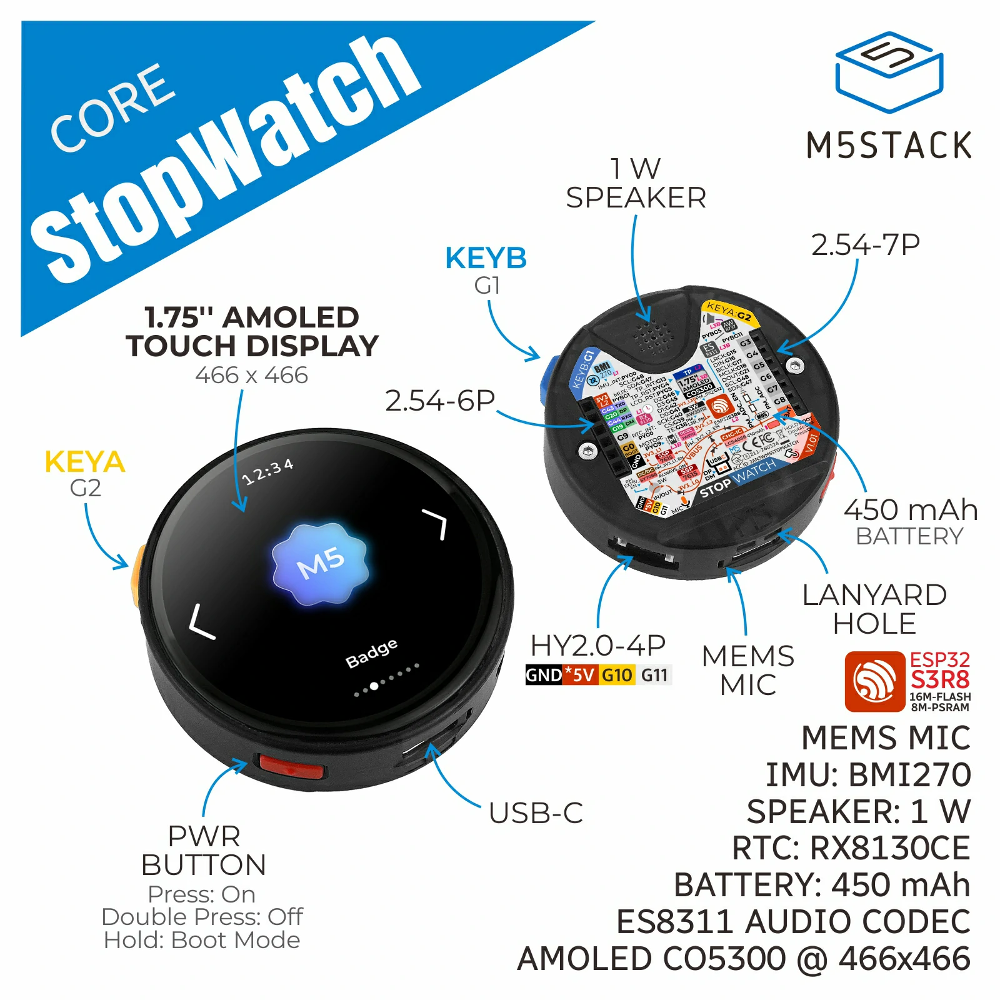
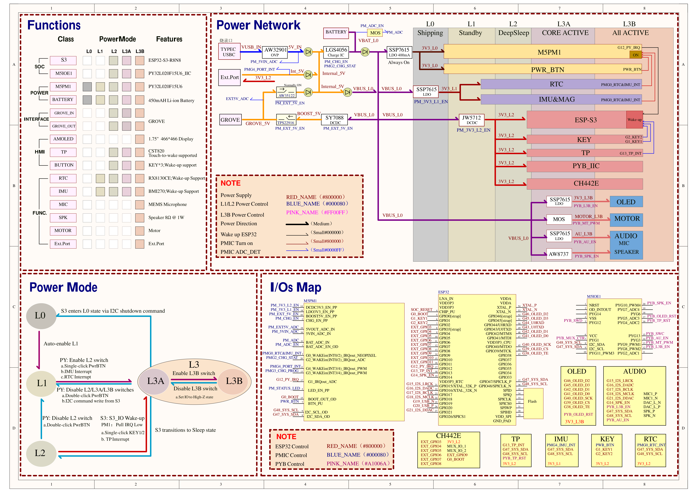

# M5Stack StopWatch C152 Development Guide


[**View M5Stack StopWatch C152 on OpenELAB**](https://openelab.io/products/m5stack-stopwatch-dev-kit-esp32-s3)

**Model:** StopWatch C152 · **SKU:** `M5-C152`


## Product overview



_Manufacturer image: M5Stack._ [_Image source_](https://m5stack-doc.oss-cn-shenzhen.aliyuncs.com/1242/C152_stopwatch_mainpictures_01.webp)_._

[Product at OpenELAB](https://openelab.io/products/m5stack-stopwatch-dev-kit-esp32-s3) · [Manufacturer wiki hub](./)

### Product and revision check

**M5Stack StopWatch C152** is a compact ESP32-S3 handheld development device with a round AMOLED touchscreen. It suits a portable control panel, electronic badge, timer interface or sensor display. It includes audio, motion sensing and battery operation; application behavior is defined by the installed firmware.

**Check hardware revision before using the rear power pin.** M5Stack documents a v1.0 sticker error: a pin marked BAT on some units is actually **5 V IN**. In v1.0.1, the revised BAT pin is a battery connection. Do not connect a battery according to the sticker alone. Use USB-C for the first tutorial and compare the actual board/revision with the manufacturer's notice.

## Applications

Use StopWatch C152 for a handheld timer, touch-operated instrument or portable sensor UI. Keep AMOLED refresh and audio power in the battery budget.

## Specifications

### Specifications and interfaces

| Item         | Specification                                                           |
| ------------ | ----------------------------------------------------------------------- |
| Controller   | ESP32-S3R8, 16 MB flash, 8 MB PSRAM                                     |
| Display      | 1.75-inch round AMOLED, 466 × 466, touch input                          |
| User input   | Two programmable buttons, power control and vibration feedback          |
| Audio        | ES8311 codec, microphone and 1 W speaker path                           |
| Sensors/time | BMI270 IMU; RX8130CE RTC                                                |
| Power        | USB-C 5 V; built-in 450 mAh battery; M5PM1 management                   |
| Expansion    | HY2.0-4P port and rear header; verify revision-specific pin definitions |
| Size/mass    | 52 × 52 × 15.5 mm; 39 g                                                 |

The HY2.0-4P port is documented as GND/5 V/G10/G11. Rear multiplexed pins and power rails require the M5IOE1/M5PM1 configuration shown in the pin map. Do not infer always-on peripheral power or generic ESP32 pin availability from the connector alone.

Source: [M5Stack StopWatch hardware reference](https://docs.m5stack.com/en/core/StopWatch). Revision notes take priority over a generic wiring diagram.

## Hardware and connections

### Pin ownership and power layers

| Peripheral  | StopWatch route                                                 |
| ----------- | --------------------------------------------------------------- |
| System I2C  | SDA47 / SCL48; BMI2700x68, RX8130CE0x32, ES83110x18, M5IOE10x4F |
| AMOLED QSPI | CS39, clock40, TE38, D0/D1/D2/D3=41/42/46/45                    |
| Touch       | CST820B, interrupt13; reset via M5IOE1 PYG4                     |
| User A/B    | Yellow GPIO2 / blue GPIO1                                       |
| Audio I2S   | MCLK18, BCLK17, microphone data16, LRCK15, codec data input21   |
| Grove       | Black GND, red5V, yellow10, white11                             |
| Rear mux    | M5IOE1 PYG1 low: UART TX43/RX44; high: USB D+/D−20/19           |

AMOLED reset is PYG5, display power PYG8, audio rail PYG3, amplifier enable PYG10 and vibration PWM PYG9 on M5IOE1. These are expander channels, not ESP32 GPIO numbers. Default charging is185mA; the documented425mA configuration changes the PMIC's charge-program pin. Leave the default for first-run testing and consult the matched battery/thermal design before changing it. [Hardware map](https://docs.m5stack.com/en/core/StopWatch), [power API](https://docs.m5stack.com/en/arduino/stopwatch/m5pm1_m5ioe1).



_M5Stack official technical illustration:_ [_original_](https://m5stack-doc.oss-cn-shenzhen.aliyuncs.com/1242/C152-SCH_Stopwatch_PRJ_Main_VA_20251201_2026_04_24_17_46_22_page_02.png)_. Verify drawing and physical revision together._

## Software and development resources

### Software options

Arduino development uses **M5Unified** and **M5GFX**, with M5PM1/M5IOE1 support for power and expansion functions. UiFlow2 offers the manufacturer-supported visual/Python route. The factory firmware is an additional application that can be restored through its documented M5Burner workflow.

Use the [StopWatch-specific Arduino guide](https://docs.m5stack.com/en/arduino/stopwatch/program); a nearby ESP32-S3 board preset may compile while selecting the wrong display or power configuration.

## Getting started

### Getting started: run the official BarGraph example

Prepare StopWatch, a USB-C data cable, a computer and Arduino IDE 2.x.

1. Install the M5Stack board package using the [official board-manager setup](https://docs.m5stack.com/en/arduino/arduino_board). Select **M5StopWatch** in the board menu, then the device's serial port.
2. Install **M5Unified** and **M5GFX** through Library Manager and accept their dependencies. Record the selected versions. For explicit peripheral-power work, use the linked M5PM1 and M5IOE1 guides/libraries.
3. Open the official **BarGraph** example referenced by the StopWatch Arduino guide. Build it first. If the selected library installation lacks the example, follow the current manufacturer link rather than substituting a sketch for another display board.
4. Upload using a data cable. If automatic bootloader entry fails, hold the power/reset control until the green indicator signals download mode, release it and select the enumerated port again. Use the current manufacturer animation/instructions for the exact physical operation.
5. Restart into the application if necessary and inspect the graph rendering on the round screen. The first checkpoint is a working upload and correctly rendered display; it does not validate the speaker, IMU, battery or sleep current.

The example is linked rather than copied so the device-specific display initialization remains with its maintained upstream version. Save the working example/library versions before extending it.

### Add input, sensors and low-power behavior

Use `M5.update()` in an M5Unified application before reading button state. Add a single button or touch interaction to the known working display application, then test IMU, audio and RTC independently. Follow the [power-management guide](https://docs.m5stack.com/en/arduino/stopwatch/m5pm1_m5ioe1) when enabling rails or peripherals: a peripheral that has no power can resemble a failed driver.

For battery projects, measure idle and sleep current with the intended rails, screen state and wake sources. A program that uses an ESP32 sleep call without accounting for the external power-management chips can behave differently from the vendor's low-power demo.

### Original local button counter

After the stock display example works, replace it with this original sketch. It uses the model's M5Unified initialization, not raw display wiring. Select the exact target listed above, then upload with external wiring disconnected.

```cpp
#include <M5Unified.h>
unsigned presses = 0;
void setup() {
  M5.begin();
  Serial.begin(115200);
  M5.Display.fillScreen(TFT_BLACK);
  M5.Display.setTextColor(TFT_WHITE, TFT_BLACK);
  M5.Display.setTextSize(2);
  M5.Display.setCursor(8, 12);
  M5.Display.println("Input check");
}
void loop() {
  M5.update();
  if (M5.BtnA.wasPressed()) {
    Serial.printf("presses=%u\n", ++presses);
    M5.Display.fillRect(8, 44, M5.Display.width()-16, 32, TFT_BLACK);
    M5.Display.setCursor(8, 44);
    M5.Display.printf("%u", presses);
  }
  delay(5);
}
```

Expected result is an increasing count on the screen and at 115200 baud for each model-mapped A-button press. Holding the button is not intended to generate continuous counts. A count lost after reboot is normal: this example keeps no persistent state. Keep the loop responsive before adding an animation, network request or sensor transaction. Source API: [M5Unified](https://github.com/m5stack/M5Unified); source-reviewed, not compiled or run.

### Touch, timekeeping, motion and sleep

After the local counter works, log touch coordinates at the center and around the circular edge; a square466×466 framebuffer contains pixels outside the visible circular area. Keep important controls inside the visible disk. Read the BMI270 while stationary, then rotate the unit about one axis at a time; a nonzero axis offset alone is not a failed IMU. Set the RX8130CE with a known time, read it back and compare elapsed time after a controlled restart before adding a scheduled wake.

M5PM1 controls the system power layers while M5IOE1 switches display/audio/motor loads. Prepare a sleep experiment by stopping audio, finishing storage writes and recording enabled rails, then configure one wake source. Confirm wake behavior before comparing current. Use the vendor PowerDemo for layer sequencing, not a generic ESP32 deep-sleep call alone. The rear power pin correction applies even if a sleep example appears to work on USB.

## Troubleshooting and FAQs

### Recovery and FAQ

| Problem                              | Check                                                                                               |
| ------------------------------------ | --------------------------------------------------------------------------------------------------- |
| Board does not enumerate             | Data cable, charged/powered device, USB port and documented download-mode entry.                    |
| Code builds but screen is blank      | M5StopWatch preset, recent compatible M5Unified/M5GFX versions and peripheral-power initialization. |
| BAT label differs from documentation | Stop using the rear power pin; identify v1.0 versus v1.0.1 and follow the official revision notice. |
| Button reads never change            | Update the M5Unified state each loop and use the model's button mapping.                            |
| Need the original application back   | Follow the official factory-restoration guide for C152; preserve required settings before flashing. |
| Battery drains rapidly               | Inspect display/radio/rail state and wake frequency; compare with the manufacturer's power demo.    |

## Downloads and technical documents

### Technical documents and software

| Resource                                                                                                                            | Use                                              |
| ----------------------------------------------------------------------------------------------------------------------------------- | ------------------------------------------------ |
| [Hardware and revision notice](https://docs.m5stack.com/en/core/StopWatch)                                                          | Specifications, pin map and power-pin correction |
| [Arduino quick-start](https://docs.m5stack.com/en/arduino/stopwatch/program)                                                        | M5StopWatch preset and BarGraph example          |
| [Schematics](https://m5stack-doc.oss-cn-shenzhen.aliyuncs.com/1242/C152-SCH_Stopwatch_PRJ_Main_VA_20251201_2026_04_24_17_46_22.pdf) | Electrical reference                             |
| [Dimension drawing](https://m5stack-doc.oss-cn-shenzhen.aliyuncs.com/1242/C152-StopWatch-model-size.pdf)                            | Mechanical dimensions                            |
| [CAD/structure files](https://github.com/m5stack/M5_Hardware/tree/master/Products/C152_StopWatch/Structures)                        | Mechanical integration                           |
| [M5Unified](https://github.com/m5stack/M5Unified)                                                                                   | Arduino device API                               |
| [M5GFX](https://github.com/m5stack/M5GFX)                                                                                           | Display library and examples                     |
| [Power-management guide](https://docs.m5stack.com/en/arduino/stopwatch/m5pm1_m5ioe1)                                                | M5PM1 and M5IOE1                                 |
| [Factory restoration](https://docs.m5stack.com/en/guide/stopwatch/restore_factory)                                                  | Return to manufacturer firmware                  |
| [Factory firmware source](https://github.com/m5stack/M5StopWatch-UserDemo)                                                          | Application reference                            |
| [Low-power demo](https://github.com/m5stack/M5StopWatch-PowerDemo)                                                                  | Power-measurement development reference          |

**Review date:** 17 November 2026. **Validation:** official documentation and the cited software interfaces reviewed. Commands and examples have not been compiled or run on physical hardware by OpenELAB for this guide. Record your hardware revision, firmware, software versions and actual results when reproducing it.

### Official documentation and development resources

Use [StopWatch](https://docs.m5stack.com/en/core/StopWatch) for the manufacturer's complete model reference, diagrams and maintained examples. The official product code is **`C152`**; match the board/Unit label before choosing a firmware or host example. The references below complement this guide's local instructions.

| Development need                       | Model-specific reference                                                                                                           |
| -------------------------------------- | ---------------------------------------------------------------------------------------------------------------------------------- |
| Arduino development tutorial           | [Read arduino development tutorial](https://docs.m5stack.com/en/arduino/stopwatch/program)                                         |
| Mechanical / CAD files                 | [Read mechanical / cad files](https://github.com/m5stack/M5_Hardware/tree/master/Products/C152_StopWatch/Structures)               |
| Mechanical / CAD files                 | [Read mechanical / cad files](https://github.com/m5stack/M5_Hardware/blob/master/Products/C152_StopWatch/Structures/StopWatch.stl) |
| Arduino development tutorial           | [Read arduino development tutorial](https://docs.m5stack.com/en/arduino/stopwatch/m5pm1_m5ioe1)                                    |
| Official source: M5PM1                 | [Read official source: m5pm1](https://github.com/m5stack/M5PM1)                                                                    |
| Official source: M5IOE1                | [Read official source: m5ioe1](https://github.com/m5stack/M5IOE1)                                                                  |
| Official source: M5Unified             | [Read official source: m5unified](https://github.com/m5stack/M5Unified)                                                            |
| Official source: M5GFX                 | [Read official source: m5gfx](https://github.com/m5stack/M5GFX)                                                                    |
| Official source: M5StopWatch-UserDemo  | [Read official source: m5stopwatch-userdemo](https://github.com/m5stack/M5StopWatch-UserDemo)                                      |
| Official source: M5StopWatch-PowerDemo | [Read official source: m5stopwatch-powerdemo](https://github.com/m5stack/M5StopWatch-PowerDemo)                                    |

Keep the example's host model, interface pins and dependency versions together when reproducing a result. A schematic or SDK link does not establish that another revision uses the same wiring. Official model pages and accessible tutorial links reviewed **23 November 2026**. Other downloads above are manufacturer-listed resources; listing a file is not a test of its contents. Compilation, firmware flashing and hardware operation were **not performed** in this review.

| Official file or repository                                                                                                                       | Use                                                                                          |
| ------------------------------------------------------------------------------------------------------------------------------------------------- | -------------------------------------------------------------------------------------------- |
| [Hermes Voice Agent](https://github.com/allinnb/hermes-gadget-sdk/blob/main/STOPWATCH.md)                                                         | Manufacturer-listed exact model document / maintained source; use the scope described above. |
| [StopWatch GeaStack Firmware Flashing](https://github.com/geastack/targets/tree/main/targets/esp32-s3-m5stack-stopwatch)                          | Manufacturer-listed exact model document / maintained source; use the scope described above. |
| [StopWatch Schematics PDF](https://m5stack-doc.oss-cn-shenzhen.aliyuncs.com/1242/C152-SCH_Stopwatch_PRJ_Main_VA_20251201_2026_04_24_17_46_22.pdf) | Manufacturer-listed exact model document / maintained source; use the scope described above. |
| [StopWatch Model Size PDF](https://m5stack-doc.oss-cn-shenzhen.aliyuncs.com/1242/C152-StopWatch-model-size.pdf)                                   | Manufacturer-listed exact model document / maintained source; use the scope described above. |
| [StopWatch Structure Files](https://github.com/m5stack/M5_Hardware/tree/master/Products/C152_StopWatch/Structures)                                | Manufacturer-listed exact model document / maintained source; use the scope described above. |
| [ESP32-S3](https://m5stack-doc.oss-cn-shenzhen.aliyuncs.com/472/esp32-s3_datasheet_en.pdf)                                                        | Manufacturer-listed exact model document / maintained source; use the scope described above. |
| [ES8311](https://m5stack.oss-cn-shenzhen.aliyuncs.com/resource/docs/products/atom/Atomic%20Echo%20Base/ES8311.pdf)                                | Manufacturer-listed exact model document / maintained source; use the scope described above. |
| [RX8130CE Datasheet](https://m5stack-doc.oss-cn-shenzhen.aliyuncs.com/1132/RX8130CE_cn.pdf)                                                       | Manufacturer-listed exact model document / maintained source; use the scope described above. |
| [RX8130CE Register Manual](https://m5stack-doc.oss-cn-shenzhen.aliyuncs.com/1132/RX8130CE_cn-Register-Datasheet.pdf)                              | Manufacturer-listed exact model document / maintained source; use the scope described above. |
| [CO5300 Display Driver Datasheet](https://m5stack-doc.oss-cn-shenzhen.aliyuncs.com/1242/CO5300_Datasheet.pdf)                                     | Manufacturer-listed exact model document / maintained source; use the scope described above. |
| [CST820 Touch Controller Datasheet](https://m5stack-doc.oss-cn-shenzhen.aliyuncs.com/1242/CST820B_datasheet.pdf)                                  | Manufacturer-listed exact model document / maintained source; use the scope described above. |
| [M5PM1 Arduino Library](https://github.com/m5stack/M5PM1)                                                                                         | Manufacturer-listed exact model document / maintained source; use the scope described above. |
| [M5IOE1 Arduino Library](https://github.com/m5stack/M5IOE1)                                                                                       | Manufacturer-listed exact model document / maintained source; use the scope described above. |
| [StopWatch Arduino M5Unified Driver Library](https://github.com/m5stack/M5Unified)                                                                | Manufacturer-listed exact model document / maintained source; use the scope described above. |
| [StopWatch Arduino M5GFX Driver Library](https://github.com/m5stack/M5GFX)                                                                        | Manufacturer-listed exact model document / maintained source; use the scope described above. |
| [StopWatch UiFlow2 Docs](https://uiflow-micropython.readthedocs.io/en/latest/controllers/stopwatch.html)                                          | Manufacturer-listed exact model document / maintained source; use the scope described above. |
| [M5PM1 Power Management Chip](https://m5stack-doc.oss-cn-shenzhen.aliyuncs.com/1207/M5PM1_Datasheet_EN.pdf)                                       | Manufacturer-listed exact model document / maintained source; use the scope described above. |
| [M5IOE1 IO Expansion Management Chip](https://m5stack-doc.oss-cn-shenzhen.aliyuncs.com/1210/IO_Expander_Datasheet_EN.pdf)                         | Manufacturer-listed exact model document / maintained source; use the scope described above. |
| [StopWatch Factory Firmware](https://github.com/m5stack/M5StopWatch-UserDemo)                                                                     | Manufacturer-listed exact model document / maintained source; use the scope described above. |
| [StopWatch Low-Power Test Example](https://github.com/m5stack/M5StopWatch-PowerDemo)                                                              | Manufacturer-listed exact model document / maintained source; use the scope described above. |
| [download](https://m5stack-doc.oss-cn-shenzhen.aliyuncs.com/1242/C152-StopWatch-UserDemo.exe)                                                     | Manufacturer-listed exact model document / maintained source; use the scope described above. |

## References and validation

Exact-model [manufacturer hardware reference](https://docs.m5stack.com/en/core/StopWatch) and model-specific software links in the procedures establish this guide's hardware scope. Electrical values are manufacturer-reported; external-project behavior and diagnostic order are original engineering guidance.

**Review:** 24 November 2026. Manufacturer documentation and the linked SDK interfaces were reviewed. **Compilation, firmware flashing and hardware operation: not run.** Expected results above are commissioning checkpoints, not observed bench measurements.
