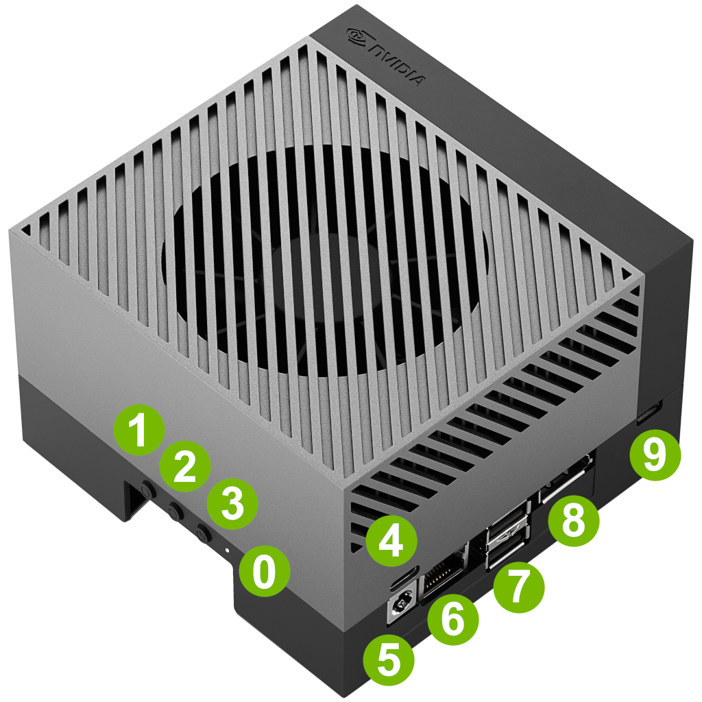
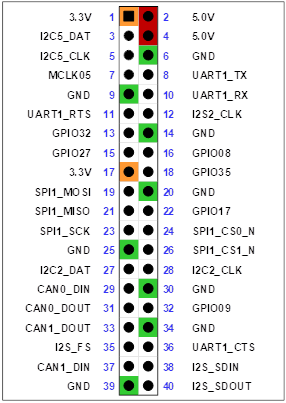

# NVIDIA Jetson AGX Orin 64GB Developer Kit Engineering Guide


[**View NVIDIA Jetson AGX Orin 64GB Developer Kit on OpenELAB**](https://openelab.io/products/waveshare-nvidia-jetson-agx-orin)

**Model:** NVIDIA reference Jetson AGX Orin Developer Kit, 64GB · **SKU:** `NVIDIA-AGX-64G` · **Scope:** reference carrier and supplied thermal solution; third-party Orin carriers require their own board support package.


## Product overview <a href="#product-and-applications" id="product-and-applications"></a>

The Jetson AGX Orin 64GB Developer Kit is an Arm Linux computer for developing GPU inference, camera pipelines and robotics applications. Start by recording the factory image and establishing a working console; choose the application’s JetPack generation before upgrading. The reference kit has **DisplayPort output, not HDMI or USB-C display output**, and its two USB-C connectors have different data roles. [NVIDIA hardware layout](https://docs.nvidia.com/jetson/agx-orin-devkit/user-guide/latest/hardware_layout.html)

[NVIDIA manufacturer directory](./) · [AIoT documentation](../aiot-wiki-home-page.md)

## Applications

* Build a perception pipeline and measure capture, preprocessing, inference and postprocessing separately.
* Develop multi-sensor robotics software with a recorded camera driver, middleware, time synchronization and coordinate-frame configuration.
* Prototype a custom carrier or peripheral after checking the carrier specification, electrical budget and supported components list.
* Evaluate model memory requirements and sustained thermal performance before selecting a production module. Peak TOPS is not an application frame-rate or latency guarantee.

NVIDIA supports module-performance emulation on this kit, but emulation does not establish another carrier’s connector layout or peripheral compatibility. [Kit introduction](https://docs.nvidia.com/jetson/agx-orin-devkit/user-guide/latest/index.html)

## Specifications <a href="#hardware-reference" id="hardware-reference"></a>

| Parameter          | 64GB reference-kit scope                                        | Integration meaning                                                      |
| ------------------ | --------------------------------------------------------------- | ------------------------------------------------------------------------ |
| CPU                | 12-core Arm Cortex-A78AE; up to 2.2GHz                          | Build/select `aarch64` software, not x86 binaries                        |
| GPU                | 2,048 Ampere CUDA cores; 64 Tensor Cores                        | Kernel/library compatibility follows the installed JetPack release       |
| AI compute         | Up to 275 INT8 TOPS                                             | Manufacturer peak; precision, sparsity, accelerators and workload matter |
| Memory             | 64GB 256-bit LPDDR5; 204.8GB/s                                  | Shared by CPU, GPU and other engines; allow operating-system headroom    |
| Storage            | 64GB eMMC 5.1; optional NVMe, USB and microSD                   | Installing an SSD does not automatically migrate the root filesystem     |
| Module power modes | 15–60W                                                          | Module power is different from total input plus peripheral loads         |
| Wired network      | RJ45, up to 10GbE                                               | Actual negotiation depends on cable, switch and software                 |
| Display            | DisplayPort 1.4a, MST                                           | Use an active DP-to-HDMI adapter for an HDMI-only monitor                |
| USB                | Two USB-A Gen2, two USB-A Gen1; two USB-C; debug micro-B        | Observe host/device role distinctions below                              |
| PCIe               | Mechanically x16 expansion slot, electrically x8; M.2 expansion | Connector size does not imply 16 active lanes                            |
| Camera             | 16 CSI lanes on carrier camera expansion connector              | Not a generic Raspberry Pi ribbon-camera socket                          |
| Other I/O          | 40-pin expansion, automation, fan, audio, RTC and JTAG          | Physical connectors are not interchangeable electrical standards         |

Core compute and memory figures: [NVIDIA kit comparison](https://www.nvidia.com/en-us/autonomous-machines/embedded-systems/jetson/back-to-school/). Connector capabilities: [NVIDIA hardware layout](https://docs.nvidia.com/jetson/agx-orin-devkit/user-guide/latest/hardware_layout.html). The 64GB specification must not be substituted for an older 32GB kit.

## Hardware and connections

### Identify ports before applying power



Manufacturer diagram: NVIDIA, [Hardware Layout](https://docs.nvidia.com/jetson/agx-orin-devkit/user-guide/latest/hardware_layout.html). The other side, underside and module-side drawings remain available there.

| Reference              | Connection                                                      | Check before use                                                                         |
| ---------------------- | --------------------------------------------------------------- | ---------------------------------------------------------------------------------------- |
| J24, above DC jack     | USB-C host/data port and USB-PD power input                     | Recommended supplied-adapter position for first boot; not the flashing device port       |
| J40, beside J30        | USB-C host/device data and USB-PD input                         | Use for host flashing, USB virtual Ethernet and headless first setup                     |
| J41                    | DC barrel alternative, 5.5mm outer/2.5mm inner, center positive | Carrier specification v1.2 lists 7–20V; match the installed hardware and supply capacity |
| J18                    | DisplayPort                                                     | The reference kit’s only display-output interface                                        |
| J26                    | Micro-B debug UART                                              | Separate from J40’s USB gadget console; host sees four serial devices                    |
| J17                    | Ethernet                                                        | Confirm link speed before throughput measurements                                        |
| J1 / J505              | M.2 M-Key storage / E-Key expansion                             | Install with power disconnected and check module/key compatibility                       |
| J6 / J509              | PCIe / CSI camera expansion                                     | Use model-specific mechanical, lane and driver information                               |
| J30 / J42              | Expansion / automation header                                   | Verify pin 1 and voltage domain before connecting                                        |
| J9 / J13 / J511 / J502 | Fan / RTC / audio / JTAG                                        | Use the carrier specification for mating parts and limits                                |

Use the bundled USB-PD adapter for the baseline. Both USB-C ports can accept negotiated PD, but that does not make either a generic fixed-voltage input. The how-to guide lists source profiles up to 20V/4.5A; a low-power USB charger may be inadequate. Shut down Ubuntu before removing power. Keep the fitted cooling hardware and airflow clear. [Power and USB roles](https://docs.nvidia.com/jetson/agx-orin-devkit/user-guide/latest/howto.html), [carrier specification entry](https://developer.nvidia.com/embedded/downloads#?search=Jetson%20AGX%20Orin%20Developer%20Kit%20Carrier%20Board%20Specification), SP-10900-001 v1.2, chapters 1 and 3.

### J30 expansion header: power rails are not signal levels

J30 signal pins are **3.3V logic**. The presence of 5V power pins does not establish 5V-tolerant signals. CAN TX/RX pins are controller-side signals: a suitable external CAN transceiver and correctly terminated bus are required. Select pin multiplexing and a driver for the installed BSP before using alternate functions. [Carrier specification](https://developer.nvidia.com/embedded/downloads#?search=Jetson%20AGX%20Orin%20Developer%20Kit%20Carrier%20Board%20Specification), section 3.3; [manufacturer pinout/orientation](https://docs.nvidia.com/jetson/agx-orin-devkit/user-guide/latest/hardware_layout.html#pin-header).



The white PCB triangle identifies pin 1. The diagram’s signal labels are carrier names, not Linux GPIO numbers. Useful groups are:

| Function                      | Physical J30 pins            |
| ----------------------------- | ---------------------------- |
| 3.3V power                    | 1, 17                        |
| 5V power                      | 2, 4                         |
| Ground                        | 6, 9, 14, 20, 25, 30, 34, 39 |
| I2C5 data/clock               | 3 / 5                        |
| I2C2 data/clock               | 27 / 28                      |
| UART1 TX/RX/RTS/CTS           | 8 / 10 / 11 / 36             |
| SPI1 MOSI/MISO/clock/CS0/CS1  | 19 / 21 / 23 / 24 / 26       |
| CAN0 DIN/DOUT                 | 29 / 31                      |
| CAN1 DIN/DOUT                 | 37 / 33                      |
| I2S2 clock/frame/input/output | 12 / 35 / 38 / 40            |

For drive current, pull-ups, default mux and shared-function constraints, use the specification’s full table rather than treating this selection table as an electrical design approval. Keep wiring unpowered until polarity, common reference, load and voltage conversion are checked.

### Automation, storage and mechanical integration

J42 controls recovery, reset, power and automatic startup. Shorting 5–6 enables automatic power-on; 9–10 enables the documented wake-on-LAN configuration. Other pins include standby/overcurrent/JTAG signals in different voltage domains; do not bridge them from a generic GPIO diagram. Read the full automation table for custom control hardware. [Hardware layout](https://docs.nvidia.com/jetson/agx-orin-devkit/user-guide/latest/hardware_layout.html#automation-header-j42)

NVMe, USB and microSD are supported storage choices, subject to the selected BSP installation path. Check free space and the actual root device before installing a large SDK. The carrier specification also provides connector heights, camera-module clearance, mechanical drawings and per-connector power budgets; use these for enclosure/peripheral design. A developer kit is not evidence of a production enclosure’s environmental qualification.

## Software and development resources <a href="#software-and-recovery" id="software-and-recovery"></a>

### Select a release deliberately

| Documented stack                       | Evidence and decision                                                                                                                    |
| -------------------------------------- | ---------------------------------------------------------------------------------------------------------------------------------------- |
| JetPack 7.2.2 / Jetson Linux 39.2.2    | Current release archive/download page reviewed 24 November 2026 lists Orin-family support, Ubuntu 24.04 and kernel 6.8                   |
| JetPack 7.2.1 / Linux 39.2.1           | The model-specific quick-start uses this ISO as its worked installation path; the 7.2.2 download notes instruct updating from that image |
| JetPack 6.2.1 / Linux 36.4.4           | Older application baseline documented separately; Ubuntu 22.04 and kernel 5.15                                                           |
| Factory JetPack 5.x or another release | Record the actual version; do not assume the installed image matches the current website                                                 |

Sources: [release archive](https://developer.nvidia.com/embedded/jetpack-archive), [current download/release matrix](https://developer.nvidia.com/embedded/jetpack/downloads), [model quick-start](https://docs.nvidia.com/jetson/agx-orin-devkit/user-guide/latest/quick_start.html), [6.2.1 documentation](https://docs.nvidia.com/jetson/jetpack/introduction/index.html). This is a compatibility choice, not an instruction to upgrade a working robot automatically. Recheck camera drivers, ROS distributions, CUDA extensions, inference engines and containers before changing generations.

JetPack supplies CUDA, cuDNN, TensorRT, VPI, multimedia APIs and development tools. Release-specific examples and sample paths differ. In the 6.2.1 documentation, sample locations include `/usr/src/tensorrt/samples/`, `/usr/src/jetson_multimedia_api`, `/usr/share/opencv4/samples/` and `/opt/nvidia/vpi/samples/`; inspect installed packages before assuming those paths exist on R39. Nsight tooling, DeepStream, Isaac ROS and other application frameworks have separate support matrices. For example, the reviewed 7.2.2 matrix labels Isaac ROS support “Coming soon”; generic Orin support must not override that release-specific condition. [JetPack component references](https://docs.nvidia.com/jetson/jetpack/introduction/index.html), [7.2.2 matrix](https://developer.nvidia.com/embedded/jetpack/downloads)

## Getting started <a href="#getting-started-establish-a-reproducible-baseline" id="getting-started-establish-a-reproducible-baseline"></a>

### 1. Establish a console on the factory image

1. Choose a display-attached or headless setup before applying power. For a desktop, attach a DisplayPort monitor, USB keyboard/mouse and network while the kit is unpowered.
2. For headless initialization, leave DisplayPort disconnected and attach the host to J40 beside J30. Compare the host’s serial-device list before and after attachment.
3. Connect the supplied adapter above the DC jack. On the display, follow Ubuntu’s first-user wizard; for headless operation, open the newly enumerated serial device at **115200 baud** and complete the terminal wizard. On Windows the documented USB identity is VID `0955`, PID `7020`; choose the actual COM port.
4. Create the local account, finish network/timezone configuration and log in after the initial reboot. Capture the inventory below before installing applications or changing the image.

[Model first-boot instructions](https://docs.nvidia.com/jetson/agx-orin-devkit/user-guide/latest/quick_start.html)

After logging into Ubuntu, run this original inventory checkpoint on the Jetson:

```bash
cat /etc/nv_tegra_release
uname -m
uname -r
free -h
lsblk -o NAME,SIZE,TYPE,MOUNTPOINTS
df -h /
sudo nvpmodel -q
```

**Expected result:** a readable L4T release, `aarch64` architecture, memory/storage inventory and named power mode. Available RAM is lower than the nominal capacity because the system reserves/uses memory. Save this output with the board revision, image source and application dependency versions. These are inventory checks, not an inference benchmark.

### 2. Choose an installation or recovery route

| Route                    | Appropriate use                                                                 | Boundary                                                                                         |
| ------------------------ | ------------------------------------------------------------------------------- | ------------------------------------------------------------------------------------------------ |
| Factory eMMC boot        | First identification and known-working baseline                                 | Does not prove current SDK components are installed                                              |
| Jetson ISO USB installer | Model guide’s R39 installation workflow without a separate Ubuntu flashing host | Backup required; target eMMC/NVMe installation overwrites selected storage                       |
| SDK Manager              | Guided host flashing and optional SDK installation                              | NVIDIA account; host OS must satisfy the chosen release’s requirements                           |
| L4T flash scripts        | Controlled custom BSP/image deployment                                          | Exact board configuration, release and storage required; do not borrow another carrier’s command |

For the model guide’s R39.2.1 ISO route: confirm its documented prerequisite **installed L4T R35.5 or later**, create an installation USB with an image-writing tool, boot/select it in UEFI, complete required QSPI capsule prompts, select the intended eMMC or NVMe target, then remove the installation USB and complete Ubuntu initialization. A normal file copy does not create bootable installation media. Connect the display directly if a KVM gives a black installer screen. [BSP choices](https://docs.nvidia.com/jetson/agx-orin-devkit/user-guide/latest/setup_bsp.html), [ISO procedure](https://docs.nvidia.com/jetson/agx-orin-devkit/user-guide/latest/quick_start.html#step-2-update-bsp-with-jetson-iso)

Check the [R39.2.2 release notes](https://docs.nvidia.com/jetson/archives/r39.2.2/ReleaseNotes/Jetson_Linux_Release_Notes_r39.2.2.pdf) before migrating: they add capsule-update and board-identity cautions. Thor-specific workarounds and storage-size assumptions are not automatically applicable to AGX Orin. Preserve a recovery plan before changing firmware.

### 3. Install the matching SDK components

First check the release and available package candidate:

```bash
cat /etc/nv_tegra_release
apt-cache policy nvidia-jetpack
```

On an intentionally selected, already compatible NVIDIA BSP/repository, install the supported `nvidia-jetpack` package using NVIDIA’s version-specific instructions. An APT package installation is not a substitute for a BSP migration. Do not mix an R36 repository or binary extension with R39 libraries. SDK Manager can install components separately from Jetson OS; the documented USB target address is `192.168.55.1` after device mode is running. [SDK setup](https://docs.nvidia.com/jetson/agx-orin-devkit/user-guide/latest/setup_jetpack.html)

### 4. Observe a finite workload checkpoint

Use `sudo tegrastats`, observe several reports, then stop with Ctrl+C. Record temperature, utilization, memory and the selected power mode before and during the application’s smallest test. Change power modes only after checking supply/cooling and recording the original setting; numeric mode IDs are release/configuration-specific. [Monitoring and power controls](https://docs.nvidia.com/jetson/agx-orin-devkit/user-guide/latest/howto.html)

For a compatible environment that already contains NVIDIA-supported PyTorch, this original small test checks GPU execution without allocating the very large tensor shown in some examples:

```python
import torch

print("PyTorch:", torch.__version__)
print("CUDA available:", torch.cuda.is_available())
if not torch.cuda.is_available():
    raise SystemExit("Check JetPack, the installed build, and container GPU access")
print("GPU:", torch.cuda.get_device_name(0))
x = torch.arange(64, dtype=torch.float32, device="cuda")
print("Sum:", x.sum().item())
```

**Expected result:** CUDA availability is true and the sum is `2016.0`. This example is syntax reviewed, not executed here; it establishes neither model accuracy nor sustained performance. Install a PyTorch build explicitly compatible with the chosen stack before running it. [NVIDIA’s container/PyTorch checkpoint](https://docs.nvidia.com/jetson/agx-orin-devkit/user-guide/latest/setup_docker.html)

### 5. Add containers and peripherals after the baseline

NVIDIA distinguishes an ISO-provisioned system from one flashed with SDK Manager/scripts when installing Docker and the Container Toolkit. Inspect what is already installed; use the [official Docker guide](https://docs.nvidia.com/jetson/agx-orin-devkit/user-guide/latest/setup_docker.html) to configure the NVIDIA runtime and restart Docker when required. Docker group membership is privileged system access; choose it deliberately rather than changing socket permissions.

Check an explicitly selected image’s architecture and JetPack/L4T compatibility before running it. A historical example tag in a tutorial is not a guarantee for a newer BSP. Retain the image digest, runtime configuration and application package versions with the project. Then add one USB/camera/storage peripheral at a time and compare enumeration, logs and resource use. CSI, GMSL and industrial cameras require their own adapter and driver support; a connector name alone is insufficient.

## Troubleshooting and FAQs <a href="#faqs" id="faqs"></a>

| Symptom                                          | Ordered checks and supported next action                                                                                                 |
| ------------------------------------------------ | ---------------------------------------------------------------------------------------------------------------------------------------- |
| No picture on HDMI/USB-C                         | Use J18 DisplayPort; check monitor input and active HDMI adapter; bypass a KVM before changing firmware                                  |
| Headless first-user wizard absent                | Disconnect DisplayPort before initialization; use J40 and identify the new host serial device at 115200 baud                             |
| Host flashing cannot find the kit                | Confirm J40/data cable, stable separate power and recovery-button sequence; recovery USB detection is not a running Ubuntu session       |
| Need Force Recovery from a running kit           | Hold Recovery, press/hold Reset, release both as documented; recovery enables flashing, it does not itself restore data                  |
| Need Force Recovery from power-off               | Hold Recovery while applying the documented supply, use Power if necessary, then release; follow the model’s exact button procedure      |
| Debug console differs from USB setup console     | J26 micro-B exposes four serial ports; identify the debug stream at 115200 rather than assuming J40’s device number                      |
| JetPack package not found or dependency conflict | Record L4T and APT candidate; check release-specific repositories and free storage instead of forcing cross-generation packages          |
| Container runs but CUDA is unavailable           | Check ARM/Jetson image support, selected L4T generation, NVIDIA runtime configuration and daemon restart; compare with a native baseline |
| Docker permission denied                         | Use the documented privileged invocation or deliberately configured group membership; do not make the Docker socket world-writable       |
| Unexpected throttling or shutdown                | Record power mode, supply, peripherals, fan/airflow and `tegrastats`; isolate added loads before increasing power limits                 |
| Fresh installation repeatedly reappears          | Remove the installation USB and check UEFI boot selection for the intended root device                                                   |
| Peripheral fits but does not work                | Verify electrical level, pin mux, actual lane wiring and exact driver/release support                                                    |

The corresponding procedures are in [Quick Start](https://docs.nvidia.com/jetson/agx-orin-devkit/user-guide/latest/quick_start.html), [BSP Installation](https://docs.nvidia.com/jetson/agx-orin-devkit/user-guide/latest/setup_bsp.html), [How-to](https://docs.nvidia.com/jetson/agx-orin-devkit/user-guide/latest/howto.html) and [Docker Setup](https://docs.nvidia.com/jetson/agx-orin-devkit/user-guide/latest/setup_docker.html). Preserve the exact failure message and a boot log before reinstalling.

## Downloads and technical documents

### Model-guide coverage and resource map

| Official resource                                                                                                                                                     | Covered topics and use                                                                                                                              |
| --------------------------------------------------------------------------------------------------------------------------------------------------------------------- | --------------------------------------------------------------------------------------------------------------------------------------------------- |
| [Introduction](https://docs.nvidia.com/jetson/agx-orin-devkit/user-guide/latest/index.html)                                                                           | Platform role, module emulation, ecosystem and AI Lab entry points                                                                                  |
| [Quick Start](https://docs.nvidia.com/jetson/agx-orin-devkit/user-guide/latest/quick_start.html)                                                                      | Display/headless setup, Windows/macOS/Linux terminals, ISO media, QSPI prompts, target selection and first boot                                     |
| [BSP Installation](https://docs.nvidia.com/jetson/agx-orin-devkit/user-guide/latest/setup_bsp.html)                                                                   | eMMC/ISO versus host SDK Manager/flash-script routes and recovery cabling                                                                           |
| [JetPack SDK Setup](https://docs.nvidia.com/jetson/agx-orin-devkit/user-guide/latest/setup_jetpack.html)                                                              | Package installation and separate SDK Manager component stage                                                                                       |
| [Docker Setup](https://docs.nvidia.com/jetson/agx-orin-devkit/user-guide/latest/setup_docker.html)                                                                    | Toolkit/runtime setup, permissions and PyTorch GPU checkpoint                                                                                       |
| [Hardware Layout](https://docs.nvidia.com/jetson/agx-orin-devkit/user-guide/latest/hardware_layout.html)                                                              | Both side views, carrier top/bottom, full connector locations, display, storage and header diagrams                                                 |
| [Supported Hardware](https://docs.nvidia.com/jetson/agx-orin-devkit/user-guide/latest/supported_hardware.html)                                                        | Official supported-components-list entry; verify the actual selected part and revision                                                              |
| [How-to Guides](https://docs.nvidia.com/jetson/agx-orin-devkit/user-guide/latest/howto.html)                                                                          | Power/shutdown, USB roles, PD, debug UART, recovery, monitoring and power modes                                                                     |
| [Carrier Board Specification search](https://developer.nvidia.com/embedded/downloads#?search=Jetson%20AGX%20Orin%20Developer%20Kit%20Carrier%20Board%20Specification) | SP-10900-001 v1.2: complete pin tables, camera routing, drawings, connector parts and electrical budgets; download-center access may be interactive |
| [Jetson Download Center](https://developer.nvidia.com/embedded/downloads)                                                                                             | Module datasheet, supported components, carrier design files, pin/function guides and revision-specific documents                                   |
| [Current JetPack downloads](https://developer.nvidia.com/embedded/jetpack/downloads)                                                                                  | ISO, SDK Manager, BSP/rootfs, source packages, toolchain, release notes, API and development guides, source/binary SHA lists and license            |
| [JetPack Archive](https://developer.nvidia.com/embedded/jetpack-archive)                                                                                              | Match an application to a supported historical release rather than a floating latest label                                                          |
| [R39.2.2 release notes](https://docs.nvidia.com/jetson/archives/r39.2.2/ReleaseNotes/Jetson_Linux_Release_Notes_r39.2.2.pdf)                                          | Known/fixed issues and camera/compute/multimedia conditions; distinguish Orin from Thor-only entries                                                |
| [Jetson software entry](https://developer.nvidia.com/embedded/learn/getting-started-jetson)                                                                           | Retained learning and development references                                                                                                        |

The reviewed download page also links Yocto/OE4T, debugging/profiling tools, camera development, CUDA utilities and application frameworks. Use those versioned resources for advanced work; this model guide does not reproduce the complete CUDA, TensorRT or kernel API manuals. Files listed by a document center are not claimed downloaded or tested solely because a link exists.

## References and validation <a href="#sources-and-validation" id="sources-and-validation"></a>

Reviewed **24 November 2026**. The eight model-user-guide pages, current release/archive information, relevant carrier-specification sections and official hardware diagrams were read. The SKU was matched to the OpenELAB product page. This page adds an original inventory procedure, release-selection decision table, bounded GPU check and fault-isolation workflow.

The carrier’s full supported-components/design-file package was not independently downloaded as a complete bundle. Verify those documents for the received board before custom electrical/mechanical design. Software installation, flashing, container execution and physical hardware tests were **not run**. Expected outputs above are checkpoints to verify on the actual kit, not measurements made during this documentation review.
