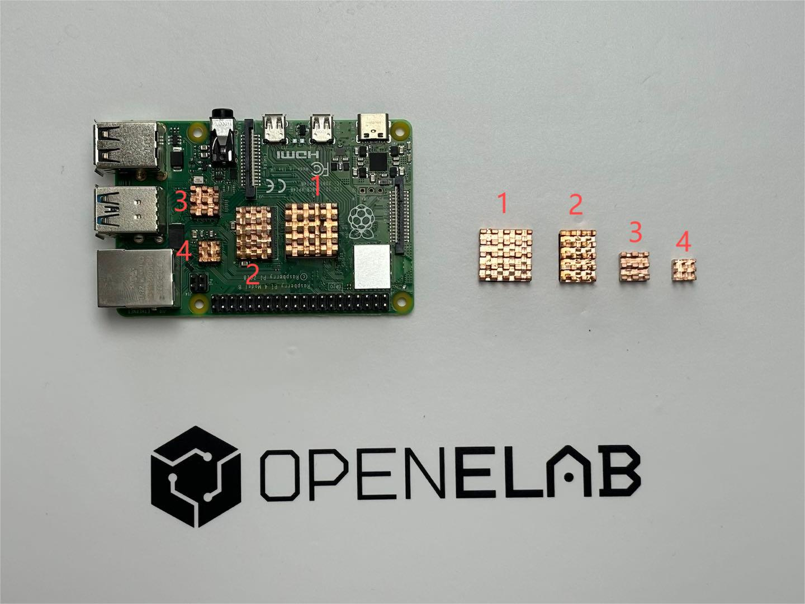

---
layout:
  width: default
  title:
    visible: false
  description:
    visible: false
  tableOfContents:
    visible: true
  outline:
    visible: true
  pagination:
    visible: true
  metadata:
    visible: true
  tags:
    visible: true
  actions:
    visible: true
  anchors:
    visible: true
---

# ELAB Raspberry Pi 4 Heat Sink (Copper)

### ELAB Raspberry Pi 4 Heat Sink (Copper)

***

### Product Link



<figure><figcaption></figcaption></figure>

\-
