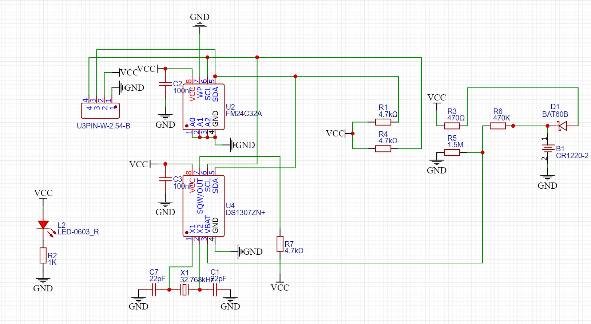
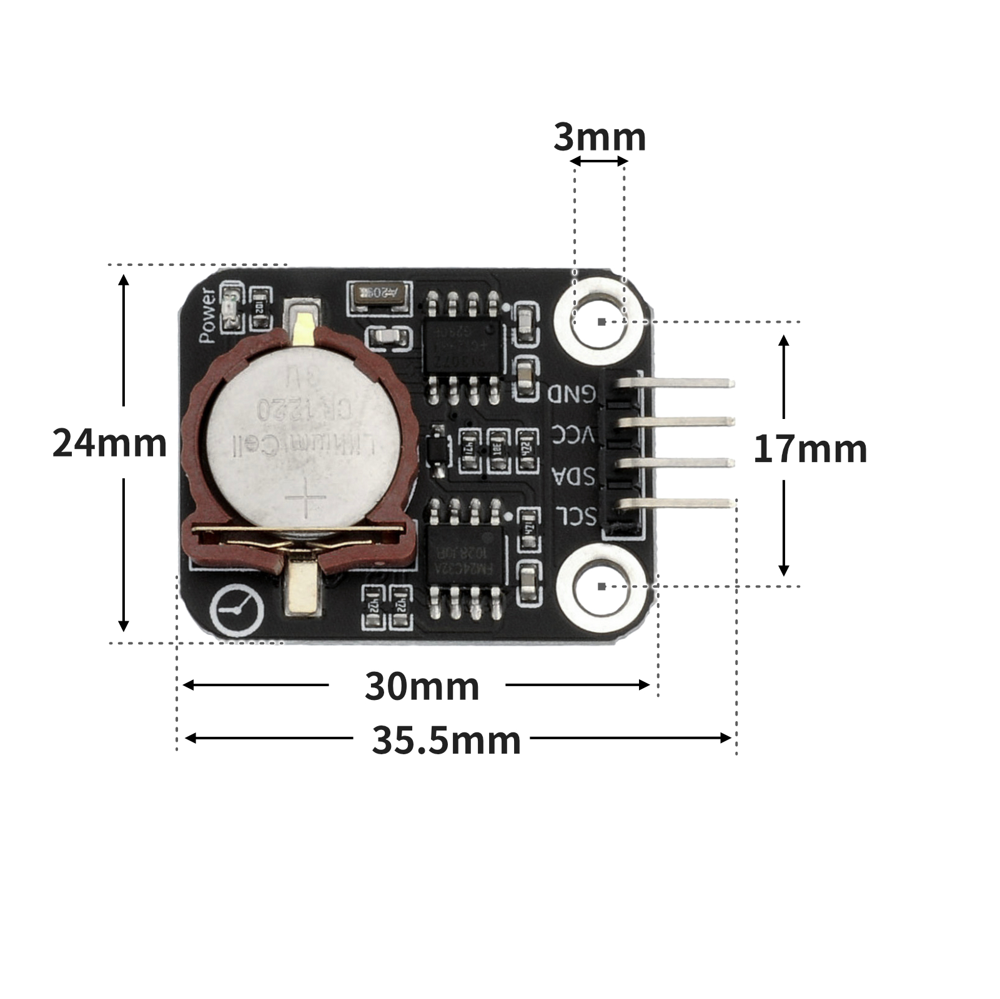

# HS-S30A



### Introduction

The DS1307 clock module is a low-power, full-BCD clock-calendar real-time clock (RTC) chip with 56 bytes of non-volatile RAM. Addresses and data are transmitted via a two-wire bidirectional serial bus. The chip provides information such as seconds, minutes, and hours, and automatically adjusts for the number of days in each month. The AM/PM flag determines whether the clock operates in 24-hour or 12-hour mode. The chip features a built-in power-sensing circuit with power-down detection and battery-switching capabilities. The DS1307 clock module is a sensor with an integrated digital clock; users can write their own programs to turn it into an electronic clock.

### Schematic Diagram

<figure><figcaption></figcaption></figure>

### Module Parameters

| Pin Names | Description                                 |
| --------- | ------------------------------------------- |
| GND       | GND (negative terminal of the power supply) |
| VCC       | VCC (Positive Power Supply Input)           |
| SDA       | Serial Data Pins                            |
| SCL       | Serial Clock Pin                            |

Supply Voltage: 3.3V / 5V

Connection Type: 2.54mm pin header

Mounting Method: Screw-mounted

### PCB Dimensions

<figure><figcaption></figcaption></figure>

### Add Arduino Library Files

First, locate the Arduino library folder:

<figure><figcaption></figcaption></figure>

Simply copy the library files to the “libraries” folder within the Arduino IDE directory:

<figure><figcaption></figcaption></figure>

Library file:&#x20;



### Arduino IDE Sample Programs

Sample Program (UNO Development Board):



```
#include <RtcDS1307.h>
#include <Wire.h>

RtcDS1307<TwoWire> Rtc(Wire);

void setup(){
  Serial.begin(9600);
  Rtc.Begin();
  Rtc.SetIsRunning(true);
  Rtc.SetDateTime(RtcDateTime(__DATE__, __TIME__));
}

void loop(){
  //DS1307 Connecting the Clock Module to the Development Boardllc（A4，A5）

  Serial.print(String(String("Date") + String("：")) + String(String(Rtc.GetDateTime().Year()) + String("-")) + String(String(Rtc.GetDateTime().Month()) + String("-")) + String(String(Rtc.GetDateTime().Day()) + String("-")));
  Serial.println(String(String("Time") + String("：")) + String(String(Rtc.GetDateTime().Hour()) + String("-")) + String(String(Rtc.GetDateTime().Minute()) + String("-")) + String(Rtc.GetDateTime().Second()));

}
```

### Mixly Sample Programs (Visual Programming Language)

Sample Program (UNO Development Board):



<figure><figcaption></figcaption></figure>

Sample Program (ESP32 Development Board):



### Setting Up the Test Environment

Required Components:

HELLO STEM UNO R3 PRO Development Board \*1

USB Type-C Cable \*1

DS1307 Clock Module \*1

1P female-to-female DuPont wires \*4 or 4P female-to-female DuPont wire \*1

Circuit Wiring Diagram:

<figure><figcaption></figcaption></figure>

### Test Conclusions

After connecting the wires to the components and uploading the above program to the Arduino UNO development board, open the Mxily Serial Monitor. The serial output will display the current date and time as read by the DS1307 clock module.

<figure><figcaption></figcaption></figure>
