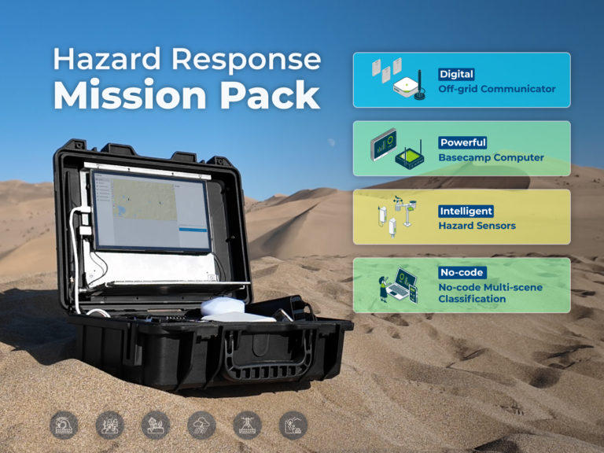

# Seeed Studio Hazard Response Mission Pack All-in-one Compact Kit Meshtastic


[**View Seeed Studio Hazard Response Mission Pack All-in-one Compact Kit Meshtastic on OpenELAB**](https://openelab.io/products/seeed-studio-hazard-response-mission-pack-all-in-one-compact-kit-meshtastic)

**Model / option:** Seeed Studio Hazard Response Mission Pack All-in-one Compact Kit Meshtastic · **SKU:** `Seeed-E24101801`


## Product overview <a href="#product-and-scope" id="product-and-scope"></a>

Hazard Response Mission Pack, `Seeed-E24101801`, is an integration kit: a basecamp computer/router/display system, LoRaWAN gateway capability, Meshtastic radios and expansion interfaces. It is an evolving engineering platform; a photographed scenario is not a guaranteed sensor bill of materials or a validated emergency-warning installation.

The basic kit and project V3 examples overlap but are not identical. Use the exact delivered inventory, regional gateway label and installed image as the starting record. This guide first proves local computing and an isolated, synthetic Node-RED data path, then adds mesh/network sensors one transport at a time. Optional S2100 loggers, weather/level sensors and vision modules are not counted as included merely because the project describes them. [Seeed E24101801 listing](https://www.seeedstudio.com/Mission-Pack.html), [V3 project context](https://wiki.seeedstudio.com/mission_pack_intro_v3/).

## Applications

Use the pack for field telemetry trials, offline situational dashboards, teaching and replicable sensor-integration prototypes. Separate three independently testable routes: **Meshtastic text/position**, **LoRaWAN application telemetry** and **IP/RS485 local services**. Sharing a case does not make the radio protocols interchangeable.

For flood, fire or personnel scenarios, first use synthetic events and record stale/missing-data behavior. A displayed alarm is a demonstration until sensor placement, calibration, communications loss, local power and human response have been engineered and validated for the actual use. No certification or response reliability is inferred from an example flow.

## Specifications

| Part / parameter     | Basic kit reference and qualification                                                                                               |
| -------------------- | ----------------------------------------------------------------------------------------------------------------------------------- |
| Edge computer        | reComputer R1025-10 / CM4-based R1000-family computer;4 GB RAM,32 GB eMMC in kit listing                                            |
| CPU family           | Raspberry Pi CM4, quad-core Cortex-A72 at1.5 GHz in the kit table; identify the installed OS architecture before selecting binaries |
| Display              | 10.1-inch1024×60060 Hz capacitive-touch IPS display                                                                                 |
| Meshtastic handhelds | Four T1000-E trackers plus one charging case                                                                                        |
| Basecamp mesh device | One Meshtastic device plus antenna; exact radio revision must be inventoried                                                        |
| LoRaWAN gateway      | Listed SX1302/SX1303-family capability; EU868 or US915 build depends on ordered/delivered option                                    |
| RS485                | Three isolated3-pin terminal blocks in system table; check actual computer/case labels before attaching field wiring                |
| LAN / Wi-Fi          | Three listed external Ethernet roles; router supports2.4/5 GHz, unlike a bare XIAO radio                                            |
| Power                | Supplied12 V /2 A adapter for the complete kit;24 W nominal input capacity calculated from label, not spare peripheral power        |
| Other listed parts   | RS485 RGB indicator, two LoRa antennas, mini keyboard/trackpad, user guide and carrying case                                        |
| Size / mass          | 345×270×138 mm;7 kg listed system weight                                                                                            |
| Environment          | −20 to+55 °C;0–85% RH without condensation in kit table; component charging ranges can be narrower                                  |

The [manufacturer E24101801 datasheet, physical pages5–8](https://files.seeedstudio.com/Bazaar/product_pdf/E24101801.pdf) is the source for the kit table. Its CPU line is inconsistent with the separately identified CM4; for software use the actual `uname -m`/OS/board model as described below instead of repeating the erroneous CPU label. No bare-board processor clock is used as a complete system benchmark.



_Manufacturer Mission Pack overview; optional sensor arrangements can differ from the basic purchased kit — Seeed Studio,_ [_original diagram_](https://wiki.seeedstudio.com/mission_pack_intro_v3/)_._

## Hardware and connections <a href="#hardware-and-technical-documents" id="hardware-and-technical-documents"></a>

### Inventory and power boundary

Use the supplied12 V adapter at the kit's intended input, with all field sensors disconnected during the first boot. Inspect the adapter/case labels and connector polarity; do not feed12 V into USB, HDMI or the tracker magnetic contacts. The tracker cable is a5 V USB charging/data interface, and the case's12 V rating is not a rating for every accessory connector.

| Connection                    | Initial procedure                                                                                                                                         |
| ----------------------------- | --------------------------------------------------------------------------------------------------------------------------------------------------------- |
| Computer/display              | Leave factory harness intact; for a loose display connect HDMI video to the computer's HDMI output, then its separate labeled USB power/touch connections |
| Keyboard                      | Fit required batteries if supplied keyboard uses them; insert its receiver into a computer USB port                                                       |
| External network              | Identify WAN versus internal LAN labels/router settings before moving cables; local operation need not have Internet                                      |
| LoRaWAN / Meshtastic antennas | Match the labeled RF path and regional band; do not swap a2.4 GHz Wi-Fi antenna onto the sub-GHz radio                                                    |
| RS485 terminals               | Treat A/B/reference labels and exact device manual as authoritative; a3-pin terminal block is not evidence of a12 V power output                          |
| T1000-E                       | Use matching magnetic USB cables/charging case; no generic nRF/LoRaWAN tracker firmware                                                                   |

The project hardware handbook mistakenly describes the HDMI cable's far end as a USB connection. Keep HDMI video and USB touch/power separate. Its generic LoRaWAN-node paragraph is also not a pinout for every optional sensor. [Hardware integration reference](https://seeed-studio.github.io/Hazard-Response-Mission-Pack/hardware-connection).

For internal maintenance, use the [R1000 assembly guide](https://wiki.seeedstudio.com/recomputer_r1000_assembly_guide/) only after identifying the received board and disconnecting power. Do not install a second WM1302 module if the gateway is already fitted. Slot shape alone does not establish power/interface compatibility. Restore grounding hardware and antenna routing after service.

### A useful inventory record

Label the case, computer, router, gateway band/module, basecamp mesh device and all four trackers. Record OS image/service versions, radio firmware, serial IDs, port labels and adapter ratings. Confirm the regional gateway against the actual label: the umbrella E24101801 SKU alone does not specify EU868 versus US915. The official configurator offers sub-options114993391/114993468; they are not extra assigned SKU rows here.

## Software and development resources <a href="#development-software-and-recovery" id="development-software-and-recovery"></a>

The system centers on Node-RED and Docker-packaged services, but service names, mapped ports and credentials depend on the installed image. Inspect that image before replacing it. The [official repository](https://github.com/Seeed-Studio/Hazard-Response-Mission-Pack) separates `functions/` snippets, `examples/` functional nodes and `projects/` complete scenarios. It is MIT-licensed at reviewed commit`4a20bba0cb1ae119b77cfc4ef59e51f9b59a0ec1`; retain attribution when reusing its code.

The handbook has partial sections for additional devices and software setup; a heading is not a runnable complete deployment. Use the appropriate component's exact manual for credentials, radio target, sensor protocol and voltage. Do not assume a root `docker-compose.yml` exists or run an arbitrary replacement stack on the supplied computer.

| Subsystem         | Version/identity checkpoint                                                                           |
| ----------------- | ----------------------------------------------------------------------------------------------------- |
| OS / architecture | `/proc/device-tree/model`, `uname -m`, `/etc/os-release`; choose ARM binaries for the actual image    |
| Containers        | Existing image tags/digests, mapped host ports, persistent volumes; export data/flows before changing |
| Node-RED          | Version from editor About/runtime log, installed palette nodes and flow export                        |
| Meshtastic        | Exact basecamp radio target and T1000-E tracker target are different records                          |
| LoRaWAN           | Gateway concentrator model/band, packet forwarder, network-server plan and device decoder             |
| Vision            | Exact camera/module and matching model/runtime, optional hardware separated from base kit             |

## Getting started

### Local basecamp acceptance before radio configuration

1. Inventory the case against the basic kit and label all connections. Attach the correct radio antennas, leave added sensors/actuators disconnected and use the supplied12 V adapter.
2. Boot the existing computer image. Check display, keyboard/trackpad and touch independently. Read the hardware model/OS information; do not select software from an assumed host architecture.
3. Inspect the local network and running services with the read-only commands below. If Docker is absent, retain the installed service layout rather than installing a second runtime immediately.
4. Locate the existing Node-RED address from its service/container port mapping or supplied image documentation, then open it on the computer/local LAN using the configured login. Do not assume a factory password or expose the editor to WAN.
5. Export existing flows and note their enabled inputs/outputs. Create a **new isolated test tab**, using only Inject → Function → Debug as below. Keep sensor/actuator/network-output nodes out of this first test.

```sh
cat /proc/device-tree/model
uname -m
cat /etc/os-release
ip -brief address
ip route
df -h
systemctl --type=service --state=running
# If the supplied image uses Docker:
docker ps
```

**Expected result:** a repeatable boot, usable local display/input, identified network interfaces and an accessible existing Node-RED editor. If a command is unavailable or Docker permission is denied, inspect the supplied image's documented service account instead of replacing the installation.

### Original Node-RED first result with no device output

In the new tab add an Inject node with JSON payload `{"station":"bench-01","temperature_C":24.5,"synthetic":true}`. Add a Function node with this original code, wire its first output to a Debug node showing the complete message and deploy only the new tab:

```javascript
const p = msg.payload;
if (!p || p.synthetic !== true || typeof p.station !== 'string' ||
    !Number.isFinite(p.temperature_C)) {
    node.error('Invalid synthetic bench record', msg);
    return null;
}
msg.topic = 'mission/bench/temperature';
msg.payload = {
    station: p.station,
    temperature_C: p.temperature_C,
    received_at: new Date().toISOString(),
    source: 'synthetic',
    interpretation: p.temperature_C >= 30 ? 'demo-high' : 'demo-normal'
};
return msg;
```

Press Inject. **Expected result:** Debug shows station`bench-01`, temperature24.5, a current receive timestamp, source`synthetic` and interpretation`demo-normal`. Change the synthetic value to31 and inject again; expect`demo-high`. These are arbitrary bench thresholds, not a hazard criterion. A visible Debug message proves the local flow path, not a radio/sensor measurement. Remove/disable the test tab after saving its result.

### Add Meshtastic as its own acceptance test

1. Charge and identify all four T1000-E trackers. Read each firmware version and node ID; keep the basecamp mesh radio as a separate device record.
2. Configure the same locally permitted region, modem preset, frequency slot and channel name/key on the basecamp radio and a tracker. Avoid changing the radio role until a direct link works.
3. Send `MISSION-T1-01` from the tracker and observe it at the basecamp client. Reply`BASE-T1-01`, then repeat with each tracker using unique sequence names. Record both receiving timestamps and current position age.
4. Only after the mesh works, connect the supplied basecamp transport to an existing validated Node-RED integration. If importing a repository flow, inspect every network endpoint, credential, custom-node dependency and device-output node before deploying it.

**Expected result:** all four named trackers independently exchange a reply with the basecamp radio, with Internet disconnected if an offline claim is being tested. Use the [T1000-E exact guide](https://wiki.seeedstudio.com/sensecap_t1000_e/) for its magnetic-cable DFU and firmware target; the handbook's generic USB-C wording does not change the tracker connector.

### Add one LoRaWAN or RS485 sensor

For LoRaWAN, identify the fitted gateway band, check its network-server connection and record its gateway EUI. Register one actual sensor with its own OTAA keys, region/sub-band and correct decoder. Observe join request, join accept, raw application payload and decoded value as four separate checkpoints. Meshtastic channel keys are not LoRaWAN AppKeys.

For RS485, use the exact sensor's supply/terminal diagram, baud/parity, address, function code, register/scaling and fault values. Connect only one sensor on a short bench bus first; verify a read-only sample with CRC before adding it to a flow. Do not infer an RGB indicator command/register map from its case label; keep indicator writes disabled until its exact manual is identified.

Normalize the validated measurement into an explicit internal record with device ID, quantity, value, unit, device sample time, receipt time, transport and quality. Keep status/exception frames separate from numeric measurements. After adding persistent storage, unplug the test sensor/network and verify that stale/missing data becomes visible rather than reusing the last value indefinitely.

### Optional vision and field scenario

The project describes Grove Vision AI V2 with a compatible XIAO and OV5647 camera. Treat these as optional components. With power disconnected, align the camera ribbon at the vision module's CSI connector and follow the exact module/host guide. Load a model matching the received hardware and establish local inference output before passing events into Node-RED. Log model version and confidence threshold; a class label is not ground truth.

For a deployment rehearsal, retain a manual way to distinguish test/real events, local operator acknowledgement and a communications-loss state. Run the scenario on synthetic inputs first, then observational sensor data with physical outputs still disabled. Configure automatic outputs only after the actual interface and response policy have been validated for that installation.

## Troubleshooting and FAQs <a href="#faqs" id="faqs"></a>

| Symptom                            | Isolate this boundary first                                                                                                          |
| ---------------------------------- | ------------------------------------------------------------------------------------------------------------------------------------ |
| No boot / restarts under load      | Supplied12 V adapter, input connector/polarity, display/peripheral load and storage health; case rating is not spare accessory power |
| Video but no touch                 | HDMI video is separate from USB touch; check the display's exact USB route                                                           |
| Node-RED inaccessible              | Actual mapped host port/service status, IP/interface, local authentication; no fixed factory URL assumed                             |
| Missing palette nodes after import | Compare installed node versions/dependencies; do not deploy unknown outputs merely to clear missing-node errors                      |
| Phone pairs, no basecamp text      | Region/modem/channel/key and actual receiving radio; BLE is not a mesh delivery receipt                                              |
| LoRaWAN sensor absent              | Gateway band/plan and forwarding, OTAA keys, join/downlink path, then application decoder                                            |
| RS485 values implausible           | Sensor model, address/function, signedness, word/byte order and units before building an alarm rule                                  |
| Dashboard freezes on last sample   | Add sample age/stale status and transport-health records; distinguish missing from normal                                            |
| Firmware recovery requested        | Restore the individual component's exact image/target after backup; there is no universal Mission Pack firmware file                 |

## Downloads and technical documents <a href="#official-documentation-and-development-resources" id="official-documentation-and-development-resources"></a>

| Resource                                                                                                                        | Purpose / limitation                                                                     |
| ------------------------------------------------------------------------------------------------------------------------------- | ---------------------------------------------------------------------------------------- |
| [E24101801 datasheet PDF](https://files.seeedstudio.com/Bazaar/product_pdf/E24101801.pdf)                                       | Basic kit inventory/specification; identify actual model/image before selecting binaries |
| [Manufacturer kit/options](https://www.seeedstudio.com/Mission-Pack.html)                                                       | Exact umbrella SKU, regional options and separate accessory list                         |
| [V3 overview](https://wiki.seeedstudio.com/mission_pack_intro_v3/)                                                              | Project context; not an immutable commercial bill of materials                           |
| [Hardware handbook](https://seeed-studio.github.io/Hazard-Response-Mission-Pack/hardware-connection)                            | Connections; apply HDMI/USB distinction and actual component manuals                     |
| [Software handbook](https://seeed-studio.github.io/Hazard-Response-Mission-Pack/software-setup)                                 | Component setup scope; incomplete sections are not deployment recipes                    |
| [System architecture](https://seeed-studio.github.io/Hazard-Response-Mission-Pack/integrator-handbook/system-diagram)           | Basecamp, radio and sensor roles                                                         |
| [Pinned repository](https://github.com/Seeed-Studio/Hazard-Response-Mission-Pack/tree/4a20bba0cb1ae119b77cfc4ef59e51f9b59a0ec1) | MIT project source, examples, functions and scenarios; preserve attribution              |
| [T1000-E setup/recovery](https://wiki.seeedstudio.com/sensecap_t1000_e/)                                                        | Exact included tracker firmware and connector                                            |
| [R1000 assembly](https://wiki.seeedstudio.com/recomputer_r1000_assembly_guide/)                                                 | Internal maintenance after exact-board identification                                    |

## References and validation <a href="#sources-and-validation" id="sources-and-validation"></a>

Reviewed24 November2026: exact live OpenELAB E24101801 listing, manufacturer umbrella/option page and8-page datasheet, project handbook/system architecture, V3 introduction and source repository at`4a20bba0cb1ae119b77cfc4ef59e51f9b59a0ec1`. The overview photo is attributed to Seeed; the isolated Node-RED example and layered acceptance procedure are original.

**Source reviewed; OS/container commands, Node-RED execution, radio/LoRaWAN, RS485/indicator, vision and physical hardware tests not run.** Exact received gateway band, basecamp mesh-radio revision, image credentials and field-sensor maps must be read from the unit/component manuals before those operations. This guide's first result is a local synthetic data-path check, not a validated hazard alert.
