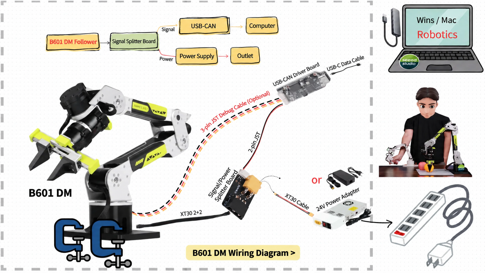

# Seeed Studio reBot Arm B601-DM Engineering Guide


[**View Seeed Studio reBot Arm B601-DM Assembled Kit with Gripper on OpenELAB**](https://openelab.io/products/seeed-studio-rebot-arm-b601-dm-assembled-kit)

**Model:** reBot B601-DM · **SKU:** `Seeed-100065783` · **Option:** assembled DAMIAO follower with gripper; **power supply and clamps are separate**. Accessory variants sharing the product listing are not part of this SKU's coverage.


## Product overview <a href="#product-and-scope" id="product-and-scope"></a>

B601-DM is a six-axis follower arm plus gripper driven by DAMIAO motors. Bring-up starts with the correct24 V power/cable path, seven known motor identities and preserved zero references. B601-RS uses RobStride actuators and48 V; similar mechanical appearance does not make its power, gains, firmware or bus backend interchangeable. [DM quick start](https://wiki.seeedstudio.com/rebot_b601_dm_getting_started/).

## Applications

Use the arm for supervised manipulation, leader/follower demonstration collection and kinematics experiments. Keep initial tests unloaded. Start trajectory development in simulation, then compare real joint order, directions, zeros and frames before running the same path on hardware.

The hardware project recommends working within70% of reach, because an extended loaded pose can stall a joint and allow the arm to drop. A payload value is not a rated load envelope over every orientation/speed. Support links before removing torque, and provide accessible drive-power isolation. [Hardware project](https://github.com/Seeed-Projects/reBot-DevArm), [DM motion workflow](https://wiki.seeedstudio.com/rebot_arm_b601_dm_pinocchio_meshcat/).

## Specifications

| Item                   | B601-DM reference / scope                                                                  |
| ---------------------- | ------------------------------------------------------------------------------------------ |
| Structure              | 6 arm axes +1 gripper                                                                      |
| Actuation              | J1–J3 DAMIAO4340P class; J4–J7 DAMIAO4310 class in current setup table                     |
| Main supply            | **24 V DC**, not RS48 V                                                                    |
| Reference supply setup | Mean Well24 V/14.6 A or15 A-class reference in current quick start; separate from this SKU |
| Host path              | USB-CAN adapter / DAMIAO USB2CAN serial bridge, depending on selected backend              |
| Payload                | Manufacturer project1.5 kg; no complete operating load envelope supplied                   |
| Reach / mass           | Manufacturer project767 mm / approximately4.5 kg                                           |
| Repeatability          | Project states less than±0.2 mm; test conditions unspecified                               |
| Temperature            | DM kinematics guide recommends0–40 °C                                                      |

[Current DM motor/setup table](https://wiki.seeedstudio.com/rebot_b601_dm_getting_started/), [project specification](https://github.com/Seeed-Projects/reBot-DevArm), [DM kinematics reference](https://wiki.seeedstudio.com/rebot_arm_b601_dm_pinocchio_meshcat/). These are reported values, not OpenELAB bench measurements. The tutorial BOM that includes a24 V adapter describes its example setup; it does not change the purchased **without-power** option.

### Motor ID and feedback map

| Joint             | Motor class | CAN command/motor ID | Master/feedback ID in Seeed setup |
| ----------------- | ----------- | -------------------- | --------------------------------- |
| J1 shoulder\_pan  | 4340P       | 0x01                 | 0x11                              |
| J2 shoulder\_lift | 4340P       | 0x02                 | 0x12                              |
| J3 elbow\_flex    | 4340P       | 0x03                 | 0x13                              |
| J4 wrist\_flex    | 4310        | 0x04                 | 0x14                              |
| J5 wrist\_yaw     | 4310        | 0x05                 | 0x15                              |
| J6 wrist\_roll    | 4310        | 0x06                 | 0x16                              |
| J7 gripper        | 4310        | 0x07                 | 0x17                              |

[DM exact setup table](https://wiki.seeedstudio.com/rebot_b601_dm_getting_started/), [follower integration](https://github.com/Seeed-Projects/lerobot-robot-seeed-b601). Tool labels such as Master ID can differ from an SDK's feedback-ID wording; keep the actual numeric pair with each joint. The leader uses IDs0–6 on its own serial bus, not these follower CAN IDs.

## Hardware and connections <a href="#hardware-and-technical-documents" id="hardware-and-technical-documents"></a>

### Mount and wire before power



_Seeed Studio_ [_original DM-only diagram_](https://files.seeedstudio.com/wiki/sensecraft-robotics/guide-assets/rebot-arm-102-b601-dm/02-2-follower-wiring-overview-dm-en.png)_, visually inspected. The3-pin debug cable is optional; the diagram's24 V supply is separate from this store SKU._

1. Secure the base to a rigid bench with suitable clamps and support the links. Check the base reinforcement and cable restraints against the actual revision.
2. With supplies off, connect the base XT30 2+2 harness to the signal/power splitter. Verify the often-missed motor1–motor2 harness link.
3. Connect the splitter's2-pin signal cable to the identified USB-CAN driver; the optional3-pin debug cable goes only to its documented debug connection. Do not infer a pinout from wire color.
4. Connect the splitter power path to the supported **24 V** supply. Keep strain off connectors and cables outside the full motion sweep. Do not hot-plug XT30/JST motor harnesses.
5. If using [Star Arm102](star-arm-102-leader-development-guide.md), secure it independently and connect its **12 V/2 A** supply plus USB data. Keep leader, follower and host ports labelled.

[DM wiring and power](https://wiki.seeedstudio.com/rebot_b601_dm_getting_started/). Use an enclosed supported supply rather than recreating an exposed mains assembly from a video. Maintain the manufacturer's1 m clearance during debugging/motion and keep physical power isolation accessible.

### Revision and assembly boundaries

The hardware directory distinguishes March2026 V1.0 and later V1.1 assembly files; its April update corrects joint1 to4340P and adds cable/base improvements. The October record describes molded harness and routing changes. The open reproduction BOM explicitly does not promise that every material/detail is identical to final shipped hardware. Use the received actuator labels and exact full-assembly STEP revision before fabrication. [DM hardware revision history](https://github.com/Seeed-Projects/reBot-DevArm/blob/main/hardware/reBot_B601_DM/readme.md).

The supplied assembled arm should not receive an indiscriminate ID rewrite. For a replacement/unconfigured motor, isolate it and use the matching DAMIAO tool/firmware; the manufacturer debug procedure uses **921600 baud** for that serial parameter interface. That is not a CAN bitrate. Read parameters first, set the joint's ID pair deliberately, write/read back, disable and power off before moving the debug cable to another motor.

## Software and development resources <a href="#development-software-and-recovery" id="development-software-and-recovery"></a>

| Route                | Exact selection / boundary                                                                                  |
| -------------------- | ----------------------------------------------------------------------------------------------------------- |
| MotorBridge Studio   | DAMIAO B601 model, actual USB-CAN backend; inspect before enable                                            |
| MotorBridge CLI/SDK  | DAMIAO protocol; actual adapter driver/runtime and channel                                                  |
| LeRobot follower     | `seeed_b601_dm_follower`; `damiao` for documented serial bridge, `socketcan` for a real Linux CAN interface |
| LeRobot leader       | `rebot_arm_102_leader`, separate serial port and calibration identity                                       |
| Pinocchio/MeshCat    | `reBotArm_control_py`, `config/rebotarm.yaml` selects `rebotarm_dm.yaml`                                    |
| ROS/MoveIt/Isaac Sim | Exact DM URDF, joint frames/limits and branch before real motion                                            |

[DM first-run](https://wiki.seeedstudio.com/rebot_b601_dm_getting_started/), [LeRobot](https://wiki.seeedstudio.com/rebot_arm_b601_dm_lerobot/), [Pinocchio](https://wiki.seeedstudio.com/rebot_arm_b601_dm_pinocchio_meshcat/). The quick-start recommends a physical Ubuntu24.04 host and provides OS-specific tooling; a VM can have adapter/timing problems. LeRobot has separate Python/CUDA/camera dependencies. Keep one coherent release/commit/backend configuration rather than mixing old plugin and new built-in registrations.

## Getting started

### Read seven joints before commanding motion

1. Inspect mounted/empty hardware,24 V supply, splitter and adapter identity with power off. On the host identify the actual serial bridge (for example `/dev/ttyACM0`) or CAN interface. Close competing applications.
2. Create an isolated MotorBridge environment and record its installed version:

```bash
conda create -n openelab-b601-dm python=3.12 -y
conda activate openelab-b601-dm
python -m pip install motorbridge
python -m pip show motorbridge
python -m pip check
motorbridge-cli --help
motorbridge-gateway --bind 127.0.0.1:9002
```

3. Open [MotorBridge Studio](https://motorbridge.github.io/motorbridge-studio/), connect to the local gateway and select the **DAMIAO reBot B601** model and observed backend/device. A serial bridge is not configured with `ip link set can0`; SocketCAN is a different path.
4. Scan/read states and compare all seven joint model/ID pairs with the table. Save existing parameters/zero references before changing them. Inspect voltage, temperature, position and reported faults where available.

**Expected result:** seven uniquely identified DM joints with plausible state feedback, before an enable/target command. A detected USB adapter alone is not a complete arm result. If identities are incomplete or inconsistent, stop here and inspect supply, cable chain and IDs.

### Preserve or establish zeros, then bounded first motion

5. The current quick start includes MotorBridge zero-setting/debugging. Preserve a supplied valid configuration; if recalibration is needed, support the arm in the manufacturer's illustrated reference pose and follow that exact workflow. A zero write is a state change, not a passive measurement.
6. Read/save parameters, confirm the model/mode and verify readback after any deliberate write. MIT `kp/kd` and native POS\_VEL gains/velocity limits have different meanings. Do not copy the published single-joint example's gains to every joint or change them to hide an origin error.
7. With clear workspace and no payload, select the supported first-run control, start near the **current pose**, use conservative limits and make one small joint change. Confirm intended joint/sign and stop response. Support the arm before disabling torque.

**Expected result:** repeatable state reading, correct reference and one controlled small motion without noise, oscillation or unexpected joint movement. A high-gain “hold zero” command can move abruptly when zero/model is wrong; it is not the first communication test. [Current MotorBridge workflow](https://wiki.seeedstudio.com/rebot_b601_dm_getting_started/).

### Original offline YAML inspection before a kinematics example

After installing the [control project](https://github.com/Seeed-Projects/reBotArm_control_py) with its maintained `uv.lock`, select the DM hardware file in `config/rebotarm.yaml`. Save the following original script as `inspect_dm_config.py` at the project root. It reads configuration only; it neither sets zero nor enables motors.

```python
from pathlib import Path
import yaml

cfg = yaml.safe_load(Path('config/rebotarm_dm.yaml').read_text())
joints = cfg['joints']
seen = set()
for joint in joints:
    motor_id = joint['motor_id']
    feedback_id = joint['feedback_id']
    assert motor_id not in seen, f'Duplicate motor ID {motor_id}'
    seen.add(motor_id)
    assert joint['vendor'].lower() == 'damiao', 'Wrong motor protocol'
    print(joint['name'], 'motor=', hex(motor_id),
          'feedback=', hex(feedback_id), 'model=', joint['model'])
assert set(range(1, 8)).issubset(seen), 'Expected IDs1..7, including gripper'
print('DM_CONFIG_READ: compare with actual bus inventory and units before use')
```

```bash
uv run python inspect_dm_config.py
```

**Expected result:** a readable seven-joint ID/model listing or a precise configuration assertion. This is a local consistency check, not proof that hardware matches the file. Inspect FK/IK in simulation before selecting a real example. The project includes forward/inverse kinematics, smooth trajectories and gravity compensation; gravity compensation depends on a correct mass/geometry model and is an advanced test, not the first power-on mode. [DM configuration and examples](https://wiki.seeedstudio.com/rebot_arm_b601_dm_pinocchio_meshcat/).

### LeRobot: serial bridge and leader remain separate

Install the manufacturer-matched core, `lerobot-robot-seeed-b601`, `lerobot-teleoperator-rebot-arm-102`, MotorBridge and video dependencies in a Python3.12 environment; retain commits and `pip freeze`. The documented package route uses the following types. Inspect help before connecting a different core release.

With both devices already commissioned and in the documented reference poses, replace the example ports with actual identities:


**Automatic motion at connection and exit — B601 plugin commit `0da1a1a5575905d77823227003ffee7672059780`, reviewed 24 November 2026.** Both RS and DM followers inherit this lifecycle. `connect()` calls `configure()`, which enables the drives; its default path then calls `detect_gripper_zero()`, actively closing/probing the gripper. Ordinary `disconnect()` attempts `safe_zero()` to move the arm toward its zero pose **before** configured torque disable. Calibration, emergency and already-returning guards can change that shutdown path; verify the installed version rather than assuming every entry/exit behaves identically.

Before running the commands below, keep the gripper empty, clear the **full return-to-zero path**, and support the arm against falling when torque is removed. Complete the separate passive MotorBridge scan/read procedure above first; LeRobot connection is an active commissioning step. **Ctrl-C or normal program exit is not an immediate stationary torque-off.** Arrange accessible physical emergency drive-power isolation separately, with mechanical support for the resulting loss of torque. [Connection and configure source](https://github.com/Seeed-Projects/lerobot-robot-seeed-b601/blob/0da1a1a5575905d77823227003ffee7672059780/lerobot_robot_seeed_b601/seeed_b601_follower.py#L145-L260), [gripper probe](https://github.com/Seeed-Projects/lerobot-robot-seeed-b601/blob/0da1a1a5575905d77823227003ffee7672059780/lerobot_robot_seeed_b601/seeed_b601_follower.py#L270-L320), [guarded disconnect](https://github.com/Seeed-Projects/lerobot-robot-seeed-b601/blob/0da1a1a5575905d77823227003ffee7672059780/lerobot_robot_seeed_b601/seeed_b601_follower.py#L745-L769).


```bash
lerobot-calibrate --robot.type=seeed_b601_dm_follower \
  --robot.port=/dev/ttyACM0 --robot.can_adapter=damiao --robot.id=openelab_dm
lerobot-calibrate --teleop.type=rebot_arm_102_leader \
  --teleop.port=/dev/ttyUSB0 --teleop.id=openelab_star102
lerobot-teleoperate \
  --robot.type=seeed_b601_dm_follower --robot.port=/dev/ttyACM0 \
  --robot.can_adapter=damiao --robot.id=openelab_dm \
  --teleop.type=rebot_arm_102_leader --teleop.port=/dev/ttyUSB0 \
  --teleop.id=openelab_star102
```

Expected behavior is small one-joint correspondence before cameras or recording. A leader's startup/calibration can reset origins/counters; compare the exact implementation and saved calibration rather than assuming that connecting is always read-only. For a SocketCAN adapter select its actual channel and matching backend, not the serial-bridge configuration above. [DM LeRobot procedure](https://wiki.seeedstudio.com/rebot_arm_b601_dm_lerobot/).

For RealSense/Orbbec, use the documented **DepthCameraSupport** route and compatible SDKs; detect actual camera serials, verify RGB/depth streams separately and preserve resolution/fps/scaling. Record a short local task with fixed wrist/scene cameras, inspect frames/timestamps/actions, then collect more episodes. Visualize before replay; replay and policy evaluation command real motion. Keep training/checkpoint/dataset versions separate from physical calibration records. A trained policy is not a cure for inverted joint mapping.

## Troubleshooting and FAQs <a href="#faqs" id="faqs"></a>

| Symptom                             | Diagnosis and bounded recovery                                                                                                              |
| ----------------------------------- | ------------------------------------------------------------------------------------------------------------------------------------------- |
| All motors appear with one ID       | Stop; isolate/reconfigure individual unconfigured motors using the exact tool. Do not enable the assembled chain with duplicate identities. |
| Loud noise immediately at startup   | Stop and support links; inspect motor revision, protocol/mode, zero reference, current/gains and actual supply before retrying.             |
| Adapter opens, no joint feedback    | Check24 V on the drive path, splitter wiring, first/second joint link, driver/backend and ID pairs.                                         |
| Wrong direction or sudden jump      | Stop; compare leader raw angles, follower state, origins and direction mapping.                                                             |
| CLI reads the wrong robot           | Rebind physical serial/CAN identities, not only `/dev/ttyACM0` enumeration order.                                                           |
| Motion works, video recording fails | Diagnose camera identity/SDK, USB bandwidth and encoder dependencies separately.                                                            |
| New CAD does not match a bracket    | Check the full-assembly revision and shipped production differences; do not force a reproduction BOM's parts into the factory unit.         |
| Can RS48 V supply be used?          | No. The DM drive supply is24 V; leader12 V is a third power domain.                                                                         |

On macOS, the manufacturer notes old WCH drivers can reduce teleoperation performance; inspect the actual device/driver and current OS guidance rather than deleting unrelated drivers. Recover serial ownership/permissions or restore the known configuration before changing gains. Back up calibration and parameters before reset, motor-ID writes or firmware work.

## Downloads and technical documents <a href="#official-documentation-and-development-resources" id="official-documentation-and-development-resources"></a>

| Resource                                                                                                                                          | Scope                                                                                 |
| ------------------------------------------------------------------------------------------------------------------------------------------------- | ------------------------------------------------------------------------------------- |
| [DM hardware/BOM/revision history](https://github.com/Seeed-Projects/reBot-DevArm/blob/main/hardware/reBot_B601_DM/readme.md)                     | Full assembly and part-specific STEP paths; distinguish reproduction from shipped BOM |
| [Current DM full-assembly STEP](https://github.com/Seeed-Projects/reBot-DevArm/blob/main/hardware/reBot_B601_DM/reBot_B601_DM_v1.1_20260625.step) | Manufacturer-listed V1.1 assembly file; verify received revision before fabrication   |
| [DM quick start](https://wiki.seeedstudio.com/rebot_b601_dm_getting_started/)                                                                     | Supply, harness, ID pairs, DAMIAO debug and MotorBridge                               |
| [MotorBridge source/SDK](https://github.com/tianrking/motorbridge)                                                                                | Adapter/runtime, CLI and gateway                                                      |
| [B601 LeRobot plugin](https://github.com/Seeed-Projects/lerobot-robot-seeed-b601)                                                                 | Exact DM follower configuration                                                       |
| [Pinocchio control project](https://github.com/Seeed-Projects/reBotArm_control_py)                                                                | DM YAML, models, simulations and motion examples                                      |
| [Star Arm102 integration](https://github.com/Seeed-Projects/lerobot-teleoperator-rebot-arm-102)                                                   | Separate leader map/calibration                                                       |

## References and validation <a href="#sources-and-validation" id="sources-and-validation"></a>

Reviewed **24 November2026**: [DM quick start](https://wiki.seeedstudio.com/rebot_b601_dm_getting_started/), [DM LeRobot](https://wiki.seeedstudio.com/rebot_arm_b601_dm_lerobot/), [DM Pinocchio/MeshCat](https://wiki.seeedstudio.com/rebot_arm_b601_dm_pinocchio_meshcat/), [open hardware project](https://github.com/Seeed-Projects/reBot-DevArm) and source repositories above. Seeed's DM wiring illustration was visually inspected. [The retained regional product reference](https://openelab.de/products/seeed-studio-rebot-arm-b601-dm-assembled-kit) identifies the same ordering code; the opening global-store link was independently verified.

**Validation:** source reviewed. SDK installation/compilation, CAN/serial reads, calibration, parameter writes, simulation and hardware motion were **not run**. Expected results describe reproduction checkpoints; no compiler or hardware result is claimed.
