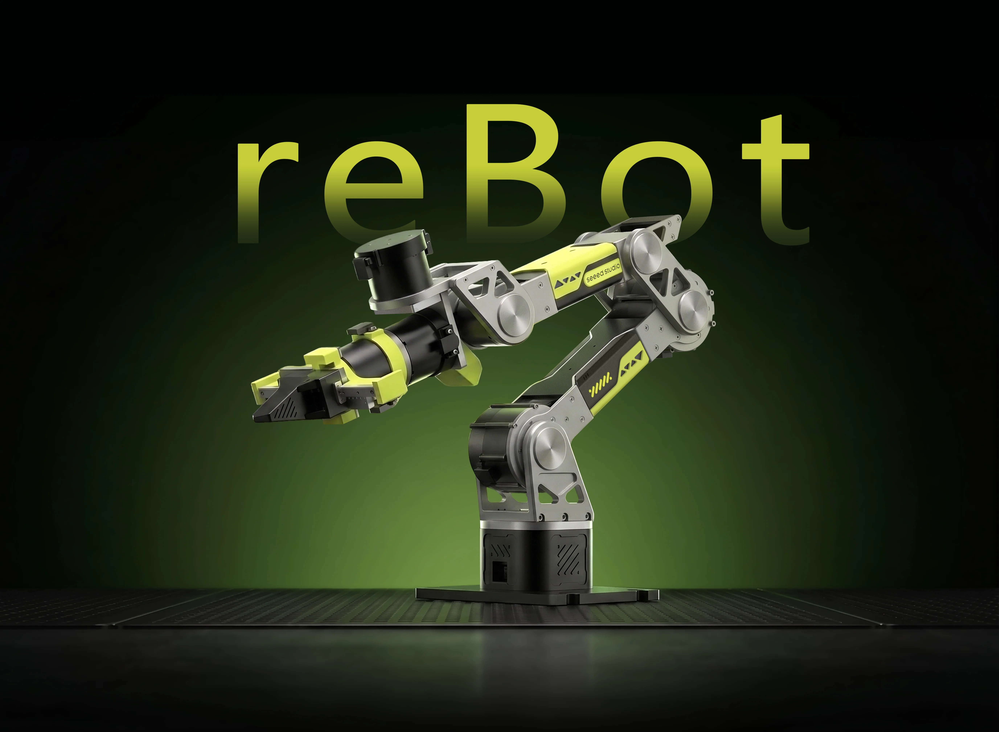

# Seeed Studio reBot Arm B601-RS Development Guide




[**View Seeed Studio reBot Arm B601-RS Assembled Kit with Gripper on OpenELAB**](https://openelab.io/products/seeed-studio-rebot-arm-b601-rs-assembled-kit-with-gripper-without-power-supply)

**Model:** reBot B601-RS · **SKU:** `Seeed-100019336` · **Option:** assembled RobStride follower with gripper, **without power supply**. Star Arm 102, cameras and accessory variants on the same listing are separate items.


### Product overview <a href="#product-and-exact-kit-scope" id="product-and-exact-kit-scope"></a>

B601-RS is a six-joint, CAN-controlled follower arm plus actuated gripper. The engineering workflow is to establish the RobStride bus, inspect seven joints, preserve or establish zero references, then test bounded motion before teleoperation or learned policies. The visually similar B601-DM uses DAMIAO motors, a different protocol and 24 V power. [RS quick start](https://wiki.seeedstudio.com/rebot_b601_rs_getting_started/).

_Seeed Studio_ [_original product illustration_](https://files.seeedstudio.com/wiki/robotics/projects/rebot_arm/RS5_56.webp)_._ Seeed Studio wiki hub.

### Applications

Use the arm for joint-space control, kinematics/trajectory experiments and leader-guided demonstration collection. For learning, establish stable calibration and camera geometry before collecting repeated tasks. For motion planning, begin in simulation and verify frame conventions, joint limits and collision geometry before connecting the real arm.

A maximum payload figure is not a load permitted at every reach, speed or orientation. Seeed's motion examples restrict operation to the inner 70% of reach to avoid shoulder stall and possible arm drop. Keep the gripper empty during commissioning; account for tooling mass and cable forces when later evaluating a task. [RS kinematics reference](https://wiki.seeedstudio.com/rebot_arm_b601_rs_pinocchio_meshcat/).

### Specifications <a href="#hardware-and-software-map" id="hardware-and-software-map"></a>

| Parameter           | B601-RS manufacturer reference / condition                                                   |
| ------------------- | -------------------------------------------------------------------------------------------- |
| Axes                | 6 arm joints + 1 gripper actuator                                                            |
| Motors              | RobStride 06 ×3; RobStride 00 ×4                                                             |
| Supply voltage      | 48 V DC follower; **not the DM 24 V supply**                                                 |
| CAN                 | 1 Mbit/s; adapter/backend must match firmware                                                |
| Reach               | 754.7 mm with gripper; 587.5 mm without, tutorial figures                                    |
| Payload             | Rated 2.5 kg; 5 kg maximum stated in the kinematics tutorial, without a full load envelope   |
| Self weight         | Approximately 6.7 kg                                                                         |
| Repeatability       | Tutorial states 0.1 mm; repository describes less than ±0.1 mm; conditions are not specified |
| Working temperature | −20 to 50 °C in the RS tutorial; supply/host can impose narrower limits                      |

Source: [RS numerical specification tables](https://wiki.seeedstudio.com/rebot_arm_b601_rs_pinocchio_meshcat/), [open hardware project](https://github.com/Seeed-Projects/reBot-DevArm). These are manufacturer-reported values, not OpenELAB measurements or commissioning targets.

| Joint   | Manufacturer travel reference | Integration boundary                                                                   |
| ------- | ----------------------------- | -------------------------------------------------------------------------------------- |
| J1      | ±150°                         | Verify zero and sign before using absolute angles                                      |
| J2 / J3 | Each 220° to 0°               | Keep the source's coordinate convention; do not translate to ±110° without a transform |
| J4 / J5 | Each ±90°                     | Check cable clearance as well as joint limits                                          |
| J6      | ±180°                         | A physical range is not unlimited rotation                                             |
| Gripper | 345° to 0° motor reference    | Motor angle is not a jaw opening in millimeters                                        |

Travel source: [RS kinematics guide](https://wiki.seeedstudio.com/rebot_arm_b601_rs_pinocchio_meshcat/). Store a calibrated joint-to-model transform with the physical arm. Do not apply these degree values directly to an SDK accepting radians.

#### Supply sizing and package distinction

The RS quick start names a **48 V / 12.5 A** reference supply; the kinematics tutorial uses a **48 V / 15 A** example, while the repository discusses a higher-current full-performance option. These are source setup choices, not proof of a common included adapter or a constant current draw. This SKU explicitly excludes the supply. Select a supported enclosed RS supply, cable/connector and protection appropriate to the actual task. Do not copy the quick-start page's incidental 24 V enclosure wording into an RS electrical design. [Quick-start supply section](https://wiki.seeedstudio.com/rebot_b601_rs_getting_started/), [hardware/BOM](https://github.com/Seeed-Projects/reBot-DevArm).

### Hardware and connections

#### Prepare the bench

Use two suitable clamps or a designed rigid fixture; Seeed's checklist calls for clamps at least 3 inches. Inspect the base and links with power removed. Support the arm before torque is disabled. Provide physical drive-power isolation, keep people and objects at least 1 m away from the motion area and check the full cable sweep. The host's Stop button cannot hold an unpowered arm in the air.

_Seeed Studio_ [_RS-specific wiring photograph_](https://files.seeedstudio.com/wiki/robotics/projects/rebot_arm/rs_connecting_cable.jpg)_, reviewed for the CANH/CANL/GND labels and separate power lead. Connector orientation is determined by the actual labels; cable color alone is insufficient._

#### Connect with all power off

1. Connect the follower's base XT30 2+2 harness to the signal/power separation board. Verify the motor-1 to motor-2 link is present before closing covers.
2. Connect the separation board's CAN signal path to the identified USB-CAN adapter, matching CANH/CANL and its documented ground reference. The thick power lead goes to the 48 V drive supply; USB powers communication, not the arm.
3. Confirm the adapter's normal operating/termination selection. Seeed's PCAN-compatible adapter procedure returns the switch to **120R** after bootloader work. Do not leave it in BOOT. CAN needs the documented termination at the bus ends, not an arbitrary resistor at every motor.
4. If a leader is used, secure it separately and connect its own **12 V / 2 A** supply and USB-C data. Never power the leader from the RS 48 V path.
5. Recheck polarity, mechanical support and the intended interface before energizing. Do not hot-plug motor, XT30 or signal harnesses.

[RS connection procedure](https://wiki.seeedstudio.com/rebot_b601_rs_getting_started/), Star Arm 102 leader guide. Do not infer pin numbers for an unlabelled adapter from this photograph; identify that adapter's manual first.

### Software and development resources

| Route                        | Model-specific selection                                                                                   |
| ---------------------------- | ---------------------------------------------------------------------------------------------------------- |
| MotorBridge Studio           | `rebot-arm-robstride`; read/scan before enabling motion                                                    |
| MotorBridge CLI / Python SDK | RobStride vendor, observed CAN channel, joint IDs 1–7; retain installed version and backend                |
| LeRobot                      | `seeed_b601_rs_follower`; SocketCAN on Linux or the documented PCAN mapping; leader `rebot_arm_102_leader` |
| Kinematics                   | `Seeed-Projects/reBotArm_control_py`, `config/rebotarm.yaml` → `hardware_yaml: "rebotarm_rs.yaml"`         |
| SenseCraft Robotics          | Exact reBot Arm 102 + B601 RS project, separate leader/follower port binding                               |
| ROS / MoveIt / Isaac Sim     | Use the exact RS model/URDF and supported branch; physical zero, frames and limits must match simulation   |

The [RS quick start](https://wiki.seeedstudio.com/rebot_b601_rs_getting_started/) recommends a physical Ubuntu 24.04 host and documents other OS paths. The [MotorBridge repository](https://github.com/tianrking/motorbridge) identifies Linux as its primary target and some Windows backends as experimental; a GUI being available on an OS is not equivalent to every adapter/backend being validated there.

The older [B601 LeRobot plugin README](https://github.com/Seeed-Projects/lerobot-robot-seeed-b601) calls RS registered but still being refined and says the dedicated `robstride` adapter path is unsupported in that plugin revision. Use the documented `socketcan` route rather than assuming a vendor name is the adapter backend. Current LeRobot source can include integrated reBot support; use **one complete installation route**, not duplicate built-in and separately registered classes. Seeed's [RS LeRobot tutorial](https://wiki.seeedstudio.com/rebot_arm_b601_rs_lerobot/) supplies the package-based route below.

### Getting started <a href="#getting-started-identify-all-joints-before-moving" id="getting-started-identify-all-joints-before-moving"></a>

#### Establish communication without an enable command

1. Identify the real USB-CAN adapter/firmware. On Linux inspect `ip -br link` and the device enumeration. Choose the observed CAN interface; `can0` below is a replaceable example. Keep the arm supported and do not start another motor application concurrently.
2. Create an isolated Python 3.12 environment, install MotorBridge and record its resolved version. Confirm the CLI options before using hardware.

```bash
conda create -n openelab-b601-rs python=3.12 -y
conda activate openelab-b601-rs
python -m pip install motorbridge
python -m pip show motorbridge
motorbridge-cli --help
```

3. For a SocketCAN-compatible adapter, bring up the identified interface at 1 Mbit/s. This changes the host interface, not motor IDs or zeros. A PCAN library backend on Windows/macOS uses its own documented channel mapping instead of Linux `ip` commands.

```bash
sudo ip link set can0 down
sudo ip link set can0 type can bitrate 1000000 restart-ms 100
sudo ip link set can0 up
ip -details -statistics link show can0
motorbridge-cli scan --vendor robstride --channel can0 \
  --start-id 1 --end-id 7 --timeout-ms 300
```

**Expected result:** the scan identifies the expected seven RS joint IDs without commanding a target position. Save the scan and interface statistics. A healthy USB adapter alone is not a successful joint scan. If fewer joints appear, stop here and inspect supply, termination, CAN pair, harness continuity and duplicate IDs. [MotorBridge scan reference](https://github.com/tianrking/motorbridge), [RS adapter setup](https://wiki.seeedstudio.com/rebot_b601_rs_getting_started/).

#### Preserve zeros, initialize parameters and test one joint

4. Launch `motorbridge-gateway --bind 127.0.0.1:9002` and open [MotorBridge Studio](https://motorbridge.github.io/motorbridge-studio/). Select `rebot-arm-robstride`, the observed channel and the corresponding backend. Scan again and compare J1–J7 with the physical inventory.
5. **Read Parameters** first and save the existing values. An assembled, correctly calibrated kit should not receive an indiscriminate ID/zero rewrite. If zero calibration is actually required, support the arm and follow the RS illustrated zero pose for each joint; a zero write in an arbitrary pose corrupts the model reference.
6. The current RS workflow provides **Apply Default Template → Write Parameters → readback verification**. Applying a template only changes the page's staged values; writing changes the motors. Confirm the exact RS template and support/clearance before writing, then compare the automatic readback. Keep the previous configuration for recovery.
7. Use the application's supported position/first-run view with a small target near the **current** pose, conservative velocity and no payload. Test joint identity, direction and stop response one joint at a time. Stop for oscillation, noise, unexpected movement or excessive current/temperature.

**Expected result:** seven plausible states, known zero references, matching parameter readback and a small motion of the intended joint. MIT stiffness/damping and native position-loop parameters are different controls; copying gains between them is not a recovery method. Native position behavior also depends on `loc_kp`, `vel_max`, `spd_kp` and `acc_rad`. [RS calibration and parameter flow](https://wiki.seeedstudio.com/rebot_b601_rs_getting_started/).

#### Original offline joint-map check

Before sending targets, validate your saved joint inventory with this original host-only script. Create `joints.json` containing seven objects with `joint`, `id` and `model`, then run `python check_rs_inventory.py joints.json`. It does not talk to motors or assert that a handwritten inventory matches hardware.

```python
import json
import sys

joints = json.load(open(sys.argv[1], encoding='utf-8'))
expected = {'shoulder_pan', 'shoulder_lift', 'elbow_flex',
            'wrist_flex', 'wrist_yaw', 'wrist_roll', 'gripper'}
assert len(joints) == 7, 'Expected seven joints including gripper'
assert {j['joint'] for j in joints} == expected, 'Missing/duplicate joint name'
assert {int(j['id']) for j in joints} == set(range(1, 8)), 'IDs must be unique 1..7'
for j in sorted(joints, key=lambda x: int(x['id'])):
    print(j['joint'], 'id=', j['id'], 'model=', j['model'])
print('INVENTORY_CONSISTENT: compare with the actual scan before motion')
```

Expected output is a seven-row inventory or an assertion identifying the inconsistency. Preserve model/firmware, zero offsets, units and current/thermal limits in a fuller commissioning record; the check intentionally does not manufacture numerical torque limits.

#### LeRobot teleoperation and cameras <a href="#lerobot-and-application-development" id="lerobot-and-application-development"></a>

After the MotorBridge baseline, follow the manufacturer package route in an isolated environment: install its Seeed LeRobot checkout, `lerobot-teleoperator-rebot-arm-102`, `lerobot-robot-seeed-b601` and `motorbridge`, then run `python -m pip check` and inspect `lerobot-teleoperate --help` for the expected types. The source snapshots for this page were reviewed on 24 November 2026; resolve/pin a mutually compatible package set and retain it rather than silently mixing a new core with historical plugins.

The following original configuration assumes a calibrated, supported, empty RS follower on `can0` and a separately powered leader on the observed `/dev/ttyUSB0`. Calibration/startup may establish origins; place the actual arms in the documented reference poses first.


**Automatic motion at connection and exit — B601 plugin commit `0da1a1a5575905d77823227003ffee7672059780`, reviewed 24 November 2026.** Both RS and DM followers inherit this lifecycle. `connect()` calls `configure()`, which enables the drives; its default path then calls `detect_gripper_zero()`, actively closing/probing the gripper. Ordinary `disconnect()` attempts `safe_zero()` to move the arm toward its zero pose **before** configured torque disable. Calibration, emergency and already-returning guards can change that shutdown path; verify the installed version rather than assuming every entry/exit behaves identically.

Before running the commands below, keep the gripper empty, clear the **full return-to-zero path**, and support the arm against falling when torque is removed. Complete the separate passive MotorBridge scan/read procedure above first; LeRobot connection is an active commissioning step. **Ctrl-C or normal program exit is not an immediate stationary torque-off.** Arrange accessible physical emergency drive-power isolation separately, with mechanical support for the resulting loss of torque. [Connection and configure source](https://github.com/Seeed-Projects/lerobot-robot-seeed-b601/blob/0da1a1a5575905d77823227003ffee7672059780/lerobot_robot_seeed_b601/seeed_b601_follower.py#L145-L260), [gripper probe](https://github.com/Seeed-Projects/lerobot-robot-seeed-b601/blob/0da1a1a5575905d77823227003ffee7672059780/lerobot_robot_seeed_b601/seeed_b601_follower.py#L270-L320), [guarded disconnect](https://github.com/Seeed-Projects/lerobot-robot-seeed-b601/blob/0da1a1a5575905d77823227003ffee7672059780/lerobot_robot_seeed_b601/seeed_b601_follower.py#L745-L769).


```bash
lerobot-calibrate --robot.type=seeed_b601_rs_follower \
  --robot.port=can0 --robot.can_adapter=socketcan --robot.id=openelab_rs
lerobot-calibrate --teleop.type=rebot_arm_102_leader \
  --teleop.port=/dev/ttyUSB0 --teleop.id=openelab_star102
lerobot-teleoperate \
  --robot.type=seeed_b601_rs_follower --robot.port=can0 \
  --robot.can_adapter=socketcan --robot.id=openelab_rs \
  --teleop.type=rebot_arm_102_leader --teleop.port=/dev/ttyUSB0 \
  --teleop.id=openelab_star102
```

Expected behavior is the same small-joint correspondence already checked without cameras. For camera work, detect/bind the actual serial numbers; match RGB/depth dimensions, fps, warm-up and depth scale. The vendor tutorial covers RealSense and Orbbec on **DepthCameraSupport**. Record a short local episode with the same calibrated IDs, verify time-aligned views/actions, and inspect it before replay. Replay and policy evaluation cause real motion, so repeat the clearance check.

SenseCraft's project route covers model selection, USB binding, calibration, teleoperation, cameras, action replay, dataset recording/deletion/merging, training, model management and operation. Use one recorded project configuration throughout. [RS LeRobot workflow](https://wiki.seeedstudio.com/rebot_arm_b601_rs_lerobot/), [SenseCraft RS workflow](https://wiki.seeedstudio.com/sensecraft_robotics_rebot_arm_102_b601_rs/).

#### Kinematics before torque control

In `reBotArm_control_py`, select `rebotarm_rs.yaml` explicitly; the default DM configuration uses the wrong protocol. Inspect FK, IK and trajectory simulations in MeshCat first. Confirm frame names, joint order, radians/meters and the reference pose, then use the corresponding real-machine example only after bus and zeros are sound. MIT `kp/kd` tune stiffness/damping; native POS\_VEL `vel_kp/vel_ki/pos_kp/vlim` tune a different controller. Gravity compensation depends on the mass/geometry model and is not an initial “floating arm” test. [RS Pinocchio/MeshCat procedure](https://wiki.seeedstudio.com/rebot_arm_b601_rs_pinocchio_meshcat/).

### Troubleshooting and FAQs <a href="#troubleshooting-and-recovery" id="troubleshooting-and-recovery"></a>

| Symptom                                      | Ordered checks / recovery                                                                                                                                        |
| -------------------------------------------- | ---------------------------------------------------------------------------------------------------------------------------------------------------------------- |
| No CAN interface                             | Confirm adapter USB enumeration/firmware, normal switch setting and OS backend; do not flash a different adapter's image.                                        |
| Interface present, no joints                 | Inspect 48 V at the correct power path, CANH/CANL, termination and bitrate; then inspect the first chain segment.                                                |
| Joint missing                                | Power off and inspect its cable and neighboring links; compare IDs. Do not enable a partially identified arm.                                                    |
| Oscillation or native position mode abnormal | Stop, support links, read current parameters and compare the RS template/readback and mode. Do not increase stiffness to hide a zero/sign error.                 |
| Wrong joint or inverted teleoperation        | Compare leader raw angles, follower joint map, direction transform and origins before sending more actions.                                                      |
| PCAN number changes after replug             | Re-identify the channel; enumeration order is not a durable robot identity.                                                                                      |
| macOS library error                          | Follow the current PCBUSB loader/runtime instructions; the documented runtime loads `PCBUSB`, not merely a successful `ctypes` load of a differently named file. |
| Can DM commands be reused?                   | No. Similar mechanics do not establish actuator protocol, bus backend, supply or gain compatibility.                                                             |

For the exact documented adapter that needs recovery: disconnect drive power, use the official **USB2CAN.zip**/DFU procedure, restore **120R**, reconnect and verify the PCAN identity before reattaching the arm. Preserve the old adapter identity/firmware first. Driver installation and bootloader flashing are separate operations. [OS-specific recovery guide](https://wiki.seeedstudio.com/rebot_b601_rs_getting_started/).

### Downloads and technical documents <a href="#technical-documents-and-software" id="technical-documents-and-software"></a>

| Resource                                                                                                                         | Purpose / scope                                                                     |
| -------------------------------------------------------------------------------------------------------------------------------- | ----------------------------------------------------------------------------------- |
| [RS hardware/BOM directory](https://github.com/Seeed-Projects/reBot-DevArm/tree/main/hardware/reBot_B601_RS)                     | Model-specific mechanical files and parts; hardware project declares CERN-OHL-W-2.0 |
| [reBot open hardware project](https://github.com/Seeed-Projects/reBot-DevArm)                                                    | CAD, BOM, model and ecosystem links; software license declared Apache-2.0           |
| [MotorBridge source](https://github.com/tianrking/motorbridge)                                                                   | SDK, CLI, gateway and backend compatibility                                         |
| [USB2CAN firmware package](https://files.seeedstudio.com/wiki/robotics/projects/rebot_arm/pcan_firmware/USB2CAN.zip)             | Only for the adapter/recovery flow identified in Seeed's guide                      |
| [PEAK driver package](https://files.seeedstudio.com/wiki/robotics/projects/rebot_arm/pcan_firmware/PEAK-System_Driver-Setup.zip) | Manufacturer-linked Windows driver package                                          |
| [B601 LeRobot integration](https://github.com/Seeed-Projects/lerobot-robot-seeed-b601)                                           | Match core/plugin/backend versions                                                  |
| [Star Arm 102 LeRobot integration](https://github.com/Seeed-Projects/lerobot-teleoperator-rebot-arm-102)                         | Leader map and raw-angle diagnostic                                                 |
| [Pinocchio control project](https://github.com/Seeed-Projects/reBotArm_control_py)                                               | RS YAML, kinematics/simulation and motion examples                                  |

### References and validation <a href="#official-documentation-and-development-resources" id="official-documentation-and-development-resources"></a>

Reviewed **24 November 2026**: [RS quick start](https://wiki.seeedstudio.com/rebot_b601_rs_getting_started/), [RS kinematics](https://wiki.seeedstudio.com/rebot_arm_b601_rs_pinocchio_meshcat/), [LeRobot](https://wiki.seeedstudio.com/rebot_arm_b601_rs_lerobot/), [SenseCraft Robotics](https://wiki.seeedstudio.com/sensecraft_robotics_rebot_arm_102_b601_rs/) and repositories above. The wiring photograph was visually inspected; linked CAD/firmware packages are resources, not proof of successful flashing or mechanical fit.

**Validation:** source reviewed. SDK installation/compilation, adapter flashing, CAN scans, calibration, parameter writes and hardware motion were **not run**. Expected results and original scripts/configurations are provided for controlled reproduction, with no fabricated bench outcome.
