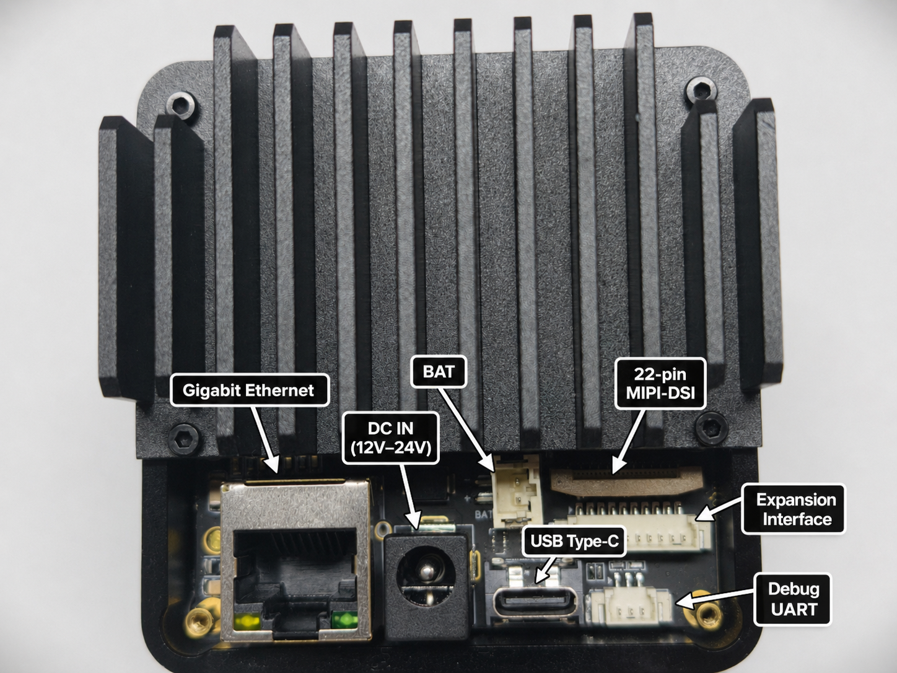
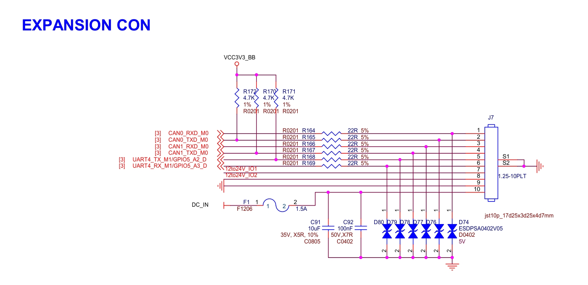
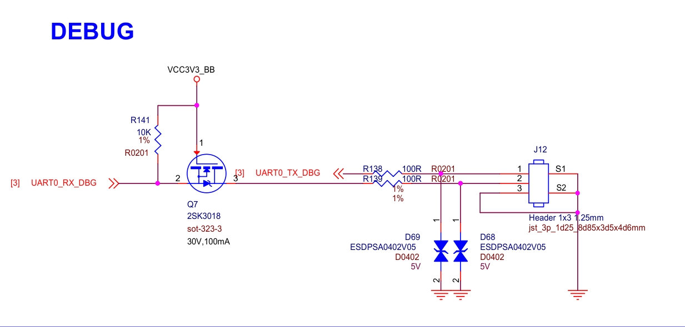

# Seeed Studio reCamera Pro 2GB Engineering Guide


[**View Seeed Studio reCamera Pro 2GB Open AI Camera on OpenELAB**](https://openelab.io/products/seeed-studio-recamera-pro-2gb-open-ai-camera)

**Model:** reCamera Pro, Rockchip RV1126B · **SKU:** `Seeed-100092895` · **RAM:** 2 GB. This is the aarch64 Pro platform, not the SG2002/RISC-V original reCamera or the 4 GB option.


## Product overview <a href="#product-and-scope" id="product-and-scope"></a>

reCamera Pro runs camera capture, local AI inference and event actions on an embedded Linux device. The first useful result is **live video plus actual inference output**, followed by a recorded event that can be played back. Web API integration and native applications come after that baseline, using firmware-compatible models and libraries. [Pro first detection](https://wiki.seeedstudio.com/recamera_pro_getting_started/), [development routes](https://wiki.seeedstudio.com/recamera_pro_dev_path/).

## Applications

Build a scene-specific detection/recording prototype, a local camera event endpoint or an annotated video application. Keep camera frame rate, inference rate and downstream recording/notification cadence separate. A 3 TOPS NPU rating does not establish application FPS, model accuracy or the memory capacity to run an arbitrary language/vision model on the 2 GB unit.

For deployment, define an observable test scene and a data-retention policy. Verify the trigger with a target entering and leaving view, inspect event timestamps and file playback, and test what happens when the network or storage is unavailable. Use the supplied lens/lighting for initial tests before changing optics.

## Specifications

| Item                | Pro hardware / scope                                                                             |
| ------------------- | ------------------------------------------------------------------------------------------------ |
| SoC / CPU           | Rockchip RV1126B, quad-core Cortex-A53 up to1.2 GHz                                              |
| NPU                 | Manufacturer3 TOPS, mixed INT8/INT16 support                                                     |
| This SKU memory     | **2 GB LPDDR4**, not4 GB                                                                         |
| Storage             | 16 GB eMMC; microSD expansion up to512 GB in hardware reference                                  |
| Camera              | SC850SL,4K at30 fps sensor path                                                                  |
| Motion sensing      | ICM-42670-P,3-axis accelerometer +3-axis gyro                                                    |
| Audio               | Two electret microphones;8 Ω speaker rated1 W                                                    |
| Network             | Gigabit Ethernet; Wi-Fi/Bluetooth hardware, firmware/image-dependent support                     |
| Physical interfaces | Full-function USB-C OTG, debug UART,2 CAN signal groups,22-pin MIPI DSI,2 GPIO/expansion signals |
| Main DC input       | 12–24 V,5525 barrel connector; use the supplied12 V adapter for first run                        |
| Battery option      | Supported7.4 V battery charge/discharge circuit; not an arbitrary single-cell input              |

[Official Pro hardware reference](https://wiki.seeedstudio.com/recamera_pro_hardware_specifications/), [exact2 GB listing](https://openelab.io/products/seeed-studio-recamera-pro-2gb-open-ai-camera). The hardware wiki's “Wi-Fi5.2” wording is not a valid Wi-Fi standard designation; select the actual SSID/module/firmware capability rather than deriving a radio specification from that phrase. The storefront and hardware page also differ in Bluetooth-version wording; no Bluetooth-version-dependent procedure is assumed here.

## Hardware and connections <a href="#hardware-and-technical-documents" id="hardware-and-technical-documents"></a>

### Power before USB networking

The quick-start baseline uses **12 V DC, at least1 A**, with a **12 V /3 A factory adapter** described in the current guide. Keep the supplied adapter for first commissioning; another retail reference to12 V /2 A is not a reason to discard the unit's own label. USB-C initially provides the host data/network path. For USB-powered operation, the FAQ requires a suitable **USB PD** source; an ordinary5 V host port or charge cable is not equivalent. Do not combine power sources without the exact board power design. [First connection](https://wiki.seeedstudio.com/recamera_pro_getting_started/), [power-related FAQ](https://wiki.seeedstudio.com/recamera_pro_faqs/).



_Seeed Studio_ [_original rear-interface photograph_](https://files.seeedstudio.com/wiki/reCamera-Pro/getting_started/base_board_pin.png)_, visually inspected. The DC IN and BAT connectors are different inputs._

Leave expansion, battery and MIPI devices disconnected until the camera boots and streams. Keep the heatsink clear and the device mechanically stable. Ethernet connectivity does not by itself establish a suitable PoE source; use the documented supported power path, not a passive voltage injector.

### Expansion connector and debug UART



_Seeed Studio_ [_original J7 expansion circuit_](https://files.seeedstudio.com/wiki/reCamera-Pro/getting_started/reCamera-PRO_Expansion_CON.jpg)_. Read connector orientation from the drawing and actual pin1 mark._

| J7 pin | Net shown in manufacturer circuit                      | Boundary                                                                  |
| ------ | ------------------------------------------------------ | ------------------------------------------------------------------------- |
| 1 /2   | CAN0\_RXD\_M0 / CAN0\_TXD\_M0                          | RX/TX controller nets, **not CANH/CANL**                                  |
| 3 /4   | CAN1\_RXD\_M0 / CAN1\_TXD\_M0                          | A physical CAN transceiver/bus design is still required                   |
| 5 /6   | UART4\_TX\_M1/GPIO5\_A2\_D; UART4\_RX\_M1/GPIO5\_A3\_D | Multiplexed UART/GPIO functions; verify selected firmware function        |
| 7 /8   | 12to24V\_IO1 /12to24V\_IO2                             | Follow the full I/O circuit; do not treat them as ordinary3.3 V GPIO pins |
| 9      | GND                                                    | Common reference                                                          |
| 10     | DC\_IN through1.5 A fuse                               | Shared protected supply net, not a declared spare-current budget          |



_Seeed Studio_ [_original J12 debug circuit_](https://files.seeedstudio.com/wiki/reCamera-Pro/getting_started/reCamera-PRO_Debug_Uart.jpg)_. Pins1/2/3 are debug TX/RX/GND, with no VCC power pin._

Do not attach RS-232 voltage levels or a5 V adapter to these debug signals. Check the exact UART voltage/interface and adapter before wiring, cross TX/RX, and use GND. USB-network access below requires no debug wiring. [Exact hardware diagrams](https://wiki.seeedstudio.com/recamera_pro_hardware_specifications/).

## Software and development resources <a href="#development-software-and-recovery" id="development-software-and-recovery"></a>

| Route                        | Correct Pro contract                                                                                    |
| ---------------------------- | ------------------------------------------------------------------------------------------------------- |
| Factory WebUI                | Production Buildroot firmware; preview, inference, recording and output configuration                   |
| Web API                      | JSON HTTP(S), mostly `/cgi-bin/entry.cgi`; JWT token cookie; some serial/file functions use `/api/v1/…` |
| Native SDK                   | **aarch64 Linux / RV1126B**, Rockchip GCC12.4.0, matching sysroot, GStreamer1.22                        |
| NPU runtime/model conversion | **RKNN-Toolkit2 2.3.2 / RKNN Runtime2.3.2**, target `rv1126b` in reviewed firmware                      |
| Model source                 | Inspect ONNX contract, convert to RKNN, compare source versus device outputs                            |
| Experimental Debian13        | Separate image/development tradeoffs; not the stock WebUI environment                                   |

[Development selector](https://wiki.seeedstudio.com/recamera_pro_dev_path/), [SDK](https://wiki.seeedstudio.com/recamera_pro_sdk_setup/), [downloads/version alignment](https://wiki.seeedstudio.com/recamera_pro_downloads/). Match the actual firmware's runtime, ABI and model format before deployment. Do not install an SG2002/riscv64 application, an RV1126 rather than **RV1126B** model, or a4 GB model package by filename similarity.

## Getting started

### Connect, preview and confirm inference

1. Connect the documented12 V DC supply and USB-C **data** cable. Wait for solid green. Green breathing means startup; red is power; green100 ms blinking indicates OTA; short green blinking indicates a dirty-filesystem SD condition.
2. Open `http://192.168.42.1` from the USB-connected host. At first login the documented initial password is `recamera`; set your own password, then log in as `admin`. Keep the device on a trusted local connection during setup.
3. In **Real-time Preview**, click **Start**, aim/focus and verify live movement. Compare main/substream behavior before adding recording.
4. In **AI Inference**, enable inference, select the existing detection model and **Save Configuration**. Confirm **Running** and nonzero actual FPS, then place an expected target in view. Inspect `class_name`, `score`, `bbox` and `detection_count` with timestamps.

**Expected result:** live imagery **and** changing plausible detection results. A video preview alone checks only the image path. Record firmware/model/input settings and a short result sample; the factory model's category list controls what can be detected. [First detection](https://wiki.seeedstudio.com/recamera_pro_getting_started/), [inference settings](https://wiki.seeedstudio.com/recamera_pro_ai_inference/).

For Wi-Fi, open **Device Info → Network Settings**, enable/scan, join the intended SSID, then read the assigned IP from its information icon. From the same reachable LAN, open that address, log in and start preview again. Only then unplug USB while retaining DC power. Guest/client isolation and host routing can block access even when both devices show Wi-Fi connected. [Wireless access](https://wiki.seeedstudio.com/recamera_pro_wifi_access/).

### Detect, record and play back

1. In **Recording Settings**, select MP4. The reviewed factory workflow saves **one-minute** MP4 clips; do not assume changing inference FPS changes that duration.
2. Choose **AI Inference Trigger → Configure**, select the running task and a category actually emitted by that model. For the first test leave the trigger area empty for the full frame and choose a schedule covering the current time.
3. Click **Apply**, verify the active trigger, then introduce the target. In **File Preview**, open today's recording and play it back. Inspect Storage Management location, quota and full-disk/overwrite policy.

**Expected result:** a playable clip associated with the intended event and timestamp. Next narrow the region or combine documented timer/GPIO/UART/HTTP/audio triggers one at a time. Set HTTP/MQTT/UART outputs to a test endpoint and compare its received payload/timing with the camera event before enabling repeated notifications. [First recording](https://wiki.seeedstudio.com/recamera_pro_first_recording/). Set device time/timezone before judging schedules and exported event order.

### Original authenticated device-information script

This original host script performs a login and **read-only device-info** request, with a bounded timeout and no model/configuration change. It uses the actual API field names and cookie behavior. Install `requests`, save as `read_recamera.py`, then supply your device base URL. Use HTTPS with a trusted device certificate/CA where configured; `--ca` names that CA file. The first-boot HTTP URL is suitable only for the trusted direct/local setup described above.

```python
import argparse
import getpass
import json
import requests

parser = argparse.ArgumentParser()
parser.add_argument('base_url')
parser.add_argument('--ca', help='CA file for the device HTTPS certificate')
args = parser.parse_args()
base = args.base_url.rstrip('/') + '/cgi-bin/entry.cgi'
with requests.Session() as session:
    session.verify = args.ca if args.ca else True
    response = session.post(base + '/system/login', json={
        'sUserName': 'admin', 'sPassword': getpass.getpass('Camera password: ')
    }, timeout=10)
    response.raise_for_status()
    login = response.json()
    if login.get('iStatus') != 0 or login.get('iAuth') != 1:
        raise SystemExit('Login not ready: check password, lock wait or first-login change')
    info = session.get(base + '/system/device-info', timeout=10)
    info.raise_for_status()
    data = info.json()
    wanted = ('sSerialNumber', 'sFirmwareVersion', 'sSensorModel', 'sBasePlateModel')
    print(json.dumps({key: data.get(key) for key in wanted}, indent=2))
```

```bash
python -m pip install requests
python read_recamera.py http://192.168.42.1
```

**Expected result:** serial, firmware, sensor and baseboard information from the intended unit. The cookie is held in the session and not printed. Default token lifetime in the reviewed API is24 h; re-authenticate when expired. For lockouts, respect `sWaittime` rather than retrying rapidly. `iAuth=2` means a password change is still required. [API quick start](https://wiki.seeedstudio.com/recamera_pro_api_quick_start/), [API organization](https://wiki.seeedstudio.com/recamera_pro_api_introduction/).

### Build and deploy an original native checkpoint

On a Linux/WSL host, prepare CMake/Ninja/pkg-config and the official Pro toolchain. Its setup script downloads versioned compiler/sysroot assets and checks SHA-256 values; inspect scripts and retain the selected release before running them.

```bash
git clone https://github.com/Seeed-Projects/recamera_pro_toolchain.git
cd recamera_pro_toolchain
./scripts/setup.sh
source scripts/env.sh
bash scripts/check-sdk.sh
```

Create a separate project with this original `main.cpp`:

```cpp
#include <fstream>
#include <iostream>
#include <string>
#include <sys/utsname.h>
int main() {
  utsname host{};
  if (uname(&host) != 0) return 1;
  std::cout << "machine=" << host.machine << " kernel=" << host.release << '\n';
  std::ifstream memory("/proc/meminfo");
  std::string line;
  while (std::getline(memory, line))
    if (line.rfind("MemTotal:", 0) == 0 || line.rfind("MemAvailable:", 0) == 0)
      std::cout << line << '\n';
  return memory.bad() ? 2 : 0;
}
```

And `CMakeLists.txt`:

```cmake
cmake_minimum_required(VERSION 3.16)
project(pro_checkpoint LANGUAGES CXX)
add_executable(pro_checkpoint main.cpp)
target_compile_features(pro_checkpoint PRIVATE cxx_std_17)
```

Load the toolchain environment in the **same terminal**, configure a fresh build directory and inspect the resulting architecture before copying it:

```bash
cmake -S . -B build -G Ninja
cmake --build build
file build/pro_checkpoint
"${CROSS_COMPILE}readelf" -l build/pro_checkpoint
"${CROSS_COMPILE}readelf" -d build/pro_checkpoint
scp build/pro_checkpoint root@192.168.42.1:/userdata/pro_checkpoint
ssh root@192.168.42.1 'chmod +x /userdata/pro_checkpoint && /userdata/pro_checkpoint'
```

**Expected result:** `file` identifies **aarch64**, the interpreter is `/lib/ld-linux-aarch64.so.1`, no host/WSL path is embedded in runtime search paths, and the device prints architecture plus kernel-reported memory. MemTotal is available system memory, not a literal2 GB retail label. Keep applications/assets in `/userdata`; do **not** replace `/oem/usr/lib/librknnrt.so` with a host library. The reviewed sysroot has GLIBC symbols through2.38, so a different firmware ABI needs independent validation. [SDK setup and ABI rules](https://wiki.seeedstudio.com/recamera_pro_sdk_setup/).

### Model conversion, camera and audio pipeline

For a custom ONNX model, record input name/static shape, NCHW/NHWC layout, RGB/BGR order, dtype/range, resize/letterbox, normalization and output/postprocessing contract. On an x86\_64 conversion host install the matching **RKNN-Toolkit2 2.3.2** wheel for its CPython version; set `target_platform='rv1126b'`. Compare an unquantized baseline first, then build INT8 with a representative readable calibration-image list and compare held-out accuracy. Apply mean/std exactly once. Before model upload, check firmware: **V1.1.1 and earlier** have a documented FP16-upload freeze. [Conversion procedure](https://wiki.seeedstudio.com/recamera_pro_rknn_model_conversion/), [known model-upload issue](https://wiki.seeedstudio.com/recamera_pro_faqs/).

SenseCraft's browser conversion is an alternative ONNX→RKNN route; it does not remove the need to inspect preprocessing and category/postprocessing metadata. In the WebUI, uploading an RKNN file and configuring name/categories/IOU/confidence/max objects are separate steps from selecting the running model. Measure warm-up and end-to-end capture/preprocess/infer/postprocess/output time rather than reporting NPU-only latency as application throughput. [Model deployment choices](https://wiki.seeedstudio.com/recamera_pro_model_path/), [SenseCraft](https://wiki.seeedstudio.com/recamera_pro_sensecraft/).

Native media examples use GStreamer `/dev/video13`, with1920×1080 capture up to30 fps in the documented reference. Confirm device ownership/format before adapting it. Convert NV12 correctly before an RGB/BGR model. Audio capture uses `ai_asr` at16 kHz, S16\_LE,4 channels; the reference typically selects channel0 to avoid competing with the vendor owner of `hw:0,0`. A five-second diagnostic is `arecord -D ai_asr -f S16_LE -r 16000 -c 4 -d 5 /tmp/pro-test.wav`, followed by a controlled playback test. WAV/PCM playback and MP3 decoding are different operations. [Media development](https://wiki.seeedstudio.com/recamera_pro_media_dev/).

The example Visual Wake application publishes RTSP on8554 at `/visual-wake`,960×540 with a declared15 fps; those are **application defaults**, not the stock camera's universal RTSP URL/rate. Choose the stock WebUI streaming settings or the exact custom application's endpoint and verify a TCP client before integrating an NVR.

## Troubleshooting and FAQs <a href="#faqs" id="faqs"></a>

| Symptom                                  | Checks / supported recovery                                                                                                                                                 |
| ---------------------------------------- | --------------------------------------------------------------------------------------------------------------------------------------------------------------------------- |
| USB address unreachable on Windows       | Identify the reCamera RNDIS adapter by unplug/replug; set IPv4/DNS to automatic, then retry192.168.42.1.                                                                    |
| Host loses Internet after USB connection | Inspect USB adapter route priority; do not change the main router to compensate for a host-route issue.                                                                     |
| Wi-Fi errors and no preview              | Verify stable supplied DC power or adequate USB PD, solid green, assigned address and LAN reachability.                                                                     |
| Preview works, no detections             | Confirm enabled task, selected compatible model, actual inference FPS, categories and thresholds.                                                                           |
| Trigger shown, no recording              | Check applied trigger, current schedule/time, category/region and storage state, then test manual recording.                                                                |
| Model upload freezes old firmware        | Use the documented recovery; back up before reset. The FAQ offers restoring the model field under `[rc_model.0]` in `/userdata/config/rkipc.ini` to `yolox_s.rknn` via SSH. |
| Native “Exec format error”               | Check aarch64 target, ELF interpreter and device ABI; do not copy an x86 binary/library.                                                                                    |
| Correct tensor shape, wrong detections   | Compare NV12 conversion, RGB/BGR, normalization once, resize and output decoder with the source model.                                                                      |

### Firmware recovery and alternative image boundary

Record version and export configuration before updating under **Device Info → System Settings**. During OTA, keep power stable until the green LED returns solid, then recheck preview, inference and recording. Factory reset via the side button held about**15 s** or the WebUI clears settings; it is not a normal restart. If boot is stuck, diagnose power/storage before erasing. [Update/recovery](https://wiki.seeedstudio.com/recamera_pro_firmware_update/).

Experimental Debian13 is a separate OS replacement. Read its exact Loader-mode, partition-order and recovery instructions, back up user/config data and verify access after flashing. Stock USB virtual networking and Bluetooth/application support may be absent in that image. Do not use SG2002 flashing files or infer raw partition offsets from another image. [Debian13 guide](https://wiki.seeedstudio.com/recamera_pro_debian/).

## Downloads and technical documents <a href="#official-documentation-and-development-resources" id="official-documentation-and-development-resources"></a>

| Resource                                                                                                                                                        | Exact scope / purpose                                                                                    |
| --------------------------------------------------------------------------------------------------------------------------------------------------------------- | -------------------------------------------------------------------------------------------------------- |
| [Pro hardware diagrams](https://wiki.seeedstudio.com/recamera_pro_hardware_specifications/)                                                                     | Rear/front/side, J7 expansion and J12 debug orientation                                                  |
| [Pro toolchain](https://github.com/Seeed-Projects/recamera_pro_toolchain)                                                                                       | Versioned compiler/sysroot, checksums, SDK smoke example and CMake integration                           |
| [RKNN-Toolkit2](https://github.com/airockchip/rknn-toolkit2)                                                                                                    | Choose2.3.2 conversion wheel matching host architecture/CPython                                          |
| [Firmware/download center](https://wiki.seeedstudio.com/recamera_pro_downloads/)                                                                                | Production update route and image-specific flashing tools                                                |
| [Experimental Debian13 v1.0.0 archive](https://github.com/yyling0101-a11y/reCamere_pro_debian_img/releases/download/v1.0.0/recamera_pro_debian13_v1.0.0.tar.gz) | Manufacturer-linked experimental image, not stock firmware                                               |
| [Rockchip rkbin](https://github.com/rockchip-linux/rkbin)                                                                                                       | Manufacturer-linked Linux flashing resources                                                             |
| [Linux Upgrade Tool](https://github.com/vicharak-in/Linux_Upgrade_Tool)                                                                                         | Follow Pro Loader/image procedure                                                                        |
| [Native-development resources](https://github.com/Seeed-Projects/recamera-pro-development-skill)                                                                | Toolchain/app workflow; external documentation is evidence, not an instruction to alter your workstation |

The download-center Windows SocToolKit link contains a truncated-looking identifier in the reviewed page; use a verified current link from the maintained image guide before downloading. A listed archive is not evidence that it was installed or flashed.

## References and validation <a href="#sources-and-validation" id="sources-and-validation"></a>

Reviewed **24 November2026** against the Pro hardware/quick-start, [API](https://wiki.seeedstudio.com/recamera_pro_api_quick_start/), [SDK](https://wiki.seeedstudio.com/recamera_pro_sdk_setup/), [model conversion](https://wiki.seeedstudio.com/recamera_pro_rknn_model_conversion/), [Wi-Fi](https://wiki.seeedstudio.com/recamera_pro_wifi_access/), [downloads](https://wiki.seeedstudio.com/recamera_pro_downloads/) and linked topic guides. Original Seeed diagrams were visually inspected and are attributed beside each figure.

**Validation:** source reviewed. Camera boot/network/AI/API requests, C++ compilation/deployment, model conversion, firmware flashing and physical tests were **not run**. The original script/application and expected outputs describe reproduction checkpoints; no benchmark or hardware result was fabricated.
