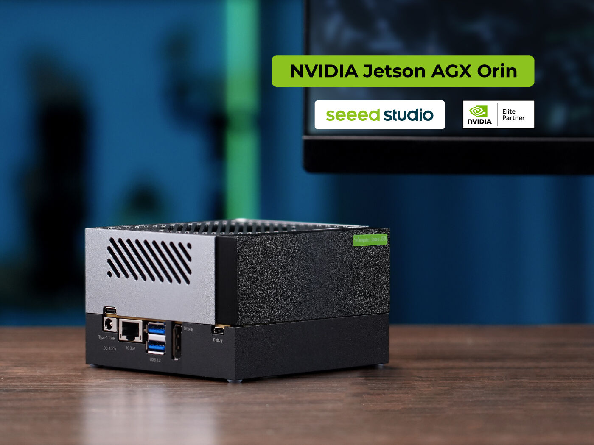

# Seeed Studio reComputer Classic J5012 Development Guide


[**View Seeed Studio reComputer Classic J5012 on OpenELAB**](https://openelab.io/products/seeed-studio-recomputer-classic-j5012-with-nvidia-jetson-agx-orin-64gb)

**Model/family:** Seeed Studio reComputer Classic J5012 · **OpenELAB SKU:** `Seeed-100003716`




_Manufacturer image: Seeed Studio._ [_Image source_](https://files.seeedstudio.com/wiki/reComputer-Jetson/Classic_J501/100006184-gallery_img_1.jpg)_._

[Product at OpenELAB](https://openelab.io/products/seeed-studio-recomputer-classic-j5012-with-nvidia-jetson-agx-orin-64gb) · [Manufacturer wiki hub](./)

## Product and applications

**reComputer Classic J5012** is Seeed's AGX Orin **64 GB** edge computer for local inference, development and high-memory vision workloads. It uses the Classic J501 carrier, which differs substantially from Robotics J501. The reviewed Classic documentation explicitly says it **does not have GMSL**.

## Model-specific hardware

| Item                  | Classic J5012                                                           |
| --------------------- | ----------------------------------------------------------------------- |
| Module                | Jetson AGX Orin 64 GB; 12-core Arm CPU                                  |
| Advertised AI maximum | Up to 275 TOPS INT8; workload/mode dependent                            |
| Module storage        | 64 GB eMMC; NVMe expansion on carrier                                   |
| Carrier NVMe          | M.2 Key M 2280; verify installed SSD against the order                  |
| Network               | One 10GbE RJ45; M.2 Wi-Fi/Bluetooth provision                           |
| Display               | DisplayPort, with appropriate DP/HDMI adapter/cable for an HDMI monitor |
| Expansion             | PCIe slot, 40-pin header, CSI adapter connection                        |
| DC input              | 9–20 V carrier input; documented 19 V adapter                           |
| Envelope              | 110 × 110 × 73 mm carrier/system reference                              |

Sources: [Classic J501 guide](https://wiki.seeedstudio.com/ai_robotics_seeed_agx_orin_dev_kit_getting_started/), [Classic carrier datasheet](https://files.seeedstudio.com/wiki/reComputer-Jetson/Classic_J501/reComputer_classic_j501_datasheet.pdf). Confirm module and included SSD/Wi-Fi components from the actual order rather than transferring Robotics-series specifications.

## First boot and a useful baseline

Prepare the correct manufacturer power supply, monitor/HDMI cable, keyboard and wired network. Attach peripherals while powered off, then apply power and finish the Linux first-run setup. Start with the installed image if it boots; reflashing is a recovery or version-management operation and can overwrite the system disk.

On the **Jetson**, open a terminal and capture a baseline:

```bash
cat /etc/nv_tegra_release
uname -a
lsblk -o NAME,SIZE,TYPE,MOUNTPOINTS
ip -brief address
dpkg-query -W nvidia-jetpack
sudo nvpmodel -q
tegrastats --interval 1000
```

Stop the last command with **Ctrl+C** after several readings. Expected checkpoints are a readable L4T release, an NVMe root filesystem, a network interface/address, a reported power mode and changing memory/CPU/temperature statistics. The `nvidia-jetpack` meta-package may be absent on a minimal image; that result alone does not prove the BSP or CUDA is missing. Keep this output with the exact image identifier before installing project software.

Do not use a desktop-PC CUDA installer or an arbitrary x86 container. Select Jetson/aarch64 packages and containers that explicitly match the installed JetPack/L4T release. Begin with a small camera or inference example from that release before adding multiple streams. The commands above establish platform visibility, not an inference-performance benchmark.

Sources: [NVIDIA Jetson Linux developer guide](https://docs.nvidia.com/jetson/archives/r36.4.3/DeveloperGuide/), [tegrastats reference](https://docs.nvidia.com/jetson/archives/r36.4.3/DeveloperGuide/AT/JetsonLinuxDevelopmentTools/TegrastatsUtility.html).

## Expansion and development

Use DisplayPort for the first desktop check; an HDMI-only monitor needs the appropriate supported adapter/cable. For PCIe and CSI, power down before installing hardware and confirm signal/lane mapping and driver support.

The 40-pin connector's CAN pins are **controller-level signals** in the reviewed Classic reference and require a suitable external CAN transceiver. Do not connect CAN-H/CAN-L directly to logic-level pins. The connector's Raspberry Pi-like shape does not establish a complete Raspberry Pi electrical/software equivalence.

For software, record the actual JetPack/L4T release and use its matching Jetson packages or containers. Test a small application first, then measure RAM and thermal behavior under the intended model. A large memory configuration does not make every desktop/x86 package compatible.

## Recovery and firmware

Use the **Classic J501 / AGX Orin 64 GB** release table and host-OS requirements. Back up data, connect the carrier's USB-C **flashing** port, and follow the Classic recovery-button/power sequence. The manufacturer lists `0955:7023` for the 64 GB AGX Orin recovery device in `lsusb`.

Flash the exact Classic image and target storage specified by that package; do not choose a Robotics J501 GMSL image. Complete normal first-boot configuration and repeat the baseline checks before restoring applications.

## Troubleshooting and FAQ

| Problem                               | Check                                                                                                                  |
| ------------------------------------- | ---------------------------------------------------------------------------------------------------------------------- |
| Monitor blank on first boot           | Actual DP connection, supported adapter/cable, monitor input and power; distinguish display issues from recovery mode. |
| CAN wiring does not communicate       | External transceiver, logic/interface voltage, pin mapping and physical bus configuration.                             |
| Expected GMSL connectors are absent   | Classic J501 is a different carrier from Robotics J501; do not assume GMSL support.                                    |
| Recovery host cannot detect board     | Correct flashing USB port, data cable, recovery-button sequence and 64 GB image target.                                |
| New package fails on a working system | Check aarch64/Jetson architecture and JetPack/L4T dependency compatibility before reflashing the entire device.        |

## Technical documents and software

| Resource                                                                                                                             | Use                                 |
| ------------------------------------------------------------------------------------------------------------------------------------ | ----------------------------------- |
| [Classic J501 setup and interfaces](https://wiki.seeedstudio.com/ai_robotics_seeed_agx_orin_dev_kit_getting_started/)                | Exact carrier and image selection   |
| [Classic carrier datasheet](https://files.seeedstudio.com/wiki/reComputer-Jetson/Classic_J501/reComputer_classic_j501_datasheet.pdf) | Pin tables and electrical reference |
| [Mechanical STEP model](https://files.seeedstudio.com/wiki/reComputer-Jetson/Classic_J501/reComputer_classic_J501.stp)               | Mechanical integration              |
| [Seeed BSP source](https://github.com/Seeed-Studio/Linux_for_Tegra)                                                                  | Carrier software development        |
| [NVIDIA JetPack SDK](https://developer.nvidia.com/embedded/jetpack)                                                                  | Matched NVIDIA software components  |

**Review date:** 17 November 2026. **Validation:** official documentation and the cited software interfaces reviewed. Commands and examples have not been compiled or run on physical hardware by OpenELAB for this guide. Record your hardware revision, firmware, software versions and actual results when reproducing it.

## Official documentation and development resources

Use [Flash JetPack and Interfaces Usage | reComputer Classic J501](https://wiki.seeedstudio.com/ai_robotics_seeed_agx_orin_dev_kit_getting_started/) for the manufacturer's complete model reference, diagrams and maintained examples. The references below complement this guide's local instructions.

| Development need                   | Model-specific reference                                                                                                     |
| ---------------------------------- | ---------------------------------------------------------------------------------------------------------------------------- |
| Official source: Linux\_for\_Tegra | [Read official source: linux\_for\_tegra](https://github.com/Seeed-Studio/Linux_for_Tegra)                                   |
| Mechanical / CAD files             | [Read mechanical / cad files](https://files.seeedstudio.com/wiki/reComputer-Jetson/Classic_J501/reComputer_classic_J501.stp) |

Keep the example's host model, interface pins and dependency versions together when reproducing a result. A schematic or SDK link does not establish that another revision uses the same wiring. Official model pages and accessible tutorial links reviewed **23 November 2026**. Other downloads above are manufacturer-listed resources; listing a file is not a test of its contents. Compilation, firmware flashing and hardware operation were **not performed** in this review.
