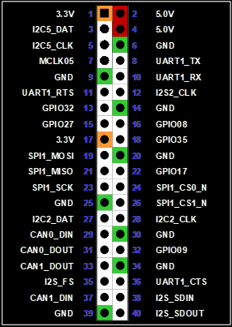

# Seeed Studio reComputer Classic J5012 Development Guide


[**View Seeed Studio reComputer Classic J5012 on OpenELAB**](https://openelab.io/products/seeed-studio-recomputer-classic-j5012-with-nvidia-jetson-agx-orin-64gb)

**Model:** reComputer Classic J5012 · **SKU:** `Seeed-100003716` · **Configuration:** Jetson AGX Orin 64GB, Classic J501 carrier, 128GB NVMe


The Classic J5012 is an AGX Orin 64GB development computer with DisplayPort, 10GbE and PCIe expansion. Its 40-pin header exposes **logic-level CAN**, requiring external transceivers. It is not the Robotics J501 carrier with isolated CAN terminals, five Ethernet ports and GMSL expansion.


_Seeed Studio;_ [_official Classic J501 illustration_](https://files.seeedstudio.com/wiki/reComputer-Jetson/Classic_J501/100006184-gallery_img_1.jpg)_._ [_Seeed Studio wiki directory_](./)_._

## Product overview <a href="#product-and-applications" id="product-and-applications"></a>

This guide covers the **64GB J5012**, not the 32GB J5011. It supplies a large shared CPU/GPU memory pool, module eMMC and a separate NVMe drive for development. The delivered adapter is **19V, 4.94A** according to the exact store configuration; regional AC cords and other package details should be checked when unpacking. [Exact OpenELAB listing](https://openelab.io/products/seeed-studio-recomputer-classic-j5012-with-nvidia-jetson-agx-orin-64gb), [Classic J501 engineering reference](https://wiki.seeedstudio.com/ai_robotics_seeed_agx_orin_dev_kit_getting_started/).

The vendor describes compatibility with the NVIDIA AGX Orin development ecosystem. That does not make a Robotics carrier image, automotive CAN connector or arbitrary camera adapter compatible. Keep carrier identity, BSP generation and expansion hardware with every project.

## Applications

Use the system for local model prototyping, multi-sensor software development, machine vision and PCIe acquisition/network experiments. The 64GB pool is useful for large models and frame buffers, but does not remove throughput, power or thermal constraints. Quantization, TensorRT engine compatibility and end-to-end latency need workload measurements.

The PCIe slot is appropriate for a supported capture/network/adapter card after checking electrical lane width and power. The CSI board-to-board connector supports camera-adapter development; it is not a bank of directly usable 15-pin camera sockets. Start with the supplied NVMe and a simple CUDA check before adding a PCIe card or custom camera board.

## Specifications <a href="#model-specific-hardware" id="model-specific-hardware"></a>

| Item                         | Classic J5012 / 100003716                                                                     |
| ---------------------------- | --------------------------------------------------------------------------------------------- |
| Module                       | NVIDIA Jetson AGX Orin 64GB                                                                   |
| CPU                          | 12-core Cortex-A78AE; 3MB L2 + 6MB L3                                                         |
| GPU / acceleration           | 2048 Ampere CUDA cores, 64 Tensor Cores; two NVDLA v2, PVA v2                                 |
| Memory                       | 64GB 256-bit LPDDR5; module bandwidth 204.8GB/s                                               |
| AI headline / module power   | Up to 275 TOPS INT8; module modes 15–60W, distinct from complete-system consumption           |
| Storage                      | 64GB eMMC 5.1 on module; Key M J4 NVMe 2280, PCIe Gen4 x4; 128GB SSD included                 |
| Wireless                     | Key E J5, 2230 Wi-Fi/BT; verify fitted module and antennas                                    |
| Ethernet                     | One RJ45 10GbE J17, backward compatible with supported lower rates                            |
| USB                          | Four Type-A host ports J24/J33; distinct Type-C power and recovery sockets; Micro-B J26 debug |
| Display                      | One DisplayPort; use the documented DP-to-HDMI cable for an HDMI monitor                      |
| PCIe                         | J6 physical x16 connector, **x8 electrical**, controller #5 / UPHY block1                     |
| Expansion                    | J30 40-pin I/O; J509 120-pin CSI BTB; J511 audio; J42 automation; J502 JTAG                   |
| Main power                   | 9–20V DC barrel; supplied 19V adapter                                                         |
| Size / operating environment | 110 × 110 × 73mm; 0–40°C stated system range                                                  |

Sources: [Classic J501 specification tables](https://wiki.seeedstudio.com/ai_robotics_seeed_agx_orin_dev_kit_getting_started/#specifications), [downloaded Classic datasheet](https://files.seeedstudio.com/wiki/reComputer-Jetson/Classic_J501/reComputer_classic_j501_datasheet.pdf), [exact store bundle](https://openelab.io/products/seeed-studio-recomputer-classic-j5012-with-nvidia-jetson-agx-orin-64gb). The PDF module table retains a copied “Robotics” model label; carrier-specific connector tables and the explicit Classic model comparison establish this page's scope. USB generation descriptions vary across summaries; inspect the actual bus topology rather than assume four independent 10Gb/s links.

## Hardware and connections

### Main supply, display and recovery are separate

Use the supplied **19V adapter** on the barrel input for the first boot. Confirm center/polarity against the adapter and carrier markings. The 9–20V input range is for the documented main input, not a GPIO supply rail. Type-C power, Type-C recovery and Micro-B debug have different roles. Use **DisplayPort or DP→HDMI**, not a nonexistent native HDMI socket. [Classic hardware overview and recovery locations](https://wiki.seeedstudio.com/ai_robotics_seeed_agx_orin_dev_kit_getting_started/#hardware-overview).

Install expansion while fully unpowered. Retain the 5V PWM fan J9 and its automatic controller. A PCIe connector's physical length does not establish its electrical lane count or an unlimited auxiliary power budget. Check card dimensions, 12V/3.3V requirements, mounting and driver support before inserting it.

### J30 pinout and the I2C illustration discrepancy

| Function               | Physical positions on J30                                                                      |
| ---------------------- | ---------------------------------------------------------------------------------------------- |
| Rails / grounds        | 3.3V:1/17; 5V:2/4; GND:6/9/14/20/25/30/34/39                                                   |
| I2C4                   | SDA3, SCL5; module balls E60/D61                                                               |
| I2C2                   | SDA27, SCL28; module balls K61/J61                                                             |
| UART1                  | TX8, RX10, RTS11, CTS36                                                                        |
| SPI1                   | MOSI19, MISO21, CLK23, CS0 24, CS1 26                                                          |
| CAN0                   | RX29 (`CAN0_DIN`), TX31 (`CAN0_DOUT`)                                                          |
| CAN1                   | TX33 (`CAN1_DOUT`), RX37 (`CAN1_DIN`)                                                          |
| I2S2                   | CLK12, FS35, DIN38, DOUT40                                                                     |
| Other selected signals | MCLK05 pin7; PWM01 pin13; GPIO27 pin15; GPIO08 pin16; GPIO35 pin18; GPIO17 pin22; GPIO09 pin32 |

Source: [Classic datasheet pp.37–39](https://files.seeedstudio.com/wiki/reComputer-Jetson/Classic_J501/reComputer_classic_j501_datasheet.pdf). These are physical positions and module signal names, not GPIO offsets. The official graphical pinout labels pins3/5 as I2C5 and uses other shorthand; the **datasheet pin table's I2C4** definition takes precedence. Query Linux's actual adapter list before choosing a bus number.



_Seeed Studio,_ [_official J30 drawing_](https://files.seeedstudio.com/wiki/reComputer-Jetson/Classic_J501/interface_40pin_header_pinout.png)_. Its I2C5 labels at pins3/5 conflict with the datasheet's I2C4 labels; use the text table above for signal identity. The illustration is retained for physical orientation, not silently corrected into a new manufacturer drawing._

### External transceivers for native CAN

The J30 CAN signals are **3.3V controller TX/RX**; the carrier has no onboard CANH/CANL transceiver on this header. For CAN0 connect pin31 to transceiver TXD, pin29 to transceiver RXD; for CAN1 use TX33/RX37. Use a suitable 3.3V-logic transceiver and the documented 3.3V/GND rails. On the differential side connect H↔H and L↔L, with 120Ω at the two bus ends. Two external transceivers are needed for a physical CAN0-to-CAN1 bench link. A transceiver designed only for Classic CAN must not be assumed suitable for high-speed FD. [Classic CAN section](https://wiki.seeedstudio.com/ai_robotics_seeed_agx_orin_dev_kit_getting_started/#can-communication), [NVIDIA CAN reference](https://docs.nvidia.com/jetson/archives/r36.4.3/DeveloperGuide/HR/ControllerAreaNetworkCan.html).

### Camera, audio, RTC and automation headers

J509 is a **120-pin BTB** interface carrying CSI0–CSI7 as eight two-lane connections, camera clocks/control and multiple rails including1.8V,2.8V and3.3V. Use a matching adapter board and sensor BSP; do not bridge it to a different camera connector from a photograph. J511 is an analog audio-panel header with dual microphone inputs, stereo headphone outputs and detection lines, not a general-purpose digital I/O port.

J13 accepts the documented external RTC backup route; check battery polarity and specification before fitting it. J42 exposes recovery/reset/power/ACOK and other control signals. Its documented auto-power-on option connects **pins5/6**. Set that jumper only with power removed and exact J42 orientation confirmed; do not copy an original J401 or Super header jumper. J502 JTAG includes a **1.8V reference rail**, not 3.3V. [Classic datasheet pp.40–51](https://files.seeedstudio.com/wiki/reComputer-Jetson/Classic_J501/reComputer_classic_j501_datasheet.pdf).

## Software and development resources

The current Classic page lists **JetPack7.2** and compatibility with6.2. Its downloadable mass-flash table currently exposes AGX Orin32GB and64GB **7.2** archives; select64GB for this model. Do not manufacture a6.2 archive URL from the7.2 filename. A physical x86 Ubuntu20.04/22.04 host is the conservative common route; the7.2 matrix also permits24.04 with the vendor's host-component restriction. [Classic image selector](https://wiki.seeedstudio.com/ai_robotics_seeed_agx_orin_dev_kit_getting_started/#preparing-the-jetpack-image).

Use the installed JetPack's CUDA/TensorRT/DeepStream and Jetson aarch64 packages. A TensorRT engine built for another stack/GPU is not guaranteed portable. Record the L4T release, toolchain, container and model separately. The original CUDA checkpoint below uses basic runtime APIs and an Orin compute target; it does not require a downloaded neural model or copy a vendor demonstration.

## Getting started <a href="#first-boot-and-a-useful-baseline" id="first-boot-and-a-useful-baseline"></a>

### 1. Boot and identify the installed stack

1. Prepare the Classic J5012,19V adapter,DP display or DP→HDMI cable,keyboard and Ethernet. Remove external GPIO/PCIe experiments for the baseline.
2. Connect peripherals while unpowered,apply main supply and press power if auto-on is not enabled. Complete Ubuntu's initial account/network setup.
3. On the Jetson,inspect:

```bash
cat /etc/nv_tegra_release
uname -m
free -h
lsblk -o NAME,SIZE,TYPE,MOUNTPOINTS
findmnt /
ip -br address
sudo nvpmodel -q
lsusb -t
lspci -nn
```

**Expected result:** aarch64,L4T release,nominal64GB module memory with lower usable RAM,identifiable eMMC/NVMe and network devices. `findmnt /` tells which storage actually hosts root; an installed SSD alone does not prove the system booted from it. Capture a short `tegrastats --interval 1000` sample and stop with Ctrl+C.

### 2. Original CUDA arithmetic checkpoint

Use the CUDA toolkit provided for the installed JetPack. Confirm `/usr/local/cuda/bin/nvcc --version`; if absent,install the **matching** JetPack development components instead of a desktop driver/toolkit. Save this original program as `classic_cuda.cu`:

```cpp
#include <cuda_runtime.h>
#include <cstdio>
#include <cstdlib>

static void require(cudaError_t r) {
    if (r != cudaSuccess) {
        std::fprintf(stderr, "CUDA: %s\n", cudaGetErrorString(r));
        std::exit(1);
    }
}
__global__ void fill(int *values) {
    unsigned i = threadIdx.x;
    if (i < 32) values[i] = int(i * i + 7);
}
int main() {
    cudaDeviceProp prop{};
    require(cudaGetDeviceProperties(&prop, 0));
    std::printf("device=%s compute=%d.%d\n", prop.name, prop.major, prop.minor);
    int *device = nullptr, host[32]{};
    require(cudaMalloc(reinterpret_cast<void **>(&device), sizeof(host)));
    fill<<<1, 32>>>(device);
    require(cudaGetLastError());
    require(cudaDeviceSynchronize());
    require(cudaMemcpy(host, device, sizeof(host), cudaMemcpyDeviceToHost));
    require(cudaFree(device));
    for (int i = 0; i < 32; ++i) {
        if (host[i] != i * i + 7) return 2;
    }
    std::printf("CLASSIC_J5012_CUDA_OK samples=32 last=%d\n", host[31]);
    return 0;
}
```

Compile and run **on the Jetson**:

```bash
/usr/local/cuda/bin/nvcc -O2 -arch=sm_87 classic_cuda.cu -o classic_cuda
./classic_cuda
```

**Expected result:** an Orin device identity,compute capability8.7 and `CLASSIC_J5012_CUDA_OK samples=32 last=968`. This checks kernel execution,memory transfer and arithmetic,not model throughput or275TOPS. The code has **not been compiled or run for this guide**. NVIDIA's [CUDA for Tegra application note](https://docs.nvidia.com/cuda/cuda-for-tegra-appnote/index.html) identifies Orin's8.7 capability; select the toolkit matching the installed BSP rather than following that note's optional CUDA-upgrade procedure blindly.

### 3. Establish CAN communication after adding physical transceivers

With two compatible external transceivers wired as above and two end terminations,install `can-utils`. On the isolated bench:

```bash
sudo apt install can-utils
sudo ip link set can0 down
sudo ip link set can1 down
sudo ip link set can0 type can bitrate 500000
sudo ip link set can1 type can bitrate 500000
sudo ip link set can0 up
sudo ip link set can1 up
candump -n 1 can1
```

In a second terminal,run `cansend can0 612#A1B2C3D4`. Expected result is ID612 and four received bytes on can1. Reverse the direction,then inspect both channels' `ip -details -statistics link show` output. A controller's internal loopback would not validate the transceivers or wire. For FD,bring both down and set matching arbitration/data rates,for example500000/2000000 with `fd on`;use a real FD `##` frame. Turn interfaces down before removing wiring. [Classic CAN procedure](https://wiki.seeedstudio.com/ai_robotics_seeed_agx_orin_dev_kit_getting_started/#can-communication).

### 4. Bring up expansion deliberately <a href="#expansion-and-development" id="expansion-and-development"></a>

| Interface         | Procedure / expected checkpoint                                                                                                                                                                                                                                                                               |
| ----------------- | ------------------------------------------------------------------------------------------------------------------------------------------------------------------------------------------------------------------------------------------------------------------------------------------------------------- |
| J30 GPIO          | Inspect `gpiodetect`,`gpioinfo` and the pinmux. A libgpiod1 held output uses `gpioset --mode=signal CHIP LINE=VALUE`;v2 uses `gpioset -c CHIP LINE=VALUE` and holds by default. These are syntax patterns;first identify a genuinely free line and compatible load. Stop only after the load is disconnected. |
| UART1             | Connect compatible TTL adapter RX←TX8,TX→RX10,GND→GND6. Open the verified UART node (`ttyTHS1` in the source example) at115200,8N1,no flow control. Send a distinct short string both ways.                                                                                                                   |
| SPI1              | With power removed,connect MOSI19 to MISO21 on an otherwise disconnected test bus. Enable SPI,load `spidev`,inspect actual nodes,and use the vendor-linked loopback utility at100kHz. Matching TX/RX bytes prove loopback;remove the jumper before attaching a real slave.                                    |
| I2C               | Use SDA3/SCL5 for the datasheet's I2C4 route,or27/28 for I2C2. Inspect `i2cdetect -l` and the actual attached sensor/voltage before bus access;do not equate a module signal name with a Linux adapter number.                                                                                                |
| NVMe              | `nvme list` and `sudo nvme smart-log /dev/nvme0n1` after verifying that device name. Use a temporary **file** on the desired mount for performance testing;5GB raw writes are not required for enumeration.                                                                                                   |
| PCIe              | Insert a supported card while unpowered,then inspect `lspci -nn` and `lspci -vv -s BDF` using its actual address. Compare negotiated speed/width;the slot isx8 electrical despite itsx16 form.                                                                                                                |
| Wi-Fi / Bluetooth | Inspect `lspci`,`nmcli device status` and `iw dev`;attach the correct antennas. Scan with NetworkManager and pair via `bluetoothctl`;a fitted module is not proof that the antenna is connected.                                                                                                              |
| Ethernet          | Check actual interface name (`end0` is the source example),then `ethtool INTERFACE`. Test a bench `iperf3` peer,optionally binding `-B LOCAL_IP`;10Gb/s needs a compatible peer,cable and negotiated link.                                                                                                    |
| CSI camera        | Install the matching BTB adapter/sensor BSP while unpowered. Inspect `v4l2-ctl --list-devices` and listed formats. A finite `v4l2-ctl -d /dev/video0 --stream-mmap --stream-count=30 --stream-to=/dev/null` checks30buffers only after the node/mode is confirmed.                                            |
| Audio             | Connect the documented audio panel;inspect `arecord -l` and `aplay -l`,select the actual devices in OS settings,and record/play a5second sample. An absent panel is not repaired by wiring a microphone to arbitrary J30 pins.                                                                                |
| RTC / fan         | Set time through OS,read `sudo hwclock -r`,then check retention with NTP/network disconnected. Keep automatic fan control;inspect real hwmon labels before any manual intervention.                                                                                                                           |

Sources: [Classic interface sections](https://wiki.seeedstudio.com/ai_robotics_seeed_agx_orin_dev_kit_getting_started/#-interface-usage),[connector datasheet](https://files.seeedstudio.com/wiki/reComputer-Jetson/Classic_J501/reComputer_classic_j501_datasheet.pdf). Camera format,GPIO offsets and PCIe card driver support remain tied to the actual expansion and image;they are not constants inferred from enclosure appearance.

### 5. Recover the correct AGX64 image <a href="#recovery-and-firmware" id="recovery-and-firmware"></a>

Back up data. On the supported Ubuntu host,download the **Classic J501 AGX Orin64GB** archive from the [current official selector](https://wiki.seeedstudio.com/ai_robotics_seeed_agx_orin_dev_kit_getting_started/#preparing-the-jetpack-image) and compare SHA256. The reviewed7.2 example filename identifies `mfi_seeed-agx-orin-64g-7.2.0-39.2.0-2026-08-04.tar.gz`;use the actually downloaded release.

1. Connect the dedicated **Recovery USB-C** (hardware side-view2,label2) to the host with a data cable. Do not use Type-C power or Micro-B debug.
2. Hold the recovery button,apply the19V main supply,then release recovery. On the host,`lsusb` should show **0955:7023** for64GB;7223 is32GB.
3. Extract the selected archive with `sudo tar xpf EXACT_ARCHIVE.tar.gz`,enter its extracted directory and run:

```bash
sudo ./tools/kernel_flash/l4t_initrd_flash.sh --flash-only \
  --massflash 1 --network usb0 --showlogs
```

4. Wait for successful completion,boot through DisplayPort and finish Ubuntu setup. Repeat the storage and CUDA checks. Save actual logs;do not infer the new root disk from the flash command's generic name.

## Troubleshooting and FAQs <a href="#troubleshooting-and-faq" id="troubleshooting-and-faq"></a>

| Symptom                                  | Ordered diagnosis                                                                                                                              |
| ---------------------------------------- | ---------------------------------------------------------------------------------------------------------------------------------------------- |
| No display on an HDMI cable              | This carrier outputsDP;useDP or the correct DP→HDMI cable,then check monitor input and power.                                                  |
| CAN utility works but bus is silent      | External3.3Vtransceiver present→TX/RX orientation→CANH/L→two end terminations→reference→bitrate→counters. J30 is not isolated differentialCAN. |
| I2C device absent on a copied bus        | Use the datasheet J30 map and `i2cdetect -l`;the image'sI2C5 label is not the authoritative signal identity.                                   |
| PCIe card trains at fewer lanes          | Compare card capability and negotiated link againstx8 electrical;check mounting/power and BSP driver support.                                  |
| CUDA compiler/runtime error              | Record `nvcc --version`,L4T and library paths;restore matching JetPack components instead of layering desktop drivers.                         |
| Camera connector does not fit a ribbon   | J509 is120-pinBTB and needs the correct adapter;do not substitute a15-pin CSI cable.                                                           |
| Recovery sees only a serial bridge       | Check dedicated recovery port/button/power sequence;the Micro-B debug path does not prove APX recovery.                                        |
| Remote auto-on differs from another J501 | Use ClassicJ42's documented5/6 jumper;Robotics terminals and other reComputer service headers differ.                                          |

## Downloads and technical documents <a href="#technical-documents-and-software" id="technical-documents-and-software"></a>

| Official file / source                                                                                                                                                                                                             | Purpose and access                                                                             |
| ---------------------------------------------------------------------------------------------------------------------------------------------------------------------------------------------------------------------------------- | ---------------------------------------------------------------------------------------------- |
| [Classic J501 engineering wiki](https://wiki.seeedstudio.com/ai_robotics_seeed_agx_orin_dev_kit_getting_started/)                                                                                                                  | Current images,hashes,recovery and all carrier interface procedures                            |
| [Classic J501 datasheet](https://files.seeedstudio.com/wiki/reComputer-Jetson/Classic_J501/reComputer_classic_j501_datasheet.pdf)                                                                                                  | Downloaded/read;J30pp.37–39,CSIpp.40–47,audiop.48,automationpp.49–50,JTAGp.51                  |
| [Earlier product-hosted datasheet link](https://files.seeedstudio.com/products/NVIDIA-Jetson/reComputer_classic_j501_datasheet.pdf)                                                                                                | Retained product resource URL;use current exact-model version above for this review            |
| [Classic J501 STEP](https://files.seeedstudio.com/wiki/reComputer-Jetson/Classic_J501/reComputer_classic_J501.stp) / [retained earlier STEP URL](https://files.seeedstudio.com/products/NVIDIA-Jetson/reComputer_classic_J501.stp) | Manufacturer mechanical downloads;not substituted with RoboticsCAD                             |
| [AGX reference electrical PDF linked by Seeed](https://files.seeedstudio.com/wiki/reComputer-Jetson/Classic_J501/AGX_P3737_A05_V1_20260605.pdf)                                                                                    | Additional AGX reference;filename/listing alone is not proof it is a Classic carrier schematic |
| [Seeed Linux\_for\_Tegra](https://github.com/Seeed-Studio/Linux_for_Tegra)                                                                                                                                                         | Carrier BSP/device-tree source;select exact release                                            |
| [CUDA for Tegra application note](https://docs.nvidia.com/cuda/cuda-for-tegra-appnote/index.html)                                                                                                                                  | CUDA/Orin architecture and memory considerations                                               |
| [JetPack SDK](https://developer.nvidia.com/embedded/jetpack)                                                                                                                                                                       | NVIDIA software entry point                                                                    |

## References and validation <a href="#official-documentation-and-development-resources" id="official-documentation-and-development-resources"></a>

Reviewed **24 November2026** against the exact store/catalog model,live Classic engineering page and downloaded51-page Classic datasheet. The J30 table and official orientation image were visually inspected. I2C naming discrepancies,logic-level CAN,and separate USB roles are stated where wiring is performed.

**Compilation,CUDA execution,firmware flashing and hardware tests were not run.** The original32-element CUDA and finite CAN/camera checkpoints describe expected outcomes. No inference-speed,thermal or PCIe compatibility result is claimed. Manufacturer files retain their original notices;linking the AGX reference PDF does not establish an inspected Classic schematic.

### Related retained references

* [NVIDIA Jetson Linux developer guide](https://docs.nvidia.com/jetson/archives/r36.4.3/DeveloperGuide/)
* [tegrastats reference](https://docs.nvidia.com/jetson/archives/r36.4.3/DeveloperGuide/AT/JetsonLinuxDevelopmentTools/TegrastatsUtility.html)
