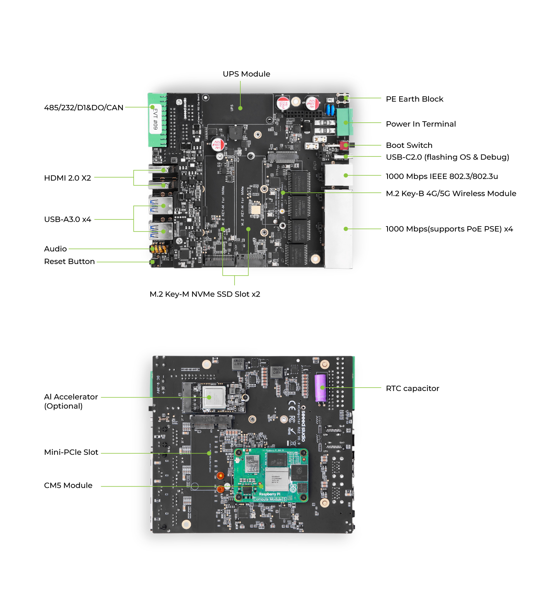

# Seeed Studio reComputer Industrial R2245-12 Engineering Guide


[**View Seeed Studio reComputer Industrial R2245-12 on OpenELAB**](https://openelab.io/products/seeed-studio-recomputer-r2245-26tops)

**Model:** reComputer Industrial R2245-12 · **SKU:** `Seeed-100077451` · **Configuration:** Raspberry Pi CM5,16GB RAM,32GB eMMC, Hailo-8 26TOPS


The R2245-12 combines a CM5 Linux computer with a preinstalled Hailo-8 accelerator, industrial I/O and five Ethernet sockets for camera/gateway workloads. It is neither a CM4 R1000 nor a Jetson. This guide provides a battery-free, field-output-free boot and AI checkpoint; it also identifies unresolved copied source text that must be cleared before the excluded optional operations. Core boot and Hailo development are source-reviewed within that scope.

## Product overview <a href="#product-applications-and-specification-scope" id="product-applications-and-specification-scope"></a>

The exact listed **R2245-12** has **16GB RAM and 32GB eMMC**, not a generic “up to 16GB/64GB” family configuration. Its Hailo-8 is the 26TOPS device, not Hailo-8L 13TOPS. The sold package lists a 19V/4.7A adapter, DIN clip, mounting brackets, terminal connectors and Wi-Fi/BLE antenna. Check the physical nameplate and fitted accelerator before choosing an image or HEF model. [Exact OpenELAB configuration](https://openelab.io/products/seeed-studio-recomputer-r2245-26tops), [R22xx manufacturer reference](https://wiki.seeedstudio.com/recomputer_industrial_r22xx_getting_start/).

The official R22xx pages contain identifiable R21xx/CM4 carryovers, including a two-port PoE-PD summary and serial tables. The actual R22 board overview, schematic block diagram and current PoE section describe a five-port system with four PoE source ports. Relevant limits and unresolved operations are stated below instead of inheriting another model's wiring.

## Applications

Use the R2245-12 for camera analytics, local inference, industrial telemetry and an NVR prototype with supported storage/network software. Hailo's TOPS rating does not establish simultaneous camera count, recording throughput or inference FPS. Start with the delivered Hailo example, then one camera, then storage retention and multiple streams.

The fanless enclosure needs clear heat paths and cabinet ventilation. IP40 does not make it weatherproof. Optional cellular, LoRa, TPM, SSD and UPS hardware have separate module, antenna, region and driver requirements; the family expansion list is not the package BOM.

## Specifications

| Parameter           | Exact R2245-12 / 100077451                                                                                                                  |
| ------------------- | ------------------------------------------------------------------------------------------------------------------------------------------- |
| Host CPU            | Raspberry Pi Compute Module 5; quad Cortex-A76 up to 2.4GHz                                                                                 |
| RAM / eMMC          | 16GB /32GB in the sold configuration                                                                                                        |
| AI accelerator      | Preinstalled Hailo-8 M.2,26TOPS advertised maximum                                                                                          |
| OS route            | Seeed CM5/R22 image recommended; Raspberry Pi OS/Debian ecosystem                                                                           |
| Main input          | 9–36V DC, two-pin terminal; listed adapter 19V/4.7A                                                                                         |
| Network             | Five physical Gigabit RJ45: one native and four extended ports                                                                              |
| PoE camera output   | Current configuration page: four source ports, Mode A, up to 12W each, internal 48V boost; see connection restrictions below                |
| USB / display       | Four USB-A 3.0 host; one USB-C 2.0 flashing/debug; two HDMI 2.0                                                                             |
| Field interfaces    | Two isolated RS485, one isolated RS232, one isolated CAN-FD; four DI, four DO                                                               |
| DI / DO boundary    | DI 5–24V recommended operating range;DO transistor/open-collector,<60V; exact R22 channel-current qualification excluded from load guidance |
| Storage / expansion | Two NVMe 2280 positions; separate M.2 accelerator position; Key B cellular and Mini PCIe LoRa; Nano-SIM                                     |
| Other features      | RTC, watchdog, buzzer, user RGB, optional security/UPS modules                                                                              |
| Environment         | −20 to+50°C, 10–95%RH per family table; IP40; fanless                                                                                       |

Sources:[exact store specification](https://openelab.io/products/seeed-studio-recomputer-r2245-26tops), [R22 hardware/interface tables](https://wiki.seeedstudio.com/recomputer_industrial_r22xx_getting_start/), [current PoE configuration section](https://wiki.seeedstudio.com/recomputer_industrial_r22xx_configure_system/#poe-ip-camera). The source's isolated DI subtable permits 5–30V while its system table says 5–24V; this guide stays within 5–24V. Its 1A DI wording is not a sensor input-current rating and is not adopted. DO 500mA text names R21xx, so this guide does not certify 500mA on R2245-12.

## Hardware and connections

### Main power and physical layout

With the system unpowered, identify DC+ and DC− on the two-pin power terminal and connect the supplied 19V adapter through the correct terminal adapter. Connect protective earth where the documented installation requires it; PE, logic ground and isolated I/O references have different roles. USB-C is a flashing/data connection, not a substitute for the main terminal supply.



_Seeed Studio,_ [_official R22 board overview_](https://files.seeedstudio.com/wiki/reComputer-AI-Industrial/R2200/2.1.2-1.png)_. The generic illustration labels the accelerator optional; the exact R2245-12 listing includes Hailo-8. The four-socket group is labelled PoE PSE._

Open the enclosure only with main power disconnected and any fitted UPS discharged by the supported process. Follow the [R22 assembly guide](https://wiki.seeedstudio.com/recomputer_industrial_r22xx_assembly_guide/) for mounting, SSD, radio, TPM and UPS access. Do not substitute the CM4 gateway's internal layout. Secure NVMe cards at their standoffs and preserve thermal contact before closing the enclosure.

### Industrial terminal pinout

These pin IDs follow the official terminal diagram. Verify connector orientation from that diagram before inserting wires.

| Function                 | Terminal IDs                              |
| ------------------------ | ----------------------------------------- |
| RS485 channel labelled 3 | A:pin1, B:pin3, GND:pin5                  |
| RS485 channel labelled 4 | A:pin7, B:pin9, GND:pin11                 |
| RS232 channel 1          | TX 2, RX 4, GND 6                         |
| CAN0                     | H8, L10, GND 12                           |
| DI 1–DI 4                | 13, 15, 17, 19; input reference G\_DI 21  |
| DO 1–DO 4                | 14, 16, 18, 20; output reference G\_DO 22 |

Source:[R22 interface description](https://wiki.seeedstudio.com/recomputer_industrial_r22xx_getting_start/#interface-description). The A/B labels identify differential RS485, not TTL UART. Cross RS232 TX/RX only to a real RS232 peer. CANH/CANL are already differential signals; external sensor power is separate. Use appropriate endpoint termination and the documented isolated reference; do not connect a field supply to a CAN signal pin.

DI uses PNP-style positive voltage referenced to G\_DI. DO is a transistor/open-collector switch requiring an external pull-up/load supply; it does not source a 60V rail. **Field-load DO operation remains unqualified here because the exact R22 continuous current rating is not established by the reviewed sources.** Initial system and accelerator setup requires no DO wiring.

### PoE role and connection restrictions

The R22's current configuration section specifies **PSE camera outputs**, not a PoE-PD input supply. It reports an internal 48V boost, Mode A over pairs 1/2 and 3/6, and **12W maximum per output** with sufficient main input. Its four-output example recommends a 24V/3A supply; that is a system integration example, not a replacement for calculating camera peaks, host/SSD load and conversion losses. [Official PoE section](https://wiki.seeedstudio.com/recomputer_industrial_r22xx_configure_system/#poe-ip-camera).

**The vendor prohibits connecting or disconnecting Ethernet cables while the R22's PoE output is active.** Use connect-first, power-second; disable output and remove main power before changing the camera harness. Do not assume standard PoE switch hot-plug behavior. The hardware page's older two-port PD table and its ETH1/no-PSE row conflict with the current four-PSE procedure and labelled board view; identify ports physically and enumerate actual interface names instead of copying eth indices.

The current procedure uses a historical global GPIO **652** for PSE enable, but its own comment says 532. The downloaded R22 mainboard schematic, sheet23, maps `PSE_PWR_EN` to U35 P14, line offset12 on the I2C0x21 expander. A historical global number652 is consistent only when that chip's base is640. Map the received unit's actual kernel line and physical port group before controlling it. This guide does not provide a blind startup command or enable camera power automatically. Port identification, enable mapping and the connected camera's power requirements must be confirmed on the exact delivered revision before PoE commissioning.

## Software and development resources <a href="#technical-resources-and-integration" id="technical-resources-and-integration"></a>

Use the Seeed **R22/CM5** image linked by [R22 flash OS](https://wiki.seeedstudio.com/recomputer_industrial_r22xx_flash_os/) and [pi-gen-expand](https://github.com/Seeed-Studio/pi-gen-expand), with its matching kernel/device tree, Hailo PCIe driver, HailoRT and application environment. The [R2x FAQ](https://wiki.seeedstudio.com/recomputer_industrial_r2x_faq/) permits generic Ubuntu 24.04 installation but warns that missing device trees may leave functions inoperative; it recommends the supplied image for Hailo.

Hailo inference uses a **HEF** compiled for the correct accelerator and toolchain. An ONNX file is not directly executable by the NPU, and a Hailo-8L-specific HEF must not be assumed compatible with Hailo-8. Keep runtime, firmware, HEF, postprocessing library and Python environment together. The factory image's example path is documented as `/mnt/hailo-rpi5-examples`; upstream repository layouts can change. Do not update that example independently before recording a working baseline. [Official AI accelerator procedure](https://wiki.seeedstudio.com/recomputer_industrial_r22xx_configure_system/#ai-accelerator), [Hailo example project](https://github.com/hailo-ai/hailo-rpi5-examples).

For Node-RED, MQTT, Modbus or NVR software, first validate physical transport and the appropriate driver. Application installation does not configure an isolated serial terminal's electrical type or guarantee a camera decoder's acceleration path.

## Getting started <a href="#getting-started-os-and-accelerator-enumeration" id="getting-started-os-and-accelerator-enumeration"></a>

### 1. Boot without field I/O or PoE cameras

1. Prepare the exact R2245-12, listed 19V adapter, HDMI display, keyboard and a wired management connection. Leave field terminals and PoE camera cables disconnected.
2. Confirm the BOOT switch is in **normal/eMMC** mode, connect peripherals while unpowered, and apply main power. Complete the delivered Linux setup.
3. On the R22, record:

```bash
cat /etc/os-release
uname -a
tr -d '\0' </proc/device-tree/model
free -h
lsblk -o NAME,SIZE,TYPE,MOUNTPOINTS
findmnt /
ip -br address
lspci -nn
lsusb -t
```

**Expected result:** a CM5/Raspberry Pi 5-class platform,16GB nominal memory,32GB nominal eMMC with lower filesystem capacity, and a visible Hailo PCIe device. Inspect the actual root mount instead of assuming eMMC or NVMe. A PCIe device entry proves enumeration, not a working inference runtime.

### 2. Original Hailo/software preflight

Save as `r2245_preflight.py`. This original script collects bounded read-only results; it neither changes GPIO nor flashes firmware.

```python
import json,shutil,subprocess
commands={
    "platform":["uname","-m"],
    "storage":["lsblk","-J","-o","NAME,SIZE,TYPE,MOUNTPOINTS"],
    "network":["ip","-j","address"],
    "pcie":["lspci","-nn"],
    "hailo_identity":["hailortcli","fw-control","identify"],
}
report={}
for label,args in commands.items():
    if not shutil.which(args[0]):
        report[label]={"available":False}
        continue
    try:
        result=subprocess.run(args,text=True,capture_output=True,timeout=10)
        report[label]={"returncode":result.returncode,
                       "stdout":result.stdout.strip(),
                       "stderr":result.stderr.strip()}
    except subprocess.TimeoutExpired:
        report[label]={"timeout_seconds":10}
print(json.dumps(report,indent=2))
```

Run `python3 r2245_preflight.py > r2245-preflight.json`. **Expected result:** a JSON record containing the local interfaces and successful Hailo identity if the matching runtime/driver is installed. A missing command is recorded explicitly; it is not replaced by invented hardware output. Read the Hailo identity alongside `lspci` and kernel logs to distinguish runtime absence, permissions, driver binding and an absent accelerator.

### 3. Run the supplied accelerator example before upgrading it

On the supplied compatible image:

```bash
cd /mnt/hailo-rpi5-examples
source ./setup_env.sh
python basic_pipelines/detection_simple.py
```

Use the delivered example's default/supported input, then stop with Ctrl+C after a short observation. **Expected result:** the documented YOLO v 6Nano detection pipeline starts and produces detections on suitable input without a HEF/runtime mismatch. Record model, HEF path/runtime versions and actual display/output. The baseline is a supported manufacturer example; the preflight/reporting procedure above is original. [Seeed accelerator example](https://wiki.seeedstudio.com/recomputer_industrial_r22xx_configure_system/#ai-accelerator).

If the directory/script is missing, record the installed image and check its matching example release rather than creating an empty path or blindly installing current upstream. For a custom model, convert/compile for Hailo-8 using the supported toolchain and validate postprocessing before a throughput test.

### 4. Serial and CAN transport on an isolated bench

The R22 has **one RS232 and two RS485** channels. Its configuration page contains a copied two-RS232 R21xx table; do not treat `/dev/ttyACM1` as RS232 without proving the physical mapping. An expansion board may shift ACM enumeration. Inspect `/dev/serial/by-id`,`/dev/serial/by-path`,`lsusb -t` and `udevadm info --query=property --name=DEVICE`, then confirm each channel using a known peer.

For an RS232-only loopback, disconnect power and join physical TX 2 to RX 4 on that one RS232 channel. On the verified device, configure 9600, 8N1, no flow control. A finite original Python test is:

```python
import sys,serial
payload=b"R2245_RS232_LOOPBACK\r\n"
with serial.Serial(sys.argv[1],9600,timeout=2) as port:
    port.reset_input_buffer()
    port.write(payload)
    port.flush()
    result=port.read(len(payload))
print("received_hex="+result.hex())
raise SystemExit(0 if result==payload else 1)
```

Install the matching `python3-serial` package and run with the **verified** device path. Expected result is the exact payload returned and exit 0. Do not short an RS485 A/B pair as if it were TX/RX. For RS485, use a second configured peer or the other RS485 port, A↔A/B↔B plus documented reference and end termination; configure the driver/terminal tool's RS485 direction mode as required by the delivered image before a two-way exchange. [Serial configuration](https://wiki.seeedstudio.com/recomputer_industrial_r22xx_configure_system/#rs485-testing).

R22 has only **one CAN controller**, so physical CAN testing requires a second device or USB-CAN adapter. Connect H8/L10/GND 12 to the peer and use two endpoint 120Ω resistors. With actuators disconnected:

```bash
sudo apt install can-utils
sudo ip link set can0 down
sudo ip link set can0 type can bitrate 500000
sudo ip link set can0 up
candump -n 1 can0
```

Send one known frame from the peer; expected result is that frame once. Reverse direction with `cansend can0 224#10203040`, observe the peer, then inspect `ip -details -statistics link show can0`. The source's `can1` belongs to its **external R21 peer**, not a second R22 interface. Bring the interface down before removing wiring. [R22 CAN explanation](https://wiki.seeedstudio.com/recomputer_industrial_r22xx_configure_system/#can-testing).

### 5. Digital I/O and optional service features

The following are **historical mappings in the reviewed vendor image**, not portable global GPIO assignments. Read `/sys/kernel/debug/gpio`,`gpiodetect` and `gpioinfo` and match actual signal labels/chip offsets after every kernel/image change.

| Feature            | Source mapping and bounded procedure                                                                                                                                                                                                                                                                                                                       |
| ------------------ | ---------------------------------------------------------------------------------------------------------------------------------------------------------------------------------------------------------------------------------------------------------------------------------------------------------------------------------------------------------- |
| DI 1–DI 4          | Vendor globals 588/589/590/595. Use a known 5–24V signal and G\_DI, then compare input values with and without the signal. The configuration example is active-low; verify polarity on the bench.                                                                                                                                                          |
| DO 1–DO 4          | Vendor globals 638/637/636/635. Field loads remain blocked pending exact R22 current/aggregate limits. Use no actuator/relay as a first result. For a verified free test line, libgpiod1 holds with `gpioset --mode=signal CHIP LINE=VALUE`; v 2 uses `gpioset -c CHIP LINE=VALUE` and holds by default.                                                   |
| RGB / buzzer       | Inspect `/sys/class/leds/led-red`,`led-blue`,`led-green`; preserve trigger/brightness before a brief test. The buzzer is global 627 in the source image; do not operate it through a copied global number on another kernel.                                                                                                                               |
| SPI / TPM          | Source uses `/dev/spidev10.0` for an unpopulated TPM-header MOSI/MISO loopback. Verify the actual header/node; never short a populated TPM. For a fitted TPM, inspect `/dev/tpm0` and `/dev/tpmrm0` instead.                                                                                                                                               |
| RTC / watchdog     | Read `sudo hwclock -r` and verify retention without NTP. Inspect watchdog identity/configuration and arrange a maintenance test before enabling it; the vendor's forced kernel-crash example is not needed for the first boot.                                                                                                                             |
| ATECC608A / EEPROM | Inspect device/driver presence using the image's documented I2C mapping. The source misdescribes utility bus/address arguments as random-serial creation and gives different EEPROM write/read bus paths. Do not provision keys or overwrite identification EEPROM from those examples. Obtain the exact utility/device documentation before modification. |
| UPS                | Optional hardware; the R22 source mixes GPIO6 and GPIO16 and even an R21xx label. Do not install its shutdown overlay unmodified. Mainboard sheet7 connects `CM5_UPS_DET` to CM5GPIO16, narrowing the reference design;automatic shutdown remains excluded until the fitted module/revision,active polarity and hold-up time are confirmed.                |
| Radios             | Fit antennas/SIM before activation. Inspect actual modem node and `mmcli -L`; set the intended carrier APN. For LoRa, use the module's USB/SPI transport, local regional plan and actual reset/power GPIO mapping. The source's SX1302 US915/EU868 examples are not interchangeable region defaults.                                                       |
| Storage / USB      | Inspect `lsblk`,`findmnt`,`lsusb -t`; the NVMe bridge may enumerate as`sdX`. Identify actual disks before formatting; test files on a confirmed mount.                                                                                                                                                                                                     |

Sources:[system configuration topics](https://wiki.seeedstudio.com/recomputer_industrial_r22xx_configure_system/), [assembly guide](https://wiki.seeedstudio.com/recomputer_industrial_r22xx_assembly_guide/). These bounds are specific source discrepancies, not claims that optional hardware was tested.

### 6. One camera stream after PoE identification is cleared

For the first network-video check, use a camera powered by its own documented supply or a verified external PoE switch. This separates R22 network/video setup from the unresolved PSE enable mapping. Give each directly attached camera subnet a distinct address; avoid copying the same static IP onto two R22 ports. Keep the existing network manager until there is a deliberate management-access migration plan.

For the manufacturer's reCamera example, open that camera's Node-RED dashboard, import the [official R22 camera flow](https://files.seeedstudio.com/wiki/reComputer-AI-Industrial/R2200/flows.json), set your own RTSP credentials in its output node and deploy. Its 10.0.3.200 and port 1880 are that example's defaults, not discovery guarantees. On the R22, use VLC's **Media → Open Network Stream** with the camera's actual authenticated RTSP URL. Expected result is changing video; verify codec, resolution, CPU load and dropped frames separately before feeding Hailo. Do not assume every codec has a CM5 hardware decoder. [R22/reCamera procedure](https://wiki.seeedstudio.com/recomputer_industrial_r22xx_configure_system/#recomputer-r22--recamera).

### 7. OS recovery and optional NVMe boot

Back up eMMC, project data and application configuration. Use the exact Seeed R22/CM5 image from the [official flash guide](https://wiki.seeedstudio.com/recomputer_industrial_r22xx_flash_os/) and record its release/hash; do not use an R1000 CM4 image.

1. Remove main power, set BOOT to USB/flashing mode, connect the flashing USB-C data port to the host, and apply main power as documented.
2. Use Raspberry Pi `usbboot/rpiboot` with **CM5 support** to expose the eMMC as USB mass storage; host driver/tool requirements differ across Windows/macOS/Linux.
3. In Raspberry Pi Imager, choose the downloaded R22 image and select the identified **32GB eMMC target** by size/device. Disconnect unrelated removable drives to avoid confusing targets. Write and verify.
4. Remove power/disconnect USB, set BOOT back to normal/eMMC, and boot. Repeat platform, storage, Hailo and network checks before adding field wiring.

If USB storage does not appear, check BOOT position, data cable, power, rpiboot version and host logs before attributing it to failed CM5/eMMC. The FAQ mentions possible hardware failure after these checks; it is not a first diagnosis. For NVMe boot, first establish a working eMMC image, record EEPROM/boot order, clone only to the intended spare NVMe and select the documented NVMe/USB boot order. Preserve eMMC as a recovery path until the NVMe root mount is proved. [R22 flash/NVMe instructions](https://wiki.seeedstudio.com/recomputer_industrial_r22xx_flash_os/), [R2x FAQ](https://wiki.seeedstudio.com/recomputer_industrial_r2x_faq/).

## Troubleshooting and FAQs <a href="#faqs-and-recovery" id="faqs-and-recovery"></a>

| Symptom                                       | Ordered diagnosis                                                                                                                                                                    |
| --------------------------------------------- | ------------------------------------------------------------------------------------------------------------------------------------------------------------------------------------ |
| Hailo visible on PCIe but identify fails      | Match driver/runtime/firmware→device permissions→kernel logs→fitted Hailo-8 identity. Do not substitute Hailo-8L HEF files.                                                          |
| Example starts but model load fails           | Record HEF/runtime/postprocessing versions and virtual environment; restore the delivered matching example before upgrading packages.                                                |
| Only two Ethernet ports expected from summary | The R22 physical board has five; use current PoE section/board diagram and enumerate actual interfaces. The two-port PD summary is copied family text.                               |
| PoE camera reboots                            | Check documented 12W per-port ceiling, camera peak/IR load, total input budget and correct source port. Disable output before rewiring;R22 PoE hot plug is prohibited by the vendor. |
| Serial test hits wrong protocol               | Verify physical terminal and USB by-path mapping; the copied two-RS232 table is not R22 evidence.                                                                                    |
| CAN example expects can1                      | R22 has only can0; can1 in the source belongs to an external peer.                                                                                                                   |
| New Ubuntu boots but I/O missing              | Use exact Seeed device-tree/drivers; generic Ubuntu installation does not establish full carrier functionality.                                                                      |
| UPS overlay shuts down unexpectedly           | Remove the unverified optional configuration using normal recovery; resolve GPIO6/16 mapping before another power-loss test.                                                         |

## Downloads and technical documents <a href="#official-documentation-and-development-resources" id="official-documentation-and-development-resources"></a>

| Resource                                                                                                                              | Use / access                                                                               |
| ------------------------------------------------------------------------------------------------------------------------------------- | ------------------------------------------------------------------------------------------ |
| [R22 hardware guide](https://wiki.seeedstudio.com/recomputer_industrial_r22xx_getting_start/)                                         | Board views, terminal maps, slot and power reference; known copied tables identified above |
| [R22 assembly](https://wiki.seeedstudio.com/recomputer_industrial_r22xx_assembly_guide/)                                              | Mounting, enclosure and expansion installation                                             |
| [R22 configuration](https://wiki.seeedstudio.com/recomputer_industrial_r22xx_configure_system/)                                       | Hailo, industrial I/O, radios, PoE and camera topics                                       |
| [R22 flash OS](https://wiki.seeedstudio.com/recomputer_industrial_r22xx_flash_os/)                                                    | eMMC flash and NVMe boot                                                                   |
| [R2x FAQ](https://wiki.seeedstudio.com/recomputer_industrial_r2x_faq/)                                                                | Model-scoped Ubuntu, display/flash and optional hardware answers                           |
| [R22 schematics ZIP](https://files.seeedstudio.com/wiki/reComputer-AI-Industrial/R2200/recomputer_industrial_R22_schematic.zip)       | Downloaded/read; contains 35-sheet R22 mainboard and 8-sheet expansion board v1.0 PDFs     |
| [R22 STEP](https://files.seeedstudio.com/wiki/reComputer-AI-Industrial/R2200/re_computer_r22-total.stp)                               | Manufacturer mechanical download; not CAD-tested                                           |
| [Industrial R flyer](https://files.seeedstudio.com/wiki/reComputer_industrial_R/Seeed_reComputer_Industrial_R_Series_Flyer.pdf)       | Two-page graphical family reference; not a text-derived pinout authority                   |
| [Seeed image project](https://github.com/Seeed-Studio/pi-gen-expand) / [Raspberry Pi usbboot](https://github.com/raspberrypi/usbboot) | Image and CM5 boot-tool resources                                                          |
| [Hailo Raspberry Pi examples](https://github.com/hailo-ai/hailo-rpi5-examples)                                                        | Version-matched examples and model assets                                                  |
| [Seeed AI-kit tutorial](https://github.com/Seeed-Projects/Tutorial-of-AI-Kit-with-Raspberry-Pi-From-Zero-to-Hero)                     | Additional accelerator learning, not replacement for R22 electrical reference              |

## References and validation <a href="#sources-and-validation" id="sources-and-validation"></a>

Reviewed **24 November 2026** against the exact store/catalog variant, the live R22 hardware/assembly/configuration/flash/FAQ pages, and downloaded schematic archive. The R22 mainboard overview was visually inspected; mainboard sheets identify a PSE board and four-PHY group. The public guide clearly distinguishes resolved CM5/Hailo identity and first boot from unresolved field-load/optional control instructions.

**Compilation, OS flashing, Hailo inference and hardware tests were not run.** Preflight, serial loopback and CAN checkpoint code is original and describes expected results. Exact R22 DO continuous/aggregate current, PSE enable/port mapping and UPS detect pin must be confirmed for the delivered revision before those operations; the guide is bounded accordingly. Manufacturer figures/downloads retain their original notices.

**Excluded optional operations:** rating-dependent DO loads,PoE energization/autostart,and automatic UPS shutdown or hold-up claims. The main19V power route,CM5/Hailo identity,Linux boot and version-matched accelerator first-result procedure are source-reviewed;none of the excluded electrical operations is declared verified.
