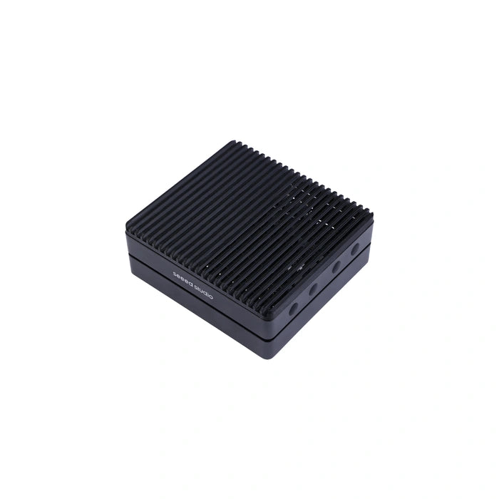

# Seeed Studio reComputer J4012 Development Guide



_Product image: OpenELAB._ [_Image source_](https://cdn.shopify.com/s/files/1/0621/0050/4774/files/seeed-110110145-global-media-1-700.webp?v=1791786369)_._

[Product at OpenELAB](https://openelab.io/products/seeed-studio-recomputer-j4012-edge) · [Manufacturer wiki hub](./)

### Product identity

**reComputer J4012, Seeed code 110110145**, is the original J30/J40-series edge computer with Jetson Orin NX **16 GB** and the J401 carrier. Use it for embedded vision, industrial inference prototypes and robot perception applications. It is a separate configuration from J4011B, Super J4012, Robotics J4012 and reServer Industrial J4012.

### Hardware specifications

| Item                        | Original J4012                                                           |
| --------------------------- | ------------------------------------------------------------------------ |
| Compute                     | Orin NX 16 GB LPDDR5; eight-core Arm CPU                                 |
| Advertised original maximum | Up to 100 TOPS, dependent on mode/workload                               |
| Storage                     | NVMe SSD; 128 GB documented standard configuration                       |
| External I/O                | Four USB 3.2 Type-A, HDMI 2.1, Gigabit Ethernet                          |
| Camera/expansion            | Two 15-pin two-lane CSI connectors, M.2 Key E/M and expansion headers    |
| Input                       | 9–19 V carrier reference; use the supply specified for the purchased kit |
| Size                        | 130 × 120 × 58.5 mm                                                      |

Sources: [J30/J40 model reference](https://wiki.seeedstudio.com/reComputer_J30_40_with_Jetson_getting_start/), [J40x datasheet](https://files.seeedstudio.com/products/NVIDIA/reComputer-J401x-datasheet.pdf). Check the actual included SSD, wireless module and adapter; package descriptions can differ from bare-board configurations.

### First boot and a useful baseline

Prepare the correct manufacturer power supply, monitor/HDMI cable, keyboard and wired network. Attach peripherals while powered off, then apply power and finish the Linux first-run setup. Start with the installed image if it boots; reflashing is a recovery or version-management operation and can overwrite the system disk.

On the **Jetson**, open a terminal and capture a baseline:

```bash
cat /etc/nv_tegra_release
uname -a
lsblk -o NAME,SIZE,TYPE,MOUNTPOINTS
ip -brief address
dpkg-query -W nvidia-jetpack
sudo nvpmodel -q
tegrastats --interval 1000
```

Stop the last command with **Ctrl+C** after several readings. Expected checkpoints are a readable L4T release, an NVMe root filesystem, a network interface/address, a reported power mode and changing memory/CPU/temperature statistics. The `nvidia-jetpack` meta-package may be absent on a minimal image; that result alone does not prove the BSP or CUDA is missing. Keep this output with the exact image identifier before installing project software.

Do not use a desktop-PC CUDA installer or an arbitrary x86 container. Select Jetson/aarch64 packages and containers that explicitly match the installed JetPack/L4T release. Begin with a small camera or inference example from that release before adding multiple streams. The commands above establish platform visibility, not an inference-performance benchmark.

Sources: [NVIDIA Jetson Linux developer guide](https://docs.nvidia.com/jetson/archives/r36.4.3/DeveloperGuide/), [tegrastats reference](https://docs.nvidia.com/jetson/archives/r36.4.3/DeveloperGuide/AT/JetsonLinuxDevelopmentTools/TegrastatsUtility.html).

### Interfaces and applications

Start with one supported camera, one network link and a small stock inference example. CSI compatibility depends on the fitted sensor driver/device tree and cable orientation. Add a ROS pipeline or multiple cameras after those independent checks work.

Use the [J401 carrier interface guide](https://wiki.seeedstudio.com/J401_carrierboard_Hardware_Interfaces_Usage/) for actual header pins, CAN requirements and supported expansion. A 40-pin connector shape does not establish signal voltage or directly usable CAN-H/CAN-L wiring. Power down before inserting camera ribbons or M.2 modules.

### Recovery and firmware selection

Seeed's [J401 flash guide](https://wiki.seeedstudio.com/reComputer_J4012_Flash_Jetpack/) is the model-specific entry point. Read the release table for **J401 carrier + Orin NX 16 GB**, preserve application data and use the host Ubuntu version required by the chosen image. The original product page documents JetPack 5.1.3; inspect the actual unit instead of assuming every shipment runs that version.

Follow the carrier's exact force-recovery wiring/button procedure and image target. Do not transplant the Super board's switch procedure or the Industrial server's image. After a deliberate flash, complete normal boot, remove recovery connections as instructed and repeat the baseline before installing other software.

### Troubleshooting and FAQ

| Problem                                        | Check                                                                                                                 |
| ---------------------------------------------- | --------------------------------------------------------------------------------------------------------------------- |
| A “J4012” image boots with missing peripherals | Confirm original J401 carrier rather than Super/Robotics/Industrial and the exact Orin NX memory target.              |
| Camera absent                                  | Supported sensor, ribbon contacts/orientation, driver and image revision.                                             |
| Package or container fails                     | aarch64/Jetson architecture and installed JetPack/L4T compatibility.                                                  |
| Recovery host cannot detect the module         | Exact carrier recovery procedure, USB data connection, power and expected module identity.                            |
| Kit contents differ from a guide               | Use the delivered board/module and order configuration as the identity record before planning accessories or storage. |

### Technical documents and software

| Resource                                                                                             | Use                                     |
| ---------------------------------------------------------------------------------------------------- | --------------------------------------- |
| [Model reference](https://wiki.seeedstudio.com/reComputer_J30_40_with_Jetson_getting_start/)         | Original J30/J40 specifications         |
| [J401 flash guide](https://wiki.seeedstudio.com/reComputer_J4012_Flash_Jetpack/)                     | Exact carrier/module image and recovery |
| [Carrier interface guide](https://wiki.seeedstudio.com/J401_carrierboard_Hardware_Interfaces_Usage/) | Electrical and peripheral setup         |
| [J40x datasheet](https://files.seeedstudio.com/products/NVIDIA/reComputer-J401x-datasheet.pdf)       | Hardware reference                      |
| [Jetson SDK/examples](https://github.com/Seeed-Projects/jetson-examples)                             | Manufacturer application examples       |

**Review date:** 17 November 2026. **Validation:** official documentation and the cited software interfaces reviewed. Commands and examples have not been compiled or run on physical hardware by OpenELAB for this guide. Record your hardware revision, firmware, software versions and actual results when reproducing it.
