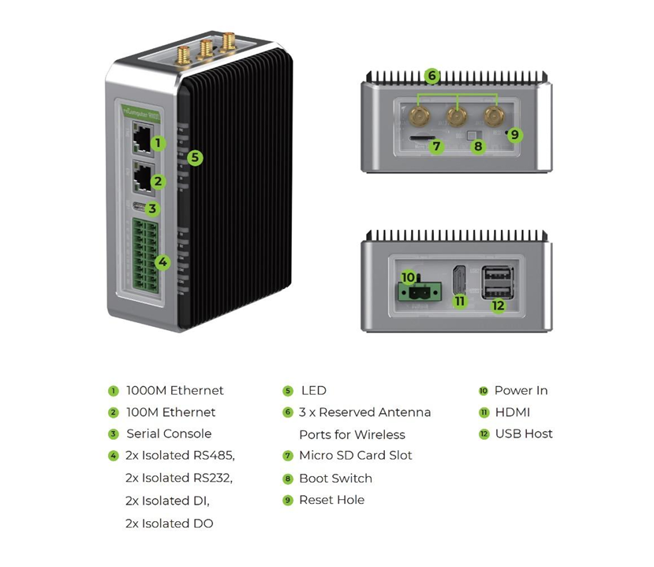

# Seeed Studio reComputer R1024 R1025 and R1126 Engineering Guide


[**View reComputer R1024-10 on OpenELAB**](https://openelab.io/products/seeed-studio-recomputer-r1024-10) · **SKU:** `Seeed-113991294` · **4GB RAM / 16GB eMMC**

[**View reComputer R1126-10 on OpenELAB**](https://openelab.io/products/seeed-studio-recomputer-r1126-10-iot-gateway-controller-4gb-ram-64gb-emmc) · **SKU:** `Seeed-100040889` · **4GB RAM / 64GB eMMC**

**Reference model:** R1025-10 · **SKU:** `Seeed-113991274` · **4GB RAM / 32GB eMMC**. Its exact current global-store listing is unresolved: the observed historical product link returns 404 and the current catalog has no matching SKU. Do not substitute another model's purchasing link.


These Raspberry Pi CM4 gateways share a Linux development approach but have different field interfaces. R1024/R1025 use the R1000 carrier with three RS485 ports. R1126 uses the R1100 carrier with two RS485, two RS232, two digital inputs and two digital outputs. This guide preserves those differences from power selection through image recovery.

## Product overview <a href="#model-selection-and-applications" id="model-selection-and-applications"></a>

| Model / exact SKU            | Compute and storage     | Carrier / current store status                                    |
| ---------------------------- | ----------------------- | ----------------------------------------------------------------- |
| R1024-10 / `Seeed-113991294` | CM4, 4GB RAM, 16GB eMMC | R1000; verified global listing above                              |
| R1025-10 / `Seeed-113991274` | CM4, 4GB RAM, 32GB eMMC | R1000 manufacturer reference; exact active store match unresolved |
| R1126-10 / `Seeed-100040889` | CM4, 4GB RAM, 64GB eMMC | R1100; exact current listing above                                |

Sources: [R1000 naming and hardware reference](https://wiki.seeedstudio.com/recomputer_r/), [R1024 listing](https://openelab.io/products/seeed-studio-recomputer-r1024-10), [R1126 listing](https://openelab.io/products/seeed-studio-recomputer-r1126-10-iot-gateway-controller-4gb-ram-64gb-emmc), [R1100 reference](https://wiki.seeedstudio.com/recomputer_r1100_intro/). R1000 manual naming explicitly uses R1025-10 for the 4GB/32GB wireless configuration. The older R1100 family table stops at 32GB; the exact R1126 listing establishes its 64GB storage refresh. Storage capacity does not make R1000 and R1100 terminals interchangeable.

The `-10` configurations are associated with CM4 wireless capability, but antennas, cellular, LoRa, PoE, UPS, TPM and NVMe hardware must be checked against the actual order. The CM4 is not a built-in Hailo accelerator; “AI capable” describes optional expansion and software possibilities.

## Applications

Use R1000 for meter collection, BACnet MS/TP or Modbus RTU gateways needing three isolated RS485 links. Use R1100 when the project also needs real RS232 devices or isolated DI/DO. Both can run local dashboards, MQTT bridges and services such as Node-RED after hardware transport is established.

The [R1000 application index](https://wiki.seeedstudio.com/recomputer_r1000_intro/) also covers FUXA, FIN, N3uron, CODESYS, OPC UA, S7, InfluxDB/Grafana, ThingsBoard, AWS and fleet management. These are distinct applications with licensing, protocol and deployment requirements; a gateway does not automatically implement every server or PLC protocol. Start with the read-only Modbus result below, then add one integration service and a restart/reconnect test. Do not use an untested dashboard flow as a building-control loop.

## Specifications

| Item                | R1024-10 / R1025-10, R1000 carrier                                       | R1126-10, R1100 carrier                                                  |
| ------------------- | ------------------------------------------------------------------------ | ------------------------------------------------------------------------ |
| CPU                 | CM4, four Cortex-A72 cores at 1.5GHz                                     | Same CM4 CPU class                                                       |
| RAM / eMMC          | 4GB / 16GB or 32GB respectively                                          | 4GB / 64GB exact listing                                                 |
| Main terminal input | **12–24V AC or 9–36V DC**                                                | **9–36V DC**; no AC allowance established here                           |
| PoE                 | Optional module, ETH0 powered-device input, IEEE 802.3af / 12.95W budget | Optional module, ETH0 powered-device input, IEEE 802.3af / 12.95W budget |
| Ethernet            | One 10/100/1000Mb/s native port plus one USB-derived 10/100Mb/s port     | Same speed distinction                                                   |
| Serial field ports  | Three isolated RS485, each with A/B/isolated ground                      | Two isolated RS485 plus two isolated RS232                               |
| Digital field I/O   | No R1100-style DI/DO terminal block                                      | Two PNP-style DI, use 5–24V; two open-collector DO, below 60V            |
| USB / display       | Two USB-A 2.0 host, one USB-C 2.0 flashing; HDMI 2.0                     | Same connector counts                                                    |
| Expansion           | NVMe via the documented bridge, two Mini PCIe module positions, SIM      | NVMe, two Mini PCIe module positions, Nano-SIM                           |
| Time / resilience   | RTC, hardware watchdog 1–255s, optional supercapacitor UPS               | Same feature categories; different GPIO mappings                         |
| Enclosure           | 130 × 93 × 49.6mm, DIN rail or wall; 560g family net weight              | Same stated family envelope                                              |
| Environment         | −30 to +70°C, IP40, fanless; 10–95%RH family specification               | Same stated family range                                                 |

Sources: [R1000 specifications/power](https://wiki.seeedstudio.com/recomputer_r/), [R1100 specifications](https://wiki.seeedstudio.com/recomputer_r1100_intro/). The 40V overvoltage-protection figure in the family tables is **not** an operating input rating. The vendor's measured 2.88W idle / 5.52W CPU-load figures were obtained at 24V without external devices; they are not the required supply rating for a populated cellular/NVMe system.

The R1100 DI subtable permits 5–30V while its system/configuration tables say 5–24V; stay within 5–24V here. Its DO configuration page states 500mA, but load selection must include the received revision's continuous/aggregate rating and suppression requirements; use a small resistor/meter first, not an inductive relay.

## Hardware and connections <a href="#hardware-and-technical-documents" id="hardware-and-technical-documents"></a>

### Power, mounting and power-off behavior

Use a suitable regulated **24V DC bench supply** for a common first-boot route across both carriers. Wire the two-pin terminal from the received unit's markings. R1000's AC compatibility comes from its documented bridge-rectifier input; do not transfer it to R1100. The optional PoE module makes the gateway a **powered device**, not a source for cameras. ETH1 is not the documented PoE input port. [R1000 power diagram](https://wiki.seeedstudio.com/recomputer_r/#power-diagram), [R1100 power diagram](https://wiki.seeedstudio.com/recomputer_r1100_intro/#power-diagram).

There is no normal main power button: applying power starts the system. Use the OS shutdown command and wait for completion before removing supply; the R1000 guide asks for at least ten seconds before repowering. Reset is not a clean shutdown. Mount the DIN clip/wall bracket securely, preserve enclosure heat dissipation and route field wiring away from the internal radio antenna connectors.

### R1000: three separate RS485 connectors

Follow the actual **A/B/GND\_ISO** silk-screen on each three-pin connector. The isolated reference belongs with the fieldbus peer, not an assumed chassis or CM4 ground. The R1000 manual states that the 120Ω endpoint resistors are **not installed by default**. Fit appropriate termination at the two physical ends of a bus; a supplied resistor does not mean it is already enabled. Verify A/B polarity against the peer's differential convention. [R1000 manual, RS485 section](https://files.seeedstudio.com/wiki/reComputer-R1000/reComputerR_UserManual_version01.pdf).

R1000 does not acquire R1100's RS232 and DI/DO by installing its software. Never connect an RS232 voltage-level instrument to the R1000 RS485 connector.

### R1100: terminal IDs and separate digital references



_Seeed Studio,_ [_official R1100 interface illustration_](https://files.seeedstudio.com/wiki/R1100/interface.PNG)_. It shows the R1100 carrier layout, not the three-RS485 R1000 layout._

| R1100 terminal ID | Function              |
| ----------------- | --------------------- |
| 1 / 3 / 5         | RS485-1 A / B / GND   |
| 2 / 4 / 6         | RS485-2 A / B / GND   |
| 13 / 15 / 17      | RS232-3 RX / TX / GND |
| 14 / 16 / 18      | RS232-4 RX / TX / GND |
| 7 / 9 / 11        | DI1 / DI2 / G\_DI     |
| 8 / 10 / 12       | DO1 / DO2 / G\_DO     |

Source: [R1100 interface tables](https://wiki.seeedstudio.com/recomputer_r1100_intro/#interface-description), [R1100 user manual V1.0](https://files.seeedstudio.com/R11/reComputer%20R1100%20User%20Manual-V1.0.pdf). Terminal IDs must be oriented using the official diagram. Do not infer numbering from the perspective of an angled enclosure image.

R1100 DI is PNP-style: apply the documented positive test voltage to DI relative to G\_DI. DO is an **open collector**, requiring an external pull-up/load supply referenced to G\_DO. The port does not generate the external voltage. Keep isolated references and power domains distinct; connect a field ground only as specified by that interface's wiring.

### Internal expansion is model and revision specific

Power off before opening the enclosure. Fit the correct Mini PCIe USB/SPI LoRa or cellular module, SIM form factor, antennas, NVMe bridge/drive and any soldered optional PoE/UPS hardware using the exact assembly guide. R1000's original SIM description and R1100's Nano-SIM must not be treated as one card holder. The on-board DSI/speaker provisions on R1000 are reserved internal interfaces, not ready-made external display/audio ports.

The R1100 listing's additional 64GB eMMC is on its compute module; it does not change the optional NVMe slot into system RAM. Check boot media using the mounted root filesystem rather than whichever disk has the largest capacity. [R1000 assembly](https://wiki.seeedstudio.com/recomputer_r1000_assembly_guide/), [R1100 hardware overview](https://wiki.seeedstudio.com/recomputer_r1100_intro/#hardware-overview).

## Software and development resources <a href="#software-recovery-and-faqs" id="software-recovery-and-faqs"></a>

| Target                   | Model-specific image / driver requirement                                                                                             |
| ------------------------ | ------------------------------------------------------------------------------------------------------------------------------------- |
| R1024-10 / R1025-10      | R1000/`reComputer-R100x` image/device tree; identify carrier v1.0 versus v1.1 before RS485 setup                                      |
| R1126-10                 | R1100/`reComputer-R110x` image/device tree; storage capacity does not change that carrier target                                      |
| Shared user applications | Raspberry Pi OS/Debian-family ARM packages compatible with the installed image; Node-RED/MQTT/Modbus libraries are application layers |

The [current Seeed image index](https://github.com/Seeed-Studio/pi-gen-expand) lists separate R100x and R110x images. Use the matched carrier entry, record its release/hash and read that image's login instructions. Older tutorials alternate between `pi` and `recomputer` accounts; do not treat either or an example password as universal. Change any delivered default credential before deployment.

After a self-installed OS, the official flash guides use Seeed's `seeed-linux-dtoverlays` repository and `scripts/reTerminal.sh --device reComputer-R100x` or `--device reComputer-R110x` respectively. Review the selected release/script before running it, then reboot. Do not install both carrier overlays. [R1000 image/drivers](https://wiki.seeedstudio.com/recomputer_r1000_flash_OS/), [R1100 image/drivers](https://wiki.seeedstudio.com/recomputer_r1100_flash_os/).

R1000 v1.0 has a documented RS485 direction-enable issue. The manufacturer's [RS485 guide](https://wiki.seeedstudio.com/recomputer_r1000_use_rs485_modbus_rtu/) offers a kernel-hook solution or a userspace DE proxy. Those are revision-specific; v1.1 has a different driver/setup route. A UART device appearing in `/dev` does not prove bidirectional RS485 is configured.

## Getting started <a href="#getting-started-inspect-before-connecting-a-fieldbus" id="getting-started-inspect-before-connecting-a-fieldbus"></a>

### 1. Identify the carrier before fieldbus wiring

1. Check the model/SKU label and carrier revision. Prepare a compatible 24V DC supply, HDMI/keyboard or the delivered SSH route, and Ethernet on a bench network.
2. Leave field terminals disconnected. Set BOOT to **normal/eMMC**, attach peripherals with power removed, then apply power and complete Linux setup.
3. Run on the gateway:

```bash
cat /etc/os-release
uname -a
tr -d '\0' </proc/device-tree/model
free -h
lsblk -o NAME,SIZE,TYPE,MOUNTPOINTS
findmnt /
ip -br address
lsusb -t
ls -l /dev/serial/by-id /dev/serial/by-path
```

**Expected result:** CM4 Linux, nominal 4GB RAM, identifiable 16/32/64GB eMMC according to model, and the two network paths. Missing `/dev/serial` directories do not by themselves prove missing R1000 UARTs: native ttyAMA ports and USB ttyACM ports enumerate differently.

### 2. Resolve the actual serial device and direction control

For **R1000 v1.1**, the vendor serial tutorial lists native UARTs such as ttyAMA2/3/4; other revision/proxy examples use ttyAMA5 and synthetic ttyAMA10/11/12. These are not interchangeable defaults. Inspect the installed overlay, kernel logs and revision-specific pin-assignment sheet, then verify one connector with a known peer. Use the v1.1 minicom RS485 controls where the driver supports them.

For **R1000 v1.0**, install the manufacturer's documented kernel-hook solution for the running kernel, or deliberately run the documented userspace proxy. In the proxy method, the application opens the **new proxy tty**, not the underlying ttyAMA port; the proxy must remain active. Record its mapping, DE line and kernel version. Do not run a v1.0 workaround on an unidentified v1.1 board.

For **R1100**, the reviewed image maps RS485 COM1/COM2 to ttyACM0/ttyACM1 and RS232 COM3/COM4 to ttyACM2/ttyACM3. Verify these with USB by-path information and a bench peer because additional devices can shift enumeration. RS232 uses a compatible RS232 adapter, crossed TX/RX and ground; RS485 uses a differential adapter with matching polarity, reference and termination. [R1000 serial procedure](https://wiki.seeedstudio.com/recomputer_r1000_use_rs485_modbus_rtu/), [R1100 configuration](https://wiki.seeedstudio.com/recomputer_r1100_configure_system/).

Before Modbus, send distinct short strings both ways at a common rate using minicom or equivalent. For a bench RS485 test, 9600 baud, 8N1 and matching direction mode on both ends provide a clear starting configuration. Do not infer bidirectional success from a local echo setting.

### 3. Original read-only Modbus RTU example

Use a separate **bench simulator** or known device with an explicitly documented holding register. For a reproducible fixture, configure the peer simulator as unit1, 9600 baud, 8N1, holding-register protocol address0 containing **1234**. Keep real actuators disconnected. Connect the gateway's verified RS485 channel to that peer, enable the correct direction-control route, and close other serial clients.

Install `python3-serial` and save this original function03 reader as `read_one_register.py`. It sends one read request, validates CRC/unit/function/length and performs no writes:

```python
import struct,sys
import serial

def crc16(data):
    value=0xFFFF
    for byte in data:
        value ^= byte
        for _ in range(8):
            value=(value >> 1) ^ (0xA001 if value & 1 else 0)
    return struct.pack('<H',value)

def exact(port,count):
    data=b''
    while len(data)<count:
        part=port.read(count-len(data))
        if not part:
            raise RuntimeError('timeout after '+str(len(data))+' bytes')
        data+=part
    return data

path=sys.argv[1]
unit=int(sys.argv[2])
address=int(sys.argv[3],0)
if not (1<=unit<=247 and 0<=address<=65535):
    raise SystemExit('unit must be 1..247; address 0..65535')
request=struct.pack('>BBHH',unit,3,address,1)
with serial.Serial(path,9600,bytesize=8,parity='N',stopbits=1,timeout=2) as port:
    port.reset_input_buffer()
    port.write(request+crc16(request))
    port.flush()
    header=exact(port,3)
    if header[0]!=unit:
        raise RuntimeError('unexpected responding unit')
    if header[1]==0x83:
        response=header+exact(port,2)
        if crc16(response[:-2])!=response[-2:]:
            raise RuntimeError('exception CRC mismatch')
        raise RuntimeError('Modbus exception '+str(header[2]))
    if header[1]!=3 or header[2]!=2:
        raise RuntimeError('unexpected function or byte count')
    response=header+exact(port,4)
    if crc16(response[:-2])!=response[-2:]:
        raise RuntimeError('CRC mismatch')
    value=struct.unpack('>H',response[3:5])[0]
    print('response_hex='+response.hex())
    print(f'unit={unit},protocol_address={address},u16={value}')
```

Run using the **verified** device or active proxy path:

```bash
python3 read_one_register.py /dev/ttyACM0 1 0
```

The path shown is the reviewed R1100 COM1 example, not an R1000 default. Replace it with the actual native/proxy path on R1000. **Expected result for the configured simulator:** `u16=1234`, together with raw response bytes. A timeout prompts wiring/direction checks; a Modbus exception is a valid protocol reply indicating that address/function access needs investigation. A register printed as40001 by a device manual may use protocol address0, but check that device's convention. Signedness,scale,units and multi-register word order are device-specific; this example returns an unsigned16-bit value only.

Source context: [manufacturer Modbus RTU/TCP workflow](https://wiki.seeedstudio.com/recomputer_r1000_use_rs485_modbus_rtu/). The implementation here is original and has not been run on either carrier.

### 4. R1100 digital I/O: small bench signals first

In the reviewed R1100 image, the configuration guide maps DI1/DI2 to historical GPIO530/531 and DO1/DO2 to532/533. Inspect `/sys/kernel/debug/gpio` and `gpioinfo` to resolve the **actual** chip and line offset; global numbering can move between kernels. Do not transfer the R2245 or Jetson GPIO map.

For DI1, connect a known 12V signal relative to G\_DI11 and read the verified input line using `gpioget`. Compare disconnected/connected states: the vendor example reads0 for an electrically high input and1 for low. Treat this as active-low software reporting, not proof that a field contact is normally open/closed.

For a DO1 bench check, connect a small external pull-up through a resistor to a 12V supply and measure DO1 relative to G\_DO12 with a high-impedance meter. Do not use an inductive load. With the verified mapping, libgpiod1 syntax is `gpioset --mode=signal CHIP LINE=VALUE`; keep the process alive until the test load is removed. Libgpiod2 uses `gpioset -c CHIP LINE=VALUE` and holds by default. Observe both requested states rather than assuming a GPIO's logical1 means a high-voltage source. The source's output voltage comes from the external pull-up. [R1100 DI/DO explanation](https://wiki.seeedstudio.com/recomputer_r1100_configure_system/#di-digital-input-testing).

### 5. Add a service after physical transport works

Install the chosen Node-RED release compatible with the image, open its editor on the gateway's actual address, and import the following original software-only flow. It checks scheduling and message delivery without operating hardware:

```json
[
  {"id":"bench-trigger","type":"inject","name":"Every 5 seconds","props":[{"p":"payload"}],"repeat":"5","once":true,"onceDelay":1,"payload":"","payloadType":"date","wires":[["bench-record"]]},
  {"id":"bench-record","type":"function","name":"Gateway bench marker","func":"msg.payload={time:new Date().toISOString(),role:'gateway-bench',transport:'software-only'}; return msg;","outputs":1,"wires":[["bench-debug"]]},
  {"id":"bench-debug","type":"debug","name":"Observe marker","active":true,"tosidebar":true,"complete":"payload","wires":[]}
]
```

Deploy and observe a new timestamped object every five seconds. This establishes a software service checkpoint; it does not prove Modbus, MQTT or sensor data. Replace the software marker with the already-validated read-only data route only after that transport works. Protect remote editor access and preserve exported flows/credentials with a backup. [Manufacturer Node-RED route](https://wiki.seeedstudio.com/recomputer_r1000_getting_started_node_red/), [application index](https://wiki.seeedstudio.com/recomputer_r1000_intro/).

For MQTT, add a known local broker and test one topic before cloud authentication. For Modbus TCP, keep client/server roles distinct and check unit/register settings and TCP routing; a server listening on privileged port502 may need deliberate service permissions. BACnet MS/TP depends on correct RS485 transport and token settings, while BACnet/IP uses the network. OPC UA/S7/FIN/CODESYS are separate stacks; retain their exact versions and licenses instead of presenting installation as a hardware capability test.

### 6. Optional interfaces and resilience checkpoints

| Feature            | Model-specific procedure and boundary                                                                                                                                                                                                                                                           |
| ------------------ | ----------------------------------------------------------------------------------------------------------------------------------------------------------------------------------------------------------------------------------------------------------------------------------------------- |
| Ethernet           | `ip -br link`, then `ethtool INTERFACE`; ETH1 is only10/100Mb/s. Test a bench `iperf3` peer and record the actual route/interface; two ports do not imply an automatic bridge.                                                                                                                  |
| Wi-Fi / Bluetooth  | Attach the correct CM4 antenna, inspect `nmcli device status` and pair through `bluetoothctl`. The R1000 reference also documents desktop selection. Do not use a `-00` non-wireless image/module assumption for these `-10` variants.                                                          |
| Cellular / GNSS    | Fit the region-compatible modem, SIM and main/diversity/GNSS antennas. Inspect actual AT and network nodes; `AT`/`ATI` establish command transport. Configure carrier APN and the documented ECM/QMI route; a response does not establish registration or Internet routing.                     |
| LoRa               | Fit a USB or SPI gateway module of the correct region. R1100's reviewed SX1302 setup uses I2C3 and `/dev/spidev0.1`; R1000 setup differs. Do not copy reset global GPIOs or a US915 plan onto an EU868 deployment.                                                                              |
| USB / NVMe         | Inspect `lsusb -t`, `lsblk`, `findmnt`; NVMe behind a bridge may appear as`sdX`. A file test belongs on the confirmed spare mount, never a raw disk write.                                                                                                                                      |
| LEDs / buzzer      | PWR is power, ACT is eMMC activity and serial LEDs indicate traffic. Inspect exposed `/sys/class/leds` names. R1000 buzzer is CM4GPIO21 in its manual; R1100 configuration uses a different expanded mapping. Do not transfer that pin.                                                         |
| RTC                | Establish system time, read `sudo hwclock -r`, then check retention with networking/NTP disabled. A clock corrected at boot by the network does not prove battery/backup retention.                                                                                                             |
| Watchdog           | Inspect actual hardware identity and service configuration; interval must be shorter than timeout. Arrange a controlled maintenance test before enabling reboot behavior. A forced kernel crash is unnecessary for first-run verification.                                                      |
| UPS                | R1000 manual uses GPIO25 alarm; R1100 configuration uses GPIO6. Verify carrier revision, active-low signal and actual hold-up time before installing an automatic shutdown overlay. Test graceful shutdown with saved data and a recoverable bench power cycle.                                 |
| Security / EEPROM  | Inspect optional TPM devices and ATECC driver presence. Use the exact chip/tool documentation for serial reads; the source's “generate serial number” wording is not adopted as provisioning guidance. Do not change permissions globally or overwrite identification EEPROM as a first result. |
| Internal CSI / DSI | Only use a documented carrier connector, supported adapter and sensor/display driver. An IMX219 overlay example in R1100 configuration does not mean every enclosure ships with an exposed camera connector.                                                                                    |

Sources: [R1000 full hardware guide](https://wiki.seeedstudio.com/recomputer_r/), [R1100 hardware](https://wiki.seeedstudio.com/recomputer_r1100_intro/), [R1100 configuration](https://wiki.seeedstudio.com/recomputer_r1100_configure_system/).

### 7. Recover eMMC with the correct carrier target

Back up application data,network configuration,flows and any device-specific credentials before imaging. Select **R100x** for R1024/R1025 and **R110x** for R1126 from the official Seeed image list. A larger eMMC does not justify a different carrier image.

1. Remove power,move the boot switch toward **BOOT/USB flash**,connect a known USB-C data cable to the host and apply main power as documented.
2. Run the appropriate `rpiboot/usbboot` host tool. Confirm the exposed eMMC by capacity and device identity; do not select the host's system disk or an unrelated USB drive.
3. In Raspberry Pi Imager,choose the exact downloaded carrier image and identified eMMC,write and verify. Use the release's supported customization/login instructions.
4. Power off,disconnect USB,return BOOT to normal/eMMC and restart. Restore the correct carrier drivers if the image requires them,then repeat storage,network and serial checks before reconnecting a site bus.

[R1000 flash guide](https://wiki.seeedstudio.com/recomputer_r1000_flash_OS/) and [R1100 flash guide](https://wiki.seeedstudio.com/recomputer_r1100_flash_os/) include Windows,macOS and Linux routes. Generic OS instructions alone do not restore all carrier functions. For NVMe boot,first keep a known working eMMC image,record EEPROM/boot order and use the exact model's sequence. Verify `findmnt /` after the change before treating NVMe boot as successful.

## Troubleshooting and FAQs

| Symptom                                      | Ordered diagnosis                                                                                                                                                                                   |
| -------------------------------------------- | --------------------------------------------------------------------------------------------------------------------------------------------------------------------------------------------------- |
| RS485 sends but never receives               | Identify R1000v1.0/v1.1 → correct DE solution/driver → physical port → active proxy path if used → A/B/reference/termination → common serial settings.                                              |
| R1100 port shifts after adding a modem       | Use USB by-path and a known peer to remap COM channels; do not persist a guessed ttyACM number.                                                                                                     |
| Modbus timeout                               | Close competing serial tools → verify direction/two-way transport → unit/baud/parity → physical bus. A failed register is not the first explanation for no bytes.                                   |
| Modbus exception / CRC mismatch              | Exception: check function/address permissions. CRC: inspect settings,termination,noise and framing; retain raw bytes before applying scaling.                                                       |
| DO reads floating or inverted                | Check external pull-up/load reference,verified GPIO mapping and held line ownership. The output is an open collector,not a voltage generator.                                                       |
| Optional PoE browns out with modem/SSD       | Use the documented terminal supply and calculate the populated system's demand;12.95W PoE is a total power budget,not spare peripheral capacity.                                                    |
| No eMMC in flashing mode                     | Check BOOT position,data cable,main power and rpiboot/host drivers before assuming storage failure.                                                                                                 |
| R1126 capacity differs from old family table | Use the exact64GB listing and actual device identity; do not relabel it as a32GB R1125.                                                                                                             |
| Where is the R1025 purchasing link?          | The observed historical link is not currently readable as an active product and the current catalog has no exactSKU. Manufacturer setup is covered,while the active store match remains unresolved. |

## Downloads and technical documents <a href="#official-documentation-and-development-resources" id="official-documentation-and-development-resources"></a>

| Official resource                                                                                                                                                                                                                                           | Scope / access                                                                                        |
| ----------------------------------------------------------------------------------------------------------------------------------------------------------------------------------------------------------------------------------------------------------- | ----------------------------------------------------------------------------------------------------- |
| [R1000 engineering reference](https://wiki.seeedstudio.com/recomputer_r/) / [application index](https://wiki.seeedstudio.com/recomputer_r1000_intro/)                                                                                                       | Hardware,power,revision context and linked integration tutorials                                      |
| [R1000 user manual](https://files.seeedstudio.com/wiki/reComputer-R1000/reComputerR_UserManual_version01.pdf)                                                                                                                                               | Downloaded/read;revision1.1,28May2024;R1025 naming,RS485,power andUPS                                 |
| [R1000 v1.1 pin assignment XLSX](https://files.seeedstudio.com/wiki/reComputer-R1000/reComputer_R1000_v1_1_Pin_Assignment.xlsx)                                                                                                                             | Official revision-specific mapping;download before revision-dependent integration                     |
| [R1000 schematic/PCB ZIP](https://files.seeedstudio.com/wiki/reComputer-R1000/reComputer_R1000_schematic_design_files.zip) / [retained v1.1 schematic URL](https://files.seeedstudio.com/wiki/reComputer-R1000/202003926_reComputer-R1000-v1.1_SCH-PCB.zip) | Manufacturer electrical downloads;check exact archive revision                                        |
| [R1000 STEP](https://files.seeedstudio.com/wiki/reComputer-R1000/reComputer_R1000.stp)                                                                                                                                                                      | Exact family mechanical download                                                                      |
| [R1100 hardware](https://wiki.seeedstudio.com/recomputer_r1100_intro/) / [configuration](https://wiki.seeedstudio.com/recomputer_r1100_configure_system/)                                                                                                   | R1100 serial,DI/DO,radio,time and optional-module details                                             |
| [R1100 manual V1.0](https://files.seeedstudio.com/R11/reComputer%20R1100%20User%20Manual-V1.0.pdf)                                                                                                                                                          | Downloaded/read;terminal and electrical reference;old storage options distinguished fromR1126 listing |
| [R1100 schematic ZIP](https://files.seeedstudio.com/R11/reComputer%20R1100_schematic_design_files.zip) / [R1100 STEP](https://files.seeedstudio.com/R11/reComputer%20R1100_3D.stp)                                                                          | Exact carrier electrical/mechanical files;listed,notCAD-tested                                        |
| [R1100 flyer](https://files.seeedstudio.com/wiki/reComputer-R1000/reComputer-R1100/reComputer-R1100-flyer.pdf)                                                                                                                                              | Family overview;not aR1000 terminal authority                                                         |
| [R1000 flash](https://wiki.seeedstudio.com/recomputer_r1000_flash_OS/) / [R1100 flash](https://wiki.seeedstudio.com/recomputer_r1100_flash_os/)                                                                                                             | Carrier-specific eMMC/NVMe recovery and overlay targets                                               |
| [RS485/Modbus tutorial](https://wiki.seeedstudio.com/recomputer_r1000_use_rs485_modbus_rtu/)                                                                                                                                                                | Revision-dependent DE handling and protocol examples                                                  |
| [Seeed device-tree repository](https://github.com/Seeed-Studio/seeed-linux-dtoverlays) / [image list](https://github.com/Seeed-Studio/pi-gen-expand)                                                                                                        | Use a matched release and record commit/image hash                                                    |

## References and validation <a href="#sources-and-validation" id="sources-and-validation"></a>

Reviewed **24 November2026** against the exact R1024/R1126 store/catalog identities,live R1000/R1100 hardware and configuration pages,carrier-specific flash instructions,and downloaded R1000/R1100 manuals. The official R1100 interface illustration was visually inspected. The R1025 manufacturer configuration is documented,while its active global-store/SKU match remains unresolved;no competing new page or invented handle is created.

**Compilation,Node-RED execution,OS flashing and physical hardware tests were not run.** The CRC-validating read-only Modbus client and software marker flow are original,source-reviewed examples with expected results. Record model,carrier revision,image/kernel,DE mapping,physical wiring,peer register definition and actual response before claiming a validated gateway. Manufacturer resources retain their original notices.

### Related retained references

* [Manufacturer model comparison](https://www.seeed.cc/product/recomputer-r1000-series-raspberry-pi-iot-gateway-controller-cm4-powered-ai-capable)
* [October 2026 memory/storage revision mapping](https://www.seeedstudio.com/blog/2026/10/23/upgraded-memory-and-storage-for-seeed-raspberry-pi-based-products/)
