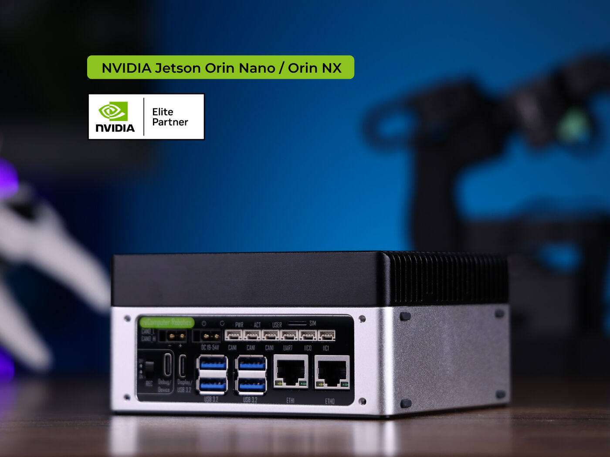
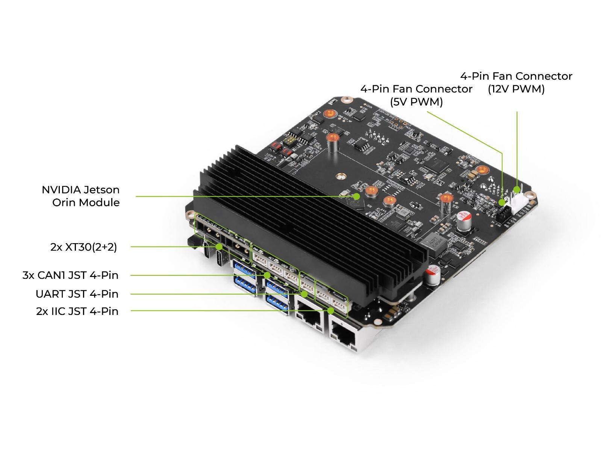

# Seeed Studio reComputer Robotics J4012 Development Guide


[**View reComputer Robotics J4012 base system on OpenELAB**](https://openelab.io/products/seeedstudio-recomputer-robotics-j4012-intelligent) · **SKU:** `Seeed-114110310`

[**View reComputer Robotics J4012 with GMSL extension on OpenELAB**](https://openelab.io/products/seeed-studio-recomputer-robotics-j4012) · **SKU:** `Seeed-100026552`

**Shared compute/carrier:** Jetson Orin NX16GB and Robotics J401. **Order distinction:** base system versus fitted GMSL extension; cameras/cables remain separate configuration items.


The Robotics J4012 is a compact Orin NX16GB computer with two CAN controllers, dual Gigabit Ethernet and USB-C DisplayPort. This guide covers both exact sold configurations, identifies the added GMSL board, and establishes boot, CAN and camera checkpoints using the Robotics-specific BSP. The original J4012 and Super J4012 have different power connectors, headers and images.



_Seeed Studio product illustration._ [_Official Robotics hardware reference_](https://wiki.seeedstudio.com/recomputer_robotics_j401_hardware_interfaces_usage/)_;_ [_Seeed Studio wiki directory_](./)_._

## Product overview <a href="#product-and-variant-scope" id="product-and-variant-scope"></a>

| Exact sold configuration                    | Hardware distinction                                                         | Firmware consequence                                                                                 |
| ------------------------------------------- | ---------------------------------------------------------------------------- | ---------------------------------------------------------------------------------------------------- |
| `Seeed-114110310`, base Robotics J4012      | NX16GB,128GB NVMe,Robotics carrier/cooling;GMSL board is an expansion option | Use Robotics J401/NX16GB BSP;do not assume camera drivers from a generic JetPack installation        |
| `Seeed-100026552`, Robotics J4012 with GMSL | Same compute plus fitted GMSL extension in the listed package                | Require driver-equipped Robotics J401/NX16GB image and overlay for the installed camera/deserializer |

Sources: [base-system listing](https://openelab.io/products/seeedstudio-recomputer-robotics-j4012-intelligent), [GMSL-system listing](https://openelab.io/products/seeed-studio-recomputer-robotics-j4012), [manufacturer Robotics setup](https://wiki.seeedstudio.com/recomputer_robotics_j401_getting_started/). Neither configuration implies included cameras,radio modules or a power adapter. Inspect order contents before purchasing add-ons. Installing a GMSL-enabled image does not mean an expansion board is physically present.

## Applications

The Robotics J4012 suits robot perception,USB-camera acquisition,GMSL vision with the extension,and CAN sensor integration. The XT30(2+2) connections combine power with one CAN bus;this is useful for a robot harness but needs deliberate polarity and topology checks. Multiple connectors for one controller are not independent CAN networks.

Keep motors and actuators disconnected during commissioning. Bring up Linux,then one camera or bench CAN peer,then wireless/network services. The advertised157TOPS maximum is a module/image/power-mode condition,not a synchronized multi-camera inference guarantee.

## Specifications <a href="#hardware-specifications" id="hardware-specifications"></a>

| Item                  | Both Robotics J4012 configurations                                                                            |
| --------------------- | ------------------------------------------------------------------------------------------------------------- |
| Compute               | Orin NX16GB;8-core Cortex-A78AE up to2GHz;1024 Ampere CUDA cores,32 Tensor Cores                              |
| Memory / acceleration | 16GB128-bit LPDDR5,102.4GB/s module bandwidth;two NVDLA v2 and one PVA v2                                     |
| Headline / storage    | Up to157TOPS in supported Super/MAXN configuration;128GB NVMe2280                                             |
| Network / expansion   | Two Gigabit RJ45;Key E Wi-Fi/BT;Key B cellular with SIM;Key M NVMe                                            |
| USB / display         | Six USB3.2 Type-A5Gb/s;one Type-C host with DP1.4;separate USB2.0 Type-C device/debug                         |
| CAN                   | Two controllers:CAN0 on two connected XT30(2+2) sockets;CAN1 repeated on three GH-1.25 headers                |
| Serial / I2C          | One GH-1.25 UART;two GH-1.25 I2C headers                                                                      |
| Camera                | Expansion connector;optional/fitted four-camera GMSL2 Mini-FAKRA board according to SKU                       |
| Fans / controls       | Separate5V/12V PWM connectors;PWR/RESET;REC switch;PWR/ACT/userRGB LEDs                                       |
| Main input            | **19–54V DC** via XT30(2+2);XT30-to-5525 cable in listed kit                                                  |
| Size                  | 115×115×38mm system dimensions stated by manufacturer;confirm mounting clearances with CAD                    |
| Thermal scope         | Supported heatsink/fan required;25W:−20 to+60°C;higher modes require the matching documented thermal envelope |

Sources: [current carrier table](https://wiki.seeedstudio.com/recomputer_jetson_robotics_j401_getting_started/#carrier-board-specifications), [Robotics manual V0.5,15May2025](https://files.seeedstudio.com/products/NVIDIA-Jetson/reComputer_robotics_J401_user_manual.pdf), [GMSL listing compute table](https://openelab.io/products/seeed-studio-recomputer-robotics-j4012).

The base store table says12–54V,whereas the current carrier table and manual's XT30 table specify**19–54V**. Use the documented19V-class supply for this guide;12V operation is not established here. The current wiki's40W temperature text also varies between50°C and55°C;use the lower50°C planning ceiling until the exact revision's thermal qualification is confirmed. Do not treat a broad temperature headline as permission to run MAXN at60°C.

## Hardware and connections <a href="#camera-can-and-power-integration" id="camera-can-and-power-integration"></a>

### XT30 power/CAN0 and GH header orientation



_Seeed Studio,_[_official Robotics board connector illustration_](https://media-cdn.seeedstudio.com/media/wysiwyg/upload/image-robotic-1.jpeg)_. The pin tables below refer to the manual's numbered connector view,not an inferred cable wire color._

| Connector                   | Numbered pin functions                                                                                |
| --------------------------- | ----------------------------------------------------------------------------------------------------- |
| Power board J4/J5 XT30(2+2) | 1:19–54V power;2:GND;3:CAN0\_H;4:CAN0\_L                                                              |
| J9/J10/J11 CAN1 GH-1.25     | 1:GND;2:CAN1\_L;3:CAN1\_H;4:5V CAN supply                                                             |
| J8 UART GH-1.25             | 1:GND;2:UART1\_RX3.3V;3:UART1\_TX3.3V;4:VDD\_UART                                                     |
| J6 I2C GH-1.25              | 1:GND;2:I2C1 SDA3.3V-level-shifted;3:I2C1 SCL3.3V-level-shifted;4:VDD\_I2C1                           |
| J7 I2C GH-1.25              | 1:GND;2:I2C0 SDA3.3V-level-shifted;3:I2C0 SCL3.3V-level-shifted;4:VDD\_I2C1 as labelled in the manual |

Source:[manual pp.38–39](https://files.seeedstudio.com/products/NVIDIA-Jetson/reComputer_robotics_J401_user_manual.pdf). J4/J5 power connections are **joined**;they are not isolated supplies. Do not connect different power sources or assume the second socket has an independent protected output budget. The two small XT30 pins are CAN,not extra supply contacts. CAN1 pin4 is5V;do not connect it to CANH,L or a3.3V logic input.

Use the supplied XT30 adapter cable and an approved19V/4.74A supply as the documented starting accessory. Check polarity at both ends before energizing. UART/I2C tables name supply nets without establishing that every external module can be powered from them;the first UART test below connects **only GND,RX andTX**,leaving pin4 unused. A peripheral with5V pull-ups needs level matching even if its own power rail is5V.

### Two CAN controllers,not five

CAN0 appears on both XT30 connectors;CAN1 appears on three GH connectors. The onboard transceivers provide differential H/L signals,unlike the original/Super logic headers. They have active-high standby controls:for operation hold **gpiochip2 line3 low for CAN0** and **line4 low for CAN1** in the reviewed6.x BSP. The carrier's two120Ω termination switches must match the physical bus ends. [Robotics CAN section](https://wiki.seeedstudio.com/recomputer_jetson_robotics_j401_getting_started/#can).

### Display,cameras and internal service parts

Use the **Type-C host/DP1.4 port** for a supported display cable/adapter. The other Type-C switches between device/recovery and CP210x debug;it is not a second display connector. The optional camera expansion is a Robotics-specific GMSL board,not the Super's fourCSI sockets. Power off before attaching it or any coax/camera cable.

Fit NVMe2280 in Key M,wireless in Key E and a supported cellular module/SIM/antennas in Key B. Mount with the supplied standoffs and retain cooling. Use the matching5V or12V fan connector,never interchange solely by shape. RTC backup uses the documented3V non-rechargeable route;the holder specification and polarity must be checked against the manual/received revision. Internal12-pin controls include1.8V signals and differ from the originalJ401J15;use the external REC switch for recovery. [Manual connector chapters](https://files.seeedstudio.com/products/NVIDIA-Jetson/reComputer_robotics_J401_user_manual.pdf).

## Software and development resources

The current system page describes **JetPack6.2** preinstallation and a **7.2** option. Its image table is indexed by module and GMSL support;select **Robotics J401 / Orin NX16GB**. A copied FAQ still mentions separate non-GMSL builds,while the reviewed current rows show GMSL-enabled choices. Use the actual current selector and archive manifest;do not invent a missing plain-image URL. [System image selector](https://wiki.seeedstudio.com/recomputer_robotics_j401_getting_started/#prepare-the-jetpack-image).

The system setup and carrier-interface pages currently give **different7.2NX16GB hashes**. They may refer to different builds:do not mix a download from one page with a hash from the other. Use one matched download/hash pair and preserve its exact filename,date and manifest;the6.2 row is consistent across the reviewed pages. The following detailed peripheral procedures use the reviewed**6.x layout**. Package,GPIO and camera differences must be rechecked after moving to7.2.

For flashing,use physical x86 Ubuntu20.04/22.04 for6.x;the7.2 host note permits24.04 for flashing/target components with a host-development restriction. Use Jetson/aarch64 packages and containers matching the installed L4T. ROS/Isaac packages and Orbbec tools have their own version requirements. [Carrier software context](https://wiki.seeedstudio.com/recomputer_jetson_robotics_j401_getting_started/).

## Getting started <a href="#first-boot-and-a-useful-baseline" id="first-boot-and-a-useful-baseline"></a>

### 1. Boot the correct computer and preserve a baseline

1. Prepare the exactSKU,approved19V supply and XT30 cable,USB-C DisplayPort cable/adapter,keyboard and Ethernet. Leave actuators/CAN devices disconnected.
2. Connect peripherals with power off,check XT30 polarity and apply main power. Finish Ubuntu first-run setup.
3. On the Jetson,run:

```bash
cat /etc/nv_tegra_release
uname -m
free -h
findmnt /
lsblk -o NAME,SIZE,TYPE,MOUNTPOINTS
ip -br address
lsusb -t
sudo nvpmodel -q
```

**Expected result:** aarch64,L4T release,NX16GB nominal memory,root storage and the two network interfaces. Record short `tegrastats --interval 1000` readings and stop with Ctrl+C. GPIO/camera setup should use that actual release rather than an assumed factory image.

### 2. Original finite CAN0-to-CAN1 test

Power off and connect CAN0H→CAN1H,CAN0L→CAN1L and documented grounds using the exact pin table. Keep the main power contacts separate from the signal harness. On this standalone two-node bus,enable the two end120Ω switches. No robot or vehicle network is connected.

After boot,install `can-utils` and the image's libgpiod tools;inspect `gpiodetect`,`gpioinfo` and `gpioset --version`. For **libgpiod1**,keep terminalA running:

```bash
sudo gpioset --mode=signal gpiochip2 3=0 4=0
```

For **libgpiod2**,use `sudo gpioset -c gpiochip2 3=0 4=0` instead. Both forms hold the standby controls low;do not use a bare libgpiod1 command and assume the level persists after exit.

In terminalB:

```bash
sudo ip link set can0 down
sudo ip link set can1 down
sudo ip link set can0 type can bitrate 500000
sudo ip link set can1 type can bitrate 500000
sudo ip link set can0 up
sudo ip link set can1 up
candump -n 1 can1
```

In terminalC,send `cansend can0 5A1#01030507`. **Expected result:** one frame on can1,ID5A1,fourbytes01/03/05/07,then the receiver exits. Reverse direction with another known frame. Check `ip -details -statistics link show can0` for error counters.

To testFD,bring both down,configure matching `bitrate 500000 dbitrate 2000000 fd on`,bring them up and send an actualFD frame such as `cansend can0 5A2##1010203040506070809`. `##1` isFD with bitrate switching;one`#` remainsClassic. Bring both interfaces down before stopping the holding process and removing the harness. [Documented CAN/FD mapping](https://wiki.seeedstudio.com/recomputer_jetson_robotics_j401_getting_started/#can),[NVIDIA CAN utilities](https://docs.nvidia.com/jetson/archives/r36.4.3/DeveloperGuide/HR/ControllerAreaNetworkCan.html).

### 3. UART: one bounded exchange with a3.3V adapter

Connect GH UART GND1→adapterGND,JetsonRX2→adapterTX and JetsonTX3→adapterRX while unpowered. Leave supply4 disconnected. Use a**3.3V TTL** adapter,notRS232. In the reviewed image,hold UART-enable chip2 line5 low using the version-correct holding form (`gpioset --mode=signal gpiochip2 5=0` forv1),in a separate terminal.

Install `python3-serial`,save the original script below as `robot_uart.py` and use the verified UART node;the vendor example uses`/dev/ttyTHS1`:

```python
import sys,time,serial
with serial.Serial(sys.argv[1],115200,timeout=0.2) as port:
    port.write(b"ROBOTICS_J4012_READY\n")
    deadline=time.monotonic()+12
    while time.monotonic()<deadline:
        packet=port.read(64)
        if packet:
            print("reply_hex="+packet.hex())
            port.write(b"ack:"+packet)
```

Run `python3 robot_uart.py /dev/ttyTHS1`;on the host,use115200,8N1,no flow control and send`bench-link`. **Expected result:** the host sees theREADY line and acknowledged bytes;the Jetson prints reply hex for12seconds. This checks transport,not a robot protocol. Disconnect the adapter before releasing the enable. [UART procedure](https://wiki.seeedstudio.com/recomputer_jetson_robotics_j401_getting_started/#uart).

### 4. GMSL extension: choose sensor before overlay

For the baseSKU,this step applies only after adding the supported extension. ForSKU100026552,verify the fitted board and coax/camera kit;the computer package does not establish which sensor is attached.

| Camera route listed by Seeed                | Required configuration                                  |
| ------------------------------------------- | ------------------------------------------------------- |
| SG3S-ISX031C-GMSL2F                         | Driver-equipped image and matching3G overlay            |
| SG2-AR0233C-5200-G2A / SG2-IMX390C-5200-G2A | Matching6G overlay and sensor mode                      |
| SG8S-AR0820C-5300-G2A                       | Matching6G overlay and supported high-resolution mode   |
| Orbbec Gemini335Lg                          | Orbbec-specific overlay and compatible OrbbecSDK/viewer |

Power off to connect the extension and camera. Boot the matchingBSP,run `sudo /opt/nvidia/jetson-io/jetson-io.py`,choose the actual offered sensor/board configuration,save and reboot. Seeed names `Seeed GMSL 1X4 3G`,`Seeed GMSL 1X4 6G` and the Orbbec route;use the menu that corresponds to the installed image. [Extension/camera section](https://wiki.seeedstudio.com/recomputer_jetson_robotics_j401_getting_started/#extension-port).

Install `v4l-utils` and inspect before setting controls:

```bash
v4l2-ctl --list-devices
v4l2-ctl -d /dev/video0 --list-formats-ext
v4l2-ctl -d /dev/video0 --list-ctrls
```

Replace video0 with the identified capture node. For anSG camera whose driver actually offers `sensor_mode=1` at1920×1080,select that mode and format before the finite test:

```bash
v4l2-ctl -d /dev/video0 --set-ctrl=sensor_mode=1
v4l2-ctl -d /dev/video0 --set-fmt-video=width=1920,height=1080,pixelformat=YUYV
v4l2-ctl -d /dev/video0 --stream-mmap --stream-count=30 --stream-to=/dev/null
```

\*\*Expected result:\*\*30buffers stream without errors. For a visible preview after this succeeds,use the listed format in aGStreamer `v4l2src` pipeline with `videoconvert ! autovideosink`. Do not forceSG mode numbers ontoOrbbec. The source maps modes0/1/2 to1920×1536/1920×1080/3840×2160 in itsSG example;check the actual driver's list. Leave synchronization disabled for the first single-sensor result;only set `trig_mode=1` after checking every participating sensor supports it. This avoids treating a mixed-resolution example as a universal camera configuration.

The Orbbec route links [OrbbecViewer2.4.8 forLinuxaarch64](https://github.com/orbbec/OrbbecSDK_v2/releases/download/v2.4.8/OrbbecViewer_v2.4.8_202507031357_a1355db_linux_aarch64.zip). Use it with theOrbbec overlay and device firmware combination;inspect any requested firmware update before applying it. A viewer launch is not a measured synchronized-depth result.

### 5. Remaining interfaces and system service checks

| Path            | Concrete checkpoint                                                                                                                                                                                                                                     |
| --------------- | ------------------------------------------------------------------------------------------------------------------------------------------------------------------------------------------------------------------------------------------------------- |
| I2C headers     | With a known level-compatible device onGND1/SDA2/SCL3,use `i2cdetect -l` to identify the bus. The source'sIIC0 scan usesbus1 and a configured0x08 slave;these are not built-in sensor identities. Avoid blanket scans on internal buses.                |
| SixUSB hosts    | Use `lsusb -t` to inspect topology;for a knownUVC camera,`v4l2-ctl --list-devices` then `guvcview -d OBSERVED_VIDEO_NODE`. Do not raw-write USB disks for a speed check.                                                                                |
| NVMe            | Inspect `lsblk` and actual mount before a temporary file test;never assume `/home/seeed/ssd` is a mounted spare disk.                                                                                                                                   |
| Ethernet        | `ip -br address`→`ethtool INTERFACE`;test an`iperf3` bench peer using `-B LOCAL_IP` to bind the intended port. Separate camera and uplink routes deliberately.                                                                                          |
| KeyB cellular   | Fit supported module,SIM and antennas;inspect `lsusb`,`lsmod`,`mmcli -L`,then actual modem index. Create aNetworkManager profile with the carrier's actualAPN,activate it and verify a data route. Enumeration/ATresponse is not Internet connectivity. |
| KeyE radio      | Check module enumeration and`nmcli device status`;pairBluetooth separately. Keep frequency band/antenna/regional module selection with the deployment.                                                                                                  |
| RGB userLED     | The reviewedBSP maps chip2lines0/1/2 tored/blue/green. Inspect actual mappings,then hold one output with version-correct`gpioset` for a brief no-load indicator check;do not assume a level persists afterv1exits.                                      |
| Fan,RTC,buttons | Keep`nvfancontrol` active,inspect actualhwmon labels andtemperatures. Check`sudo hwclock -r` after fitting the documented battery and verify retention withoutNTP. Normal OSshutdown precedes power removal;RESET is not a file-safe shutdown.          |

### 6. Robotics-specific firmware recovery <a href="#firmware-recovery-and-software" id="firmware-recovery-and-software"></a>

Back up data;flashing rewrites the target system. Use the exactRoboticsJ401/NX16GB archive and its own matchingSHA256 from one official table. Connect theUSB2.0device/debugType-C,not theType-Chost/DPport.

1. With main power removed,set the documentedREC switch to thevendor'sRESET/recovery position.
2. Apply main power and attach theUSBdata cable to theUbuntu host. Host`lsusb` must show **0955:7323** forNX16GB;CP210xdebug enumeration alone is notAPXrecovery.
3. Compare `sha256sum EXACT_ARCHIVE.tar.gz`,extract with `sudo tar xpf EXACT_ARCHIVE.tar.gz` and enter its extracted directory.
4. Run thearchive's mass-flash command:

```bash
sudo ./tools/kernel_flash/l4t_initrd_flash.sh --flash-only \
  --massflash 1 --network usb0 --showlogs
```

5. After successful completion,remove power,return the switch to normal/debug,boot throughType-CDisplayPort and complete setup. Repeat thebaseline,CAN and camera tests;save actual logs. [Robotics setup/recovery](https://wiki.seeedstudio.com/recomputer_robotics_j401_getting_started/#enter-force-recovery-mode).

## Troubleshooting and FAQs <a href="#troubleshooting-and-faq" id="troubleshooting-and-faq"></a>

| Symptom                          | Ordered checks                                                                                                                                                |
| -------------------------------- | ------------------------------------------------------------------------------------------------------------------------------------------------------------- |
| CANinterface exists,no traffic   | Correctcontroller/connector→standby heldlow→termination switch topology→H/L/reference→bitrate→error counters. Five sockets still expose onlytwo controllers.  |
| Works only whileGPIOcommand runs | That is expected line-ownership behavior;use a managed holding process for the application. Releasinglibgpiod1does not establish a persistent hardware state. |
| GMSLbundle has no video          | Verify fitted extension andcamera model→matchingdriverBSP→correctoverlay→reboot→node/mode/controls. A genericJetPackinstall is insufficient.                  |
| UVCworks,GMSLdoes not            | These use different acquisition/driver paths;do not use USBsuccess asGMSLproof.                                                                               |
| Monitor blank                    | Use theType-Chost/DPport with a compatible cable/adapter;thedevice/debugport is different.                                                                    |
| 12Vadapter fails to boot         | The reviewedmanual/currentcarrier table specifies19–54V;use thedocumented19V supply rather than relying on conflicting12Vstoretext.                           |
| Modem enumerates,no data         | Checkdriverbinding→SIM/registration→actualAPN→NetworkManageractivation→routing;do not copy a sample operator'sAPN.                                            |
| Wronghash for7.2image            | Pairdownload andhash from the sameofficialtable;system andcarrierpages currentlylistdifferentNX16buildhashes.                                                 |

## Downloads and technical documents <a href="#technical-documents-and-software" id="technical-documents-and-software"></a>

| Resource                                                                                                                                                                                                    | Scope / access                                          |
| ----------------------------------------------------------------------------------------------------------------------------------------------------------------------------------------------------------- | ------------------------------------------------------- |
| [RoboticsJ401 system setup](https://wiki.seeedstudio.com/recomputer_robotics_j401_getting_started/)                                                                                                         | Exactimage selector,hashes andRECswitch procedure       |
| [Detailed RoboticsJ401 interfaces](https://wiki.seeedstudio.com/recomputer_jetson_robotics_j401_getting_started/)                                                                                           | CANstandby,UART/I2C,radios,GMSLoverlays and display     |
| [Hardware resource index](https://wiki.seeedstudio.com/recomputer_robotics_j401_hardware_interfaces_usage/)                                                                                                 | Manufacturerboardviews and directresources              |
| [UsermanualV0.5](https://files.seeedstudio.com/products/NVIDIA-Jetson/reComputer_robotics_J401_user_manual.pdf)                                                                                             | Downloaded/read;XT30/GHtablespp.38–39visually checked   |
| [Carrier datasheet](https://files.seeedstudio.com/products/NVIDIA-Jetson/reComputer_robotics_J401_datasheet.pdf)                                                                                            | Officialcarrier reference                               |
| [Carrier schematicv1.0,250421](https://files.seeedstudio.com/products/NVIDIA-Jetson/reComputer%20Robotics%20J401_V1.0_SCH_250421.pdf)                                                                       | Carrier electricaldownload                              |
| [Power-board schematicv1.0,250507](https://files.seeedstudio.com/products/NVIDIA-Jetson/Power%20board%20for%20reComputer%20Robotics_V1.0_SCH_250507.pdf)                                                    | XT30,auxiliaryheaders and power domains                 |
| [GMSL-board schematicv1.0,250717](https://files.seeedstudio.com/products/NVIDIA-Jetson/GMSL%20board%20for%20reComputer%20Robotics_V1.0_SCH_250717.pdf)                                                      | Extension electricalreference forGMSLconfiguration      |
| [RoboticsSTEP](https://files.seeedstudio.com/products/NVIDIA-Jetson/recomputer_robotics_j401.stp) / [PCBADXF](https://files.seeedstudio.com/products/NVIDIA-Jetson/Mechanical_reComputer_Robotics_PCBA.dxf) | ExactRoboticsmechanicalfiles;listed,notCAD-tested       |
| [SensingGMSLcameras](https://wiki.seeedstudio.com/sensing_gmsl_cameras/)                                                                                                                                    | Relatedcamera integration;exactcarrier/BSPstillrequired |

## References and validation <a href="#official-documentation-and-development-resources" id="official-documentation-and-development-resources"></a>

Reviewed **24November2026** against both exactstore/catalog configurations,liveRobotics system/carrier/interface pages and downloadedmanual. ThemanualXT30/CAN/UART/I2Cpin diagrams andofficialboardoverview were visually inspected. The19Vstarting supply,40Wthermal caveat andmatchedimage/hash rule explicitly bound conflicting source text. No12Voperation orunreviewedauxiliarypowerbudget is asserted.

**Compilation,firmware flashing,SDKinstallation and hardware tests were not run.** CAN,UART andGMSL examples areoriginal boundedprocedures with expectedresults. Keepmodule/carrier/extensionrevision,imagehash,GPIOtoolversion,supply,wiring andactualoutput withtheproject. Manufacturerimages/downloads retainoriginalnotices.

### Related retained references

* [Image source](https://media-cdn.seeedstudio.com/media/catalog/product/cache/bb49d3ec4ee05b6f018e93f896b8a25d/1/-/1-114110310-recomputer-robotics_2.jpg)
* [NVIDIA Jetson Linux developer guide](https://docs.nvidia.com/jetson/archives/r36.4.3/DeveloperGuide/)
* [tegrastats reference](https://docs.nvidia.com/jetson/archives/r36.4.3/DeveloperGuide/AT/JetsonLinuxDevelopmentTools/TegrastatsUtility.html)
* [JetPack SDK](https://developer.nvidia.com/embedded/jetpack)
