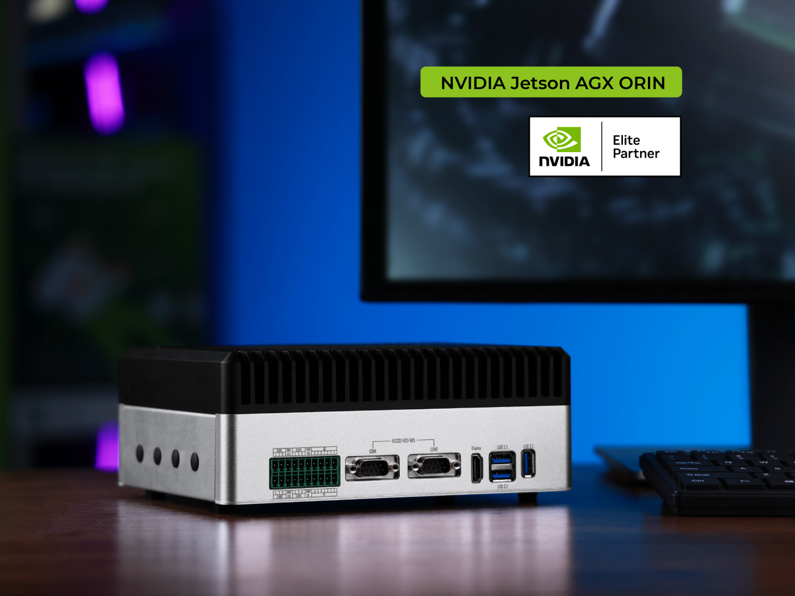

# Seeed Studio reComputer Robotics J5011 GMSL Development Guide


[**View Seeed Studio reComputer Robotics J5011 GMSL on OpenELAB**](https://openelab.io/products/seeed-studio-recomputer-robotics-j5011)

**Covered model:** Seeed Studio reComputer Robotics J5011 GMSL · **OpenELAB SKU:** `Seeed-100076722`




_Manufacturer image: Seeed Studio._ [_Image source_](https://files.seeedstudio.com/wiki/recomputer_robotic_j501/hardware_overview.png.jpg)_._

[Product at OpenELAB](https://openelab.de/products/seeed-studio-recomputer-robotics-j5011) · [Manufacturer wiki hub](./)

## Product and configuration scope

**reComputer Robotics J5011** uses **Jetson AGX Orin 32 GB** on Seeed's Robotics J501 carrier. This guide covers the GMSL-equipped configuration sold under code **100076722**. It is different from Classic J5011/J5012 and from Robotics J4012; use the carrier-specific images and connectors.

Applications include multi-camera robot perception, mobile-robot sensor integration and edge inference systems needing CAN and industrial I/O. The 32 GB model is advertised at up to **200 TOPS**; the J501 family's 275 TOPS headline refers to the 64 GB configuration and must not be attributed to J5011.

**Source and configuration note (reviewed 18 November 2026):** This J5011 is the **reComputer Robotics** carrier built around Jetson AGX Orin **32 GB**, with optional GMSL2 camera hardware. Do not follow the similarly named **reComputer Classic J5011** image/recovery procedure. See Seeed's [Robotics J501 setup and interface guide](https://wiki.seeedstudio.com/ai_robotics_recomputer_j501_robotics_getting_started/) and the [exact OpenELAB product listing](https://openelab.io/products/seeed-studio-recomputer-robotics-j5011). Confirm the supplied GMSL deserializer and target image before camera-driver setup.

## Key specifications and interfaces

| Item              | J5011 Robotics configuration                                                                          |
| ----------------- | ----------------------------------------------------------------------------------------------------- |
| Compute           | AGX Orin 32 GB LPDDR5; eight-core Arm CPU                                                             |
| Storage expansion | Two M.2 Key M NVMe slots; verify installed SSD/order contents                                         |
| Network           | One 10GbE and four Gigabit Ethernet ports                                                             |
| Robot interfaces  | Four CAN channels; digital I/O; RS232/422/485; UART/I2S                                               |
| GMSL              | Optional MAX96712-based camera expansion; fitted board/image must match                               |
| USB/display       | USB host ports, distinct recovery/debug USB-C connections; HDMI                                       |
| Input             | 19–48 V DC terminal input in the carrier reference; adapter selection/order contents require checking |

Sources: [Robotics J501 reference](https://wiki.seeedstudio.com/ai_robotics_recomputer_j501_robotics_getting_started/), [carrier datasheet](https://files.seeedstudio.com/wiki/recomputer_robotic_j501/reComputer_robotics_J501_datasheet.pdf). Read connector pinouts, isolation and voltage ratings before wiring a robot's power or fieldbus.

## First boot and a useful baseline

Prepare the correct manufacturer power supply, monitor/HDMI cable, keyboard and wired network. Attach peripherals while powered off, then apply power and finish the Linux first-run setup. Start with the installed image if it boots; reflashing is a recovery or version-management operation and can overwrite the system disk.

On the **Jetson**, open a terminal and capture a baseline:

```bash
cat /etc/nv_tegra_release
uname -a
lsblk -o NAME,SIZE,TYPE,MOUNTPOINTS
ip -brief address
dpkg-query -W nvidia-jetpack
sudo nvpmodel -q
tegrastats --interval 1000
```

Stop the last command with **Ctrl+C** after several readings. Expected checkpoints are a readable L4T release, an NVMe root filesystem, a network interface/address, a reported power mode and changing memory/CPU/temperature statistics. The `nvidia-jetpack` meta-package may be absent on a minimal image; that result alone does not prove the BSP or CUDA is missing. Keep this output with the exact image identifier before installing project software.

Do not use a desktop-PC CUDA installer or an arbitrary x86 container. Select Jetson/aarch64 packages and containers that explicitly match the installed JetPack/L4T release. Begin with a small camera or inference example from that release before adding multiple streams. The commands above establish platform visibility, not an inference-performance benchmark.

Sources: [NVIDIA Jetson Linux developer guide](https://docs.nvidia.com/jetson/archives/r36.4.3/DeveloperGuide/), [tegrastats reference](https://docs.nvidia.com/jetson/archives/r36.4.3/DeveloperGuide/AT/JetsonLinuxDevelopmentTools/TegrastatsUtility.html).

## GMSL and CAN first checks

Verify the exact camera sensor, serializer/deserializer path, cable and POC power requirements against the supported-camera list. GMSL is not a generic USB camera connection. Select a BSP/image that explicitly includes the fitted GMSL expansion and supported sensor driver. Start with one camera and its stock capture example before adding synchronization or multiple streams.

For CAN, use the Robotics J501 datasheet's terminal numbering and the matching interface section in the setup guide. Distinguish the native and SPI-connected channels. First inspect interface visibility and error counters; do not transmit arbitrary frames onto a connected robot network as a discovery method.

## Recovery and SDK selection

Back up project/configuration data. In Seeed's image table, select **Robotics J501 / AGX Orin 32 GB / the fitted GMSL option** and note the required Ubuntu host version. Use the labeled recovery USB connection and documented recovery-button/power sequence. The guide lists AGX Orin 32 GB as `0955:7223` in the host's `lsusb` recovery check.

Flash only the selected carrier/module/GMSL image using its supplied procedure. Finish normal first boot and repeat the baseline before installing ROS/Isaac ROS or inference packages. Choose Jetson/aarch64 dependencies matched to the installed release. Do not copy Classic J501 or AGX Orin 64 GB image commands because they share the word “J501”.

## Troubleshooting and FAQ

| Symptom                                          | Check                                                                                                         |
| ------------------------------------------------ | ------------------------------------------------------------------------------------------------------------- |
| Headline performance differs from order          | J5011 is 32 GB/200 TOPS reference; J5012 is 64 GB/275 TOPS reference. Measure the actual workload separately. |
| GMSL camera not detected                         | Fitted expansion, exact sensor/serializer, cable/POC path and matching GMSL BSP/image.                        |
| CAN channel missing or errors increase           | Native versus SPI channel, kernel/device-tree support, terminal mapping and physical termination.             |
| Host sees no recovery device                     | Use recovery USB rather than debug UART, data cable and the model's power/button sequence.                    |
| Boot succeeds but peripherals fail after reflash | Check that the image includes the Robotics carrier drivers and correct GMSL option.                           |

## Technical documents and software

| Resource                                                                                                                                                                     | Use                                    |
| ---------------------------------------------------------------------------------------------------------------------------------------------------------------------------- | -------------------------------------- |
| [Robotics J501 setup/image matrix](https://wiki.seeedstudio.com/ai_robotics_recomputer_j501_robotics_getting_started/)                                                       | Module, GMSL and BSP selection         |
| [Carrier datasheet](https://files.seeedstudio.com/wiki/recomputer_robotic_j501/reComputer_robotics_J501_datasheet.pdf)                                                       | Electrical interfaces and dimensions   |
| [Carrier schematic](https://files.seeedstudio.com/wiki/recomputer_robotic_j501/reComputer%20Robotics%20J501%20Main%20Board%20for%20Jetson%20AGX%20Orin_V1.0_SCH_2512161.pdf) | Revision-specific electrical reference |
| [Seeed L4T source](https://github.com/Seeed-Studio/Linux_for_Tegra)                                                                                                          | Carrier BSP/kernel development         |
| [NVIDIA JetPack SDK](https://developer.nvidia.com/embedded/jetpack)                                                                                                          | Matched NVIDIA software components     |

**Review date:** 17 November 2026. **Validation:** official documentation and the cited software interfaces reviewed. Commands and examples have not been compiled or run on physical hardware by OpenELAB for this guide. Record your hardware revision, firmware, software versions and actual results when reproducing it.
