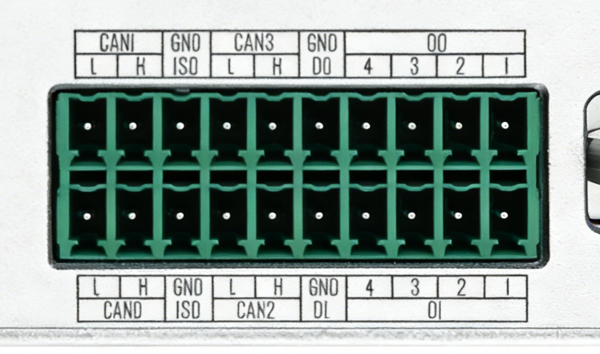

# Seeed Studio reComputer Robotics J5011 GMSL Development Guide


[**View Seeed Studio reComputer Robotics J5011 with GMSL on OpenELAB**](https://openelab.io/products/seeed-studio-recomputer-robotics-j5011)

**Model:** reComputer Robotics J5011 · **SKU:** `Seeed-100076722` · **Configuration:** Jetson AGX Orin 32GB, Robotics J501 carrier, GMSL extension


The Robotics J5011 is a robot-oriented AGX Orin 32GB computer with five Ethernet ports, four isolated CAN channels and configurable industrial serial connections. It is different from the **Classic J5012** and the smaller Robotics J4012. The carrier's external power, digital I/O and camera connections need separate configuration before robot integration.


_Seeed Studio;_ [_original hardware overview_](https://files.seeedstudio.com/wiki/recomputer_robotic_j501/hardware_overview.png.jpg)_._ [_Seeed Studio wiki directory_](./)_._

## Product overview <a href="#product-and-configuration-scope" id="product-and-configuration-scope"></a>

The **J5011** has 32GB RAM, eight CPU cores and up to **200 TOPS INT8** in the manufacturer's module comparison. The 64GB J5012 column's 275 TOPS, 12-core CPU and larger GPU are not J5011 specifications. This listing includes the GMSL configuration and a 128GB NVMe; the carrier's second NVMe slot, wireless modules and camera accessories must still be checked against the actual order. [Exact OpenELAB model](https://openelab.io/products/seeed-studio-recomputer-robotics-j5011), [Robotics J501 manual and model table](https://wiki.seeedstudio.com/ai_robotics_recomputer_j501_robotics_getting_started/).

Treat carrier firmware as part of the computer. Seeed's GMSL driver and GPIO/serial definitions are not established by a generic AGX Orin SDK installation.

## Applications

Use the system for robot perception, independent sensor Ethernet networks, GMSL camera acquisition and CAN sensor gateways. The isolated industrial interfaces reduce direct coupling but do not make wiring or power budgets interchangeable across ports. Establish a bench-only first result with actuators disconnected, then introduce one subsystem at a time.

The two native CAN channels and two SPI-to-CAN channels can have different driver/latency behavior. A 10GbE uplink does not make each camera port 10GbE, and an eight-camera GMSL expansion capacity does not guarantee a particular synchronized inference frame rate. Preserve timestamps and measure the whole acquisition/inference pipeline before control use.

## Specifications <a href="#key-specifications-and-interfaces" id="key-specifications-and-interfaces"></a>

| Item                    | Robotics J5011 / 100076722                                                                                                             |
| ----------------------- | -------------------------------------------------------------------------------------------------------------------------------------- |
| Module                  | AGX Orin 32GB; 8-core Cortex-A 78A E up to 2GHz                                                                                        |
| GPU / AI engines        | 1792 Ampere CUDA cores, 56 Tensor Cores; two NVDLA v 2, PVA v 2                                                                        |
| Memory                  | 32GB 256-bit LPDDR5; module bandwidth 204.8GB/s                                                                                        |
| Module compute headline | Up to 200 TOPS INT8; application throughput requires measurement                                                                       |
| Storage                 | Module 64GB eMMC; carrier two NVMe 2280 Key M positions; listing includes 128GB SSD                                                    |
| Network                 | One 10GbE RJ45 plus four 10/100/1000Mb/s RJ45                                                                                          |
| USB                     | **Three Type-A** host sockets, dedicated USB-C recovery and separate USB-C debug                                                       |
| Display                 | **One HDMI 2.1** output                                                                                                                |
| CAN / digital I/O       | Four isolated CAN/CAN-FD channels; four 12V DI; four open-drain DO, 40V maximum withstand                                              |
| Serial                  | DB9-1 switchable RS232/422/485; DB9-2 fixed RS232 in the documented implementation                                                     |
| GMSL                    | MAX96712 expansion; each four-camera board uses a four-way Mini-FAKRA cable; two-board configuration supports up to eight GMSL2 inputs |
| Other expansion         | Key E Wi-Fi/BT, Key B cellular with Nano-SIM, internal SPI/I2C/I2S headers                                                             |
| Main power              | **19–48V DC**, 5.08mm two-pin terminal; adapter not included                                                                           |
| Mechanical              | 210 × 180 × 87mm including stands; desk, wall or suitable DIN bracket                                                                  |
| Cooling / environment   | Retain supported heatsink/fans; current wiki: −10 to +60°C at 25W, to +55°C in MAXN configuration                                      |

Sources: [Robotics J501 specifications](https://wiki.seeedstudio.com/ai_robotics_recomputer_j501_robotics_getting_started/#specifications), [downloaded carrier datasheet pp.6–10](https://files.seeedstudio.com/wiki/recomputer_robotic_j501/reComputer_robotics_J501_datasheet.pdf). The interface narrative elsewhere says four USB-A and mentions a DP connection; its actual carrier table, datasheet and board views identify **three USB-A and HDMI**. Use those physical connectors. The PDF's top-level storage summary says one Key M while its detailed connector list identifies **J2 and J6**; inspect the fitted slots before storage changes. No weight or J5012-only power number is transferred here.

## Hardware and connections

### Power and physical assembly

Turn off and disconnect the main supply before fitting NVMe, radios, GMSL boards or terminal wiring. Identify **DC+ and DC− from the received unit's silk-screen and official hardware view**, then connect a regulated 19–48V source with capacity for the complete system and selected peripherals. The separate DI\_12V label is **not** permission to apply a 48V robot battery to a digital input. Do not use USB debug/recovery as the system's power supply. [J501 hardware overview](https://wiki.seeedstudio.com/ai_robotics_recomputer_j501_robotics_getting_started/#hardware-overview).

Keep airflow around the enclosure. The 5V and 12V fan connectors have different voltage/pitch; the current wiki lists 1.5A maximum on each. Use the installed fan policy instead of disabling cooling as a first test. Main input current, module power mode and auxiliary load current need separate budgets.

### J25 terminal pinout: use separate references

The following pin numbers are from the connector table, not an inferred left-to-right view. Orient the connector with Seeed's diagram before inserting wires.

| J25 pins   | Signal / reference                                                |
| ---------- | ----------------------------------------------------------------- |
| 1, 3, 5, 7 | DI 1, DI 2, DI 3, DI 4; nominal 12V inputs                        |
| 9          | GND\_DI, input reference                                          |
| 2, 4, 6, 8 | DO 1, DO 2, DO 3, DO 4; open-drain outputs, maximum 40V withstand |
| 10         | GND\_DO, output reference                                         |
| 11, 13     | CAN2 H, L                                                         |
| 12, 14     | CAN3 H, L                                                         |
| 15, 16     | GND\_ISO, CAN isolated reference                                  |
| 17, 19     | CAN0 H, L                                                         |
| 18, 20     | CAN1 H, L                                                         |

Sources: [J501 datasheet pp.49–50](https://files.seeedstudio.com/wiki/recomputer_robotic_j501/reComputer_robotics_J501_datasheet.pdf), [current DI/DO table](https://wiki.seeedstudio.com/ai_robotics_recomputer_j501_robotics_getting_started/#dido). The PDF repeats DI 1 at pin 3; the current per-channel table identifies **DI 2**. **40V withstand is not a 40V power source or a published load-current budget.** Use an external pull-up/load supply appropriate to the output circuit; confirm current and inductive protection before driving a load. This guide's first result leaves DO loads disconnected.



_Seeed Studio,_ [_official J501 terminal photograph_](https://files.seeedstudio.com/wiki/recomputer_robotic_j501/can_hw_1.png)_. The upper/lower row orientation matters; refer to the numerical J25 table as well._

### CAN channels and controlled termination

| CAN channel | Controller route | Termination control in documented JetPack 6.x image |
| ----------- | ---------------- | --------------------------------------------------- |
| can0        | Native           | gpiochip 2 line 9                                   |
| can1        | Native           | gpiochip 2 line 8                                   |
| can2        | SPI-to-CAN       | gpiochip 2 line 10                                  |
| can3        | SPI-to-CAN       | gpiochip 2 line 12                                  |

These are already **differential CAN** outputs with onboard isolated transceivers, unlike the Super/Classic logic headers. The 120Ω termination enables are **active-low**. Fit termination only at the two physical bus ends. Chip numbering must be rechecked with `gpioinfo` after an image/kernel change. [J501 CAN section](https://wiki.seeedstudio.com/ai_robotics_recomputer_j501_robotics_getting_started/#can).

### DB9 modes and GPIO enables

| DB9 pin | RS232     | RS422 on DB9-1 | RS485 on DB9-1 |
| ------- | --------- | -------------- | -------------- |
| 1       | Unused    | TX−            | Data−          |
| 2       | RX        | TX+            | Data+          |
| 3       | TX        | RX+            | Unused         |
| 4       | Unused    | RX−            | Unused         |
| 5       | Ground    | Ground         | Ground         |
| 7 / 8   | RTS / CTS | Unused         | Unused         |

DB9-1 is `/dev/ttyTHS1`; DB9-2 is `/dev/ttyTHS4` in the reviewed BSP. **Selectable DB9-1 operation is excluded from this guide's ready commissioning procedure until the exact-revision SW3 mapping is confirmed. Do not energize a DB9-1 peer using a switch tuple from the conflicting references.** DB9-2 is the separately documented fixed RS232 port and is the serial checkpoint used below.

The disagreement involves both bit order and physical polarity:

| Reference               | Logical order shown                                                            | Reported selection / physical interpretation                                          |
| ----------------------- | ------------------------------------------------------------------------------ | ------------------------------------------------------------------------------------- |
| Datasheet pp.42–43      | `Mode_0 / Mode_1 / Mode_2`; switch positions1/2/3 map to those signals on p.42 | Pure RS232 is logical `0/0/1`; p.43 states physical **ON = logical0**, OFF = logical1 |
| Current wiki UART table | `MODE_2 / MODE_1 / MODE_0`                                                     | Calls `0/0/1` RS232 and equates ON with logical1                                      |

Reversing the datasheet's logical RS232 order gives `MODE2/MODE1/MODE0=1/0/0`, not the wiki's tuple. The RS485 `0/1/0` bit pattern is symmetric under reversal, but that **does not resolve ON/OFF polarity** or establish the installed transceiver's direction mode. These are conflicting source statements, not a set of alternative approved switch settings. Confirm the received carrier revision, schematic nets, transceiver truth table and physical switch continuity before choosing a DB9-1 electrical mode. The pin table above remains a conditional connector reference, not authorization to connect a live selectable-mode peer.

Sources: [UART interface tables](https://wiki.seeedstudio.com/ai_robotics_recomputer_j501_robotics_getting_started/#uart), [datasheet pp.40–44, especially42–43](https://files.seeedstudio.com/wiki/recomputer_robotic_j501/reComputer_robotics_J501_datasheet.pdf). For the fixed DB9-2 route, hold the verified gpiochip2 line15 enable low using the installed libgpiod version. The primary J25 CAN first result is independent of SW3.

For RS232, use a genuine RS232 adapter and cross TX/RX plus ground; a TTL adapter is electrically different. For RS422 connect each transmitter pair to the peer receiver pair with polarity preserved. For RS485, A/B conventions vary among vendors: match Data+/Data−, reference and endpoint termination.

## Software and development resources

The vendor's delivered generation is **JetPack 6.2.1 / L4T 36.4.4**; the current Robotics J501 selector also lists **7.2** images for AGX Orin 32GB. Select the GMSL-equipped **Robotics** carrier image. An image for Classic AGX Orin or NX Robotics is a different target. Physical x 86 Ubuntu 20.04/22.04 is the documented 6.x flashing host; the 7.2 host matrix adds 24.04 for flashing/target-component installation, with a separate restriction on host development components. [Image table and host requirements](https://wiki.seeedstudio.com/ai_robotics_recomputer_j501_robotics_getting_started/#-flash-jetpack-os).

Use Jetson `aarch64` CUDA, TensorRT, camera drivers and containers matching that installed release. ROS/Isaac ROS support still depends on its actual Ubuntu/JetPack matrix. Preserve the camera model, serializer, GMSL board revision, overlay and model artifact with the image hash. [Seeed carrier BSP sources](https://github.com/Seeed-Studio/Linux_for_Tegra) provide device-tree material; a repository name alone does not establish a particular sensor's support.

## Getting started <a href="#first-boot-and-a-useful-baseline" id="first-boot-and-a-useful-baseline"></a>

### 1. First boot with no robot outputs connected

1. Prepare the J5011, correctly polarized regulated main supply, HDMI display, keyboard, one wired network connection and supported cooling. Leave DI/DO loads and robot CAN networks disconnected.
2. Boot the delivered image and complete Ubuntu user/network setup. Do not reflash a working unit merely to identify it.
3. Run on the Jetson:

```bash
cat /etc/nv_tegra_release
uname -m
free -h
lsblk -o NAME,SIZE,TYPE,MOUNTPOINTS
findmnt /
ip -br address
lsusb -t
sudo nvpmodel -q
ip -details link show type can
```

**Expected result:** aarch64, AGX-class 32GB nominal memory, identifiable root storage and the carrier's network/CAN interfaces. Usable RAM is lower than the nominal module size. Capture `tegrastats --interval 1000` briefly and stop with Ctrl+C. Missing optional radio hardware is not a base-computer failure.

### 2. Original finite CAN0-to-CAN1 bench checkpoint <a href="#gmsl-and-can-first-checks" id="gmsl-and-can-first-checks"></a>

Power off and connect J25 CAN0 H17→CAN1 H18, CAN0 L19→CAN1 L20 and the documented isolated reference. This is a dedicated two-node bench link with no actuators. Install `can-utils` and the distribution's libgpiod tools, then verify `gpioset --version`, `gpiodetect` and `gpioinfo` against the table above.

For **libgpiod1.x**, hold the two end resistors enabled in terminal A:

```bash
sudo gpioset --mode=signal gpiochip2 8=0 9=0
```

Leave that command running. For **libgpiod2.x**, the equivalent form is `sudo gpioset -c gpiochip2 8=0 9=0`, which holds by default. Do not run both versions simultaneously. In terminal B:

```bash
sudo ip link set can0 down
sudo ip link set can1 down
sudo ip link set can0 type can bitrate 500000
sudo ip link set can1 type can bitrate 500000
sudo ip link set can0 up
sudo ip link set can1 up
candump -n 1 can1
```

In terminal C, send one frame:

```bash
cansend can0 456#0102030405
```

**Expected result:** terminal B reports ID `456` and five payload bytes, then exits after one frame. This demonstrates a physical channel-to-channel path, unlike a controller's internal loopback. Reverse direction with `candump -n 1 can0` and `cansend can1 457#0504030201`. Inspect `ip -details -statistics link show can0` for error counters. Bring both interfaces down **before** stopping terminal A and removing bench wires; releasing a GPIO does not guarantee its previous level persists.

For can2/can3 repeat the procedure using H11/H12, L13/L14 and held termination lines 10/12. For CAN-FD, configure both nodes while down with `bitrate 500000 dbitrate 2000000 fd on` and send an FD frame such as `cansend can0 456##1010203040506070809`. The `##1` syntax enables FD bitrate switching. Check both controller routes at the chosen data rate instead of assuming a native-channel result validates SPI-to-CAN. [Seeed CAN mapping](https://wiki.seeedstudio.com/ai_robotics_recomputer_j501_robotics_getting_started/#can), [NVIDIA CAN utilities](https://docs.nvidia.com/jetson/archives/r36.4.3/DeveloperGuide/HR/ControllerAreaNetworkCan.html).

### 3. First GMSL image and a bounded frame capture

1. Check the number of **fitted** MAX96712 expansion boards and matching four-way cables. Connect the supported camera while all power is removed; GMSL power-over-coax is not generic Ethernet PoE.
2. Boot the driver-equipped image and open `sudo /opt/nvidia/jetson-io/jetson-io.py`. Select the installed sensor/board overlay actually offered by that BSP, save and reboot. The manufacturer's camera subsection names SG3S 3G, SG2/SG8S 6G and Orbbec-specific routes, but its prose also reuses a four-camera example; do not assume an eight-camera cable arrangement from the overlay name alone.
3. Install `v4l-utils`. Inspect nodes, controls and available modes:

```bash
v4l2-ctl --list-devices
v4l2-ctl -d /dev/video0 --list-formats-ext
v4l2-ctl -d /dev/video0 --list-ctrls
```

4. For a supported SG-series camera whose controls actually list these values, `sensor_mode=1` corresponds to the manufacturer's 1920×1080 mode. After confirming the node/mode, a finite original checkpoint is:

```bash
v4l2-ctl -d /dev/video0 --set-ctrl=sensor_mode=1,trig_mode=0
v4l2-ctl -d /dev/video0 --set-fmt-video=width=1920,height=1080,pixelformat=YUYV
v4l2-ctl -d /dev/video0 --stream-mmap --stream-count=30 --stream-to=/dev/null
```

**Expected result:** 30 frames complete without timeout. This establishes transport without requiring a graphical desktop; inspect a live preview afterward to confirm scene content and exposure. Replace the node/mode from actual enumeration. The official page also lists mode 0=1920×1536 and mode 2=3840×2160; these are not universal modes for every SG/Orbbec sensor. Set `trig_mode=1` only after confirming the required shared synchronization configuration. A driver node or frame count is not proof of timestamp synchronization. [GMSL camera procedure](https://wiki.seeedstudio.com/ai_robotics_recomputer_j501_robotics_getting_started/#extension-port).

For Gemini 335Lg, follow its separate [Orbbec aarch64 viewer release](https://github.com/orbbec/OrbbecSDK_v2/releases/download/v2.4.8/OrbbecViewer_v2.4.8_202507031357_a1355db_linux_aarch64.zip) and matching camera firmware; SG YUYV controls are not depth-camera APIs.

### 4. Serial, DI/DO and internal buses

Use **fixed RS232 DB9-2 only** for this optional serial checkpoint; leave DB9-1 unconnected while its SW3 selection is unresolved. With power removed, connect DB9-2 TX3 to a genuine USB-to-RS232 adapter's RX, RX2 to its TX, and GND5 to ground. Do not use a TTL adapter. Verify the received connector numbering and `/dev/ttyTHS4` mapping against the exact carrier before powering the peer.

In a separate terminal, hold its verified enable low using `sudo gpioset --mode=signal gpiochip2 15=0` for libgpiod1, or `sudo gpioset -c gpiochip2 15=0` for libgpiod2. Keep it running during the test. Install `python3-serial`, set the host RS232 terminal to **115200 baud,8N1,no flow control**, and send a short reply within ten seconds. This original bounded example uses that fixed port:

```python
import serial, time
with serial.Serial('/dev/ttyTHS4', 115200, timeout=0.2) as port:
    port.reset_input_buffer()
    port.write(b'J5011_FIXED_RS232_CHECK\n')
    stop = time.monotonic() + 10
    while time.monotonic() < stop:
        response = port.read(128)
        if response:
            print('received_hex=' + response.hex())
```

**Expected result:** the host receives `J5011_FIXED_RS232_CHECK`, and the Jetson prints the reply bytes. This is a source-reviewed procedure,not an executed hardware result. Stop the application and disconnect the bench peer before releasing the enable. No DB9-1 RS232,RS422 orRS485 switching procedure is enabled by this example.

For DI, the documented mappings are chip 0 lines 96/104/86/83 for DI 1–DI 4. Verify with `gpioinfo`; apply a nominal 12V test signal only between the selected input and GND\_DI. Read with libgpiod1 `gpioget gpiochip0 96`, or libgpiod2 `gpioget -c gpiochip0 96`, and compare connected/disconnected states. Do not infer active polarity from a copied GPIO number.

For DO, chip 1 lines 4/7/9/8 correspond to DO 1–DO 4 in this BSP. Use only a high-impedance meter and a small external pull-up for initial checks; keep power/loads isolated from So C headers. Hold the requested output with version-correct `gpioset`, observe the actual terminal voltage and remove the load before release. The source's 12V example is supplied by its external pull-up, not generated by the DO port. Do not connect a relay until the exact load-current and suppression requirements are established.

The internal SPI header supports a documented MOSI-to-MISO loopback; after checking the header diagram, load `spidev`, inspect `/dev/spidev*` and use the official linked test at 100kHz on the verified node (`/dev/spidev2.0` is the source example). Match TX and RX bytes, then remove the jumper with power off. A missing node may indicate device-tree configuration, not just a missing module. Internal I2C/I2S require the J30 electrical table; they are not additional J25 field terminals. [SPI/UART/DI/DO procedures](https://wiki.seeedstudio.com/ai_robotics_recomputer_j501_robotics_getting_started/#-interfaces-usage).

### 5. Storage, radios, indicators and timekeeping

| Interface           | Checkpoint                                                                                                                                                                                                                    |
| ------------------- | ----------------------------------------------------------------------------------------------------------------------------------------------------------------------------------------------------------------------------- |
| NVMe                | Inspect `lsblk`, `findmnt /` and `nvme list`; two fitted drives need stable filesystem identifiers. Test a file on a confirmed mount, never overwrite a raw system device.                                                    |
| Five Ethernet ports | `ip -br link` → `ethtool INTERFACE` → a bench `iperf3 -s` peer. Use `iperf3 -c PEER_IP -B LOCAL_IP -t 10` to bind the port being tested; replace both addresses. Link LEDs do not establish routing.                          |
| Key E               | Fit module/antennas; inspect PCIe/USB enumeration and `nmcli device status`; scan/pair Bluetooth separately.                                                                                                                  |
| Key B / SIM         | Check `lsusb`, modem driver and `mmcli -L`; inspect the returned modem index with `mmcli -m INDEX`. Configure the actual carrier APN in NetworkManager and check the data route. The vendor's China Mobile APN is an example. |
| USB / debug         | Inspect `lsusb -t`; three Type-A ports share bandwidth. The separate debug USB-C gives a 115200-baud console; do not confuse it with APX recovery.                                                                            |
| User LED            | Inspect `/sys/class/leds`; the reviewed names are `on-board:red`, `on-board:green`, `on-board:blue`. Preserve any active trigger and use the exposed brightness interface for a brief indicator check, then restore it.       |
| RTC                 | Fit the documented 3V battery route with correct polarity, set time via the OS, read `sudo hwclock -r`, then compare after normal power-off with networking disabled.                                                         |
| Cooling             | Inspect `nvfancontrol`, actual hwmon labels and temperatures; preserve automatic control. Do not copy an unrelated `hwmon1` or a sample password into a fan script.                                                           |

### 6. Recover the Robotics AGX image <a href="#recovery-and-sdk-selection" id="recovery-and-sdk-selection"></a>

Back up data first. On the host, select **Robotics J501 / AGX Orin 32GB / GMSL / intended version** from the [official image table](https://wiki.seeedstudio.com/ai_robotics_recomputer_j501_robotics_getting_started/#prepare-the-jetpack-image), then compare `sha256sum` with that row. The 6.2.1 archive example identifies L4T 36.4.4; the 7.2 example identifies 39.2.0. Those are separate stacks.

Use the **dedicated recovery USB-C** identified as J9 in the datasheet and hardware view. The wiki's recovery sentence calls it USB2.0 DEVICE while its connector table distinguishes recovery from debug; do not choose the debug socket by that sentence alone. Connect a data cable, hold RECOVERY while applying main power, then release it. On the host, require **0955: 7223** in `lsusb` for this 32GB module; 7023 is the 64GB model.

Extract the exact archive and, inside its extracted directory, run:

```bash
sudo ./tools/kernel_flash/l4t_initrd_flash.sh --flash-only \
  --massflash 1 --network usb0 --showlogs
```

After successful completion, boot through the actual HDMI output, finish Ubuntu setup and repeat the baseline, finite CAN test and camera enumeration. Save the real flash log. Flashing success does not by itself validate a connected sensor.

## Troubleshooting and FAQs <a href="#troubleshooting-and-faq" id="troubleshooting-and-faq"></a>

| Symptom                                      | Ordered diagnosis                                                                                                                                                                                                             |
| -------------------------------------------- | ----------------------------------------------------------------------------------------------------------------------------------------------------------------------------------------------------------------------------- |
| No CAN frames / bus-off                      | Correct J25 row/orientation → isolated reference → held active-low end termination → bitrate → physical wiring → error counters. Test native and SPI channels separately.                                                     |
| Termination works briefly then disappears    | Keep libgpiod1 `--mode=signal` process running; v 2 uses `-c` and holds by default. Do not issue a bare v 1 command and assume persistence.                                                                                   |
| DB9-1 is needed for RS232/422/485            | Leave the peer disconnected until the exact-revision SW3 logical order and physical ON/OFF polarity are resolved; do not try source tuples on a live device. Use the independent fixed DB9-2 RS232 checkpoint if appropriate. |
| DO reads floating                            | It is an open-drain switch; check external pull-up and GND\_DO.40V withstand does not supply 40V or define a load-current rating.                                                                                             |
| Only four of eight cameras appear            | Check fitted board count, cabling, carrier-specific image and available overlays. One four-camera example does not prove both expansion branches work.                                                                        |
| Capture times out in trigger mode            | Confirm master/sync source and supported controls; start unsynchronized with `trig_mode=0` on a sensor that supports it, then add synchronization.                                                                            |
| USB serial appears but flashing fails        | Use the separate recovery connector and 0955: 7223 APX identity; debug 115200 serial is a different path.                                                                                                                     |
| Public summary says 275TOPS / four USB-A /DP | Use the J5011 model column and physical carrier/datasheet:200TOPS, three Type-A, one HDMI.                                                                                                                                    |

## Downloads and technical documents <a href="#technical-documents-and-software" id="technical-documents-and-software"></a>

| Resource                                                                                                                                                                                           | Purpose                                                                |
| -------------------------------------------------------------------------------------------------------------------------------------------------------------------------------------------------- | ---------------------------------------------------------------------- |
| [Robotics J501 full engineering wiki](https://wiki.seeedstudio.com/ai_robotics_recomputer_j501_robotics_getting_started/)                                                                          | Current image selector, interfaces and camera procedures               |
| [Robotics J501 datasheet](https://files.seeedstudio.com/wiki/recomputer_robotic_j501/reComputer_robotics_J501_datasheet.pdf)                                                                       | Downloaded/read; DB9 pp.40–44, J25 pp.49–50                            |
| [J501 main-board schematic v1.0, 2512161](https://files.seeedstudio.com/wiki/recomputer_robotic_j501/reComputer%20Robotics%20J501%20Main%20Board%20for%20Jetson%20AGX%20Orin_V1.0_SCH_2512161.pdf) | Manufacturer-linked carrier electrical reference                       |
| [Seeed Linux\_for\_Tegra](https://github.com/Seeed-Studio/Linux_for_Tegra)                                                                                                                         | BSP/device-tree sources; choose the target branch/release              |
| [Orbbec Viewer v 2.4.8, aarch64](https://github.com/orbbec/OrbbecSDK_v2/releases/download/v2.4.8/OrbbecViewer_v2.4.8_202507031357_a1355db_linux_aarch64.zip)                                       | Separate Gemini 335Lg camera-viewer route, not a universal GMSL driver |
| [Robotics/edge catalog](https://files.seeedstudio.com/wiki/Seeed_Jetson/Seeed_NVIDIA_Jetson_Catalog_in_Robotics_and_Edge_AI.pdf)                                                                   | Family comparison; not the pinout authority                            |

No model-specific STEP link was found in the reviewed J501 Robotics resource list; use the documented enclosure dimensions for planning and obtain exact mechanical files before a close-tolerance fixture. The Classic J501 STEP is a different assembly.

## References and validation <a href="#official-documentation-and-development-resources" id="official-documentation-and-development-resources"></a>

Reviewed **24 November 2026** against the exact store/catalog model, the live Robotics J501 wiki and the downloaded 50-page datasheet. The official J25 terminal image was visually inspected. Numerical scope separates 32GB from 64GB and onboard differential CAN from other reComputer logic headers. Source conflicts about USB count, display wording, storage summary and pin 3 are resolved beside the relevant tables; unpublished DO load-current and exact optional mechanical details remain outside the load/fixture procedures.

**Compilation, SDK installation, flashing and hardware tests were not run.** The finite CAN, serial and camera examples are original source-reviewed procedures with expected results. Record the received carrier/module/GMSL revisions, image hash, GPIO tool version, load/supply and actual logs before reporting an operational robot.

The optional DB9-1 SW3 mode-selection conflict was independently reviewed on24 November2026. Selectable DB9-1 commissioning is excluded pending exact-revision confirmation;the J25 CAN baseline and fixed DB9-2 example do not depend on those settings.

### Related retained references

* [Product at OpenELAB](https://openelab.de/products/seeed-studio-recomputer-robotics-j5011)
* [NVIDIA Jetson Linux developer guide](https://docs.nvidia.com/jetson/archives/r36.4.3/DeveloperGuide/)
* [tegrastats reference](https://docs.nvidia.com/jetson/archives/r36.4.3/DeveloperGuide/AT/JetsonLinuxDevelopmentTools/TegrastatsUtility.html)
* [NVIDIA JetPack SDK](https://developer.nvidia.com/embedded/jetpack)
