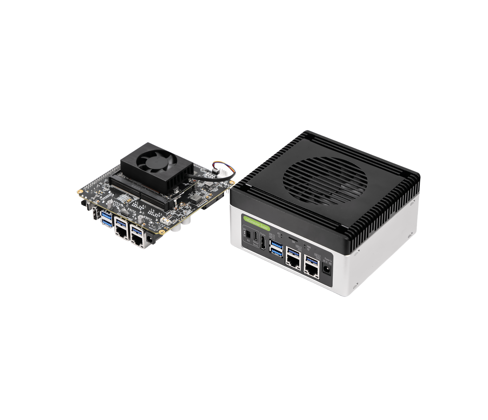

# Seeed Studio reComputer Super J4012 Development Guide


[**View Seeed Studio reComputer Super J4012 on OpenELAB**](https://openelab.io/products/seeed-studio-recomputer-super-j4012)

**Covered model:** Seeed Studio reComputer Super J4012 · **SKU:** `Seeed-114110314`




_Manufacturer image: Seeed Studio._ [_Image source_](https://files.seeedstudio.com/wiki/reComputer-Jetson/super/1.png)_._

[Product at OpenELAB](https://openelab.io/products/seeed-studio-recomputer-super-j4012) · [Manufacturer wiki hub](./)

## Product and applications

**reComputer Super J4012, SKU 114110314**, combines Jetson Orin NX 16 GB with a Super-series carrier and active cooling. Use it for edge vision, robot perception and local inference prototypes that need multiple camera/network connections. The J4011B, original J4012 and Robotics J4012 are separate configurations; use this carrier's firmware and pin map.

## Key hardware

| Item                   | Configuration                                                                           |
| ---------------------- | --------------------------------------------------------------------------------------- |
| Module                 | Jetson Orin NX 16 GB; eight-core Arm CPU and Ampere GPU                                 |
| Advertised maximum     | Up to 157 TOPS in supported Super configurations; not a measured application throughput |
| Memory/storage         | 16 GB LPDDR5; M.2 NVMe 2280, documented 128 GB SSD configuration                        |
| Networking             | Two Gigabit RJ45 Ethernet ports; wireless modules are optional                          |
| USB/display            | Four USB 3.2 Type-A; USB-C device/debug; HDMI 2.1                                       |
| Camera/expansion       | Four 15-pin CSI connectors, CAN header, 40-pin expansion; M.2 Key E and mini-PCIe       |
| Recommended NX adapter | 19 V / 4.74 A, 5525 barrel connector                                                    |
| System envelope        | 130 × 120 × 66 mm                                                                       |

Do not substitute the Orin Nano adapter recommendation for the NX model. Fit camera ribbons only with power removed and verify contact orientation. CSI camera compatibility also depends on the sensor driver and device tree, not just lane count.

Sources: [Super setup](https://wiki.seeedstudio.com/recomputer_jetson_super_getting_started/), [user manual](https://files.seeedstudio.com/products/NVIDIA-Jetson/reComputer_super_user_manual.pdf), [hardware interfaces](https://wiki.seeedstudio.com/recomputer_jetson_super_hardware_interfaces_usage/).

## First boot and a useful baseline

Prepare the correct manufacturer power supply, monitor/HDMI cable, keyboard and wired network. Attach peripherals while powered off, then apply power and finish the Linux first-run setup. Start with the installed image if it boots; reflashing is a recovery or version-management operation and can overwrite the system disk.

On the **Jetson**, open a terminal and capture a baseline:

```bash
cat /etc/nv_tegra_release
uname -a
lsblk -o NAME,SIZE,TYPE,MOUNTPOINTS
ip -brief address
dpkg-query -W nvidia-jetpack
sudo nvpmodel -q
tegrastats --interval 1000
```

Stop the last command with **Ctrl+C** after several readings. Expected checkpoints are a readable L4T release, an NVMe root filesystem, a network interface/address, a reported power mode and changing memory/CPU/temperature statistics. The `nvidia-jetpack` meta-package may be absent on a minimal image; that result alone does not prove the BSP or CUDA is missing. Keep this output with the exact image identifier before installing project software.

Do not use a desktop-PC CUDA installer or an arbitrary x86 container. Select Jetson/aarch64 packages and containers that explicitly match the installed JetPack/L4T release. Begin with a small camera or inference example from that release before adding multiple streams. The commands above establish platform visibility, not an inference-performance benchmark.

Sources: [NVIDIA Jetson Linux developer guide](https://docs.nvidia.com/jetson/archives/r36.4.3/DeveloperGuide/), [tegrastats reference](https://docs.nvidia.com/jetson/archives/r36.4.3/DeveloperGuide/AT/JetsonLinuxDevelopmentTools/TegrastatsUtility.html).

## Development path

The manufacturer's documented starting image is JetPack 6.2. Keep its carrier drivers when choosing TensorRT, CUDA, camera plugins and containers. Start with one USB camera or supported CSI camera and inspect device detection before attempting synchronized multi-camera capture. Add a robot middleware stack only after the base image, camera and network paths work individually.

The [interface guide](https://wiki.seeedstudio.com/recomputer_jetson_super_hardware_interfaces_usage/) covers header functions, CAN, storage and camera usage. Use the schematic for signal-level wiring; an expansion connector is not a promise of 5 V tolerant GPIO.

## Recovery and system restore

Download the image specifically for **reComputer Super / Orin NX 16 GB** from Seeed. Back up project files first. Follow the Super board's documented recovery-switch procedure and use its USB-C data connection to the Ubuntu host; the Orin NX 16 GB recovery identity is `0955:7323` in `lsusb`.

Run the flash instructions bundled with that exact image. This writes the NVMe system and is different from a normal application update. Return the recovery switch to its normal operating position after flashing, complete Linux setup and repeat the baseline checks. Do not use the reServer Industrial REC-button sequence for this carrier.

## Troubleshooting and FAQ

| Problem                                    | Diagnostic direction                                                                                 |
| ------------------------------------------ | ---------------------------------------------------------------------------------------------------- |
| USB recovery device absent                 | Check recovery-switch position, power, data cable and host USB port before retrying a flash.         |
| CSI camera missing                         | Verify supported sensor, ribbon orientation, device-tree configuration and driver/BSP version.       |
| Unexpected reboot under load               | Inspect the NX-rated supply, connector seating, cooling and power-mode configuration.                |
| CUDA/PyTorch import failure                | Match Jetson architecture and JetPack/L4T version; do not mix desktop CUDA wheels into the platform. |
| Does 157 TOPS guarantee an inference rate? | No. Measure your model, precision, power mode, memory use and end-to-end input/output pipeline.      |

## Technical documents and software

| Resource                                                                                                                    | Use                              |
| --------------------------------------------------------------------------------------------------------------------------- | -------------------------------- |
| [Super setup and BSP releases](https://wiki.seeedstudio.com/recomputer_jetson_super_getting_started/)                       | Image selection and recovery     |
| [Hardware/interface guide](https://wiki.seeedstudio.com/recomputer_jetson_super_hardware_interfaces_usage/)                 | Expansion and peripheral setup   |
| [User manual](https://files.seeedstudio.com/products/NVIDIA-Jetson/reComputer_super_user_manual.pdf)                        | Specifications and board details |
| [Carrier schematic](https://files.seeedstudio.com/products/NVIDIA-Jetson/reComputer%20Super%20J401_v1.0_SCH_PDF_250401.pdf) | J401 v1.0 electrical reference   |
| [Mechanical STEP model](https://files.seeedstudio.com/products/NVIDIA-Jetson/reComputer%20Super%20J401.stp)                 | CAD integration                  |
| [JetPack SDK](https://developer.nvidia.com/embedded/jetpack)                                                                | NVIDIA libraries and tools       |

**Review date:** 17 November 2026. **Validation:** official documentation and the cited software interfaces reviewed. Commands and examples have not been compiled or run on physical hardware by OpenELAB for this guide. Record your hardware revision, firmware, software versions and actual results when reproducing it.
