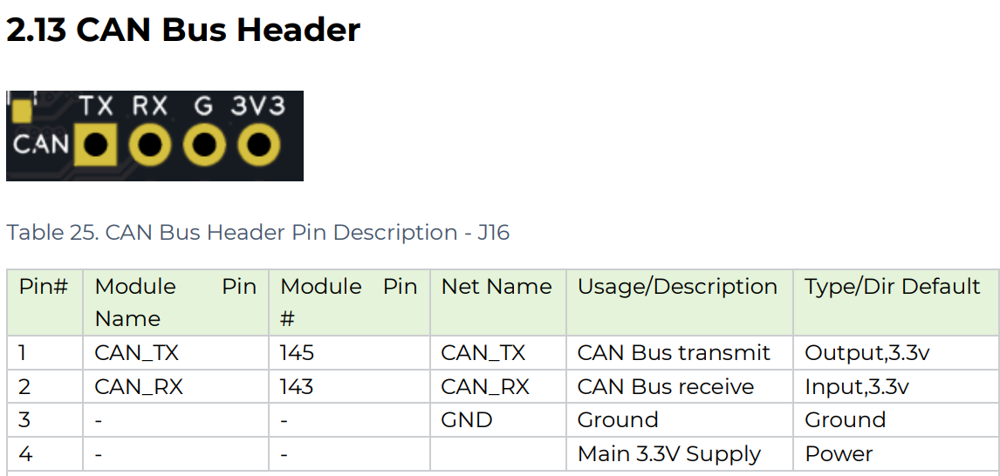

# Seeed Studio reComputer Super J4012 Development Guide


[**View Seeed Studio reComputer Super J4012 on OpenELAB**](https://openelab.io/products/seeed-studio-recomputer-super-j4012)

**Model:** reComputer Super J4012 · **SKU:** `Seeed-114110314` · **Configuration:** Jetson Orin NX 16GB, Super J401 carrier, 128GB NVMe SSD


reComputer Super J4012 is an actively cooled Orin NX edge computer for local inference and camera processing. Its Super carrier supports a higher performance envelope than the original J4012, but its CAN header still requires an external transceiver. This guide establishes a repeatable Linux, multimedia and peripheral baseline before an application is deployed.


_Seeed Studio product illustration;_ [_official original_](https://files.seeedstudio.com/wiki/reComputer-Jetson/super/1.png)_._ [_Seeed Studio wiki directory_](./)_._

## Product overview <a href="#product-and-applications" id="product-and-applications"></a>

The exact model here has **16GB LPDDR5**, an eight-core Cortex-A78AE CPU and a 1024-core Ampere GPU. The Super family's J3010/J3011 and J4011 have different modules; a family image is not interchangeable merely because its enclosure looks similar. The **original J4012** and **Robotics J4012** also use different carriers, supply ranges and recovery wiring. See [Seeed's Super model table](https://wiki.seeedstudio.com/recomputer_jetson_super_getting_started/#specifications).

The supplied 128GB NVMe is the system disk. Cellular, Wi-Fi/Bluetooth modules, antennas, cameras and RTC batteries should be treated as separate configuration items unless the order explicitly includes them. Keep the supplied heatsink and fan installed during development.

## Applications

Use the four CSI connectors for supported short-ribbon camera modules, dual Ethernet for a separate sensor network, and USB for industrial cameras or acquisition adapters. Practical projects include single-camera inspection, robot perception with externally interfaced CAN, and local TensorRT inference. Camera count, advertised TOPS and network line rate are separate limits: measure acquisition, preprocessing, model execution and output together before sizing a deployment.

Start with one stream and one model. Add cameras only after recording frame size, frame rate, precision, memory use, power profile and cooling conditions. M.2 Key E is the wireless expansion route; Mini PCIe is the documented LTE route, not an interchangeable M.2 5G socket. [Super interface guide](https://wiki.seeedstudio.com/recomputer_jetson_super_hardware_interfaces_usage/).

## Specifications <a href="#key-hardware" id="key-hardware"></a>

| Parameter            | Super J4012 / 114110314                                                                                          |
| -------------------- | ---------------------------------------------------------------------------------------------------------------- |
| Compute              | Orin NX 16GB; 8-core Arm Cortex-A78AE, up to 2GHz; 1024 Ampere CUDA cores, 32 Tensor Cores; two NVDLA v2 engines |
| Memory               | 16GB, 128-bit LPDDR5; manufacturer module bandwidth 102.4GB/s                                                    |
| AI headline          | Up to 157 TOPS with the supported Super configuration; not application FPS                                       |
| System storage       | One M.2 Key M slot; 128GB NVMe 2280 supplied                                                                     |
| Network              | Two 10/100/1000Mb/s RJ45; ETH0 native, ETH1 PCIe-derived                                                         |
| USB                  | Four USB 3.2 Type-A, 5Gb/s; one USB 2.0 Type-C device/debug connection                                           |
| Cameras              | Four 15-pin, two-lane MIPI CSI connectors; actual sensors need BSP drivers                                       |
| Expansion            | 40-pin I/O, separate 12-pin control/UART, four-pin logic-level CAN, M.2 Key E, Mini PCIe                         |
| Display / fans       | One HDMI 2.1; separate 5V and 12V four-pin PWM fan connectors                                                    |
| Main input           | **12–19V DC**, 5.5mm outer / 2.5mm inner barrel; NX recommendation **19V, 4.74A**                                |
| Enclosure / mounting | 130 × 120 × 66mm; desk or wall mounting                                                                          |
| Environment          | Current system wiki lists −10 to +60°C; keep airflow and workload within the system's thermal configuration      |

Sources: [current Super specifications and adapter recommendations](https://wiki.seeedstudio.com/recomputer_jetson_super_getting_started/), [Super manual V1.0, 10 May 2025, §§1.2–1.3 and 2.16](https://files.seeedstudio.com/products/NVIDIA-Jetson/reComputer_super_user_manual.pdf). The older manual's broad environmental headline is not a substitute for the current system rating. A module's power mode is not the adapter's total peripheral power budget.

## Hardware and connections

### Power and connector domains

With power disconnected, seat the NVMe, retain the fan wiring, attach HDMI/keyboard and connect one Ethernet cable. Use the NX-rated 19V supply; the family's 12V/5A recommendation applies to Orin Nano. USB-C is used for data/debug/recovery and does not replace the barrel input. The manual's protection threshold around 22.5V is a fault response, **not** an allowable operating voltage.

Do not put the main supply onto a GPIO rail. Header signal levels, supply pins and the control header are different domains. The manual identifies some control signals at **1.8V**, so a 3.3V UART label elsewhere does not establish a safe level for every control pin. Keep external wiring out of the 12-pin header until its exact signal and orientation have been checked. [Manual §§2.9, 2.15–2.16](https://files.seeedstudio.com/products/NVIDIA-Jetson/reComputer_super_user_manual.pdf).

### 40-pin I/O and separate control header

The following are **physical header positions**, not Linux GPIO numbers. Identify pin 1 from the official board drawing before attaching a cable.

| Function            | Physical pins / signal                                                           |
| ------------------- | -------------------------------------------------------------------------------- |
| 3.3V / 5V supply    | 1, 17 / 2, 4                                                                     |
| Grounds             | 6, 9, 14, 20, 25, 30, 34, 39                                                     |
| I2C1                | 3 SDA, 5 SCL                                                                     |
| I2C0 / ID bus       | 27 SDA, 28 SCL; do not probe unidentified system devices blindly                 |
| UART1               | 8 TX, 10 RX, 11 RTS, 36 CTS                                                      |
| SPI0                | 19 MOSI, 21 MISO, 23 SCK, 24 CS0, 26 CS1                                         |
| SPI1                | 13 SCK, 16 CS1, 18 CS0, 22 MISO, 37 MOSI                                         |
| I2S0                | 12 clock, 35 frame sync, 38 data in, 40 data out                                 |
| GPIO-labelled lines | 7 GPIO09, 15 GPIO12, 29 GPIO01, 31 GPIO11, 32 GPIO07                             |
| Pin 33              | Current interface wiki marks it system-reserved; leave unconnected in this guide |

Source: [Super header table](https://wiki.seeedstudio.com/recomputer_jetson_super_hardware_interfaces_usage/#40-pin-extension-header), [manual pp.34–37](https://files.seeedstudio.com/products/NVIDIA-Jetson/reComputer_super_user_manual.pdf). Use Jetson-IO to enable the intended peripheral, then reboot and inspect the resulting devices. Never translate a physical pin directly into a `gpiochip` line number.

The Super 12-pin header is **not the original J401's J15 numbering**. Its manual identifies 1/2 LED−/LED+, 3 UART2 RX, 4 UART2 TX, 5/6 auto-power-on control, 7 ground, 8 reset, 9 ground, 10 force-recovery, 11 ground and 12 power button. Use the external recovery switch for normal service instead of improvising jumpers. [Official 12-pin diagram](https://files.seeedstudio.com/wiki/reComputer-Jetson/reComputer-super/12pin2.jpg).

### CAN needs a physical-layer adapter

| J16 position | Function        | Connection to a suitable 3.3V-logic CAN transceiver                              |
| ------------ | --------------- | -------------------------------------------------------------------------------- |
| 1            | CAN\_TX, output | Transceiver TXD / D input                                                        |
| 2            | CAN\_RX, input  | Transceiver RXD / R output                                                       |
| 3            | GND             | Logic reference ground                                                           |
| 4            | 3.3V            | Only a transceiver explicitly compatible with this rail and its available budget |

These are **TX/RX logic signals, not CANH/CANL**. Fit an external CAN/CAN-FD transceiver appropriate to the selected bitrate; put termination at the two ends of the differential bus. Connect differential H to H and L to L. [Manual §2.13](https://files.seeedstudio.com/products/NVIDIA-Jetson/reComputer_super_user_manual.pdf), [official CAN connection guide](https://wiki.seeedstudio.com/recomputer_jetson_super_hardware_interfaces_usage/#can).



_Seeed Studio,_ [_official Super CAN header diagram_](https://files.seeedstudio.com/wiki/reComputer-Jetson/reComputer-super/can_port.png)_; the table describes the logic side before an external transceiver._

### Cameras, expansion and RTC

Open CSI latches and insert ribbons only while unpowered. Match the contact side to the carrier and camera illustrations; a 15-pin cable does not establish a driver match. Do not replace a 5V fan with a 12V fan on the same header. Fit M.2/PCIe modules while unpowered, secure their standoffs, and connect antennas before radio use.

The current wiki names a **CR1225** RTC cell whereas manual V1.0 names **CR1220**. These share nominal voltage but differ mechanically. Check the fitted holder/revision before choosing a battery; do not force either size. Use only one documented RTC battery route and preserve polarity. The manual states charging is disabled and specifies a non-rechargeable cell. This discrepancy does not affect the following battery-free first boot. [RTC instructions](https://wiki.seeedstudio.com/recomputer_jetson_super_hardware_interfaces_usage/#rtc).

## Software and development resources <a href="#development-path" id="development-path"></a>

| Software layer                  | Supported starting point / decision                                                                                                               |
| ------------------------------- | ------------------------------------------------------------------------------------------------------------------------------------------------- |
| Factory generation              | JetPack 6.2 with Seeed Super BSP; inspect the installed release rather than assume it                                                             |
| Reviewed current images         | Manufacturer selector lists JetPack 6.2 and 7.2 for **Super / Orin NX 16GB**                                                                      |
| Host for the 6.x recovery route | Physical x86 Ubuntu 20.04 or 22.04 PC, data-capable USB-C cable                                                                                   |
| Target packages                 | Jetson `aarch64` packages matching the installed L4T release; NVIDIA CUDA, TensorRT and GStreamer integration                                     |
| Containers / ROS                | Choose a release explicitly compatible with the actual JetPack/Ubuntu stack; arbitrary desktop CUDA wheels and ROS binaries are not a carrier BSP |

Source: [Super image/host matrix](https://wiki.seeedstudio.com/recomputer_jetson_super_getting_started/#flash-jetpack-os). The 7.2 host note restricts Ubuntu 24.04 to flashing and target component installation; use the supported host development combination when those components are needed. The examples below use the documented **JetPack 6.x** multimedia layout. Do not assume the same utility paths on 7.2.

Keep the exact download name, SHA256, L4T version, camera overlay and dependency versions with the project. Original examples below are newly composed from documented interfaces; they are not copies of the manufacturer's application projects.

## Getting started <a href="#first-boot-and-a-useful-baseline" id="first-boot-and-a-useful-baseline"></a>

### 1. Boot and preserve a platform record

1. Prepare the complete Super J4012, 19V/4.74A adapter, HDMI display, keyboard, Ethernet and optional supported camera. Begin with external GPIO/CAN wiring disconnected.
2. Connect the display and peripherals while unpowered. Apply main power and complete the Ubuntu first-run account, locale and network setup.
3. Run these commands **on the Jetson**, saving output with the hardware revision:

```bash
mkdir -p "$HOME/super-j4012-check"
cat /etc/nv_tegra_release
uname -m
lsblk -o NAME,SIZE,TYPE,MOUNTPOINTS
findmnt /
ip -brief address
dpkg-query -W nvidia-jetpack nvidia-l4t-core
sudo nvpmodel -q
tegrastats --interval 1000
```

Stop `tegrastats` with Ctrl+C after several readings. **Expected result:** `aarch64`, a readable L4T release, mounted root storage, network address and changing CPU/RAM/temperature statistics. An absent `nvidia-jetpack` metapackage does not by itself mean CUDA is missing. Do not change a power-mode number copied from another image; inspect the available profile names first. [NVIDIA tegrastats reference](https://docs.nvidia.com/jetson/archives/r36.4.3/DeveloperGuide/AT/JetsonLinuxDevelopmentTools/TegrastatsUtility.html).

### 2. Run an original accelerated-video checkpoint

On the JetPack 6.x target, first check that NVIDIA's conversion plugin is present:

```bash
gst-inspect-1.0 nvvidconv
gst-launch-1.0 -e videotestsrc num-buffers=60 pattern=ball \
  ! 'video/x-raw,width=640,height=480,framerate=30/1,format=I420' \
  ! nvvidconv ! 'video/x-raw(memory:NVMM),format=NV12' \
  ! nvvidconv ! 'video/x-raw,format=I420' ! fakesink sync=false
```

**Expected result:** a finite pipeline reaches EOS and exits without a missing-element or caps-negotiation error. This checks the installed NVIDIA multimedia path without a camera or display; it is **not** an inference or GPU-FLOPS benchmark. `nvvidconv` uses supported acceleration paths that depend on configuration. [NVIDIA accelerated GStreamer guide, r36.4.3](https://docs.nvidia.com/jetson/archives/r36.4.3/DeveloperGuide/SD/Multimedia/AcceleratedGstreamer.html).

### 3. Bring up one CSI camera

Power off, connect one supported sensor to the documented port and enable its required driver/overlay. Boot, then:

```bash
sudo apt install v4l-utils
v4l2-ctl --list-devices
command -v nvgstcapture-1.0
nvgstcapture-1.0 --sensor-id=0
```

Use a local display session for preview. **Expected result:** the sensor is listed and a live preview changes with the scene. If a different port is used, select that sensor's documented ID. A `/dev/video0` node alone is not proof of correct exposure, orientation or sensor mode. On an image without `nvgstcapture-1.0`, check `gst-inspect-1.0 nvarguscamerasrc` and use the sensor's supported GStreamer caps from the installed release; do not install an unrelated camera stack over the BSP. [Super CSI procedure](https://wiki.seeedstudio.com/recomputer_jetson_super_hardware_interfaces_usage/#csi-camera).

### 4. Bench CAN test after fitting the transceiver

Use an isolated bench network with a second CAN node at 500kbit/s and correct end termination. Install `can-utils`; leave actuators disconnected. On the Jetson:

```bash
sudo apt install can-utils
sudo ip link set can0 down
sudo ip link set can0 type can bitrate 500000
sudo ip link set can0 up
ip -details -statistics link show can0
candump -n 3 can0
```

Send three known frames from the second node. Expected result is three matching IDs/payloads with increasing RX counters. For a deliberate transmission, run `cansend can0 321#10203040` in another terminal and confirm it at the peer. Stop with `sudo ip link set can0 down`. A local TX log is not reception at another node. Configure CAN-FD only when the transceiver and both nodes support the same arbitration/data rates. [Seeed CAN setup](https://wiki.seeedstudio.com/recomputer_jetson_super_hardware_interfaces_usage/#can), [NVIDIA CAN driver reference](https://docs.nvidia.com/jetson/archives/r36.4.3/DeveloperGuide/HR/ControllerAreaNetworkCan.html).

### 5. Check remaining interfaces without assuming device numbers

| Interface         | Procedure and useful checkpoint                                                                                                                                                                                                                                                                                                                                                                                                     |
| ----------------- | ----------------------------------------------------------------------------------------------------------------------------------------------------------------------------------------------------------------------------------------------------------------------------------------------------------------------------------------------------------------------------------------------------------------------------------- |
| USB / NVMe        | Compare `lsusb -t` and `lsblk` before/after attachment. Use file-level tests only on an explicitly mounted spare filesystem; raw-device writes destroy data. Four USB connectors do not guarantee four independent full-bandwidth links.                                                                                                                                                                                            |
| Ethernet          | Use `ip -br link`, then `ethtool INTERFACE` for the observed name. Run an `iperf3` server on a bench peer, then `iperf3 -c PEER_IP -t 10` and `iperf3 -c PEER_IP -R -t 10`. Replace capitalized inputs; keep each port's address and route distinct.                                                                                                                                                                                |
| Wi-Fi / Bluetooth | Fit the supported Key E module/antennas, inspect `nmcli device status`; use `bluetoothctl`, `scan on`, then `scan off`. Network discovery is not an Internet test.                                                                                                                                                                                                                                                                  |
| LTE               | Fit supported Mini PCIe modem, SIM and antennas. Identify the modem's AT port from enumeration; the vendor example uses `/dev/ttyUSB2`, 115200. Send `AT`, then `ATI`. `OK` proves command transport; APN, registration and an actual data route remain separate checks.                                                                                                                                                            |
| GPIO / pinmux     | Run `sudo /opt/nvidia/jetson-io/jetson-io.py`, enable the intended function, save and reboot. Inspect `gpiodetect`, `gpioinfo` and `gpioset --version` before assigning a free line. For libgpiod 1.x, `gpioset --mode=signal CHIP LINE=VALUE` holds until interrupted; 2.x uses `gpioset -c CHIP LINE=VALUE` and holds by default. These are syntax patterns, not a pin assignment. Disconnect loads before releasing a held line. |
| Fan / RTC         | Read `systemctl status nvfancontrol`, inspect actual `/sys/class/hwmon` labels and retain automatic cooling. For an installed, verified RTC battery, inspect `ls /dev/rtc*` and `sudo hwclock -r`; establish network time first and then check retention with networking disabled. Do not hard-code an `hwmon` index.                                                                                                               |
| Controls / LEDs   | PWR indicates main power, ACT indicates storage activity. Use a normal OS shutdown before power removal; reset is not a file-safe shutdown. Test remote buttons only with the exact 12-pin drawing.                                                                                                                                                                                                                                 |

These checkpoints adapt the [official interface procedures](https://wiki.seeedstudio.com/recomputer_jetson_super_hardware_interfaces_usage/). The vendor's optional overlay archive is a pinmux starting point, not permission to execute an unreviewed script or drive a system-reserved line.

### 6. Restore a known image when recovery is necessary <a href="#recovery-and-system-restore" id="recovery-and-system-restore"></a>

Back up projects and configuration first: flashing rewrites the system storage. On a supported Ubuntu host, select **Super / Orin NX 16GB / intended JetPack version** from the [official image table](https://wiki.seeedstudio.com/recomputer_jetson_super_getting_started/#prepare-the-jetpack-image), download fully, and compare `sha256sum` with that exact table row.

1. With power removed, put the documented recovery switch in the vendor's RESET/recovery position.
2. Apply barrel power; connect the device/debug USB-C data port to the host.
3. On the **host**, run `lsusb`; NX 16GB recovery should enumerate as **0955:7323**. A CP210x serial device alone is not APX recovery.
4. Extract the exact archive with `sudo tar xpf DOWNLOADED_ARCHIVE.tar.gz`; replace that name and enter the extracted mass-flash directory. Run the vendor-provided command there:

```bash
sudo ./tools/kernel_flash/l4t_initrd_flash.sh --flash-only \
  --massflash 1 --network usb0 --showlogs
```

5. Wait for successful completion, disconnect power, return the switch to normal/debug operation, then boot and repeat the inventory and finite multimedia test. Save the actual flash log. Do not substitute the original J401's jumper header or Robotics image.

## Troubleshooting and FAQs <a href="#troubleshooting-and-faq" id="troubleshooting-and-faq"></a>

| Symptom                                | Ordered diagnosis / supported recovery                                                                                                                                        |
| -------------------------------------- | ----------------------------------------------------------------------------------------------------------------------------------------------------------------------------- |
| Reboots when camera or model starts    | Check 19V NX supply and barrel seating → peripheral budget → fan/airflow → recorded power mode and temperature. Stabilize power before changing software.                     |
| CAN controller exists but no traffic   | Verify external transceiver and 3.3V logic → H/L and reference → two end terminations → matching bitrate → error counters. Logic TX/RX cannot wire directly to a vehicle bus. |
| CSI node absent                        | Confirm sensor support for the exact BSP → power-off ribbon inspection → overlay/port → kernel and camera-service logs. A cable fit is not sensor compatibility.              |
| `nvvidconv` missing                    | Confirm Jetson image and matching NVIDIA multimedia packages. A generic Ubuntu install or desktop container may lack the Jetson plugin.                                       |
| No boot display                        | Confirm HDMI on the Super, monitor input and main power; use switch-selected CP210x debug at 115200 baud to distinguish boot failure from display negotiation.                |
| Recovery device absent                 | Check switch before power-on → data cable → correct USB-C → direct host USB port. Require 0955:7323 before flashing.                                                          |
| Clock wrong after power loss           | Confirm holder/revision and suitable battery; distinguish RTC retention from NTP correcting the time on each boot.                                                            |
| Can 157 TOPS predict model throughput? | No. Record model, precision, batch, power profile, memory and total pipeline latency in a real measurement.                                                                   |

## Downloads and technical documents <a href="#technical-documents-and-software" id="technical-documents-and-software"></a>

| Official resource                                                                                                                                                                                             | Purpose / scope                                                                        |
| ------------------------------------------------------------------------------------------------------------------------------------------------------------------------------------------------------------- | -------------------------------------------------------------------------------------- |
| [Super setup and BSP images](https://wiki.seeedstudio.com/recomputer_jetson_super_getting_started/)                                                                                                           | Current model/host/image selector, hashes and recovery                                 |
| [Super interface procedures](https://wiki.seeedstudio.com/recomputer_jetson_super_hardware_interfaces_usage/)                                                                                                 | CSI, USB/debug, expansion, RTC, network, fan, CAN and GPIO                             |
| [User manual V1.0](https://files.seeedstudio.com/products/NVIDIA-Jetson/reComputer_super_user_manual.pdf)                                                                                                     | Downloaded/read; detailed connectors; printed pp.34–44 for headers, CAN, RTC and power |
| [Super J401 v1.0 schematic, 250401](https://files.seeedstudio.com/products/NVIDIA-Jetson/reComputer%20Super%20J401_v1.0_SCH_PDF_250401.pdf)                                                                   | Downloaded/read electrical reference; carrier-specific                                 |
| [STEP assembly](https://files.seeedstudio.com/products/NVIDIA-Jetson/reComputer%20Super%20J401.stp)                                                                                                           | Manufacturer-listed 3D mechanical file                                                 |
| [Enclosure DXF](https://files.seeedstudio.com/products/NVIDIA-Jetson/Mechanical_reComputer_Super.dxf) / [PCBA DXF](https://files.seeedstudio.com/products/NVIDIA-Jetson/Mechanical_reComputer_Super_PCBA.dxf) | Manufacturer-listed mounting drawings                                                  |
| [Thermal report](https://files.seeedstudio.com/products/NVIDIA-Jetson/reComputer_Super_Temperature_Test_Report.pdf)                                                                                           | Official report; check its workload/configuration before adopting limits               |
| [GPIO overlay archive](https://files.seeedstudio.com/wiki/overlay.zip)                                                                                                                                        | Optional manufacturer pinmux resources; review before applying                         |
| [CP210x VCP drivers](https://www.silabs.com/developer-tools/usb-to-uart-bridge-vcp-drivers?tab=downloads)                                                                                                     | Host serial driver for the documented debug path                                       |
| [JetPack SDK](https://developer.nvidia.com/embedded/jetpack)                                                                                                                                                  | NVIDIA stack; match installed BSP generation                                           |

## References and validation <a href="#official-documentation-and-development-resources" id="official-documentation-and-development-resources"></a>

Reviewed **24 November 2026** against Seeed's live Super setup/interface pages, downloaded manual/schematic and NVIDIA r36.4.3 command references. The Super image selector now includes 7.2; the finite GStreamer example deliberately targets the reviewed 6.x layout. Official figures remain attributed to Seeed; linked files retain their original notices. The original procedures here do not reproduce the manufacturer's complete manual or application examples.

**Software execution, compilation, firmware flashing, inference benchmarks and hardware tests were not run.** Outputs above are expected checkpoints. RTC cell size and the reserved pin-33 discrepancy are explicitly bounded; neither is used in first boot or the supplied examples. Record actual module/carrier, image hash, dependencies, connections and observed results before claiming a tested integration.

### Related retained references

* [NVIDIA Jetson Linux developer guide](https://docs.nvidia.com/jetson/archives/r36.4.3/DeveloperGuide/)
