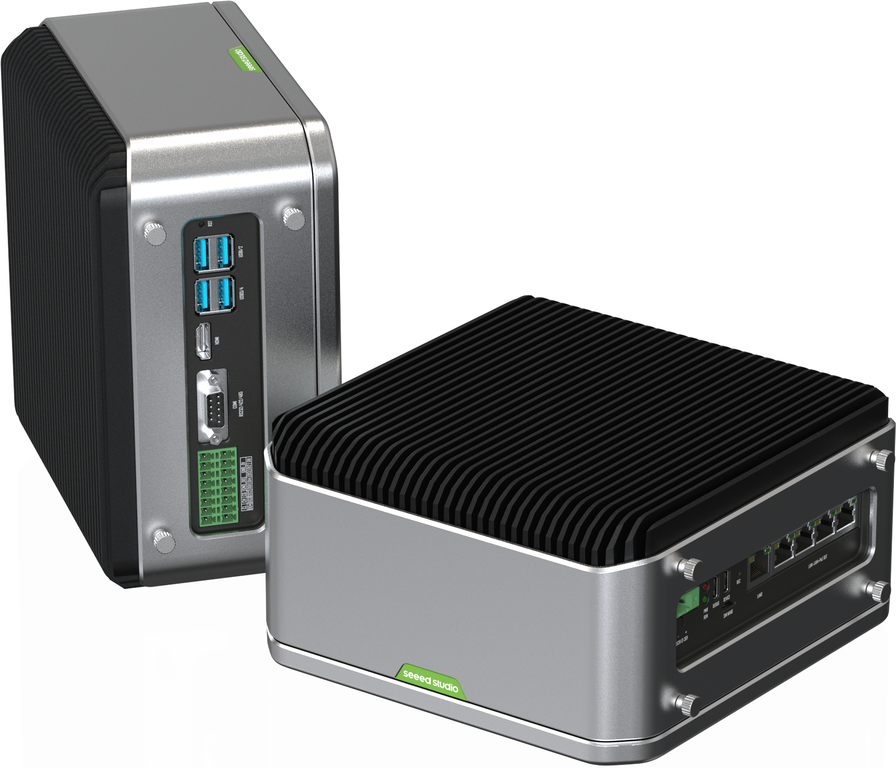

# Seeed Studio reServer Industrial J4012 Development Guide


[**View Seeed Studio reServer Industrial J4012 on OpenELAB**](https://openelab.io/products/seeed-studio-reserver-industrial-j4012ai)

**Model:** reServer Industrial J4012 (Jetson Orin NX 16 GB) · **OpenELAB SKU:** `Seeed-114110247` · **Seeed ordering code:** `114110247`




_Manufacturer image: Seeed Studio._ [_Image source_](https://files.seeedstudio.com/wiki/reServer-Industrial/1.png)_._

[Product at OpenELAB](https://openelab.io/products/seeed-studio-reserver-industrial-j4012ai) · [Manufacturer wiki hub](./)

## Product and model scope

**reServer Industrial J4012, SKU 114110247**, is a fanless Jetson Orin NX edge server for multi-camera analytics and industrial integration. Its four PoE camera ports and local storage expansion suit an AI-enabled NVR, inspection station or on-site video-processing gateway. It is different from reComputer J4012 and reComputer Super J4012: their images and connector instructions are not interchangeable.

## Applications

* **Edge video analytics / network video recorder:** process footage from supported IP cameras connected through the four PoE PSE ports.
* **Industrial inspection gateway:** combine on-device inference, wired networking and documented industrial I/O in a locally managed system.
* **Robotics edge computer:** use the Jetson Orin NX with a model-specific carrier BSP for local perception or control workloads.

_These are integration applications, not validated end-to-end performance claims. See_ [_Seeed's reServer Industrial guide_](https://wiki.seeedstudio.com/reServer_Industrial_Getting_Started/)_._

## Hardware specifications

| Item                              | J4012 configuration                                                                        |
| --------------------------------- | ------------------------------------------------------------------------------------------ |
| Compute                           | NVIDIA Jetson Orin NX, 16 GB LPDDR5                                                        |
| Original advertised AI capability | Up to 100 TOPS; dependent on software, mode and workload                                   |
| Storage                           | M.2 2280 NVMe; 128 GB SSD in the documented standard configuration; two 2.5-inch SATA bays |
| Networking                        | Five Gigabit Ethernet ports, including four 802.3af PoE PSE ports                          |
| Industrial interfaces             | CAN, digital I/O and selectable RS232/RS422/RS485                                          |
| Power                             | 12–36 V DC terminal input; documented adapter 24 V / 5 A                                   |
| Cooling                           | Passive heatsink/fanless system                                                            |
| Envelope                          | 194.33 × 187 × 95.5 mm                                                                     |

Check the actual order for included SSD, adapter and wireless modules. A PoE PSE port supplies a camera; it does not mean that the server accepts its own power over Ethernet. Cable pinouts, electrical limits and serial-mode switches are in the reference guide below.

Sources: [manufacturer setup](https://wiki.seeedstudio.com/reServer_Industrial_Getting_Started/), [datasheet](https://files.seeedstudio.com/wiki/reServer-Industrial/reServer-Industrial-Datasheet.pdf), [hardware reference](https://files.seeedstudio.com/wiki/reServer-Industrial/reServer-Industrial-Reference-Guide.pdf).

## First boot and a useful baseline

Prepare the correct manufacturer power supply, monitor/HDMI cable, keyboard and wired network. Attach peripherals while powered off, then apply power and finish the Linux first-run setup. Start with the installed image if it boots; reflashing is a recovery or version-management operation and can overwrite the system disk.

On the **Jetson**, open a terminal and capture a baseline:

```bash
cat /etc/nv_tegra_release
uname -a
lsblk -o NAME,SIZE,TYPE,MOUNTPOINTS
ip -brief address
dpkg-query -W nvidia-jetpack
sudo nvpmodel -q
tegrastats --interval 1000
```

Stop the last command with **Ctrl+C** after several readings. Expected checkpoints are a readable L4T release, an NVMe root filesystem, a network interface/address, a reported power mode and changing memory/CPU/temperature statistics. The `nvidia-jetpack` meta-package may be absent on a minimal image; that result alone does not prove the BSP or CUDA is missing. Keep this output with the exact image identifier before installing project software.

Do not use a desktop-PC CUDA installer or an arbitrary x86 container. Select Jetson/aarch64 packages and containers that explicitly match the installed JetPack/L4T release. Begin with a small camera or inference example from that release before adding multiple streams. The commands above establish platform visibility, not an inference-performance benchmark.

Sources: [NVIDIA Jetson Linux developer guide](https://docs.nvidia.com/jetson/archives/r36.4.3/DeveloperGuide/), [tegrastats reference](https://docs.nvidia.com/jetson/archives/r36.4.3/DeveloperGuide/AT/JetsonLinuxDevelopmentTools/TegrastatsUtility.html).

## Camera and industrial I/O bring-up

For the first network test, connect the upstream LAN port to your network and one supported PoE camera to a PoE port. Record which interface owns each IP address; camera discovery can fail when the camera and host are on different subnets. Confirm an individual stream before increasing the camera count. Use the [official PoE camera guide](https://wiki.seeedstudio.com/reserver_industrial_poe_camera_usage/) for the model's power and network configuration.

For RS485/CAN, inspect the terminal/DB9 mapping and configure the documented operating mode before attaching a field device. RS232 and RS485 are electrically different; connector shape does not establish compatibility. Bring up one bus at a time and use the [interface guide](https://wiki.seeedstudio.com/reserver_industrial_hardware_interface_usage/) for transceivers, termination and driver settings.

## Recovery and firmware selection

Use the reServer **Industrial J4012 / Orin NX 16 GB** image and its matching driver package from Seeed's release table. For example, the documented JetPack 6.2 baseline pairs with L4T 36.4.3; choose the host OS required by that specific release.

The model has a **DEVICE** USB-C connector and a **REC** recovery button. Follow the manufacturer's power-on-with-REC-held sequence, connect DEVICE to the Ubuntu host using a data cable, and check `lsusb` on that host. The documented recovery identity for Orin NX 16 GB is `0955:7323`. This is a USB bootloader identity, not a normal Linux login.

Before executing the vendor's flash command, back up required data and verify the target image/module combination. Use the command supplied with that image archive; filenames and board configurations change between releases. After flashing, return to normal boot and repeat the baseline checks above.

## Troubleshooting and FAQ

| Symptom                                  | Next check                                                                                                                |
| ---------------------------------------- | ------------------------------------------------------------------------------------------------------------------------- |
| Black display                            | Confirm power, HDMI connection and normal boot rather than recovery mode; inspect the documented debug UART if necessary. |
| Camera powers up but no image            | Check camera subnet, interface selection, stream URL/authentication and PoE power budget independently.                   |
| One image boots but industrial I/O fails | Verify the carrier-specific BSP/drivers; a generic Jetson image may lack them.                                            |
| Performance below the TOPS figure        | Check power mode, cooling, model precision, data-transfer costs and the actual inference pipeline.                        |
| Flash host cannot find the device        | Use DEVICE, a data cable and the correct REC/power sequence; recheck `lsusb`.                                             |

## Technical documents and software

| Resource                                                                                                           | Use                                                       |
| ------------------------------------------------------------------------------------------------------------------ | --------------------------------------------------------- |
| [Official setup and image table](https://wiki.seeedstudio.com/reServer_Industrial_Getting_Started/)                | Model-specific BSP, recovery and release combinations     |
| [Datasheet](https://files.seeedstudio.com/wiki/reServer-Industrial/reServer-Industrial-Datasheet.pdf)              | Specifications and operating conditions                   |
| [Reference manual](https://files.seeedstudio.com/wiki/reServer-Industrial/reServer-Industrial-Reference-Guide.pdf) | Electrical interfaces and installation                    |
| [Mechanical STEP model](https://files.seeedstudio.com/wiki/reServer-Industrial/reServer-Industrial-3D.stp)         | Mechanical integration                                    |
| [JetPack SDK](https://developer.nvidia.com/embedded/jetpack)                                                       | NVIDIA software stack; combine with Seeed carrier support |

**Documentation review:** 17 November 2026. **Formatting and scope update:** 18 November 2026. **Software execution:** not run. **Hardware validation:** not run. The instructions are based on [Seeed's reServer Industrial product guide and image table](https://wiki.seeedstudio.com/reServer_Industrial_Getting_Started/); record hardware revision, JetPack/L4T version and actual results when reproducing them.
