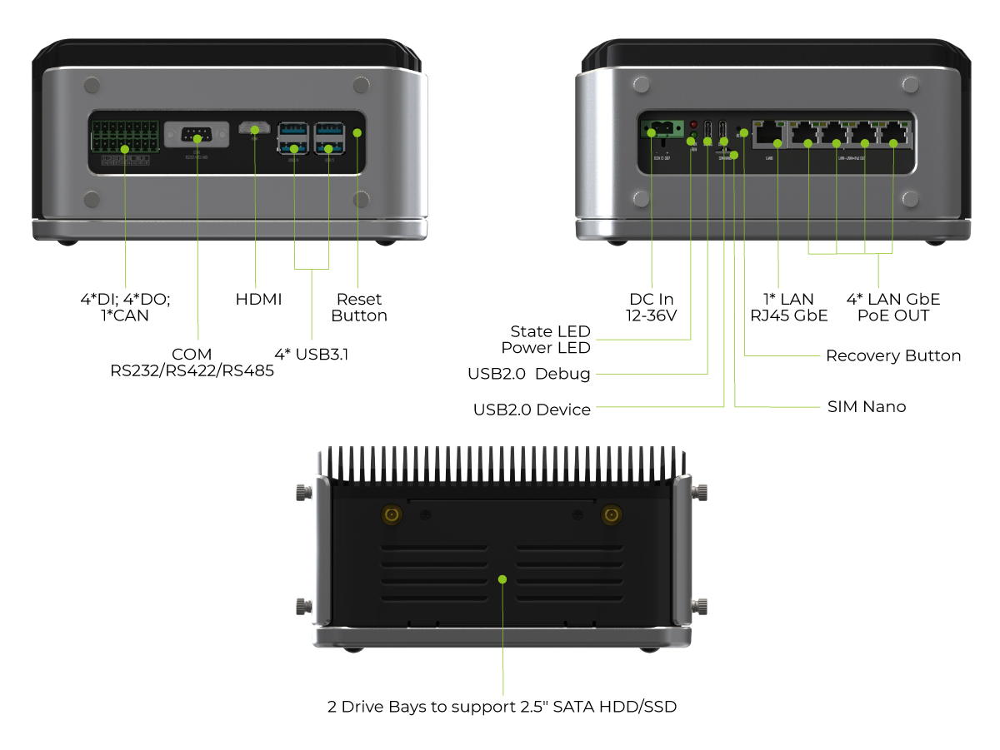
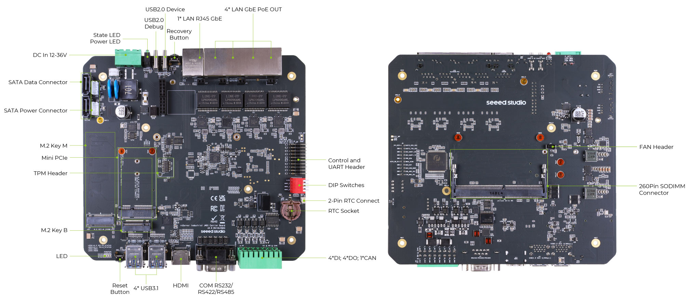

# Seeed Studio reServer Industrial J4012 Development Guide


[**View Seeed Studio reServer Industrial J4012 on OpenELAB**](https://openelab.io/products/seeed-studio-reserver-industrial-j4012ai)

**Model:** reServer Industrial J4012, Jetson Orin NX 16 GB · **SKU:** `Seeed-114110247` · **Seeed ordering code:** `114110247`


## Product and model scope

The **reServer Industrial J4012** combines an Orin NX 16 GB computer, four powered camera-network ports and industrial interfaces in a fanless enclosure. This guide takes an already installed system through identification, one camera-network connection and an observable stream, then explains storage, serial, CAN, digital I/O and recovery. It applies to **reServer Industrial**, not reComputer J4012, reComputer Super J4012 or the Robotics J4012 GMSL carrier. Their BSPs and connectors are different.


_Image: Seeed Studio;_ [_original enclosure illustration_](https://files.seeedstudio.com/wiki/reServer-Industrial/1.png)_._

[Seeed Studio manufacturer wiki](./) · [Official reServer Industrial setup](https://wiki.seeedstudio.com/reServer_Industrial_Getting_Started/)

### Which Industrial configuration is this?

| Industrial model      | Seeed code    | Jetson module | Memory    | Original advertised AI figure |
| --------------------- | ------------- | ------------- | --------- | ----------------------------- |
| **J4012, this guide** | **114110247** | **Orin NX**   | **16 GB** | **100 TOPS**                  |
| J4011                 | 114110248     | Orin NX       | 8 GB      | 70 TOPS                       |
| J3011                 | 114110249     | Orin Nano     | 8 GB      | 40 TOPS                       |
| J3010                 | 114110250     | Orin Nano     | 4 GB      | 20 TOPS                       |

These are the original module/configuration figures in Seeed's family table, not measured application throughput or a promise that a newer power mode is supported by every carrier revision. Use the **NX 16 GB** image row for this SKU. [Seeed model table](https://wiki.seeedstudio.com/reServer_Industrial_Getting_Started/#specifications).

## Applications

* **Local camera analytics:** start with one supported IP camera, then add streams while measuring decode load, inference time and storage throughput independently.
* **NVR and event recording:** keep the OS on NVMe and use the SATA bays for application data after explicitly identifying each disk.
* **Industrial protocol gateway:** bridge an independently commissioned RS232/422/485 or CAN device to an application. General-purpose Linux software is not a safety controller.
* **Remote edge station:** add a documented cellular or LoRa module when required; the socket and SIM slot do not mean a modem, antenna or data plan is included.

Engineering sizing should include camera startup consumption, sustained write volume, enclosure airflow and loss-of-network behavior. These application choices are integration guidance, not benchmarks performed on this unit.

## Hardware specifications

| Parameter           | J4012 / 114110247                                                                                |
| ------------------- | ------------------------------------------------------------------------------------------------ |
| GPU                 | 1,024 Ampere CUDA cores and 32 Tensor Cores                                                      |
| CPU                 | Eight Arm Cortex-A78AE cores; 64-bit architecture                                                |
| RAM                 | 16 GB 128-bit LPDDR5; manufacturer bandwidth figure 102.4 GB/s                                   |
| Boot storage        | M.2 Key M 2280 NVMe, PCIe Gen4; documented standard system includes 128 GB NVMe; no eMMC         |
| Additional storage  | Two 2.5-inch SATA drive bays, SATA III 6 Gb/s                                                    |
| Network             | Five 10/100/1,000 Mb/s RJ45 ports: LAN0 uplink and LAN1–LAN4 PoE PSE                             |
| PoE                 | IEEE 802.3af, 15 W per camera port; reference guide states 60 W across four ports                |
| Host USB            | Four USB3.1 Type-A ports in the datasheet/reference manual                                       |
| Service USB         | Separate USB-C DEVICE and DEBUG functions; use chassis labels                                    |
| Display             | **One** HDMI output; NX configuration is listed as HDMI2.1, up to 7,680 × 4,320 at 30 Hz         |
| Industrial I/O      | Four isolated DI, four isolated DO; one isolated CAN; one selectable DB9 serial port             |
| Expansion           | Mini PCIe; M.2 Key B 3042/3052; nano-SIM; optional TPM2.0 module                                 |
| Supply              | 12–36 V DC, two-pin terminal; documented adapter 24 V / 5 A, AC cord excluded                    |
| Size and mass       | 194.33 × 187 × 95.5 mm, W × D × H; 2.8 kg                                                        |
| Thermal conditions  | −20 to +60 °C **with 0.7 m/s airflow**; passive heatsink does not remove the airflow requirement |
| Humidity            | Operating: 95% RH at 40 °C, non-condensing; storage: 95% RH at 60 °C, non-condensing             |
| Storage temperature | −40 to +85 °C                                                                                    |
| Mounting            | Desktop, DIN rail and VESA options; use the supplied/mechanically compatible brackets            |
| Original OS         | JetPack 5.1.1; actual shipment image may differ                                                  |

Source: [datasheet](https://files.seeedstudio.com/wiki/reServer-Industrial/reServer-Industrial-Datasheet.pdf), [reference guide pp.1–3, 8–9](https://files.seeedstudio.com/wiki/reServer-Industrial/reServer-Industrial-Reference-Guide.pdf). The HDMI1.4 entry in the family table belongs to the Nano configurations; it is not a second J4012 HDMI socket. Confirm the actual order for SSD, adapter and modules. Manufacturer-listed FCC/CE/RoHS/UKCA/KC marks and two-year warranty are documentation claims; this review did not independently certify them. Shock/vibration suitability must be checked against the exact installed storage and mounting, rather than treating the table as a qualification of every added drive.

## Hardware and connections

### Power, ports and enclosure access

1. Shut down Linux, remove the DC input and wait for the system to de-energize before changing internal modules, DIP switches or drive wiring.
2. Identify DC polarity on the chassis/reference drawing before inserting the terminal plug. Use the specified adapter or a properly sized regulated supply, including the camera load. The PoE ports **supply** cameras; they do not power this server as a PoE powered device.
3. Attach HDMI, keyboard and LAN0 before first power-on. Start with one camera only after normal Linux boot works.
4. Use the [official assembly guide](https://files.seeedstudio.com/wiki/reServer-Industrial/reServer-Industrial-Assembly-Guide.pdf) when opening the enclosure. Keep thermal pads, heatsink contact and grounding hardware in their documented positions.



_Seeed Studio_ [_front-panel diagram_](https://files.seeedstudio.com/wiki/reServer-Industrial/2.jpg)_._



_Seeed Studio_ [_rear-panel diagram_](https://files.seeedstudio.com/wiki/reServer-Industrial/3.jpg)_._

**Use the words printed beside the USB-C sockets.** DEVICE is the Jetson recovery/data connection; DEBUG is the debug-UART/RP2040 service path. Reference-guide pp.5–6 contain inconsistent DEVICE/DEBUG section labeling. The physical labels and the recovery enumeration checkpoint below prevent relying on a conflicting connector number. Internal J8 jumpers select RP2040 versus UART service; leave them in the shipment position for ordinary Jetson boot. Do not flash RP2040 firmware as a Jetson recovery step.

### Digital I/O and CAN terminal

The 16-position terminal combines different isolated signal groups. **GND\_DI, GND\_DO and CAN CG/GND\_ISO are not interchangeable wiring instructions.** Orient the connector from the reference drawing before counting positions.

| Channel   | Jetson BGA signal | Legacy JetPack 5 sysfs number          | External wiring constraint                                      |
| --------- | ----------------- | -------------------------------------- | --------------------------------------------------------------- |
| DI1 / DI2 | PQ.05 / PAC.06    | 453 / 492                              | Documented 12 V inputs; return to GND\_DI                       |
| DI3 / DI4 | PQ.06 / PH.00     | 454 / 391                              | Same input group; not 3.3 V header GPIO                         |
| DO1 / DO2 | PI.00 / PI.01     | 399 / 400                              | External load/return to GND\_DO; no direct motor or relay drive |
| DO3 / DO4 | PI.02 / PH.07     | 401 / 398                              | Same output group                                               |
| CAN       | CH, CL, CG        | SocketCAN `can0` in the documented BSP | CH to CAN-H, CL to CAN-L, CG to the isolated bus reference      |

**Output-current discrepancy:** the PDF reference guide p.10 lists a 40 V / 500 mA load limit, while the current interface wiki lists **40 V / 40 mA per output**. Do not design a 500 mA load from these conflicting sources. This guide limits the introductory check to a high-impedance measurement or a current-limited load below 40 mA; obtain revision-specific confirmation before using higher current. The 40 V figure is a maximum withstand/load specification, not a generated 40 V supply. Seeed's DI example uses a 4.7 kΩ series resistor; preserve the complete external circuit, not only a GPIO number. [Interface DI/DO table and diagrams](https://wiki.seeedstudio.com/reserver_industrial_hardware_interface_usage/#di-do), [PDF p.10](https://files.seeedstudio.com/wiki/reServer-Industrial/reServer-Industrial-Reference-Guide.pdf).

### DB9 serial modes and pinout

Set the first three SW3 switches **with power removed**. The mode bits are MODE0, MODE1, MODE2 in the manufacturer's order; do not infer the physical ON direction from this text table.

| Mode bits | Function                                                                  |
| --------- | ------------------------------------------------------------------------- |
| 000       | RS422 full duplex                                                         |
| 001       | Pure RS232                                                                |
| 010       | RS485 half duplex, TX enable active low; documented factory default       |
| 011       | RS485 half duplex, TX enable active high                                  |
| 100       | RS422 with termination                                                    |
| 101       | Special RS232/RS485 coexistence mode; use only for the documented circuit |
| 110       | RS485 with termination, TX enable active low                              |
| 111       | High impedance / low power                                                |

| DB9 pin | RS232, mode001 | RS422, mode000/100 | RS485, mode010/110 |
| ------- | -------------- | ------------------ | ------------------ |
| 1       | —              | TX−                | Data−              |
| 2       | RXD            | TX+                | Data+              |
| 3       | TXD            | RX+                | —                  |
| 4       | —              | RX−                | —                  |
| 5       | GND            | GND                | GND                |
| 7 / 8   | RTS / CTS      | —                  | —                  |

Switch4 controls slew rate. Seeed lists a 250 kb/s limit in its slow setting and transceiver limits of 1.5 Mb/s RS232 / 10 Mb/s RS422/485 in its fast setting, **subject to the Jetson UART and system configuration**. Those numbers are not verified achievable application rates. For a first test use 9,600 baud, 8 data bits, no parity, one stop bit and a matching interface adapter. RS232 voltages must never be wired into a TTL UART. RS485 A/B naming varies between vendors; match Data+/Data−, not letters alone. [Reference pp.11–12](https://files.seeedstudio.com/wiki/reServer-Industrial/reServer-Industrial-Reference-Guide.pdf), [serial interface guide](https://wiki.seeedstudio.com/reserver_industrial_hardware_interface_usage/#rs232-rs422-rs485-interfaces).

## Software and development resources

**Keep the NVIDIA release and Seeed carrier BSP together.** JetPack 5.1.1 corresponds to Jetson Linux 35.3.1, an Ubuntu 20.04 root filesystem, CUDA 11.4, TensorRT 8.5.2 and cuDNN 8.6. The original manual workflow below is pinned to that combination. It is a recovery reference, not a recommendation to downgrade a working newer installation. [NVIDIA release notes](https://docs.nvidia.com/jetson/jetpack/5.1.1/release-notes/index.html).

Seeed's maintained table also lists later JetPack images. Choose a row that explicitly names **reServer Industrial Orin NX 16 GB**, inspect its release notes, checksum and Ubuntu-host requirements, and use its own flash procedure. Do not combine a JetPack 5 driver ZIP with JetPack 6/7 or assume a generic NVIDIA development-kit image supports this carrier's PoE and industrial I/O. An OS release in an online table was not installed during this review.

For application development:

* Select `aarch64`/Jetson packages or containers compatible with the installed L4T release; an x86 desktop CUDA installer is unsuitable.
* Use the matching NVIDIA multimedia/TensorRT examples before adopting a larger analytics stack. Rebuild TensorRT engines when the runtime, target or model configuration requires it.
* Keep application state, camera credentials and recordings separate from the reproducible OS image. Pin dependencies and record their licenses.
* `jtop`/jetson-stats is an optional third-party monitor, not the NVIDIA BSP itself. `tegrastats` and `nvpmodel -q` provide a smaller initial diagnostic without installing a Python package system-wide.

## First boot and a useful baseline

### 1. Prepare the system

Required: correctly rated DC supply, HDMI monitor, keyboard, wired LAN0 network, and an administrative Linux account. For a later camera test, prepare one IEEE802.3af-compatible camera, its documented IP address/protocol, credentials and a known-good Ethernet cable. Do not attach field I/O yet.

Power on with the existing NVMe image. Complete the first-run account/network setup if presented. **Reflashing is not a prerequisite when the system already boots.** Record the chassis/module labels and any carrier-board revision before installing software.

### 2. Identify the running platform

Run on the **Jetson**, not the Ubuntu flashing host:

```bash
cat /etc/nv_tegra_release
uname -a
dpkg-query -W nvidia-l4t-core
dpkg-query -W nvidia-jetpack
findmnt /
lsblk -o NAME,SIZE,TYPE,FSTYPE,MOUNTPOINTS,MODEL
ip -br address
sudo nvpmodel -q
tegrastats --interval 1000
```

Stop `tegrastats` with Ctrl+C after several updates. Expect an L4T release, an NVMe-backed root filesystem, the installed power-mode name and changing CPU/RAM/thermal readings. A missing `nvidia-jetpack` meta-package alone does not establish that CUDA or the BSP is absent. If `MOUNTPOINTS` is unsupported by an older `lsblk`, use `MOUNTPOINT`. Save the output before any system changes. [NVIDIA tegrastats reference](https://docs.nvidia.com/jetson/archives/r36.4.3/DeveloperGuide/AT/JetsonLinuxDevelopmentTools/TegrastatsUtility.html).

### 3. Establish a repeatable checkpoint

1. Run a normal reboot and confirm the same root disk, network connection and release information return. **Expected result:** this establishes a working host baseline. It is not an inference or thermal benchmark. If the display remains blank, use the documented DEBUG UART path and correct internal jumper configuration to distinguish boot failure from HDMI negotiation; do not move jumpers on a powered board.

## Camera and industrial I/O bring-up

### One PoE camera: separate power, link, address and stream

1. Keep LAN0 as the upstream connection. Identify LAN1–LAN4 from the front diagram. Their four PSE outputs are rated 15 W each; the reference guide states 60 W total. Camera heaters/IR illumination and startup peaks must fit the supply/system budget.
2. Enable PoE using the procedure for the **installed BSP**. For the original JetPack 5.1.x mapping, after confirming GPIO 315 is the documented PoE enable and is not owned by another driver:

```bash
sudo sh -c 'test -d /sys/class/gpio/gpio315 || echo 315 > /sys/class/gpio/export'
sudo sh -c 'echo out > /sys/class/gpio/gpio315/direction'
sudo sh -c 'echo 1 > /sys/class/gpio/gpio315/value'
```

For JetPack 6, Seeed identifies expander `gpiochip2` offset 15. Verify it on the actual image with `gpiodetect`, `gpioinfo` and `gpioset --version` before changing it. **libgpiod 1.x** requires a holding mode, for example `sudo gpioset --mode=signal gpiochip2 15=1`; **libgpiod 2.x**, after verifying chip/line mapping, uses `sudo gpioset -c gpiochip2 15=1`. Keep the process running in its own terminal during this bench test. Its line state after exit is not guaranteed. Do not silently reuse these offsets on another BSP or run two owners for the same line. [Seeed PoE enable](https://wiki.seeedstudio.com/reserver_industrial_hardware_interface_usage/#gigabit-ethernet-connectors), [libgpiod command lifetime and syntax](https://libgpiod.readthedocs.io/en/v2.3.1/gpioset.html).

3. Plug one camera into one powered port. Run `ip -br link` before and after connection to map the physical label to the actual Linux interface. Interface names vary; an example `eth0` is not a reliable LAN1 identity.
4. Configure a local camera subnet without replacing LAN0's default route. The following is an **example** only for a camera already configured as `192.168.6.64/24`, when that subnet is unused elsewhere. Replace `enP1p1s0` with the observed camera interface:

```bash
camera_if=enP1p1s0
sudo nmcli connection add type ethernet ifname "$camera_if" con-name camera-lan1 \
  ipv4.method manual ipv4.addresses 192.168.6.6/24 ipv4.never-default yes \
  ipv6.method disabled
sudo nmcli connection up camera-lan1
ip -br address show dev "$camera_if"
ping -I "$camera_if" -c 4 192.168.6.64
```

If a suitable profile already exists, modify that profile rather than adding a competing connection. A successful ping proves IP reachability, not image decoding; some cameras intentionally ignore ICMP. 5. Open the camera's documented web page or client, verify its stream settings and test one stream with a protocol-compatible player. An RTSP camera requires its own documented URL/authentication; a GigE Vision camera normally requires the corresponding acquisition SDK. Neither is automatically a `/dev/video0` USB camera. 6. For a camera whose manual specifies RTSP, a local test in VLC is **Media → Open Network Stream → enter its documented URL → Play**. Supply credentials locally rather than publishing them in commands/logs. Success is sustained moving video with the expected resolution and no repeated reconnects. Then test decoding/inference with the matching Jetson application before adding another camera.

Record physical port, interface name, camera address/model, protocol and chosen stream. Use separate non-overlapping subnets where the network design requires them. Undo the example profile with `sudo nmcli connection delete camera-lan1` when it is no longer needed. [Seeed camera workflow](https://wiki.seeedstudio.com/reserver_industrial_poe_camera_usage/).

### SATA, NVMe and USB: identify before writing

With DC removed, install SATA data and power connections according to the assembly guide. After boot, compare `lsblk` output before/after. The existing NVMe root disk and each added SATA disk must be identified by model/size and mount point before partitioning or formatting. The same rule applies to USB drives.

The current interface article describes three USB connectors in one paragraph, whereas the Industrial datasheet, rear diagram and reference manual describe **four Type-A ports**. Use the physical J4012 hardware and manual for port count; do not transfer that paragraph's current-sharing figures to an unverified revision. The Type-A ports are host ports. Some upstream examples write `dd` directly to a block device; that would destroy existing data and is not an appropriate first check here. This guide intentionally uses enumeration, not a destructive disk benchmark. [Storage/USB interface source](https://wiki.seeedstudio.com/reserver_industrial_hardware_interface_usage/).

### RTC, wireless modules and TPM

| Interface           | Practical commissioning check                                                                                                                                                                                                                                                       |
| ------------------- | ----------------------------------------------------------------------------------------------------------------------------------------------------------------------------------------------------------------------------------------------------------------------------------- |
| RTC                 | Documented onboard cell is CR1220; check polarity with DC disconnected. Run `sudo hwclock --show` and `timedatectl status`. Only write a verified system time to RTC with `sudo hwclock --systohc`. Avoid installing a second clock-restore service when the OS already manages it. |
| External RTC header | Reference guide p.17 shows J12 polarity and battery constraints. The current wiki's external battery designation differs; confirm the actual battery voltage, connector pitch and polarity before purchase or wiring.                                                               |
| Mini PCIe           | Seeed's examples cover EC20/EC25 cellular and WM1302 LoRa concentrators. Confirm the module interface and regional variant, install with power removed, attach the correct antenna, then inspect `lsusb`/serial devices.                                                            |
| M.2 Key B           | Examples use SIM8202G-M2 and nano-SIM. Apply the release-specific power-control sequence before expecting enumeration; the maintained article still labels its full 5G internet walkthrough “Coming soon.”                                                                          |
| SIM                 | Reference guide warns that Mini PCIe and M.2 Key B cannot use the SIM simultaneously. Choose the intended modem path; do not assume two independent cellular subscriptions.                                                                                                         |
| TPM                 | Optional, not installed merely because a header exists. Seeed demonstrates an Infineon SLB9670 module. Check `sudo dmesg \| grep -i tpm` and `ls -l /dev/tpm*`; protect provisioned keys before OS replacement.                                                                     |

For a cellular modem, identify its actual AT command port, confirm `AT` responds, then apply that modem's APN and USB-network mode using its own manual. A generic `/dev/ttyUSB2` may point to another interface; do not issue reset/GNSS commands by guessing. For WM1302, choose the SPI/USB HAL and region configuration documented for that fitted module. Gateway ID, regional channel plan and network-server settings are separate from hardware enumeration; antenna/regional limits must be correct before transmitting. [RTC, modem, LoRa and TPM procedures](https://wiki.seeedstudio.com/reserver_industrial_hardware_interface_usage/).

### DI/DO: read one input before driving a load

For the original JetPack 5 mapping, wire **DI1** only with the documented 12 V circuit and GND\_DI. After checking that the line is free, export 453 and read its BGA-named directory:

```bash
sudo sh -c 'test -d /sys/class/gpio/PQ.05 || echo 453 > /sys/class/gpio/export'
cat /sys/class/gpio/PQ.05/value
```

Seeed's legacy DI1 example reports **0 with the 12 V input present and 1 without it**. That is an inverted electrical readout, not a general promise that all input APIs return the same logical polarity. On its documented JetPack 6 image, DI1 is gpiochip0 offset105 and DO1 offset51; confirm BGA name, line ownership and installed libgpiod syntax before using them. Do not mix legacy global GPIO numbers and chip offsets.

For an output test use the complete external load circuit, a current-limited supply and GND\_DO. The published JetPack 5 and JetPack 6 DO examples differ in apparent polarity. Establish inactive/active state with a meter and no actuator attached. Because of the current-limit conflict above, higher-current load commissioning remains outside this guide pending a revision-specific manufacturer answer. [DI/DO source and diagrams](https://wiki.seeedstudio.com/reserver_industrial_hardware_interface_usage/#di-do).

### CAN: an isolated two-node bench check

Wire CH/CL/CG to a compatible USB-CAN adapter on a disconnected bench bus. Use termination at **the two physical ends**, accounting for the J4012's switchable onboard 120 Ω resistor. Do not add another 120 Ω at every node. The carrier is described as CAN-FD capable up to 5 Mb/s; the initial example below is **classic CAN at 125 kb/s**, not a CAN-FD performance test.

On the Jetson, with no production bus attached:

```bash
sudo apt install can-utils
sudo modprobe mttcan
sudo ip link set can0 down
sudo ip link set can0 type can bitrate 125000
sudo ip link set can0 up
ip -details -statistics link show can0
candump can0
```

Configure the adapter for standard11-bit frames and125 kb/s. Send one harmless test frame from the adapter; expect `candump` to show the matching ID and bytes. For the reverse direction, use a second terminal and `cansend can0 123#01020304`, then confirm the adapter receives those four bytes. Stop with Ctrl+C and `sudo ip link set can0 down`. A bus-off/error counter is a reason to inspect bitrate, pin mapping, termination and reference wiring before repeated sends. The `cansend` token must contain `#` without whitespace; splitting it into a shell comment would change the command. [Seeed CAN examples](https://wiki.seeedstudio.com/reserver_industrial_hardware_interface_usage/#can).

### Serial: match electrical mode before sending text

For a first RS232 test, power off, set mode001, attach a correctly wired RS232 adapter and then boot. Confirm `/dev/ttyTHS0` is the carrier UART and is not occupied by a console on that BSP. Configure both ends at 9,600 baud, 8N1 without hardware flow control:

```bash
sudo stty -F /dev/ttyTHS0 9600 cs8 -cstopb -parenb -crtscts raw -echo
sudo sh -c 'printf "J4012 serial check\r\n" > /dev/ttyTHS0'
```

Open a serial terminal on the other computer and expect that exact line. For reception, run `sudo cat /dev/ttyTHS0`, send a short line from the adapter, then stop with Ctrl+C. Use appropriate group/device permissions for an application rather than permanently making the UART world-writable.

RS422 crosses transmit pairs to the peer's receive pairs. RS485 uses the selected half-duplex mode and release-specific TX-enable control; Seeed's legacy example manipulates PR.04/global 460. Do not reuse that write on a newer BSP without confirming its direction-control implementation. Use only one transmitter at a time on the initial RS485 bench bus. [Mode table and UART workflow](https://wiki.seeedstudio.com/reserver_industrial_hardware_interface_usage/#rs232-rs422-rs485-interfaces).

### Run LED and performance

Seeed's JetPack 5 example addresses the green RUN LED as PCC.01/global 329. It is normally a system-status indicator, so application use should not hide a diagnostic indication inadvertently. Verify line ownership first; then use the documented GPIO method for that release and release the line when finished. The red POWER indication is separate.

Start performance work with `sudo nvpmodel -q` and `tegrastats`. Record power mode, temperatures, clocks, input size, precision, batch size and stream count alongside latency/throughput. The upstream `nvpmodel -m 0`/`jetson_clocks` recipe changes power/clocks and may request a reboot; mode0 is not a universal maximum across all images. Select a named mode supported by the exact BSP and supply, then test the enclosure under its required airflow. [Manufacturer monitoring and performance sections](https://wiki.seeedstudio.com/reserver_industrial_hardware_interface_usage/).

## Recovery and firmware selection

### Confirm recovery without erasing the disk

1. Back up required files and record the working L4T/BSP, storage layout, application configuration and any TPM-bound keys.
2. Prepare a supported Ubuntu **host**, a reliable data cable and the exact reServer Industrial NX 16 GB archive. For the documented JetPack 5 manual method use the manufacturer-listed Ubuntu 18.04/20.04 host; later image rows have different host requirements.
3. Power the server off. Connect **DEVICE** USB-C to the host. Hold REC while applying the terminal DC supply, then release REC as specified in Seeed's sequence.
4. Run `lsusb` on the host. The documented Orin NX 16 GB recovery identity is **`0955:7323`**. Another module's ID, no device, or only a USB-UART is a reason to stop and check model/cable/port/power. USB enumeration alone is not a completed flash.

### Manufacturer full-image path

Download the archive from the **matching model and JetPack row** in [Seeed's image table](https://wiki.seeedstudio.com/reServer_Industrial_Getting_Started/#flash-jetpack). Verify the published checksum when provided and enough host disk space. Extract it, enter its `mfi_...` directory and inspect the included instructions. For a package that explicitly provides the documented massflash workflow:

```bash
sudo ./tools/kernel_flash/l4t_initrd_flash.sh \
  --flash-only --massflash 1 --network usb0 --showlogs
```

This writes system storage; run it only after the model/archive/recovery checks and backup. Use the archive's command if it differs. Do not turn a generic downloaded filename into a presumed compatible image.

### Original JetPack 5.1.1 manual BSP path

The maintained guide also documents a manual **L4T35.3.1** route: extract NVIDIA's matching driver package and sample root filesystem; apply binaries; install flash prerequisites; then overlay the **reServer Industrial Orin NX 8/16 GB** carrier driver ZIP into that same tree. The official inputs are linked below. Do not mix release trees or substitute the Nano driver.

The original 35.3.1 carrier command, executed from `Linux_for_Tegra` on the host after those prerequisites, is:

```bash
sudo ./tools/kernel_flash/l4t_initrd_flash.sh \
  --external-device nvme0n1p1 -c tools/kernel_flash/flash_l4t_nvme.xml \
  -S 80GiB \
  -p "-c bootloader/t186ref/cfg/flash_t234_qspi.xml --no-systemimg" \
  --network usb0 reserver-orin-industrial external
```

This is version-specific, includes an 80 GiB rootfs sizing argument and is not a command for every later JetPack image. Follow that release's post-flash driver/`depmod` and serial-console instructions only where applicable. Return to normal boot after flashing, rerun the baseline, check the release/disk and verify one camera before restoring all services. Installing `nvidia-jetpack` through the matching repository may add SDK components; a generic distribution upgrade does not replace a carrier-BSP migration plan. [Seeed flashing procedure](https://wiki.seeedstudio.com/reServer_Industrial_Getting_Started/).

## Troubleshooting and FAQ

| Symptom                               | Ordered checks and useful evidence                                                                                                                                  |
| ------------------------------------- | ------------------------------------------------------------------------------------------------------------------------------------------------------------------- |
| No display after power-on             | Check DC polarity/rating and POWER LED; distinguish normal boot from recovery; reseat HDMI with power removed; inspect DEBUG UART if the OS still does not appear.  |
| Camera has no power                   | Confirm LAN1–4 rather than LAN0, IEEE802.3af compatibility, PoE-enable state/owner, cable and15 W per-port budget. Test one camera before four.                     |
| Camera pings but has no video         | Confirm protocol, exact stream URL, credentials, codec and the decoder/SDK. ICMP success does not prove RTSP/GigE acquisition.                                      |
| Camera subnet breaks internet         | Inspect `ip route` and NetworkManager profiles. Keep camera profiles from becoming the default route; avoid overlapping camera and uplink subnets.                  |
| GPIO commands fail or change nothing  | Confirm BSP, libgpiod version, BGA name, chip/offset and line ownership. Keep a userspace output request alive; never replace an unknown number by trial and error. |
| Output-current ratings disagree       | Use the bounded low-current check above; do not commission a larger load until Seeed confirms the installed carrier revision's rating.                              |
| RS232 works but RS485 does not        | Remove power before checking mode switches, confirm Data+/Data− and termination, then verify the BSP's half-duplex direction control and one active transmitter.    |
| CAN enters bus-off                    | Stop sending; check125 kb/s at both ends, CH/CL/CG, the two endpoint terminations and transceiver compatibility. Capture error counters before re-enabling.         |
| Added disk missing                    | Inspect power/data seating while unpowered, then `lsblk` and kernel messages. Do not format the first disk name that appears.                                       |
| Cellular slot occupied but no network | Verify actual module, SIM selection, antenna, release-specific power sequence, USB enumeration, AT port and APN; a socket alone is not a working modem.             |
| Low inference throughput              | Compare precision/input/batching, decode and storage load, supported power mode and thermal readings. TOPS is not frames per second.                                |
| Flash host cannot see NX 16 GB        | Use DEVICE and a data cable; repeat REC-at-power-on; verify `0955:7323`; exclude DEBUG-only enumeration before starting flash.                                      |
| Generic image boots but I/O fails     | Compare the exact Seeed carrier BSP and kernel modules; boot success alone does not establish PoE/serial/CAN support.                                               |

## Technical documents and software

| Resource                                                                                                                                                           | Purpose and scope                                                                             |
| ------------------------------------------------------------------------------------------------------------------------------------------------------------------ | --------------------------------------------------------------------------------------------- |
| [Official setup and image table](https://wiki.seeedstudio.com/reServer_Industrial_Getting_Started/)                                                                | Industrial family identities, JetPack images, recovery and release-specific host requirements |
| [Hardware/interface guide](https://wiki.seeedstudio.com/reserver_industrial_hardware_interface_usage/)                                                             | Ethernet, SATA, RTC, modem/LoRa, DI/DO, CAN, serial, USB, LED, TPM and performance examples   |
| [PoE camera guide](https://wiki.seeedstudio.com/reserver_industrial_poe_camera_usage/)                                                                             | Power, physical-port mapping and network checkpoints                                          |
| [Datasheet PDF](https://files.seeedstudio.com/wiki/reServer-Industrial/reServer-Industrial-Datasheet.pdf)                                                          | Family comparison, packing list, conditions and dimensions; read for this revision            |
| [Reference guide PDF](https://files.seeedstudio.com/wiki/reServer-Industrial/reServer-Industrial-Reference-Guide.pdf)                                              | 24-page connector, pin, mode, RTC, power and mounting reference                               |
| [Assembly guide PDF](https://files.seeedstudio.com/wiki/reServer-Industrial/reServer-Industrial-Assembly-Guide.pdf)                                                | Enclosure and internal installation sequence; manufacturer-linked resource                    |
| [Mechanical STEP](https://files.seeedstudio.com/wiki/reServer-Industrial/reServer-Industrial-3D.stp)                                                               | CAD integration; linked, not imported or dimensionally validated here                         |
| [NVIDIA35.3.1 driver package](https://developer.nvidia.com/downloads/embedded/l4t/r35_release_v3.1/release/jetson_linux_r35.3.1_aarch64.tbz2)                      | Original JetPack 5.1.1 manual-flash input                                                     |
| [NVIDIA35.3.1 sample rootfs](https://developer.nvidia.com/downloads/embedded/l4t/r35_release_v3.1/release/tegra_linux_sample-root-filesystem_r35.3.1_aarch64.tbz2) | Matching root filesystem, not a complete carrier image by itself                              |
| [Seeed Orin NX carrier overlay](https://sourceforge.net/projects/nvidia-jetson/files/reServer-Industrial/orin-nx-8-16-reserver-industrial.zip/download)            | Original Industrial NX 8/16 GB driver ZIP; match the release instructions before use          |
| [NVIDIA JetPack](https://developer.nvidia.com/embedded/jetpack)                                                                                                    | SDK overview; use with Seeed carrier support                                                  |

## Official documentation and development resources

The [Seeed source repository](https://github.com/Seeed-Studio/wiki-documents) provides maintained documentation history and links to the original diagrams. The table above is an index to complete originals; this guide adds the staged checks, variant distinctions and conflict handling needed for integration. It does not replace a modem's AT-command manual, a camera's stream specification or a board-revision-specific electrical approval.

**Reviewed 24 November 2026:** official setup, interface and PoE pages; downloaded datasheet and reference PDF, including visual inspection of connector pages. Source conflicts concerning USB count/labels and DO limits are disclosed at the relevant operation. **Software execution, firmware flashing, hardware operation and performance testing: not run.** Commands are source-reviewed procedures with explicit checkpoints, not claimed measurements. Record the actual carrier revision, image archive/hash and test results when reproducing them.

### Related retained references

* [NVIDIA Jetson Linux developer guide](https://docs.nvidia.com/jetson/archives/r36.4.3/DeveloperGuide/)
