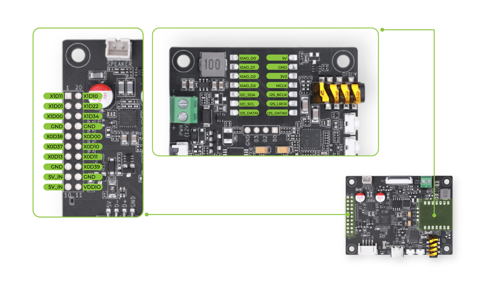
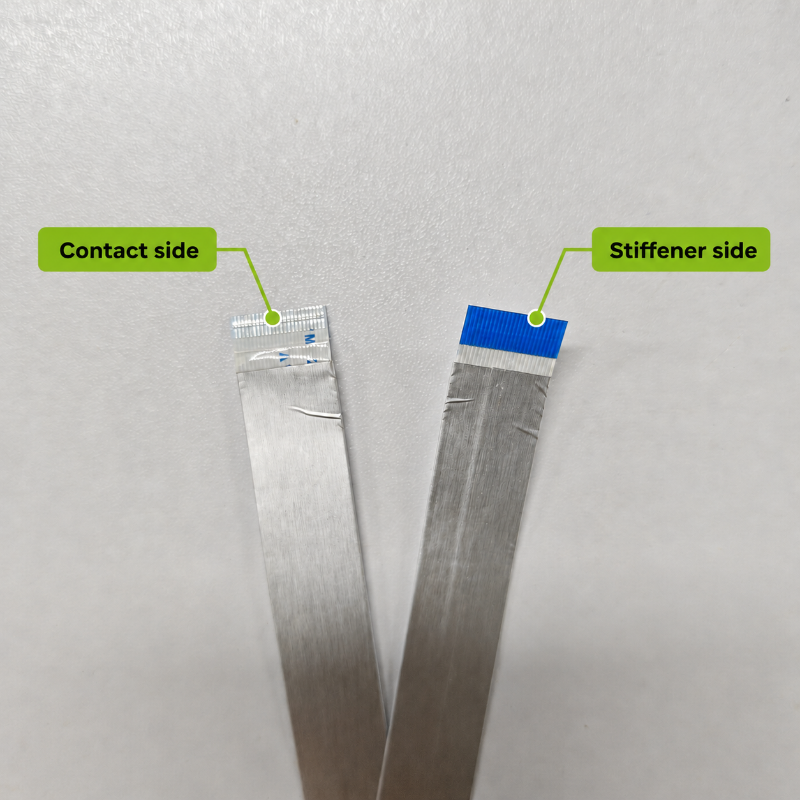
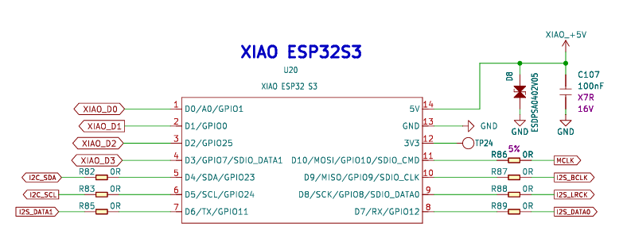

# Seeed Studio reSpeaker Flex XVF3800 Development Guide


[**View reSpeaker Flex Circular-4 with XIAO ESP32S3 on OpenELAB**](https://openelab.io/products/seeed-studio-respeaker-flex-xvf3800-circular-4-with-xiao-esp32s3) — **SKU:** `Seeed-100070894`.

[**View reSpeaker Flex Linear-4 without XIAO on OpenELAB**](https://openelab.io/products/seeed-studio-respeaker-flex-xvf3800-linear-4-without-xiao-esp32s3) — **SKU:** `Seeed-100099135`.

[**View reSpeaker Flex Circular-4 without XIAO on OpenELAB**](https://openelab.io/products/seeed-studio-respeaker-flex-xvf3800-circular-4-without-xiao-esp32s3) — **SKU:** `Seeed-100005504`.

[**View reSpeaker Flex Linear-4 with XIAO ESP32S3 on OpenELAB**](https://openelab.io/products/seeed-studio-respeaker-flex-xvf3800-linear-4-with-xiao-esp32s3) — **SKU:** `Seeed-100026178`.

**Model:** reSpeaker Flex XVF3800, separate core and four-microphone array joined by a 24-pin FPC. Geometry and fitted XIAO determine the firmware and setup route.


## Product overview

reSpeaker Flex puts the XMOS XVF3800 processor, codec, amplifier and optional XIAO on a core board, while a separate circular or linear board carries the microphones. This lets an enclosure place microphones at the speaking surface without putting all processing electronics there. It supports USB audio or embedded I2S audio with I2C configuration. The processing includes acoustic echo cancellation (AEC), automatic gain control (AGC), beamforming, voice activity detection (VAD), direction of arrival (DoA), noise suppression and de-reverberation. [Seeed Flex introduction](https://wiki.seeedstudio.com/respeaker_flex_introduction/).

### Product and variant selection

| OpenELAB SKU      | Array      | XIAO ESP32S3  | Manufacturer-default interface | Firmware geometry code |
| ----------------- | ---------- | ------------- | ------------------------------ | ---------------------- |
| `Seeed-100070894` | Circular-4 | Pre-installed | I2S                            | `c`                    |
| `Seeed-100099135` | Linear-4   | Not included  | USB                            | `l`                    |
| `Seeed-100005504` | Circular-4 | Not included  | USB                            | `c`                    |
| `Seeed-100026178` | Linear-4   | Pre-installed | I2S                            | `l`                    |

The verified product pages identify core board, matching array, 20 cm FPC and pin connectors; the XIAO options add the fitted controller. The [manufacturer XIAO guide](https://wiki.seeedstudio.com/respeaker_flex_xiao_introduction/) identifies the populated versus unpopulated footprint. The same core connector does not make circular and linear processing interchangeable: install an image for the actual geometry.

This page excludes the [all-in-one circular XVF3800](respeaker-xvf3800-four-mic-development-guide.md) and [XU316-based Lite](respeaker-lite-voice-kit-development-guide.md). Their firmware, data-pin maps and power limits are different. Return to the [Seeed Studio hub](./) for model selection.

## Applications

Use Circular-4 where users can speak around a robot head or tabletop device. Use Linear-4 across a kiosk/display edge when the interaction area is in front. Seeed describes circular pickup as 360° and linear pickup as approximately 180° with rear suppression; enclosure reflections and speaker placement still affect the result.

Choose USB when the host already runs speech recognition, such as a Raspberry Pi or PC. Choose the XIAO option for a custom embedded/Wi-Fi application. Home Assistant-oriented marketing does not establish that an all-in-one XVF3800 ESPHome package works unchanged on Flex: the Flex GPIO map and geometry-specific firmware differ. Establish raw transport and reference audio before integrating a voice service.

## Specifications

| Parameter                     | Flex core / array value and condition                                                                                |
| ----------------------------- | -------------------------------------------------------------------------------------------------------------------- |
| Processor / codec / amplifier | XMOS XVF3800 / TLV320AIC3104 / TPA3139D2                                                                             |
| Circular array                | Four PDM MEMS microphones; 44 mm spacing; 360° pickup; three M3 mounting holes                                       |
| Linear array                  | Four PDM MEMS microphones; 33 mm spacing; front-oriented pickup; two M3 mounting holes                               |
| Core mounting                 | Four M3 mounting holes                                                                                               |
| Manufacturer range claim      | Up to 5 m; installation/acoustics dependent, not a guaranteed wake-word distance                                     |
| Microphone interconnect       | 24 contacts, 0.5 mm pitch FPC; supplied cable length 20 cm                                                           |
| FPC microphone supply / clock | 3.3 V MIC\_VDD; manufacturer lists 2–4 MHz MIC\_CLK                                                                  |
| USB connectors                | USB-C and PH2.0 locking USB interface; UAC 2.0 audio and DFU                                                         |
| Power paths                   | 5 V USB-C/locking connector; separate P1 terminal accepts 12 V                                                       |
| Speaker / headphone outputs   | Manufacturer specifies up to 10 W into 4 Ω on amplified output with appropriate external supply; separate 3.5 mm AUX |
| USB profiles                  | 16 kHz two/six channels, or 48 kHz two channels, with circular/linear firmware                                       |
| I2S profiles                  | 16 or 48 kHz, two-channel 32-bit path; current repository labels I2S images as slave images                          |

Sources: [Flex hardware and power guide](https://wiki.seeedstudio.com/respeaker_flex_introduction/), [XIAO/FPC details](https://wiki.seeedstudio.com/respeaker_flex_xiao_introduction/), [firmware v1.0.4 reference](https://github.com/respeaker/reSpeaker_Flex/blob/99a5047129c158beb655daf5f38b325ebef0974a/xmos_firmwares/README.md). A 24-contact connector with eight data-line positions is expansion capability, not eight microphones included in these four-mic SKUs. Legacy storefront “maximum 16 kHz” text is narrower than the actual current 48 kHz firmware options; select the installed image rather than treating that text as a universal hardware cap.

### Current firmware selection

The current repository reviewed here is commit `99a5047129c158beb655daf5f38b325ebef0974a`, with v1.0.4 under version subdirectories. Old wiki names such as `ua-io16-cir` and `inthost-lr16-lin` describe earlier naming; use the actual filenames below.

| Installed array / desired path   | Exact v1.0.4 file, relative to repository root                                                                                    |
| -------------------------------- | --------------------------------------------------------------------------------------------------------------------------------- |
| Circular, USB 16 kHz stereo      | `xmos_firmwares/usb/v1.0.4/respeaker_flex_usb_c16k2ch_v1.0.4.bin`                                                                 |
| Circular, USB 16 kHz six-channel | `xmos_firmwares/usb/v1.0.4/respeaker_flex_usb_c16k6ch_v1.0.4.bin`                                                                 |
| Circular, USB 48 kHz stereo      | `xmos_firmwares/usb/v1.0.4/respeaker_flex_usb_c48k2ch_v1.0.4.bin`                                                                 |
| Linear, USB 16 kHz stereo        | `xmos_firmwares/usb/v1.0.4/respeaker_flex_usb_l16k2ch_v1.0.4.bin`                                                                 |
| Linear, USB 16 kHz six-channel   | `xmos_firmwares/usb/v1.0.4/respeaker_flex_usb_l16k6ch_v1.0.4.bin`                                                                 |
| Linear, USB 48 kHz stereo        | `xmos_firmwares/usb/v1.0.4/respeaker_flex_usb_l48k2ch_v1.0.4.bin`                                                                 |
| Circular, I2S 16 / 48 kHz        | `xmos_firmwares/i2s/v1.0.4/respeaker_flex_i2s_c16k2ch_v1.0.4.bin` / `respeaker_flex_i2s_c48k2ch_v1.0.4.bin` in the same directory |
| Linear, I2S 16 / 48 kHz          | `xmos_firmwares/i2s/v1.0.4/respeaker_flex_i2s_l16k2ch_v1.0.4.bin` / `respeaker_flex_i2s_l48k2ch_v1.0.4.bin` in the same directory |

Source: [versioned repository tree](https://github.com/respeaker/reSpeaker_Flex/tree/99a5047129c158beb655daf5f38b325ebef0974a/xmos_firmwares). Six-channel USB defaults are two configured processed outputs followed by four raw microphones. Firmware v1.0.2 introduced configurable direct routing on channels 3–6; v1.0.3 corrected fixed-beam setting restoration; v1.0.4 added separate AIC3104 headphone/line-out level commands, range **0–9**. Preserve the version when comparing tuning behavior.

## Hardware and connections

### Hardware and technical documents



_Seeed Studio_ [_original header diagram_](https://files.seeedstudio.com/wiki/reSpeaker_flex/header_pinout.jpg)_, viewed in the pictured board orientation. P1 is the 12 V terminal; the labeled 5V\_IN and logic/header pins are different circuits._

Start from USB power with no external speaker load for the first capture. The external 12 V terminal powers the core and supports its higher-power amplifier path. Seeed reports simultaneous 12 V and USB operation, including a 12 V/2 A source and a 4 Ω/5 W speaker test; that reported test is not a 10 W continuous measurement by OpenELAB. It also reports that USB VBUS is unnecessary for enumeration when the core is supplied at 12 V. Use the documented core connector/polarity rather than modifying a USB cable for the initial check. [Official power FAQ](https://wiki.seeedstudio.com/respeaker_flex_introduction/).

Connect a passive speaker to the two-pin amplified speaker output with power removed. Do not connect either speaker lead to GND or a line input based only on connector appearance. Start at low volume. The 3.5 mm jack is for headphones/active speakers; when both outputs are plugged in, the manufacturer says the AUX path takes precedence. A 10 W-capable amplifier does not mean a 5 V USB source can provide that output under every load.

### FPC connection and complete signal groups



_Diagram: Seeed Studio,_ [_original FPC orientation guide_](https://files.seeedstudio.com/wiki/reSpeaker_flex/fpc-cable-orientation.png)_. Exposed cable contacts face the connector's metal contacts. Check the actual latch and contact side at both ends._

1. Disconnect all power, including USB and the external terminal.
2. Identify contact and stiffener sides of the supplied FPC. Open the locking tab gently; do not pull a cable against a closed latch.
3. Insert squarely to full depth with exposed contacts toward the socket contacts, then close the latch evenly. Repeat at the array board.
4. Route the ribbon without a sharp crease, stress at the latch or tension from enclosure movement. Secure the boards so the cable is not their mechanical support.

| FPC contact(s)                         | Signal           | Direction relative to core / integration limit                              |
| -------------------------------------- | ---------------- | --------------------------------------------------------------------------- |
| 1, 2                                   | MIC\_VDD         | 3.3 V microphone supply                                                     |
| 3, 5, 7, 9, 11, 13, 15, 17, 19, 21, 24 | GND              | Supply return / intervening signal grounds                                  |
| 4                                      | MIC\_CLK         | Core output, manufacturer lists 2–4 MHz                                     |
| 6, 8, 10, 12                           | MIC\_D1–MIC\_D4  | Array microphone data into core                                             |
| 14, 16, 18, 20                         | MIC\_D5–MIC\_D8  | Extra data positions in interface; not additional microphones in these SKUs |
| 22, 23                                 | GPIO\_1, GPIO\_2 | General expansion I/O                                                       |

Source: [official 24-pin FPC table](https://wiki.seeedstudio.com/respeaker_flex_introduction/#24-fpc-cable). The microphone ribbon carries PDM signals, not the XIAO's I2S stream. Do not inject 5 V or 12 V into MIC\_VDD, GPIO or microphone data. A different pitch/contact orientation or a cable with different contact-side arrangement is not an equivalent replacement merely because it has 24 conductors.

### Exact Flex XIAO pin map



_Seeed Studio_ [_XIAO footprint schematic_](https://files.seeedstudio.com/wiki/reSpeaker_flex/xiao_esp32s3.png)_, inspected for signal names, D labels and GPIO numbers._

| Flex signal            | XIAO label | ESP32-S3 GPIO | Use                                              |
| ---------------------- | ---------- | ------------- | ------------------------------------------------ |
| I2C\_SDA               | D4         | 5             | DSP configuration data                           |
| I2C\_SCL               | D5         | 6             | DSP configuration clock                          |
| I2S\_DATA1             | D6         | 43            | XIAO transmit / playback data into front end     |
| I2S\_DATA0             | D7         | 44            | XIAO receive / microphone data from front end    |
| I2S\_LRCK              | D8         | 8             | I2S frame clock                                  |
| I2S\_BCLK              | D9         | 9             | I2S bit clock                                    |
| MCLK                   | D10        | 10            | Routed master clock                              |
| Available lower D pads | D0–D3      | 1, 2, 3, 7    | Confirm other attached circuits before assigning |

This is **Flex**, where BCLK/WS are GPIO9/8. The all-in-one XVF3800 uses GPIO8/7 and opposite RX/TX assignments; copying its sketch unchanged is incorrect. Keep the same ground reference and 3.3 V logic domain. A pre-soldered XIAO already connects these buses, so a second external master must not drive them concurrently. No-XIAO variants need a separately installed host before following the embedded example.

Orient the microphone inlet side toward the speaking area and preserve the array's geometry. Use Circular/Linear DXF and STEP below for hole locations and keep-outs, rather than scaling a product photo. The manufacturer describes an XTAG4 debug pad; that pad is not the XIAO USB programming connector.

## Software and development resources

| Resource            | Correct target / use                                                                                                                          |
| ------------------- | --------------------------------------------------------------------------------------------------------------------------------------------- |
| USB host            | Linux/Raspberry Pi OS, Windows or macOS UAC audio; choose profile and inspect host formats                                                    |
| Python control      | Flex repository `python_control/xvf_host.py`, Python 3 + PyUSB + libusb; current script auto-discovers PID under vendor `0x2886` when omitted |
| XMOS firmware       | **reSpeaker\_Flex**, array geometry `c` or `l`; do not use all-in-one XVF3800 images                                                          |
| Arduino XIAO        | Espressif ESP32 package, board `XIAO_ESP32S3`, USB CDC diagnostics; Audio Tools library                                                       |
| Embedded clock role | Current Flex I2S images are slave images; host generates clocks at the chosen rate                                                            |
| Voice service       | Implement application/network/recognition separately after capture; a microphone front end does not supply STT/TTS automatically              |

Clone the official repository and keep a known source version:

```bash
git clone https://github.com/respeaker/reSpeaker_Flex.git
cd reSpeaker_Flex
git checkout 99a5047129c158beb655daf5f38b325ebef0974a
python3 -m venv .venv
. .venv/bin/activate
python -m pip install pyusb
```

Windows may need the README's `libusb-package`; Linux/macOS need the system libusb backend. Audio transport and USB control can have different OS permission/driver requirements. Read [Python control README](https://github.com/respeaker/reSpeaker_Flex/blob/99a5047129c158beb655daf5f38b325ebef0974a/python_control/README.md). Official firmware is distributed as binaries; public access is not a general license grant to redistribute them. Follow upstream links and the specific dependency licenses.

## Getting started

### First useful test: USB capture

1. Power off and connect the supplied FPC to the **matching** four-mic array as above. Prepare a Linux/Raspberry Pi OS host with `alsa-utils`, a data USB-C cable and an independent known-working playback output.
2. Connect the **XMOS core USB-C beside RST**, not only the XIAO USB. No-XIAO units are USB-first; XIAO units may require the geometry-specific USB image through Safe Mode, described below.
3. Inspect the host capture device and actual formats, replacing `CARD` below with the number printed by `arecord -l`:

```bash
arecord -l
arecord -D hw:CARD,0 --dump-hw-params -d 1 -t raw /dev/null
```

4. For the **16 kHz, two-channel** Flex USB image, record a baseline:

```bash
arecord -D plughw:CARD,0 -c 2 -r 16000 -f S16_LE -d 5 flex-baseline.wav
aplay flex-baseline.wav
```

The `plughw:` plugin can convert format; S16\_LE here describes the WAV, not a measured native endpoint width. `hw:` probing may print capabilities then reject its default format; inspect the printed values. Use `-c 6` only for the six-channel profile and `-r 48000` only for an appropriate 48 kHz profile. In Audacity, select the actual Flex input, matching rate and two or six capture channels; Windows uses WASAPI and Linux uses ALSA as documented in Seeed's [recording instructions](https://wiki.seeedstudio.com/respeaker_flex_introduction/).

**Expected result:** Flex appears as a capture device and the five-second WAV contains speech from the chosen interaction area. Reposition the talker in front/behind a Linear-4 or around a Circular-4 while keeping the same gain to evaluate the installed layout. This observation is not a calibrated directivity measurement.

### Read version, geometry and direction

From `python_control/` in the pinned Flex repository:

```bash
python xvf_host.py --list
python xvf_host.py VERSION
python xvf_host.py AEC_MIC_ARRAY_GEO
python xvf_host.py DOA_VALUE
python xvf_host.py AUDIO_MGR_OP_L
python xvf_host.py AUDIO_MGR_OP_R
```

Check that the returned geometry agrees with the fitted circular/linear board before comparing beam behavior. A response is evidence of control transport, not proof that an FPC is connected correctly. `DOA_VALUE` returns direction and speech status; do not treat a retained angle with no detected speech as a new localization result. Source: [Flex control tools](https://github.com/respeaker/reSpeaker_Flex/blob/99a5047129c158beb655daf5f38b325ebef0974a/python_control/README.md).

This original Python wrapper records a short, read-only control baseline. Save it as `capture_flex_status.py` **inside `python_control`**, activate the environment above and run `python capture_flex_status.py`. It uses the current interpreter and stops on transport/command failure rather than silently retaining stale values:

```python
import datetime
import json
from pathlib import Path
import subprocess
import sys

commands = ("VERSION", "AEC_MIC_ARRAY_GEO", "DOA_VALUE",
            "AUDIO_MGR_OP_L", "AUDIO_MGR_OP_R")
record = {"utc": datetime.datetime.now(datetime.timezone.utc).isoformat(),
          "device": "reSpeaker Flex", "responses": {}}
for command in commands:
    response = subprocess.run(
        [sys.executable, "xvf_host.py", command],
        capture_output=True, text=True, timeout=10)
    if response.returncode:
        raise SystemExit(f"{command} failed: {response.stderr or response.stdout}")
    record["responses"][command] = response.stdout.strip()
Path("flex-status.json").write_text(json.dumps(record, indent=2))
print(json.dumps(record, indent=2))
```

Expected output is JSON with five actual responses and a UTC time; it intentionally does not manufacture expected geometry coordinates. Record the speaker/array placement and firmware filename beside the file. This helps distinguish a firmware change from a physical placement change.

### Tuning, channel routing and persistence

Read current routes before making a temporary change. The control interface takes two values, `category, source`, where raw microphones are category 1, source 0–3, and the automatically selected processed beam is category 6, source 3. For example `python xvf_host.py AUDIO_MGR_OP_L --values 1 0` routes raw microphone 0 into the left output; restore the saved original pair afterward. This command does not increase the number of USB channels.

The six-channel profile defaults to two configured streams plus four raw microphones. Keep raw relative gains intact for acoustic measurements/calibration; lower raw signal level than processed speech is normal. Read the [signal category/routing table](https://github.com/respeaker/reSpeaker_Flex/blob/99a5047129c158beb655daf5f38b325ebef0974a/python_control/README.md) for reference, residual and packed-output choices. `AUDIO_MGR_OP_ALL` refers to packed source slots, not a general six-channel selection.

On v1.0.4, read `AIC3104_HP_LEVEL` and `AIC3104_LINEOUT_LEVEL` before changing their **0–9** values. Improve the correct codec/mixer path before adding large host gain that can clip playback. `SAVE_CONFIGURATION --values 1` saves supported configuration to flash, including settings other than the last write; use it after confirming the whole state and retaining your baseline.

### Original Flex XIAO I2S meter

For **100070894 / 100026178**, install the geometry-matched **16 kHz I2S v1.0.4** XMOS image. For 100099135 / 100005504 this route also requires a separately fitted compatible host. Install Arduino IDE, add Espressif's package index `https://espressif.github.io/arduino-esp32/package_esp32_index.json`, install the ESP32 package and Audio Tools, select **XIAO\_ESP32S3**, enable USB CDC and use the XIAO programming port.

This original receive-only program configures the XIAO as **master** to complement the current Flex I2S **slave** image. It uses the inspected Flex schematic, including MCLK10, and allocates only a short block. Keep any external I2S host disconnected.

```cpp
#include <Arduino.h>
#include "AudioTools.h"
using namespace audio_tools;
I2SStream audio;
int32_t words[256];
uint32_t bytesSeen = 0;
uint32_t last = 0;
int64_t maximum = 0;

void setup() {
  Serial.begin(115200);
  delay(1500);
  auto cfg = audio.defaultConfig(RX_MODE);
  cfg.copyFrom(AudioInfo(16000, 2, 32));
  cfg.pin_bck = 9;
  cfg.pin_ws = 8;
  cfg.pin_mck = 10;
  cfg.pin_data = 43;
  cfg.pin_data_rx = 44;
  cfg.is_master = true;
  if (!audio.begin(cfg)) {
    Serial.println("Flex I2S initialization failed");
    while (true) delay(1000);
  }
  last = millis();
}
void loop() {
  size_t count = audio.readBytes(reinterpret_cast<uint8_t *>(words), sizeof(words));
  bytesSeen += count;
  for (size_t i = 0; i < count / sizeof(int32_t); ++i) {
    int64_t value = words[i];
    if (value < 0) value = -value;
    if (value > maximum) maximum = value;
  }
  if (millis() - last >= 1000) {
    Serial.printf("Flex bytes=%lu peak_word=%lld\n",
                  (unsigned long)bytesSeen, (long long)maximum);
    last = millis();
    bytesSeen = 0;
    maximum = 0;
  }
}
```

**Expected result:** periodic received-byte counts and speech-responsive peaks. Nominal payload at 16 kHz stereo/32-bit is **128,000 bytes/s**, calculated as 16,000 × 2 × 4; timer boundaries and DMA buffering affect individual reports. If there are no data, inspect clock ownership, geometry-specific firmware and FPC seating before integrating Wi-Fi. For a 48 kHz image, update the application rate to 48,000 and expect 384,000 bytes/s. A larger stream rate does not itself establish wider acoustic bandwidth. Source/API baseline: [Flex I2S guide](https://wiki.seeedstudio.com/respeaker_flex_xiao_introduction/), [Audio Tools ESP32 configuration](https://github.com/pschatzmann/arduino-audio-tools/blob/cf52ad7cb778c9daf651af04fc9724a93daeb889/src/AudioTools/CoreAudio/AudioI2S/I2SConfigESP32.h).

### Embedded development and recovery

USB firmware allows USB DFU; I2S firmware allows I2C DFU; the factory Safe Mode supports both. To return a Flex from I2S to USB, remove **all** supplies, hold the core board's **Boot/SafeMode** button, reconnect power and inspect `dfu-util -l`. The RST button restarts the core; XIAO BOOT is a separate ESP32 loader. Do not substitute the all-in-one XVF3800's Mute-button recovery sequence.

Install `dfu-util` using `sudo apt install dfu-util` on Debian-derived Linux, `brew install dfu-util` on macOS, or the [official Windows binaries](https://dfu-util.sourceforge.net/releases/dfu-util-0.11-binaries.tar.xz). Confirm the actual Flex and its **alt 1 upgrade** partition; remove unrelated DFU devices before issuing the write. From the pinned repository root, an example for **Circular-4 only** is:

```bash
dfu-util -l
dfu-util -R -e -a 1 -D xmos_firmwares/usb/v1.0.4/respeaker_flex_usb_c16k2ch_v1.0.4.bin
```

For Linear-4 select the corresponding `l16k2ch` file from the table. Do not flash a circular image just because the command is shown first. Do not overwrite the factory partition. Power-cycle afterward; confirm capture enumeration and read `VERSION`. On Windows use WinUSB only for the intended DFU interface and retain normal audio drivers on the audio interfaces. Download binary/raw files or clone the repository, rather than saving GitHub HTML as `.bin`. [Seeed update/recovery instructions](https://wiki.seeedstudio.com/respeaker_flex_introduction/).

## Troubleshooting and FAQs

### FAQs

| Symptom / question                                 | Ordered checks                                                                                                                                                                                                      |
| -------------------------------------------------- | ------------------------------------------------------------------------------------------------------------------------------------------------------------------------------------------------------------------- |
| No sound device on a XIAO SKU                      | Confirm core XMOS port and data cable, then installed I2S/USB mode. I2S factory firmware is a valid reason for no normal USB audio device. Use Flex SafeMode to switch.                                             |
| USB works but microphone signal is absent          | Check FPC fully seated/contact direction, inlet obstruction, mute/routing and capture mixer. A working control endpoint does not prove the array ribbon is connected.                                               |
| Poor direction detection after replacing the array | Confirm circular `c` versus linear `l` firmware and read geometry. Preserve spacing/orientation and compare at the same gain.                                                                                       |
| Low speaker volume on Linux                        | Select Flex in `alsamixer` with F6; check PCM-1 and the intended codec level. Unplug AUX when evaluating the JST speaker, then check supply/load. Save a validated mixer state with `sudo alsactl store` if needed. |
| No sound through JST while AUX is connected        | Remove the 3.5 mm plug; official behavior gives AUX priority. Do not diagnose the amplifier before testing that path.                                                                                               |
| Windows has a warning after a profile change       | Inspect the exact device/interface in Device Manager, uninstall the stale sound-device instance and reconnect so Windows re-enumerates it. Avoid replacing every interface driver with WinUSB.                      |
| Embedded receive stays empty                       | Use Flex BCLK9/WS8/RX44, correct 16/48 kHz image and complementary clock roles. Check MCLK10 and a common ground; do not reuse all-in-one pin defaults.                                                             |
| Six-channel raw audio is quieter                   | Raw channels bypass enhancement. Preserve relative levels for algorithm work; level compensation for listening is a host decision.                                                                                  |
| Can the board receive 12 V and USB together?       | Manufacturer says yes through the dedicated P1 terminal plus USB. This permission does not apply 12 V to the 5 V locking connector, header or microphone FPC.                                                       |

## Downloads and technical documents

| Resource                                                                                                                                                                                                 | Engineering purpose / model                                  |
| -------------------------------------------------------------------------------------------------------------------------------------------------------------------------------------------------------- | ------------------------------------------------------------ |
| [Flex hardware manual](https://wiki.seeedstudio.com/respeaker_flex_introduction/)                                                                                                                        | Core/arrays, FPC, supply, audio, recovery and host recording |
| [Flex XIAO guide](https://wiki.seeedstudio.com/respeaker_flex_xiao_introduction/)                                                                                                                        | Fitted-host schematic and Arduino setup                      |
| [Pinned firmware directory](https://github.com/respeaker/reSpeaker_Flex/tree/99a5047129c158beb655daf5f38b325ebef0974a/xmos_firmwares)                                                                    | Versioned USB/I2S `c`/`l` images and release notes           |
| [Circular USB stereo 16 kHz binary](https://raw.githubusercontent.com/respeaker/reSpeaker_Flex/99a5047129c158beb655daf5f38b325ebef0974a/xmos_firmwares/usb/v1.0.4/respeaker_flex_usb_c16k2ch_v1.0.4.bin) | USB v1.0.4 for 100070894/100005504 geometry                  |
| [Linear USB stereo 16 kHz binary](https://raw.githubusercontent.com/respeaker/reSpeaker_Flex/99a5047129c158beb655daf5f38b325ebef0974a/xmos_firmwares/usb/v1.0.4/respeaker_flex_usb_l16k2ch_v1.0.4.bin)   | USB v1.0.4 for 100026178/100099135 geometry                  |
| [Circular I2S 16 kHz binary](https://raw.githubusercontent.com/respeaker/reSpeaker_Flex/99a5047129c158beb655daf5f38b325ebef0974a/xmos_firmwares/i2s/v1.0.4/respeaker_flex_i2s_c16k2ch_v1.0.4.bin)        | Current slave image for the circular embedded-meter path     |
| [Linear I2S 16 kHz binary](https://raw.githubusercontent.com/respeaker/reSpeaker_Flex/99a5047129c158beb655daf5f38b325ebef0974a/xmos_firmwares/i2s/v1.0.4/respeaker_flex_i2s_l16k2ch_v1.0.4.bin)          | Current slave image for the linear embedded-meter path       |
| [Python SDK / controls](https://github.com/respeaker/reSpeaker_Flex/tree/99a5047129c158beb655daf5f38b325ebef0974a/python_control)                                                                        | Version, geometry, DoA, routing and codec levels             |
| [Circular 2D DXF](https://files.seeedstudio.com/wiki/reSpeaker_flex/reSpeaker_xvf3800_flex_circular_2d.dxf)                                                                                              | Circular array mounting/outline                              |
| [Linear 2D DXF](https://files.seeedstudio.com/wiki/reSpeaker_flex/reSpeaker_xvf3800_flex_linear_2d.dxf)                                                                                                  | Linear array mounting/outline                                |
| [Core 2D DXF](https://files.seeedstudio.com/wiki/reSpeaker_flex/reSpeaker_xvf3800_flex_Separate_2d.dxf)                                                                                                  | Core mounting/outline                                        |
| [Circular STEP](https://files.seeedstudio.com/wiki/reSpeaker_flex/reSpeaker_xvf3800_flex_circular_260210.step)                                                                                           | Array mechanical integration                                 |
| [Linear STEP](https://files.seeedstudio.com/wiki/reSpeaker_flex/reSpeaker_xvf3800_flex_linear.step)                                                                                                      | Array mechanical integration                                 |
| [Core STEP](https://files.seeedstudio.com/wiki/reSpeaker_flex/reSpeaker_xvf3800_flex_Separate.step)                                                                                                      | Core enclosure integration                                   |

### Official documentation and development resources

The maintained [Flex repository](https://github.com/respeaker/reSpeaker_Flex) and [manufacturer manual](https://wiki.seeedstudio.com/respeaker_flex_introduction/) complement the local procedures. Mechanical files refer to the separate core/array components. A STEP link is not proof that a complete speaker/enclosure/XIAO assembly fits a custom product; check the actual revision and tolerances.

## References and validation <a href="#sources-and-validation" id="sources-and-validation"></a>

Reviewed **24 November 2026**: all four exact OpenELAB product variants, Seeed Flex and Flex-XIAO manuals, inspected header/FPC/schematic diagrams, and repository commit `99a5047129c158beb655daf5f38b325ebef0974a` with firmware v1.0.4 and Python control source. The diagrams are attributed Seeed Studio originals. Legacy firmware names in the wiki were reconciled to actual versioned files rather than reused as unverified download paths.

**Validation:** source review and static consistency only. The original programs were **not compiled or run on physical hardware**. No SPL, pickup distance, current draw, speaker output power, USB descriptors or acoustic directivity was measured. Record the core/array revisions, exact geometry and firmware, host toolchain/dependency versions and actual capture results when reproducing this guide.
