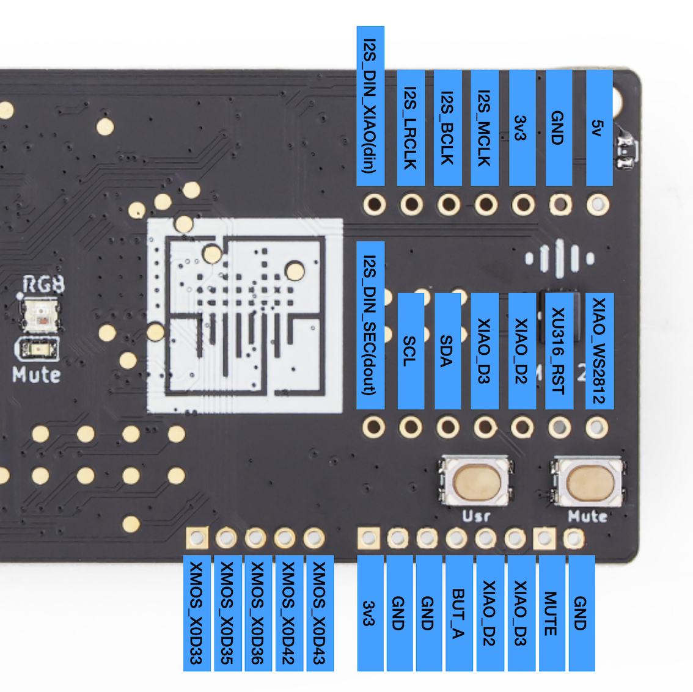
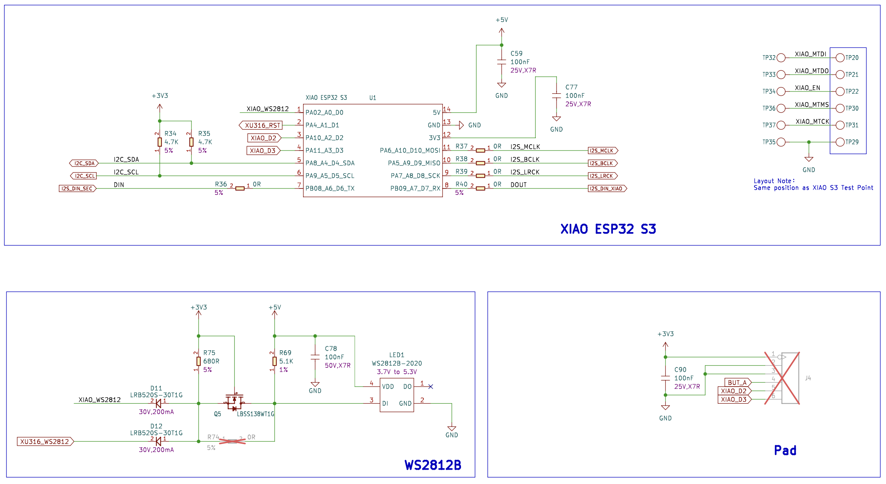

# Seeed Studio reSpeaker Lite and Voice Assistant Kit Development Guide


[**View reSpeaker Lite 2-Mic Array Voice Kit on OpenELAB**](https://openelab.io/products/seeed-studio-respeaker-lite-2) — **SKU:** `Seeed-110061601`; reSpeaker Lite board with pre-soldered XIAO ESP32S3.

[**View reSpeaker Lite Voice Assistant Kit on OpenELAB**](https://openelab.io/products/seeed-studio-respeaker-lite-voice-assistant-kit) — **SKU:** `Seeed-E24072601`; board with pre-soldered XIAO ESP32S3, mono enclosed speaker and acrylic enclosure.

**Model:** XMOS XU316-based reSpeaker Lite, two microphones. Both SKUs require coordinated XMOS audio firmware and XIAO application firmware; the kit enclosure does not select USB/I2S mode.


## Product overview

reSpeaker Lite is a two-microphone audio front end with XMOS XU316 processing, USB audio and an I2S connection to a companion controller. It provides interference cancellation, acoustic echo cancellation (AEC), noise suppression, voice-to-noise ratio (VNR) and automatic gain control (AGC). The XIAO ESP32S3 runs the application/network code. Recognition, wake-word detection and Home Assistant services require the corresponding software; the microphones alone are not a complete speech assistant. [Seeed Lite introduction](https://wiki.seeedstudio.com/reSpeaker_usb_v3/), [XIAO kit guide](https://wiki.seeedstudio.com/xiao_respeaker/).

### Identity and applications

| Exact OpenELAB SKU | Included hardware established by its listing                                            | What changes in setup                                                                                                                                    |
| ------------------ | --------------------------------------------------------------------------------------- | -------------------------------------------------------------------------------------------------------------------------------------------------------- |
| `Seeed-110061601`  | Lite two-mic board with pre-soldered XIAO ESP32S3                                       | Arrange a suitable output/speaker and enclosure separately when needed; do not treat the generic Lite standalone photograph as proof this SKU lacks XIAO |
| `Seeed-E24072601`  | Lite with pre-soldered XIAO, 4 Ω/5 W mono enclosed speaker, laser-cut acrylic enclosure | Assemble the case and speaker; preserve microphone inlet access and cable clearance                                                                      |

Both exact product URLs were matched to their current readable variants. The board's 35 × 86 mm footprint and the complete kit's listed 92 × 42 × 95 mm envelope describe different assemblies. A separately sold standalone Lite without XIAO exists in Seeed's family, but it is not an additional SKU covered here.

This is **XU316 Lite**, not [XVF3800 four-mic](respeaker-xvf3800-four-mic-development-guide.md) or [Flex](respeaker-flex-xvf3800-development-guide.md). Do not flash their firmware or transfer Flex's 12 V input contract. More hardware is indexed in the [Seeed Studio hub](./).

## Applications

Use USB mode for a computer-based speech recorder or communication input. Use I2S plus the fitted XIAO for a Home Assistant satellite, keyword spotter or Wi-Fi audio node. An enclosed kit shortens assembly work but still needs firmware, a USB supply and application configuration.

For a first AEC evaluation, play through the Lite's intended output, capture speech concurrently and compare at the same volume and placement. A separate sound card or wireless speaker does not automatically feed its playback stream to the XU316 reference path. For a keyword classifier, preserve the model's sample rate, channel selection, preprocessing and label order rather than using a WAV header to rename mismatched data.

## Specifications

| Parameter                        | Lite board / kit scope                                                                                                                    |
| -------------------------------- | ----------------------------------------------------------------------------------------------------------------------------------------- |
| Audio DSP                        | XMOS XU316                                                                                                                                |
| Microphones                      | Two high-performance digital microphones                                                                                                  |
| Manufacturer far-field claim     | Up to 3 m under suitable acoustic conditions                                                                                              |
| Microphone sensitivity           | -26 dBFS, manufacturer-listed                                                                                                             |
| Microphone signal-to-noise ratio | 64 dBA, manufacturer-listed                                                                                                               |
| Acoustic overload                | Manufacturer table writes “120 dBL”; retain this source notation rather than treating the ambiguous unit as a calibrated system SPL limit |
| Host audio                       | USB Audio Class 2.0 or alternative I2S firmware                                                                                           |
| Initial supply                   | USB 5 V or documented external 5 V pad                                                                                                    |
| Codec                            | TLV320AIC3204, I2C address `0x18`                                                                                                         |
| XMOS I2C control                 | Address `0x42`, supported with I2S firmware                                                                                               |
| Board dimensions                 | 35 × 86 mm                                                                                                                                |
| Output                           | Amplified speaker connector, manufacturer describes 5 W speaker support; 3.5 mm headphones/active speaker                                 |
| Complete E24072601 kit           | Listed envelope 92 × 42 × 95 mm; listed mass 200 g; 4 Ω/5 W enclosed speaker                                                              |
| Fitted XIAO                      | ESP32S3, dual-core up to 240 MHz, Wi-Fi/BLE, 8 MB flash and 8 MB PSRAM in these listings                                                  |
| User controls                    | USR and mute buttons, mute indicator, programmable WS2812, power indicator; XIAO BOOT/reset are separate                                  |

Sources: [Seeed board specification](https://wiki.seeedstudio.com/reSpeaker_usb_v3/), [official Lite repository](https://github.com/respeaker/ReSpeaker_Lite/tree/2ad81e22e773d1680793acdb3e14bb108d7566cb), and the exact OpenELAB package links above. Microphone-component figures do not establish the assembled kit's measured recognition range, overload threshold or acoustic frequency response.

### USB and I2S profiles are different

The current official Lite repository at commit `2ad81e22e773d1680793acdb3e14bb108d7566cb` provides these files in `xmos_firmwares/`:

| Filename                                                         | Use / boundary                                                                                             |
| ---------------------------------------------------------------- | ---------------------------------------------------------------------------------------------------------- |
| `respeaker_lite_usb_dfu_firmware_v2.0.7.bin`                     | USB sound-card route; standard 16 kHz example path                                                         |
| `respeaker_lite_i2s_dfu_firmware_v1.0.9.bin`                     | Standard I2S 16 kHz example route                                                                          |
| `respeaker_lite_i2s_dfu_firmware_48k_v1.0.9.bin`                 | I2S 48 kHz; application must use 48,000 Hz                                                                 |
| `respeaker_lite_i2s_dfu_firmware_48k_v1.1.0_ch0-asr_ch1-mww.bin` | 48 kHz I2S with channel 0 for automatic speech recognition (ASR) and channel 1 for micro wake word         |
| `respeaker_lite_i2s_factory_firmware_v1.1.0_ch0-asr_ch1-mww.bin` | Factory-format file; not interchangeable with an alt-1 DFU update image just because it has a similar name |

The manufacturer overview's “maximum sampling rate 16 kHz” is a legacy summary, not a description of every I2S binary now available. The official repository does not provide a released USB 48 kHz image in its reviewed firmware list. A 48 kHz I2S file does not establish USB 48 kHz support. Sources: [firmware list/README](https://github.com/respeaker/ReSpeaker_Lite/blob/2ad81e22e773d1680793acdb3e14bb108d7566cb/README.md), [changelog](https://github.com/respeaker/ReSpeaker_Lite/blob/2ad81e22e773d1680793acdb3e14bb108d7566cb/xmos_firmwares/changelog.md).

## Hardware and connections



_Seeed/reSpeaker_ [_official pinout_](https://raw.githubusercontent.com/respeaker/ReSpeaker_Lite/2ad81e22e773d1680793acdb3e14bb108d7566cb/doc/images/pinout.png)_. Pad labels and direction are viewed from the pictured underside, not a connector drawing for XVF3800._

### Power, ports and outputs

Use a known-good USB data cable on the **Lite/XMOS USB-C** for audio and XMOS DFU. Use the **XIAO USB-C** for ESP32 upload and diagnostic serial. A visible XIAO serial port says nothing about the XMOS sound-card firmware. Begin with one documented supply path; GPIO logic is 3.3 V, not 5 V tolerant.

The Lite requires 5 V at the published supply input. A single Li-ion cell at approximately 3–4.2 V is not a direct substitute for the whole board's 5 V supply; the XIAO's own battery capability does not establish a complete Lite power budget. A battery design needs a suitable 5 V converter, current/thermal assessment and a reviewed power path. [Official Lite power/output FAQ](https://wiki.seeedstudio.com/respeaker_lite_faq/).

Connect the E24072601 speaker to the intended two-pin output with power removed, then begin playback at low volume. The codec's automatic headphone detection normally mutes the JST speaker when a 3.5 mm plug is inserted. A silent speaker with AUX connected can be normal routing. The official repository documents an optional hardware modification to disable detection; it is not required for initial operation. Do not bridge pads merely to diagnose software routing. [Codec and headphone detection](https://github.com/respeaker/ReSpeaker_Lite/blob/2ad81e22e773d1680793acdb3e14bb108d7566cb/README.md).

### Lite-specific XIAO signals

| Function                       | XIAO label | ESP32-S3 GPIO | Direction / condition                                    |
| ------------------------------ | ---------- | ------------- | -------------------------------------------------------- |
| I2C SDA / SCL                  | D4 / D5    | 5 / 6         | Shared DSP/codec control bus                             |
| I2S BCLK                       | D9         | 8             | Clock; current 48 kHz satellite receives it from XMOS    |
| I2S WS/LRCLK                   | D8         | 7             | Frame clock; follows the chosen firmware profile         |
| I2S microphone input           | D7         | 44            | XMOS → XIAO                                              |
| I2S playback output            | D6         | 43            | XIAO → XMOS                                              |
| MCLK                           | D10        | 9             | Routed clock signal; retain the chosen project's setting |
| RGB data                       | D0         | 1             | WS2812 route                                             |
| XU316 reset                    | D1         | 2             | Separate from XIAO reset                                 |
| Optional USR / mute connection | D2 / D3    | 3 / 4         | Button support needs the documented pad wiring           |

Sources: [manufacturer recording example](https://wiki.seeedstudio.com/respeaker_record_and_play/), [official I2C source](https://github.com/respeaker/ReSpeaker_Lite/blob/2ad81e22e773d1680793acdb3e14bb108d7566cb/xiao_esp32s3_arduino_examples/xiao_i2c_get_register_value/xiao_i2c_get_register_value.ino), [current Lite hardware package](https://github.com/formatBCE/Respeaker-ESPHome-integration/blob/7fd7cea02c424899de87673a1e650ec210c5e9e5/packages/respeaker-lite/hardware.yaml). The opposite RX/TX assignment in the all-in-one XVF3800 guide is intentional: that is another board.



_Seeed Studio_ [_v1.0 schematic extract_](https://files.seeedstudio.com/wiki/SenseCAP/respeaker/respeaker_lite_v1.0_sch_1.png)_. This older drawing is useful for net labels and pad connectivity. Use the ESP32 GPIO mapping in the exact-model source above; the footprint drawing also contains legacy symbolic pin names._

### Buttons and enclosure

For Home Assistant's intended user/mute controls, power off and follow Seeed's [button wiring diagram](https://wiki.seeedstudio.com/respeaker_button/): connect USR to D2 and MUTE to D3 at the labeled pads. Fitted XIAO does not establish that every optional button jumper is already present. Keep solder/cleaning contamination away from the microphone holes and inspect for bridges before powering up.

For E24072601, assemble the supplied acrylic pieces without blocking sound holes, loading the board with cable strain or trapping the speaker lead. For a custom case, keep the inlet paths open and evaluate speaker-to-microphone coupling in the final assembly. The [enclosure guide](https://wiki.seeedstudio.com/respeaker_enclosure/) recommends minimizing internal reflections and using perforations when the acoustic chamber cannot be controlled. The v1.1 STEP below is a **board** model, not a complete enclosure/speaker assembly.

## Software and development resources

| Workflow            | Exact target and prerequisites                                                                                                                           |
| ------------------- | -------------------------------------------------------------------------------------------------------------------------------------------------------- |
| USB                 | XMOS Lite USB v2.0.7, host USB audio application; no ESP32 application is needed for that route                                                          |
| Arduino I2S/control | Espressif ESP32 board package, `XIAO_ESP32S3`, USB CDC diagnostics; built-in Wire and/or Audio Tools                                                     |
| I2C protocol        | XMOS command transport at `0x42`; resource `0xF0` for DFU/version services and `0xF1` for configuration; codec `0x18` uses a different register protocol |
| ESPHome             | Current community Lite package, ESP-IDF framework, octal PSRAM, 48 kHz XMOS profile, matching release and Home Assistant integration                     |
| Keyword spotting    | Model plus Audio Tools/TensorFlow Lite adapter; match 16 kHz mono feature input, labels and model representation                                         |

The [XIAO kit article](https://wiki.seeedstudio.com/xiao_respeaker/) still links `respeaker/respeaker_arduino_library`. Its [actual README](https://github.com/respeaker/respeaker_arduino_library/blob/4e04f8c72fa53beeb27dacd8d729a90f79202db7/README.md) targets an ATmega32U4/OpenWrt MT7688 bridge, not this ESP32S3/XU316 first-run path. Do not install it as proof of Lite audio support. Use the actual [Lite Arduino control examples](https://github.com/respeaker/ReSpeaker_Lite/tree/2ad81e22e773d1680793acdb3e14bb108d7566cb/xiao_esp32s3_arduino_examples), the model-specific examples linked below and the original diagnostics here.

Install Arduino IDE, add `https://espressif.github.io/arduino-esp32/package_esp32_index.json` in Additional Boards Manager URLs, install **esp32 by Espressif Systems**, select **XIAO\_ESP32S3** and the observed XIAO port. Enable USB CDC for serial reports and PSRAM for applications that require it. Keep the selected core/library version with the project. For Audio Tools, use the maintained [upstream library](https://github.com/pschatzmann/arduino-audio-tools); this review inspected commit `cf52ad7cb778c9daf651af04fc9724a93daeb889` API definitions but did not compile them.

## Getting started

### Quick start: prove the microphone path first

1. Choose the USB workflow for the first host recording. Prepare a Linux/Raspberry Pi OS host with `alsa-utils`, a data USB cable and a known-working playback device. Connect the **Lite/XMOS** USB port.
2. If the board is configured for I2S, install the Lite **USB v2.0.7** image using the DFU procedure below before expecting the normal USB sound card. Do not flash the XIAO for this USB-only check.
3. Find the capture card and inspect its capabilities. Replace `CARD` with the observed number:

```bash
arecord -l
arecord -D hw:CARD,0 --dump-hw-params -d 1 -t raw /dev/null
arecord -D plughw:CARD,0 -c 2 -r 16000 -f S16_LE -d 5 lite-baseline.wav
aplay lite-baseline.wav
```

The probe can print capabilities and then reject default settings; read the output. `plughw:` may convert the native sample format; the S16\_LE WAV is a host recording format, not proof of a native endpoint width. In Audacity choose the actual Lite input, two recording channels and 16,000 Hz for the standard USB profile. Seeed shows Windows WASAPI; select the equivalent actual host/input on another OS. [Official recording setup](https://wiki.seeedstudio.com/reSpeaker_usb_v3/).

4. Speak a short phrase, press/release mute, and repeat. Compare the input meter and saved recording. For output testing, select Lite explicitly and attach the intended speaker/headphones; the default `aplay` command above may use another sound card.

**Expected result:** the host lists ReSpeaker Lite, the five-second recording contains intelligible speech, and mute behavior is observable. This proves the selected USB capture route; it does not verify I2S, ESPHome or the claimed three-meter range.

### Original read-only I2C status diagnostic

For the embedded route, install a compatible **I2S** firmware and connect the computer to the **XIAO** USB. This original program uses the documented `0x42` resource/command frame, checks transport lengths, and prints firmware, mute and VNR without changing audio settings. The status byte is printed explicitly rather than silently treating it as data. Commands follow the [official read example](https://github.com/respeaker/ReSpeaker_Lite/blob/2ad81e22e773d1680793acdb3e14bb108d7566cb/xiao_esp32s3_arduino_examples/xiao_i2c_get_register_value/xiao_i2c_get_register_value.ino).

```cpp
#include <Arduino.h>
#include <Wire.h>

bool readXmos(uint8_t resource, uint8_t command, uint8_t *value, uint8_t length) {
  Wire.beginTransmission(0x42);
  Wire.write(resource);
  Wire.write(command);
  Wire.write(uint8_t(length + 1));
  if (Wire.endTransmission() != 0) {
    Serial.println("XMOS I2C address/frame not acknowledged");
    return false;
  }
  size_t count = Wire.requestFrom(uint8_t(0x42), uint8_t(length + 1));
  if (count != size_t(length + 1)) {
    while (Wire.available()) Wire.read();
    Serial.println("Short XMOS response");
    return false;
  }
  uint8_t status = Wire.read();
  Serial.printf("status=0x%02X ", status);
  if (status != 0) {
    while (Wire.available()) Wire.read();
    Serial.println("command returned nonzero status");
    return false;
  }
  for (uint8_t i = 0; i < length; ++i) value[i] = Wire.read();
  return true;
}
void setup() {
  Serial.begin(115200);
  delay(1500);
  Wire.begin(5, 6);
  Wire.setClock(100000);
}
void loop() {
  uint8_t version[3], mute, vnr;
  if (readXmos(0xF0, 0xD8, version, 3))
    Serial.printf("XMOS=%u.%u.%u\n", version[0], version[1], version[2]);
  if (readXmos(0xF1, 0x81, &mute, 1))
    Serial.printf("mute=%u\n", mute);
  if (readXmos(0xF1, 0x80, &vnr, 1))
    Serial.printf("VNR=%u\n", vnr);
  delay(1000);
}
```

**Expected result:** a real three-part installed XMOS version, mute state (1 muted/0 unmuted) and VNR (manufacturer range 0–100). Mute-state support requires I2S v1.0.9 or newer; VNR requires v1.0.5 or newer. Speak and use mute to observe changes. A successful control read does not establish that an I2S data stream is correct. If the address is unresponsive, confirm power, GPIO5/6, common ground and I2S firmware before rewriting registers. The codec at `0x18` is not addressed with this XMOS protocol.

### Original 48 kHz Lite I2S transport meter

Install the official **48 kHz v1.1.0 ASR/micro-wake-word DFU image** listed above. This path matches the current Lite satellite's clock contract: XMOS drives the clocks, XIAO is secondary/slave, BCLK8/WS7, receive44/transmit43. Use Audio Tools with the Arduino setup above and the XIAO port. It is a receive-only transport check, not a speaker loopback or a complete assistant.

```cpp
#include <Arduino.h>
#include "AudioTools.h"
using namespace audio_tools;
I2SStream input;
int32_t frameWords[256];
uint32_t totalBytes = 0;
uint32_t reportAt = 0;
int64_t peaks[2] = {0, 0};

void setup() {
  Serial.begin(115200);
  delay(1500);
  auto cfg = input.defaultConfig(RX_MODE);
  cfg.copyFrom(AudioInfo(48000, 2, 32));
  cfg.pin_bck = 8;
  cfg.pin_ws = 7;
  cfg.pin_data = 43;
  cfg.pin_data_rx = 44;
  cfg.is_master = false;
  if (!input.begin(cfg)) {
    Serial.println("Lite I2S initialization failed");
    while (true) delay(1000);
  }
  reportAt = millis();
}
void loop() {
  size_t bytes = input.readBytes(reinterpret_cast<uint8_t *>(frameWords), sizeof(frameWords));
  totalBytes += bytes;
  for (size_t i = 0; i + 1 < bytes / sizeof(int32_t); i += 2) {
    for (unsigned ch = 0; ch < 2; ++ch) {
      int64_t magnitude = frameWords[i + ch];
      if (magnitude < 0) magnitude = -magnitude;
      if (magnitude > peaks[ch]) peaks[ch] = magnitude;
    }
  }
  if (millis() - reportAt >= 1000) {
    Serial.printf("bytes=%lu peak_ch0=%lld peak_ch1=%lld\n",
      (unsigned long)totalBytes, (long long)peaks[0], (long long)peaks[1]);
    totalBytes = 0;
    peaks[0] = peaks[1] = 0;
    reportAt = millis();
  }
}
```

**Expected result:** periodic received-byte counts and speech-responsive peaks. Nominal payload is **384,000 bytes/s** (48,000 × 2 × 4); DMA/report timing changes each interval. The two channels can differ because this image uses different processing for ASR and micro wake word. Neither peak is calibrated sound pressure. Source clock configuration: [current Lite hardware package](https://github.com/formatBCE/Respeaker-ESPHome-integration/blob/7fd7cea02c424899de87673a1e650ec210c5e9e5/packages/respeaker-lite/hardware.yaml).

For the manufacturer's older **16 kHz** test, the [official I2S Test](https://wiki.seeedstudio.com/respeaker_i2s_test/) uses `ESP_I2S`, `setPins(8,7,43,44)` and a 16-bit stereo configuration. Its printed `I2S RX pass!` means more than 16,000 of 32,000 read sample values were neither zero nor `0xFFFF`; it is not an acoustic-quality test. Keep that complete test with its matching 16 kHz firmware rather than running it unchanged against the 48 kHz profile. The separate [record/play example](https://wiki.seeedstudio.com/respeaker_record_and_play/) uses a 32-bit Audio Tools stream and secondary clock role. These are distinct examples, not interchangeable defaults.

### Playback, codec gain and buffer sizing

For a record-then-play application, prove receive first, then route a known buffer to the output with the same rate/channels/word width. The manufacturer record/play example uses `AudioInfo(16000,2,32)`, GPIO8/7/43/44 and `is_master=false`; its **128,000-byte buffer is one second**, calculated as 16,000 × 2 × 4. At 48 kHz the same buffer is only one third of a second. Re-labeling it one second would make duration/timing incorrect.

The [official codec-volume example](https://github.com/respeaker/ReSpeaker_Lite/blob/2ad81e22e773d1680793acdb3e14bb108d7566cb/xiao_esp32s3_arduino_examples/xiao_i2c_control_volume/xiao_i2c_control_volume.ino) uses AIC3204 address `0x18`, page 1 and registers `0x10/0x11` for headphone drivers and `0x12/0x13` for line drivers. The register values are codec-encoded gains, not a generic 0–255 volume scale. Read the [TI AIC3204 application reference](https://www.ti.com/lit/ml/slaa557/slaa557.pdf) before extending it. The XMOS configuration service's speaker-mute command is separate from codec gain and microphone mute.

### Home Assistant and development

Seeed's [Home Assistant tutorial](https://wiki.seeedstudio.com/respeaker_lite_ha/) points to the community integration now maintained as [formatBCE/Respeaker-ESPHome-integration, Lite instructions](https://github.com/formatBCE/Respeaker-ESPHome-integration/blob/7fd7cea02c424899de87673a1e650ec210c5e9e5/readme/lite/README.md). At this review its current base requires **ESPHome 2026.11.0 or newer** and its example selects release **2026.11.2**. This supersedes the older wiki FAQ's historical minimum-version value.

1. Prepare Home Assistant with ESPHome and a working Assist pipeline. Back up any existing configuration/secrets and confirm the fitted board is Lite, not XVF3800.
2. Complete USR→D2 and MUTE→D3 button wiring where absent. Confirm the existing XMOS version before updating. The current community integration warns that **XMOS versions older than 1.0.8 can have a factory-partition-erasure recovery risk during updates**. Stop that update path and follow its version-specific recovery guidance rather than attempting a routine automatic update on an unidentified older image.
3. For the current route, install the requested **48 kHz I2S v1.1.0 or newer** image through the **XMOS** port. A standard 16 kHz image is not compatible with this 48 kHz application configuration.
4. Build or install the **Lite** satellite application through the **XIAO** port. The current hardware package selects an ESP-IDF ESP32S3 target, octal PSRAM at 80 MHz, I2C GPIO5/6 at 400 kHz, and a 48 kHz full-duplex secondary I2S bus. Keep its device package intact instead of substituting a generic ESP32 board block.
5. Keep power stable if logs/LEDs show an XMOS update; do not disconnect it during the update. Provision Wi-Fi, add the ESPHome device in Home Assistant, provide the expected API encryption key and select the intended Assist pipeline.
6. Test wake word, transcription and response playback in sequence. Only then evaluate media playback, timers/alarms, mute feedback and optional blueprints.

A minimal local configuration can import the released base rather than copying the wiki's long YAML snapshot. Save as `lite.yaml`, keep real credentials in a separate local `secrets.yaml`, and use the release-matched upstream example if changing package structure:

```yaml
substitutions:
  respeaker_lite_ref: 2026.11.2
packages:
  satellite: github://formatBCE/Respeaker-ESPHome-integration/config/common/respeaker-satellite-base.yaml@${respeaker_lite_ref}
esphome:
  name: lab-lite-voice
  friendly_name: Lab Lite Voice
wifi:
  ssid: !secret wifi_ssid
  password: !secret wifi_password
api:
  encryption:
    key: !secret api_key
ota:
  - platform: esphome
    id: ota_esphome
    password: !secret ota_password
```

Validate/build in ESPHome Builder or with `esphome config lite.yaml`, then `esphome compile lite.yaml`. These commands have not been run in this review. The alternative current [web installer](https://formatbce.github.io/Respeaker-ESPHome-integration/lite/) uses Chrome/Edge on a computer and the XIAO serial port; install/provision first, then verify logs and Home Assistant discovery.

The community package uses a decimator to produce 16 kHz voice/wake-word input from the 48 kHz hardware stream. Do not infer that a 48 kHz I2S clock gives the XMOS-processed speech new content above 8 kHz. Retain the package's channel order and conversion. Source: [current base](https://github.com/formatBCE/Respeaker-ESPHome-integration/blob/7fd7cea02c424899de87673a1e650ec210c5e9e5/packages/core/base.yaml), [Lite hardware](https://github.com/formatBCE/Respeaker-ESPHome-integration/blob/7fd7cea02c424899de87673a1e650ec210c5e9e5/packages/respeaker-lite/hardware.yaml).

### Keyword spotting and custom applications

The [manufacturer TensorFlow Lite tutorial](https://wiki.seeedstudio.com/respeaker_streams_i2s_tflite/) describes four classes in the order **silence, unknown, yes, no**, a mono **16,000 Hz** input and a **10 KiB** tensor arena in its historical example. Its `model.h` and `g_model` are required model data, not headers supplied automatically by installing a generic TensorFlow library. At this review the tutorial's linked model/example repositories and direct `model.h` path returned HTTP 404. The tutorial remains readable, but reproducing that historical classifier requires obtaining its compatible model and adapter or supplying a separately validated replacement. This optional model download limitation does not affect the USB, I2C or I2S diagnostics above.

Before integrating classification, prove an intelligible recording at the model input rate, set the Lite's actual I2S pins explicitly, and select the intended channel. A 48 kHz stream needs a justified conversion to the model's 16 kHz feature input. Preserve label order when handling callback results; add application debounce/decision logic and print score/new-command state before connecting a classifier to an action. The example is a small keyword classifier, not a general natural-language recognizer. Model compilation/inference was not performed in this guide.

### Firmware update and recovery <a href="#resources-recovery-and-faqs" id="resources-recovery-and-faqs"></a>

For normal Lite USB DFU, install `dfu-util` using the OS package/tool distribution (`sudo apt install dfu-util` on Debian-derived Linux or `brew install dfu-util` on macOS). Windows uses the official dfu-util binaries and an interface-specific WinUSB driver when required. Connect **XMOS**, run `dfu-util -l`, and confirm VID:PID **2886:0019**, the intended serial and **alt 1 UPGRADE**. Alt 0 FACTORY and alt 2 DATAPARTITION have different purposes; do not write them as a routine repair.

After confirming the installed-version/update prerequisites above, clone and pin the official repository, then choose one image for the desired mode. This example installs USB mode:

```bash
git clone https://github.com/respeaker/ReSpeaker_Lite.git
cd ReSpeaker_Lite
git checkout 2ad81e22e773d1680793acdb3e14bb108d7566cb
dfu-util -l
dfu-util -d 2886:0019 -R -e -a 1 -D xmos_firmwares/respeaker_lite_usb_dfu_firmware_v2.0.7.bin
```

Disconnect other DFU devices and use appropriate device permissions. Download raw binaries or clone the repository; saving a GitHub HTML page as `.bin` does not download firmware. Power-cycle afterward, confirm normal enumeration and make a new test recording. `dfu-util -l` is not a complete semantic-version report; use the I2C status query in I2S mode or the chosen application's actual version reporting. [Official DFU guide](https://github.com/respeaker/ReSpeaker_Lite/blob/2ad81e22e773d1680793acdb3e14bb108d7566cb/xmos_firmwares/dfu_guide.md).

A disappearing **XIAO programming port** uses a different recovery: disconnect peripheral wiring where practical, hold XIAO **BOOT** while connecting its USB, release BOOT, select the newly visible port and upload a minimal Blink/serial sketch, then reset. Lite's USR/Mute buttons are not substitutes. Do not apply the XVF3800 Mute-at-power-on or Flex Boot-at-power-on recipe to Lite without model-specific evidence. [Manufacturer FAQ](https://wiki.seeedstudio.com/respeaker_lite_faq/).

## Troubleshooting and FAQs

| Symptom / question                        | Ordered diagnosis and supported recovery                                                                                                                                                                                                    |
| ----------------------------------------- | ------------------------------------------------------------------------------------------------------------------------------------------------------------------------------------------------------------------------------------------- |
| No Lite USB audio on Windows              | Check XMOS port and data cable, then USB-mode firmware. If a stale/warning-marked sound device remains after flashing, uninstall that device/driver instance and reconnect so Windows reinstalls its audio driver. XIAO serial is separate. |
| USB/DFU access error                      | Confirm actual 2886:0019 interface and permission. Apply WinUSB only to the intended DFU interface, preserving audio functions; power-cycle and retry detection before writing.                                                             |
| Loud static in an I2S example             | Lower output volume; compare exact firmware filename to sample rate, word width and clock role. Use 48,000 Hz for a `48k` image; the standard 16 kHz program is not a valid unchanged test.                                                 |
| GPIO/control works but audio is absent    | Check Lite RX44/TX43, BCLK8/WS7, correct firmware and clock source. I2C communication does not verify audio timing or channel interpretation.                                                                                               |
| Speaker is silent, headphones work        | Unplug AUX to test the normal speaker path, check intended passive speaker connection and source volume. Headphone detection normally mutes the JST output.                                                                                 |
| ESPHome ends with a compiler target error | Start from the current released Lite package and compatible ESPHome, clean old build output and read the first actual configuration/compiler error above the final target-failed line. Preserve the full log and release.                   |
| Mute/USR actions are missing              | Inspect the documented USR→D2 / MUTE→D3 jumpers, input configuration and application release before assuming an audio-board fault.                                                                                                          |
| Can I use one Li-ion cell directly?       | Lite's system supply contract is 5 V. XIAO battery capability is not proof that the DSP/amplifier board can run from the cell without conversion.                                                                                           |
| Can I power it like Flex at 12 V?         | No. Lite is specified for USB/external 5 V. Do not apply 12 V to its power pads.                                                                                                                                                            |
| Is the STEP a complete kit assembly?      | No. `ReSpeakerLitev1.1.step` is the board-level v1.1 model. Compare revision, connectors and measured mounting positions before releasing a mechanical design.                                                                              |

Sources: [official Lite FAQ](https://wiki.seeedstudio.com/respeaker_lite_faq/) and [current integration requirements](https://github.com/formatBCE/Respeaker-ESPHome-integration/blob/7fd7cea02c424899de87673a1e650ec210c5e9e5/readme/lite/README.md).

## Downloads and technical documents

| Resource                                                                                                                                                                                                                          | Exact scope / purpose                                                                |
| --------------------------------------------------------------------------------------------------------------------------------------------------------------------------------------------------------------------------------- | ------------------------------------------------------------------------------------ |
| [Lite board manual](https://wiki.seeedstudio.com/reSpeaker_usb_v3/)                                                                                                                                                               | USB audio, DFU, board overview and pinout                                            |
| [XIAO voice-kit manual](https://wiki.seeedstudio.com/xiao_respeaker/)                                                                                                                                                             | Controller integration and schematic context                                         |
| [v1.0 schematic PDF](https://files.seeedstudio.com/wiki/SenseCAP/respeaker/respeaker_lite_v1.0_sch_1.pdf)                                                                                                                         | Actual Lite signal/power circuits; match the physical revision                       |
| [v1.1 board STEP](https://files.seeedstudio.com/wiki/respeakerv3/ReSpeakerLitev1.1.step)                                                                                                                                          | Board mechanical reference; not kit/enclosure assembly                               |
| [USB v2.0.7 binary](https://raw.githubusercontent.com/respeaker/ReSpeaker_Lite/2ad81e22e773d1680793acdb3e14bb108d7566cb/xmos_firmwares/respeaker_lite_usb_dfu_firmware_v2.0.7.bin)                                                | Standard USB sound-card route                                                        |
| [I2S v1.0.9 16 kHz binary](https://raw.githubusercontent.com/respeaker/ReSpeaker_Lite/2ad81e22e773d1680793acdb3e14bb108d7566cb/xmos_firmwares/respeaker_lite_i2s_dfu_firmware_v1.0.9.bin)                                         | Standard 16 kHz I2S examples                                                         |
| [I2S v1.0.9 48 kHz binary](https://raw.githubusercontent.com/respeaker/ReSpeaker_Lite/2ad81e22e773d1680793acdb3e14bb108d7566cb/xmos_firmwares/respeaker_lite_i2s_dfu_firmware_48k_v1.0.9.bin)                                     | 48 kHz I2S example path                                                              |
| [I2S v1.1.0 48 kHz ASR/micro-wake-word binary](https://raw.githubusercontent.com/respeaker/ReSpeaker_Lite/2ad81e22e773d1680793acdb3e14bb108d7566cb/xmos_firmwares/respeaker_lite_i2s_dfu_firmware_48k_v1.1.0_ch0-asr_ch1-mww.bin) | Split speech/wake processing used by the original meter                              |
| [Lite firmware and control source](https://github.com/respeaker/ReSpeaker_Lite/tree/2ad81e22e773d1680793acdb3e14bb108d7566cb)                                                                                                     | Firmware changelog, DFU, I2C register/volume examples                                |
| [TI AIC3204 reference](https://www.ti.com/lit/ml/slaa557/slaa557.pdf)                                                                                                                                                             | Codec driver register interpretation                                                 |
| [Manufacturer enclosure guidance](https://wiki.seeedstudio.com/respeaker_enclosure/)                                                                                                                                              | Assembly/product reference and custom acoustic design guidance                       |
| [Current Lite satellite source](https://github.com/formatBCE/Respeaker-ESPHome-integration/blob/7fd7cea02c424899de87673a1e650ec210c5e9e5/readme/lite/README.md)                                                                   | Release-aware Home Assistant setup, minimum ESPHome version and update prerequisites |

### Official documentation and development resources

Continue with [16 kHz I2S Test](https://wiki.seeedstudio.com/respeaker_i2s_test/), [record/playback](https://wiki.seeedstudio.com/respeaker_record_and_play/), [button wiring](https://wiki.seeedstudio.com/respeaker_button/), [TensorFlow keyword spotting](https://wiki.seeedstudio.com/respeaker_streams_i2s_tflite/) and [Home Assistant](https://wiki.seeedstudio.com/respeaker_lite_ha/). Keep firmware rate/role, dependency version, model data and physical pin map together when reproducing a project.

## References and validation <a href="#sources-and-validation" id="sources-and-validation"></a>

Reviewed **24 November 2026**: exact store variants, manufacturer Lite/XIAO/FAQ/Home Assistant/I2S/record-play/button/keyword/enclosure topics, inspected official pinout and schematic, and official firmware/source at `respeaker/ReSpeaker_Lite` commit `2ad81e22e773d1680793acdb3e14bb108d7566cb`. Current community integration source: commit `7fd7cea02c424899de87673a1e650ec210c5e9e5`, with released 2026.11.2 configuration/firmware paths observed. Seeed's diagrams retain their attribution; original application explanations/code are provided here rather than reproducing whole source tutorials.

The community integration's [license](https://github.com/formatBCE/Respeaker-ESPHome-integration/blob/7fd7cea02c424899de87673a1e650ec210c5e9e5/LICENSE.md) separates GPLv3 runtime code from MIT Python/other parts and credits bundled sounds separately. Link upstream firmware/resources rather than assuming all binaries/assets have the same redistribution terms.

**Validation:** source review and static consistency checks only. Original code/YAML has **not been compiled or run on hardware**; no flash, USB descriptor, pickup-distance, AEC, output-power or current measurement was performed. Preserve the actual hardware revision, XMOS image, ESP32 application/release, dependency versions and observed results for a reproducible deployment.
