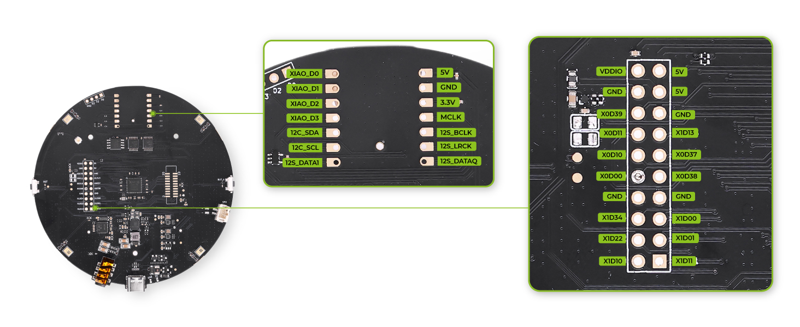

# Seeed Studio reSpeaker XVF3800 Four-Mic Array Development Guide


[**View reSpeaker XVF3800 with XIAO ESP32S3 and case on OpenELAB**](https://openelab.io/products/seeed-studio-respeaker-xmos-xvf3800-with-xiao-esp32s3-case) — **SKU:** `Seeed-114993702`.

[**View reSpeaker XVF3800 USB 4-Mic Array on OpenELAB**](https://openelab.io/products/seeed-studio-respeaker-xvf3800-usb-4-mic-array-aec-agc-noise-suppression) — **SKU:** `Seeed-101991441`; no XIAO or case.

[**View reSpeaker XVF3800 with XIAO ESP32S3 on OpenELAB**](https://openelab.io/products/seeed-studio-respeaker-xmos-xvf3800-with-xiao-esp32s3-ai-4mic-array) — **SKU:** `Seeed-114993700`; no case.

[**View reSpeaker XVF3800 with case, without XIAO on OpenELAB**](https://openelab.io/products/seeed-studio-respeaker-xmos-xvf3800-with-case-ai-powered-4-mic-array) — **SKU:** `Seeed-114993701`.

**Model:** all-in-one reSpeaker XVF3800 circular four-microphone board. Match the fitted XIAO, enclosure and installed XMOS firmware before choosing USB or I2S instructions.


## Product overview

The Seeed Studio reSpeaker XVF3800 is a circular microphone array that performs acoustic echo cancellation (AEC), beamforming, automatic gain control (AGC), noise suppression, direction of arrival (DoA) and voice activity detection (VAD) before delivering audio to a host. A PC or single-board computer can use USB audio; an embedded application can instead use I2S and I2C. Speech recognition and Home Assistant run in the connected application, not automatically inside the microphone processor. [Seeed hardware guide](https://wiki.seeedstudio.com/respeaker_xvf3800_introduction/).

### Product and firmware selection <a href="#product-family-and-variant-selection" id="product-family-and-variant-selection"></a>

| OpenELAB SKU      | XIAO ESP32S3 | Case     | Manufacturer-default XMOS route | First integration decision                                                       |
| ----------------- | ------------ | -------- | ------------------------------- | -------------------------------------------------------------------------------- |
| `Seeed-114993702` | Pre-soldered | Included | I2S                             | Program XIAO separately; use matching I2S clock role/rate, or change XMOS to USB |
| `Seeed-101991441` | Absent       | Absent   | USB                             | Connect XMOS USB-C to a USB host                                                 |
| `Seeed-114993700` | Pre-soldered | Absent   | I2S                             | Same embedded electronics as 114993702; provide mechanical protection            |
| `Seeed-114993701` | Absent       | Included | USB                             | Case does not add Wi-Fi, Bluetooth or an embedded application host               |

The exact store pages above identify the package. Seeed's [XIAO introduction](https://wiki.seeedstudio.com/respeaker_xvf3800_xiao_getting_started/) establishes that an I2S-configured unit does not appear as the normal USB sound card. Used or reprogrammed units can differ from factory defaults. No separate speaker, USB cable or power adapter is established by the 114993702 packing list; arrange these separately when needed.

This page excludes the [split-board reSpeaker Flex](respeaker-flex-xvf3800-development-guide.md), the [two-microphone reSpeaker Lite](respeaker-lite-voice-kit-development-guide.md) and the older XVF3000. Return to the [Seeed Studio hub](./) for other hardware.

## Applications

Use USB for a Linux voice terminal, conference input or speech-data recorder. Use the XIAO option for Wi-Fi audio forwarding or a Home Assistant voice satellite. A robot can use DoA as a speech-direction cue; it is not a calibrated position sensor, and a valid speech flag matters when interpreting the angle.

For an AEC experiment, play the reference audio through the array's own audio-output path and record the microphones concurrently. Audio coming from an unrelated Bluetooth speaker or another sound card is not automatically available to the XVF3800 as its echo reference. Keep a baseline recording, fixed speaker placement and a record of DSP settings when comparing suppression or beam routing. These are engineering evaluation procedures, not manufacturer performance guarantees.

## Specifications <a href="#hardware-and-processing" id="hardware-and-processing"></a>

| Parameter                        | All-in-one XVF3800 scope                                                                                                  |
| -------------------------------- | ------------------------------------------------------------------------------------------------------------------------- |
| Audio processor                  | XMOS XVF3800                                                                                                              |
| Microphones                      | Four digital PDM MEMS microphones in a circular arrangement                                                               |
| Manufacturer pickup claim        | 360°; up to 5 m under suitable acoustic conditions                                                                        |
| Processing                       | AEC, multi-beamforming, AGC, VAD, DoA, noise suppression, de-reverberation; manufacturer lists 60 dB AGC range            |
| Audio codec / amplifier          | TLV320AIC3104 / LM48511                                                                                                   |
| Indicators                       | Twelve addressable WS2812 RGB LEDs; separate mute indication                                                              |
| Host interfaces                  | USB Audio Class 2.0; alternative I2S audio with I2C control                                                               |
| Initial supply                   | USB 5 V; external 5 V only through documented power connections                                                           |
| Output                           | 3.5 mm headphones/active-speaker output; separate amplified speaker connector, manufacturer describes 5 W speaker support |
| Embedded controller, when fitted | XIAO ESP32S3; separate application and programming USB                                                                    |
| USB DFU identity                 | Manufacturer examples show VID:PID `2886:001a`; inspect actual enumeration                                                |

Sources: [hardware/components](https://wiki.seeedstudio.com/respeaker_xvf3800_introduction/), [XIAO integration](https://wiki.seeedstudio.com/respeaker_xvf3800_xiao_getting_started/), exact store pages in the opening block. The amplifier's speaker capability is not a guaranteed continuous output measurement or a USB power budget.

### Firmware determines the stream

The repository reviewed on 24 November 2026 identifies **USB v2.1.1** and **I2S v1.0.9**. Some wiki text still describes USB v2.1.0; use the versioned filenames actually present in the [official firmware repository](https://github.com/respeaker/reSpeaker_XVF3800_USB_4MIC_ARRAY/tree/c410f94ba366ebb7eab0db27d8f309b072d8a203/xmos_firmwares).

| Image in `xmos_firmwares/`                                 | Meaning / companion configuration                                                   |
| ---------------------------------------------------------- | ----------------------------------------------------------------------------------- |
| `usb/respeaker_xvf3800_usb_dfu_firmware_v2.1.1_48k2ch.bin` | Explicit 48 kHz, two-channel USB profile                                            |
| `usb/respeaker_xvf3800_usb_dfu_firmware_v2.1.1_16k6ch.bin` | Explicit 16 kHz, six-channel USB profile                                            |
| `usb/respeaker_xvf3800_usb_dfu_firmware_v2.1.1.bin`        | Generic USB filename; do not infer additional rates or channel counts from its name |
| `i2s/respeaker_xvf3800_i2s_master_v1.0.9_48k.bin`          | XVF3800 generates BCLK/WS at 48 kHz; XIAO must receive clocks                       |
| `i2s/respeaker_xvf3800_i2s_slave_v1.0.9_16k.bin`           | XVF3800 receives clocks at 16 kHz; XIAO must generate them                          |

Read the [USB changelog](https://github.com/respeaker/reSpeaker_XVF3800_USB_4MIC_ARRAY/blob/c410f94ba366ebb7eab0db27d8f309b072d8a203/xmos_firmwares/usb/readme.md) and [I2S clock-role reference](https://github.com/respeaker/reSpeaker_XVF3800_USB_4MIC_ARRAY/blob/c410f94ba366ebb7eab0db27d8f309b072d8a203/xmos_firmwares/i2s/readme.md). Interface rate and acoustic information bandwidth are different quantities. The filename is not evidence of the USB sample width; inspect host descriptors before configuring a hardware-only recorder. Six-channel defaults expose two configured outputs followed by four raw microphones; routing can change those contents.

## Hardware and connections

### Hardware and technical documents



_Diagram: Seeed Studio,_ [_original pad and header photograph_](https://files.seeedstudio.com/wiki/respeaker_xvf3800_usb/pinout.jpg)_. This is the all-in-one board, not Flex. Read labels in the pictured underside orientation._

The XMOS USB-C connector is beside the 3.5 mm jack. It handles XMOS audio and DFU. The XIAO's own connector handles ESP32 programming and diagnostic serial. Keep those two targets distinct. Initial USB testing needs no loose GPIO wiring.

Keep the sound holes on the Seeed-logo/microphone-inlet side open toward the speaking area. Do not bury them under adhesive, foam or a solid enclosure wall. The case changes access and acoustics, not the DSP pin map. Use the exact board and enclosure CAD before designing mounting features; storefront dimensions differ between bare and enclosed descriptions and are unsuitable as a manufacturing drawing.

### XIAO and XMOS signals

The following is the **all-in-one** XIAO route in Seeed's [Home Assistant audio configuration](https://wiki.seeedstudio.com/respeaker_xvf3800_xiao_home_assistant/#audio-configuration) and [WebSocket example](https://wiki.seeedstudio.com/respeaker_xvf3800_xiao_websocket_audio_stream/). Directions are from the XIAO's perspective.

| Function               | ESP32-S3 GPIO | XIAO label / condition                                                          |
| ---------------------- | ------------- | ------------------------------------------------------------------------------- |
| I2S BCLK               | 8             | D9; shared audio clock                                                          |
| I2S WS/LRCLK           | 7             | D8; shared frame clock                                                          |
| I2S microphone receive | 43            | D6; XMOS → XIAO                                                                 |
| I2S playback transmit  | 44            | D7; XIAO → XMOS                                                                 |
| I2C SDA / SCL          | 5 / 6         | D4 / D5; manufacturer HA control bus at 100 kHz                                 |
| MCLK footprint         | 9             | D10; the cited 48 kHz HA configuration leaves this optional clock commented out |

GPIO are 3.3 V-domain signals. Do not apply 5 V supply voltage to I2S or I2C. Do not connect an external clock-driving host while a fitted XIAO is also driving the same bus. The `VDDIO` label on an expansion header is not a general authorization to supply an arbitrary voltage.

### GPIO Overview

| XMOS pin      | Direction | Documented use / active state                                      |
| ------------- | --------- | ------------------------------------------------------------------ |
| X1D09         | Input     | Mute-button state; HIGH when released                              |
| X1D13 / X1D34 | Input     | Floating inputs; an unconnected value is not a stable switch state |
| X0D11 / X0D39 | Output    | Unassigned in the listed board functions                           |
| X0D30         | Output    | HIGH enables microphone mute and red mute indication               |
| X0D31         | Output    | Amplifier enable, active LOW                                       |
| X0D33         | Output    | WS2812 power, active HIGH                                          |

Source: [official host-control GPIO table](https://github.com/respeaker/reSpeaker_XVF3800_USB_4MIC_ARRAY/blob/c410f94ba366ebb7eab0db27d8f309b072d8a203/host_control/README.md). These are XMOS port names, not ESP32 GPIO numbers. Use read-only status first; changing a mute or amplifier pin changes the actual audio path.

Use the speaker connector only for the intended passive speaker load. A 3.5 mm output goes to headphones or an active speaker. Connect the speaker with power removed and begin with low playback volume. This board's 5 V input does **not** accept the Flex's 12 V terminal supply.

## Software and development resources <a href="#choose-usb-or-embedded-i2s" id="choose-usb-or-embedded-i2s"></a>

| Route               | Target, prerequisites and boundary                                                                                                                                                    |
| ------------------- | ------------------------------------------------------------------------------------------------------------------------------------------------------------------------------------- |
| USB audio           | Windows/macOS/Linux/Raspberry Pi OS; native UAC audio support, with profile selected by XMOS firmware                                                                                 |
| Python USB control  | Official repository `python_control/xvf_host.py`; Python 3, PyUSB and system libusb; script commands differ from native binary flags                                                  |
| Native host control | Keep the complete `host_control/<platform>` directory, including adjacent libraries; available directories include Linux x86-64, macOS ARM64, Raspberry Pi 64-bit, Jetson and Windows |
| Arduino             | Espressif ESP32 package, board **XIAO\_ESP32S3**, USB CDC enabled for diagnostics; Arduino Audio Tools for the original meter below                                                   |
| Wi-Fi streaming     | XIAO application plus `WebSocketsClient`; match network address, port and PCM framing                                                                                                 |
| Home Assistant      | XIAO running ESPHome plus compatible XMOS I2S image; the Seeed-linked integration is community maintained                                                                             |

Pin the checked repository when reproducing this guide:

```bash
git clone https://github.com/respeaker/reSpeaker_XVF3800_USB_4MIC_ARRAY.git
cd reSpeaker_XVF3800_USB_4MIC_ARRAY
git checkout c410f94ba366ebb7eab0db27d8f309b072d8a203
python3 -m venv .venv
. .venv/bin/activate
python -m pip install pyusb
```

Install libusb using the host's package manager; a Python import alone does not install the native USB backend on every OS. See [Python control README](https://github.com/respeaker/reSpeaker_XVF3800_USB_4MIC_ARRAY/blob/c410f94ba366ebb7eab0db27d8f309b072d8a203/python_control/readme.md). The repositories distribute XMOS binaries and utilities; their public availability does not establish a blanket redistribution license for every binary. Link official downloads. Arduino Audio Tools uses its own [license](https://github.com/pschatzmann/arduino-audio-tools/blob/cf52ad7cb778c9daf651af04fc9724a93daeb889/License.txt); the examples below are original procedures.

## Getting started

### First useful test: USB capture <a href="#getting-started-record-a-short-usb-audio-sample" id="getting-started-record-a-short-usb-audio-sample"></a>

1. Prepare a Linux/Raspberry Pi OS host, data-capable USB-C cable, `alsa-utils` and a known-working playback output. Connect the **XMOS** port. Do not wire GPIO for this test.
2. If the unit has XIAO and I2S firmware, use the recovery procedure below to install the exact **48k2ch v2.1.1 USB** image. Otherwise first inspect the existing device and keep its version record.
3. Identify the actual capture card and device:

```bash
lsusb
arecord -l
aplay -l
```

4. For the explicit 48k2ch profile, replace the example card `4` with the actual card. Probe hardware capabilities, then make a four-second recording:

```bash
arecord -D hw:4,0 --dump-hw-params -d 1 -t raw /dev/null
arecord -D plughw:4,0 -c 2 -r 48000 -f S16_LE -d 4 xvf-baseline.wav
aplay xvf-baseline.wav
```

`hw:` probing may reject its default recording format while still printing capabilities. Read the capabilities. `plughw:` can convert sample format; the resulting 16-bit WAV does not establish a 16-bit native USB endpoint. Playback here deliberately uses the host's default output. To evaluate the XVF3800 speaker path, explicitly select its observed playback device with `aplay -D plughw:4,0 xvf-baseline.wav` after connecting a suitable output.

**Expected result:** the intended array is listed as a capture device, the four-second file contains intelligible speech, and pressing mute changes capture/indication. USB audio success alone does not verify ESP32 firmware, AEC quality or every microphone channel. In Audacity, select the actual reSpeaker input/output, two recording channels and 48,000 Hz for this exact profile; another profile requires its own settings.

### Original recording check: file duration and channel peaks

Save as `inspect_voice.py`, then run `python3 inspect_voice.py xvf-baseline.wav`. This standard-library program checks the **16-bit PCM WAV created above**, not arbitrary packed raw USB data.

```python
import array
import math
import sys
import wave

with wave.open(sys.argv[1], "rb") as recording:
    channels = recording.getnchannels()
    rate = recording.getframerate()
    frames = recording.getnframes()
    if recording.getsampwidth() != 2 or recording.getcomptype() != "NONE":
        raise SystemExit("Use an uncompressed 16-bit PCM WAV")
    samples = array.array("h", recording.readframes(frames))
if sys.byteorder != "little":
    samples.byteswap()
print(f"channels={channels} rate={rate} duration={frames/rate:.3f}s")
for channel in range(channels):
    values = samples[channel::channels]
    if not values:
        raise SystemExit("No complete audio frames")
    peak = max(abs(value) for value in values)
    rms = math.sqrt(sum(value * value for value in values) / len(values))
    clipped = sum(abs(value) >= 32760 for value in values)
    print(f"ch{channel+1}: peak={peak} rms={rms:.1f} near_full_scale={clipped}")
```

Expected duration is approximately four seconds. Speech should change nonzero channel levels; no universal peak/RMS threshold establishes sound quality. For a six-channel 16 kHz image, record with `-c 6 -r 16000`, retain all six channels, and interpret default channels 3–6 as raw microphone streams. Lower raw levels are expected; do not normalize each microphone independently for calibration or beamforming analysis.

### Read firmware, direction and routing before tuning

From the checked-out repository's `python_control` directory:

```bash
python xvf_host.py --list
python xvf_host.py VERSION
python xvf_host.py DOA_VALUE
python xvf_host.py AEC_MIC_ARRAY_GEO
python xvf_host.py GPI_READ_VALUES
python xvf_host.py AUDIO_MGR_OP_L
python xvf_host.py AUDIO_MGR_OP_R
```

Expected responses have the command name and returned values. `DOA_VALUE` carries direction in degrees and speech-detected status in current firmware; preserve both fields. Speak from two known sides with the inlet side facing the room. Do not interpret a retained angle during silence as a new location measurement.

The [version-matched Python reference](https://github.com/respeaker/reSpeaker_XVF3800_USB_4MIC_ARRAY/blob/c410f94ba366ebb7eab0db27d8f309b072d8a203/python_control/readme.md) defines routing as `category, source`, with zero-based microphone/beam indexes. For example, **after recording the original left route**, `python xvf_host.py AUDIO_MGR_OP_L --values 1 0` routes raw microphone 0 to the left output; restore the captured original pair afterward. This changes content, not channel count or rate. On six-channel USB v2.1.0+, `AUDIO_MGR_OP_CH3` through `CH6` can also be configured. `AUDIO_MGR_OP_ALL` concerns packed left/right slots and is not a six-channel shortcut.

`SAVE_CONFIGURATION --values 1` persists the whole supported configuration. Use it only after validating all changes. USB v2.1.1 adds configurable mute/GPI events and persistent USB button settings; I2S v1.0.9's `MUTE_FUNCTION_ENABLE` resets on boot. Do not infer identical persistence across firmware modes. Read-only/native equivalents use `--list-commands`, not Python's `--list`; keep the binary's neighboring libraries together. [USB/I2S changelogs](https://github.com/respeaker/reSpeaker_XVF3800_USB_4MIC_ARRAY/tree/c410f94ba366ebb7eab0db27d8f309b072d8a203/xmos_firmwares).

### Original XIAO I2S microphone meter

Use this alternative after proving the board identity. Install Arduino IDE, the Espressif ESP32 board package using `https://espressif.github.io/arduino-esp32/package_esp32_index.json`, and **Arduino Audio Tools**. Select **XIAO\_ESP32S3**, enable USB CDC on boot and choose the XIAO port. Install **XMOS I2S master v1.0.9 at 48 kHz** through the XMOS connector first. The XIAO is the clock slave in this example. It receives only and does not play sound or allocate a multi-second PSRAM buffer.

```cpp
#include <Arduino.h>
#include "AudioTools.h"
using namespace audio_tools;
I2SStream microphone;
int32_t block[256];
uint32_t lastReport = 0;
uint32_t received = 0;
int64_t peak = 0;

void setup() {
  Serial.begin(115200);
  delay(1500);
  auto cfg = microphone.defaultConfig(RX_MODE);
  cfg.copyFrom(AudioInfo(48000, 2, 32));
  cfg.pin_bck = 8;
  cfg.pin_ws = 7;
  cfg.pin_data = 44;
  cfg.pin_data_rx = 43;
  cfg.is_master = false;
  if (!microphone.begin(cfg)) {
    Serial.println("I2S initialization failed");
    while (true) delay(1000);
  }
  lastReport = millis();
}
void loop() {
  size_t n = microphone.readBytes(reinterpret_cast<uint8_t *>(block), sizeof(block));
  received += n;
  for (size_t i = 0; i < n / sizeof(int32_t); ++i) {
    int64_t value = block[i];
    if (value < 0) value = -value;
    if (value > peak) peak = value;
  }
  if (millis() - lastReport >= 1000) {
    Serial.printf("bytes=%lu peak_word=%lld\n", (unsigned long)received, (long long)peak);
    received = 0;
    peak = 0;
    lastReport = millis();
  }
}
```

**Expected result:** serial reports arriving bytes and a peak that responds to speech. Nominal payload is **384,000 bytes/s**, calculated as 48,000 × 2 × 4; reporting/DMA scheduling affects each interval. A changing peak is a transport check, not calibrated SPL. Zero bytes suggest missing clocks, wrong firmware or wrong receive pin. This map intentionally differs from Lite's 16 kHz test and from Flex's GPIO11/12 audio data wiring. [Official all-in-one I2S example](https://wiki.seeedstudio.com/respeaker_xvf3800_xiao_websocket_audio_stream/).

### WebSocket audio streaming and buffer checks

Seeed's [WebSocket project](https://wiki.seeedstudio.com/respeaker_xvf3800_xiao_websocket_audio_stream/) captures **five seconds, 48 kHz, two channels, 32-bit PCM**, then sends binary chunks to a Python server on port **12345**. Its historical `test5` image is now under old firmware; the current 48 kHz master image provides the relevant clock role. Preserve the stated GPIO mapping and match the sender's Audio Tools version. Enable **OPI PSRAM** for that full-buffer project: the payload alone is **1,920,000 bytes**, calculated from 5 × 384,000. Network stacks and other allocations need additional memory.

Use a PC on the same network, set its reachable LAN address in `wsHost`, allow inbound TCP 12345, then start the server before powering the sender. The server must receive binary PCM without a WAV header, preserve complete eight-byte stereo frames, and save a WAV with rate 48,000, two channels and four bytes/sample. The file should contain 240,000 frames for a complete five-second transfer. Reject or flag incomplete transfers instead of silently labeling them five seconds. Start with the local I2S meter before adding Wi-Fi, then test one capture before continuous streaming. A faster sample rate in a WAV header cannot repair data captured at the wrong clock rate.

### Home Assistant setup

The [Seeed HA guide](https://wiki.seeedstudio.com/respeaker_xvf3800_xiao_home_assistant/) links formatBCE's community ESPHome integration. Its old repository now directs users to [the consolidated XVF3800 instructions](https://github.com/formatBCE/Respeaker-ESPHome-integration/blob/main/readme/xvf3800/README.md). Use the **XVF3800** configuration, not Lite or Flex, and retain its release tag, ESPHome minimum version, external components and secrets together.

1. Prepare Home Assistant with ESPHome and a working Assist pipeline. Local or cloud STT/TTS services are a separate choice from the microphone hardware.
2. Back up any existing XIAO configuration and local secrets. Follow the current device-specific installer/build instructions on the **XIAO** USB port.
3. Use the XMOS image requested by that release; the 48 kHz path makes the ESP32 an I2S secondary/slave. Confirm the DSP version/status in logs before testing wake words.
4. Add the discovered ESPHome device to Home Assistant, supply its API key when required and choose the intended Assist pipeline. Test wake → speech transcription → response playback in order.
5. Only after basic voice operation, evaluate mute, LED state, beam lock, timers/alarms and media playback. A Sonoff/HACS example in a tutorial is optional; it is not required to prove microphone capture.

The official guide also documents a desktop control application: Scan → Connect, then Audio for DSP/routing, Monitor for DoA/VAD/beam energy, LEDs for effects and Parameters for advanced settings. Establish a version/routing baseline before editing. [Official application walkthrough](https://wiki.seeedstudio.com/respeaker_xvf3800_introduction/).

### Embedded development and recovery <a href="#embedded-development-and-firmware-recovery" id="embedded-development-and-firmware-recovery"></a>

USB firmware supports USB DFU; I2S firmware supports I2C DFU; factory Safe Mode supports both. To recover **this all-in-one board**, remove power, hold **Mute**, reconnect power, and look for the blinking red indication. This is different from Flex's Boot button and from the XIAO BOOT loader.

Install `dfu-util` (`sudo apt install dfu-util` on Debian-derived Linux, `brew install dfu-util` on macOS; Windows uses the official binaries). Run `dfu-util -l` and confirm the actual device, serial and **alt 1 upgrade** partition. Disconnect unrelated DFU devices. From the pinned repository root, this installs the explicit USB profile used above:

```bash
dfu-util -l
dfu-util -d 2886:001a -R -e -a 1 -D xmos_firmwares/usb/respeaker_xvf3800_usb_dfu_firmware_v2.1.1_48k2ch.bin
```

Use administrator/device permissions where the OS requires them. Do not write alt 0 factory or erase flash as a routine repair. Power-cycle, reconnect the XMOS port, recheck enumeration, then read `VERSION` using the USB control tool. `dfu-util -l` is a transport check; it is not itself a complete semantic version report. On Windows install WinUSB only on the appropriate DFU interface, preserving the audio interfaces. Source: [official DFU guide](https://github.com/respeaker/reSpeaker_XVF3800_USB_4MIC_ARRAY/blob/c410f94ba366ebb7eab0db27d8f309b072d8a203/xmos_firmwares/dfu_guide.md).

## Troubleshooting and FAQs <a href="#troubleshooting-and-faq" id="troubleshooting-and-faq"></a>

### FAQs

| Symptom                                      | Ordered checks and recovery                                                                                                                                                                                                                |
| -------------------------------------------- | ------------------------------------------------------------------------------------------------------------------------------------------------------------------------------------------------------------------------------------------ |
| XIAO version has no USB sound card           | Confirm XMOS port/data cable, then I2S-versus-USB firmware. Enter Mute-at-power-on Safe Mode only when switching/recovering XMOS. ESP32 serial enumeration is a different function.                                                        |
| Capture is silent                            | Select the actual card/input; release mute; inspect mixer capture switches, channel routes and installed profile. Test speech before judging DoA during silence.                                                                           |
| Some six-channel streams are zero            | Inspect `amixer -c CARD controls` and `contents`, then relevant capture switches/gains and `AUDIO_MGR_OP_CH3`–`CH6`. Wiki `numid=8/10` examples depend on descriptor enumeration; inspect names/IDs on the actual firmware before writing. |
| Raw channels are quieter                     | They bypass voice enhancement. Preserve raw relative levels for measurements; applying independent automatic gain changes the data's meaning.                                                                                              |
| XIAO uploads but I2S never receives          | Match 48 kHz XMOS master with ESP32 slave, or 16 kHz XMOS slave with ESP32 master. Check BCLK8, WS7 and RX43 for this model. Two slaves have no clock; two masters contend.                                                                |
| Five-second network capture fails allocation | Enable PSRAM, check `psramFound()`, free capacity and the 1,920,000-byte payload requirement. Prove local I2S before diagnosing the network.                                                                                               |
| Playback exists but AEC is weak              | Check reference routing, intended playback device, volume/clipping, speaker-to-mic placement and original DSP configuration. AEC does not receive arbitrary external speakers' audio automatically.                                        |
| Python sees no USB device                    | Check installed USB firmware, libusb backend and OS permissions; on Windows distinguish audio driver from DFU/control interface driver.                                                                                                    |
| ESPHome build fails                          | Start from the current consolidated device package and supported ESPHome release; clean stale build output and read the first error, not only the final failed-target line.                                                                |

For a missing XIAO programming port, hold the **XIAO BOOT** button while reconnecting its USB, release it, select the newly enumerated port and upload a minimal serial sketch. This does not change XMOS audio firmware.

## Downloads and technical documents

### Technical documents and software

| Resource                                                                                                                                                                                                                     | Purpose / exact scope                                                                              |
| ---------------------------------------------------------------------------------------------------------------------------------------------------------------------------------------------------------------------------- | -------------------------------------------------------------------------------------------------- |
| [Official XVF3800 manual](https://wiki.seeedstudio.com/respeaker_xvf3800_introduction/)                                                                                                                                      | Components, USB, Safe Mode, DSP controls, application walkthrough and platform setup               |
| [XIAO introduction](https://wiki.seeedstudio.com/respeaker_xvf3800_xiao_getting_started/)                                                                                                                                    | Factory I2S behavior, programming environment and antenna connection guidance                      |
| [Versioned USB 48k2ch binary](https://raw.githubusercontent.com/respeaker/reSpeaker_XVF3800_USB_4MIC_ARRAY/c410f94ba366ebb7eab0db27d8f309b072d8a203/xmos_firmwares/usb/respeaker_xvf3800_usb_dfu_firmware_v2.1.1_48k2ch.bin) | All-in-one XVF3800, USB v2.1.1                                                                     |
| [Versioned USB 16k6ch binary](https://raw.githubusercontent.com/respeaker/reSpeaker_XVF3800_USB_4MIC_ARRAY/c410f94ba366ebb7eab0db27d8f309b072d8a203/xmos_firmwares/usb/respeaker_xvf3800_usb_dfu_firmware_v2.1.1_16k6ch.bin) | Two configured streams plus four raw microphones by default                                        |
| [Versioned I2S master 48 kHz binary](https://raw.githubusercontent.com/respeaker/reSpeaker_XVF3800_USB_4MIC_ARRAY/c410f94ba366ebb7eab0db27d8f309b072d8a203/xmos_firmwares/i2s/respeaker_xvf3800_i2s_master_v1.0.9_48k.bin)   | XMOS clock master; XIAO follows clocks                                                             |
| [Versioned I2S slave 16 kHz binary](https://raw.githubusercontent.com/respeaker/reSpeaker_XVF3800_USB_4MIC_ARRAY/c410f94ba366ebb7eab0db27d8f309b072d8a203/xmos_firmwares/i2s/respeaker_xvf3800_i2s_slave_v1.0.9_16k.bin)     | XMOS clock slave; host supplies clocks                                                             |
| [Firmware and host tools repository](https://github.com/respeaker/reSpeaker_XVF3800_USB_4MIC_ARRAY)                                                                                                                          | Download actual binary/raw files or clone; saving a GitHub HTML page is not a firmware download    |
| [Board assembly STEP](https://files.seeedstudio.com/wiki/respeaker_xvf3800_usb/3d/respeaker_mic_array_xvf3800_1_with-xiao-0820.stp)                                                                                          | Board/XIAO mechanical reference; compare received revision                                         |
| [Upper case STEP](https://files.seeedstudio.com/wiki/respeaker_xvf3800_usb/3d/1-up.stp) / [lower case STEP](https://files.seeedstudio.com/wiki/respeaker_xvf3800_usb/3d/1-down.stp)                                          | Separate enclosure parts, not another product SKU                                                  |
| [Official product flyer PDF](https://files.seeedstudio.com/wiki/respeaker_xvf3800_usb/ReSpeaker_XVF_3800.pdf)                                                                                                                | Manufacturer product overview                                                                      |
| [XMOS XVF3800 documentation](https://www.xmos.com/documentation/XM-014888-PC/html/index.html)                                                                                                                                | Processor control and algorithm concepts; distinguish reference-board defaults from Seeed defaults |
| [ALSA recorder/player manual](https://github.com/alsa-project/alsa-utils/blob/master/aplay/aplay.1)                                                                                                                          | Host options, hardware/plugin device distinction                                                   |

### Official documentation and development resources

Continue with [WebSocket audio streaming](https://wiki.seeedstudio.com/respeaker_xvf3800_xiao_websocket_audio_stream/), [Python controls](https://wiki.seeedstudio.com/respeaker_xvf3800_python_sdk/), [Home Assistant tutorial](https://wiki.seeedstudio.com/respeaker_xvf3800_xiao_home_assistant/) and [current community XVF3800 satellite](https://github.com/formatBCE/Respeaker-ESPHome-integration/blob/main/readme/xvf3800/README.md). Preserve each project's firmware/rate/library assumptions instead of mixing fragments between releases.

### Additional product illustrations


## References and validation

Manufacturer pages, current OpenELAB product variants, official repository READMEs/source and important pinout diagrams reviewed **24 November 2026**. Repository reference: `respeaker/reSpeaker_XVF3800_USB_4MIC_ARRAY` commit `c410f94ba366ebb7eab0db27d8f309b072d8a203`; USB v2.1.1, I2S v1.0.9. Hardware/source links are attributed where used. The diagrams are Seeed Studio originals; no generated pinout substitutes are used.

**Validation:** source review and static consistency checks only. The original programs have **not been compiled or run on hardware**; no microphone distance, AEC performance, current draw, USB descriptor or acoustic calibration was measured. Record actual board revision, XMOS image, XIAO application/dependency versions, host OS, USB formats and results during reproduction. Firmware modes and a case option do not imply equivalent physical dimensions or a tested end-to-end voice service.

### Related retained references

* [Image source](https://files.seeedstudio.com/wiki/respeaker_xvf3800_usb/respeaker-banner.jpg)
