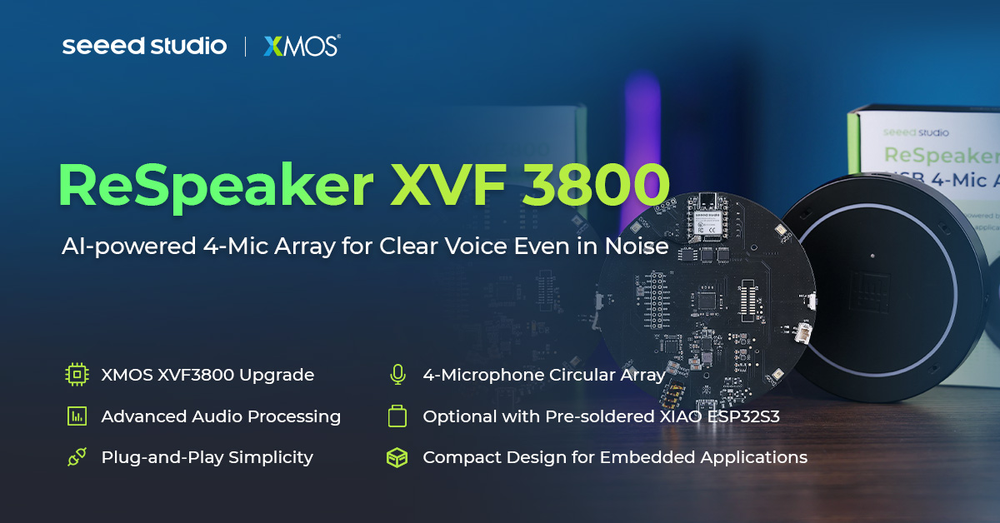

# Seeed Studio reSpeaker XVF3800 Four-Mic Array Development Guide



_Manufacturer image: Seeed Studio._ [_Image source_](https://files.seeedstudio.com/wiki/respeaker_xvf3800_usb/respeaker-banner.jpg)_._

[Product at OpenELAB](https://openelab.io/products/seeed-studio-respeaker-xmos-xvf3800-with-xiao-esp32s3-case) · [Manufacturer wiki hub](./)

### Product family and variant selection

The **reSpeaker XVF3800 USB 4-Mic Array** combines a circular four-microphone array with XMOS voice processing. Use it as the audio front end for a voice terminal, conferencing prototype, robot interface or wake-word application. Speech recognition and conversational AI run on the selected host/service; the array's signal processing is a separate layer.

This page covers the circular XVF3800 array, including the following OpenELAB configurations. It does not cover the older XVF3000 array, the Flex array or the separate 44 mm design.

| Seeed ordering code | Configuration                                 |
| ------------------- | --------------------------------------------- |
| 101991441           | USB array; verify supplied enclosure/firmware |
| 114993700           | Array with XIAO ESP32S3                       |
| 114993701           | Case configuration without XIAO ESP32S3       |
| 114993702           | Case configuration with XIAO ESP32S3          |

An enclosure is not an MCU. Check whether XIAO is physically installed and which firmware is on the XMOS processor before choosing a tutorial.

### Hardware and processing

| Item             | Development relevance                                                                       |
| ---------------- | ------------------------------------------------------------------------------------------- |
| Audio processor  | XMOS XVF3800                                                                                |
| Microphones      | Four PDM MEMS microphones in a circular arrangement                                         |
| Processing       | AEC, beamforming, noise reduction, AGC, VAD and direction-of-arrival functions              |
| Host paths       | USB audio or embedded I2S, selected by XMOS firmware                                        |
| Other interfaces | I2C control, RGB indicators, mute input, audio-output connections                           |
| Optional MCU     | XIAO ESP32S3 provides the user application and wireless connection in MCU-equipped variants |

Sources: [manufacturer array reference](https://wiki.seeedstudio.com/respeaker_xvf3800_introduction/), [XIAO-specific setup](https://wiki.seeedstudio.com/respeaker_xvf3800_xiao_getting_started/).

### Choose USB or embedded I2S

**USB host route:** use XMOS USB firmware and connect the XMOS USB-C port, near the 3.5 mm jack, to a PC or Linux host. **XIAO route:** use the appropriate I2S firmware on XMOS and a matching application on the ESP32S3. Flashing one processor does not update the other. The XIAO-equipped configuration is documented as shipping with I2S firmware, which may not enumerate as a USB audio device.

For I2S, match sample rate, slot/channel layout, sample format and clock roles. “Master” identifies the BCLK/WS clock provider, not which device sends microphone samples. Use the official example's pin map rather than wiring by a generic XIAO audio tutorial.

### Getting started: record a short USB audio sample

Prepare a USB data cable, the array, and a Linux computer with ALSA utilities. If the board is currently using I2S firmware, first use the manufacturer's documented safe-mode/DFU workflow to install the correct **USB** image. Save the previous firmware identity; do not change Windows audio drivers merely to reproduce a Linux recording test.

1. Connect the **XMOS** USB-C connector and confirm that an audio device appears in the operating system. Avoid confusing it with XIAO's separate programming connector.
2. List the available capture devices:

```bash
arecord -l
arecord -L
```

3. Select the XVF3800 capture device from the returned list. In the OS sound recorder, select this input explicitly, record several seconds of speech, stop, and play the file through the host's known working speaker/headphones. This GUI path avoids assuming that every firmware exposes the same ALSA channel count and sample format.
4. Confirm that speech is audible, muting suppresses the microphone input, and changing host input selection changes the actual source. Use a unique device identity when more than one array is connected.
5. For command-line capture, inspect the selected device's supported hardware parameters before setting `arecord` rate/channel/format flags. Do not assume a two-channel application works unchanged with a six-channel firmware image.

The expected result is a real recording from the selected array. It does not validate AEC performance, wake-word accuracy or an AI service. Test those separately with a defined loudspeaker/reference path and acoustic environment.

### Embedded development and firmware recovery

For XIAO development, follow the [official Arduino/I2S setup](https://wiki.seeedstudio.com/respeaker_xvf3800_xiao_getting_started/), which uses Arduino-ESP32 and the Arduino Audio Tools library. Begin with its audio-stream example before adding networking. The [WebSocket streaming guide](https://wiki.seeedstudio.com/respeaker_xvf3800_xiao_websocket_audio_stream/) is a separate next step; it adds buffering and transport requirements.

The [official firmware/control repository](https://github.com/respeaker/reSpeaker_XVF3800_USB_4MIC_ARRAY) contains firmware directories and host-control utilities. Use the array's safe-mode instructions when I2S firmware does not expose normal USB DFU. Choose the exact image from the release directory, keep a record of it and verify USB enumeration again after switching modes.

### Troubleshooting and FAQ

| Problem                                 | Next check                                                                                                                          |
| --------------------------------------- | ----------------------------------------------------------------------------------------------------------------------------------- |
| No USB sound device                     | Confirm XMOS connector, data cable and USB rather than I2S firmware; use the official safe-mode path if necessary.                  |
| Recorded file is silent                 | Input selection, mute state, channel mapping and firmware format; do not assume every exposed channel carries the same signal.      |
| XIAO firmware uploads but audio fails   | XMOS I2S firmware, wiring/pin map, clock roles, sample format and application configuration.                                        |
| AEC seems ineffective                   | Confirm the playback reference actually reaches the signal processor; audio capture alone does not establish an AEC reference path. |
| Does the case-only model include Wi-Fi? | Wireless application capability requires the corresponding MCU/host, not just the enclosure.                                        |

### Technical documents and software

| Resource                                                                                                                                  | Use                                                               |
| ----------------------------------------------------------------------------------------------------------------------------------------- | ----------------------------------------------------------------- |
| [Array hardware and firmware guide](https://wiki.seeedstudio.com/respeaker_xvf3800_introduction/)                                         | USB setup, recovery and hardware overview                         |
| [XIAO ESP32S3 guide](https://wiki.seeedstudio.com/respeaker_xvf3800_xiao_getting_started/)                                                | Embedded I2S route                                                |
| [Official firmware and host control](https://github.com/respeaker/reSpeaker_XVF3800_USB_4MIC_ARRAY)                                       | Firmware images and control utilities                             |
| [Board assembly STEP model](https://files.seeedstudio.com/wiki/respeaker_xvf3800_usb/3d/respeaker_mic_array_xvf3800_1_with-xiao-0820.stp) | Mechanical integration                                            |
| [Upper enclosure STEP](https://files.seeedstudio.com/wiki/respeaker_xvf3800_usb/3d/1-up.stp)                                              | Enclosure reference                                               |
| [Lower enclosure STEP](https://files.seeedstudio.com/wiki/respeaker_xvf3800_usb/3d/1-down.stp)                                            | Enclosure reference                                               |
| [ALSA arecord/aplay manual source](https://github.com/alsa-project/alsa-utils/blob/master/aplay/aplay.1)                                  | Linux audio tooling; select parameters for the installed firmware |

**Review date:** 17 November 2026. **Validation:** official documentation and the cited software interfaces reviewed. Commands and examples have not been compiled or run on physical hardware by OpenELAB for this guide. Record your hardware revision, firmware, software versions and actual results when reproducing it.
