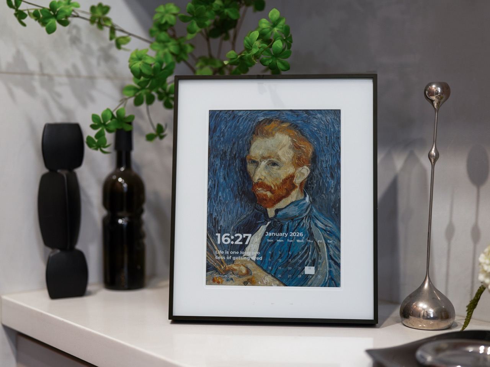
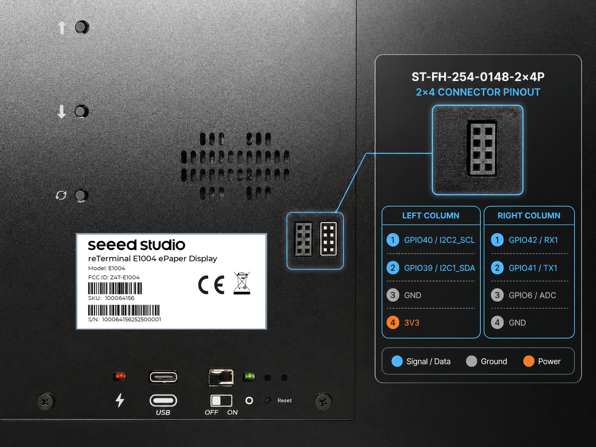

# Seeed Studio reTerminal E1004 Development Guide


[**View Seeed Studio reTerminal E1004 13.3" Full-color ePaper Display on OpenELAB**](https://openelab.io/products/seeed-studio-reterminal-e1004-epaper)

**Model / option:** reTerminal E1004; integrated terminal, 13.3-inch Spectra 6 · **SKU:** `Seeed-100064156`


## Product overview <a href="#product-and-applications" id="product-and-applications"></a>

reTerminal E1004 combines an ESP32-S3 controller, battery, sensors and a 13.3-inch Spectra 6 ePaper panel. It can run the factory SenseCraft Seeedash workflow or your own display firmware. The two display halves must use the E1004 dual-chip profile. A driver that initializes only one chip can leave half the panel stale. No capacitive touch panel or microphone is specified for E1004. [Exact-model hardware reference](https://wiki.seeedstudio.com/getting_started_with_reterminal_e1004/).



_Seeed Studio manufacturer image retained from this guide._ [Seeed Studio wiki hub](./)

## Applications

Use E1004 for schedules, equipment status, room information and periodically refreshed dashboards. Design an update policy around information age: show a timestamp or stale-data indicator, retain a useful last frame and wake only when required. ePaper preserves a visible image after the controller sleeps; a visible image therefore does not prove that the device is online. The large color panel suits posters and color-coded information with infrequent changes.

Use physical buttons for local navigation; do not assume a touch screen from the HMI name.

## Specifications <a href="#hardware-specifications" id="hardware-specifications"></a>

| Integration parameter | reTerminal E1004                                                                  |
| --------------------- | --------------------------------------------------------------------------------- |
| MCU / memory          | ESP32-S3, 8 MB PSRAM, 32 MB flash                                                 |
| Panel / pixels        | 13.3-inch Spectra 6; 1200 × 1600                                                  |
| Driver scope          | T133A01, dual-chip; Seeed\_GFX combination 523                                    |
| Radio                 | 2.4 GHz Wi-Fi 802.11b/g/n; Bluetooth 5.0                                          |
| Battery               | 5000 mAh; capacity is not a runtime guarantee                                     |
| Input                 | USB-C 5 V / 1 A                                                                   |
| microSD               | Up to 32 GB; 16 GB listed as included                                             |
| Environment           | Manufacturer terminal operating range 0–40 °C                                     |
| Dimensions            | 376 × 311 × 40 mm                                                                 |
| Onboard peripherals   | Temperature/humidity, buzzer, buttons, RTC; no documented PDM microphone workflow |

Hardware values: [model specifications](https://wiki.seeedstudio.com/getting_started_with_reterminal_e1004/); driver support: [Arduino display cookbook](https://wiki.seeedstudio.com/reterminal_e10xx_with_arduino/). A calculated packed display buffer is 960,000 bytes at 4 bits/pixel; this is a storage calculation, not the library's measured total allocation. Image decoding, working buffers and Wi-Fi need additional RAM.

## Hardware and connections

### Supply and expansion header

Use a USB-C **data** cable and the documented 5 V supply for initial commissioning. Leave the enclosure assembled and external peripherals disconnected until the stock device boots. Do not put 5 V on GPIO or the 3V3 output. Expansion signals use the 3.3 V domain; sensor modules need compatible pull-ups and a common ground. No external-load current budget is established by the terminal's 1 A USB input rating.

Viewed from the rear exactly as in Seeed's photograph, each column runs top to bottom. The wiki calls this expansion connector **J2**; the reviewed V1.0 schematic calls the same 2×4 connector **J3**. Use the physical orientation and signals below rather than the designator alone.



_Seeed Studio, unmodified_ [_original rear-header diagram_](https://files.seeedstudio.com/wiki/reterminal_e10xx/img/217.png)_._

| Position | Signal       | MCU pin / role             |
| -------- | ------------ | -------------------------- |
| L1       | SCL          | GPIO40, external I2C clock |
| L2       | SDA          | GPIO39, external I2C data  |
| L3       | Ground       | GND                        |
| L4       | Supply       | HEADER\_3V3 output         |
| R1       | RX1          | GPIO42, receive            |
| R2       | TX1          | GPIO41, transmit           |
| R3       | Analog input | GPIO6                      |
| R4       | Ground       | GND                        |

The V1.0 schematic places HEADER\_3V3 behind a load switch enabled by **GPIO46 HIGH**. External I2C is GPIO39/40, while the onboard sensor/RTC bus remains GPIO19/20. For a 3.3 V UART peripheral cross TX/RX and share GND; start at 115200 only if that peripheral supports it. USB serial diagnostics use GPIO43/44, a different UART path.

Pin evidence: [exact model connector table](https://wiki.seeedstudio.com/getting_started_with_reterminal_e1004/), [V1.0, 5 January 2026 schematic](https://files.seeedstudio.com/wiki/reterminal_e10xx/res/202004523_reTerminal%20E1004_V1.0_SCH_260105.pdf). GPIO/ADC scope should be checked against the ESP32-S3 datasheet, not against a similarly named XIAO. The drawings are Seeed Studio CC BY-SA 4.0 hardware references; no generated pinout is substituted.

### Internal signals to reserve

| Function                   | GPIO / constraint                                                         |
| -------------------------- | ------------------------------------------------------------------------- |
| ePaper                     | SCK7, MISO8, MOSI9, CS10 plus second CS2, DC11, RESET38, BUSY13, enable12 |
| Diagnostic UART            | RX44 / TX43, carrier USB-UART bridge                                      |
| LED                        | GPIO48, active LOW                                                        |
| Buttons                    | KEY0 GPIO3, KEY1 GPIO4, KEY2 GPIO5; active LOW                            |
| Buzzer                     | GPIO45                                                                    |
| Temperature/humidity / RTC | SDA19 / SCL20, addresses 0x44 / 0x51                                      |
| Battery                    | ADC1/GPIO1, measurement enable GPIO21 HIGH, divider factor 2              |
| microSD                    | SCK7/MISO8/MOSI9, CS14, detect15, power enable GPIO16                     |

Sources: [peripherals cookbook](https://wiki.seeedstudio.com/reterminal_e10xx_with_arduino_peripherals/), [RTC/audio/touch cookbook](https://wiki.seeedstudio.com/reterminal_e10xx_with_arduino_peripherals_2/), [schematic](https://files.seeedstudio.com/wiki/reterminal_e10xx/res/202004523_reTerminal%20E1004_V1.0_SCH_260105.pdf). SPI is shared: initialize one coherent bus configuration and deselect the other peripheral, rather than constructing competing drivers that reconfigure it mid-transfer.

## Software and development resources <a href="#choose-firmware-before-developing" id="choose-firmware-before-developing"></a>

| Development route              | Exact selection and boundary                                                                                                              |
| ------------------------------ | ----------------------------------------------------------------------------------------------------------------------------------------- |
| Factory SenseCraft Seeedash    | Add this E1004 using its displayed pairing code; select its own model in Tools → Firmware Flasher                                         |
| Arduino                        | Espressif package, **XIAO\_ESP32S3**, OPI PSRAM; `BOARD_SCREEN_COMBO 523`                                                                 |
| Seeed\_GFX                     | Reviewed commit `0dfdd7135425be82b5bb4b4b58d74dd51ab29a59`; TFT\_eSPI-compatible API below                                                |
| Seeed\_GFX2                    | Current successor; use its product-profile/API migration, not the legacy `driver.h` instructions unchanged                                |
| GxEPD2 alternative             | Seeed fork with GxEPD2\_T133A01\_1200x1600                                                                                                |
| ESPHome / Home Assistant       | ESPHome **2026.7.0 or later**: `epaper_spi`, model `seeed-reterminal-e1004`, octal PSRAM                                                  |
| TRMNL                          | Exact E1004 firmware; monochrome rendering on the color panel                                                                             |
| EEZ Studio / SquareLine Vision | Generate a layout using the documented ePaper port, dimensions and export flow; do not treat an LVGL desktop preview as a flashed display |

[Display cookbook](https://wiki.seeedstudio.com/reterminal_e10xx_with_arduino/), [Seeed\_GFX migration note](https://github.com/Seeed-Studio/Seeed_GFX), [ESPHome cookbook](https://wiki.seeedstudio.com/reterminal_e10xx_with_esphome/), [TRMNL support](https://wiki.seeedstudio.com/reterminal_e10xx_trmnl/), [EEZ](https://wiki.seeedstudio.com/reterminal_e10xx_with_eezstudio/), [SquareLine](https://wiki.seeedstudio.com/reterminal_e10xx_with_squareline_vision/). Preserve one complete firmware path at a time; custom uploads replace factory firmware behavior.

## Getting started <a href="#getting-started-deploy-one-readable-test-page" id="getting-started-deploy-one-readable-test-page"></a>

### First boot and factory content

1. Connect USB-C, slide power ON and observe the boot/pairing screen. The green LED initially lights for roughly 3 seconds. If the AP disappears after inactivity, wake the device with Refresh.
2. Join the **reTerminal E1004-…** access point named on the actual screen. Open `http://192.168.4.1` if the captive portal does not appear. Select an authorized **2.4 GHz** Wi-Fi network and enter its credentials.
3. After connection, use the displayed pairing code at [SenseCraft Seeedash](https://sensecraft.seeed.cc/hmi) → Device. Select the exact model. In Home choose a template, save it to Workspace, edit a short device-specific label and publish it to this device.
4. Press Refresh and wait for the full refresh. Navigate between deployed pages with the left/right buttons. Compare the label on the screen with the intended device record.

**Expected result:** a template containing your new label appears on this physical E1004. A pairing code alone proves neither cloud binding nor successful content delivery. Record the firmware version and one content timestamp. [Factory workflow](https://wiki.seeedstudio.com/getting_started_with_reterminal_e1004/).

### Original Arduino static-frame test

1. In Arduino IDE Preferences add `https://espressif.github.io/arduino-esp32/package_esp32_index.json`, install **esp32 by Espressif Systems**, select **XIAO\_ESP32S3** and the observed serial port. OPI PSRAM must be enabled; the large framebuffer cannot be treated as ordinary internal SRAM.
2. Install the reviewed Seeed\_GFX snapshot from [its source archive](https://github.com/Seeed-Studio/Seeed_GFX/archive/0dfdd7135425be82b5bb4b4b58d74dd51ab29a59.zip). Avoid two active libraries providing `TFT_eSPI.h`; inspect the compiler's chosen path.
3. Create `driver.h` beside the sketch with the exact line below, then upload this complete original one-refresh test. It uses the legacy API validated by source review of `HelloWorld.ino` and `TFT_eSPI.h`; do not switch to GFX2 halfway through the setup.

```cpp
#define BOARD_SCREEN_COMBO 523
```

```cpp
#include <Arduino.h>
#include "TFT_eSPI.h"
#ifndef EPAPER_ENABLE
#error Select the exact reTerminal BOARD_SCREEN_COMBO in driver.h
#endif
EPaper panel;
void setup() {
  Serial1.begin(115200, SERIAL_8N1, 44, 43);
  panel.begin();
  panel.fillScreen(TFT_WHITE);
  panel.setTextColor(TFT_BLACK);
  panel.setTextSize(2);
  panel.drawString("OpenELAB E1004: static frame", 24, 24);
  int w = panel.width(), h = panel.height();
  panel.drawRect(8, 8, w - 16, h - 16, TFT_BLACK);
  panel.fillRect(24, h / 2, w / 3, 40, TFT_BLACK);
  panel.drawLine(24, h - 24, w - 24, h - 24, TFT_BLACK);
  Serial1.printf("canvas=%dx%d; starting one refresh\n", w, h);
  panel.update();
  Serial1.println("FRAME_SENT: inspect border and orientation");
}
void loop() { delay(1000); }
```

**Expected result:** one labeled frame, a complete border and a black bar. The serial monitor on the carrier USB-UART path at 115200 should report dimensions and `FRAME_SENT` after the refresh call returns. Neither the printed message nor a successful upload proves every pixel is correct; inspect the panel. A persistent old image means power/firmware/driver must still be checked. [Library reference](https://github.com/Seeed-Studio/Seeed_GFX/blob/0dfdd7135425be82b5bb4b4b58d74dd51ab29a59/examples/ePaper/Basic/HelloWorld/HelloWorld.ino).

### Six-pigment image checkpoint

Use a small diagnostic image containing labeled black, white, red, yellow, green and blue blocks before a photograph. Convert for the actual panel palette and dimensions, then compare labels with visible blocks. A full refresh can take tens of seconds; leave the display powered and avoid rapid repeated updates. RGB source colors are quantized/dithered. An orange input is not evidence of an orange pigment. [Display cookbook](https://wiki.seeedstudio.com/reterminal_e10xx_with_arduino/).

### Buttons, battery and sensor diagnostics

Run this separate original sketch after the display result. It reads GPIOs and the SHT4x without repeatedly refreshing the display. Install **Sensirion I2C SHT4x** and **Sensirion Core**. The battery divider is enabled only while sampling; this reports voltage, not a calibrated state-of-charge percentage.

```cpp
#include <Arduino.h>
#include <Wire.h>
#include <SensirionI2cSht4x.h>
SensirionI2cSht4x climate;
constexpr int batteryEnable = 21;
void setup() {
  Serial1.begin(115200, SERIAL_8N1, 44, 43);
  for (int pin : {3, 4, 5}) pinMode(pin, INPUT_PULLUP);
  pinMode(batteryEnable, OUTPUT);
  digitalWrite(batteryEnable, LOW);
  analogReadResolution(12);
  analogSetPinAttenuation(1, ADC_11db);
  Wire.begin(19, 20);
  climate.begin(Wire, 0x44);
}
void loop() {
  digitalWrite(batteryEnable, HIGH);
  delay(10);
  unsigned batteryMillivolts = 2U * analogReadMilliVolts(1);
  digitalWrite(batteryEnable, LOW);
  float celsius = 0, percentRH = 0;
  int16_t error = climate.measureHighPrecision(celsius, percentRH);
  Serial1.printf("keys=%d%d%d,battery_mV=%u,sht_error=%d", 
      digitalRead(3), digitalRead(4), digitalRead(5), batteryMillivolts, error);
  if (!error) Serial1.printf(",temp_C=%.2f,RH_pct=%.2f", celsius, percentRH);
  Serial1.println();
  delay(5000);
}
```

**Expected result:** a pressed button changes its bit to 0; the sensor reports error 0 with temperature °C and relative humidity %. Check the raw voltage against a meter before using it for cutoffs. For a separate LED check, use GPIO48 LOW/HIGH; for one short sound use `tone(45, 1200, 80)` and then stop it. [Electrical and API reference](https://wiki.seeedstudio.com/reterminal_e10xx_with_arduino_peripherals/).

### RTC, SD images and power policy

The PCF8563 at I2C address 0x51 uses a CR1220 backup cell. Check its voltage-low flag before trusting the date. Set time deliberately once, then reboot and verify progression; do not overwrite the clock with build time on every wake. For power work, first verify timer wake with a short sleep, then confirm the model's button wake pin: GPIO4 on E1004. Sleep resets ordinary RAM in deep sleep, so persist only the state you need and finish transfers before sleeping. USB-UART activity is not evidence of the MCU's sleep current. [RTC and low-power procedure](https://wiki.seeedstudio.com/reterminal_e10xx_with_arduino_peripherals_2/).

For SD, enable GPIO16, initialize SCK7/MISO8/MOSI9 with CS14 and first list files. Keep the documented FAT32 capacity limit. Then use the matching `reTerminal_E1004_SDcard_Color6` image example. Start with one baseline JPEG, uncompressed BMP or PNG; avoid progressive/CMYK JPEG and EXIF-only rotation assumptions. Use Bayer8 or shrink the source: full-resolution RGB888 plus Floyd–Steinberg working memory exceeds 8 MB on this model. Do not confuse scaling/fit/rotation bugs with a failed panel. [Image decoder and dithering guidance](https://wiki.seeedstudio.com/reterminal_e10xx_with_arduino_peripherals/).

E1004 is excluded from the documented PDM microphone workflow; do not reuse E1003 microphone pins, because E1004 assigns them to other functions. [Audio and power reference](https://wiki.seeedstudio.com/reterminal_e10xx_with_arduino_peripherals_2/).

### Home Assistant and visual-layout workflows <a href="#custom-firmware-and-expansion" id="custom-firmware-and-expansion"></a>

In ESPHome Device Builder create an ESP32-S3 node, enter your own Wi-Fi/API secrets and first install over USB. Add the exact display platform from the software table, a local font and a static label; verify output before importing a Home Assistant entity. Show an explicit unknown/stale state when the entity is unavailable. A 300 s refresh interval is an initial test policy, not a universal optimum. Validate text, icons, images and screenshot retrieval independently before adding deep sleep; keep a wake window for later uploads. [ESPHome complete setup and examples](https://wiki.seeedstudio.com/reterminal_e10xx_with_esphome/).

For TRMNL, flash the exact hardware profile, provision Wi-Fi, bind the device to its own account/device record and deploy one simple plugin before changing refresh intervals. The color hardware renders monochrome under that firmware. EEZ/SquareLine workflows need matching resolution, fonts, assets and the vendor's exported-code port. First reproduce a single exported label using its supported project, then add data bindings. [TRMNL](https://wiki.seeedstudio.com/reterminal_e10xx_trmnl/), [EEZ](https://wiki.seeedstudio.com/reterminal_e10xx_with_eezstudio/), [SquareLine Vision](https://wiki.seeedstudio.com/reterminal_e10xx_with_squareline_vision/).

## Troubleshooting and FAQs <a href="#troubleshooting-and-faq" id="troubleshooting-and-faq"></a>

| Symptom                     | Checks and supported recovery                                                                                                                             |
| --------------------------- | --------------------------------------------------------------------------------------------------------------------------------------------------------- |
| Old picture, apparently off | A retained ePaper frame is normal. Check switch, USB power and wake response before assuming the MCU is alive.                                            |
| AP disappears               | Wake the unit; it can sleep during provisioning. Rejoin the AP printed on this device and open 192.168.4.1.                                               |
| Wi-Fi never connects        | Verify 2.4 GHz credentials and AP reachability; use both navigation buttons held for 2 s to re-enter network setup.                                       |
| Upload works, no new frame  | Check combo 523, selected library, OPI PSRAM and full-refresh wait. Verify the second CS and reset38 configuration.                                       |
| Serial monitor empty        | Use the carrier bridge and 115200; this page initializes Serial1 on RX44/TX43. USB CDC `Serial` is a separate route.                                      |
| SD not found / image fails  | First mount/list with correct enable GPIO16, CS14 and FAT32. Test a small baseline image before a full-size decoder/dither path.                          |
| Battery value implausible   | Enable GPIO21, allow settling, verify ADC1/GPIO1 and factor 2; measure independently.                                                                     |
| Firmware flasher hangs      | Switch ON, wake, close serial-monitor owners and reselect the port. If recovery requires BOOT/reset, use the model procedure rather than random shorting. |

### Firmware recovery without accidental erasure <a href="#firmware-recovery" id="firmware-recovery"></a>

In Seeedash **Device**, note the existing firmware; open **Tools → Firmware Flasher**, select this E1004, then the intended release. A standard Flash is the documented update route. **Full Flash erases saved settings/designs** and should be chosen only for an intentional factory reset after backup. Do not flash while asleep or interrupt power. E1001/E1002 macOS serial failures may require the current WCH CH34x driver/system-extension approval; verify the USB device actually present before installing a driver. [Model recovery instructions](https://wiki.seeedstudio.com/getting_started_with_reterminal_e1004/).

## Downloads and technical documents <a href="#technical-documents-and-software" id="technical-documents-and-software"></a>

| Resource                                                                                                                           | Purpose                                                                                       |
| ---------------------------------------------------------------------------------------------------------------------------------- | --------------------------------------------------------------------------------------------- |
| [E1004 schematic PDF](https://files.seeedstudio.com/wiki/reterminal_e10xx/res/202004523_reTerminal%20E1004_V1.0_SCH_260105.pdf)    | V1.0, 5 January 2026; supply, internal GPIO and connector circuits; Seeed Studio CC BY-SA 4.0 |
| [Seeed\_GFX pinned source archive](https://github.com/Seeed-Studio/Seeed_GFX/archive/0dfdd7135425be82b5bb4b4b58d74dd51ab29a59.zip) | Reproduce the legacy display API/profile; software license in repository                      |
| [Seeed GxEPD2 fork](https://github.com/Seeed-Projects/Seeed_GxEPD2/)                                                               | Model-specific alternative panel classes                                                      |
| [Seeed\_GFX2](https://github.com/Seeed-Studio/Seeed_GFX2)                                                                          | Successor library; follow its own setup                                                       |
| [Factory firmware flasher](https://sensecraft.seeed.cc/hmi)                                                                        | Tools → Firmware Flasher, choose E1004 explicitly                                             |
| [Display examples](https://wiki.seeedstudio.com/reterminal_e10xx_with_arduino/)                                                    | Model-specific monochrome/color/grayscale routes                                              |
| [Peripherals and SD images](https://wiki.seeedstudio.com/reterminal_e10xx_with_arduino_peripherals/)                               | GPIO, sensor, battery and image pipeline                                                      |
| [RTC, low power, audio and touch](https://wiki.seeedstudio.com/reterminal_e10xx_with_arduino_peripherals_2/)                       | Match the applicability table before using a peripheral                                       |

## References and validation <a href="#official-documentation-and-development-resources" id="official-documentation-and-development-resources"></a>

Reviewed **24 November 2026**: [exact-model reference](https://wiki.seeedstudio.com/getting_started_with_reterminal_e1004/), [Arduino source](https://wiki.seeedstudio.com/reterminal_e10xx_with_arduino/), [ESPHome source](https://wiki.seeedstudio.com/reterminal_e10xx_with_esphome/) and the schematic revision above. The original image and original document links are attributed to Seeed Studio. Source review includes the relevant schematic pages and the legacy graphics API; other CAD or enclosure dimensions are not inferred from images.

**Validation:** source reviewed; compilation, flashing, network commissioning, display refresh, sensor readings, sleep current and physical hardware were **not run** for this guide. Expected results are checkpoints for reproduction. Record actual board/core/library/firmware versions and results on your own device.

### Related retained references

* [Image source](https://files.seeedstudio.com/wiki/reterminal_e10xx/img/e1004/mainpic2.jpeg)
* [firmware hub](https://seeed-projects.github.io/OSHW-reTerminal-Series-E-D/)
* [ESPHome display guide](https://wiki.seeedstudio.com/reterminal_e10xx_esphome/)
* [Seeedash documentation](https://sensecraft-hmi-docs.seeed.cc/en/)
