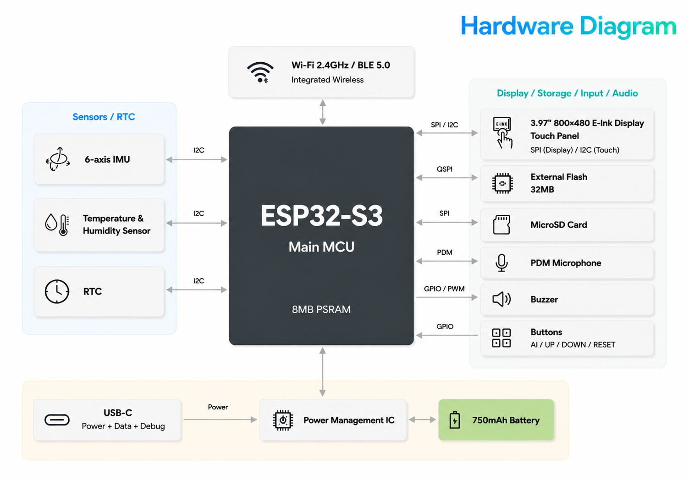

# Seeed Studio reTerminal Sticky Development Guide


[**View Seeed Studio reTerminal Sticky 3.97-inch AI Magnetic ePaper Display on OpenELAB**](https://openelab.io/products/seeed-studio-reterminal-sticky-3-97-inch-ai-magnetic-epaper-display)

**Model:** reTerminal Sticky · **SKU:** `Seeed-100056818` · **Scope:** enclosed 800 × 480 touch ePaper terminal; 750 mAh battery. Use Sticky-specific firmware, not another reTerminal's pin map.


## Product overview <a href="#product-and-applications" id="product-and-applications"></a>

Sticky is a pocket-sized ESP32-S3 display with capacitive touch, buttons, environmental/motion sensing, microphone, storage and a magnetic back. The factory application connects it to Seeedash; development firmware can instead implement local pages and event-driven interactions. The microphone is a capture interface: cloud AI behavior depends on the installed application and service. [Official hardware architecture](https://www.seeedstudio.com/sticky/docs/en/device-guide/hardware-overview/).



_Seeed Studio_ [_original hardware diagram_](https://files.seeedstudio.com/wiki/reterminal_sticky/img/developer_docs/Hardware_Diagram.png)_, retained from the existing guide._ [Seeed Studio hub](./).

## Applications

Build a low-update room/status label, a task-note display, a battery-powered sensor dashboard or an ePaper interaction prototype. Its magnetic mounting and glass front suit a removable indoor display; IP40 does not provide water protection. An image remains visible after power loss, so show a timestamp or validity state when stale data matters.

For an embedded application, poll fast-changing inputs without refreshing the screen on every event. Aggregate touch strokes, debounce buttons, and separate sensor validity from rendering. This makes slow ePaper refreshes predictable while allowing the input task to remain responsive.

## Specifications <a href="#hardware-specifications" id="hardware-specifications"></a>

| Item               | Sticky hardware / condition                                  |
| ------------------ | ------------------------------------------------------------ |
| Processor          | ESP32-S3 with 8 MB PSRAM                                     |
| Flash              | 32 MB QSPI                                                   |
| Display            | 3.97-inch monochrome, 800 × 480, four gray levels            |
| Panel variants     | SSD1677 / SSD2677 supported by current model configuration   |
| Interaction        | Capacitive touch, AI/Power, Up, Down buttons                 |
| Sensors            | SHT40, LSM6DS3TR-C IMU, PCF8563 RTC                          |
| Battery monitoring | BQ27220 fuel gauge                                           |
| Audio              | PDM microphone and buzzer                                    |
| Connectivity       | 2.4 GHz Wi-Fi, BLE 5.0, USB-C serial/data/power              |
| Storage            | microSD, shared SPI bus with display                         |
| Battery / input    | 750 mAh single-cell lithium battery; standard 5 V USB source |
| Enclosure          | 106 × 65.5 × 7.3 mm; 70 g; IP40                              |

Sources: [hardware overview](https://www.seeedstudio.com/sticky/docs/en/device-guide/hardware-overview/), [factory power/setup](https://www.seeedstudio.com/sticky/docs/en/quick-start/), [panel auto-detection](https://www.seeedstudio.com/sticky/docs/en/device-guide/arduino-basics/). Dimensions/weight are manufacturer values. No independent endurance or current measurements were made for this page.

## Hardware and connections

### Power, mechanics and serial path

Use a data-capable USB-C cable and a standard 5 V source. Custom Arduino peripheral sketches must retain **GPIO45 main-power hold** and **GPIO46 power lock HIGH** as documented. Let the maintained board layer manage shutdown rather than randomly toggling power nets. Do not expose the internal lithium cell to external GPIO power or infer a connector polarity from a different terminal.

Keep the microphone aperture and charging indicator unobstructed. Use the official STEP model for fixtures; the built-in corner magnets and optional adhesive magnetic ring are mounting features, not proof of shock retention. The reset hole is for an unresponsive device or a documented recovery step. [Mechanical/power overview](https://www.seeedstudio.com/sticky/docs/en/device-guide/hardware-overview/), [Arduino power-hold baseline](https://www.seeedstudio.com/sticky/docs/en/device-guide/arduino-peripherals/).

### Exact internal signal map

| Subsystem          | GPIO / electrical role                                                    |
| ------------------ | ------------------------------------------------------------------------- |
| Display SPI        | SCK13, MOSI14, CS15, DC16, RESET17, BUSY18, enable47                      |
| SD SPI             | SCK13, MOSI14, MISO12, CS8; enable10 HIGH, detect11 LOW when inserted     |
| Touch I2C          | SDA3/SCL2; interrupt21, reset41, enable42                                 |
| Sensor I2C         | SDA1/SCL0; SHT40 0x44, IMU 0x6A, RTC 0x51, BQ27220 0x55                   |
| IMU interrupt      | GPIO7                                                                     |
| PDM microphone     | CLK19 / DATA20                                                            |
| Buttons            | AI4, Up5, Down6; pressed LOW                                              |
| Buzzer             | GPIO48 PWM                                                                |
| Serial diagnostics | RX44 / TX43, CH343P USB-UART bridge                                       |
| Power management   | Hold45 / lock46; charger enable39 active LOW; external-power detect9 HIGH |

[Official pin map](https://www.seeedstudio.com/sticky/docs/en/device-guide/hardware-overview/), [peripheral power/addresses](https://www.seeedstudio.com/sticky/docs/en/device-guide/arduino-peripherals/), [schematic PDF](https://files.seeedstudio.com/wiki/reterminal_sticky/res/reTerminal_Sticky_Schematic_diagram_260609.pdf). These are internal 3.3 V-domain signals, not a general 5 V expansion connector. GPIO0 on the sensor bus also matters to boot configuration; preserve the supplied board initialization.

### Shared-bus ownership

The display and SD share SPI signal lines but have different CS. Deselect display CS15 while a standalone SD test owns the bus. In the ESP-IDF dashboard, reuse the initialized SPI2 host and unmount the filesystem after reading; do not release the whole host while the display still needs it. For the sensor bus, reuse the board's I2C handle rather than creating four competing controllers. Explicitly set unused ESP-IDF SPI data pins to `-1`; zero-initialized unused pins can unintentionally claim GPIO0 and break sensor I2C. [Official integration diagnostics](https://www.seeedstudio.com/sticky/docs/en/device-guide/esp-pages/).

## Software and development resources <a href="#software-choices" id="software-choices"></a>

| Route                   | Selection / compatibility                                                                                            |
| ----------------------- | -------------------------------------------------------------------------------------------------------------------- |
| Factory Seeedash        | Bluetooth provisioning to the matching SN; 2.4 GHz Wi-Fi; application and account services                           |
| Arduino                 | **XIAO\_ESP32S3**, **Seeed\_GFX2**, `Seeed_Product::reTerminal_Sticky`, CH343P port                                  |
| Arduino grayscale / SD  | OPI PSRAM; keep the complete example support files                                                                   |
| ESP-IDF dashboard       | **ESP-IDF v5.4**, target **esp32s3**, `Seeed-Projects/sticky-esp-idf-dashboard`                                      |
| ESP-IDF peripherals     | `Seeed-Projects/sticky-esp-idf-peripherals`; retain its required components and board initialization                 |
| Playground alternatives | Exact Sticky application, its license/backend requirements and restoration route; uploading replaces the current app |

[Arduino instructions](https://www.seeedstudio.com/sticky/docs/en/device-guide/arduino-basics/), [ESP-IDF baseline](https://www.seeedstudio.com/sticky/docs/en/device-guide/esp-basics/), [Playground](https://www.seeedstudio.com/sticky/playground/firmware/). Seeed reports v5.4 as its hardware-tested dashboard baseline; OpenELAB has not repeated that test. The source snapshots for this guide were read on 24 November 2026. Record your actual commit and dependency resolution before building; a moving `main` branch is not a pinned release.

## Getting started

### Factory pairing and one fresh note

1. Charge if needed, then hold AI/Power for about **3 s**. Choose a language at first boot. Keep a Bluetooth-enabled phone nearby with Seeedash installed.
2. In Seeedash sign in, choose **Connect Device**, and match the **SN displayed on Sticky**, especially if multiple units are nearby. Provision an authorized 2.4 GHz Wi-Fi network.
3. Verify the app lists that device and the Home screen appears. If an update is offered, keep adequate power and Wi-Fi throughout; later updates are under **Settings → Software Update**.
4. Open a note/content function and send a short distinctive test label. For the factory AI voice flow, hold AI for about **1 s**, speak the note and wait for the application result. Verify the resulting content and device identity instead of assuming a microphone event means a completed cloud request.

**Expected result:** the intended Sticky shows newly created content. Factory controls include page buttons/swipes, AI short-press Home, any-button wake, and both page buttons held for about 1 s to power off. These factory meanings differ from the ESP-IDF demo below. [Factory guide](https://www.seeedstudio.com/sticky/docs/en/quick-start/).

### Original Arduino first frame <a href="#arduino-and-factory-setup-routes" id="arduino-and-factory-setup-routes"></a>

1. Install Arduino IDE and the Espressif ESP32 package using `https://espressif.github.io/arduino-esp32/package_esp32_index.json` in Preferences. Select **XIAO\_ESP32S3**, the actual **CH343P** port and OPI PSRAM for grayscale/image work.
2. Install [Seeed\_GFX2](https://github.com/Seeed-Studio/Seeed_GFX2) with its Sticky examples. Save the library commit/version and current firmware/content before upload. Legacy Seeed\_GFX `BOARD_SCREEN_COMBO` instructions are a different API.
3. Upload this complete original static-frame test. Its API was checked against the model's current [HelloWorld source](https://github.com/Seeed-Studio/Seeed_GFX2/blob/main/examples/ePaper%20Displays/reTerminal%20E%20Series/reTerminal%20Sticky/HelloWorld/HelloWorld.ino).

```cpp
#include <Arduino.h>
#include <Seeed_GFX.h>
Seeed_GFX screen(Seeed_Product::reTerminal_Sticky);
void setup() {
  pinMode(45, OUTPUT); digitalWrite(45, HIGH);
  pinMode(46, OUTPUT); digitalWrite(46, HIGH);
  Serial1.begin(115200, SERIAL_8N1, 44, 43);
  if (!screen.begin()) {
    Serial1.println(screen.lastResult().message);
    return;
  }
  screen.fillScreen(TFT_WHITE);
  screen.setTextColor(TFT_BLACK);
  screen.setTextSize(3);
  screen.drawString("Sticky bench 01", 40, 55);
  screen.drawRect(5, 5, screen.width()-10, screen.height()-10, TFT_BLACK);
  screen.fillRect(40, 140, 160, 70, TFT_BLACK);
  screen.update();
  Serial1.println("FRAME_SENT: verify label, rectangle and border");
}
void loop() { delay(1000); }
```

**Expected result:** the new label, black rectangle and complete border appear after a full refresh; Serial1 at 115200 reports the checkpoint. The product profile detects SSD1677/SSD2677 and handles orientation; place buttons at the top and do not add a second coordinate rotation.

### Grayscale, SD and original button checkpoint

Run the GFX2 **Gray4** example with its `image.h`, OPI PSRAM and `PanelMode::Gray4`; inspect four ordered tones. This is a different test from monochrome dithering. For the SD image example use a backed-up **FAT32** card, preferably MBR, and `/img/demo.jpg`. Start with an **800×480 baseline JPEG**; retain `image_loader`, `pngle` and `miniz` support files. Different aspect ratios may be stretched by that example. [Arduino display examples](https://www.seeedstudio.com/sticky/docs/en/device-guide/arduino-basics/).

This standalone original sketch reports a button change only after 35 ms of stable input. It preserves the power latch and does not start display or network tasks.

```cpp
#include <Arduino.h>
constexpr int keys[] = {4, 5, 6};
bool previous[3] = {true, true, true};
bool stable[3] = {true, true, true};
unsigned long changed[3] = {};
void setup() {
  pinMode(45, OUTPUT); digitalWrite(45, HIGH);
  pinMode(46, OUTPUT); digitalWrite(46, HIGH);
  Serial1.begin(115200, SERIAL_8N1, 44, 43);
  for (int pin : keys) pinMode(pin, INPUT_PULLUP);
}
void loop() {
  for (int i=0; i<3; ++i) {
    bool level = digitalRead(keys[i]);
    if (level != previous[i]) { previous[i]=level; changed[i]=millis(); }
    if (millis()-changed[i] >= 35 && level != stable[i]) {
      stable[i]=level;
      Serial1.printf("gpio=%d,event=%s\n", keys[i], level ? "released" : "pressed");
    }
  }
  delay(2);
}
```

Expected output is one pressed/released pair for each deliberate action, rather than dozens of contact-bounce events. Keep a 1 kHz/short-duration `tone(48,1000,60)` buzzer test separate. For SHT40 use SDA1/SCL0 and the exact Sensirion library; for IMU verify address0x6A and stationary orientation before interpreting acceleration units. BQ27220 state-of-charge and external-power GPIO9 are separate observations: external power present is not a measured “charging” current. [Standalone peripherals](https://www.seeedstudio.com/sticky/docs/en/device-guide/arduino-peripherals/).

### ESP-IDF: build the dashboard <a href="#getting-started-with-esp-idf-build-the-official-dashboard" id="getting-started-with-esp-idf-build-the-official-dashboard"></a>

1. Open an **ESP-IDF v5.4** terminal and confirm `idf.py --version`. Clone the maintained dashboard, record its source commit and set the exact target.

```bash
git clone https://github.com/Seeed-Projects/sticky-esp-idf-dashboard.git
cd sticky-esp-idf-dashboard
git rev-parse HEAD
idf.py set-target esp32s3
idf.py build
```

2. Identify the actual serial device. Replace `PORT` below with its COM, `/dev/cu.*` or `/dev/tty*` name, then flash and monitor.

```bash
idf.py -p PORT flash monitor
```

3. Wait for Home, then navigate **Home → Sensor → Battery → Note → Imu → Microphone → Home** using Up/Down and swipes. Short AI refreshes the current demo page; on Microphone it initiates the documented capture. Exit monitor with **Ctrl+]**.

**Expected result:** a freshly rendered Home and changing data/input behavior on the other pages. Home is four-level gray; the five other pages are monochrome and carry RTC status. A static ePaper image alone is not proof of execution. [Dashboard setup and structure](https://www.seeedstudio.com/sticky/docs/en/device-guide/esp-basics/).

### Add an original sensor-status renderer

In the dashboard source, create `main/pages/bench_page.h` declaring `void bench_page_render(Canvas&, const AppState&);` with forward declarations, and `bench_page.cpp` below. This example uses the reviewed existing `AppState.environment` fields and `page_draw_layout`/Canvas interfaces; it does not read hardware from a renderer.

```cpp
#include <cstdio>
#include "app_state.h"
#include "canvas.h"
#include "page.h"

void bench_page_render(Canvas& canvas, const AppState& state) {
  page_draw_layout(canvas, state, "Bench check", "Environment status");
  char message[80];
  if (state.environment.valid) {
    std::snprintf(message, sizeof(message), "T %.1f C / RH %.1f %%",
                  state.environment.temperature_c,
                  state.environment.humidity_percent);
  } else {
    std::snprintf(message, sizeof(message), "Sensor unavailable: %d",
                  int(state.environment.error));
  }
  canvas.draw_text(76, 250, message, 2, GrayLevel::Black);
  canvas.draw_line(76, 320, 718, 320, GrayLevel::Black);
}
```

Append `Bench` to `PageId` to preserve existing IDs. In `app.cpp`, include its header, add its name and renderer in `page_name()`/`render_current_page()`, and insert it in **both** next/previous navigation. Extend the restored-page upper-bound check to `PageId::Bench`. Add `pages/bench_page.cpp` to `main/CMakeLists.txt` SRCS. Keep the existing version/length/checksum validation and event loop. Rebuild, open Bench from both directions and verify both valid and unavailable rendering states. A state-layout change beyond an appended page ID needs a separate retention-format compatibility decision. [Source interfaces](https://github.com/Seeed-Projects/sticky-esp-idf-dashboard), [page integration guide](https://www.seeedstudio.com/sticky/docs/en/device-guide/esp-basics/).

### Peripheral and sleep verification

| Feature         | Small useful check                                                                                                 |
| --------------- | ------------------------------------------------------------------------------------------------------------------ |
| SHT40 / battery | Open/refresh their pages; verify valid data and distinguish unavailable states                                     |
| RTC             | Read a progressing minute and validity; do not reset to build time on every boot                                   |
| Note            | Put `TEST.TXT` on SD, refresh, change file and verify a new read; preserve filesystem error state                  |
| IMU             | Rotate slowly and wait for stable orientation; avoid refreshing on every raw sample                                |
| Microphone      | Trigger one capture; current demo expects 16000 samples at 16 kHz, 16-bit mono; RMS/peak is not speech recognition |
| Touch           | Compare corner/gesture direction with page navigation; do not transform already-normalized events again            |
| Deep sleep      | Hold AI about 2 s, release after feedback, wake with AI and verify the prior page is restored                      |

The demo uses separate grayscale full, monochrome full and monochrome partial-refresh APIs. Keep monochrome partial RTC updates off grayscale Home. After 20 successful partial updates the next partial request performs a full update in the reviewed demo. Before sleep, stop touch polling, sleep the display and wait for AI release before active-low wake is armed; otherwise the device may wake immediately. On wake `app_main()` runs again: reinitialize buses/devices, validate retained state, restore it and redraw using the page's assigned mode. [Pages/peripherals](https://www.seeedstudio.com/sticky/docs/en/device-guide/esp-pages/), [refresh/low power](https://www.seeedstudio.com/sticky/docs/en/device-guide/esp-refresh/), [Arduino interaction](https://www.seeedstudio.com/sticky/docs/en/device-guide/arduino-interaction/).

## Troubleshooting and FAQs <a href="#troubleshooting-and-faq" id="troubleshooting-and-faq"></a>

| Symptom                           | Ordered check / recovery                                                                                          |
| --------------------------------- | ----------------------------------------------------------------------------------------------------------------- |
| Charges, no serial device         | Replace charge-only cable; inspect CH343P enumeration and actual OS driver before changing firmware.              |
| Uploads but old frame remains     | Verify target/profile, serial startup and complete refresh; a retained image is expected without power.           |
| Gray/SD allocation failure        | Enable OPI PSRAM and retain all support files; reproduce the unmodified matching example first.                   |
| Sensors fail after SPI starts     | Check unused SPI data pins are −1 and GPIO0/1 remain owned by sensor I2C.                                         |
| SD read breaks display            | Deselect the other device, reuse SPI2 and unmount the filesystem without freeing the shared host.                 |
| Touch reversed                    | Use Sticky's transformation once; do not rotate page and touch coordinates twice.                                 |
| Immediate sleep wake              | Wait for AI release, stop touch polling and inspect the selected wake level/source.                               |
| New page undefined or unreachable | Add its `.cpp` to SRCS, match declaration, register renderer and both navigation directions.                      |
| Need factory features again       | Back up files/settings, select the official Sticky firmware/restore tool and flash only the matching application. |

For a stuck application use the documented Reset hole and reconnect the observed serial port. Save logs, firmware commit and board/controller variant before escalating. Formatting SD or resetting the factory app is a separate data-erasing action, not a first diagnosis. [Factory reset/settings](https://www.seeedstudio.com/sticky/docs/en/quick-start/), [official firmware tools](https://www.seeedstudio.com/sticky/playground/official-firmware/).

## Downloads and technical documents <a href="#technical-documents-and-software" id="technical-documents-and-software"></a>

| Resource                                                                                                                        | Use                                                               |
| ------------------------------------------------------------------------------------------------------------------------------- | ----------------------------------------------------------------- |
| [Sticky schematic PDF](https://files.seeedstudio.com/wiki/reterminal_sticky/res/reTerminal_Sticky_Schematic_diagram_260609.pdf) | June 2026 hardware reference; power and pin relationships         |
| [Official STEP model](https://files.seeedstudio.com/wiki/reterminal_sticky/res/reTerminal_Sticky_3D.stp)                        | Fixture/enclosure integration; manufacturer-listed download       |
| [Seeed\_GFX2](https://github.com/Seeed-Studio/Seeed_GFX2)                                                                       | Product profile, display/controller handling and Arduino examples |
| [ESP-IDF dashboard](https://github.com/Seeed-Projects/sticky-esp-idf-dashboard)                                                 | Board/device/app/page implementation                              |
| [ESP-IDF peripherals](https://github.com/Seeed-Projects/sticky-esp-idf-peripherals)                                             | Focused device examples                                           |
| [Playground firmware](https://www.seeedstudio.com/sticky/playground/firmware/)                                                  | Exact Sticky application selection                                |
| [Official firmware restoration/tools](https://www.seeedstudio.com/sticky/playground/official-firmware/)                         | Factory application and font tooling                              |
| [Playground registry](https://github.com/Seeed-Projects/reterminal-sticky-playground-registry)                                  | Third-party source, licenses and compatibility records            |

## References and validation <a href="#official-documentation-and-development-resources" id="official-documentation-and-development-resources"></a>

Reviewed **24 November 2026** using the official Sticky hardware, Arduino, ESP-IDF, factory and refresh sources cited beside the relevant procedure. SDK interfaces for the original renderer/sketch were read; the schematic was downloaded for electrical review. Source links remain available for the original diagrams and current revisions.

**Validation:** source reviewed. Compilation, firmware flashing, display/touch checks, microphone capture, sensor calibration, sleep current and physical hardware were **not run**. Expected results describe what to verify, not observed OpenELAB tests. Archive your actual source commit, IDF/core/library versions and results when reproducing a workflow.
