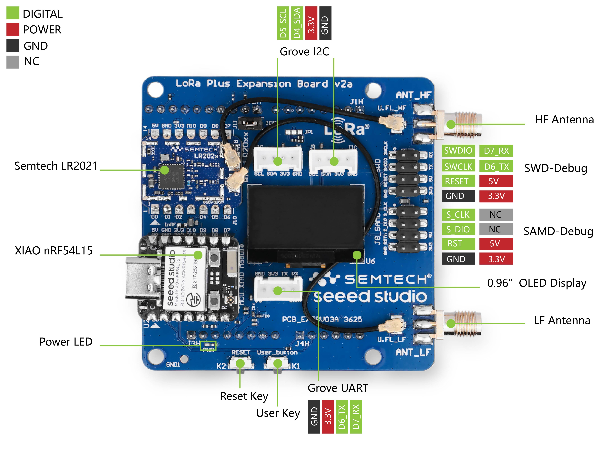

# Seeed Studio Semtech LR2021 LoRa Plus Evaluation Kit


[**View Seeed Studio Semtech LR2021 LoRa Plus Evaluation Kit on OpenELAB**](https://openelab.io/products/seeed-studio-semtech-lr2021-lora)

**Model / option:** Seeed Studio Semtech LR2021 LoRa Plus Evaluation Kit · **SKU:** `Seeed-100039980`


## Product overview <a href="#exact-kit-and-applications" id="exact-kit-and-applications"></a>

The Semtech LR2021 LoRa Plus Evaluation Kit, assigned SKU **`Seeed-100039980`**, is the **EU868 option** of the observed OpenELAB listing. The same product page also offers US915 SKU`Seeed-100035909`; that is a distinct store variant and is not counted as an additional assigned row here. Select the physical LF antenna/network settings for the received option.

The kit contains two LR2021 radio modules, two XIAO nRF54L15 hosts and two LoRa Plus expansion boards for paired experiments. It is not an end-user tracker, LoRaWAN gateway or ready-to-use satellite terminal. Its LF/HF RF paths and firmware determine which chip capabilities are usable in a specific experiment. [Seeed exact kit](https://wiki.seeedstudio.com/semtech_lr2021_evk_getting_started/).

## Applications

Use the two assemblies for controlled packet-delivery/range comparisons, LoRa/FLRC experiments or an initial LoRaWAN application uplink. A LoRaWAN test also requires a compatible gateway and network-server account; the second EVK radio does not automatically become a multi-channel gateway.

For performance work record payload size, PHY, frequency, bandwidth, spreading factor/data rate, output power, antenna path and sample count. Compare one variable at a time. Report lost/duplicate packets separately; raw PHY throughput is not application goodput. Satellite-oriented chip features require the right RF design, software and external service, beyond this first-run guide.

## Specifications

| Parameter                | Exact EVK / documented condition                                                                                                                                         |
| ------------------------ | ------------------------------------------------------------------------------------------------------------------------------------------------------------------------ |
| Assigned regional option | EU868, SKU100039980; US915 SKU100035909 is separate                                                                                                                      |
| Radio / host             | LR2021, XIAO nRF54L15 Cortex-M33 host up to128 MHz                                                                                                                       |
| Supply                   | 5 V via USB-C; expansion rails3.3 V and5 V are outputs, not a GPIO tolerance statement                                                                                   |
| PHY support              | LoRa,(G)FSK, LR-FHSS, FLRC, O-QPSK, OOK and BLE PHY; application-stack support is separate                                                                               |
| Sub-GHz output           | +22 to−10 dBm specified                                                                                                                                                  |
| 2.4 GHz output           | Up to+12 dBm in Seeed output-power table                                                                                                                                 |
| TX current               | 105 mA at+22 dBm sub-GHz;27 mA at+14 dBm2.4 GHz measurement condition in vendor table—do not treat that condition as permission to exceed its output-power specification |
| RX current               | 5.7 mA at LoRaSF7/BW125 kHz;10.9 mA FLRC, radio-mode values rather than full-kit current                                                                                 |
| Sensitivity              | −141.5 dBm LoRaSF12/BW125 kHz;−111 dBm FLRC260 kbps;−97 dBm BLE2 Mbps, manufacturer figures                                                                              |
| Interfaces               | USB-C, two Grove I²C, one Grove UART, two SMA-K antenna ports, SWD/SAMD debug connections                                                                                |
| OLED                     | 0.96-inch128×64 panel on expansion board                                                                                                                                 |
| Board / package size     | Expansion65 W×73 L×27 H mm; package200×130×50 mm                                                                                                                         |
| Temperature              | −40 to+85 °C listed; verify complete test setup, host, cables and accessories                                                                                            |

Source: [Seeed EVK specification and pin tables](https://wiki.seeedstudio.com/semtech_lr2021_evk_getting_started/). Low radio sleep current does not include a powered debug adapter, OLED, regulator loss or attached sensor. Do not size a whole-kit supply from radio-only RX current.

## Hardware and connections

Power down before seating hosts/radio modules or moving RF jumpers. Identify **ANT\_LF/U.FL\_LF** for the selected sub-GHz antenna and **ANT\_HF/U.FL\_HF** for the2.4 GHz path. Use the matching supplied antennas and coax routing in the exact diagram. Do not swap cables based only on connector fit. Inspect U.FL alignment; apply force vertically, not through a bent cable.



_LR2021 EU868 evaluation assembly with nRF54L15 host, LF/HF paths, Grove ports and debug headers — Seeed Studio,_ [_original diagram_](https://wiki.seeedstudio.com/semtech_lr2021_evk_getting_started/)_._

| XIAO label                | nRF54L15 native pin        | Documented peripheral                   |
| ------------------------- | -------------------------- | --------------------------------------- |
| D0 /D1 /D2 /D3            | P1.04 /P1.05 /P1.06 /P1.07 | GPIO; may be used by shield controls    |
| D4 SDA /D5 SCL            | P1.10 /P1.11               | I²C `i2c22`                             |
| D6 TX /D7 RX              | P2.08 /P2.07               | UART `uart21`                           |
| D8 SCK /D9 MISO /D10 MOSI | P2.01 /P2.04 /P2.02        | SPI `spi00`                             |
| D11 SCL /D12 SDA          | P0.03 /P0.04               | I²C `i2c30` on extra pins               |
| D13 /D14 /D15             | P2.10 /P2.09 /P2.06        | Extra GPIO; inspect shield reservations |

These are host-native identities from the [Seeed pin table](https://wiki.seeedstudio.com/semtech_lr2021_evk_getting_started/). A Grove port label alone does not establish that both connectors are independent buses. Use the selected shield's devicetree and the expansion schematic to determine bus instances, addresses and occupied interrupt/reset lines before adding a sensor. The first-run example uses the assembled USB path and requires no invented jumper wiring.

The USB-connected XIAO nRF54L15 exposes a CMSIS-DAP debug interface; the current Semtech instructions recommend pyOCD≥0.38.0. It is not an nRF52840 UF2 board. Debug header3.3 V/5 V pins are distinct supply rails; connect a probe using its exact signal/reference requirements. [Semtech board/flash instructions](https://github.com/Lora-net/usp_zephyr/blob/d2195460d5e3ac6cd425dd1ef96558610efd52c6/README.md).

## Software and development resources

### Keep one coherent SDK revision

Seeed's webpage shows an older Zephyr4.2-based example. The **reviewed current USP-for-Zephyr commit**`d2195460d5e3ac6cd425dd1ef96558610efd52c6` declares USP1.3.0 and a west manifest pinned to **Zephyr4.4.2**. Its README lists Zephyr SDK1.0.1 for the current validation configuration. Use those manifest dependencies together; do not combine a current application with the old4.2 board overlay directory.

The repository's validation statements are **Semtech's**, not tests performed for this guide. Its known limitations document explicitly says current XIAO nRF54L15 support is prepared for4.4 and geolocation/rf-certification are not fully validated in that release. [Pinned README](https://github.com/Lora-net/usp_zephyr/blob/d2195460d5e3ac6cd425dd1ef96558610efd52c6/README.md), [manifest](https://github.com/Lora-net/usp_zephyr/blob/d2195460d5e3ac6cd425dd1ef96558610efd52c6/west.yml), [known limitations](https://github.com/Lora-net/usp_zephyr/blob/d2195460d5e3ac6cd425dd1ef96558610efd52c6/doc/KNOWN_LIMITATIONS.md).

| Build item                  | Exact selection                                                           |
| --------------------------- | ------------------------------------------------------------------------- |
| Board                       | `xiao_nrf54l15/nrf54l15/cpuapp`                                           |
| Expansion shield            | `semtech_loraplus_expansion_board`                                        |
| 868/915 radio shield        | `semtech_wio_lr2021`                                                      |
| LoRaWAN example             | `samples/usp/lbm/periodical_uplink`                                       |
| Standard / low-power config | `prj.conf` /`prj_lowpower.conf`; start with logs enabled                  |
| Firmware provisioning       | Device-tree `boards/user_keys.overlay`; keys not shared sample identities |
| Flasher                     | `west flash --runner pyocd`; confirm correct probe/target                 |

The CN radio shield and other LR20xx models do not describe this EU868 assignment. A firmware region option alone cannot change an RF matching network/antenna into another physical variant. Source files identify Apache-2.0 licensing; Semtech modules have their own notices. Keep licenses when distributing modified firmware.

## Getting started <a href="#documents-and-first-build" id="documents-and-first-build"></a>

### Install a pinned standalone workspace

1. Inventory the two hosts/radio modules, LF/HF antennas and cables. Check the EU868 SKU/labels. Assemble with power off and follow the LF/HF diagram before connecting USB.
2. Install the OS prerequisites for the selected Zephyr release: Python, Git, CMake/Ninja/build tools, west and a compatible Zephyr SDK. Use a dedicated development directory and environment; the following initialization does not flash anything.
3. Create the pinned manifest workspace below. `west init -m` follows the manifest's self path **`application`**, so the later sample path uses that folder. Do not mix it with a manually cloned workspace whose manifest directory was named differently.

```sh
python3 -m venv .venv-lr2021
. .venv-lr2021/bin/activate
python -m pip install west
west init -m https://github.com/Lora-net/usp_zephyr.git --mr d2195460d5e3ac6cd425dd1ef96558610efd52c6 lr2021-workspace
cd lr2021-workspace
west update
west packages pip --install
west sdk install
west list zephyr
```

On Windows activate the environment using its `Scripts\activate` entry and install the matching Windows build dependencies first. **Expected result:** a west workspace containing Zephyr4.4.2 and the pinned USP application/modules. No successful installation/build is claimed here. Check `west list` paths and `git` revisions before continuing.

### Provision, build and send one LoRaWAN counter

1. Prepare an online **EU868 LoRaWAN gateway** and a network-server account. Register a new end device with the sample's LoRaWAN1.0.4 / regional-parameters1.0.3 profile, unless deliberately selecting another supported parameter version.
2. In `application/samples/usp/lbm/periodical_uplink/boards/user_keys.overlay`, replace the actual DevEUI, JoinEUI and16-byte key properties with your provisioned values. The reviewed sample has `user-lorawan-device-eui`, `user-lorawan-join-eui`, `user-lorawan-gen_app-key`, `user-lorawan-app-key` and `user-lorawan-region`. Preserve their exact spelling and set the region to`EU_868`. Match the key roles to the selected LoRaWAN profile; zero values are placeholders in the upstream template, not usable shared credentials.
3. Build the standard logging configuration with the exact board and both shields:

```sh
west build --pristine --board xiao_nrf54l15/nrf54l15/cpuapp --shield semtech_loraplus_expansion_board --shield semtech_wio_lr2021 application/samples/usp/lbm/periodical_uplink
```

4. Inspect `build/zephyr/zephyr.dts`, configuration/build output and artifact target. Connect one XIAO and identify its CMSIS-DAP probe. Flash only that unit:

```sh
west flash --runner pyocd
```

5. Open the observed serial console at115200 baud. Expect a startup banner, OTAA join attempt and a`JOINED` event. Verify the corresponding join in the network server; an RF TX log alone is not a completed join.
6. Observe a periodic application uplink on **FPort101**, then press the user button once and observe **FPort102**. The default interval is60 s. Confirm the server received both payloads before changing power settings or moving outdoors.

**Expected result:** one identified EU868 assembly joins and delivers a periodic/button counter to the server. The reviewed `main.c` encodes an unsigned32-bit counter in four **big-endian bytes**, increments after sending and starts at0. Some webpage descriptions imply a first value1; trust the actual selected source and captured payload. [Pinned sample source](https://github.com/Lora-net/usp_zephyr/blob/d2195460d5e3ac6cd425dd1ef96558610efd52c6/samples/usp/lbm/periodical_uplink/src/main.c).

### Original counter formatter and receive checkpoint

Use this original network-server formatter only for the sample's four-byte counter; it is not a SenseCAP sensor decoder:

```javascript
function decodeUplink(input) {
  const b = input.bytes;
  if (!b || b.length !== 4) return {errors: ['Counter payload needs four bytes']};
  if (input.fPort !== 101 && input.fPort !== 102) {
    return {errors: ['Expected periodic port 101 or button port 102']};
  }
  const counter = b[0] * 16777216 + b[1] * 65536 + b[2] * 256 + b[3];
  return {data: {counter, source: input.fPort === 101 ? 'periodic' : 'button'}};
}
```

Synthetic bytes`00 00 00 02` on port101 should decode to counter2/source`periodic`; this is an expected parser result, not a hardware observation. Retain raw bytes, frame counter and reception time. A counter gap can indicate a lost application report, local reset or another transmitted sample; distinguish these from LoRaWAN frame-counter behavior.

For a downlink check, schedule a short test payload such as`01 02` on an application port supported by the sample (the Seeed example uses port1). Wait for the next Class A receive windows after an uplink, then confirm the sample's`DOWNDATA` event and actual bytes. RX1/RX2 timeouts without a queued downlink are normal; do not diagnose them as join failures. Remove any queued test command afterward.

### Low power and second-node experiments

After the standard build works, retain its configuration/logs, then create a separate build using`-DCONF_FILE=prj_lowpower.conf`. Account for disabled logging/OLED, USB/probe current and Grove loads when measuring. A silent low-power build is not necessarily dead firmware; restore the standard logging build to isolate failures.

For a second LoRaWAN assembly provision **different** DevEUI/keys. For point-to-point/range/PER/FLRC work choose the exact current USP sample and match both ends' RF path, PHY, data rate and packet structure. Establish a short-range baseline before a field test. A2.6 Mbps FLRC PHY limit is not the expected throughput of the LoRaWAN counter application.

## Troubleshooting and FAQs <a href="#faqs-and-recovery" id="faqs-and-recovery"></a>

| Symptom                              | Ordered diagnosis                                                                                                                |
| ------------------------------------ | -------------------------------------------------------------------------------------------------------------------------------- |
| Board/shield not found               | Pinned manifest workspace, correct self path, `west update`, exact board qualifier and shield names                              |
| Build fails after following old wiki | Check Zephyr4.2 versus current4.4.2; use coherent manifest rather than copying old overlay directories blindly                   |
| pyOCD finds no target                | Data cable, actual CMSIS-DAP interface, driver/udev permissions and pyOCD version; nRF52 UF2 instructions do not apply           |
| Radio init or SPI fails              | Correct Wio-LR2021 module/shields, seated headers, power and exact RF carrier revision                                           |
| TX logs but no OTAA join             | EU868 gateway/region, EUI/key/profile, channel/downlink path and antenna LF routing                                              |
| Server has bytes, no fields          | Four-byte counter formatter and FPort101/102; no SenseCAP decoder assumed                                                        |
| Downlink never arrives               | Queue a real downlink, wait for uplink-triggered Class A windows and inspect gateway transmission capability                     |
| Button count duplicates              | Check debounce/event handling and actual source; do not combine two independent counter streams as packet loss                   |
| Low-power current too high           | Measurement boundary, debug host/OLED/USB, sensor rails and correct low-power build                                              |
| Device reports locked                | Back up any accessible data and use the exact nRF54L15 vendor recovery procedure; erase/unlock is not a first communication test |

## Downloads and technical documents

| Resource                                                                                                                                                                                                  | Exact purpose                                                                              |
| --------------------------------------------------------------------------------------------------------------------------------------------------------------------------------------------------------- | ------------------------------------------------------------------------------------------ |
| [Seeed EVK overview/pinout](https://wiki.seeedstudio.com/semtech_lr2021_evk_getting_started/)                                                                                                             | Original two-node hardware, diagram and legacy setup context                               |
| [868/915 radio schematic/layout](https://files.seeedstudio.com/wiki/Semtech_LR2021_EVK/res/LR2021WIO1XDCS_Wio-LR2021_e769v02a_868_915_sch_layout.pdf)                                                     | Exact radio hardware family; not CN490 carrier                                             |
| [Expansion schematic/layout](https://files.seeedstudio.com/wiki/Semtech_LR2021_EVK/res/LR20xx_XIAO_LoRa_Plus_Expansion_Board_e758v03a_sch_layout.pdf)                                                     | Power, connectors and reserved peripheral routing                                          |
| [nRF54L15 host schematic](https://files.seeedstudio.com/wiki/XIAO_nRF54L15/Getting_Start/nRF54L15_Schematic.pdf)                                                                                          | Host power/debug circuit                                                                   |
| [Host KiCad archive](https://files.seeedstudio.com/wiki/XIAO_nRF54L15/Getting_Start/nRF54L15_KICAD.zip) / [DXF](https://files.seeedstudio.com/wiki/XIAO_nRF54L15/Getting_Start/nRF54L15\(Sense\)_DXF.zip) | Host carrier/mechanical reference                                                          |
| [Host pin sheet](https://files.seeedstudio.com/wiki/XIAO_nRF54L15/Getting_Start/XIAO_nRF54L15datasheet.xlsx)                                                                                              | Native pin assignments                                                                     |
| [Pinned USP-for-Zephyr repository](https://github.com/Lora-net/usp_zephyr/tree/d2195460d5e3ac6cd425dd1ef96558610efd52c6)                                                                                  | Current manifest, sample, release notes and known limitations                              |
| [Semtech LR2021 product](https://www.semtech.com/products/wireless-rf/lora-plus/lr2021)                                                                                                                   | Manufacturer silicon documentation; distinguish chip capability from assembled-EVK support |

### Additional manufacturer references <a href="#official-documentation-and-development-resources" id="official-documentation-and-development-resources"></a>

* [Manufacturer reference 1](https://www.seeedstudio.com/LR2021-LoRa-Plus-Evaluation-kit-868Mhz-EU-V2-0-p-6697.html)

## References and validation <a href="#sources-and-validation" id="sources-and-validation"></a>

Reviewed24 November2026: exact live OpenELAB EU868 SKU/variant, Seeed EVK specification/pinout, expansion schematic and Semtech USP repository at`d2195460d5e3ac6cd425dd1ef96558610efd52c6`. The frontend/pinout illustration was visually inspected and is attributed to Seeed. Original additions are the coherent pinned-workspace procedure, counter formatter and staged acceptance checks.

**Source reviewed; SDK installation, compilation, flashing, counter/formatter execution, LoRaWAN join/downlink, RF, power and hardware tests not run.** Semtech's own validation/limitations are attributed to its source, not reported as independent test outcomes. Newer repositories also cover LR2012/LR2022/new EVKs; they do not change this assigned LR2021 EU868 SKU.

### Related retained references

* [Semtech USP Zephyr software](https://github.com/Lora-net/usp_zephyr)
