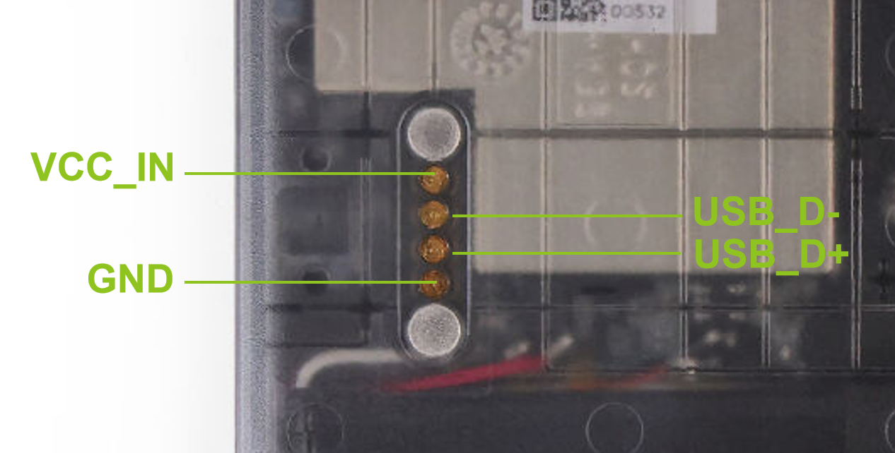

# Seeed Studio SenseCAP Card Tracker T1000-E for Meshtastic GPS IP65


[**View Seeed Studio SenseCAP Card Tracker T1000-E for Meshtastic GPS IP65 on OpenELAB**](https://openelab.io/products/seeed-studio-sensecap-tracker-t1000)

**Model / option:** Seeed Studio SenseCAP Card Tracker T1000-E for Meshtastic GPS IP65 · **SKU:** `Seeed-114993369`


## Product overview <a href="#description" id="description"></a>

### Exact hardware identity <a href="#seeed-studio-sensecap-card-tracker-t1000-e-for-meshtastic" id="seeed-studio-sensecap-card-tracker-t1000-e-for-meshtastic"></a>

SenseCAP Card Tracker T1000-E, `Seeed-114993369`, is an nRF52840/LR1110 Meshtastic card tracker with AG3335 GNSS, a 700 mAh battery and a magnetic USB charging/data connection. The **E suffix matters**: other T1000 LoRaWAN trackers are different products and are not made compatible by renaming a firmware file.

This guide commissions the purchased Meshtastic SKU and explains the separate manufacturer-documented MeshCore conversion. Neither protocol is LoRaWAN. A LoRaWAN gateway, shared RF band or SenseCAP cloud account does not by itself deliver a Meshtastic message. [Seeed T1000-E overview](https://wiki.seeedstudio.com/t1000_e_intro/).

### OpenELAB listing and option <a href="#product-link" id="product-link"></a>

Use [View Seeed Studio SenseCAP Card Tracker T1000-E for Meshtastic GPS IP65 on OpenELAB](https://openelab.io/products/seeed-studio-sensecap-tracker-t1000) and match `Seeed-114993369` before selecting regional firmware or adding accessories.

## Applications <a href="#feature" id="feature"></a>

Use the T1000-E for low-profile text and position sharing, personnel/asset-location experiments or a portable telemetry node. First validate a direct link with a known compatible peer, then test the intended placement on a person or asset. Internal antennas are affected by the body, metal cases and orientation.

This is a message/location device with user-configurable GNSS intervals. It does not establish continuous tracking, guaranteed message delivery or rescue-service availability. The exposed magnetic contacts are a USB interface, not a general sensor expansion connector.

## Specifications <a href="#specification" id="specification"></a>

| Parameter            | T1000-E value / condition                                                           |
| -------------------- | ----------------------------------------------------------------------------------- |
| Host                 | Nordic nRF52840                                                                     |
| LoRa transceiver     | Semtech LR1110; Meshtastic device documentation lists 865–928 MHz frequency options |
| Navigation           | MediaTek AG3335 GNSS                                                                |
| Battery              | Internal 700 mAh rechargeable lithium cell                                          |
| Charging/data input  | Magnetic USB cable, 4.7–5.5 V DC input                                              |
| Charging temperature | 0 to +45 °C                                                                         |
| Device environment   | −20 to +60 °C; 5–95% RH without condensation                                        |
| Enclosure            | IP65; assembled enclosure rating does not make wet contacts suitable for charging   |
| Size / mass          | 85 × 55 × 6.5 mm; 32 g                                                              |
| Temperature channel  | −20 to +60 °C; published ±1 °C, 0.1 °C resolution                                   |
| Light channel        | Relative 0–100%, not calibrated illuminance in lux                                  |
| User controls        | One button, one LED, buzzer                                                         |
| USB cable            | Manufacturer lists a 1 m magnetic cable; AC adapter separate                        |

Sources: [Seeed T1000-E specifications](https://wiki.seeedstudio.com/t1000_e_intro/) and [Meshtastic exact hardware support](https://meshtastic.org/docs/hardware/devices/seeed-studio/sensecap/card-tracker/). The manufacturer introduction inconsistently labels Bluetooth as 5.0/5.1; use the documented BLE pairing workflow rather than assuming a particular optional Bluetooth feature.

## Hardware and connections <a href="#hardware" id="hardware"></a>

Clean/dry the contact area and attach the matching magnetic USB cable. Use a data-capable USB connection for firmware/configuration; a charge-only path can illuminate the LED without creating a serial port. The contact order below is **as viewed in the official photograph**, not a universal top-to-bottom pin numbering for a custom cable.



_T1000-E magnetic contact order: VCC\_IN, USB D−, USB D+, GND in the illustrated orientation — Seeed Studio,_ [_original diagram_](https://wiki.seeedstudio.com/sensecap_t1000_e/)_._

The two inner contacts carry USB differential data. Do not wire them as UART RX/TX, I²C or GPIO. For a custom fixture, verify connector orientation and continuity against the drawing before applying 5 V.

| Internal function | Nordic signal / role                                                                                  |
| ----------------- | ----------------------------------------------------------------------------------------------------- |
| LR1110 SPI        | MISO P1.08, MOSI P1.09, clock P0.11, NSS P0.12                                                        |
| Radio controls    | Reset P1.10; DIO1 P1.01; DIO2 P0.07; documented DIO3 TCXO 1.6 V                                       |
| GNSS              | RX P0.14, TX P0.13; Serial1 at 115200 baud in Seeed's pin table                                       |
| LED / buzzer      | P0.24 / P0.25, buzzer enable P1.05                                                                    |
| Button            | P0.06                                                                                                 |
| Analog sensing    | Temperature P0.31; light P0.29                                                                        |
| Accelerometer     | I²C SDA P0.26 / SCL P0.27; manufacturer says not currently used in its documented Meshtastic firmware |

These are **internal board assignments**, not exposed solder-free expansion. [Seeed pin reference](https://wiki.seeedstudio.com/t1000_e_intro/). Preserve the correct variant's radio power/TCXO settings when developing firmware; a generic nRF52840 build is not an acceptable substitute.

## Software and development resources

For stock firmware use Meshtastic Android/iOS, its web client or official Python API. The flasher device selection is **Seeed Card Tracker T1000-E**. Keep the application and bootloader versions in a device record, since entry behavior changes with bootloader revision.

The [Meshtastic hardware page](https://meshtastic.org/docs/hardware/devices/seeed-studio/sensecap/card-tracker/) currently notes an LR1110 receive limitation with older SX127x radios: transmit can work while direct receive fails; an SX126x hop can change that path. Check the note against the installed firmware before classifying a one-way link as damaged hardware. Use an SX126x peer for the initial controlled test.

Never flash `xiao_ble`, WM1110, Feather DIY, ProMicro DIY, generic dongle or other nRF52840 firmware just because the host chip matches. Seeed explicitly warns against unrelated targets and generic NRF-OTA updates. Its [USB recovery instructions](https://wiki.seeedstudio.com/sensecap_t1000_e/) identify the correct T1000-E bootloader ZIP. The newer Meshtastic bootloader workflow is version-specific; it does not make the legacy USB steps applicable to every unit.

## Getting started <a href="#get-started" id="get-started"></a>

### Meshtastic first position and round-trip message

1. Charge with the matching magnetic cable at 0–45 °C. Press the button to start and look for the configured startup indication. A disabled buzzer/LED can make a running unit appear quiet.
2. Install/open the Meshtastic app, scan nearby BLE radios and match the T1000-E's ID. Enter the device's configured pairing PIN; Seeed's factory procedure uses `123456`. Read the firmware/hardware identity after connecting.
3. Set the LoRa region for the deployment location, then allow restart. On a known compatible second Meshtastic radio, match region, modem preset, frequency slot and channel name/key.
4. Send `T1000-A-01` from the tracker and observe it on the second device. Return `T1000-B-01` and confirm reception at the tracker client. Keep both receipts and timestamps; a successful send in one direction is not a full link check.
5. Enable GPS in Position settings. Acquire a current fix outdoors and inspect time, fix state and coordinates. Check whether the app is forwarding phone position; on iOS, location permission/precision can affect that route.
6. Remove USB and repeat. Double-click requests a node/position update and triple-click toggles GPS in Seeed's documented Meshtastic behavior. A long press of about five seconds shuts down; button functions are different after MeshCore conversion.

**Expected result:** the app reports the exact tracker identity, two test messages are received in opposite directions, and a current position is shown when GPS is enabled. [Meshtastic T1000-E setup](https://wiki.seeedstudio.com/sensecap_t1000_e/).

### Original, read-only host inventory

After installing the official `meshtastic` Python package in a virtual environment, save this as `tracker_inventory.py` and replace `YOUR_PORT` with the observed serial device. Close any browser/serial monitor using that port first.


```python
import json
import meshtastic.serial_interface

radio = meshtastic.serial_interface.SerialInterface(devPath="YOUR_PORT")
try:
    print("local", json.dumps(radio.myInfo, default=str))
    for node_id, node in sorted((radio.nodes or {}).items()):
        print(json.dumps({
            "node": node_id,
            "user": node.get("user", {}),
            "lastHeard": node.get("lastHeard"),
            "position": node.get("position", {}),
        }, default=str))
finally:
    radio.close()
```


Run `python tracker_inventory.py`. Expected output is the local protobuf identity and the currently known node records; an empty position for a peer means no position is stored, not necessarily a GNSS hardware failure. This uses the [official Python API](https://python.meshtastic.org/). It is newly authored, and was not run against a tracker here.

### Temperature, ringtone and web client

In Telemetry/Sensors enable the supported temperature channel; do not treat a 0–100 light value as lux or enable an unsupported accelerometer stream. For a message alert, External Notification can use the documented LED output24 and PWM buzzer25. These numbers belong to this firmware mapping, not to an external cable pinout. An original test RTTTL string is `cardtest:d=8,o=5,b=120:c,p,f,p,a`. Send one test message and confirm the buzzer policy, then restore the intended quiet hours/alert behavior.

For the web client choose New Connection → Bluetooth or Serial, select the exact device and connect. Inspect identity before sending. Bluetooth and serial are alternative local transports to the same radio; neither changes the LoRa packet settings. [Sensors, ringtone and web workflows](https://wiki.seeedstudio.com/sensecap_t1000_e/).

### USB update and recovery

1. Export configuration/channel information and identify the unit as **T1000-E**. Open the Meshtastic flasher and select that exact device, then select the intended release.
2. For the legacy Seeed manual-entry method, hold the device button and quickly connect the magnetic charging cable twice. A steady green LED and T1000-E USB drive indicate DFU. Browser-assisted Enter DFU is another documented route.
3. Follow the flasher's erase workflow for a clean recovery. Copy its erase UF2, wait for the drive to disappear and complete any indicated serial step. Re-enter DFU, then copy the T1000-E application UF2 and wait for restart.
4. Reconnect, set region/channel again and repeat the round-trip test. A mounted drive proves bootloader operation, not application or radio operation.

**Expected result:** the intended T1000-E application boots and reports its version. On Meshtastic nRF52 Bootloader2.5 or newer the official device page documents holding through startup for about three seconds to reach DFU; do not confuse that with the legacy magnetic-cable double-connect method. No reset button exists on this tracker. [Seeed recovery](https://wiki.seeedstudio.com/sensecap_t1000_e/), [bootloader-version conditions](https://meshtastic.org/docs/hardware/devices/seeed-studio/sensecap/card-tracker/).

For MeshCore conversion select Community Firmware → **Seeed Studio SenseCAP T1000-E** → Companion Bluetooth, erase/install using its USB process, then use MeshCore clients. Match radio parameters, reboot, exchange adverts and test a private reply. Seeed's documented MeshCore buttons use three-second power control, double-click advert, triple-click buzzer and quadruple-click GPS; these differ from Meshtastic. [MeshCore exact-model guide](https://wiki.seeedstudio.com/sensecap_t1000_e_meshcore/).

## Troubleshooting and FAQs

| Symptom                                | Ordered checks                                                                                                                                      |
| -------------------------------------- | --------------------------------------------------------------------------------------------------------------------------------------------------- |
| Charges, no USB device                 | Clean contacts, matching data cable and USB port; verify magnetic seating; use version-correct DFU entry                                            |
| Steady green after update              | Likely DFU; hold button while attaching the cable to reboot, then use exact application recovery if needed                                          |
| Cannot receive from older node         | Verify current LR1110/SX127x compatibility note; test an SX126x peer before resets                                                                  |
| Pairing fails                          | Check current PIN, unpair stale Bluetooth association, release another app/client connection                                                        |
| Broadcast works, private message fails | Refresh peer user information/public keys; reset stale NodeDB before regenerating the private identity                                              |
| GPS disappears after button presses    | Check ecosystem-specific button actions and Position settings; inspect current fix/time outdoors                                                    |
| Deeply stored battery will not boot    | Known-good continuous charge within temperature limits; follow Seeed's exact recovery guidance before repeated firmware erases                      |
| Bootloader recovery requested          | Use `t1000_e_bootloader-0.9.1-5-g488711a_s140_7.3.0.zip` only for the matching Seeed serial-DFU procedure; application reinstall follows separately |

Do not force power removal during configuration or flashing. Capture version/logs before factory reset because channel keys, peer identity and device state can change. If neither a DFU drive nor a DFU serial port appears after cable/contact/power checks, another model's firmware is not a supported recovery method.

## Downloads and technical documents

| Resource                                                                                                                         | Purpose / model boundary                                                |
| -------------------------------------------------------------------------------------------------------------------------------- | ----------------------------------------------------------------------- |
| [T1000-E overview / pins](https://wiki.seeedstudio.com/t1000_e_intro/)                                                           | Exact LR1110/AG3335 hardware and battery limits                         |
| [Seeed Meshtastic guide](https://wiki.seeedstudio.com/sensecap_t1000_e/)                                                         | Pairing, telemetry, USB contacts, firmware and recovery                 |
| [Current Meshtastic device support](https://meshtastic.org/docs/hardware/devices/seeed-studio/sensecap/card-tracker/)            | Receive compatibility and newer bootloader behavior                     |
| [T1000-E bootloader ZIP](https://files.seeedstudio.com/wiki/SenseCAP/lorahub/t1000_e_bootloader-0.9.1-5-g488711a_s140_7.3.0.zip) | Manufacturer legacy serial-DFU package; keep ZIP intact                 |
| [SenseCAP T1000 family datasheet](https://files.seeedstudio.com/products/SenseCAP/SenseCAP_Tracker_T1000_Datasheet.pdf)          | Family reference; it must not override E-specific firmware instructions |
| [UN38.3 archive](https://files.seeedstudio.com/wiki/SenseCAP/Meshtastic/UN38.3.zip)                                              | Manufacturer battery transport documentation                            |
| [MeshCore T1000-E guide](https://wiki.seeedstudio.com/sensecap_t1000_e_meshcore/)                                                | Optional ecosystem conversion; not another assigned product             |

### Retained product illustrations

<figure><figcaption></figcaption></figure>

### Additional manufacturer references

* [Manufacturer reference 1](http://meshtastic.org/)
* [Manufacturer reference 2](https://meshtastic.org/docs/configuration/radio/lora/#region)

## References and validation <a href="#official-documentation-and-development-resources" id="official-documentation-and-development-resources"></a>

Reviewed 24 November 2026: exact live OpenELAB product/SKU, Seeed T1000-E introduction and both ecosystem guides, and current Meshtastic hardware documentation. Magnetic contact photograph was visually inspected and is attributed to Seeed. The host inventory code and staged link test are original.

**Source reviewed; compilation, Python/device execution, firmware flashing, GNSS, RF, battery and hardware tests not run.** Family datasheets and future sensor support do not expand the proven hardware/firmware scope of this SKU.
