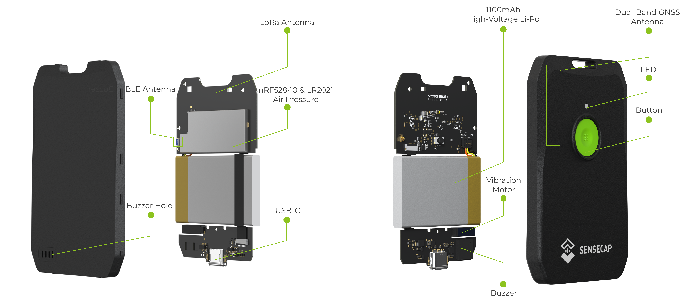
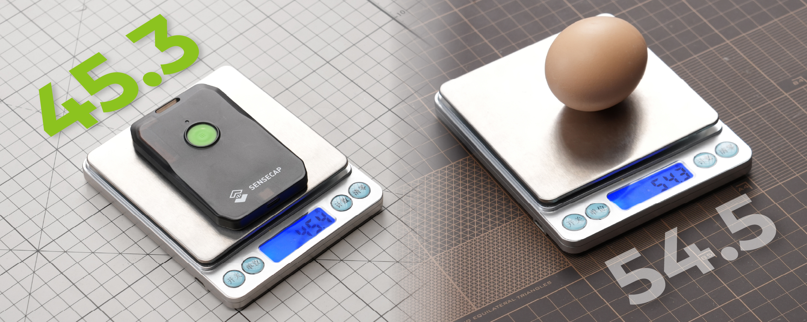

# Seeed Studio SenseCAP MeshTracker X1 for Meshtastic


[**View Seeed Studio SenseCAP MeshTracker X1 for Meshtastic on OpenELAB**](https://openelab.io/products/seeed-studio-sensecap-meshtracker-x1-for-meshtastic)

**Model / option:** Seeed Studio SenseCAP MeshTracker X1 for Meshtastic · **SKU:** `Seeed-100093876`


## Product overview <a href="#product-and-development-scope" id="product-and-development-scope"></a>

SenseCAP MeshTracker X1, `Seeed-100093876`, is a thin Meshtastic handheld using an nRF52840 host, **LR2021** radio, dual-band L1/L5 GNSS, barometer, buzzer and vibration driver. It is not the LR1110-based T1000-E and does not use that tracker's battery or bootloader. The purchased SKU is the Meshtastic version; MeshCore conversion is a separate, supported firmware path that replaces the radio ecosystem.

The LR2021 chip's FLRC throughput does not mean the Meshtastic text network uses that data rate or supports voice/images. Firmware, packet format, RF settings and peer capabilities determine interoperability. [Exact X1 introduction](https://wiki.seeedstudio.com/meshtracker_x1_intro/).

## Applications

Use X1 for compact off-grid text/position sharing, route trials or barometric trend telemetry. Test while worn in the intended position: the user's body and nearby metal change the internal antenna environment. Its IP66 rating applies to the assembled enclosure, not an open charging connection or immersion.

For a GNSS experiment, log fix state and timestamps at an open-sky reference point before testing a difficult site. A two-band receiver improves the available observations; this is not an RTK positioning guarantee. Treat the barometer's temperature as internal device temperature: it is affected by self-heating and does not replace a radiation-shielded weather thermometer.

## Specifications <a href="#hardware-specifications" id="hardware-specifications"></a>

| Parameter                | X1 value / condition                                                                                                                   |
| ------------------------ | -------------------------------------------------------------------------------------------------------------------------------------- |
| Processor / local link   | Nordic nRF52840; Bluetooth 5.0                                                                                                         |
| LoRa                     | LR2021, documented 863–928 MHz, up to +22 dBm                                                                                          |
| GNSS                     | Dual-band L1 + L5; internal GNSS antenna                                                                                               |
| Battery                  | 1100 mAh high-voltage rechargeable cell; **not** an ordinary 4.2 V maximum replacement                                                 |
| USB power                | 5 V / 0.55 A specified input; USB-C charging/data                                                                                      |
| Published charge cut-off | 4.37 V; manufacturer also lists 4.4 V / 0.22 A under battery power input—an internal battery characteristic, not a user external input |
| Charging temperature     | +5 to +45 °C                                                                                                                           |
| Operation / enclosure    | −20 to +60 °C; IP66                                                                                                                    |
| Dimensions / mass        | 90 × 57 × 8 mm; 45 g                                                                                                                   |
| Pressure channel         | 300–1100 hPa; published accuracy ±0.03 hPa and resolution 0.06 Pa; not independently verified here                                     |
| Internal temperature     | −40 to +85 °C channel range; ±1 °C reported accuracy; device operating range remains narrower                                          |
| Indications              | RGB LED, buzzer, DRV2605L vibration driver, one user button                                                                            |
| External flash           | 8 MB, as identified in the internal pin list                                                                                           |

Manufacturer specifications and conditions: [X1 hardware table](https://wiki.seeedstudio.com/meshtracker_x1_intro/). Claimed multi-day runtime and line-of-sight distance depend on configuration; use the manufacturer's worksheet to plan a measurement rather than treating them as guaranteed acceptance values.

## Hardware and connections

Charge over USB-C with the enclosure intact and a known data cable for firmware work. Do not connect a bench supply directly to the internal battery connector or replace its high-voltage cell with a mechanically similar cell. Keep the USB area dry before charging. No external Grove port or general-purpose breakout is documented for this sealed tracker.



_MeshTracker X1 internal antennas, high-voltage battery, barometer and USB-C arrangement — Seeed Studio,_ [_original diagram_](https://wiki.seeedstudio.com/meshtracker_x1_intro/)_._

The internal signals below help review firmware and diagnose a wrong board target; they are **not external connector pins**. `P1.xx` is a Nordic port/pin designation, not the same number as an Arduino GPIO index.

| Component             | Exact internal routes from Seeed's X1 pin list                                |
| --------------------- | ----------------------------------------------------------------------------- |
| LR2021 SPI            | MISO P1.08; MOSI P1.09; SCK P0.11; CS P0.12                                   |
| LR2021 controls       | Reset P1.10; Busy P0.07; DIO8 P1.01                                           |
| GNSS UART             | TX P0.13; RX P0.14; power enable P1.11                                        |
| GNSS timing/power     | Sleep interrupt P0.30; PPS P0.04; RTC interrupt P0.29; RTC power enable P1.13 |
| Barometer / motor I²C | SCL P1.14; SDA P1.15; motor-driver enable P1.05                               |
| RGB / buzzer / button | R P0.03; G P0.24; B P0.28; buzzer P0.25; button P0.06                         |
| Sensor power enable   | P1.07                                                                         |

Seeed's pin list also reserves signals for possible future motion-sensor models. Their mention does not establish that this SKU contains a magnetometer or accelerometer. [Internal pin list](https://wiki.seeedstudio.com/meshtracker_x1_intro/).

## Software and development resources <a href="#choose-the-network-and-device-role" id="choose-the-network-and-device-role"></a>

Use **Seeed SenseCAP MeshTracker X1** in the Meshtastic flasher. Source builds use `seeed_mesh_tracker_X1`, verified in the [reviewed environment](https://github.com/meshtastic/firmware/blob/d0f4096788545fb3c5e22d2a7e52ac6c268caac1/variants/nrf52840/seeed_mesh_tracker_X1/platformio.ini). The Seeed X1 source tutorial names X1 but contains repeated `seeed_wio_tracker_L1` commands and L1 display-edit instructions. Those commands are for different hardware and must not select the X1 firmware image.

For MeshCore conversion, choose Community Firmware → **Seeed Studio SenseCAP MeshTracker X1** → **Companion Bluetooth**. This is not a purchased MeshCore SKU in the assigned scope. Export configuration and keys before erasing; after conversion use MeshCore clients/peers. [X1 MeshCore guide](https://wiki.seeedstudio.com/sensecap_meshtracker_x1_meshcore/).

The manufacturer recovery ZIP is specifically [X1 Bootloader.zip](https://files.seeedstudio.com/wiki/SenseCAP/Meshcore/MeshTrackerX1/Bootloader.zip). Sharing the nRF52840 processor with another node does not make bootloaders interchangeable. Meshtastic firmware is GPL-3.0; preserve its license obligations when distributing modified binaries. The original workflow and host code below do not copy the tutorial's display implementation.

## Getting started <a href="#getting-started-one-controlled-radio-test" id="getting-started-one-controlled-radio-test"></a>

### Meshtastic: pair, exchange a reply and verify position

1. Charge the X1 within its +5 to +45 °C charging range. Press the button once to start; expect startup indication/melody if enabled. Match the node ID to the last four MAC digits on the label or the serial `using nodenum` log.
2. Connect in Meshtastic, enter the configured pairing PIN and read the firmware/device identity. Set the local LoRa region and wait for the restart. Do not use MeshCore's client against the stock application.
3. Configure a second Meshtastic radio with the same region, modem preset, frequency slot and primary-channel name/key. Send `X1-LINK-01`, observe it on the second device, and return `X1-REPLY-01`.
4. Enable GPS in Position settings, take the X1 into open sky and wait for a current fix. Confirm map position source and timestamp, not only a previously cached marker. Change update/broadcast intervals only after recording a baseline.
5. Enable environmental telemetry for pressure. Inspect a plausible value with units; temperature is obtained from the barometer and may exceed ambient due to device heating.
6. Test one message alert, then repeat on battery with the device carried as intended. Record received sequence numbers and missing replies; do not count local app send indicators as received packets.

**Expected result:** a current X1 identity, text reception and reply on a second radio, and a current position/pressure value when enabled. [Meshtastic setup and sensor behavior](https://wiki.seeedstudio.com/x1_get_started_for_meshtastic/).

### Original bounded receive logger

This optional desktop example listens for up to 60 seconds and prints each received text packet. It sends no messages and changes no radio configuration. Use the official Meshtastic Python API, install `meshtastic`, save as `x1_receive.py`, close other serial clients and run `python x1_receive.py YOUR_PORT`.

```python
import json
import sys
import time
from pubsub import pub
from meshtastic.serial_interface import SerialInterface

def received(packet, interface):
    decoded = packet.get("decoded", {})
    if decoded.get("portnum") == "TEXT_MESSAGE_APP":
        print(json.dumps({
            "from": packet.get("fromId", packet.get("from")),
            "id": packet.get("id"),
            "text": decoded.get("text", ""),
            "rssi_dBm": packet.get("rxRssi"),
            "snr_dB": packet.get("rxSnr"),
        }), flush=True)

pub.subscribe(received, "meshtastic.receive")
radio = SerialInterface(devPath=sys.argv[1])
try:
    time.sleep(60)
finally:
    radio.close()
```

Expected output is one JSON line per received text packet, with RSSI/SNR only when provided by the transport. No output during a quiet minute is not proof of failure: send a known packet from the peer and check both logs. Consult the [official Python API](https://meshtastic.org/docs/software/python/) for the installed client version. The program has not been run against hardware.

### Configure alerts without confusing pin namespaces

In the installed Meshtastic application's External Notification module, enable the intended buzzer/vibration policy and test one incoming message. Seeed lists buzzer GPIO25 and RGB 3/24/28 in the UI examples. It also abbreviates vibration as `05`, while the hardware table identifies driver EN as **P1.05**. Do not convert that textual `05` into raw MCU P0.05 in custom code. Use the correct firmware's board definition and notification driver; prefer the application's dedicated vibration control.

An original short ringtone is `x1check:d=8,o=5,b=120:c,p,g,p,c6`. Change one setting at a time, let the device restart, then check that temporary mute is off. A silent device with normal serial/app status can simply have notifications disabled.

### USB DFU, application restore and source build <a href="#firmware-sdk-and-hardware-development" id="firmware-sdk-and-hardware-development"></a>

For normal Meshtastic operation the documented button actions are: one click power on, two clicks refresh node/location information, three clicks toggle GPS, four clicks temporary mute/unmute, and a 5-second hold powers off. MeshCore's documented shutdown hold is 3 seconds; do not use one ecosystem's timing to diagnose another.

To recover X1, disconnect USB, hold the device button and connect USB promptly, keeping it held until **white steady LED / X1 DFU drive**. To reboot out of DFU, hold the button while reconnecting USB and **release immediately**; continuing to hold can enter DFU again. Select the exact X1 erase image, wait for completion, re-enter DFU if needed, and copy the X1 application UF2. Keep USB stable throughout. [X1 DFU and recovery](https://wiki.seeedstudio.com/x1_get_started_for_meshtastic/).

For a source build in a fresh checkout with PlatformIO installed:

```sh
git clone --recursive https://github.com/meshtastic/firmware.git
cd firmware
git checkout d0f4096788545fb3c5e22d2a7e52ac6c268caac1
git submodule update --init --recursive
pio run -e seeed_mesh_tracker_X1
```

Expected result is a successful X1 build and an X1-named artifact under `.pio/build/seeed_mesh_tracker_X1/`. This is a source-reviewed procedure, **not a reported successful build**. First compile unchanged source, retain build output and check the target in the artifact filename before any flash. Restore the specific X1 bootloader only if ordinary application recovery fails and DFU serial access is available.

## Troubleshooting and FAQs <a href="#troubleshooting-and-recovery" id="troubleshooting-and-recovery"></a>

| Symptom                                     | Useful check / bounded action                                                                                                               |
| ------------------------------------------- | ------------------------------------------------------------------------------------------------------------------------------------------- |
| White LED after update                      | Check whether still in DFU; immediate-release USB reboot, then exact X1 erase/application restore                                           |
| No response after storage                   | Check notification settings and charge with known cable/source; follow the manufacturer's deep-discharge recovery only for the exact device |
| Wrong location                              | GNSS enabled, open sky, fresh timestamp and selected source; check phone- versus device-provided position                                   |
| Temperature too warm                        | Expected internal barometer self-heating; compare after thermal settling, not as ambient weather calibration                                |
| Vibration setting ineffective               | Confirm supported application/driver and pin namespace; do not use UI `05` as an unverified raw pin                                         |
| Battery percentage drops rapidly near empty | High-voltage cell curve is nonlinear; log voltage/runtime and use the correct X1 mapping, not a generic linear estimate                     |
| Broadcast works, DM fails                   | Refresh user info/public keys and NodeDB before factory reset or private-key regeneration                                                   |
| Poor RF while worn                          | Change placement/orientation; keep away from body/metal; compare the same packet test in open space                                         |
| Source build names L1                       | Stop; use `seeed_mesh_tracker_X1` and X1 variant. The source tutorial's copied L1 commands do not establish compatibility                   |

If bootloader installation is necessary, use the X1 package from the X1 instructions with `adafruit-nrfutil`; refresh the serial port after 1200-baud touch and reinstall the X1 application afterward. A generic `xiao_ble` or T1000-E package is not an X1 rescue image.

## Downloads and technical documents <a href="#technical-documents-and-software" id="technical-documents-and-software"></a>

| Resource                                                                                                                                                        | Purpose / scope                                                 |
| --------------------------------------------------------------------------------------------------------------------------------------------------------------- | --------------------------------------------------------------- |
| [X1 hardware and internal pin reference](https://wiki.seeedstudio.com/meshtracker_x1_intro/)                                                                    | Correct LR2021 board, high-voltage battery and physical diagram |
| [X1 Meshtastic setup](https://wiki.seeedstudio.com/x1_get_started_for_meshtastic/)                                                                              | GPS, notifications, DFU, battery mapping and recovery           |
| [X1 MeshCore conversion](https://wiki.seeedstudio.com/sensecap_meshtracker_x1_meshcore/)                                                                        | Separate Companion firmware and 3-second shutdown behavior      |
| [X1 source tutorial](https://wiki.seeedstudio.com/meshtastic_source_code_practical_tutorial_meshtracker_x1/)                                                    | Project structure; apply the X1-target correction above         |
| [Battery consumption worksheet](https://files.seeedstudio.com/wiki/SenseCAP/MeshTrackerX1/X1_for_Meshtastic_Consumption_Test_and_Battery_Life_Calculation.xlsx) | Manufacturer workload estimates, not measured here              |
| [Battery certification archive](https://files.seeedstudio.com/wiki/SenseCAP/MeshTrackerX1/Battry_Certification.zip)                                             | Manufacturer-linked battery documents                           |
| [X1 bootloader package](https://files.seeedstudio.com/wiki/SenseCAP/Meshcore/MeshTrackerX1/Bootloader.zip)                                                      | Exact-model serial-DFU recovery; application remains separate   |

### Retained product illustrations



### Additional manufacturer references

* [Manufacturer reference 1](https://files.seeedstudio.com/wiki/SenseCAP/MeshTrackerX1/CompactTracker.jpg)
* [Manufacturer reference 2](https://github.com/meshcore-dev/MeshCore)

## References and validation <a href="#official-documentation-and-development-resources" id="official-documentation-and-development-resources"></a>

Reviewed 24 November 2026: live OpenELAB SKU match, Seeed hardware pin list, X1 Meshtastic/MeshCore commissioning, source tutorial and actual Meshtastic environment at `d0f4096788545fb3c5e22d2a7e52ac6c268caac1`. The hardware illustration is attributed to Seeed Studio; packet logger and test sequence are original.

**Compilation, Python/radio execution, firmware flashing, GNSS accuracy, battery and physical hardware tests not run.** Future motion-sensor variants are outside this SKU. No throughput, battery runtime or range test is claimed by this guide.

### Related retained references

* [Meshtastic source](https://github.com/meshtastic/firmware)
