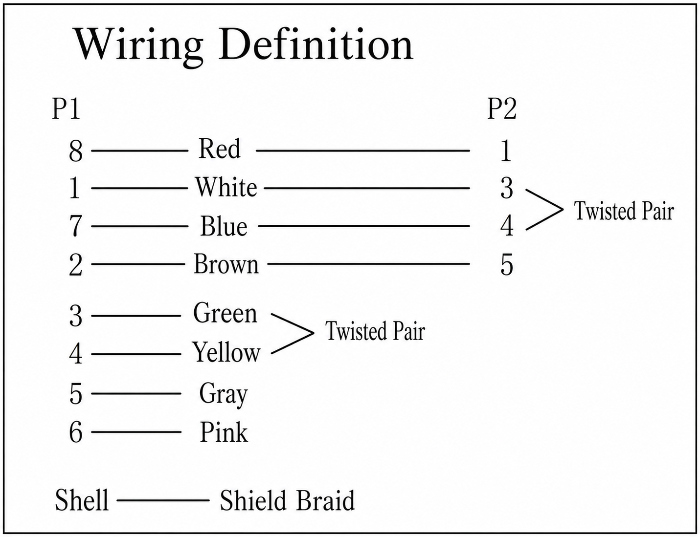
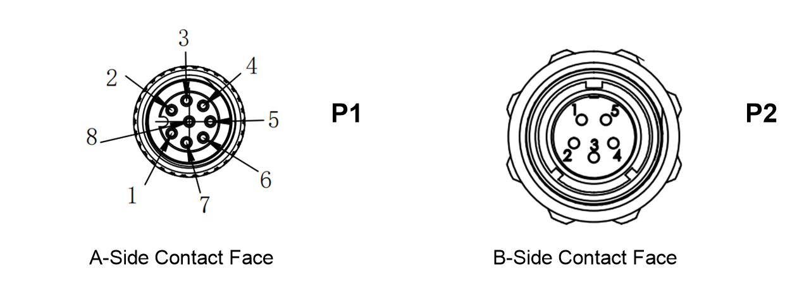

# Seeed Studio SenseCAP S700-A 7-in-1 Compact Weather Station-Radar Rain


[**View Seeed Studio SenseCAP S700-A 7-in-1 Compact Weather Station-Radar Rain on OpenELAB**](https://openelab.io/products/seeed-studio-sensecap-s700)

**Model / option:** Seeed Studio SenseCAP S700-A 7-in-1 Compact Weather Station-Radar Rain · **SKU:** `Seeed-101991050`

[**View Seeed Studio SenseCAP S500 V2 5-in-1 Compact Weather Sensor on OpenELAB**](https://openelab.io/products/seeed-studio-sensecap-s500-v2)

**Model / option:** Seeed Studio SenseCAP S500 V2 5-in-1 Compact Weather Sensor · **SKU:** `Seeed-101991021`


## Product overview <a href="#product-and-scope" id="product-and-scope"></a>

SenseCAP ONE S500 V2 and S700-A are **wired** weather sensors. They provide RS485/Modbus RTU and SDI-12; neither SKU transmits directly over LoRaWAN. Add an appropriate external logger/gateway only after local data reads work.

| SKU               | Exact model                | Measured channels / important difference                                                   |
| ----------------- | -------------------------- | ------------------------------------------------------------------------------------------ |
| `Seeed-101991050` | S700-A, 7-in-1, radar rain | Temperature, humidity, pressure, ultrasonic wind speed/direction, light and radar rain     |
| `Seeed-101991021` | S500 V2, 5-in-1            | Temperature, humidity, pressure, ultrasonic wind speed/direction; no rain or light channel |

S700-A is not S700-B optical-rain or S700-C solar-radiation hardware. S500 V2 is not older SKU101990693. The V2 family removes RS232/RS422; match the white-label SKU and USB-port location before using an older drawing. [Seeed model/revision table](https://wiki.seeedstudio.com/Getting_Started_with_SenseCAP_ONE_Compact_Weather_Sensor/).

## Applications

Use either model as a local agricultural or building weather logger input; choose S700-A when rain and light observations are required. Ultrasonic wind sensing avoids moving cups, but exposure, alignment, nearby obstacles and installation height still govern representativeness. Radar rain behavior differs from a tipping bucket, so retain the method and averaging interval with exported data.

A working bus proves communication. It does not establish meteorological siting, calibration, road-safety control performance or traceability. For an automation, log raw frames, scaled values and fault states before connecting them to decisions. Preserve model/firmware metadata so a later S500 replacement cannot silently populate nonexistent rain fields with zero.

## Specifications

| Parameter               | S500 V2 and S700-A, unless stated                                                                                                                                                |
| ----------------------- | -------------------------------------------------------------------------------------------------------------------------------------------------------------------------------- |
| Main supply             | 12–24 V DC; manufacturer family basic table lists 0.42 W                                                                                                                         |
| Heater supply           | Separate 24 V DC, 21 W when supported/enabled; manufacturer recommends 24 V / 1 A source for heater                                                                              |
| Protocols               | RS485 Modbus RTU, ASCII configuration, SDI-12; V2 does not support RS232/RS422                                                                                                   |
| Main connector / cable  | M12 8-pin, standard 3 m cable; USB-C for local configuration                                                                                                                     |
| Environment / enclosure | −40 to +85 °C; 0–100% RH non-condensing; IP66 with covers/cable correctly sealed                                                                                                 |
| Temperature             | −40 to +85 °C; ±0.1 °C; resolution0.01 °C                                                                                                                                        |
| Relative humidity       | 0–100% RH; ±1.5% RH; resolution0.01% RH                                                                                                                                          |
| Pressure                | 300–1250 hPa; ±50 Pa; resolution10 Pa                                                                                                                                            |
| Wind speed              | 0–60 m/s standard, 0–75 m/s extended; withstand up to80 m/s is not a calibrated measurement range                                                                                |
| Wind-speed accuracy     | ±0.3 m/s at≤10 m/s; ±3% at10–50 m/s; ±5% above50 m/s; resolution0.1 m/s                                                                                                          |
| Wind direction          | 0–360°; ±3°; resolution0.1°; manual's range row conditions it at −40 to +60 °C                                                                                                   |
| S700-A rain             | Radar rain intensity0–300 mm/h; ±10% reported accuracy                                                                                                                           |
| S700-A light            | Manual v1.6 lists0–188000 lux, ±5% of reading, resolution5 lux; current store lists200000 lux—use the manual range for this integration until the received revision is confirmed |
| S500 V2 light/rain      | Not fitted; do not query/report these as model capabilities                                                                                                                      |

Source: [SenseCAP ONE V3 user manual v1.6, physical PDF pages1–5](https://files.seeedstudio.com/products/SenseCAP/SenseCAP_ONE/SenseCAP_ONE_V3_Compact_Weather_Station_User_Guide_V1.6.pdf). Measurement resolution, protocol scaling and accuracy are separate quantities. A millidegree register unit does not make sensor accuracy0.001 °C.

## Hardware and connections <a href="#hardware-and-technical-documents" id="hardware-and-technical-documents"></a>

### M12 conductor and contact orientation

With all supplies off, identify the **P1 eight-pin sensor-side** contact view, cable colors and any P2 adapter view. P1 pin8 and P2 pin1 are the same red conductor; the contact numbers are not interchangeable.

| P1 sensor-side pin / color | Function             | Initial bench connection                                                 |
| -------------------------- | -------------------- | ------------------------------------------------------------------------ |
| 1 / white                  | RS485-A              | Adapter A, with manufacturer polarity checked                            |
| 2 / brown                  | Vin− operating power | Main supply negative                                                     |
| 3 / green                  | Data ground          | Adapter signal reference when required by its interface/isolation design |
| 4 / yellow                 | SDI-12 data          | Leave individually insulated during RS485 bring-up                       |
| 5 / gray                   | Heater supply−       | Leave insulated for first test                                           |
| 6 / pink                   | Heater supply+       | Leave insulated for first test; separate24 V source only when used       |
| 7 / blue                   | RS485-B              | Adapter B                                                                |
| 8 / red                    | Vin+ operating power | Fused/current-limited12–24 V main supply                                 |



_SenseCAP ONE M12 conductor cross-reference; P1 and P2 contact numbers are different — Seeed Studio,_ [_original diagram_](https://wiki.seeedstudio.com/Getting_Started_with_SenseCAP_ONE_Compact_Weather_Sensor/)_._ 

_SenseCAP ONE official P1 A-side and P2 B-side contact-face views — Seeed Studio,_ [_original diagram_](https://wiki.seeedstudio.com/Getting_Started_with_SenseCAP_ONE_Compact_Weather_Sensor/)_._

Wire functions were visually checked against [manual v1.6 physical page12](https://files.seeedstudio.com/products/SenseCAP/SenseCAP_ONE/SenseCAP_ONE_V3_Compact_Weather_Station_User_Guide_V1.6.pdf). Start with the four RS485/main-power conductors; insulate all unused wires separately. Do not feed12 V into a USB adapter's5 V terminal, and do not treat an RS485 input as3.3 V UART. Align the keyed connector before tightening clockwise; force can bend pins.

### Mounting and heat

Bench-test before mounting. Use the manufacturer's sleeve/flange dimensions and actual millimetre drawing; the wiki's prose “75cm” pole recommendation must not override the mechanical drawing. The S2120's30–40 mm mounting pole is a different product and not a substitute dimension here. Align the base arrow with true north, or deliberately configure the documented electronic-compass mode; record which was used.

Keep wind paths and rain/light exposure clear and reseal the USB cover after configuration. Heater wiring is a separate21 W circuit. The manual calls for short manufacturer heater cables and identifies a3–5 m boundary; use the supplied3 m arrangement rather than extending it without voltage-drop/thermal review. Long main-power cables also require voltage-drop and transient design; the manual's suggested24 V/2 A for>100 m is a source-sizing note, not permission to ignore conductor resistance or protection.

## Software and development resources <a href="#development-software-and-recovery" id="development-software-and-recovery"></a>

Install the [SenseCAP ONE Configuration Tool](https://github.com/Seeed-Solution/SenseCAP-One-Configuration-Tool/releases) for the host OS. The USB interface uses a serial bridge; install the official CP210x driver only if the OS does not enumerate it. The tool reads model/settings, selects protocol, sets address/baud and performs exact-board firmware upgrades. Main sensor readings are **input registers, function04**; device settings are holding registers, with writes requiring separate care.

| Protocol          | Host requirements                                                                                     |
| ----------------- | ----------------------------------------------------------------------------------------------------- |
| USB configuration | Tool, observed COM/USB serial port,9600 baud in the documented first connection                       |
| RS485 Modbus RTU  | RS485 transceiver/USB adapter;9600-8N1 default; model-specific slave address                          |
| ASCII             | 9600-8N1 in configuration context; CRLF-terminated queries, exact address prefix                      |
| SDI-12            | Actual SDI-12 level/interface adapter;1200 baud,7 data bits, even parity,1 stop bit on the sensor bus |

The wiki incorrectly states9600 for the SDI-12 sensor bus. **Manual v1.6 physical page42 specifies1200 baud**. An adapter's PC serial rate can independently be9600, so keep those two interfaces distinct. Main product power remains the12–24 V family specification; the generic SDI-12 paragraph's3.6–16 V does not authorize lowering the selected model's normal supply. [Protocol reference, physical pages26–45](https://files.seeedstudio.com/products/SenseCAP/SenseCAP_ONE/SenseCAP_ONE_V3_Compact_Weather_Station_User_Guide_V1.6.pdf).

## Getting started

### USB inventory before bus wiring

1. Check white-label SKU against the model table. Connect USB-C on a dry bench, select the observed serial port in SenseCAP ONE Configuration Tool and connect at9600 baud.
2. Read From Device. Save model, firmware versions, protocol, Modbus address, baud, measurement units and compass/heater settings before changing anything.
3. Select RS485 Modbus RTU and verify/write the intended address. Defaults in manual v1.6 are **S500:10; S700-A:20** (decimal), but a deployed unit may have changed them. Click Write to Device and read the settings back.
4. Inspect live temperature, humidity and pressure in the tool. Disconnect the tool before opening the same port in another application. Record the actual values rather than substituting manufacturer screenshots.

**Expected result:** a readable exact model/settings record and plausible changing sensor values. If that fails, resolve USB connection/model first rather than debugging the external bus.

### Read a single signed temperature value with original Python

Prerequisites: stable12–24 V main supply, wired RS485-A/B, appropriate reference/isolation, one sensor on the bench, and the address confirmed above. Install `pyserial` in a virtual environment. The program implements only a small read-only Modbus request with CRC and strict reply checks; it never writes registers. Save as `one_temperature.py` and invoke with the observed port and confirmed decimal slave ID, e.g. `python one_temperature.py YOUR_PORT 20` for S700-A or `10` for S500.

```python
import struct
import sys
import serial

def crc16(data):
    crc = 0xFFFF
    for octet in data:
        crc ^= octet
        for _ in range(8):
            crc = (crc >> 1) ^ (0xA001 if crc & 1 else 0)
    return crc

port, slave = sys.argv[1], int(sys.argv[2])
if not 1 <= slave <= 247:
    raise SystemExit("Use the confirmed unicast address 1..247")
request = struct.pack(">BBHH", slave, 4, 0, 2)
request += struct.pack("<H", crc16(request))
with serial.Serial(port, 9600, bytesize=8, parity="N",
                   stopbits=1, timeout=2) as bus:
    bus.reset_input_buffer()
    bus.write(request)
    bus.flush()
    head = bus.read(3)
    if len(head) != 3 or head[0] != slave:
        raise SystemExit("No matching Modbus header: " + head.hex())
    if head[1] & 0x80:
        tail = bus.read(2)
        raise SystemExit("Modbus exception frame: " + (head+tail).hex())
    if head[1] != 4 or head[2] != 4:
        raise SystemExit("Unexpected function/byte count: " + head.hex())
    reply = head + bus.read(6)
    if len(reply) != 9 or crc16(reply[:-2]) != int.from_bytes(reply[-2:], "little"):
        raise SystemExit("Short frame or bad CRC: " + reply.hex())
    raw = int.from_bytes(reply[3:7], "big", signed=True)
    value = raw / 1000.0
    if not -40 <= value <= 85:
        raise SystemExit("Out-of-range temperature; inspect raw frame: " + reply.hex())
    print(f"slave={slave} raw={raw} temperature_C={value:.3f}")
```

**Expected result:** a CRC-valid function04 response and a plausible temperature such as a room-temperature value, not a promised fixed number. Negative temperatures require signed32-bit decoding; do not divide each16-bit word separately. Source format: [manual v1.6 physical pages27–31](https://files.seeedstudio.com/products/SenseCAP/SenseCAP_ONE/SenseCAP_ONE_V3_Compact_Weather_Station_User_Guide_V1.6.pdf). This original code was not run on hardware.

### Expand to model-appropriate measurements

Each listed measurement occupies two16-bit input registers, high word first, with signed32-bit big-endian interpretation and the manual's factor1000. Use separate short reads first; do not assume every address is implemented on every model.

| Start address          | Quantity / unit after scaling                                   | S500 V2 | S700-A                                                                               |
| ---------------------- | --------------------------------------------------------------- | ------- | ------------------------------------------------------------------------------------ |
| 0x0000                 | 2 registers, temperature °C                                     | Yes     | Yes                                                                                  |
| 0x0002                 | 2, relative humidity %RH                                        | Yes     | Yes                                                                                  |
| 0x0004                 | 2, pressure Pa; divide again by100 for hPa                      | Yes     | Yes                                                                                  |
| 0x0006                 | 2, light lux                                                    | No      | Yes                                                                                  |
| 0x0008 /0x000A /0x000C | 2 each, min/max/mean wind direction °                           | Yes     | Yes                                                                                  |
| 0x000E /0x0010 /0x0012 | 2 each, min/max/mean wind speed m/s                             | Yes     | Yes                                                                                  |
| 0x0014 /0x0018 /0x001A | Rain accumulation / intensity / maximum intensity in family map | No      | Read only after confirming current S700-A tool/manual semantics and reporting period |

The generic register range text contains older rain/light maxima, so use the model specification table for physical ranges and confirm actual rain-channel units/averaging in the received firmware. A valid zero with no rain is different from an unsupported register. Never poll the S900 PM registers and infer PM support for these two SKUs.

### ASCII, SDI-12 and firmware maintenance

For a USB ASCII identity check in the documented configuration context, send `?` with CRLF at9600-8N1. Use the returned address prefix (the guide illustrates `0XA`) before issuing address-specific queries; the USB query context is not a Modbus frame. Keep parameter writes outside initial data validation.

For SDI-12, change protocol deliberately using the tool, attach the SDI-12 adapter to yellow data/green reference and supply the station through red/brown. Address defaults to`0`. Send `?!` on a single-device bus, then `0M!`; wait for the advertised measurement completion before `0D0!`. The response begins with the device address and signed numeric fields. Extended measurement`0M1!` provides wind observations in the manual; read the exact group for the selected model rather than expecting a light field on S500.

Firmware is board-specific. Save settings, obtain the matching master/slave image from Seeed, connect stable USB power, select the exact target board in Firmware Update, start the update and press the documented reset button when prompted. Follow with the matching slave-board image where required, reset and read back versions/settings. The [firmware workflow](https://wiki.seeedstudio.com/firmware_update/) is not a public universal binary download; do not substitute firmware from another S700 letter suffix.

## Troubleshooting and FAQs <a href="#faqs" id="faqs"></a>

| Symptom                        | Isolation path                                                                                                                              |
| ------------------------------ | ------------------------------------------------------------------------------------------------------------------------------------------- |
| No Modbus reply                | Confirm sensor power at red/brown under load, USB tool address/baud/protocol, A/B naming, adapter direction, single-master ownership        |
| CRC failures                   | Inspect reference/ground, twisted pair, interference, termination at physical bus ends and timeout; shorten to original cable for diagnosis |
| Exactly10×/100× pressure error | Raw pressure is Pa after /1000; hPa adds /100 conversion; log raw bytes                                                                     |
| Large positive value below0 °C | Decode the combined32-bit signed value, not unsigned or each16-bit register                                                                 |
| Some channels fail on S500     | Rain/light absent by design; restrict polling to implemented model channels                                                                 |
| Rain/light range inconsistent  | Check received revision/manual and firmware; retain declared conservative manual range and raw observations                                 |
| Wind direction offset          | Confirm true-north mechanical alignment versus configured compass mode and nearby magnetic materials                                        |
| SDI-12 silent at9600           | Sensor bus is1200-7E1; PC-to-adapter baud may differ; verify interface levels/protocol selection                                            |
| USB works, field sensor fails  | Separate USB configuration power from M12 supply; inspect cable drop, moisture and heater wiring                                            |
| Heater drains supply           | Heater is independent24 V/21 W; check dedicated source, short cable and thermostat settings                                                 |

The user manual also lists Modbus/ASCII/SDI-12 error responses. Preserve the actual exception/status and last valid timestamp in the logger; never convert missing data into a weather observation of zero.

## Downloads and technical documents

| Resource                                                                                                                                               | Version / purpose                                                                                                                      |
| ------------------------------------------------------------------------------------------------------------------------------------------------------ | -------------------------------------------------------------------------------------------------------------------------------------- |
| [SenseCAP ONE V3 manual PDF](https://files.seeedstudio.com/products/SenseCAP/SenseCAP_ONE/SenseCAP_ONE_V3_Compact_Weather_Station_User_Guide_V1.6.pdf) | v1.6,51 physical pages; specs1–8, connectors9–13, mounting14–18, configuration19–25, Modbus26–33, ASCII34–41, SDI-1242–47, faults48–50 |
| [Exact family wiki](https://wiki.seeedstudio.com/Getting_Started_with_SenseCAP_ONE_Compact_Weather_Sensor/)                                            | Revision identification, configuration and original connector figures                                                                  |
| [Configuration Tool releases](https://github.com/Seeed-Solution/SenseCAP-One-Configuration-Tool/releases)                                              | Host packages; record selected release/OS                                                                                              |
| [Official CP210x driver](https://www.silabs.com/products/development-tools/software/usb-to-uart-bridge-vcp-drivers)                                    | Only if the OS needs the USB serial driver                                                                                             |
| [Firmware maintenance guide](https://wiki.seeedstudio.com/firmware_update/)                                                                            | Master/slave workflow; matching firmware must be obtained for the unit                                                                 |
| [M12 conductor diagram](https://files.seeedstudio.com/wiki/SenseCAP%20ONE%20Compact%20Weather%20Sensor_/wiring-definition.png)                         | P1↔P2 mapping; use with the separate contact-face drawing                                                                              |

### Additional manufacturer references <a href="#official-documentation-and-development-resources" id="official-documentation-and-development-resources"></a>

* [Manufacturer reference 1](https://files.seeedstudio.com/products/SenseCAP/SenseCAP_ONE/SenseCAP_Weather_Sensor_Catalogue.pdf)

## References and validation <a href="#sources-and-validation" id="sources-and-validation"></a>

Reviewed 24 November 2026: both exact OpenELAB SKUs, Seeed family/revision guide, v1.6 manual and firmware workflow. The PDF's connector, default-address and SDI-12 tables were visually checked to resolve extraction/wiki errors. Manufacturer figures are linked with attribution; the read-only Modbus program and staged test procedure are original.

**Source reviewed; Python/serial execution, firmware updates, physical wiring, calibration, rain/wind/temperature and heater tests not run.** The manual's conservative light range and SDI-12 bus rate are retained with their source conditions. Confirm optional rain reporting semantics on the received firmware before enabling a production rainfall aggregation.

### Related retained references

* [S700-A specifications](https://sensecap.org/product/sensecap-s700-a-7-in-1-compact-weather-station-radar-rain/)
