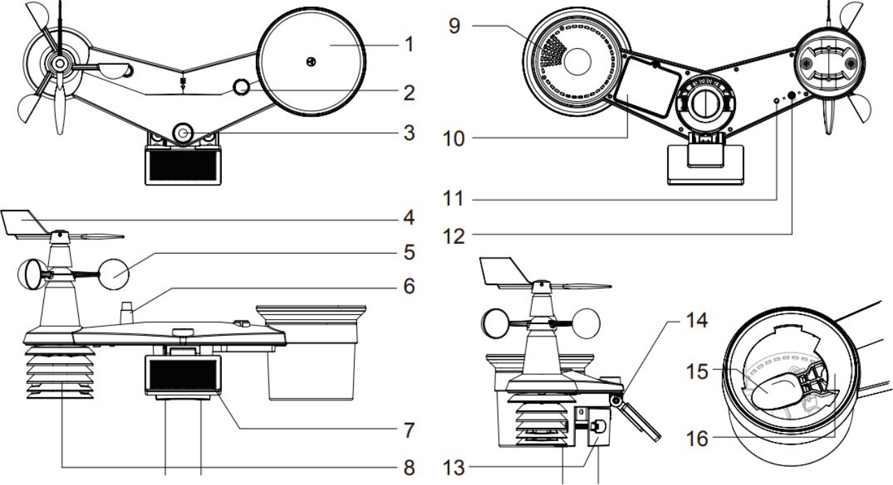

# Seeed Studio SenseCAP S2120 8-in-1 LoRaWAN Weather Sensor


[**View Seeed Studio SenseCAP S2120 8-in-1 LoRaWAN Weather Sensor on OpenELAB**](https://openelab.io/products/seeed-studio-sensecap-s2120-8)

**Model / option:** Seeed Studio SenseCAP S2120 8-in-1 LoRaWAN Weather Sensor · **SKU:** `Seeed-101990961`


## Product overview <a href="#product-and-scope" id="product-and-scope"></a>

SenseCAP S2120, `Seeed-101990961`, is a solar-assisted, AA-battery-powered **LoRaWAN Class A** weather station measuring eight weather variables. Bluetooth is used for local setup; a configured LoRaWAN gateway/network server is required for remote reports. It is not a Meshtastic radio and it is not the wired SenseCAP ONE S700-A.

The same863–928 MHz hardware supports the documented regional plans. On first use the frequency plan is unset, so the device does not transmit until Bluetooth configuration has selected a plan. Match region, network and sub-band before mounting. [Seeed exact S2120 introduction](https://wiki.seeedstudio.com/Sensor/SenseCAP/SenseCAP_LoRaWAN_Sensor/SenseCAP_S2120_8-in-1_LoRaWAN_Weather_Sensor/SenseCAP_S2120_8-in-1_LoRaWAN_Weather_Sensor_Introduction/).

## Applications

Use S2120 for a garden, farm, school or urban weather observation point with LoRaWAN coverage. It favors periodic low-data-rate reporting over a continuously connected weather display. Choose siting that exposes rain, wind, UV and light while avoiding radiant heat from buildings; one convenient mounting point may bias several channels differently.

Keep sample interval and transmission interval with stored observations. Rain rate, accumulated rain and individual tipping-bucket events are different quantities. A missing packet must be represented as missing data rather than zero rain/wind. Solar assistance extends service life but does not recharge the specified non-rechargeable AA cells.

## Specifications

| Channel           | Manufacturer range          | Accuracy / resolution                                        |
| ----------------- | --------------------------- | ------------------------------------------------------------ |
| Air temperature   | −40 to +60 °C sensing range | ±0.5 °C at0–40 °C; ±1 °C outside that range;0.1 °C           |
| Relative humidity | 1–99% RH                    | ±3% at1–90% RH; ±4% at90–99%;1% RH                           |
| Pressure          | 540–1100 hPa                | ±5 hPa at700–1100, ±8 hPa at540–699;1 hPa                    |
| Wind speed        | 0–50 m/s                    | ±0.5 m/s below5 m/s; ±10% above5 m/s;0.1 m/s                 |
| Wind direction    | 0–360°                      | ±8°;1°                                                       |
| Light             | 0–200000 lux                | ±5%;1 lux                                                    |
| UV index          | 0–16                        | ±10%;0.1                                                     |
| Hourly rainfall   | 0–450 mm/h                  | ±7%; tipping increment0.254 mm per hour-rate reporting table |

| System parameter      | S2120-specific condition                                                                           |
| --------------------- | -------------------------------------------------------------------------------------------------- |
| Radio / protocol      | WM-LR1110-based, LoRaWAN1.0.3 Class A; no direct RS485 output assumed                              |
| RF plans              | EU868, US915, AU915, AS923 groups1–4, IN865, KR920, RU864; US/AU sub-band must match network       |
| Output / sensitivity  | Up to21 dBm documented; −141 dBm atSF12/BW125 kHz reported                                         |
| Power                 | 0.5 W integrated solar panel; **3 AA internal or6 AA external**1.5 V cells, batteries not included |
| Cell chemistry        | Alkaline or non-rechargeable lithium AA; do not substitute3.7 V lithium-ion cells                  |
| Operating temperature | −20 to +60 °C with alkaline; −40 to +60 °C with specified lithium AA                               |
| Report interval       | Manufacturer setup defaults to60 minutes; deployment interval configurable                         |
| Weather head mass     | 1.5 kg documented; shipping weight is a different value                                            |
| External battery box  | 6 AA,2 m cable, IPX6 specified for box                                                             |

The numerical source is the **official specification figure**, visually reviewed in the [S2120 introduction](https://wiki.seeedstudio.com/Sensor/SenseCAP/SenseCAP_LoRaWAN_Sensor/SenseCAP_S2120_8-in-1_LoRaWAN_Weather_Sensor/SenseCAP_S2120_8-in-1_LoRaWAN_Weather_Sensor_Introduction/). It does not specify an equivalent IP rating for every open connector/installation condition. Read the current manual and received cell specifications for deployment limits.

## Hardware and connections <a href="#hardware-and-technical-documents" id="hardware-and-technical-documents"></a>



_S2120 weather head, tipping-bucket rain gauge, solar panel and battery/control layout — Seeed Studio,_ [_original diagram_](https://wiki.seeedstudio.com/Getting_Started_with_SenseCAP_S2120_8-in-1_LoRaWAN_Weather_Sensor/)_._

Install the rain funnel and turn it clockwise into its lock. Start with three matched1.5 V AA cells in the internal compartment, following the molded polarity marks. For the six-cell external box, install all cells, use the supplied replacement door and correctly oriented dummy battery, with its **OUTSIDE** mark facing outward. Do not energize both improvised battery paths or replace the dummy connection with arbitrary wiring. The standard guide describes solar power taking priority when available and AA supply otherwise; it does not describe AA charging. [Power preparation](https://wiki.seeedstudio.com/Getting_Started_with_SenseCAP_S2120_8-in-1_LoRaWAN_Weather_Sensor/).

Mount on the documented30–40 mm pole using the supplied clamp and rubber pads. Point the N marker north, level the weather head with its bubble level and lock the clamp. Adjust the solar panel to a documented0°,15°,30°,45° or60° tilt, approximately matching local latitude; in the southern hemisphere orient the panel north. Remove its shipping film. Keep access for periodic funnel cleaning and battery service. Perform configuration on the ground before installing a tall pole.

This model uses a physical rain funnel/tipping bucket and cup/vane wind assembly. Do not apply the S700-A radar-rain/ultrasonic maintenance assumptions. Ensure the funnel is level and clear of debris without treating an arbitrary poured volume as a traceable rain calibration.

## Software and development resources <a href="#development-software-and-recovery" id="development-software-and-recovery"></a>

Use the **SenseCraft** app's S2120 Weather Station setup mode. The guide's default BLE password is `000000`. An account is optional for offline configuration; select the intended Global server location when using the documented SenseCAP cloud path. Save device EUI, firmware, region/sub-band and chosen platform before provisioning the network server.

| Integration path                             | Required pairing of configuration and software                                                                                                              |
| -------------------------------------------- | ----------------------------------------------------------------------------------------------------------------------------------------------------------- |
| SenseCAP platform                            | Factory credentials matching the label and intended cloud account                                                                                           |
| TTN/The Things Stack or other LoRaWAN server | Register the EUI and the **credentials currently shown after selecting that platform**; do not assume label keys remain active                              |
| OTAA                                         | Default activation; match DevEUI, JoinEUI/AppEUI and AppKey to the actual device                                                                            |
| ABP                                          | Only when deliberately configured; use current session parameters and frame-counter policy from that server                                                 |
| Payload decoding                             | Use the exact S2120 decoder matching firmware, not a generic S210x or S700 Modbus decoder                                                                   |
| Sensor firmware                              | Update through the manufacturer's supported app path; introduction recommends2.1 for reporting stability, but record the version actually offered/installed |

Sources: [S2120 setup](https://wiki.seeedstudio.com/Getting_Started_with_SenseCAP_S2120_8-in-1_LoRaWAN_Weather_Sensor/) and [official S2120 TTN decoder](https://github.com/Seeed-Solution/SenseCAP-Decoder/blob/d0a234205fb9574dd03abd49561b60c243c0d1e3/S2120/TTN/SenseCAP_S2120_TTN_Decoder.js). The decoder is linked to its upstream source; no complete third-party implementation is republished here.

## Getting started

### First joined device and decoded weather sample

1. Install the correct batteries and place the station near a working LoRaWAN gateway in a dry bench/test area. In SenseCraft choose S2120 Weather Station, press Setup to enable Bluetooth, scan the BT ID on the base label and enter the current password.
2. Read basic information. Select the intended platform first, then the regional frequency plan and any required sub-band. Save and read back. An unset plan explains a steady red indication and no radio traffic on a new device.
3. Register the device in the network server using its **current** EUI/keys, LoRaWAN1.0.3 and the same regional plan as the gateway. Confirm the gateway is online and that its downlink channels also match. Keep private keys out of shared screenshots/logs.
4. Retain OTAA for the initial test. Choose a supported short test report interval in the app, read it back, and watch the server for join request, join accept and application uplink. Do not leave a high-traffic test interval configured for field deployment.
5. Install the current S2120 payload formatter on the application/device. Inspect the raw payload and the decoded measurement IDs/values. A successful join without an application payload is a different fault from a failed decoder.
6. Compare local temperature/humidity/pressure with plausible surroundings and record one complete report set with time, firmware, frame counter and RF metadata. Multiple frames can carry different measurement subsets; do not require all eight values in every packet.
7. Restore the intended interval, disconnect the configuration session and verify a later autonomous report before mounting. After final alignment, repeat the RF check at the real site and retain a service baseline.

**Expected result:** accepted OTAA join plus a recent raw uplink and S2120-decoded weather values. An app displaying device configuration is not proof of gateway/server delivery. [Manufacturer commissioning](https://wiki.seeedstudio.com/Getting_Started_with_SenseCAP_S2120_8-in-1_LoRaWAN_Weather_Sensor/).

### Original decoder-inspection wrapper

Use Node.js and obtain the S2120 decoder file from the pinned official link above. Save it locally as `SenseCAP_S2120_TTN_Decoder.js`, inspect it, then save the following original wrapper as `inspect_s2120.cjs`. This wrapper validates input and prints only measurement records; it does not replace the manufacturer's decoder or contact a device.

```javascript
const fs = require('node:fs');
const vm = require('node:vm');
const hex = (process.argv[2] || '').replace(/\s+/g, '');
if (!hex || hex.length % 2 || !/^[0-9a-f]+$/i.test(hex)) {
  throw new Error('Provide an even-length hexadecimal application payload');
}
const bytes = Array.from(Buffer.from(hex, 'hex'));
const context = vm.createContext({});
vm.runInContext(fs.readFileSync('SenseCAP_S2120_TTN_Decoder.js', 'utf8'),
                context, {timeout: 1000});
context.payloadInput = {bytes, fPort: 1};
const decoded = vm.runInContext('decodeUplink(payloadInput)', context,
                                {timeout: 1000});
if (!decoded.data || !Array.isArray(decoded.data.messages)) {
  throw new Error('Unexpected S2120 decoder result structure');
}
for (const row of decoded.data.messages.flat(Infinity)) {
  if (row && row.measurementId) {
    console.log(JSON.stringify({id: row.measurementId,
                              type: row.type,
                              value: row.measurementValue}));
  }
}
```

Run `node inspect_s2120.cjs YOUR_CAPTURED_HEX` using an actual application payload. For a **synthetic parser exercise only**, `0100fa320000271032000a` represents one type01 block under the reviewed decoder. Expected records are IDs4097/4098/4099/4190/4105 with25 °C,50% RH,10000 lux, UV5 and1 m/s. These are constructed inputs, not a received weather report. The example and wrapper were not executed here. Keep decoder revision with exported results; unfamiliar frame types/error records should be retained for inspection rather than silently converted to zero.

### Data interpretation and cloud access

| Measurement ID | Quantity                                              | Integration check                                                          |
| -------------- | ----------------------------------------------------- | -------------------------------------------------------------------------- |
| 4097 /4098     | Temperature / humidity                                | Retain °C and%RH and sample age                                            |
| 4099 /4190     | Light / UV index                                      | Lux and dimensionless index are different                                  |
| 4105 /4104     | Wind speed / direction                                | m/s and degrees; missing direction in calm air needs deliberate handling   |
| 4113           | Rain gauge value                                      | Confirm frame/firmware meaning before calling it a rate or accumulating it |
| 4101           | Pressure                                              | Verify decoder output units before converting to hPa                       |
| 4191 /4213     | Peak gust / rain accumulation in newer decoder frames | Only display when actually received/supported                              |

Seeed's [SenseCAP API documentation](https://wiki.seeedstudio.com/Cloud_Chain/SenseCAP_API/SenseCAP_API_Introduction/) provides HTTP historical data and MQTT/WebSocket real-time routes. Use the selected cloud's own authentication/subscription contract; an OTAA AppKey is not a cloud API password. For TTN/ChirpStack, integrate decoded application events through that server rather than simultaneously assuming SenseCAP cloud storage.

## Troubleshooting and FAQs <a href="#faqs" id="faqs"></a>

| Symptom                              | Ordered checks                                                                                                  |
| ------------------------------------ | --------------------------------------------------------------------------------------------------------------- |
| No Bluetooth scan                    | Correct S2120 setup page, press Setup, battery polarity, nearby phone permissions, BT ID                        |
| Red indicator, no RF                 | Read frequency plan; unset is intentional silence on first use                                                  |
| Join requests but no join accept     | Platform-specific keys/EUI, server activation mode, gateway downlink plan/sub-band and routing                  |
| Joined, uplinks not decoded          | Correct device application, raw payload present, S2120 formatter version/frame type; preserve raw bytes         |
| One or more fields absent            | Different frame subsets, unsupported firmware feature or sensor error event; do not fill with zero              |
| Rain remains0                        | Funnel locked/level/clear, inspect genuine rainfall/report interval and frame type before changing calibration  |
| Wind direction consistently rotated  | N marker alignment, pole movement and nearby obstructions                                                       |
| Low battery after short service      | Correct1.5 V chemistry, original external-box dummy orientation, solar film/shadow, RF retries and interval     |
| Returning from TTN to SenseCAP fails | Manufacturer requires factory settings/credentials restored for the SenseCAP platform; save existing keys first |

Clean the rain gauge every few months and inspect after debris/storms. Replace cells as a matched set of the approved chemistry. Record maintenance timestamps so cleaning/restart effects are not interpreted as weather events.

## Downloads and technical documents

| Resource                                                                                                                                                                                                          | Purpose                                                                   |
| ----------------------------------------------------------------------------------------------------------------------------------------------------------------------------------------------------------------- | ------------------------------------------------------------------------- |
| [S2120 user guide PDF](https://files.seeedstudio.com/products/SenseCAP/101990961_SenseCAP%20S2120/SenseCAP%20S2120%20LoRaWAN%208-in-1%20Weather%20Station%20User%20Guide.pdf)                                     | Exact weather station manual                                              |
| [Introduction/specification figure](https://wiki.seeedstudio.com/Sensor/SenseCAP/SenseCAP_LoRaWAN_Sensor/SenseCAP_S2120_8-in-1_LoRaWAN_Weather_Sensor/SenseCAP_S2120_8-in-1_LoRaWAN_Weather_Sensor_Introduction/) | Numerical ranges, AA power and regional plans                             |
| [Commissioning, battery and mounting guide](https://wiki.seeedstudio.com/Getting_Started_with_SenseCAP_S2120_8-in-1_LoRaWAN_Weather_Sensor/)                                                                      | App provisioning, network/cloud paths and maintenance                     |
| [Pinned official TTN decoder](https://raw.githubusercontent.com/Seeed-Solution/SenseCAP-Decoder/d0a234205fb9574dd03abd49561b60c243c0d1e3/S2120/TTN/SenseCAP_S2120_TTN_Decoder.js)                                 | Direct JS download; keep source attribution/license and selected revision |
| [Battery-life prediction worksheet](https://files.seeedstudio.com/SenseCAP_S21XX_Sensor_%20Battery_Life_Prediction.xlsx)                                                                                          | Workload/temperature/network-dependent planning; not measured here        |

### Additional manufacturer references <a href="#official-documentation-and-development-resources" id="official-documentation-and-development-resources"></a>

* [Manufacturer reference 1](https://wiki.seeedstudio.com/SenseCAP_Decoder/)
* [Manufacturer reference 2](https://www.seeedstudio.com/sensecap-s2120-lorawan-8-in-1-weather-sensor-p-5436.html)

## References and validation <a href="#sources-and-validation" id="sources-and-validation"></a>

Reviewed 24 November 2026: live SKU101990961 listing, exact S2120 introduction/specification image, commissioning guide, user manual and official decoder at `d0a234205fb9574dd03abd49561b60c243c0d1e3`. Physical/specification diagrams were visually inspected; figures remain attributed to Seeed Studio. The decoder wrapper and staged network test are original.

**Source reviewed; decoder execution, firmware update, LoRaWAN join, physical installation, weather calibration and battery tests not run.** Synthetic values above are solely an input-format example; use actual captured data for commissioning.
