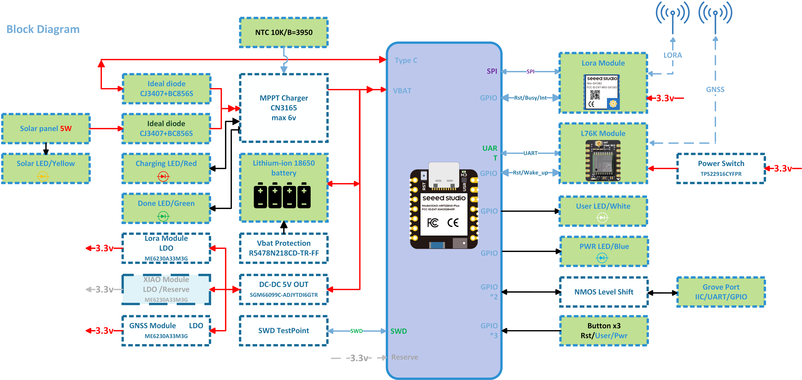

# Seeed Studio SenseCAP Solar Node P1-Pro for MeshCore


[**View Seeed Studio SenseCAP Solar Node P1-Pro for MeshCore on OpenELAB**](https://openelab.io/products/seeed-studio-sensecap-solar-node-p1-pro-for-meshcore)

**Model / option:** Seeed Studio SenseCAP Solar Node P1-Pro for MeshCore · **SKU:** `Seeed-100023690`

[**View Seeed Studio SenseCAP Solar Node P1-Pro for Meshtastic GPS Battery Included on OpenELAB**](https://openelab.io/products/seeed-studio-sensecap-solar-node)

**Model / option:** Seeed Studio SenseCAP Solar Node P1-Pro for Meshtastic GPS Battery Included · **SKU:** `Seeed-114993633`


## Product overview 

SenseCAP Solar Node P1-Pro is a fixed outdoor LoRa node with an integrated solar panel, replaceable battery bank and GNSS. The two listed SKUs use the same documented P1-Pro hardware family but arrive for **different mesh ecosystems**. A MeshCore repeater does not relay Meshtastic packets. Select the firmware workflow before installing the unit where USB access is difficult.

| Exact SKU         | Store option                                      | First commissioning path                                                        |
| ----------------- | ------------------------------------------------- | ------------------------------------------------------------------------------- |
| `Seeed-100023690` | P1-Pro for MeshCore                               | Configure a MeshCore **Repeater** over USB; use a separate Companion to test it |
| `Seeed-114993633` | P1-Pro for Meshtastic, GPS and batteries included | Pair a Meshtastic client; configure region, channel and position                |

P1 without Pro is a separate configuration; its optional battery/GPS instructions do not mean these parts are missing from either listed P1-Pro. [Seeed hardware overview](https://wiki.seeedstudio.com/meshtastic_solar_node/).

## Applications

Use the P1-Pro to extend a surveyed outdoor mesh, provide a stationary position reference or relay short field messages. Start with a measured two-way link at the proposed site. Trees, wet foliage, antenna height, feed-line loss, traffic and winter sunlight change results; the manufacturer's open-area distance is a scenario, not a site coverage guarantee. Solar power does not remove the need for an energy budget or battery maintenance.

For a sensor node, the Grove connection can host a firmware-supported environmental sensor. A generic Grove connector is not automatic support for every Grove module. A permanent repeater should have a recorded location and a reachable recovery plan; it is not a substitute for a separately engineered emergency communications service.

## Specifications 

| Parameter                | P1-Pro scope and integration meaning                                                                                  |
| ------------------------ | --------------------------------------------------------------------------------------------------------------------- |
| Host                     | XIAO nRF52840 Plus; 64 MHz Cortex-M4F, 256 kB RAM, 1 MB internal flash, 2 MB onboard external flash                   |
| Radio                    | Wio-SX1262; documented 862–930 MHz module band; up to +22 dBm conducted output                                        |
| Position                 | XIAO L76K fitted to Pro; enabling and transmitting position depend on firmware settings                               |
| Panel and external input | 5 W panel; USB-C 5 V / 1 A and documented solar supply 5 V / 1 A                                                      |
| Charger                  | CN3165, reported 0.99 A charge-management setting; actual current depends on light, cell temperature and charge state |
| Pro batteries            | Four 3350 mAh 18650 NMC cells; replacement guide specifies **button-top 3.6 V** cells                                 |
| Charging / discharge     | Published cell charging environment 0–50 °C; discharge −40 to +60 °C; these are different limits                      |
| LoRa antenna             | Supplied 868–915 MHz rod antenna, 2 dBi; match the operating region and connector                                     |
| Interfaces               | USB-C data/debug, one Grove I²C/GPIO/UART port; internal radio SPI and GNSS UART                                      |
| Enclosure / dimensions   | IPX6 when correctly assembled; 191.2 × 201.2 × 42.1 mm                                                                |

Hardware values: [Seeed P1-Pro specifications](https://wiki.seeedstudio.com/meshtastic_solar_node/). The charger block diagram's component maximum is not permission to raise the product's specified **5 V** solar/USB input. Do not treat four battery positions as a 4-series 14.4 V input.

## Hardware and connections

_P1-Pro solar, battery, charger and radio power architecture — Seeed Studio,_ [_original diagram_](https://wiki.seeedstudio.com/meshtastic_solar_node/)_._

### Connect and seal before deployment

1. Assemble the base plate, washers, universal joint and pole clamp on the ground. Connect the RF feed and correct-band antenna before enabling radio transmission. Avoid torque on the small board antenna connector.
2. Use a regulated 5 V USB source for bench setup. Keep the data cable accessible. Identify **Power**, **Reset** and **User** controls separately; a Reset double press invokes DFU, while Power behavior depends on MeshCore release.
3. Leave factory-fitted cells in place for initial bring-up. For service, remove USB, shade/disconnect the solar supply, open the cover, and confirm the printed cell polarity before replacing with the specified cell type. Do not mix cell chemistries, ages or charged/discharged cells.
4. Route any sensor cable without crushing the gasket. The illustrated level-shifting path does not establish an unlimited sensor-current budget. Confirm the exact peripheral supply and bus level before connection; do not feed external 5 V into an nRF GPIO.
5. Refit the cover evenly, check gasket seating and secure the antenna feed. Tilt the panel so water does not pool; select orientation for the site's sunlight and avoid shading from the mounting mast.

The [Meshtastic installation guide](https://wiki.seeedstudio.com/get_started_with_meshtastic_solar_node/) covers battery/GPS access, bracket assembly, optional sensors and antenna upgrades. Use its exact mechanical illustrations rather than transferring L1 Pro wiring to this assembly.

## Software and development resources 

| Task                   | Correct target / interface                                                                                                          |
| ---------------------- | ----------------------------------------------------------------------------------------------------------------------------------- |
| MeshCore factory SKU   | [MeshCore flasher](https://meshcore.io/flasher), Community Firmware → **Seeed Studio SenseCAP Solar** → **Repeater**                |
| MeshCore configuration | [USB configuration tool](https://config.meshcore.io/); serial console `ver` reports firmware identity                               |
| Meshtastic factory SKU | [Meshtastic flasher](https://flasher.meshtastic.org/) → exact **Seeed SenseCAP Solar Node** entry; use release matching that device |
| Meshtastic client      | Android/iOS app or [web client](https://client.meshtastic.org/); BLE/serial transports are local client connections                 |
| Sensor expansion       | Enable the installed firmware's supported telemetry driver; inspect bus assignment and sensor-address compatibility first           |

Do the first check with the supplied firmware. Back up region, channel keys, identity and administrative settings before switching ecosystems; the erase step removes configuration. For nRF52840, use the manufacturer-supported USB/UF2 process, not a generic ESP32 image or an arbitrary nRF OTA updater. The two app ecosystems and their encryption/channel settings are separate.

## Getting started 

### MeshCore: prove repeater transmit and return path

Prerequisites: P1-Pro MeshCore SKU, antenna, 5 V USB data connection, supported browser, and at least one configured MeshCore Bluetooth Companion. A second Companion is useful for a forwarding test.

1. Power the Solar Node by USB and connect the MeshCore flasher Console. Issue `ver`; record the actual release. A running node returns its version. A quiet LED is not a failure by itself.
2. Open the USB configuration tool, select the node and set a locally permitted radio preset. Match the Companion's frequency, bandwidth, spreading factor and coding rate. Save and reboot so the setting takes effect. A region label alone is insufficient if custom settings differ.
3. Set the repeater name and location policy. Change the factory administrator password (`password`) before remote management. If showing a fixed location, confirm whether GPS or an explicit surveyed position is appropriate.
4. Choose **Send Advert**. Confirm the Companion discovers the repeater. This establishes Solar Node → Companion reception; it does not yet establish the reverse path.
5. Open the repeater contact on the Companion and run **Ping**. A successful reply verifies both directions. Then unplug USB and repeat with the battery-powered node.
6. For a route test, exchange adverts between two Companions, select the discovered repeater in the path, send `SOLAR-A-01`, and reply `SOLAR-B-01`. Record time, selected path, location, RSSI/SNR when exposed, and whether the reply reached the sender. Repeat at the planned antenna height before permanent mounting.

**Expected result:** an advert appears in the Companion, a ping returns, and a numbered round-trip message succeeds on battery. Receiving a packet without forwarding/reply does not require the TX LED to blink. [Seeed active verification procedure](https://wiki.seeedstudio.com/get_started_with_meshcore_solar_node/).

### Interpret firmware-dependent controls

| MeshCore release | TX LED | Power button                                                          |
| ---------------- | ------ | --------------------------------------------------------------------- |
| 1.12.0–1.14.0    | Blue   | Power application starts the device; button shutdown unsupported      |
| 1.14.1–1.15.x    | White  | Brief press wakes from off; hold about 1.5 s then release to turn off |
| 1.16.0 onward    | Blue   | Supported power-button operation as above                             |

Red/green indicate charging/completion and yellow indicates solar input; they are not LoRa reception indicators. The guide reports a default flood-advert interval change to 47 hours from MeshCore 1.16.0. Read the saved intervals and actively send an advert instead of waiting overnight to decide whether the radio works. [Version-specific controls](https://wiki.seeedstudio.com/get_started_with_meshcore_solar_node/).

### Meshtastic: establish one text packet before GPS or telemetry

1. Start the Pro with its antenna fitted. Pair the exact node in the Meshtastic app; verify its device ID against the label or serial `nodenum` log. Use the PIN configured by the device rather than assuming every firmware has the same pairing policy.
2. Set the correct LoRa region and wait for restart. On a second Meshtastic radio set the same region, modem preset, frequency slot and primary-channel name/key. Keep the default client role for initial testing.
3. Send `P1-PRO-CHECK-01` from node A, observe it at B, and return `P1-PRO-REPLY-01`. A phone's Bluetooth connection alone does not show that LoRa is working.
4. Enable GPS in Position settings, take the antenna into open sky and inspect the timestamp and fix. Select update/broadcast intervals that fit the power budget; verify whether the map uses the node's GNSS location or phone-provided position.
5. For a supported Grove sensor such as an SHT31, power down before attachment, then enable environmental telemetry. Check a local reading with units before enabling mesh broadcasts. Keep detection-switch settings separate from an I²C temperature/humidity driver.
6. Repeat the message test with USB disconnected and then check charging in sunlight. Record the battery trend over complete day/night periods; one charging LED does not establish winter autonomy.

**Expected result:** readable text is exchanged in both directions, followed by a plausible, current position or sensor sample if enabled. [Meshtastic commissioning](https://wiki.seeedstudio.com/get_started_with_meshtastic_solar_node/).

### Recovery flashing when the application is unusable 

Use the chosen ecosystem's **exact Solar Node** flasher entry. Download its erase UF2 and application UF2. Double-press Reset, allow the DFU drive to enumerate, copy the erase image and wait for completion; re-enter DFU if needed, then copy the application image. Keep power connected throughout. Erase completion can leave no application running, so drive disappearance is not yet a successful recovery.

A bootloader restore is a separate last resort when a DFU serial port still exists. Seeed supplies the [XIAO nRF52840 BLE serial-DFU bootloader package](https://files.seeedstudio.com/wiki/SenseCAP/Meshtastic/xiao_nrf52840_ble_bootloader.zip). Use the Solar Node recovery procedure and exact package, re-identify any changed serial port, and reinstall the application afterward. A bootloader installation does not restore region or mesh credentials.

## Troubleshooting and FAQs 

| Symptom                              | Ordered diagnosis and action                                                                                                                                         |
| ------------------------------------ | -------------------------------------------------------------------------------------------------------------------------------------------------------------------- |
| MeshCore node will not pair to phone | Confirm **Repeater** role; configure by USB and connect the phone to a separate Bluetooth Companion                                                                  |
| White TX LED / Power appears faulty  | Read `ver`; compare the version table before replacing hardware                                                                                                      |
| No repeat after a received message   | Trigger advert and ping; a repeater does not retransmit every received packet                                                                                        |
| USB absent, only green LED           | Check data cable and port first; follow Seeed's all-power removal procedure, including shading solar input and disconnecting cells, before retrying                  |
| Good BLE, no mesh packets            | Verify ecosystem, region and full modulation settings, then channel key/path; test nearby with correct antennas                                                      |
| Meshtastic broadcasts work, DMs fail | Exchange user information again; inspect stale NodeDB/public-key state; reset NodeDB before regenerating identity keys                                               |
| Reboots on battery                   | Charge and inspect cell contacts/polarity, accessories and GNSS load; only then investigate firmware or perform erase/install                                        |
| Charges poorly in winter             | Inspect panel shadow, tilt, contamination and battery charge-temperature limit; reduce unnecessary broadcasts and measure current at the battery boundary            |
| Upgrade to higher-gain antenna       | Match frequency/connector, include feed loss and actual transmit setting in the deployment's RF calculation; do not assume maximum module output remains appropriate |

Prefer restoring a working configuration over repeated erase cycles. Export diagnostics before factory reset, since a reset changes keys and invalidates prior peer state.

## Downloads and technical documents 

| Resource                                                                                                                                                                            | Purpose                                                                            |
| ----------------------------------------------------------------------------------------------------------------------------------------------------------------------------------- | ---------------------------------------------------------------------------------- |
| [P1 / P1-Pro overview and block diagram](https://wiki.seeedstudio.com/meshtastic_solar_node/)                                                                                       | Hardware family, indicators and assembly references                                |
| [MeshCore installation, role and recovery](https://wiki.seeedstudio.com/get_started_with_meshcore_solar_node/)                                                                      | Exact Solar Node flasher selection and version differences                         |
| [Meshtastic installation and recovery](https://wiki.seeedstudio.com/get_started_with_meshtastic_solar_node/)                                                                        | Battery/GPS, sensors, mounting and channel diagnosis                               |
| [Manufacturer Meshtastic energy worksheet](https://files.seeedstudio.com/products/SenseCAP/Wio-Tracker/Solar%20Node%20Consumption%20Test%20and%20Battery%20Life%20Calculation.xlsx) | Manufacturer measurements and calculation method; not measurements from this guide |
| [MeshCore repeater energy worksheet](https://files.seeedstudio.com/wiki/SenseCAP/Meshcore/SolarNode/mesh_repeater_power_table_en1.xlsx)                                             | Release/workload-dependent budgeting                                               |
| [Serial DFU bootloader ZIP](https://files.seeedstudio.com/wiki/SenseCAP/Meshtastic/xiao_nrf52840_ble_bootloader.zip)                                                                | Exact manufacturer recovery package; keep ZIP intact                               |

### Retained product illustrations

### Additional manufacturer references

* [Manufacturer reference 1](https://files.seeedstudio.com/wiki/SenseCAP/Meshtastic/solar-node.png)
* [Manufacturer reference 2](https://github.com/meshcore-dev/MeshCore)
* [Manufacturer reference 3](https://github.com/meshtastic/firmware)

## References and validation 

Reviewed 24 November 2026: the exact two OpenELAB listings, Seeed P1-Pro hardware overview, and both ecosystem setup/recovery guides. The diagram is an attributed, unmodified Seeed figure. The commissioning packet names, isolation sequence and field acceptance procedure above are original engineering guidance.

**Source reviewed; compilation, firmware flashing, RF range, battery/current and hardware tests not run.** Firmware controls and flasher menus can change; record the selected release and actual observations before unattended installation.
