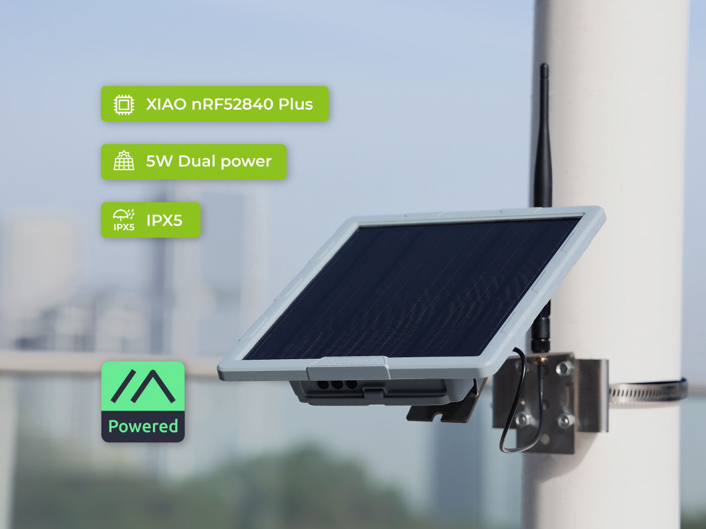

# Seeed Studio SenseCAP Solar Node P1-Pro Development Guide


[**View Seeed Studio SenseCAP Solar Node P1 / P1-Pro on OpenELAB**](https://openelab.io/products/seeed-studio-sensecap-solar-node-p1-pro-for-meshcore)

**Model/variant:** Seeed Studio SenseCAP Solar Node P1 / P1-Pro · **SKUs:** `Seeed-100023690`, `Seeed-114993633`


_Manufacturer image: Seeed Studio._ [_Image source_](https://files.seeedstudio.com/wiki/SenseCAP/Meshtastic/solar-node.png)_._

[Product at OpenELAB](https://openelab.io/products/seeed-studio-sensecap-solar-node-p1-pro-for-meshcore) · [Manufacturer wiki hub](./)

## Product and development scope

**SenseCAP Solar Node P1-Pro** is a solar-powered LoRa node for extending an outdoor mesh or adding a remotely placed node. Applications include site coverage experiments, off-grid status/location messages and low-rate sensor integration. Solar charging is an energy source, not a guarantee of continuous uptime in every installation.

This guide covers the **P1-Pro**, including the OpenELAB Meshtastic configuration (114993633) and MeshCore configuration (100023690). The P1 base variant has different GNSS/battery scope. Verify the delivered firmware and fitted batteries before deployment.

**P1 versus P1-Pro compatibility note:** Seeed's [official Solar Node variant table](https://wiki.seeedstudio.com/meshtastic_solar_node/) identifies the P1-Pro as the configuration with an integrated L76K GNSS receiver and an included four-cell 18650 battery arrangement. Confirm your purchased P1/P1-Pro SKU, battery installation and firmware target before following GNSS-specific or charging instructions; the two variants are not interchangeable.

## Hardware specifications

| Item        | SenseCAP Solar Node P1-Pro                                                |
| ----------- | ------------------------------------------------------------------------- |
| Controller  | XIAO nRF52840 Plus; Cortex-M4F                                            |
| Radio       | Wio-SX1262 / Semtech SX1262                                               |
| GNSS        | L76K fitted in the P1-Pro reference                                       |
| Solar       | Integrated 5 W panel                                                      |
| Battery     | P1-Pro reference: four 3350 mAh 18650 NMC cells; confirm supplied package |
| Wired input | USB-C 5 V / 1 A                                                           |
| Expansion   | Grove I2C/GPIO/UART                                                       |
| Enclosure   | IPX6 reference; 191.2 × 201.2 × 42.1 mm                                   |

Source: [manufacturer hardware reference](https://wiki.seeedstudio.com/meshtastic_solar_node/). Match the radio/antenna variant and physical board revision before selecting firmware or adding hardware.

## Choose the network and device role

Meshtastic and MeshCore are different firmware ecosystems. Sharing the LoRa radio band does not make their application protocols compatible. Use two nodes running the same ecosystem for the first test. A phone-linked **companion** and an infrastructure **repeater** also serve different purposes; choose the role that matches the intended deployment.

Use the current country/region settings provided by that firmware and the matching antenna. An unset or mismatched region, channel or key can prevent communication even when both devices appear connected to their phones. Record firmware versions, hardware targets and radio/channel configuration with each test; keep private channel keys out of published logs.

## Getting started: one controlled radio test

1. Inspect the supplied P1-Pro, antenna, seals and power/battery configuration. Use USB power for the bench test before relying on the solar panel. Connect the correct antenna before transmitting.
2. If it already runs the intended ecosystem, begin with its current firmware. For Meshtastic, follow the [Solar Node Meshtastic setup](https://wiki.seeedstudio.com/get_started_with_meshtastic_solar_node/) and its exact flasher target.
3. For a MeshCore infrastructure deployment, the [manufacturer MeshCore guide](https://wiki.seeedstudio.com/get_started_with_meshcore_solar_node/) selects **Seeed Studio SenseCAP Solar** and **Repeater** in the [MeshCore flasher](https://meshcore.io/flasher). A repeater is not a Bluetooth phone companion.
4. Complete configuration using the selected firmware's documented management route. Set its region/radio parameters and prepare a separate compatible companion node for verification. Follow the guide's erase step only when the selected migration procedure requires it; preserve settings first.
5. Verify the repeater from that companion using the documented discovery/ping or node-information workflow. A lone repeater cannot demonstrate an end-to-end chat link. For Meshtastic, configure a second matching node/channel and exchange messages.

For a meaningful first test, send a unique short message or the firmware's supported node-information/ping request, verify its receipt at the other node, then test the return path. Start with a short unobstructed separation. A USB connection or successful phone pairing does not establish that radio traffic is reaching another node. A node list can contain old information, so use a fresh timestamp/message to identify the current result.

Record the two node identities, firmware versions, physical locations, antenna orientation, reported RSSI/SNR where available, and delivery result. Increase distance only after a repeatable nearby test. Hardware range claims are not a guaranteed link budget for a building or field installation.

## Firmware, SDK and hardware development

The [hardware overview](https://wiki.seeedstudio.com/meshtastic_solar_node/) includes board/interface diagrams. Use the [Meshtastic firmware source](https://github.com/meshtastic/firmware) or [MeshCore source](https://github.com/meshcore-dev/MeshCore) for the chosen stack. A dedicated full-enclosure CAD download was not identified in the reviewed introduction; do not treat another Solar Node revision as a mechanical substitute. For a deployed unit, evaluate shade, panel orientation, refresh/advertisement rate and measured battery trend before changing the workload.

For custom development, retain a known working vendor image and configuration first. Build for the exact target and preserve its bootloader/board definition. Confirm a stock image still works before diagnosing your own application. Use the official source projects and their release notes for supported build tools; do not assume an ESP32 binary can be flashed onto an nRF52840 device.

## Troubleshooting and recovery

| Symptom                                  | Check and next action                                                                                             |
| ---------------------------------------- | ----------------------------------------------------------------------------------------------------------------- |
| Phone cannot find a MeshCore node        | Check its role. Repeater firmware is managed differently from Companion Bluetooth firmware.                       |
| No radio response                        | Use a separate compatible node; match ecosystem, region and radio/channel configuration.                          |
| Solar input is present but battery falls | Compare charging time/irradiance with actual radio/GNSS load; inspect seals, connections and charging conditions. |
| Only an LED remains on after update      | Use the P1-Pro-specific USB/DFU recovery section in the manufacturer guide; do not flash a Tracker L1 bootloader. |
| Firmware transfer fails                  | Use a data cable, stable power and the exact target. Keep the connection until the tool reports completion.       |

After a firmware change, verify both host connection and the two-node radio test again. Restore the same network/application family before comparing against an earlier result.

## Technical documents and software

| Resource                                                                                          | Use                                              |
| ------------------------------------------------------------------------------------------------- | ------------------------------------------------ |
| [Hardware and board diagrams](https://wiki.seeedstudio.com/meshtastic_solar_node/)                | P1 versus P1-Pro, connectors and power           |
| [Meshtastic setup/recovery](https://wiki.seeedstudio.com/get_started_with_meshtastic_solar_node/) | Exact image target and first configuration       |
| [MeshCore setup/recovery](https://wiki.seeedstudio.com/get_started_with_meshcore_solar_node/)     | Repeater role and verification from another node |
| [Meshtastic firmware source](https://github.com/meshtastic/firmware)                              | Build system, supported boards and releases      |
| [MeshCore source](https://github.com/meshcore-dev/MeshCore)                                       | Firmware/application reference                   |

**Review date:** 17 November 2026. **Validation:** official documentation and the cited software interfaces reviewed. Commands and examples have not been compiled or run on physical hardware by OpenELAB for this guide. Record your hardware revision, firmware, software versions and actual results when reproducing it.
