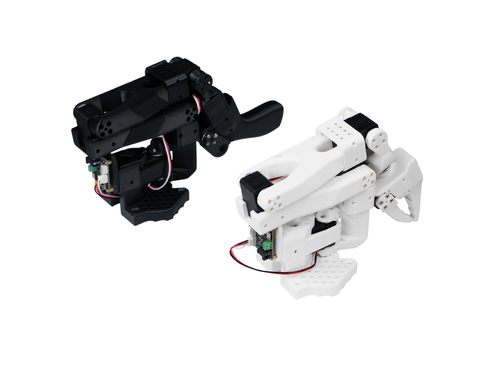

# Seeed Studio SO-ARM101 Pro Development Guide


[**View Seeed Studio SO-ARM101 Pro assembled robot arm on OpenELAB**](https://openelab.io/products/seeed-studio-so-arm101-pro-assembled-kit-lerobot-6dof-robotic-arm)

**Covered model:** Seeed Studio SO-ARM101 Pro assembled robot arm · **SKU:** `Seeed-100046482`




_Manufacturer image: Seeed Studio._ [_Image source_](https://files.seeedstudio.com/wiki/robotics/projects/lerobot/Arm_kit.png)_._

[Product at OpenELAB](https://openelab.io/products/seeed-studio-so-arm101-pro-assembled-kit-lerobot-6dof-robotic-arm) · [Manufacturer wiki hub](./)

## Product and kit scope

The **Seeed SO-ARM101 Pro assembled kit** is a leader/follower platform for teleoperation, demonstration collection and imitation-learning experiments. An assembled kit reduces mechanical assembly work; it does not remove the need to identify ports, confirm motor configuration and calibrate the actual pair.

| Item                  | Engineering meaning                                                                              |
| --------------------- | ------------------------------------------------------------------------------------------------ |
| Platform              | SO-ARM101 leader and follower architecture                                                       |
| Follower actuation    | Six Feetech STS3215-family serial servos; confirm the fitted voltage/gearing variant             |
| Host connection       | USB to each arm's servo controller                                                               |
| Pro power distinction | Leader: 5 V; follower: 12 V in Seeed's Pro instructions                                          |
| Main software         | Hugging Face LeRobot with Feetech support; Seeed SenseCraft Robotics is an alternative workflow  |
| Typical applications  | Teleoperation, pick-and-place demonstrations, camera-conditioned policy experiments and teaching |

**Do not swap the Pro leader and follower supplies.** The Standard kit's power instructions are different. Confirm labels against the manufacturer guide before applying power. Mount both arms securely and keep the follower workspace clear during calibration and motion.

Sources: [Seeed hardware/setup tutorial](https://wiki.seeedstudio.com/lerobot_so100m_new/), [SO-101 platform reference](https://huggingface.co/docs/lerobot/so101), [hardware project and drawings](https://github.com/TheRobotStudio/SO-ARM100).

## Prepare the development environment

Use a Linux host for the first supported workflow and follow the [LeRobot installation guide](https://huggingface.co/docs/lerobot/installation) for platform dependencies. This page records **LeRobot 0.7.0** as its package reference; its package metadata requires **Python 3.12 or later**. Do not combine commands from an old Seeed fork with a different upstream release without checking the CLI help.

In a dedicated environment:

Create a dedicated **Python 3.12** environment and install **LeRobot 0.7.0 with the Feetech extra** using the [official installation instructions](https://huggingface.co/docs/lerobot/installation). Verify the installed package version before connecting hardware. Then activate that environment and run `lerobot-find-port` to identify each arm.

Use `lerobot-find-port` to identify **one arm at a time** by unplug/replug detection. Record which physical arm owns each port; `/dev/ttyACM0` is an example, not a permanent identity. Fix serial permissions through the operating system's device-access mechanism rather than leaving a broad world-writable device permission as a permanent setup.

Reference: [LeRobot 0.7.0 package metadata](https://pypi.org/project/lerobot/0.7.0/). Installation commands are a documented baseline and have not been executed on an attached arm for this page.

## Getting started: calibrate before teleoperation

Check the commands available in the installed release:

```bash
lerobot-calibrate --help
lerobot-teleoperate --help
```

With the correct supplies, mounts and identified ports, follow the upstream calibration poses. Replace each example port with the corresponding physical device:

```bash
lerobot-calibrate   --robot.type=so101_follower   --robot.port=/dev/ttyACM0   --robot.id=openelab_follower

lerobot-calibrate   --teleop.type=so101_leader   --teleop.port=/dev/ttyACM1   --teleop.id=openelab_leader
```

The command prompts are interactive. Move through the manufacturer's specified calibration poses/ranges and support the links as instructed. Keep the same IDs in later commands so the correct calibration files are selected. Do not reassign motor IDs or run initial motor-setup tools on an assembled, configured arm merely because an assembly tutorial contains that step.

The first success criterion is completed calibration for both arms with the expected motors visible. For a teleoperation test, follow the [upstream real-robot workflow](https://huggingface.co/docs/lerobot/il_robots), use those same ports/IDs and first make a small leader movement in a clear follower workspace. Stop if the follower direction, scale or joint order is unexpected. Demonstration recording and policy deployment come after this check.

## Cameras, datasets and further development

Verify each camera independently before recording. Record camera identities, image size/frame rate, arm calibration IDs, software version and task definition with every dataset. A dataset with swapped camera views or inconsistent joint references can appear valid while being unsuitable for training.

The [SO-ARM101 training guide](https://wiki.seeedstudio.com/sensecraft_robotics_so_arm101/) documents Seeed's SenseCraft Robotics route. Keep that route's firmware, app and calibration procedures consistent instead of mixing them with unrelated LeRobot revisions. Hardware CAD, STL/BOM and assembly information are in the SO-ARM100/SO-ARM101 hardware project; use the SO101-specific files.

## Troubleshooting and FAQ

| Symptom                                       | First diagnostic                                                                                                                  |
| --------------------------------------------- | --------------------------------------------------------------------------------------------------------------------------------- |
| A servo is missing                            | Check correct supply, connector seating, bus order and IDs with power off; isolate the affected segment before changing settings. |
| Port opens but the wrong arm moves            | Re-identify the physical ports; enumeration order is not a reliable arm label.                                                    |
| Calibration is unexpectedly skipped           | Confirm the chosen arm ID and existing calibration record; back up records before deliberately recalibrating.                     |
| Follower moves in the wrong direction         | Stop; verify model type, calibration, motor configuration and joint mapping.                                                      |
| Training fails after teleoperation works      | Treat GPU/software, dataset format and model configuration as a separate layer from servo communication.                          |
| Is the “6DOF” store name a payload guarantee? | No. Use the hardware's actual kinematics, gripper configuration and manufacturer load limits.                                     |

## Technical documents and software

| Resource                                                                                          | Use                                           |
| ------------------------------------------------------------------------------------------------- | --------------------------------------------- |
| [Seeed setup and Pro power instructions](https://wiki.seeedstudio.com/lerobot_so100m_new/)        | Kit-specific bring-up                         |
| [SO101 hardware CAD, BOM and assembly](https://github.com/TheRobotStudio/SO-ARM100)               | Use the SO101 model-specific files            |
| [Upstream LeRobot repository](https://github.com/huggingface/lerobot)                             | SDK, examples, issues and release history     |
| [LeRobot SO-101 reference](https://huggingface.co/docs/lerobot/so101)                             | Calibration and configuration                 |
| [SenseCraft Robotics training guide](https://wiki.seeedstudio.com/sensecraft_robotics_so_arm101/) | Alternative manufacturer application workflow |

**Review date:** 17 November 2026. **Validation:** official documentation and the cited software interfaces reviewed. Commands and examples have not been compiled or run on physical hardware by OpenELAB for this guide. Record your hardware revision, firmware, software versions and actual results when reproducing it.

## Official documentation and development resources

Use [Getting Started with SO-ARM100 and SO-ARM101 Robotic Arms in LeRobot](https://wiki.seeedstudio.com/lerobot_so100m_new/) for the manufacturer's complete model reference, diagrams and maintained examples. The references below complement this guide's local instructions.

| Development need         | Model-specific reference                                                                                       |
| ------------------------ | -------------------------------------------------------------------------------------------------------------- |
| Official source: lerobot | [Read official source: lerobot](https://github.com/Seeed-Projects/lerobot)                                     |
| Mechanical / CAD files   | [Read mechanical / cad files](https://files.seeedstudio.com/wiki/robotics/projects/lerobot/so101/soarm101.stl) |

Keep the example's host model, interface pins and dependency versions together when reproducing a result. A schematic or SDK link does not establish that another revision uses the same wiring. Official model pages and accessible tutorial links reviewed **23 November 2026**. Other downloads above are manufacturer-listed resources; listing a file is not a test of its contents. Compilation, firmware flashing and hardware operation were **not performed** in this review.
