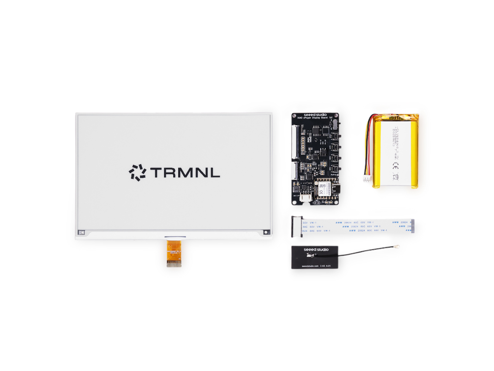

# Seeed Studio TRMNL 7.5-inch OG DIY Kit Development Guide


[**View Seeed Studio TRMNL 7.5-inch OG DIY Kit on OpenELAB**](https://openelab.io/products/seeed-studio-trmnl-diy-kit)

**Covered model:** Seeed Studio TRMNL 7.5-inch OG DIY Kit · **OpenELAB SKU:** `Seeed-104991005`


_Manufacturer image: Seeed Studio._ [_Image source_](https://files.seeedstudio.com/wiki/XIAO_Gadget/TRMNL_Kit_Pic/head.jpg)_._

[Product at OpenELAB](https://openelab.io/products/seeed-studio-trmnl-diy-kit) · [Manufacturer wiki hub](./)

## Product and kit scope

The **Seeed Studio TRMNL 7.5-inch (OG) DIY Kit, code 104991005**, combines an ePaper panel, XIAO ESP32-S3 Plus driver hardware and battery for a custom information display. Use it for calendar/status dashboards, Home Assistant displays and custom low-update signage. It is a DIY kit, not the enclosed reTerminal E1001, even though their panel size/resolution is similar.

## Hardware and assembly

| Item              | Kit reference                                                  |
| ----------------- | -------------------------------------------------------------- |
| Driver            | XIAO ePaper Display Dev Board with XIAO ESP32-S3 Plus          |
| Panel             | 7.5-inch monochrome ePaper, 800 × 480                          |
| Power             | 5 V input; 2000 mAh rechargeable battery in the documented kit |
| Panel connection  | FPC cable/extension and connector                              |
| Enclosure         | Separate; printable designs are linked by the manufacturer     |
| Development paths | TRMNL BYOD, ESPHome and Arduino                                |

Source: [manufacturer kit overview](https://wiki.seeedstudio.com/trmnl_7inch5_diy_kit_main_page/). Confirm kit contents and panel identification before choosing a driver. Refer to the driver schematic for power and pin assignments.

With power removed, unlock the FPC connector, align the cable contacts according to the manufacturer's assembly photo, insert evenly and relock. Support the panel and cable; do not crease the flex or press on the glass. Check battery connector polarity against the board drawing. Test before fastening the enclosure so that connector faults remain accessible.

## Choose the application

**TRMNL BYOD** supplies a dashboard/server ecosystem; its account/license/service requirements belong to that platform. **ESPHome** supports a Home Assistant/local configuration. **Arduino** lets you own rendering, peripherals and sleep behavior. Choose one path for the first test and retain a copy of its working firmware/configuration before switching.

Use the [manufacturer's kit page](https://wiki.seeedstudio.com/trmnl_7inch5_diy_kit_main_page/) as the entry point to its current platform-specific tutorials. Do not flash a similarly sized panel's image without checking the driver board and display identifier.

## Getting started with Arduino: one display refresh

Prepare the assembled panel/driver, USB data cable, computer and Arduino IDE. Follow the [kit-specific Arduino cookbook](https://wiki.seeedstudio.com/ogdiy_kit_works_with_arduino/) for the current board package, graphics library and driver configuration.

1. Identify the installed panel and driver-board revision. Compare the FPC path and supplied parts with the kit diagram while unpowered.
2. Install the cookbook's supported ESP32 board package/library combination. Select the exact XIAO/kit configuration and the connected board's port; record these versions.
3. Open its minimal text/graphics example with the **TRMNL OG DIY Kit** panel configuration. Avoid adding networking or a custom sensor for this first run.
4. Build, upload and restart the board into the application. Permit a complete ePaper refresh before judging the result.
5. Check a large text label and shapes near the canvas edges. Change the label and upload again. A different settled image verifies an actual new refresh rather than a retained old frame.

Expected behavior is the new text/graphics on the 800 × 480 panel with the intended orientation. A compile/upload success alone does not confirm the FPC connection, panel driver or refresh path. Keep the simplest working sketch before adding application features.

## Home Assistant, dashboards and power

For Home Assistant, follow the [kit ESPHome guide](https://wiki.seeedstudio.com/ogdiy_kit_works_with_esphome). Begin with a static page, then one live sensor. For TRMNL, use the BYOD workflow linked from the kit page and confirm the display completes a current server-driven update before adding more plugins.

A battery application needs a measured power budget: active Wi-Fi time, update interval, full/partial refresh behavior and sleep state all matter. The manufacturer's months-long battery example uses a low-duty-cycle scenario and does not establish runtime for a continuously connected custom sketch. Schedule periodic full refreshes according to the selected panel driver rather than assuming partial refresh can run indefinitely without image artifacts.

## Troubleshooting and recovery

| Problem                                       | Check and next step                                                                                      |
| --------------------------------------------- | -------------------------------------------------------------------------------------------------------- |
| Back-end dashboard updates but panel does not | Confirm device identity/connectivity and a fresh timestamp; then test a local static panel example.      |
| Upload succeeds, panel remains unchanged      | Correct driver/model, panel power, FPC contacts and connector lock. Re-seat only with power removed.     |
| Mirrored/clipped or corrupted image           | Driver/panel choice, orientation and buffer dimensions before application layout changes.                |
| Fast battery drain                            | Measure radio uptime, sleep configuration and refresh workload in the selected firmware.                 |
| Serial port missing                           | Data cable, board boot mode and USB/OS permissions as described in the XIAO/kit guide.                   |
| Need a different platform                     | Save working configuration and flash the exact kit target; repeat the static-image test after migration. |

## Technical documents and software

| Resource                                                                                                          | Use                                           |
| ----------------------------------------------------------------------------------------------------------------- | --------------------------------------------- |
| [Kit overview and printable enclosures](https://wiki.seeedstudio.com/trmnl_7inch5_diy_kit_main_page/)             | Parts, assembly and linked platform tutorials |
| [Driver schematic](https://files.seeedstudio.com/wiki/XIAO_Gadget/TRMNL_Kit_Pic/XIAO_ePaper_driver_board_sch.pdf) | Power and signal mapping                      |
| [Arduino cookbook](https://wiki.seeedstudio.com/ogdiy_kit_works_with_arduino/)                                    | Model-specific graphics configuration         |
| [ESPHome tutorial](https://wiki.seeedstudio.com/ogdiy_kit_works_with_esphome)                                     | Local/Home Assistant integration              |
| [TRMNL ePaper project source](https://github.com/Seeed-Projects/Seeed_TRMNL_Eink_Project)                         | Manufacturer software project                 |

**Review date:** 17 November 2026. **Validation:** official documentation and the cited software interfaces reviewed. Commands and examples have not been compiled or run on physical hardware by OpenELAB for this guide. Record your hardware revision, firmware, software versions and actual results when reproducing it.
