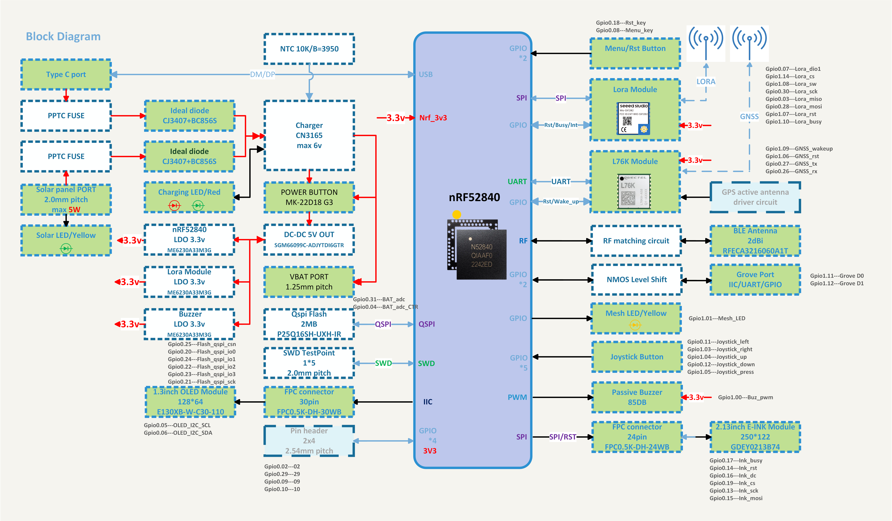

# Seeed Studio Wio Tracker L1 Pro – Meshtastic LoRa GPS Node


[**View Seeed Studio Wio Tracker L1 Pro for Meshcore on OpenELAB**](https://openelab.io/products/seeed-studio-wio-tracker-l1-pro)

**Model / option:** Seeed Studio Wio Tracker L1 Pro for Meshcore · **SKU:** `Seeed-100030144`

[**View Seeed Studio Wio Tracker L1 Pro – Meshtastic LoRa GPS Node on OpenELAB**](https://openelab.io/products/seeed-studio-wio-l1-pro)

**Model / option:** Seeed Studio Wio Tracker L1 Pro – Meshtastic LoRa GPS Node · **SKU:** `Seeed-114993649`


## Product overview <a href="#product-and-development-scope" id="product-and-development-scope"></a>

Wio Tracker L1 Pro is an enclosed nRF52840/SX1262 handheld with L76K GNSS, an OLED and an internal battery. This guide covers both sold Pro firmware options, with one canonical hardware reference and separate first-run procedures.

| SKU               | Factory ecosystem | Compatible phone/client                     |
| ----------------- | ----------------- | ------------------------------------------- |
| `Seeed-100030144` | MeshCore          | MeshCore Bluetooth Companion app/web client |
| `Seeed-114993649` | Meshtastic        | Meshtastic Android/iOS/web/Python clients   |

The Lite, bare L1 and E-Ink versions are other products. In particular, **L1 E-Ink uses a distinct firmware target**. Neither adding an E-Ink display nor changing the radio ecosystem is an ordinary settings-only change. [Seeed family comparison](https://wiki.seeedstudio.com/wio_tracker_l1_node/).

## Applications

Use the Pro for a portable two-node text link, GNSS position sharing, a field messaging terminal or a supported Grove sensor. The screen and local controls make basic operation possible away from a phone when the installed firmware implements those menus. Verify local message input on the actual version before planning phone-free use.

Measure power use with your GPS and screen settings. A battery-powered L1 Pro configured as a Companion is a different role from a solar fixed MeshCore repeater. Advert discovery, route choice and saved radio settings determine whether a repeater participates; a nearby visible node is not necessarily in the selected route.

## Specifications <a href="#hardware-specifications" id="hardware-specifications"></a>

| Parameter         | Exact family/Pro value and condition                                                     |
| ----------------- | ---------------------------------------------------------------------------------------- |
| Processor         | nRF52840 Cortex-M4F, up to 64 MHz                                                        |
| On-chip memory    | 1 MB flash; 256 kB RAM                                                                   |
| LoRa              | Wio-SX1262, 862–930 MHz documented RF range; Pro antenna 3 dBi                           |
| Bluetooth         | Bluetooth 5.0; local phone link does not prove LoRa reception                            |
| GNSS              | L76K; constellation use depends on its configuration                                     |
| Pro display       | 1.3-inch OLED, 128 × 64 pixels; not the 122 × 250 E-Ink panel                            |
| Pro battery       | Built-in 2000 mAh battery                                                                |
| USB               | Type-C 5 V / 1 A                                                                         |
| Solar connector   | 2-pin 2.0 mm; 5 V / 1 A input, **do not exceed 5 V**                                     |
| Battery connector | Family documentation specifies 2-pin 1.25 mm, 3.7 V / 1 A; Pro battery already installed |
| Expansion         | One Grove UART/I²C/GPIO; PTH signals and SWD pads                                        |

Values and connector distinctions: [Seeed L1 specifications](https://wiki.seeedstudio.com/wio_tracker_l1_node/). The internal charger's component maximum in the block diagram is not permission to apply a higher voltage to the solar connector.

## Hardware and connections

Attach the correct LoRa antenna before operation. Start with USB power and no added sensor. Lift the power switch upward to start; charge first if the screen does not respond. Use a normal 5 V source. USB charging and software-controlled sleep are separate from the mechanical switch.



_Wio Tracker L1 family power and peripheral architecture; display branches depend on variant — Seeed Studio,_ [_original diagram_](https://wiki.seeedstudio.com/wio_tracker_l1_node/)_._

The diagram is the family architecture, not evidence that the Pro includes both OLED and E-Ink panels. It also labels internal QSPI, display, GNSS and joystick nets. These are occupied signals, not spare expansion GPIO.

| Interface             | Integration rule                                                                                |
| --------------------- | ----------------------------------------------------------------------------------------------- |
| USB-C                 | Data cable for serial/DFU; close other clients before a flasher claims the port                 |
| Grove                 | Power down to attach a supported module; verify its supply and bus before using the cable       |
| Solar                 | Respect the external 5 V maximum; verify connector polarity before fitting a panel              |
| Battery               | Do not infer polarity from connector fit; identify PCB marking and existing pack before service |
| OLED / optional E-Ink | Match panel, FPC orientation, driver and firmware target; do not plug/unplug live               |
| SWD                   | Debug access is a separate recovery path requiring the board pin reference and suitable probe   |

For custom firmware, use the release's board variant rather than copying GPIO definitions from the XIAO nRF kit. The internal L1 diagram identifies a different radio/GNSS route and reserved display/joystick signals. [Hardware architecture](https://wiki.seeedstudio.com/wio_tracker_l1_node/).

## Software and development resources <a href="#choose-the-network-and-device-role" id="choose-the-network-and-device-role"></a>

| Work                     | Exact target/version boundary                                                               |
| ------------------------ | ------------------------------------------------------------------------------------------- |
| Meshtastic application   | Flasher **Seeed Wio Tracker L1** for Pro; source environment `seeed_wio_tracker_L1`         |
| MeshCore application     | Community Firmware → **Seeed Studio Wio Tracker L1 Pro** → **Companion Bluetooth**          |
| MeshCore Grove telemetry | Seeed states factory 1.12 lacks this feature; use supported 1.13 or later                   |
| Meshtastic local UI      | Seeed documents the menu/virtual keyboard in 2.7; installed builds may differ               |
| USB bootloader           | `wio_tracker_l1_bootloader-0.10.0_s140_7.3.0.zip`; separate from application firmware       |
| Source development       | PlatformIO with Meshtastic repository/submodules; freeze a release and retain tool versions |

Sources: [Meshtastic setup](https://wiki.seeedstudio.com/get_started_with_meshtastic_wio_tracker_l1/), [MeshCore setup](https://wiki.seeedstudio.com/get_started_with_other_mesh_firmware/), [source workflow](https://wiki.seeedstudio.com/meshtastic_source_code_practical_tutorial/). MeshCore and Meshtastic cannot exchange packets just by sharing a frequency. Settings, app and identity are ecosystem-specific.

## Getting started <a href="#getting-started-one-controlled-radio-test" id="getting-started-one-controlled-radio-test"></a>

### MeshCore Companion: pairing, advert and private reply

1. Fit the antenna, connect USB and switch on. In the MeshCore app choose Connect and identify `MeshCore-…` against the device label. **Use the PIN shown on the OLED**, not an assumed `123456`.
2. Set an appropriate local radio preset, match a second Companion's complete settings, save and reboot. Check that both report the intended frequency after restart.
3. Set names such as `L1-A` and `L1-B`. Send an advert from each and confirm each receives the other's signed contact before starting a private conversation.
4. Send `L1-A-01` from A and `L1-B-01` back. Keep both devices close enough for an initial direct link but avoid placing antennas against each other. Then repeat on battery.
5. Enable GPS in Position settings or on the device GPS page. Acquire a fix outdoors; compare node position/time with the intended location. Disable GPS when it is not needed, and verify the saved state after reboot.
6. Add a repeater only after the direct pair works. Receive its advert, select it in the path and repeat the numbered round-trip test. Record the selected hop path rather than assuming a received advert proves forwarding.

**Expected result:** both contacts discover one another, a private reply returns and the node continues operating after USB is removed. [MeshCore workflow](https://wiki.seeedstudio.com/get_started_with_other_mesh_firmware/).

For browser BLE, open the MeshCore web app, Settings → BLE → Scan Now, select the exact device and enter the screen PIN. The same radio can be occupied by an existing phone connection; close that connection before debugging a browser pairing failure. Three user-button presses toggle the buzzer in the documented MeshCore firmware.

### Meshtastic: serial inventory and first text

1. Switch on using USB power. Pair in the Meshtastic app using the current displayed/configured PIN. Set the LoRa region and wait for the device to restart.
2. On the second Meshtastic radio, match region, modem preset, frequency slot and primary-channel name/key. Confirm neither radio is running MeshCore.
3. Exchange `L1-CHECK-01` and a numbered reply. Inspect the receiving app and node timestamps. An outgoing message shown locally is not confirmation that the other receiver heard it.
4. Enable Position/GPS and inspect the fix outdoors. Adjust the position update and broadcast intervals independently; an old map marker should not be treated as a new fix.
5. Explore the installed OLED menu/joystick. On supported 2.7 builds, test the virtual keyboard with a short message. Check local menu labels and resulting sound instead of following the source article's contradictory buzzer Enable/Disable wording literally.

**Expected result:** bidirectional text works first; fresh GNSS and local input are separate checkpoints. [Meshtastic instructions](https://wiki.seeedstudio.com/get_started_with_meshtastic_wio_tracker_l1/).

For an original host-side inventory check, install the official Python client in a virtual environment and replace `YOUR_PORT` with the observed USB serial port:

```sh
python3 -m venv .venv-l1
. .venv-l1/bin/activate
python -m pip install meshtastic
meshtastic --port YOUR_PORT --info
meshtastic --port YOUR_PORT --nodes
```

These read-only commands are documented by the [Meshtastic CLI](https://meshtastic.org/docs/software/python/cli/). Expected output identifies the local firmware/configuration and known nodes; it does not certify RF coverage. Do not run a second serial monitor at the same time. On Windows activate `.venv-l1\Scripts\activate` instead.

### Add one Grove sensor and one local alert

With power off, attach a documented supported I²C sensor such as SHT31, SHTC3/SHT4x, MCP9808, BME280 or BMP085. Meshtastic also documents PCT2075, AHT10, MAX30102 and CardKB support. Enable the correct telemetry driver and On Screen if desired, then compare a local value with a plausible environment before enabling radio broadcasts. MAX30102 support does not establish medical accuracy.

For MeshCore, read the firmware version before attaching a sensor: Seeed's Grove support begins at 1.13. Confirm the chosen sensor appears in that release's driver support; the presence of a connector does not establish all air-quality modules are supported. For an alert test, an original short RTTTL sequence is `l1check:d=8,o=5,b=100:c,p,e,p,g`. Trigger one received test message and check the actual buzzer policy. Avoid repetitive alerts during low-power measurements.

### Source build without changing the board target <a href="#firmware-sdk-and-hardware-development" id="firmware-sdk-and-hardware-development"></a>

The source tutorial locates board definitions under `variants/`, not only in the root PlatformIO file. In a dedicated development checkout:

```sh
git clone --recursive https://github.com/meshtastic/firmware.git
cd firmware
git checkout d0f4096788545fb3c5e22d2a7e52ac6c268caac1
git submodule update --init --recursive
python3 -m venv .venv
. .venv/bin/activate
python -m pip install platformio
pio run -e seeed_wio_tracker_L1
```

The [reviewed environment](https://github.com/meshtastic/firmware/blob/d0f4096788545fb3c5e22d2a7e52ac6c268caac1/variants/nrf52840/seeed_wio_tracker_L1/platformio.ini) matches Pro/L1. Expected result is a successful build and a target-specific artifact; **this build was not run here**. First build unchanged source, then make one scoped UI change and rebuild. Do not transplant the manufacturer's complete display file across unrelated releases. Save configuration and flash only the L1 artifact through USB DFU.

## Troubleshooting and FAQs <a href="#troubleshooting-and-recovery" id="troubleshooting-and-recovery"></a>

| Symptom                          | Ordered diagnosis / recovery                                                                                              |
| -------------------------------- | ------------------------------------------------------------------------------------------------------------------------- |
| Bluetooth PIN rejected           | Check ecosystem and screen PIN; unpair stale phone record; reconnect after device reboot                                  |
| Display dark                     | Charge with 5 V, switch up, check screen timeout and application state before declaring hardware failure                  |
| Grove data absent on MeshCore    | Check version ≥1.13, module driver support, connector orientation/power and address collision                             |
| Virtual keyboard missing         | Confirm installed Meshtastic version/UI support; do not install E-Ink firmware on OLED Pro                                |
| Text broadcasts work, DMs fail   | Exchange adverts/user info; inspect identity-key mismatch and stale NodeDB before resetting keys                          |
| DFU drive absent                 | Known data cable, stable USB power, double-press Reset; manually entered DFU shows a serial port/steady yellow indication |
| Flasher loses COM port           | DFU can enumerate on a new port; refresh the device list, close competing clients and select the new port                 |
| Battery reboot or early shutdown | Charge, remove sensor load and inspect power settings; export logs/configuration before erase/install                     |

### Bootloader recovery has two stages

Restore the L1 bootloader only when application reinstall fails and the DFU serial port is available. Install `adafruit-nrfutil`, check it with **`adafruit-nrfutil version`**, and keep the downloaded ZIP intact. Seeed reports version 0.5.3.post16 in its recovery procedure. In manual DFU, replace the example port with the actual port:

```sh
adafruit-nrfutil --verbose dfu serial --package wio_tracker_l1_bootloader-0.10.0_s140_7.3.0.zip -p YOUR_DFU_PORT -b 115200 --singlebank
```

For an application-mode port, Seeed's procedure adds `--touch 1200`. If touching changes the port, find the new DFU port and repeat **without** that touch option. The expected tool result is `Device programmed.`; next install the exact ecosystem's L1 Pro application. A bootloader and a mounted UF2 volume are not a working mesh application. If there is no DFU device, stop USB retry loops and use manufacturer support rather than another model's bootloader. [Detailed recovery](https://wiki.seeedstudio.com/get_started_with_other_mesh_firmware/).

## Downloads and technical documents <a href="#technical-documents-and-software" id="technical-documents-and-software"></a>

| Resource                                                                                                                                    | Model/use                                                                            |
| ------------------------------------------------------------------------------------------------------------------------------------------- | ------------------------------------------------------------------------------------ |
| [L1 family hardware and diagram](https://wiki.seeedstudio.com/wio_tracker_l1_node/)                                                         | Pro versus Lite/L1/E-Ink distinctions                                                |
| [L1 serial DFU bootloader](https://files.seeedstudio.com/wiki/SenseCAP/Meshtastic/adafruit/wio_tracker_l1_bootloader-0.10.0_s140_7.3.0.zip) | L1/L1 Pro recovery package                                                           |
| [Pro enclosure ZIP](https://files.seeedstudio.com/wiki/SenseCAP/wio_tracker/L1pro%203D%20Enclosure.zip)                                     | Check physical control revision before printing                                      |
| [L1 outline DXF](https://files.seeedstudio.com/wiki/SenseCAP/Meshtastic/Wio%20Tracker%20L1%20outline.dxf)                                   | Bare-board integration reference; not a waterproof Pro enclosure claim               |
| [Meshtastic source tutorial](https://wiki.seeedstudio.com/meshtastic_source_code_practical_tutorial/)                                       | PlatformIO, environment discovery and bounded UI modification                        |
| [Meshtastic setup/resources](https://wiki.seeedstudio.com/get_started_with_meshtastic_wio_tracker_l1/)                                      | Display, sensors, certificates, original power worksheet and both enclosure versions |
| [MeshCore setup/resources](https://wiki.seeedstudio.com/get_started_with_other_mesh_firmware/)                                              | Companion firmware, advert/private messages and recovery                             |

### Retained product illustrations


### Additional manufacturer references

* [Manufacturer reference 1](https://files.seeedstudio.com/wiki/SenseCAP/Meshtastic/wio-tracker-l1.jpg)
* [Manufacturer reference 2](https://github.com/meshcore-dev/MeshCore)

## References and validation <a href="#official-documentation-and-development-resources" id="official-documentation-and-development-resources"></a>

Reviewed 24 November 2026: both exact OpenELAB SKUs, Seeed L1 family hardware, both first-run/recovery guides, source-development tutorial and the pinned Meshtastic target. The architecture is an attributed Seeed original; command sequencing, test messages and alert sequence are original.

**Source reviewed; compilation, flashing, RF, battery measurements and hardware tests not run.** Existing configuration must be backed up before erase or ecosystem conversion. Release-dependent menus and sensor support should be checked on the actual delivered unit.

### Related retained references

* [Meshtastic source](https://github.com/meshtastic/firmware)
