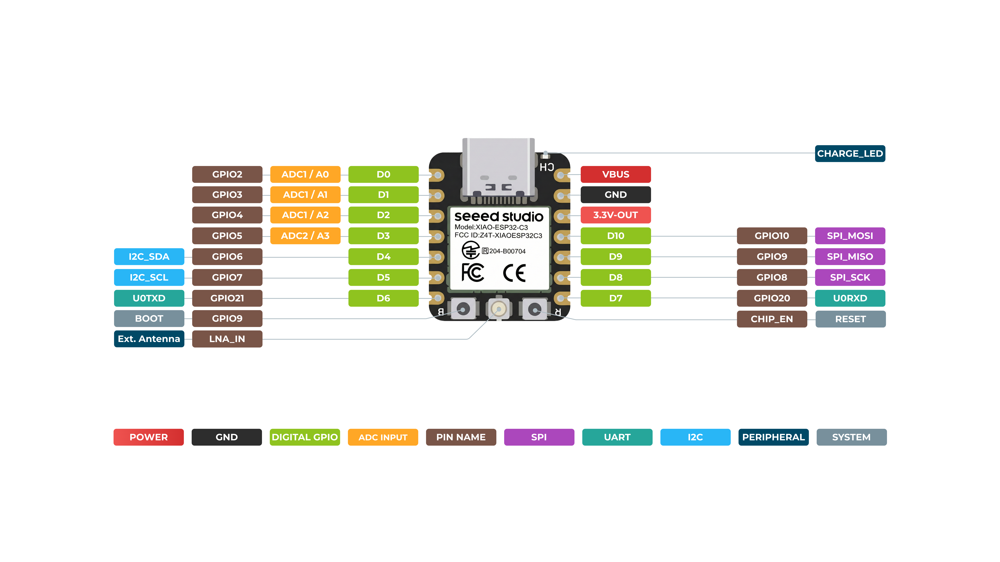
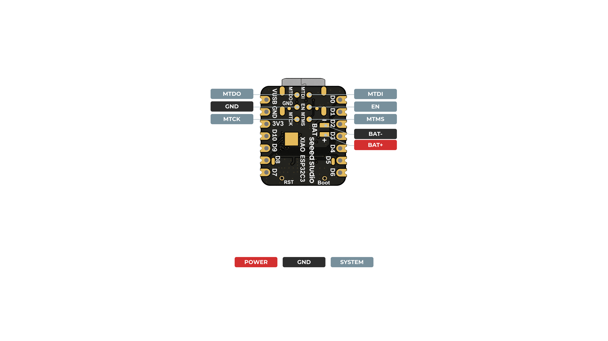
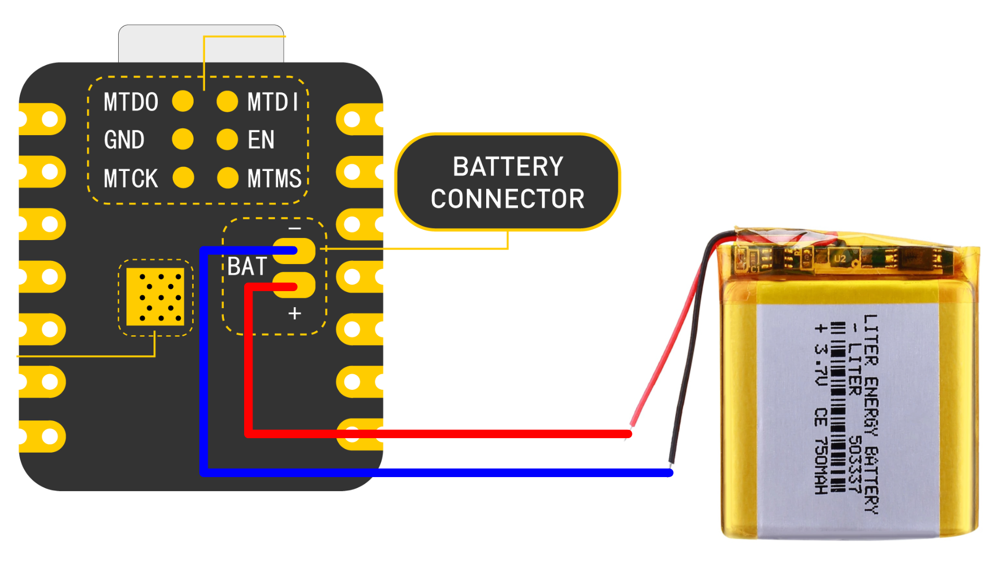

# Seeed Studio XIAO ESP32C3 Engineering Guide


[**View Seeed Studio XIAO ESP32C3 on OpenELAB**](https://openelab.io/products/seeed-studio-xiao-esp32c3)

**Model:** XIAO ESP32C3 · **SKU:** `Seeed-113991054` · Hardware reference: v1.3 schematic, dated 15 January 2026. Match the received revision before using its battery/power circuit.


## Product overview

XIAO ESP32C3 is a compact, single-core RISC-V Wi-Fi/Bluetooth LE board with USB Serial/JTAG, eleven exposed I/O, an external antenna and a single-cell battery-charging circuit. This is the main OpenELAB development guide for this SKU. The [retained hardware-reference URL](xiao-esp32c3-risc-v-wi-fi-ble-5.0.md) points here for setup instead of maintaining a second competing tutorial.

### Introduction

The guide includes Arduino/peripheral examples, Wi-Fi and BLE, battery measurement, sleep/wake, CircuitPython, PlatformIO and RTOS/ESPHome development paths. The ESP32-C3 is not the Xtensa ESP32-S3, and its USB Serial/JTAG controller is not a general USB device interface. An earlier OpenELAB description incorrectly claimed a hardware floating-point unit; that claim is removed. [ESP32-C3 chip reference](https://files.seeedstudio.com/wiki/XIAO_WiFi/Resources/esp32-c3_datasheet.pdf), [manufacturer overview](https://wiki.seeedstudio.com/XIAO_ESP32C3_Getting_Started/).

## Applications

Build a wireless sensor, a battery-powered periodic logger or a small Home Assistant node. Use the included antenna before evaluating radio behavior. A compact sensor layout still needs a defined battery, peak-current budget, analog range, antenna clearance and recovery access.

Choose the framework before designing the carrier. USB logging, two hardware UARTs, SPI, display shields and battery sensing can compete for the same exposed pins. Keep the exact XIAO label and MCU GPIO in the project configuration; do not transfer an RP2040 or ESP32-S3 pin table to this board.

## Specifications

### Features

| Item                           | XIAO ESP32C3                                                           |
| ------------------------------ | ---------------------------------------------------------------------- |
| MCU                            | ESP32-C3, 32-bit single-core RISC-V, up to 160 MHz                     |
| Memory                         | 400 KB SRAM; 4 MB flash                                                |
| Wireless                       | 2.4 GHz 802.11b/g/n Wi-Fi; Bluetooth5 LE / mesh capability             |
| Exposed interfaces             | 11 digital/PWM pins; I2C, UART, SPI; ADC pins described below          |
| Size                           | 21 × 17.8 mm in the manufacturer wiki                                  |
| GPIO domain                    | 3.3 V; not 5 V-tolerant                                                |
| Initial power                  | USB5 V; supported single-cell battery circuit on the board             |
| Controls                       | BOOT and RESET; charge indicator, no general-purpose onboard Blink LED |
| Manufacturer temperature range | -40–85 °C; connected battery/peripherals can impose narrower limits    |

Board facts: [Seeed product wiki](https://wiki.seeedstudio.com/XIAO_ESP32C3_Getting_Started/), [Apache exact-board reference](https://nuttx.apache.org/docs/latest/platforms/risc-v/esp32c3/boards/esp32c3-xiao/index.html). Hardware source: [v1.3 schematic](https://files.seeedstudio.com/wiki/XIAO_WiFi/Resources/XIAO_ESP32C3_v1.3_SCH_260116.pdf).

#### Current ratings and reported low-power values

The wiki gives both a **500 mA typical 3.3 V output test at BAT3.8 V with a 3 A-capable source** and a separate700 mA regulator-output statement. The reviewed v1.3 schematic labels a 700 mA regulator and a 500 mA USB fuse. These are different quantities: a source's3 A capability does not make the XIAO a 3 A supply. Budget the board's own radio demand, supply losses and thermal conditions before choosing an external load.

Seeed's [six-page low-power report](https://files.seeedstudio.com/wiki/Seeed-Studio-XIAO-ESP32/Low_Power_Consumption.pdf) reports44.0 µA deep sleep, Wi-Fi active/modem/light values74.7/24.4/3.6 mA, and BLE modem/light26.8/9.7 mA. Its procedure uses **AT firmware and mode commands**. These are reported test conditions, not measurements of the Arduino programs below or guarantees for a board with USB, a divider and external sensors attached.

## Hardware and connections

### Pinout



_Seeed_ [_original front diagram_](https://files.seeedstudio.com/wiki/XIAO_WiFi/XIAO_ESP32-C3_front_pinout.png)_. The charge indicator is not `LED_BUILTIN`._



_Seeed_ [_original back diagram_](https://files.seeedstudio.com/wiki/XIAO_WiFi/XIAO_ESP32-C3_back_pinout.png)_, underside orientation. Verify actual pad labels before soldering._

| XIAO label        | MCU GPIO | Function / constraint                                    |
| ----------------- | -------- | -------------------------------------------------------- |
| D0 / A0           | 2        | ADC1; boot-strapping consideration                       |
| D1 / A1           | 3        | ADC1; useful GPIO wake input                             |
| D2 / A2           | 4        | ADC1; JTAG alternate function                            |
| D3 / analog route | 5        | ADC2\_CH0; avoid for a reliable first analog measurement |
| D4 / SDA          | 6        | I2C data                                                 |
| D5 / SCL          | 7        | I2C clock                                                |
| D6 / TX           | 21       | UART TX                                                  |
| D7 / RX           | 20       | UART RX; also default `SS` in the cited Arduino variant  |
| D8 / SCK          | 8        | SPI clock; strapping pin                                 |
| D9 / MISO         | 9        | SPI receive; BOOT / strapping pin                        |
| D10 / MOSI        | 10       | SPI transmit; external Blink LED in this guide           |

Mappings: [exact Arduino variant](https://github.com/espressif/arduino-esp32/blob/master/variants/XIAO_ESP32C3/pins_arduino.h), [v1.3 schematic](https://files.seeedstudio.com/wiki/XIAO_WiFi/Resources/XIAO_ESP32C3_v1.3_SCH_260116.pdf). The current variant defines A0–A2 aliases, not A3. The chip has a GPIO5 ADC2 route, but the manufacturer's reliability warning recommends ADC1(A0/A1/A2). Four routed analog-capable signals do not imply four equally supported/reliable API aliases.

### Hardware

Connect the included antenna carefully to its U.FL/IPEX connector; align and press vertically rather than forcing it sideways. Keep its radiating area clear. Use a data-capable USB-C cable; disconnect external wiring for recovery. Header-mounted Grove shields can be useful, but an expansion's SWD spring contacts are not a compatible ESP32-C3 programming/debug interface. Check each peripheral's power and logic before connection.

### Power Pins

5V/VBUS is the USB rail, 3V3 is the regulated output, and GND is the common reference. For an external5 V source, follow the manufacturer's diode/power-routing guidance and inspect the exact revision rather than back-powering the USB port. GPIO and analog inputs remain3.3 V-domain signals. A divider must also respect the ADC's **measurable** voltage range, which can be lower than the electrical input limit.

### Strapping Pins

GPIO2/8/9—D0/D8/D9—affect boot configuration. A low-impedance peripheral or a button on those signals can prevent upload or normal startup. Use BOOT intentionally for recovery; remove unintended external forcing before retrying. Debugger/JTAG pins overlap exposed I/O, so reserve them if hardware debugging is part of the project. [Board pin/boot reference](https://wiki.seeedstudio.com/XIAO_ESP32C3_Getting_Started/).

## Software and development resources

| Framework      | Exact target / boundary                                                                    |
| -------------- | ------------------------------------------------------------------------------------------ |
| Arduino        | Espressif ESP32 package, `XIAO_ESP32C3`; record installed version and USB CDC selection    |
| PlatformIO     | `espressif32`, `seeed_xiao_esp32c3`; do not use the RP2040's Seeed-platform identifier     |
| CircuitPython  | Board-specific **BIN**, Web Workflow / serial management; no CIRCUITPY USB drive on C3     |
| NuttX current  | `esp32c3-xiao:usbnsh`; older Seeed commands use a different board-name order               |
| Zephyr current | `xiao_esp32c3/esp32c3`; use the matching release's board definition, overlays and RF blobs |
| ESPHome        | `seeed_xiao_esp32c3`; initial USB flash, then network/API integration                      |

The [Arduino variant](https://github.com/espressif/arduino-esp32/blob/master/variants/XIAO_ESP32C3/pins_arduino.h), [PlatformIO board page](https://docs.platformio.org/en/latest/boards/espressif32/seeed_xiao_esp32c3.html), [CircuitPython board page](https://circuitpython.org/board/seeed_xiao_esp32c3/), [Apache board page](https://nuttx.apache.org/docs/latest/platforms/risc-v/esp32c3/boards/esp32c3-xiao/index.html) and [Zephyr board page](https://docs.zephyrproject.org/latest/boards/seeed/xiao_esp32c3/doc/index.html) support these distinctions. A historic tutorial's “latest” firmware name is not a fixed compatibility promise.

## Getting started

### Software setup

1. Install Arduino IDE and add Espressif's actual package index in Preferences → Additional Boards Manager URLs:

```
https://espressif.github.io/arduino-esp32/package_esp32_index.json
```

2. Install **esp32 by Espressif Systems**, select **XIAO\_ESP32C3**, and choose the observed port. Record package version and USB CDC On Boot setting; enable CDC for USB diagnostic output where exposed by the package.
3. Upload the external LED example below. If upload stalls, disconnect peripherals, hold BOOT while connecting USB, release BOOT and reselect the enumerated port.

The current Seeed setup text contains a repository-mirror URL where a JSON board index is expected; use the [official Espressif Arduino installation reference](https://docs.espressif.com/projects/arduino-esp32/en/latest/installing.html) for the package index. Reset is not the same as holding BOOT through startup.

### Hardware setup

Power off. Wire **D10 → series resistor → LED anode; LED cathode → GND**. About150 Ω appears in the manufacturer's example;330 Ω is a conservative initial choice for a typical small visible LED at 3.3 V. Calculate the actual current from its forward voltage and the selected resistor. Confirm polarity and avoid a direct unresisted LED connection.

### Blink the LED

```cpp
#include <Arduino.h>
void setup() {
  Serial.begin(115200);
  pinMode(D10, OUTPUT);
}
void loop() {
  digitalWrite(D10, HIGH);
  Serial.println("EXTERNAL_LED_ON");
  delay(500);
  digitalWrite(D10, LOW);
  delay(500);
}
```

**Expected result:** the external LED flashes; Serial prints at 115200 when USB CDC is active. No general-purpose onboard LED is assumed. If serial works but the LED does not, inspect resistor/polarity/D10 mapping before changing the SDK. Manufacturer baseline: [first Blink](https://wiki.seeedstudio.com/XIAO_ESP32C3_Getting_Started/). This original sketch has not been executed on hardware.

### Digital input, PWM and ADC

For a button, connect D6 to GND through a momentary switch and use `pinMode(D6, INPUT_PULLUP)`; pressed reads LOW. Do not leave a plain INPUT floating. D6 is then unavailable for the UART TX test. With the D10 LED fitted, this complete original program reads a potentiometer on A1 and shows its level through PWM:

```cpp
#include <Arduino.h>
void setup() {
  Serial.begin(115200);
  pinMode(D10, OUTPUT);
  analogReadResolution(12);
  analogSetPinAttenuation(A1, ADC_11db);
}
void loop() {
  unsigned millivolts = analogReadMilliVolts(A1);
  unsigned duty = min(255U, millivolts * 255U / 2000U);
  analogWrite(D10, duty);
  Serial.printf("adc_mV=%u,pwm_8bit=%u\n", millivolts, duty);
  delay(100);
}
```

Keep the test voltage within0–2.0 V using a suitable divider/test source; common GND is required. Do not assume the full3.3 V supply is inside the C3 ADC's linear measurement range. For a standalone fade, drive `analogWrite(D10, duty)` through 0–255 and back, keeping the resistor. The ADC measures input; PWM is a duty-cycle output, not a DAC. [Espressif ADC API](https://docs.espressif.com/projects/arduino-esp32/en/latest/api/adc.html), [Seeed pin-multiplexing tasks](https://wiki.seeedstudio.com/XIAO_ESP32C3_Pin_Multiplexing/).

### USB serial and physical UART

With USB CDC enabled, `Serial` is the diagnostic USB path. The header UART is separate. For an isolated loopback, disconnect other D6/D7 uses, connect **D6/TX → D7/RX** and upload:

```cpp
#include <Arduino.h>
void setup() {
  Serial.begin(115200);
  Serial1.begin(115200, SERIAL_8N1, D7, D6); // RX, TX
}
void loop() {
  while (Serial.available()) Serial1.write(Serial.read());
  while (Serial1.available()) Serial.write(Serial1.read());
}
```

Type a line in the USB monitor; expected result is its return through the physical jumper. Remove the jumper to distinguish loopback from monitor local echo. For another device, cross TX/RX, share ground and use compatible3.3 V levels. `Serial2` is not an available third hardware UART on this C3.

The official tutorial also creates explicit `HardwareSerial(0)` and `(1)` objects for two simultaneous UART routes; assign nonconflicting RX/TX pins and do not initialize a second wrapper for a port already owned by another task. Its software-serial recipe recommends **EspSoftwareSerial7.0.0**, D7 RX / D6 TX at 9600. Treat that as a historical example baseline; prefer hardware UART when available. [Serial tutorial](https://wiki.seeedstudio.com/XIAO_ESP32C3_Pin_Multiplexing/), [core UART API](https://docs.espressif.com/projects/arduino-esp32/en/latest/api/serial.html).

### I2C OLED and SPI pressure sensor

For I2C, connect SDA D4/GPIO6 and SCL D5/GPIO7, with a common ground and compatible pull-up levels. Scan first, using `Wire.begin(D4,D5)` and `Wire.endTransmission()` to confirm the exact peripheral address. A5 or GPIO5 from another XIAO map is not this SCL connection.

With a compatible128×64 OLED and **U8g2** installed, this complete original sketch implements the official OLED task with a new test message:

```cpp
#include <U8g2lib.h>
U8G2_SSD1306_128X64_NONAME_F_SW_I2C screen(U8G2_R0, D5, D4, U8X8_PIN_NONE);
void setup() {
  screen.begin();
  screen.clearBuffer();
  screen.setFont(u8g2_font_ncenB08_tr);
  screen.drawStr(0, 18, "XIAO C3 ready");
  screen.sendBuffer();
}
void loop() {}
```

The manufacturer's Grove OLED uses an SSD1315 with a compatible driver path; check the actual module, supply, address and reset circuit rather than assuming all OLEDs are interchangeable. A5V-powered display must not pull the C3's I2C signals above their allowed level.

For the official **DPS310 SPI** exercise, wire3V3/GND, D10/MOSI, D9/MISO and D8/SCK; select an explicit CS such as **D3**, which then cannot serve another function. In the [Seeed DPS310 library](https://github.com/Seeed-Studio/Seeed_Arduino_DPS310), open `spi_background`, replace `pin_cs=SS` with your physical CS, retain the example's SPI initialization and run its temperature/pressure conversion sequence. The cited variant's default `SS` is GPIO20/D7, which conflicts with UART RX if both are used. Expected results are successful sensor initialization and valid temperature/pressure records; record the library's units and return codes. Pin tasks: [official multiplexing guide](https://wiki.seeedstudio.com/XIAO_ESP32C3_Pin_Multiplexing/).

### Wi-Fi scan, station and access point

Attach the antenna before radio testing. Begin in station mode: scan, compare SSID/RSSI/channel/authentication information, clear scan results after use, then connect to an authorized2.4 GHz AP with a bounded wait. This original sketch gives an on-page first network result:

```cpp
#include <WiFi.h>
const char* ssid = "YOUR_SSID";
const char* password = "YOUR_PASSWORD";
void setup() {
  Serial.begin(115200);
  WiFi.mode(WIFI_STA);
  int found = WiFi.scanNetworks();
  Serial.printf("scan_count=%d\n", found);
  for (int i=0; i<found; ++i)
    Serial.printf("%s,%d_dBm,ch%d\n", WiFi.SSID(i).c_str(), (int)WiFi.RSSI(i), WiFi.channel(i));
  WiFi.scanDelete();
  WiFi.begin(ssid, password);
  unsigned long start = millis();
  while (WiFi.status()!=WL_CONNECTED && millis()-start<20000) delay(100);
  if (WiFi.status()==WL_CONNECTED) Serial.println(WiFi.localIP());
  else Serial.println("WIFI_TIMEOUT");
}
void loop() {}
```

Expected result is an address on your AP's subnet, or an explicit timeout. For access-point mode, use `WiFi.softAP` with a unique SSID and new password, print `WiFi.softAPIP()`, join from a test client and verify the assigned subnet. The AP does not automatically provide Internet routing. The [official Wi-Fi guide](https://wiki.seeedstudio.com/XIAO_ESP32C3_WiFi_Usage/) covers basic/advanced scan/connect and AP mode and warns of board heating in hotspot operation. Keep airflow and stop if temperatures become excessive. Core behavior: [Wi-Fi API](https://docs.espressif.com/projects/arduino-esp32/en/latest/api/wifi.html).

### Bluetooth LE scan and writable GATT service

Use a BLE client, not Classic Bluetooth SPP. The [official BLE guide](https://wiki.seeedstudio.com/XIAO_ESP32C3_Bluetooth_Usage/) provides scan and writable-server examples and explicitly distinguishes core 2.x/3.x return types. For scanning, initialize `BLEDevice`, get a scanner, choose a bounded active/passive scan, inspect advertisements/RSSI and clear results. On core 3.x `start()` returns a result pointer; use `->getCount()` rather than the older value-object form.

This original server uses `auto` for the characteristic value to avoid that particular string-type assumption. Choose application-specific UUIDs for a real service; these test UUIDs identify this example only:

```cpp
#include <BLEDevice.h>
#include <BLEServer.h>
#include <BLEUtils.h>
constexpr char SERVICE[] = "cba10001-3456-4789-abcd-123456789abc";
constexpr char VALUE[] = "cba10002-3456-4789-abcd-123456789abc";
class Receiver : public BLECharacteristicCallbacks {
  void onWrite(BLECharacteristic* c) override {
    auto bytes = c->getValue();
    Serial.printf("BLE_RX_BYTES=%u\n", (unsigned)bytes.length());
  }
};
void setup() {
  Serial.begin(115200);
  BLEDevice::init("XIAO-C3-Test");
  auto* server = BLEDevice::createServer();
  auto* service = server->createService(SERVICE);
  auto* value = service->createCharacteristic(VALUE,
      BLECharacteristic::PROPERTY_READ | BLECharacteristic::PROPERTY_WRITE);
  value->setValue("ready");
  value->setCallbacks(new Receiver());
  service->start();
  auto* advertising = BLEDevice::getAdvertising();
  advertising->addServiceUUID(SERVICE);
  advertising->start();
}
void loop() { delay(20); }
```

Connect with LightBlue or another GATT client, find the service, read the value, then write a short UTF-8 test value. Expected result is the correct byte count in Serial. A read/write property does not establish authentication/encryption; define pairing/access policy before accepting operational commands. This minimal experiment does not promise automatic re-advertising after disconnect; reset for another isolated test or implement the matching core's connection callbacks.

### Battery Usage



_Seeed_ [_original battery diagram_](https://files.seeedstudio.com/wiki/XIAO_WiFi/battery_connect.png)_; verify plus/minus on the **received board** and cell before soldering. Do not infer polarity solely from a cable's color._

Use a suitable3.7 V nominal single-cell rechargeable lithium battery with the protection/charge requirements appropriate to the installation. Keep power disconnected while soldering and prevent shorts between adjacent contacts. The board includes a charging circuit; confirm its configured charge current is suitable for the chosen cell. The wiki reports380 mA fast/40 mA trickle, while the v1.3 circuit provides the exact charger/resistor arrangement. Battery-only operation may show no charge LED; judge execution through the application, not that indicator. [Battery instructions](https://wiki.seeedstudio.com/XIAO_ESP32C3_Getting_Started/), [v1.3 power circuit](https://files.seeedstudio.com/wiki/XIAO_WiFi/Resources/XIAO_ESP32C3_v1.3_SCH_260116.pdf).

#### Check the battery voltage

There is no dedicated onboard battery-level ADC route. An **external divider consumes an I/O**. With two equal200 kΩ resistors, wire BAT+ → upper resistor → A0 → lower resistor → GND. Verify the divider and pin voltage with a meter before connecting; at 4.2 V battery voltage the ideal midpoint is2.1 V. GPIO2/A0 is also a strapping pin, so check boot behavior with the actual divider/capacitance fitted.

```cpp
#include <Arduino.h>
void setup() {
  Serial.begin(115200);
  analogSetPinAttenuation(A0, ADC_11db);
}
void loop() {
  uint32_t sum = 0;
  for (int i=0; i<16; ++i) { sum += analogReadMilliVolts(A0); delay(2); }
  float estimatedVolts = (sum / 16.0f) * 2.0f / 1000.0f;
  Serial.printf("battery_estimate_V=%.3f\n", estimatedVolts);
  delay(1000);
}
```

This is an original implementation of the divider principle attributed by Seeed to community contributor msfujino. [Original discussion](https://forum.seeedstudio.com/t/battery-voltage-monitor-and-ad-conversion-for-xiao-esp32c/267535), [calibrated ADC API](https://docs.espressif.com/projects/arduino-esp32/en/latest/api/adc.html). Confirm resistor ratio, ADC settling and radio noise against a meter. Averaging does not remove systematic error; one contributor's reported accuracy is not a guarantee. Voltage alone is not a calibrated remaining-capacity percentage.

### Deep sleep mode and wake-up

Start with timer wake before adding external signals. This original sketch uses a public API and a bounded USB diagnostic interval:

```cpp
#include <Arduino.h>
#include <esp_sleep.h>
RTC_DATA_ATTR unsigned boots = 0;
void setup() {
  Serial.begin(115200);
  delay(1500);
  Serial.printf("wake=%d,boot=%u\n", (int)esp_sleep_get_wakeup_cause(), ++boots);
  esp_sleep_enable_timer_wakeup(10ULL * 1000000ULL);
  Serial.flush();
  esp_deep_sleep_start();
}
void loop() {}
```

Expected result is a restart after about 10 seconds with retained RTC state; USB can disconnect during sleep. Deep sleep does not maintain a live Wi-Fi/BLE connection. Reconnect/reinitialize the application after wake. [C3 sleep API](https://docs.espressif.com/projects/esp-idf/en/stable/esp32c3/api-reference/system/sleep_modes.html).

For a D1 low-level wake experiment, use an appropriate external pull-up and a button to GND, then configure `esp_deep_sleep_enable_gpio_wakeup(1ULL << D1, ESP_GPIO_WAKEUP_GPIO_LOW)` before sleep with the matching core. Confirm the button is released before sleeping or it can immediately wake again. The board guide identifies D0–D3 as the exposed GPIO wake choices; do not copy an unrelated ESP32 GPIO33 bitmask from old example boilerplate.

To reproduce the **manufacturer low-power report**, use its specified AT firmware, establish station/BLE state, set the supported `AT+SLEEP` mode and measure at the same supply boundary; use `AT+GSLP` for its timed deep-sleep procedure. Do not send AT commands to an ordinary Arduino sketch and expect a modem response. Measure with USB/debug/peripheral currents accounted for. [Test method and results](https://files.seeedstudio.com/wiki/Seeed-Studio-XIAO-ESP32/Low_Power_Consumption.pdf).

### PlatformIO and MicroPython

Use the [documented PlatformIO board](https://docs.platformio.org/en/latest/boards/espressif32/seeed_xiao_esp32c3.html):

```ini
[env:xiao-c3]
platform = espressif32
board = seeed_xiao_esp32c3
framework = arduino
monitor_speed = 115200
```

Place the Blink sketch in `src/main.cpp`, build/upload to the observed port, then retain a lock on the working platform/library versions. Keep USB CDC build options aligned with the chosen framework. The official root also links [IcingTomato's MicroPython repository](https://github.com/IcingTomato/micropython_xiao_esp32c3), a community resource. Verify exact C3 firmware, flash layout and native pin numbers before changing runtimes; it is not a Seeed-maintained universal firmware guarantee.

### CircuitPython: C3 has no CIRCUITPY USB drive

Download the board-specific BIN from [CircuitPython's XIAO ESP32C3 page](https://circuitpython.org/board/seeed_xiao_esp32c3/), enter BOOT mode and use that release's installer/esptool workflow. Back up existing flash data before erase/write. The manufacturer's [CircuitPython article](https://wiki.seeedstudio.com/xiao_esp32c3_with_circuitpython/) gives CLI and Web Serial methods, but its generic CIRCUITPY/UF2 and double-reset advice must not be applied to C3. Use **Web Workflow/serial file management** and save `code.py` on the runtime filesystem. The board page explicitly explains why a USB mass-storage drive will not appear.

With an external LED/resistor on D10, this original program uses CircuitPython's board objects:

```python
import board
import digitalio
import time
led = digitalio.DigitalInOut(board.D10)
led.direction = digitalio.Direction.OUTPUT
while True:
    led.value = not led.value
    time.sleep(0.5)
```

For the other documented tasks, create UART with `busio.UART(board.TX,board.RX,baudrate=9600)`, PWM with `pwmio.PWMOut`, ADC with `analogio.AnalogIn(board.A0)`, I2C with `busio.I2C(board.SCL,board.SDA)`, and SPI with `busio.SPI(board.SCK,board.MOSI,board.MISO)`. Use proper bus locking/device drivers and explicit CS; a raw transfer without a device transaction/CS is incomplete. Match library bundles to the installed CircuitPython major version. The Grove light-sensor exercise reads A0; the OLED exercise needs `adafruit_ssd1306` and its dependencies. Back up code/libraries before returning to Arduino; uploading another firmware replaces the runtime.

### NuttX: shell, GPIO, Wi-Fi and BLE

Install the RISC-V toolchain/build dependencies and esptool matching the selected NuttX release. Clone `nuttx` and `nuttx-apps` as sibling `nuttx`/`apps` directories. The current board is **`esp32c3-xiao`**; Seeed's older article uses `xiao-esp32c3` and contains a `configurate.sh` typo. In a clean build tree:

```sh
./tools/configure.sh esp32c3-xiao:usbnsh
make V=1
make flash ESPTOOL_PORT=YOUR_PORT ESPTOOL_BINDIR=./
```

Replace `YOUR_PORT`, enter BOOT mode and let the build system use its generated flash layout. Expected result is the USB NSH prompt at 115200-8N1. Preserve changes before `make distclean` when switching configurations. [Current Apache board instructions](https://nuttx.apache.org/docs/latest/platforms/risc-v/esp32c3/boards/esp32c3-xiao/index.html).

| Task            | Procedure / checkpoint                                                                                                                                                                                  |
| --------------- | ------------------------------------------------------------------------------------------------------------------------------------------------------------------------------------------------------- |
| USBNSH          | `?`, `uname -a`; compare actual release/target and console                                                                                                                                              |
| GPIO            | Select supported `gpio` config, inspect `/dev` and driver mapping before a low-energy input/output test                                                                                                 |
| Wi-Fi           | With enabled interface/tools: `ifup wlan0`, configure credentials via `wapi`, obtain a lease with `renew wlan0`, inspect `ifconfig`; do not publish credentials                                         |
| BLE             | With matching config: `bt bnep0 scan start`, stop and inspect results; for NimBLE use its enabled example/interface                                                                                     |
| Combo / storage | Older Seeed article's combo workflow combines available functions; verify current configuration names before reuse. Format storage only when the selected filesystem requires it and data may be erased |

The [Seeed NuttX tutorial](https://wiki.seeedstudio.com/xiao_esp32c3_nuttx/) explains USBNSH/Combo/Wi-Fi/BLE exercises. Distinguish USB console from `nsh` on D6/D7 UART. No supplied screenshot/log is a measurement of this board or build.

### Zephyr: current target and expansion workflows

Install a matching Zephyr workspace/SDK, run `west update`, fetch required Espressif RF blobs and build from the Zephyr repository:

```sh
west blobs fetch hal_espressif
west build -b xiao_esp32c3/esp32c3 samples/hello_world
west flash
west espressif monitor
```

Expected result is a Zephyr banner and Hello World. The [current board page](https://docs.zephyrproject.org/latest/boards/seeed/xiao_esp32c3/doc/index.html) marks the board as lacking an active maintainer and explains simple boot versus MCUboot/sysbuild. Keep all images and configuration from one release. The older [Seeed tutorial](https://wiki.seeedstudio.com/XIAO-ESP32C3-Zephyr/) uses the earlier unqualified target and covers ADC, I2C, SPI, UART and shield exercises.

| Optional exercise             | Hardware/configuration that must be explicit                                                                    |
| ----------------------------- | --------------------------------------------------------------------------------------------------------------- |
| XIAO expansion OLED / display | Correct shield/overlay, chosen display and matching sample                                                      |
| Expansion microSD             | SPI-enabled disk driver; proper CS route, formatted test card and backup                                        |
| Grove SHT31                   | I2C SHT3x node/address0x44 and driver enabled                                                                   |
| 1.69-inch240×280 SPI LCD      | Correct ST7789 overlay/config; D10 DIN, D8CLK, D1CS, D3DC, D0RST, D6BL in the cited exercise                    |
| Round Display                 | Matching Seeed shield; SPI display plus I2C touch; UART disabled where its pins serve backlight/touch interrupt |

Inspect the selected release's devicetree pinctrl/overlay and enabled Kconfig drivers before adapting a sample. The tutorial's shell substitutions and companion application paths require its actual example checkout; they are not paths present in every Zephyr installation. Validate display output and touch independently, and establish a shell/serial baseline before troubleshooting an overlay.

### ESPHome, Home Assistant and the presence-sensor project

The [Seeed ESPHome application](https://wiki.seeedstudio.com/xiao-esp32c3-esphome/) covers Home Assistant installation choices, ESPHome setup, initial USB flashing, Wi-Fi discovery, radar entities/dashboard and Grove expansion. First create an ESPHome node for the exact C3 board, configure Wi-Fi and encrypted API/OTA credentials, validate, flash over USB and inspect its log. Add the node in Home Assistant before attaching an optional radar. Later network uploads require working connectivity and the configured authentication.

For the radar application, identify **the exact24 GHz module**, supply and 3.3 V UART levels, firmware and matching supported ESPHome component. Its firmware is separate from the XIAO firmware. Establish a raw UART/status result, then presence/motion entities, then an automation. A dashboard card is not evidence that a sensor detects a person reliably. Test occupied/unoccupied conditions, latency and failure behavior.

Older custom-component and external flasher instructions may require migration to the installed ESPHome release. Do not copy privileged Docker or protection-unlock commands as a routine installation step. If the radar was working, a J-Link verification failure is a reason to check exact firmware/model first; XIAO recovery does not authorize radar read-protection changes. Keep that separate hardware recovery outside the normal bring-up path.

## Troubleshooting and FAQs

### FAQ

| Symptom                            | Ordered checks                                                                                                              |
| ---------------------------------- | --------------------------------------------------------------------------------------------------------------------------- |
| No serial/upload                   | Known data cable → no external wiring → correct C3 target → BOOT-on-connect → observed port / CDC setting                   |
| No onboard Blink                   | Use the external D10 LED/resistor; charge LED is not a program output                                                       |
| D3/A3 analog fails                 | Prefer A0–A2 ADC1; cited variant lacks A3 alias; check ADC2 reliability and attenuation                                     |
| Boot changes after attaching SPI   | D8/D9 are strapping/BOOT signals; inspect reset-time levels and peripheral loading                                          |
| UART code prints only on USB       | Separate USB Serial and physical Serial1; initialize RX/TX explicitly and test a physical loopback                          |
| Poor radio / no AP lease           | Antenna seated →2.4 GHz → credentials → signal/thermal conditions → actual connection log                                   |
| BLE compile error after upgrade    | Check core 2.x/3.x result pointer and string API changes; retain matching libraries                                         |
| Sleep loop / port vanishes         | Expected USB loss during sleep; inspect wake cause and release external wake level; use BOOT for upload recovery            |
| Battery estimate wrong             | Actual external divider → meter comparison → ADC range/settling → averaging; do not infer a capacity percentage             |
| CircuitPython has no USB drive     | Expected on C3; use Web Workflow/serial, not RP2040 UF2 instructions                                                        |
| NuttX/Zephyr board not found       | Match current versus historic target spelling and release checkout; do not rename a generated binary to force compatibility |
| Display works but touch/UART fails | Review shared pins, shield overlay, power and the separate touch driver                                                     |

For factory recovery, the root wiki links a **historical RF-test BIN** and Espressif RF Test Tool. That is test firmware, not a universal bootloader/application restore image. Confirm exact purpose/offset and back up data before flashing. Do not erase flash as the first response to a bad antenna, wrong LED wiring or an absent sensor.

## Downloads and technical documents

| Resource                                                                                                                                                                                                                                                                                         | Model/revision and purpose                                           |
| ------------------------------------------------------------------------------------------------------------------------------------------------------------------------------------------------------------------------------------------------------------------------------------------------ | -------------------------------------------------------------------- |
| [v1.3 schematic](https://files.seeedstudio.com/wiki/XIAO_WiFi/Resources/XIAO_ESP32C3_v1.3_SCH_260116.pdf)                                                                                                                                                                                        | 15 January2026, three sheets, CC BY-SA4.0; pin/power source reviewed |
| [v1.3 KiCad project](https://files.seeedstudio.com/wiki/XIAO_WiFi/Resources/XIAO_ESP32C3_v1.3_KiCad_260116.zip)                                                                                                                                                                                  | Matching hardware source; verify received revision                   |
| [Chip data sheet](https://files.seeedstudio.com/wiki/XIAO_WiFi/Resources/esp32-c3_datasheet.pdf)                                                                                                                                                                                                 | CPU/peripheral/electrical reference                                  |
| [Pin sheet](https://files.seeedstudio.com/wiki/XIAO_WiFi/Resources/XIAO-ESP32C3-pinout_sheet.xlsx) / [DXF](https://files.seeedstudio.com/wiki/XIAO_WiFi/Resources/XIAO-ESP32C3-DXF.zip)                                                                                                          | Pin/mechanical integration                                           |
| [v1.2 bottom-pad dimensions](https://files.seeedstudio.com/wiki/Seeed-Studio-XIAO-ESP32/XIAO_ESP32C3_v1.2_Dimensioning.zip)                                                                                                                                                                      | Older revision, not automatically interchangeable                    |
| [XIAO footprints](https://files.seeedstudio.com/wiki/XIAO-KiCad-Library/New_XIAO_Series_Footprints.zip) / [symbols](https://files.seeedstudio.com/wiki/XIAO-KiCad-Library/XIAO_Series_SCH_Symbols.zip)                                                                                           | Select exact board/revision for a carrier                            |
| [3D model](https://grabcad.com/library/seeed-studio-xiao-esp32-c3-1)                                                                                                                                                                                                                             | Manufacturer-linked community model; confirm actual dimensions       |
| [Low-power report](https://files.seeedstudio.com/wiki/Seeed-Studio-XIAO-ESP32/Low_Power_Consumption.pdf)                                                                                                                                                                                         | AT-firmware measurements and test method                             |
| [Historical RF-test image](https://files.seeedstudio.com/wiki/XIAO_WiFi/Resources/ESP32-C3_RFTest_108_2b9b157_20211014.bin)                                                                                                                                                                      | RF test purpose; not an interchangeable generic firmware restore     |
| [CircuitPython download](https://circuitpython.org/board/seeed_xiao_esp32c3/) / [community MicroPython](https://github.com/IcingTomato/micropython_xiao_esp32c3)                                                                                                                                 | Separate runtime sources and workflows                               |
| [Official overview](https://wiki.seeedstudio.com/XIAO_ESP32C3_Getting_Started/) / [interfaces](https://wiki.seeedstudio.com/XIAO_ESP32C3_Pin_Multiplexing/) / [Wi-Fi](https://wiki.seeedstudio.com/XIAO_ESP32C3_WiFi_Usage/) / [BLE](https://wiki.seeedstudio.com/XIAO_ESP32C3_Bluetooth_Usage/) | Original figures, examples and model-specific topics                 |
| [NuttX](https://wiki.seeedstudio.com/xiao_esp32c3_nuttx/) / [Zephyr](https://wiki.seeedstudio.com/XIAO-ESP32C3-Zephyr/) / [ESPHome](https://wiki.seeedstudio.com/xiao-esp32c3-esphome/)                                                                                                          | Source project workflows; apply release-specific corrections above   |
| [First-look article](https://sigmdel.ca/michel/ha/xiao/xiao_esp32c3_intro_en.html) / [learning ebook](https://mjrovai.github.io/XIAO_Big_Power_Small_Board-ebook/)                                                                                                                               | Attributed supplementary learning, not electrical authority          |

### Existing illustrations

<figure><figcaption></figcaption></figure>


&#x20;


      

## Official documentation and development resources

The indexed resources above identify exact-model hardware, software and original manufacturer figures. Record the selected release and observed results when reproducing a procedure.

## References and validation

Reviewed **23 November 2026**: official overview/interface/Wi-Fi/BLE/runtime/RTOS/ESPHome topics, exact Arduino variant, current framework board references, v1.3 schematic and low-power report. The guide adds original code and diagnostics, corrects CPU/ADC/USB assumptions and separates reported AT-firmware measurements from application behavior. Original figures are attributed.

**Compilation, flashing, battery/current measurement, RF, sensor, RTOS and Home Assistant tests were not run.** Record actual revisions and outputs. Older specialized shield/radar examples remain dependent on their exact hardware and matching framework sources; a general board guide cannot certify an arbitrary peripheral or firmware combination.
