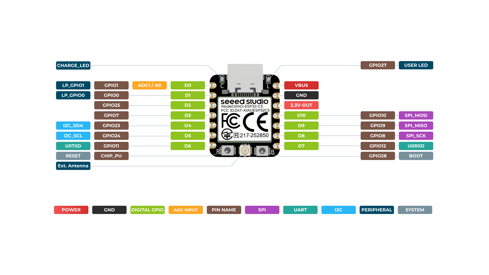
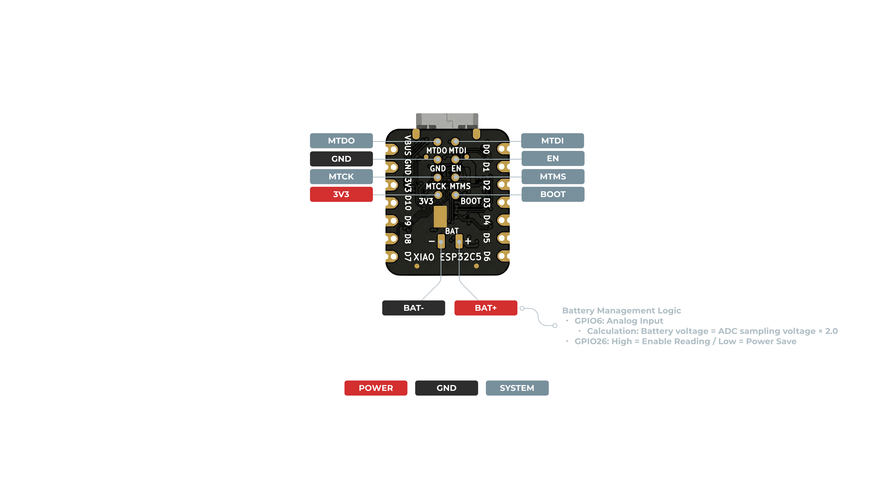

# Seeed Studio XIAO ESP32-C5 Development Guide


[**View Seeed Studio XIAO ESP32-C5 on OpenELAB**](https://openelab.io/products/seeed-studio-xiao-esp32-c5)

**Model / option:** Seeed Studio XIAO ESP32-C5 development board · **SKU:** `Seeed-100010048` · **Hardware reference:** Seeed schematic V1.1, 25 December 2025


## Product overview

### Product, applications and hardware

The XIAO ESP32-C5 is a compact, single-core RISC-V development board with **2.4 GHz and 5 GHz Wi-Fi 6**, Bluetooth LE, 8 MB flash and 8 MB PSRAM. It is useful when a small sensor or controller must join an authorized 5 GHz network. Its Arduino target is **XIAO\_ESP32C5**; C3, C6 and S3 firmware and pin maps are different. The board's supply input and its **3.3 V GPIO** are separate electrical domains. [Seeed C5 hardware reference](https://wiki.seeedstudio.com/xiao_esp32c5_getting_started/), [C5 schematic](https://files.seeedstudio.com/wiki/XIAO_ESP32C5/res/Seeed_Studio_XIAO_ESP32C5.pdf).

Start with the offline LED test, check the memory configuration, and then add a peripheral or network connection. The procedures below use original examples. They separate an upload problem, a wiring problem and a network problem so that each has an observable checkpoint.

## Applications

| Application              | Engineering choice                                                                                                                                                                                                 |
| ------------------------ | ------------------------------------------------------------------------------------------------------------------------------------------------------------------------------------------------------------------ |
| Compact networked sensor | Use a 3.3 V I2C sensor on D4/D5, confirm its address first, then add Wi-Fi reporting.                                                                                                                              |
| A device on a 5 GHz WLAN | Use the C5 board target and supported firmware; verify the router's channel, security and regional settings. Dual-band capability alone does not guarantee discovery of every access point.                        |
| Battery data logger      | Use a qualified single-cell 3.7 V lithium battery, timer wake and brief measurement windows; validate the entire board's sleep current.                                                                            |
| UART or SPI controller   | Explicitly select the C5 pins, verify logic levels, and use a loopback before connecting the target device.                                                                                                        |
| Bluetooth LE prototype   | Select an ESP32-C5-capable release of the Bluetooth stack and test its desired role/profile independently of Wi-Fi. Bluetooth LE is the relevant hardware capability; do not assume Classic Bluetooth SPP support. |

These are design patterns, not measured range, runtime or throughput promises. An external dual-band antenna and the final enclosure placement affect RF performance. [Manufacturer radio and interface scope](https://wiki.seeedstudio.com/xiao_esp32c5_getting_started/).

## Specifications

| Item              | XIAO ESP32-C5 value / boundary                                                                                     |
| ----------------- | ------------------------------------------------------------------------------------------------------------------ |
| Processor         | ESP32-C5, 32-bit single-core RISC-V, up to 240 MHz                                                                 |
| On-chip memory    | 384 KB SRAM and 320 KB ROM; these are chip resources, not all free application heap                                |
| Board memory      | 8 MB flash and 8 MB external PSRAM; firmware partition and PSRAM settings determine usable application capacity    |
| Wi-Fi             | 2.4 GHz / 5 GHz Wi-Fi 6; IEEE 802.11 a/b/g/n/ac/ax; station, SoftAP and concurrent AP+station modes are documented |
| Bluetooth         | Bluetooth 5 LE and Bluetooth mesh capability; application/stack support is firmware-dependent                      |
| Header signals    | D0–D10, 11 GPIO/PWM-capable board signals                                                                          |
| Analog exposure   | A0 on D0 plus A1–A4 on the bottom JTAG pads; battery ADC is a separate internal route                              |
| Board interfaces  | One I2C route, one SPI route, two UART controllers; the table below identifies the exposed default UART pins       |
| Size              | 21 × 17.8 mm                                                                                                       |
| USB / logic       | USB-C 5 V input; 3.3 V GPIO, not 5 V-tolerant                                                                      |
| Battery           | Single-cell nominal 3.7 V lithium battery on BAT pads; correct polarity and compatible cell protection required    |
| Charger reference | SGM40567; V1.1 schematic configures 200 mA charge current and a 4.2 V single-cell charge endpoint                  |
| Controls          | Reset on CHIP\_EN; BOOT on GPIO28; yellow user LED on GPIO27, active-low                                           |

Sources: [Seeed specification and pin map](https://wiki.seeedstudio.com/xiao_esp32c5_getting_started/), [ESP32-C5 datasheet v0.5, preliminary](https://files.seeedstudio.com/wiki/XIAO_ESP32C5/res/esp32-c5_datasheet_en.pdf), [V1.1 board power and main sheets, PDF pages 4–5](https://files.seeedstudio.com/wiki/XIAO_ESP32C5/res/Seeed_Studio_XIAO_ESP32C5.pdf). Dual-band does not mean two independently simultaneous Wi-Fi radios. Do not treat a regulator's component rating as available peripheral current after the processor, radio and other board loads.

## Hardware and connections

### Header pin map: D labels are not GPIO numbers



_Seeed Studio's_ [_original front pinout_](https://files.seeedstudio.com/wiki/XIAO_ESP32C5/Getting_started/XIAO_ESP32-C5_front_pinout.png)_, visually inspected; orientation is with USB-C at the top. The full schematic is marked CC BY-SA 4.0._

| Board label | ESP32-C5 GPIO | Arduino default / use                                      |
| ----------- | ------------- | ---------------------------------------------------------- |
| D0 / A0     | 1             | ADC and low-power GPIO                                     |
| D1          | 0             | Digital / low-power GPIO                                   |
| D2          | 25            | Digital                                                    |
| D3          | 7             | Digital; default SPI `SS` alias                            |
| D4 / SDA    | 23            | I2C data                                                   |
| D5 / SCL    | 24            | I2C clock                                                  |
| D6 / TX     | 11            | UART transmit                                              |
| D7 / RX     | 12            | UART receive                                               |
| D8 / SCK    | 8             | SPI clock                                                  |
| D9 / MISO   | 9             | SPI peripheral-to-controller data                          |
| D10 / MOSI  | 10            | SPI controller-to-peripheral data                          |
| VBUS / 5V   | —             | USB-related 5 V power rail; never a logic-level indication |
| GND         | —             | Signal/power reference                                     |
| 3V3         | —             | Regulated 3.3 V output                                     |

This table agrees with the [Arduino-ESP32 **3.3.5 C5 variant**](https://github.com/espressif/arduino-esp32/blob/3.3.5/variants/XIAO_ESP32C5/pins_arduino.h). In Arduino, numeric pin `4` means chip GPIO4, whereas `D4` means GPIO23. Prefer the named aliases or documented GPIO numbers consistently. D3 cannot simultaneously be an unrelated output and an active SPI chip-select.

### Bottom pads, battery measurement and debugging



_Seeed Studio's_ [_original back pinout_](https://files.seeedstudio.com/wiki/XIAO_ESP32C5/Getting_started/XIAO_ESP32-C5_back_pinout.png)_, visually inspected. Read BAT+ and BAT− on the actual board before soldering._

| Pad / function             | GPIO or rail           | Important boundary                                                          |
| -------------------------- | ---------------------- | --------------------------------------------------------------------------- |
| MTMS / Arduino A1          | GPIO2                  | JTAG / ADC; preserve for debugging when developing sleep firmware           |
| MTDI / A2                  | GPIO3                  | JTAG / ADC                                                                  |
| MTCK / A3                  | GPIO4                  | JTAG / ADC                                                                  |
| MTDO / A4                  | GPIO5                  | JTAG / ADC per variant and schematic                                        |
| EN                         | CHIP\_EN               | Reset, not a general output                                                 |
| BOOT                       | GPIO28                 | Download-mode control; not D0 or GPIO9                                      |
| BAT+ / BAT−                | Cell positive / ground | Single-cell battery input; not a 5 V accessory connector                    |
| Internal `BAT_VOLT_PIN`    | GPIO6                  | Switched half-battery ADC node; not a header input                          |
| Internal `BAT_VOLT_PIN_EN` | GPIO26                 | HIGH enables battery-voltage sampling; LOW reduces measurement-circuit load |

[Exact variant aliases](https://github.com/espressif/arduino-esp32/blob/3.3.5/variants/XIAO_ESP32C5/pins_arduino.h), [V1.1 power/main schematic](https://files.seeedstudio.com/wiki/XIAO_ESP32C5/res/Seeed_Studio_XIAO_ESP32C5.pdf). The advertised five ADC channels do not mean five analog inputs on the two side headers. Their alternate use also consumes debug access.

### Power and RF preparation

1. Start with USB only and all external circuitry disconnected. Use a USB-C **data** cable.
2. Attach the included compatible external antenna with power off. Align the U.FL connector vertically; keep cable strain away from it and the antenna clear of large conductive objects.
3. For a peripheral, connect ground and verify the signal voltage before connecting data. Use an appropriate translator for a 5 V UART, SPI or I2C device; I2C pull-ups must not raise C5 pins to 5 V.
4. For battery work, verify the battery chemistry, polarity and protection, disconnect power before soldering, and insulate the pads. The board supports USB use while a suitable battery is connected, but this is not authorization to parallel an arbitrary external 5 V source onto VBUS.
5. Confirm the board revision before reproducing a carrier's power arrangement. The V1.1 schematic contains input/output load switches and power selection; do not infer all earlier revisions have identical power paths.

The charger LED is a charge-management indication, not a programmable application LED or a reliable fuel gauge. V1.1's power sheet describes blinking during charging and a limited completion indication; LED-off alone does not prove that a cell is absent or discharged. Use voltage and charge-current measurements when diagnosing battery operation. [Seeed battery instructions and hardware download](https://wiki.seeedstudio.com/xiao_esp32c5_getting_started/), [schematic PDF page 4](https://files.seeedstudio.com/wiki/XIAO_ESP32C5/res/Seeed_Studio_XIAO_ESP32C5.pdf).

## Software and development resources

### Development and recovery

| Route       | Exact target and setup boundary                                                                                                  |
| ----------- | -------------------------------------------------------------------------------------------------------------------------------- |
| Arduino IDE | Espressif `esp32` board package **3.3.5 or later**, board **XIAO\_ESP32C5**, observed USB port; examples below target 3.3.5 APIs |
| PlatformIO  | Seeed's `platform-seeedboards` platform and board **seeed-xiao-esp32-c5**; do not substitute a generic C3/C6 environment         |
| ESP-IDF     | Chip target **esp32c5**, using a release that supports it; board GPIO/power configuration still comes from this schematic        |
| MicroPython | Exact **SEEED\_XIAO\_ESP32C5** build; the reviewed full `.bin` image is written at **0x2000**                                    |
| BLE / mesh  | Select a C5-capable stack and supported profile; chip capability is not a finished application                                   |

[Seeed Arduino requirements](https://wiki.seeedstudio.com/xiao_esp32c5_getting_started/), [3.3.5 board configuration](https://github.com/espressif/arduino-esp32/blob/3.3.5/boards.txt), [Seeed PlatformIO board definition](https://github.com/Seeed-Studio/platform-seeedboards/blob/main/boards/seeed-xiao-esp32-c5.json), [MicroPython board instructions](https://micropython.org/download/SEEED_XIAO_ESP32C5/). Save the release/commit and configuration with a working project. A moving `main` branch is a research snapshot, not a permanent dependency lock.

For PlatformIO, the current Seeed platform README and exact board JSON support this starting configuration:

```ini
[env:xiao_c5]
platform = https://github.com/Seeed-Studio/platform-seeedboards.git
board = seeed-xiao-esp32-c5
framework = arduino
monitor_speed = 115200
```

Build a copy of the LED sketch as `src/main.cpp` with `#include <Arduino.h>`. Run `pio run -e xiao_c5`, then select the observed upload port before `pio run -e xiao_c5 -t upload`. Inspect package resolution, retain a working platform ref and run `pio pkg list -e xiao_c5`; the commands have not been executed here. [Platform usage and pinning](https://github.com/Seeed-Studio/platform-seeedboards/blob/main/README.md).

## Getting started

### Getting started: offline LED test

1. Prepare the board, antenna, computer and USB-C data cable. Leave battery and peripheral wiring disconnected for this first check.
2. Install Arduino IDE, then install **esp32 by Espressif Systems 3.3.5 or later** in Boards Manager. The reviewed 3.3.5 release contains this exact variant.
3. Select **XIAO\_ESP32C5** and the actual enumerated port. Enable **USB CDC On Boot** for USB `Serial` output, select **8 MB flash**, and enable **PSRAM** when testing external RAM. Retain the board's supported flash/partition settings rather than carrying them over from a different XIAO.
4. Upload the original sketch below, reopen the enumerated application port if it changes, and open Serial Monitor at **115200 baud**.

```cpp
#include <Arduino.h>

void setup() {
  pinMode(LED_BUILTIN, OUTPUT);
  digitalWrite(LED_BUILTIN, HIGH);  // C5 LED off
  Serial.begin(115200);
  delay(1500);                     // bounded USB settling period
  Serial.printf("C5 flash=%lu bytes, PSRAM=%lu bytes\n",
                (unsigned long)ESP.getFlashChipSize(),
                (unsigned long)ESP.getPsramSize());
}

void loop() {
  static uint32_t cycle = 0;
  digitalWrite(LED_BUILTIN, LOW);
  delay(250);
  digitalWrite(LED_BUILTIN, HIGH);
  Serial.printf("C5_LED_CYCLE %lu\n", (unsigned long)++cycle);
  delay(750);
}
```

**Expected result:** the yellow GPIO27 LED lights for about 250 ms each second and numbered `C5_LED_CYCLE` messages continue. With correct detection/configuration, 8 MB corresponds to **8388608 bytes**; a zero PSRAM result calls for checking PSRAM enable, selected target and installed core, rather than concluding the flash is missing. This memory print is diagnostic, not a benchmark. [C5 LED/pin definition](https://github.com/espressif/arduino-esp32/blob/3.3.5/variants/XIAO_ESP32C5/pins_arduino.h), [board options](https://github.com/espressif/arduino-esp32/blob/3.3.5/boards.txt).

If the LED works but the monitor is empty, check CDC and the application port first. If upload fails, use the BOOT/reset sequence in Troubleshooting before erasing anything.

### Original I2C scan and UART/SPI loopback

5. Disconnect power. For a **loopback-only** test, connect **D6 to D7** and **D10 to D9**. Disconnect all other UART/SPI devices to avoid connecting two outputs. These are short 3.3 V board-to-board jumpers, not RS-232 connections.
6. Optionally attach a known 3.3 V I2C sensor: SDA→D4, SCL→D5, GND→GND and its supported supply. Check its pull-ups. For a known-zero ADC check, connect D0 to GND through a 1 kΩ resistor. No sensor is included by this example.
7. Upload the sketch and compare UART/SPI equality before attaching a real peripheral.

```cpp
#include <Arduino.h>
#include <Wire.h>
#include <SPI.h>

void setup() {
  Serial.begin(115200);
  delay(1500);
  Wire.begin(D4, D5, 100000);
  unsigned count = 0;
  for (uint8_t addr = 0x08; addr <= 0x77; ++addr) {
    Wire.beginTransmission(addr);
    if (Wire.endTransmission() == 0) {
      Serial.printf("I2C ACK 0x%02X\n", addr);
      ++count;
    }
  }
  Serial.printf("I2C acknowledged addresses=%u\n", count);
  pinMode(A0, INPUT);
  analogReadResolution(12);
  analogSetPinAttenuation(A0, ADC_11db);
  Serial.printf("D0 millivolts=%lu\n",
                (unsigned long)analogReadMilliVolts(A0));
  Serial1.begin(115200, SERIAL_8N1, D7, D6); // RX, TX
  pinMode(D3, OUTPUT);
  digitalWrite(D3, HIGH);
  SPI.begin(D8, D9, D10, D3);              // SCK, MISO, MOSI, SS
}

void loop() {
  while (Serial1.available()) Serial1.read();
  const uint8_t sent = 0xA6;
  Serial1.write(sent);
  Serial1.flush();
  uint32_t start = millis();
  while (!Serial1.available() && millis() - start < 100) delay(1);
  int received = Serial1.available() ? Serial1.read() : -1;

  SPI.beginTransaction(SPISettings(100000, MSBFIRST, SPI_MODE0));
  uint8_t echoed = SPI.transfer(sent);
  SPI.endTransaction();
  Serial.printf("UART=%s SPI=%s (sent=%02X, rx=%d, spi=%02X)\n",
                received == sent ? "PASS" : "CHECK_JUMPER",
                echoed == sent ? "PASS" : "CHECK_JUMPER",
                sent, received, echoed);
  delay(1000);
}
```

**Expected result:** `UART=PASS SPI=PASS` with both loopbacks correctly installed. I2C reports the attached device's documented address; **zero addresses is normal on an otherwise bare board**. Grounded D0 should read near zero with ADC noise/offset; this does not calibrate the full ADC range. A loopback checks the selected pins and data path, not a target sensor's protocol. Remove loopbacks before reconnecting peripherals. [Pin aliases](https://github.com/espressif/arduino-esp32/blob/3.3.5/variants/XIAO_ESP32C5/pins_arduino.h), [Arduino ADC API](https://docs.espressif.com/projects/arduino-esp32/en/latest/api/adc.html).

### Wi-Fi scan, then a bounded connection attempt

8. Remove diagnostic jumpers and run the following standalone sketch. Set the SSID/password to a network you are authorized to use. Keep private credentials out of published repositories.
9. For a 5 GHz check, use an identifiable 5 GHz SSID, confirm the router channel/security is supported, and compare the reported channel with the router. Do not infer successful 5 GHz association from the board name alone.

```cpp
#include <Arduino.h>
#include <WiFi.h>

const char* networkName = "YOUR_AUTHORIZED_SSID";
const char* networkPassword = "YOUR_NETWORK_PASSWORD";

void setup() {
  Serial.begin(115200);
  delay(1500);
  WiFi.mode(WIFI_STA);
  int found = WiFi.scanNetworks();
  Serial.printf("Scan result=%d\n", found);
  for (int i = 0; i < found; ++i) {
    Serial.printf("%s channel=%ld RSSI=%ld dBm\n",
                  WiFi.SSID(i).c_str(), (long)WiFi.channel(i),
                  (long)WiFi.RSSI(i));
  }
  WiFi.scanDelete();
  WiFi.begin(networkName, networkPassword);
  uint32_t start = millis();
  while (WiFi.status() != WL_CONNECTED && millis() - start < 20000) {
    delay(250);
  }
  if (WiFi.status() == WL_CONNECTED) {
    Serial.printf("WIFI_CONNECTED channel=%ld IP=%s RSSI=%ld dBm\n",
                  (long)WiFi.channel(), WiFi.localIP().toString().c_str(),
                  (long)WiFi.RSSI());
  } else {
    Serial.printf("WIFI_TIMEOUT status=%d; inspect SSID/security/channel\n",
                  (int)WiFi.status());
  }
}
void loop() { delay(1000); }
```

**Expected result:** a scan listing and either an IP address/channel within approximately 20 seconds or an explicit timeout. A missing network can be a channel/regulatory/firmware/antenna issue; an observed SSID with authentication failure is a different stage. RSSI and connection success do not establish throughput or range. [Official Wi-Fi API](https://docs.espressif.com/projects/arduino-esp32/en/latest/api/wifi.html), [3.3.5 Wi-Fi interface](https://github.com/espressif/arduino-esp32/blob/3.3.5/libraries/WiFi/src/WiFiGeneric.h).

### Battery measurement without confusing A0 and battery ADC

10. Power off and attach a suitable battery to the marked BAT pads. With a meter, verify polarity and cell voltage before powering the board. GPIO6 is the internal half-battery measurement node; D0/A0 is a different input.
11. Upload this independent sketch. It enables the divider only for the measurement window, averages 16 calibrated ADC readings and prints volts rather than an unsupported state-of-charge percentage.

```cpp
#include <Arduino.h>

void setup() {
  Serial.begin(115200);
  pinMode(BAT_VOLT_PIN_EN, OUTPUT);
  digitalWrite(BAT_VOLT_PIN_EN, LOW);
  analogReadResolution(12);
  analogSetPinAttenuation(BAT_VOLT_PIN, ADC_11db);
  delay(1500);
}

void loop() {
  digitalWrite(BAT_VOLT_PIN_EN, HIGH);
  delay(10);                        // original settling allowance
  uint32_t sumMv = 0;
  for (unsigned sample = 0; sample < 16; ++sample) {
    sumMv += analogReadMilliVolts(BAT_VOLT_PIN);
    delay(1);
  }
  digitalWrite(BAT_VOLT_PIN_EN, LOW);
  float batteryV = (sumMv / 16.0f) * 2.0f / 1000.0f;
  Serial.printf("BATTERY_ESTIMATE %.3f V; compare with meter\n", batteryV);
  delay(2000);
}
```

**Expected result:** a stable approximate cell voltage comparable with a meter, allowing divider tolerance, ADC error, noise and load effects. The **2×** conversion follows the V1.1 schematic's two 100 kΩ resistors. A zero or implausible result calls for checking cell connection, GPIO26 enable, board revision and ADC configuration. A voltage value alone is not a validated fuel gauge. [Seeed battery route](https://wiki.seeedstudio.com/xiao_esp32c5_getting_started/), [power sheet](https://files.seeedstudio.com/wiki/XIAO_ESP32C5/res/Seeed_Studio_XIAO_ESP32C5.pdf).

### Timer sleep first; button wake second

12. First establish a recoverable timer-wake loop. Leave a ten-second awake interval to reopen the monitor or upload another sketch. Deep sleep restarts normal application execution; it does not continue after `esp_deep_sleep_start()`.

```cpp
#include <Arduino.h>
#include "esp_sleep.h"

RTC_DATA_ATTR uint32_t wakeCount = 0;

void setup() {
  pinMode(LED_BUILTIN, OUTPUT);
  digitalWrite(LED_BUILTIN, LOW);
  Serial.begin(115200);
  delay(1500);
  Serial.printf("WAKE %lu reason=%d; awake window 10 seconds\n",
                (unsigned long)++wakeCount,
                (int)esp_sleep_get_wakeup_cause());
  delay(10000);
  digitalWrite(LED_BUILTIN, HIGH);
  esp_err_t result = esp_sleep_enable_timer_wakeup(15ULL * 1000000ULL);
  if (result != ESP_OK) {
    Serial.printf("Sleep configuration failed: %d\n", (int)result);
    return;
  }
  Serial.println("SLEEP_15_SECONDS");
  Serial.flush();
  esp_deep_sleep_start();
}
void loop() { delay(1000); }
```

**Expected result:** an awake interval, sleep, then a new boot with an incremented retained counter. USB may disappear during sleep and re-enumerate on wake; monitor reconnection can hide an early print. The LED gives an additional visible checkpoint. The interval includes boot/awake overhead and is not a precision timebase. A power-cycle may reset retained state. [C5 sleep reference](https://docs.espressif.com/projects/esp-idf/en/stable/esp32c5/api-reference/system/sleep_modes.html).

13. To add a normally open wake button, wire **D0/GPIO1 to GND through the button**, with a **10 kΩ pull-up to 3V3**. Keep bottom JTAG pads available. Before sleep, configure `pinMode(D0, INPUT_PULLUP)`, wait until the button is released, and add the following check before `esp_deep_sleep_start()`. Retain timer wake as a fallback during development:

```cpp
while (digitalRead(D0) == LOW) delay(10); // release before sleep
esp_err_t wakeResult = esp_deep_sleep_enable_gpio_wakeup(
    1ULL << D0, ESP_GPIO_WAKEUP_GPIO_LOW);
if (wakeResult != ESP_OK) {
  Serial.printf("GPIO wake configuration failed: %d\n", (int)wakeResult);
  return;
}
```

This Arduino **3.3.5 / ESP-IDF 5.5** API is source-checked against [the pinned sleep header](https://github.com/espressif/esp-idf/blob/v5.5/components/esp_hw_support/include/esp_sleep.h) and [C5 capability definition](https://github.com/espressif/esp-idf/blob/v5.5/components/soc/esp32c5/include/soc/soc_caps.h). Later IDF documentation names an updated GPIO wake API; use the API of the installed release. **Expected result:** a low level from a button press wakes the board, or the retained timer does. Do not use a pulled-high input with a high-level wake trigger and expect it to remain asleep: an already-active level can cause immediate wake. This procedure deliberately uses active-low wiring instead of copying that mismatch from a generic example.

For current measurement, disconnect USB and account for meter burden, battery voltage, pull-ups, the antenna/radio state and every external peripheral. A chip-level deep-sleep value is not a measured battery runtime for this board.

### MicroPython as a separate firmware route

14. Back up the existing flash/application/configuration before switching runtimes. Download the **full `.bin`** for **SEEED\_XIAO\_ESP32C5**; the reviewed release is [v1.29.0, 24 August 2026](https://micropython.org/resources/firmware/SEEED_XIAO_ESP32C5-20260824-v1.29.0.bin). Do not substitute `.app-bin`, a C3/C6 image or an arbitrary preview build.
15. Enter download mode and identify the actual serial port. Following the exact board's [official flashing instructions](https://micropython.org/download/SEEED_XIAO_ESP32C5/), erase when first installing this runtime and write the full image at **0x2000**. The `PORTNAME` token below must be replaced with the observed port; install/use the esptool version supported by that firmware/tool documentation.

```bash
esptool.py --port PORTNAME erase_flash
esptool.py --port PORTNAME write_flash 0x2000 SEEED_XIAO_ESP32C5-20260824-v1.29.0.bin
```

16. Reset, connect a serial REPL at 115200 baud and run this original short diagnostic:

```python
from machine import Pin, I2C
from time import sleep_ms

led = Pin(27, Pin.OUT, value=1)
for pulse in range(4):
    led.value(0)
    sleep_ms(150)
    led.value(1)
    sleep_ms(350)
bus = I2C(0, sda=Pin(23), scl=Pin(24), freq=100_000)
print("C5_I2C", [hex(address) for address in bus.scan()])
```

**Expected result:** four short active-low LED pulses and an address list (`[]` on a bare board). A responsive REPL confirms the MicroPython runtime; it does not validate all radio/peripheral features. Arduino sketches are replaced by this flash operation. Return to the exact Arduino target and re-upload a backed-up project when switching back.

## Troubleshooting and FAQs

### FAQs

| Symptom / question                                 | Ordered diagnosis and recovery                                                                                                                                                      |
| -------------------------------------------------- | ----------------------------------------------------------------------------------------------------------------------------------------------------------------------------------- |
| No port at all                                     | Try a known data cable and a direct host port; disconnect external wiring; inspect USB enumeration and actual device permissions. The charge LED alone does not establish USB data. |
| Application sleeps/crashes before upload           | Hold **BOOT**, press and release **RESET**, then release BOOT; reselect the download-mode port and upload the offline sketch. This board's BOOT is GPIO28.                          |
| Upload succeeds, monitor empty                     | Enable USB CDC on boot, select the application port again, check 115200 baud and open during the awake interval.                                                                    |
| LED is inverted                                    | GPIO27 LED is active-low: LOW lights it. Use the C5 variant, not a remembered LED pin from another XIAO.                                                                            |
| PSRAM shows zero                                   | Verify target, supported core and PSRAM enable. Separate PSRAM detection from flash size/partition capacity.                                                                        |
| D4 I2C device never responds                       | D4 is GPIO23, not GPIO4. Confirm D5/GPIO24, ground, actual device address and 3.3 V pull-ups before trying a sensor library.                                                        |
| UART echoes fail                                   | D6 TX→D7 RX only for loopback; remove target devices, check 115200/8N1 and separate USB Serial from Serial1. A ±RS-232 signal needs a transceiver.                                  |
| ADC seems inconsistent                             | Check that the selected alias is the intended pad, attenuation/range, source impedance and ground. GPIO6 battery measurement requires GPIO26 enable.                                |
| Immediate wake every time                          | Check the active wake level, button release and pull-up. A high-biased pin with a high-level trigger is already active.                                                             |
| 5 GHz SSID is absent                               | Verify antenna, AP channel/security/region, installed C5 firmware and scan settings. Compare a known supported AP; do not erase flash as the first network diagnostic.              |
| Battery works but LED indication seems odd         | Inspect the revision's charger indication, cell voltage and actual charge current. Do not infer capacity from the charge LED.                                                       |
| Can a C3/C6 binary or 5 V sensor be used directly? | Use the C5 firmware target and this pin map. Translate incompatible signal levels before connecting.                                                                                |

The BOOT/reset download sequence and deep-sleep USB behavior are described in the [model guide](https://wiki.seeedstudio.com/xiao_esp32c5_getting_started/). Back up data before a full erase; neither a successful erase nor an unpowered board is proof of an antenna, sensor or battery fault.

## Downloads and technical documents

### Official documentation and development resources

| Direct resource                                                                                                                                                                                                                       | Scope / access distinction                                                                                                   |
| ------------------------------------------------------------------------------------------------------------------------------------------------------------------------------------------------------------------------------------- | ---------------------------------------------------------------------------------------------------------------------------- |
| [C5 schematic PDF](https://files.seeedstudio.com/wiki/XIAO_ESP32C5/res/Seeed_Studio_XIAO_ESP32C5.pdf)                                                                                                                                 | Read and important sheets visually inspected; V1.1 dated 25 December 2025, CC BY-SA 4.0                                      |
| [ESP32-C5 datasheet PDF](https://files.seeedstudio.com/wiki/XIAO_ESP32C5/res/esp32-c5_datasheet_en.pdf)                                                                                                                               | Reviewed preliminary v0.5 chip reference; distinguish chip pins from board labels                                            |
| [C5 KiCad project ZIP](https://files.seeedstudio.com/wiki/XIAO_ESP32C5/res/Seeed_Studio_XIAO_ESP32C5.zip)                                                                                                                             | Manufacturer-listed editable design archive; verify included revision before modifying a carrier                             |
| [C5 pinout spreadsheet](https://files.seeedstudio.com/wiki/XIAO_ESP32C5/res/XIAO_ESP32C5_Pinout.xlsx)                                                                                                                                 | Manufacturer-listed spreadsheet; front/back diagrams and exact variant are the reviewed wiring references here               |
| [Front pinout PNG](https://files.seeedstudio.com/wiki/XIAO_ESP32C5/Getting_started/XIAO_ESP32-C5_front_pinout.png) / [back pinout PNG](https://files.seeedstudio.com/wiki/XIAO_ESP32C5/Getting_started/XIAO_ESP32-C5_back_pinout.png) | Original Seeed Studio images used above, inspected without redrawing                                                         |
| [XIAO KiCad footprints](https://files.seeedstudio.com/wiki/XIAO-KiCad-Library/New_XIAO_Series_Footprints.zip) / [schematic symbols](https://files.seeedstudio.com/wiki/XIAO-KiCad-Library/XIAO_Series_SCH_Symbols.zip)                | Manufacturer-listed family libraries; inspect C5 pad names and bottom-pad clearance                                          |
| [Manufacturer-linked C5 3D model](https://grabcad.com/library/seeed-studio-xiao-esp32-c5-1)                                                                                                                                           | Mechanical resource listing; access/export may require the provider's account, not a downloaded/verified STEP in this review |
| [Arduino core 3.3.5](https://github.com/espressif/arduino-esp32/tree/3.3.5) / [C5 variant](https://github.com/espressif/arduino-esp32/blob/3.3.5/variants/XIAO_ESP32C5/pins_arduino.h)                                                | Version-scoped target and aliases; repository software license applies                                                       |
| [Seeed PlatformIO C5 board](https://github.com/Seeed-Studio/platform-seeedboards/blob/main/boards/seeed-xiao-esp32-c5.json)                                                                                                           | Exact platform/board configuration; retain a resolved ref for reproduction                                                   |
| [MicroPython C5 firmware and instructions](https://micropython.org/download/SEEED_XIAO_ESP32C5/)                                                                                                                                      | Full image address0x2000 and release-specific downloads; flashing not performed                                              |

## References and validation

### Sources and validation

Reviewed **24 November 2026**: [Seeed's exact-model guide](https://wiki.seeedstudio.com/xiao_esp32c5_getting_started/), C5 schematic and chip datasheet, [Arduino 3.3.5 variant](https://github.com/espressif/arduino-esp32/blob/3.3.5/variants/XIAO_ESP32C5/pins_arduino.h), [board configuration](https://github.com/espressif/arduino-esp32/blob/3.3.5/boards.txt), [Seeed PlatformIO definition](https://github.com/Seeed-Studio/platform-seeedboards/blob/main/boards/seeed-xiao-esp32-c5.json), [MicroPython exact board](https://micropython.org/download/SEEED_XIAO_ESP32C5/), [Arduino Wi-Fi](https://docs.espressif.com/projects/arduino-esp32/en/latest/api/wifi.html) and [ADC API](https://docs.espressif.com/projects/arduino-esp32/en/latest/api/adc.html), and the versioned sleep headers cited above. Seeed drawings remain attributed; downloadable software/design resources retain their respective licenses.

**Validation:** source reviewed; front/back pinouts and power/main schematic sheets visually inspected. Arduino/PlatformIO compilation, firmware flashing, REPL execution, peripheral loopback, radio connection, charge-current and sleep-current measurements were **not run**. Expected results are reproduction checkpoints, not observed tests. Record the received board revision, core/platform version, firmware image, host OS, antenna and peripheral wiring with any actual test result.
