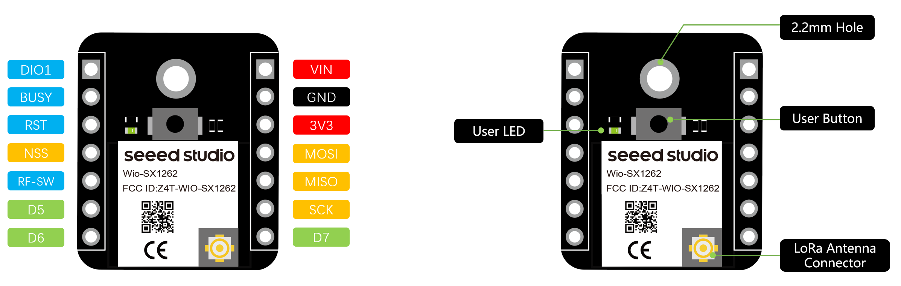

# Seeed Studio XIAO ESP32S3 & Wio-SX1262 Kit for Meshtastic


[**View Seeed Studio XIAO ESP32S3 & Wio-SX1262 Kit for Meshtastic on OpenELAB**](https://openelab.io/products/seeed-studio-xiao-esp32s30-wio-sx1262-kit-for-meshtastic)

**Model / option:** Seeed Studio XIAO ESP32S3 & Wio-SX1262 Kit for Meshtastic · **SKU:** `Seeed-102010611`


## Product overview <a href="#description" id="description"></a>

### Exact hardware identity <a href="#seeed-studio-xiao-esp32s3-wio-sx1262-kit-for-meshtastic" id="seeed-studio-xiao-esp32s3-wio-sx1262-kit-for-meshtastic"></a>

The XIAO ESP32S3 & Wio-SX1262 kit, `Seeed-102010611`, combines a Wi-Fi/BLE ESP32-S3 host with a sub-GHz LoRa radio. Its **30-pin board-to-board radio connection** differs from the through-hole nRF52840 kit. Use the ESP32S3 carrier and exact firmware target; a shared SX1262 module name does not establish interchangeable wiring.

The listed product is the Meshtastic kit. It can also be reprogrammed as a raw-LoRa device, LoRaWAN sensor node or experimental one-channel hub, but these are alternative applications. A single SX1262 is not a multi-channel LoRaWAN concentrator. Optional GNSS, OLED, sensors, enclosure and battery are separate components unless explicitly listed for the received bundle. [Exact kit overview](https://wiki.seeedstudio.com/wio_sx1262_with_xiao_esp32s3_kit/).

### OpenELAB listing and option <a href="#product-link" id="product-link"></a>

Use [View Seeed Studio XIAO ESP32S3 & Wio-SX1262 Kit for Meshtastic on OpenELAB](https://openelab.io/products/seeed-studio-xiao-esp32s30-wio-sx1262-kit-for-meshtastic) and match `Seeed-102010611` before selecting regional firmware or adding accessories.

## Applications <a href="#features" id="features"></a>

Use the kit as a compact Meshtastic text node, a Wi-Fi-connected mesh monitor input or a developer platform for LoRaWAN telemetry. Start with a two-radio message exchange; add Wi-Fi/MQTT only after the local mesh works. Internet bridging can expose message/location data, so set channel uplink/downlink and location policies deliberately.

The optional four-layer build adds a XIAO expansion board, revised L76K, a sensor, battery and enclosure. It is an assembly project, not proof that this SKU includes every pictured part. For LoRaWAN gateway experiments, account for the one-channel/fixed-modulation receive limitation; production network coverage normally requires an appropriate multi-channel gateway.

## Specifications <a href="#specification" id="specification"></a>

| Parameter                    | ESP32S3 kit value / boundary                                                                                           |
| ---------------------------- | ---------------------------------------------------------------------------------------------------------------------- |
| Host                         | ESP32-S3R8, dual-core Xtensa LX7, up to240 MHz                                                                         |
| Memory                       | 8 MB PSRAM on S3R8; XIAO board8 MB flash in documented firmware setup                                                  |
| Radio                        | SX1262-based Wio module;862–930 MHz documented band                                                                    |
| Wi-Fi / BLE                  | 2.4 GHz Wi-Fi; Bluetooth5 LE; no5 GHz Wi-Fi                                                                            |
| Power input                  | USB-C5 V; BAT pads for a protected3.7 V nominal single Li-ion/LiPo cell,4.2 V fully charged                            |
| Charger                      | 100 mA documented battery charging current; not a GPIO/peripheral-current budget                                       |
| Logic                        | 3.3 V; UART/SPI/I²C signals must remain within host limits                                                             |
| Hardware                     | Reset/Boot buttons, host/user/charge indicators; carrier user button                                                   |
| Size / temperature           | 21 ×17.8 mm board-class dimensions; stacked/coax clearance additional; −40 to+65 °C kit rating, cell charging narrower |
| Included in manufacturer kit | XIAO ESP32S3, Wio-SX1262 carrier, Wi-Fi antenna and LoRa antenna                                                       |
| Optional display / GNSS      | XIAO expansion OLED and L76K are separately added                                                                      |

Sources: [Seeed specifications and parts](https://wiki.seeedstudio.com/wio_sx1262_with_xiao_esp32s3_kit/) and [firmware setup](https://wiki.seeedstudio.com/xiao_esp32s3_&_wio_SX1262_kit_for_meshtastic/). The manufacturer's bundled FPC antenna is described as suitable for initial tests; use an appropriate installation antenna for an engineered field link.

## Hardware and connections <a href="#hardware" id="hardware"></a>

Power off before seating the board-to-board connector. Confirm it is fully aligned, then attach the separate2.4 GHz Wi-Fi and sub-GHz LoRa antennas to their respective sockets. A2.4 GHz antenna is not a substitute for the LoRa antenna. Avoid leverage on the small RF connectors.



_ESP32S3 Wio-SX1262 carrier orientation and function labels; this is the board-to-board carrier — Seeed Studio,_ [_original diagram_](https://wiki.seeedstudio.com/wio_sx1262_with_xiao_esp32s3_kit/)_._

| Radio function                 | ESP32S3 native GPIO in reviewed Meshtastic variant |
| ------------------------------ | -------------------------------------------------- |
| SPI SCK / MISO / MOSI          | 7 /8 /9                                            |
| NSS / reset                    | 41 /42                                             |
| DIO1 / Busy                    | 39 /40                                             |
| RX RF switch                   | 38; TX switch uses SX1262 DIO2                     |
| TCXO setting                   | 1.8 V in exact variant                             |
| Optional I²C SDA / SCL         | 5 /6 (XIAO D4 /D5)                                 |
| Optional GNSS RX / TX at host  | 44 /43                                             |
| Carrier user button / user LED | 21 /48                                             |

Source: inspected [carrier schematic](https://files.seeedstudio.com/products/SenseCAP/Wio_SX1262/Schematic_Diagram_Wio-SX1262_for_XIAO.pdf) and [pinned Meshtastic S3 variant](https://github.com/meshtastic/firmware/blob/d0f4096788545fb3c5e22d2a7e52ac6c268caac1/variants/esp32s3/seeed_xiao_s3/variant.h). GPIO41/42/39/40 are not ordinary XIAO D-pin aliases. Do not substitute the nRF kit's D4/D1/D2/D3 mapping.

For battery operation follow the BAT+/BAT− pads, not another board's cable colors. Seeed describes the negative pad as nearest USB and positive farther away; verify silkscreen and board revision before soldering. Do not solder with USB/cell attached. For L76K, older modules have a reset-pin/SPI conflict. Seeed's four-layer tutorial specifies revised stock after22 December2024; confirm the actual revision or apply the exact documented modification before stacking. Do not assume the purchase date alone proves the circuit revision.

## Software and development resources

| Application                         | Exact workflow                                                                                          |
| ----------------------------------- | ------------------------------------------------------------------------------------------------------- |
| Meshtastic                          | Flasher **Seeed XIAO S3**, source environment `seeed_xiao_s3`                                           |
| Arduino raw LoRa                    | XIAO ESP32S3 board in Espressif Arduino core, correct native GPIOs, explicitly matched RadioLib version |
| Manufacturer LoRaWAN sensor example | DHT20 library plus **RadioLib6.6.0**, as required by that specific example                              |
| One-channel hub                     | ESP-IDF5.2.1 in original tutorial; `one_channel_hub` XIAO S3/SX1262 branch,8 MB flash                   |
| Mesh monitoring                     | Meshtastic Wi-Fi/MQTT settings plus chosen Meshsense/MeshMonitor client; not one-channel hub firmware   |

Source projects retain their licenses. A successful Meshtastic download is not a compiled Arduino example, and updating a library does not prove an older LoRaWAN sample still builds. Keep project dependencies isolated. The older S3 article contains nRF OTA wording; this ESP32-S3 uses its ROM serial bootloader/esptool workflow, not nRF UF2 recovery.

## Getting started

### First Meshtastic result over two radios

1. Prepare the correct antennas, a data USB-C cable, current Meshtastic client and a second working Meshtastic radio. Power the assembled kit by USB; inspect factory identity/settings before updating.
2. In the serial monitor at115200 baud inspect `nodenum` to identify the BLE node. Pair in the app using the actual configured PIN; Seeed's no-display factory example uses`123456`. An added OLED can display its current code.
3. Set the local region and wait for reboot. Match region, modem preset, frequency slot and channel name/key on the second node. Do not pair the Meshtastic app with one-channel-hub firmware.
4. Send `S3KIT-A-01`, verify receipt at B and return `S3KIT-B-01`. Record both receiving timestamps. Repeat on battery only after correct cell/polarity is verified.
5. For Wi-Fi, configure a2.4 GHz SSID/password, enable networking and read the leased IP in logs. Some Meshtastic builds disable BLE when Wi-Fi is enabled; establish the selected client transport intentionally.

**Expected result:** the exact S3 kit identity and a two-way received text exchange. A Wi-Fi lease or Bluetooth connection does not prove LoRa delivery. [Manufacturer Meshtastic setup](https://wiki.seeedstudio.com/xiao_esp32s3_&_wio_SX1262_kit_for_meshtastic/).

### USB recovery and exact source target

If the application does not expose a usable upload port, hold **BOOT** while connecting USB (or hold BOOT and tap Reset), select the enumerated ESP32-S3 port and choose the exact Seeed XIAO S3 target in the flasher. Full erase removes configuration, including keys and network credentials; save them first if the application still runs. Keep power stable through installation. An nRF UF2 or T1000 bootloader ZIP cannot restore an ESP32-S3.

For a dedicated source checkout with PlatformIO:

```sh
git clone --recursive https://github.com/meshtastic/firmware.git
cd firmware
git checkout d0f4096788545fb3c5e22d2a7e52ac6c268caac1
git submodule update --init --recursive
pio run -e seeed_xiao_s3
```

The [reviewed environment](https://github.com/meshtastic/firmware/blob/d0f4096788545fb3c5e22d2a7e52ac6c268caac1/variants/esp32s3/seeed_xiao_s3/platformio.ini) selects S3. Expected result is an S3-specific build artifact; this build was not executed here. Use the build/flasher's matching flash layout rather than copying a random binary to offset0.

### Original local I²C inventory before sensor telemetry

This Arduino sketch replaces the mesh application and is a diagnostic for the optional expansion/sensor path. Install the Espressif Arduino core, select **XIAO\_ESP32S3**, use USB CDC/serial settings appropriate to that core and connect one3.3 V-compatible I²C module to SDA GPIO5, SCL GPIO6,3V3 and GND. Disconnect optional GNSS while isolating the first sensor.

```cpp
#include <Arduino.h>
#include <Wire.h>

void setup() {
  Serial.begin(115200);
  const uint32_t start = millis();
  while (!Serial && millis() - start < 4000) { delay(10); }
  Wire.begin(5, 6);
  Wire.setClock(100000);
  Serial.println("s3_i2c_inventory");
  unsigned found = 0;
  for (uint8_t address = 0x08; address <= 0x77; ++address) {
    Wire.beginTransmission(address);
    uint8_t result = Wire.endTransmission();
    if (result == 0) {
      Serial.print("ack_address=0x"); Serial.println(address, HEX);
      ++found;
    }
  }
  Serial.print("device_count="); Serial.println(found);
}
void loop() { delay(1000); }
```

**Expected result:** an ACK address for the attached module; an expansion OLED can add another address. An ACK establishes bus response, not sensor identity or calibrated measurement. Inspect the sensor's own datasheet/address, then restore Meshtastic and enable **environmental telemetry** for an I²C sensor. The old DHT20 article says Detection Sensor; that module is for GPIO state changes, so it is not a substitute for a temperature/humidity telemetry driver.

### Four-layer GNSS/sensor build and monitor

Use the [four-layer assembly guide](https://wiki.seeedstudio.com/4_layer_sandwich_for_meshtastic/) for the exact expansion board, revised L76K, headers, BME680 and3 mm acrylic layout. Check total stack clearance and all shared pins before resoldering headers. Do not include these accessory SKUs as extra products covered by this kit guide.

For a mesh map, first obtain a live GNSS fix, then confirm the position appears in a local client. Enable the selected channel's MQTT policy and the node's broker settings deliberately, verify one forwarded packet at the broker and only then connect a monitor. Same-LAN IP access and an MQTT subscription are different transports; select the one supported by the monitor version. Keep position reporting scope explicit. [Seeed monitor tutorial](https://wiki.seeedstudio.com/xiao_esp32s3_&_wio_sx1262_kit_meshmonitor/).

### Alternative: LoRaWAN node and one-channel hub

The [LoRaWAN sensor tutorial](https://wiki.seeedstudio.com/wio_sx1262_xiao_esp32s3_for_lora_sensor_node/) uses DHT20, an Arduino project pinned to RadioLib6.6.0, OTAA credentials and a4-byte temperature/humidity payload. Select the regional plan matching your gateway, populate the device's own DevEUI/JoinEUI/keys, and validate a join/uplink before enabling repetitive reports. Never copy example EUIs/keys. The tutorial's10 s interval is a test configuration, not a universal appropriate field interval.

For that explicit payload contract, an original formatter below treats temperature as signed16-bit centidegrees and humidity as unsigned centipercent. The transmitter must encode signed two's-complement temperature consistently. Keep this separate from Meshtastic protobuf and SenseCAP S2120 frames:

```javascript
function decodeUplink(input) {
  const b = input.bytes;
  if (!b || b.length !== 4) return {errors: ['Expected exactly four bytes']};
  let centiC = (b[0] << 8) | b[1];
  if (centiC & 0x8000) centiC -= 65536;
  const humidity = ((b[2] << 8) | b[3]) / 100;
  if (humidity > 100) return {errors: ['Humidity outside 0..100%']};
  return {data: {temperature_C: centiC / 100, humidity_pct: humidity}};
}
```

For the [one-channel hub](https://wiki.seeedstudio.com/wio_sx1262_xiao_esp32s3_for_single_channel_gateway/), use its separate firmware bundle/branch, select XIAO ESP32S3 Gateway, SX1262 and8 MB flash, disable unsupported OLED, and choose either SenseCraft provisioning **or** the BLE-provisioning build. They are different images. Register the observed gateway EUI with the network server and match the configured frequency, spreading factor and bandwidth. The documented three-image bundle uses bootloader0x0, partition table0x8000 and application0x10000; these offsets apply only to that matching bundle. Do not apply them to an arbitrary Meshtastic/Arduino image.

**Expected result:** an OTAA node joins a properly configured network and an application uplink is decoded; a hub separately appears online and forwards only its configured channel/modulation traffic. Hub status alone does not validate downlink timing, full regional channel coverage or a production LoRaWAN deployment.

## Troubleshooting and FAQs

| Symptom                           | Specific check                                                                                   |
| --------------------------------- | ------------------------------------------------------------------------------------------------ |
| USB upload absent                 | Known data cable, BOOT/reset entry, S3 port and exact board/CDC settings                         |
| SX1262 init fails                 | B2B seating,3.3 V rail, GPIO41/42/39/40 controls and radio antenna; not nRF-kit D pins           |
| OLED/sensor missing               | GPIO5/6 bus, sensor power/address, compatible firmware telemetry driver                          |
| GPS breaks LoRa                   | Old L76K reset/SPI conflict; confirm revised module or exact circuit modification                |
| BLE disappears after Wi-Fi        | Inspect firmware network policy and connect via intended transport before erase/reset            |
| Mesh monitor lacks locations      | Current node fix, channel reporting permission, broker/transport, monitor version and sample age |
| LoRaWAN sample fails after update | Restore its RadioLib6.6.0 dependency and exact sketch package; do not silently upgrade APIs      |
| Single-channel hub misses packets | Match frequency/SF/BW; one SX1262 cannot listen to every LoRaWAN channel/data rate at once       |

## Downloads and technical documents <a href="#resource" id="resource"></a>

| Resource                                                                                                                                             | Purpose                                                            |
| ---------------------------------------------------------------------------------------------------------------------------------------------------- | ------------------------------------------------------------------ |
| [Carrier schematic](https://files.seeedstudio.com/products/SenseCAP/Wio_SX1262/Schematic_Diagram_Wio-SX1262_for_XIAO.pdf)                            | Inspected ESP32S3 B2B radio routing                                |
| [Radio module datasheet](https://files.seeedstudio.com/products/SenseCAP/Wio_SX1262/Wio-SX1262_Module_Datasheet.pdf)                                 | RF/electrical module specification                                 |
| [Radio carrier STEP](https://files.seeedstudio.com/products/SenseCAP/Wio_SX1262/Wio-SX1262_for_XIAO_3D_file.step)                                    | Exact mechanical carrier reference                                 |
| [Meshtastic guide/resources](https://wiki.seeedstudio.com/xiao_esp32s3_&_wio_SX1262_kit_for_meshtastic/)                                             | Host schematic, CAD, pin sheet, enclosure links and software setup |
| [Four-layer build](https://wiki.seeedstudio.com/4_layer_sandwich_for_meshtastic/)                                                                    | Revised GNSS, accessory inventory and acrylic drawings             |
| [Sensor-node source package index](https://wiki.seeedstudio.com/wio_sx1262_xiao_esp32s3_for_lora_sensor_node/)                                       | Original Arduino6.6.0 dependency and LoRaWAN payload example       |
| [SenseCraft hub firmware archive](https://files.seeedstudio.com/wiki/SenseCAP/seeed_xiao_esp32s3_one_chanel_hub_2024_12_09_01.rar)                   | Separate one-channel hub application; keep complete bundle/layout  |
| [BLE-provisioning hub archive](https://files.seeedstudio.com/wiki/XIAO_ESP32S3_for_Meshtastic_LoRa/seeed_xiao_esp32s3_one_chanel_hub_2024120201.zip) | Alternative provisioning build                                     |
| [One-channel hub source](https://github.com/Seeed-Studio/one_channel_hub/tree/xiao-esp32s3-sx1262-bt-config)                                         | Exact manufacturer branch; not stock Meshtastic                    |

### Retained product illustrations

<figure><figcaption></figcaption></figure>

<figure><figcaption></figcaption></figure>

<figure><figcaption></figcaption></figure>

<figure><figcaption></figcaption></figure>

## References and validation <a href="#official-documentation-and-development-resources" id="official-documentation-and-development-resources"></a>

Reviewed24 November2026: live exact SKU, Seeed hardware/Meshtastic/four-layer/monitor/LoRaWAN node/hub topics, B2B schematic and pinned Meshtastic S3 source environment. The schematic/diagram were visually inspected; original code here consists of an I²C inventory and four-byte formatter, not copied application firmware.

**Source reviewed; compilation, code execution, flashing, RF/GNSS, Wi-Fi/MQTT, LoRaWAN join and physical tests not run.** Alternate firmware paths replace the mesh application and require separate credential/version records.
