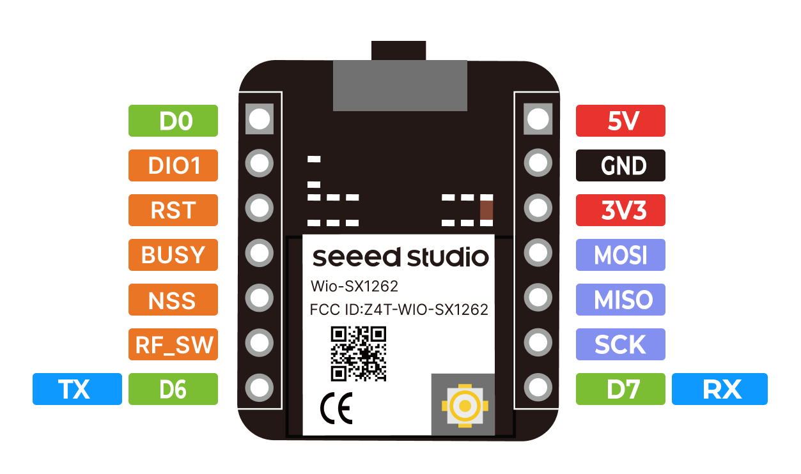

# Seeed Studio XIAO nRF52840 & Wio-SX1262 Kit for Meshtastic


[**View Seeed Studio XIAO nRF52840 & Wio-SX1262 Kit for Meshtastic on OpenELAB**](https://openelab.io/products/seeed-studio-xiao-nrf52840-wio-sx1262-kit)

**Model / option:** Seeed Studio XIAO nRF52840 & Wio-SX1262 Kit for Meshtastic · **SKU:** `Seeed-102010710`


## Product overview

`Seeed-102010710` combines the XIAO nRF52840 with the **through-hole-header Wio-SX1262 expansion board** for a compact Meshtastic node. It has BLE and LoRa, but no built-in Wi-Fi or GNSS. An optional L76K module changes the pin allocation and power workload. The nRF52840's Thread/Zigbee capability is not a promise that those stacks run simultaneously with the installed Meshtastic application.

The expansion board differs from the ESP32S3 kit's board-to-board connector version. Radio chip identity alone does not make those carriers interchangeable. [Exact kit guide](https://wiki.seeedstudio.com/xiao_nrf52840&_wio_SX1262_kit_for_meshtastic/).

## Applications

Use this kit for a BLE-connected field message node, a low-power custom LoRa receiver or a battery-powered sensor experiment after resolving pin conflicts. It is a bare development assembly: add an enclosure and mechanical antenna support for deployment. The optional GNSS and sensor configurations must be checked against the specific firmware environment before assembly.

A raw RadioLib LoRa program can demonstrate the hardware, but it replaces Meshtastic and uses a different packet protocol. LoRa, Meshtastic and LoRaWAN are different layers; seeing a signal in the same band does not establish packet compatibility.

## Specifications

| Parameter            | Exact kit scope                                                                                           |
| -------------------- | --------------------------------------------------------------------------------------------------------- |
| Host                 | nRF52840 Cortex-M4F, up to 64 MHz                                                                         |
| MCU memory           | 1 MB flash, 256 kB RAM                                                                                    |
| LoRa                 | Wio-SX1262, documented 862–930 MHz, commonly configured for 868/915 MHz networks                          |
| Local wireless       | BLE; no ESP32/Wi-Fi subsystem                                                                             |
| Input                | USB-C 5 V; single-cell rechargeable lithium battery via BAT pads, up to 4.2 V fully charged               |
| Charging             | Manufacturer lists 50/100 mA selectable charging current; verify cell suitability and board setting       |
| Logic                | 3.3 V digital interface; USB 5 V is not a GPIO rating                                                     |
| Dimensions           | XIAO-class board footprint listed as 21 × 17.8 mm; stacked assembly/antenna needs additional clearance    |
| Kit operating range  | −40 to +65 °C reported; battery charging must follow the cell/charger's narrower allowed range            |
| Radio host interface | SPI plus DIO1, reset, busy and RF-switch signals                                                          |
| Expansion            | D6/D7 UART remains available in the default radio layout; ordinary D4/D5 I²C is occupied by radio control |

Sources: [Seeed exact kit table](https://wiki.seeedstudio.com/xiao_nrf52840&_wio_SX1262_kit_for_meshtastic/) and [radio carrier schematic](https://files.seeedstudio.com/products/113010003/Wio-SX1262%20for%20XIAO%20V1.0.pdf). The overview's sub-5 µA standby statement is not a complete Meshtastic-node current measurement with the radio, USB and GNSS running.

## Hardware and connections <a href="#identity-and-hardware" id="identity-and-hardware"></a>

With power disconnected, align both seven-pin header rows in the official orientation. Do not offset the module by a row. Fit the LoRa antenna before enabling transmission. The antenna connector is not a battery connector; support the coax so it cannot lever the small RF socket off the board.



_Through-hole Wio-SX1262 for XIAO nRF52840: DIO1, reset, busy, NSS, RF switch and SPI — Seeed Studio,_ [_original diagram_](https://wiki.seeedstudio.com/xiao_nrf52840&_wio_SX1262_kit_for_meshtastic/)_._

| SX1262 carrier function | XIAO signal   | Constraint                                                           |
| ----------------------- | ------------- | -------------------------------------------------------------------- |
| SPI NSS / CS            | D4            | Occupies ordinary XIAO SDA position                                  |
| DIO1 interrupt          | D1            | Firmware interrupt input                                             |
| Reset                   | D2            | Active radio reset                                                   |
| Busy                    | D3            | Radio handshaking input                                              |
| RX RF-switch control    | D5            | Occupies ordinary XIAO SCL position                                  |
| SCK / MISO / MOSI       | D8 / D9 / D10 | Shared bus only with separate compatible CS and transaction handling |
| Carrier user button     | D0            | Can conflict with optional GNSS standby mapping                      |
| UART TX / RX            | D6 / D7       | Default optional L76K route                                          |
| Radio rail              | 3V3 and GND   | Never drive radio signals with 5 V logic                             |

These assignments agree with the inspected [V1.0 carrier schematic](https://files.seeedstudio.com/products/113010003/Wio-SX1262%20for%20XIAO%20V1.0.pdf) and [Meshtastic exact variant](https://github.com/meshtastic/firmware/blob/d0f4096788545fb3c5e22d2a7e52ac6c268caac1/variants/nrf52840/seeed_xiao_nrf52840_kit/variant.h).

The default Meshtastic environment puts I²C on NFC-pad aliases30/31; its `_i2c` environment moves I²C to D6/D7 and moves GNSS to the NFC pads. Do not attach an ordinary D4/D5 Grove I²C shield and expect it to coexist with the radio. For custom software, use the selected core's real pin aliases and reserve all radio control lines. Battery soldering requires correct BAT+/BAT− identification on the XIAO; start USB-only and verify polarity with the board schematic before adding a cell.

## Software and development resources

| Purpose                     | Target/tool                                                                            |
| --------------------------- | -------------------------------------------------------------------------------------- |
| Factory Meshtastic          | Web flasher → Seeed → **Seeed XIAO nRF52840 Kit**                                      |
| Meshtastic source           | `seeed_xiao_nrf52840_kit`; optional `_i2c` layout is a distinct configuration          |
| Arduino hardware experiment | Seeed nRF52 Boards core, **Seeed XIAO nRF52840**; RadioLib for the radio example below |
| UF2 recovery                | XIAO USB DFU, double-reset; exact kit application only                                 |
| Hardware design             | V1.0 radio carrier schematic, XIAO board schematic/PCB and radio module datasheet      |

The [reviewed PlatformIO definitions](https://github.com/meshtastic/firmware/blob/d0f4096788545fb3c5e22d2a7e52ac6c268caac1/variants/nrf52840/seeed_xiao_nrf52840_kit/platformio.ini) explicitly distinguish default and I²C layouts. A newer board-to-board radio option in the source tree is not this purchased through-hole kit. Generic `xiao_ble` firmware with a DIY pin assignment is also different.

## Getting started

### First Meshtastic result <a href="#quick-start-one-message-between-two-nodes" id="quick-start-one-message-between-two-nodes"></a>

1. Prepare a data-capable USB-C cable, installed Meshtastic client, correct LoRa antenna and a known working second Meshtastic node. Check module alignment with all power removed.
2. Power by USB and inspect the factory firmware before updating. In the app select the matching device ID; the manufacturer factory procedure uses PIN `123456`. Read back the actual hardware model and firmware.
3. Set the local radio region. On the second node match modem preset, frequency slot and primary-channel name/key. Wait for configuration restart before sending data.
4. Send `NRFKIT-A-01` from the kit. Verify reception at the other node, then return `NRFKIT-B-01`. Record both receptions and timestamps.
5. If adding L76K, disconnect power and verify D6/D7 UART plus the selected standby signal. Enable GPS only in a compatible firmware layout, acquire a fix outdoors and inspect its age. Do not press a D0 button wired against a GNSS standby output.

**Expected result:** two messages arrive in opposite directions; optional GNSS yields a current fix. A BLE pairing success alone is not a radio-link test. [Manufacturer setup](https://wiki.seeedstudio.com/xiao_nrf52840&_wio_SX1262_kit_for_meshtastic/).

### Original Arduino raw-LoRa receiver

This replaces Meshtastic. Use a separate Arduino project, the non-Mbed Seeed nRF52 core and **RadioLib 7.1.2**, whose [SX1262 API was reviewed](https://github.com/jgromes/RadioLib/blob/7.1.2/src/modules/SX126x/SX1262.h). Save the known working Meshtastic settings first. The example uses **868.1 MHz receive configuration**; adapt to the received signal and permitted band for the site. It sends no radio packet. RadioLib 8 changes the initialization API and frequency units; this sketch intentionally targets 7.1.2. The peer must use matching raw-LoRa frequency, bandwidth, spreading factor, coding rate, sync word and packet format, rather than assuming an ordinary Meshtastic message will be printable text.

```cpp
#include <Arduino.h>
#include <SPI.h>
#include <RadioLib.h>

SX1262 radio = new Module(D4, D1, D2, D3);

void setup() {
  Serial.begin(115200);
  const uint32_t started = millis();
  while (!Serial && millis() - started < 4000) { delay(10); }
  SPI.begin();
  // Standard carrier: RX switch on D5, TX switching through SX1262 DIO2.
  radio.setRfSwitchPins(D5, RADIOLIB_NC);
  int16_t rc = radio.begin(868.1, 125.0, 9, 7, 0x12, 10, 8, 1.8);
  if (rc != RADIOLIB_ERR_NONE) {
    Serial.print("init_failed="); Serial.println(rc);
    while (true) { delay(1000); }
  }
  radio.setDio2AsRfSwitch(true);
  Serial.println("raw_lora_receive_ready");
}

void loop() {
  String text;
  int16_t rc = radio.receive(text);
  if (rc == RADIOLIB_ERR_NONE) {
    Serial.print("payload="); Serial.print(text);
    Serial.print(" rssi_dBm="); Serial.print(radio.getRSSI());
    Serial.print(" snr_dB="); Serial.println(radio.getSNR());
  } else if (rc != RADIOLIB_ERR_RX_TIMEOUT) {
    Serial.print("receive_error="); Serial.println(rc);
  }
}
```

The API is defined by [RadioLib SX1262](https://github.com/jgromes/RadioLib/blob/master/src/modules/SX126x/SX1262.h) and [SX126x RF switch controls](https://github.com/jgromes/RadioLib/blob/master/src/modules/SX126x/SX126x.h). **Expected result:** initialization prints `raw_lora_receive_ready`; a matching raw-LoRa peer produces payload/RSSI/SNR lines. A silent console after initialization is expected when there is no matching transmission. No compile or hardware result is claimed here.

If initialization fails, disconnect power and recheck radio 3.3 V, ground, CS/Busy/Reset routing and header alignment. Do not “fix” detection by substituting ESP32S3 control-pin numbers. Return to Meshtastic with the exact kit UF2 and restore the saved configuration after the experiment.

### Build or restore the exact Meshtastic application <a href="#development-recovery-and-faqs" id="development-recovery-and-faqs"></a>

In a clean development checkout with PlatformIO:

```sh
git clone --recursive https://github.com/meshtastic/firmware.git
cd firmware
git checkout d0f4096788545fb3c5e22d2a7e52ac6c268caac1
git submodule update --init --recursive
pio run -e seeed_xiao_nrf52840_kit
```

Expected output is an artifact for `seeed_xiao_nrf52840_kit`, not another XIAO/DIY target. For a firmware update, use the flasher's exact kit selection, enter DFU, select the newly enumerated USB port and copy the correct UF2 to its drive. Double-press Reset to enter manually if the application cannot request DFU. Keep the cable connected until completion. Seeed warns against generic NRF-OTA for this kit; do not infer support from the presence of BLE.

## Troubleshooting and FAQs

| Symptom                               | Specific cause / action                                                                                        |
| ------------------------------------- | -------------------------------------------------------------------------------------------------------------- |
| App connects but no mesh text         | Confirm ecosystem, region, modem and channel key on both radios; inspect antenna seating                       |
| Raw-LoRa sketch receives nothing      | Verify peer packet format and full modulation settings; raw LoRa is not the Meshtastic application protocol    |
| I²C scan interferes with LoRa         | Ordinary D4/D5 are CS/RF-switch here; select a documented nonconflicting I²C layout                            |
| GPS/button changes state unexpectedly | D0 button versus default GNSS standby conflict; use exact variant mapping before wiring                        |
| Firmware uploads, radio absent        | Confirm through-hole kit environment, not DIY `xiao_ble` or board-to-board mapping                             |
| USB drive disappears while flashing   | Normal completion or reset can re-enumerate; inspect actual firmware after reboot rather than drive name alone |
| No serial after sleep/sketch change   | Try a known data cable and manual double-reset DFU before bootloader recovery                                  |
| Battery test far above standby claim  | Measure without USB/debug/peripheral overhead; account for radio RX, GNSS and telemetry workload               |

## Downloads and technical documents

| Direct resource                                                                                                                                                                       | Purpose                                                                   |
| ------------------------------------------------------------------------------------------------------------------------------------------------------------------------------------- | ------------------------------------------------------------------------- |
| [Exact kit wiki](https://wiki.seeedstudio.com/xiao_nrf52840&_wio_SX1262_kit_for_meshtastic/)                                                                                          | Factory flashing, optional GNSS and original diagrams                     |
| [Through-hole V1.0 carrier schematic](https://files.seeedstudio.com/products/113010003/Wio-SX1262%20for%20XIAO%20V1.0.pdf)                                                            | Inspected radio/header wiring; not the S3 board-to-board carrier          |
| [Wio-SX1262 module datasheet](https://files.seeedstudio.com/products/SenseCAP/Wio_SX1262/Wio-SX1262_Module_Datasheet.pdf)                                                             | RF and module electrical reference                                        |
| [XIAO nRF52840 schematic](https://files.seeedstudio.com/wiki/XIAO-BLE/Seeed-Studio-XIAO-nRF52840-Sense-v1.1.pdf)                                                                      | Manufacturer-linked XIAO v1.1 board reference; identify received revision |
| [XIAO KiCad archive](https://files.seeedstudio.com/wiki/XIAO-BLE/SeeedStudio_XIAO_nRF52840_v1.1_KiCAD.zip)                                                                            | Carrier-design source reference                                           |
| [XIAO dimensions DXF](https://files.seeedstudio.com/wiki/XIAO-BLE/XIAO-nRF52840-DXF.zip) / [pinout XLSX](https://files.seeedstudio.com/wiki/XIAO-BLE/XIAO-nRF52840-pinout_sheet.xlsx) | Physical integration and host pin aliases                                 |
| [nRF52840 data sheet v1.5](https://files.seeedstudio.com/wiki/XIAO-BLE/nRF52840_PS_v1.5.pdf)                                                                                          | Chip reference; board supply limits still apply                           |

### Additional manufacturer references <a href="#official-documentation-and-development-resources" id="official-documentation-and-development-resources"></a>

* [Manufacturer reference 1](https://flasher.meshtastic.org/)
* [Manufacturer reference 2](https://wiki.seeedstudio.com/wio_sx1262_with_xiao_esp32s3_kit/)

## References and validation <a href="#sources-and-validation" id="sources-and-validation"></a>

Reviewed 24 November 2026: live exact SKU listing, corrected ampersand kit-wiki URL, visually inspected through-hole carrier schematic/pinout, Meshtastic variant and environments at `d0f4096788545fb3c5e22d2a7e52ac6c268caac1`, and RadioLib API declarations. Diagram attribution: Seeed Studio. The receiver and packet acceptance procedure are original; linked source projects retain their own licenses.

**Source reviewed; compilation, RadioLib execution, firmware flashing, battery current and physical/radio tests not run.** The optional GNSS/I²C layout must match the selected environment; no second kit SKU or incidental accessory is counted as assigned coverage.
