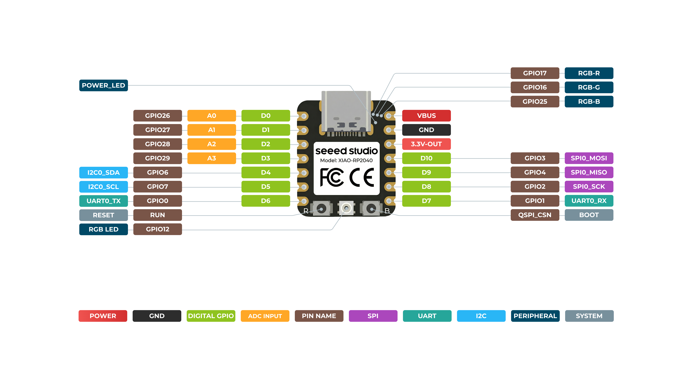
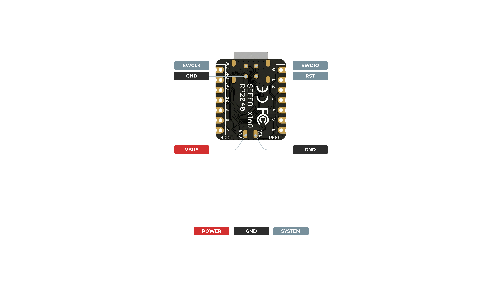

# XIAO RP2040


[**View Seeed Studio XIAO RP2040 on OpenELAB**](https://openelab.io/products/xiao-rp2040-supports-arduino)

**Model:** standard XIAO RP2040 · **OpenELAB SKU:** `Seeed-102010428` · Pin/LED checks use the standard v1.3 schematic and the Arduino-Pico `seeed_xiao_rp2040` variant. RP2040 Plus battery hardware is outside this model's scope.


## Product overview

### Description

The standard XIAO RP2040 is a compact, USB-programmable RP2040 board for embedded control, sensing and custom carriers. This guide includes working paths for Arduino, MicroPython, CircuitPython and PlatformIO; digital/analog/PWM, both kinds of onboard RGB LED, UART, I2C and SPI; recovery; and an introduction to the official MicroBlocks, NuttX and motion-classification projects.

### Standard versus Plus

The current [Seeed series wiki](https://wiki.seeedstudio.com/XIAO-RP2040/) puts **standard** and **Plus** information on one page. This product is the standard board with eleven exposed digital pins. Plus adds pads and power-management features. Do not carry Plus-only BAT+/BAT−, BAT\_EN, charger instructions or extra pin labels into a standard-board design.

The standard board **does have an addressable NeoPixel** in addition to the three directly driven color channels. This is confirmed by its [v1.3 schematic](https://files.seeedstudio.com/wiki/XIAO-RP2040/res/Seeed-Studio-XIAO-RP2040-v1.3.pdf) and the [Arduino-Pico variant definitions](https://github.com/earlephilhower/arduino-pico/blob/master/variants/seeed_xiao_rp2040/pins_arduino.h). A Plus-only label in a shared overview table must not override those exact-board sources.

## Applications

Use XIAO RP2040 for a USB-connected instrument, a small sensor controller, a low-pin-count interface or an embedded learning project. RP2040 has programmable I/O and two cores, but a small board still has finite exposed pins, SRAM and flash. Reserve bus pins and debugger access before designing the carrier.

The board itself is not a Wi-Fi/Bluetooth radio or an accelerometer. Wireless networking and the official motion-recognition project need external hardware. For an agent-generated project, record both the **XIAO label** and **MCU GPIO** for every connection, plus runtime/core, logic voltage and expected first result.

## Specifications

### Features

| Item                     | Standard XIAO RP2040                                 |
| ------------------------ | ---------------------------------------------------- |
| MCU                      | RP2040, dual Arm Cortex-M0+, up to 133 MHz           |
| Memory                   | 264 KB SRAM; 2 MB onboard flash                      |
| Exposed digital / analog | 11 digital; 4 ADC-capable pins; PWM capability       |
| Main interfaces          | One exposed I2C, UART and SPI route; SWD pads; USB-C |
| Size                     | 21 × 17.8 mm                                         |
| Logic / analog input     | 3.3 V domain; do not apply 5 V signals               |
| Initial supply           | USB 5 V; onboard regulation provides 3.3 V           |
| Controls                 | BOOT and RESET/RUN                                   |

Board characteristics: [Seeed overview](https://wiki.seeedstudio.com/XIAO-RP2040/), [exact-board NuttX reference](https://nuttx.apache.org/docs/latest/platforms/arm/rp2040/boards/seeed-xiao-rp2040/index.html). Consult the [RP2040 data sheet](https://files.seeedstudio.com/wiki/XIAO-RP2040/res/rp2040_datasheet.pdf) for chip electrical/peripheral limits; those do not create additional physical header pins on this board.

## Hardware and connections

### Front and back diagrams



_Seeed Studio_ [_original front pinout_](https://files.seeedstudio.com/wiki/XIAO-RP2040/img/XIAO_RP2040_front_pinout.png)_. The direct LED channels and NeoPixel are separate circuits. Read the USB orientation before connecting wires._



_Seeed Studio_ [_original back pinout_](https://files.seeedstudio.com/wiki/XIAO-RP2040/img/XIAO_RP2040_back_pinout.png)_. This is the underside view; do not mirror it mentally into a top-view wiring plan._

### Pin-label translation

| XIAO / Arduino label | RP2040 GPIO     | Primary exposed function                                                                       |
| -------------------- | --------------- | ---------------------------------------------------------------------------------------------- |
| D0 / A0              | 26              | Digital, ADC0                                                                                  |
| D1 / A1              | 27              | Digital, ADC1                                                                                  |
| D2 / A2              | 28              | Digital, ADC2                                                                                  |
| D3 / A3              | 29              | Digital, ADC3; may serve as an explicit software CS                                            |
| D4 / SDA             | 6               | I2C SDA                                                                                        |
| D5 / SCL             | 7               | I2C SCL                                                                                        |
| D6 / TX              | 0               | UART0 TX                                                                                       |
| D7 / RX              | 1               | UART0 RX                                                                                       |
| D8 / SCK             | 2               | SPI0 clock                                                                                     |
| D9 / MISO            | 4               | SPI0 receive                                                                                   |
| D10 / MOSI           | 3               | SPI0 transmit                                                                                  |
| 3V3 / GND / 5V-VBUS  | Power, not GPIO | Regulated output / reference / USB supply rail; check power arrangement before external supply |

Exact mappings: [Arduino-Pico board variant](https://github.com/earlephilhower/arduino-pico/blob/master/variants/seeed_xiao_rp2040/pins_arduino.h) and [Seeed v1.3 schematic](https://files.seeedstudio.com/wiki/XIAO-RP2040/res/Seeed-Studio-XIAO-RP2040-v1.3.pdf). In this variant, Arduino `Wire` maps to hardware **I2C1**, despite generic core documentation discussing I2C0 first. MicroPython therefore uses `I2C(1, sda=Pin(6), scl=Pin(7))`. Pin `D4` is GPIO6, not GPIO4.

### Power, buttons and SWD

Start with USB only, peripherals disconnected. Supply voltage and signal voltage differ: a 5 V USB connection does not make GPIO or ADC inputs 5 V-tolerant. Check a peripheral's pull-ups and output levels before attaching it. Do not wire an unregulated battery into a GPIO or copy Plus charging connections. For an external-power design, review the exact schematic and avoid unintended back-powering from simultaneous sources.

RESET/RUN restarts the application. BOOT changes the startup path: hold BOOT while plugging in USB, or hold BOOT while pressing/releasing RESET, then release BOOT. The expected ROM boot drive is **RPI-RP2**. SWD debugging uses the underside SWDIO/SWCLK/GND arrangement with an appropriate 3.3 V probe; verify the pad orientation and tool configuration before soldering. [Standard hardware/boot references](https://wiki.seeedstudio.com/XIAO-RP2040/), [schematic](https://files.seeedstudio.com/wiki/XIAO-RP2040/res/Seeed-Studio-XIAO-RP2040-v1.3.pdf).

### Correct onboard LED behavior

| Circuit                       | Pin                       | Behavior on standard v1.3 / cited Arduino variant |
| ----------------------------- | ------------------------- | ------------------------------------------------- |
| Red direct channel            | GPIO17 / `PIN_LED_R`      | Active-low: LOW on, HIGH off                      |
| Green direct channel          | GPIO16 / `PIN_LED_G`      | Active-low                                        |
| Blue direct channel           | GPIO25 / `PIN_LED_B`      | Active-low                                        |
| `LED_BUILTIN` in Arduino-Pico | GPIO17                    | Red channel in this variant                       |
| Addressable RGB data          | GPIO12 / `PIN_NEOPIXEL`   | Requires NeoPixel/WS2812 protocol                 |
| Addressable RGB enable        | GPIO11 / `NEOPIXEL_POWER` | Drive HIGH before using the pixel                 |

The [schematic](https://files.seeedstudio.com/wiki/XIAO-RP2040/res/Seeed-Studio-XIAO-RP2040-v1.3.pdf) shows the direct RGB circuit's common anode and the separate addressable pixel. The [variant header](https://github.com/earlephilhower/arduino-pico/blob/master/variants/seeed_xiao_rp2040/pins_arduino.h) sets `LED_BUILTIN` to 17. Some official tutorial text calls GPIO25 green or assumes HIGH means on; use the exact circuit/variant instead. A change of core can also change aliases, so record the package before diagnosing a color mismatch.

## Software and development resources

| Route         | First artifact                        | Distinguishing workflow                                                      |
| ------------- | ------------------------------------- | ---------------------------------------------------------------------------- |
| Arduino-Pico  | Compiled Arduino sketch               | Select **Seeed Studio XIAO RP2040** under the Earle Philhower RP2040 package |
| MicroPython   | Board-specific UF2, then Python files | Thonny / serial REPL; `machine` modules and MCU GPIO numbers                 |
| CircuitPython | Board-specific UF2, then `code.py`    | `CIRCUITPY` filesystem; `board` and `digitalio` APIs                         |
| PlatformIO    | `platformio.ini` + `src/main.cpp`     | Seeed platform and exact board ID; retain package revisions                  |
| MicroBlocks   | XIAO RP2040 VM UF2 + blocks           | Its own logical pin numbering and persistent scripts                         |
| NuttX         | `nuttx.uf2`                           | Board configuration determines USB/UART console and enabled device drivers   |

Changing runtime replaces firmware and can replace its filesystem. Back up source/data first. `RPI-RP2` is a bootloader destination; `CIRCUITPY` is an application filesystem. A MicroPython program is not copied onto `RPI-RP2` as a substitute for installing its interpreter.

## Getting started

### 1. Arduino installation and a corrected Blink

1. Prepare the standard board, a USB data cable and Arduino IDE; disconnect peripheral wiring.
2. Install the board index/package and select the exact target as described below.
3. Enter BOOT mode, upload the corrected Blink sketch, and check its expected red-channel result before adding a peripheral.

Add this index in **Preferences → Additional Boards Manager URLs**:

```
https://github.com/earlephilhower/arduino-pico/releases/download/global/package_rp2040_index.json
```

Install **Raspberry Pi Pico/RP2040/RP2350** in Boards Manager, select **Seeed Studio XIAO RP2040**, and record the installed version. These are the [manufacturer's current Arduino setup steps](https://wiki.seeedstudio.com/XIAO-RP2040-with-Arduino/); earlier Mbed-core projects are a separate environment.

#### Enter bootloader mode

Hold BOOT while connecting USB, or hold BOOT through a RESET press/release, then release BOOT. Confirm **RPI-RP2** and select the resulting target/port for a first or recovery upload.

Use this original sketch to make the tested color/polarity explicit:

```cpp
#include <Arduino.h>
constexpr uint8_t redChannel = PIN_LED_R;
void setup() {
  pinMode(PIN_LED_R, OUTPUT);
  pinMode(PIN_LED_G, OUTPUT);
  pinMode(PIN_LED_B, OUTPUT);
  digitalWrite(PIN_LED_R, HIGH);
  digitalWrite(PIN_LED_G, HIGH);
  digitalWrite(PIN_LED_B, HIGH);
}
void loop() {
  digitalWrite(redChannel, LOW);
  delay(500);
  digitalWrite(redChannel, HIGH);
  delay(500);
}
```

Compile/upload. **Expected:** the red channel turns on for half a second and off for half a second. This is an expected result, not a report of a physical test. If upload succeeds but the wrong color appears, compare the selected core/variant and actual revision before changing wiring.

### Proceed to interfaces

Save the working Blink project. For each next task, disconnect power, add only that task's wiring, check its pin/voltage table, and record its result. Restore Blink if a new peripheral makes upload or execution fail.

### 2. Digital input without a floating pin

With power disconnected, wire a momentary button between **D0 and GND**. This original sketch uses the internal pull-up, so no external high-level signal is required. Release means HIGH; press means LOW. It turns on the onboard red channel while pressed.

```cpp
#include <Arduino.h>
void setup() {
  pinMode(D0, INPUT_PULLUP);
  pinMode(PIN_LED_R, OUTPUT);
  digitalWrite(PIN_LED_R, HIGH);
}
void loop() {
  bool pressed = digitalRead(D0) == LOW;
  digitalWrite(PIN_LED_R, pressed ? LOW : HIGH);
  delay(10);
}
```

Check the idle level and pressed level before adding application logic. For event counting, implement debouncing rather than counting every loop as a separate press. This replaces an undefined floating-input arrangement with an explicit pull-up and active-low LED behavior; it covers the digital-input task in the [Arduino interface tutorial](https://wiki.seeedstudio.com/XIAO-RP2040-with-Arduino/).

### 3. ADC and PWM: state the resolution

Wire a potentiometer's ends to **3V3 and GND**, wiper to **A0**. Do not use 5 V. This original sketch requests 12-bit ADC readings and explicitly scales them to an 8-bit PWM output. Keep the Arduino-Pico core selected.

```cpp
#include <Arduino.h>
void setup() {
  Serial.begin(115200);
  analogReadResolution(12);
  analogWriteRange(255);
  pinMode(PIN_LED_R, OUTPUT);
}
void loop() {
  int raw = analogRead(A0);
  unsigned level = (unsigned long)raw * 255 / 4095;
  analogWrite(PIN_LED_R, 255 - level);  // active-low channel
  Serial.printf("adc12=%d,normalized=%.3f\n", raw, raw / 4095.0);
  delay(100);
}
```

Expected ADC values span approximately 0–4095 as the wiper moves; the red channel changes brightness. Endpoints, noise and reference accuracy must be measured, not assumed from bit depth. Disconnect the potentiometer before reusing D0/A0 in another example. Core-specific ADC/PWM configuration is documented by [Arduino-Pico](https://arduino-pico.readthedocs.io/en/latest/analog.html).

### 4. Three direct LED colors and the separate NeoPixel

To test the direct channels, initialize all three pins HIGH, then set one of `PIN_LED_R`, `PIN_LED_G`, `PIN_LED_B` LOW for a visible interval, return it HIGH, and continue to the next. The Blink sketch above is a complete base; change only the selected channel for each test. LOW on all three mixes the direct channels; it does not send data to the addressable pixel.

For the **addressable** pixel, install Adafruit NeoPixel and use this separate original sketch. GPIO11 must be enabled before sending data on GPIO12. Start at modest brightness.

```cpp
#include <Adafruit_NeoPixel.h>
Adafruit_NeoPixel pixel(1, PIN_NEOPIXEL, NEO_GRB + NEO_KHZ800);
void setup() {
  pinMode(NEOPIXEL_POWER, OUTPUT);
  digitalWrite(NEOPIXEL_POWER, HIGH);
  pixel.begin();
  pixel.setBrightness(16);
  pixel.clear();
  pixel.show();
}
void loop() {
  pixel.setPixelColor(0, pixel.Color(255, 0, 0)); pixel.show(); delay(500);
  pixel.setPixelColor(0, pixel.Color(0, 255, 0)); pixel.show(); delay(500);
  pixel.setPixelColor(0, pixel.Color(0, 0, 255)); pixel.show(); delay(500);
}
```

Expected result is red → green → blue on the addressable pixel, independently of the three direct channels. The exact pin/enable mapping is in the [board variant](https://github.com/earlephilhower/arduino-pico/blob/master/variants/seeed_xiao_rp2040/pins_arduino.h); library API: [Adafruit NeoPixel](https://github.com/adafruit/Adafruit_NeoPixel).

### 5. USB serial versus UART: a complete loopback test

`Serial` is USB CDC in the selected core. It is not the D6/D7 UART. `Serial1` is the exposed UART0; set pins **before** `begin()`. [Arduino-Pico serial documentation](https://github.com/earlephilhower/arduino-pico/blob/master/docs/serial.rst).

With power off, connect **D6/TX to D7/RX** for a board-local loopback. Upload this original bridge, open USB Serial Monitor at 115200, and type a short line:

```cpp
#include <Arduino.h>
void setup() {
  Serial.begin(115200);
  Serial1.setTX(D6);
  Serial1.setRX(D7);
  Serial1.begin(115200);
}
void loop() {
  while (Serial.available()) Serial1.write(Serial.read());
  while (Serial1.available()) Serial.write(Serial1.read());
}
```

Expected result is the typed line returning through the hardware TX→RX connection. Disable the monitor's local echo if it obscures the result. Remove the jumper to confirm the echo depends on that path. For another device, cross TX→RX and RX←TX with common GND and compatible **3.3 V logic**; do not attach RS-232 voltage levels directly.

### 6. I2C scan and OLED result

Power off. Connect a compatible OLED's SDA to **D4**, SCL to **D5**, GND to GND, and supply according to the display's own specification while keeping bus pull-ups 3.3 V-compatible. The manufacturer's example uses a Grove 0.96-inch **SSD1315** module with the SSD1306-compatible software interface; that library name does not rename the physical controller.

Run this original scan first:

```cpp
#include <Arduino.h>
#include <Wire.h>
void setup() {
  Serial.begin(115200);
  delay(1500);
  Wire.setSDA(D4);
  Wire.setSCL(D5);
  Wire.begin();
  for (uint8_t a = 8; a < 120; ++a) {
    Wire.beginTransmission(a);
    if (Wire.endTransmission() == 0) Serial.printf("ACK 0x%02X\n", a);
  }
}
void loop() {}
```

Use the **observed** address, often `0x3C` for the demonstrated display. With Adafruit GFX and Adafruit SSD1306 installed, the following complete sketch displays an original test message. Adjust geometry/address only to the actual module.

```cpp
#include <Wire.h>
#include <Adafruit_GFX.h>
#include <Adafruit_SSD1306.h>
Adafruit_SSD1306 screen(128, 64, &Wire, -1);
void setup() {
  Wire.setSDA(D4); Wire.setSCL(D5); Wire.begin();
  if (!screen.begin(SSD1306_SWITCHCAPVCC, 0x3C)) {
    while (true) delay(1000);
  }
  screen.clearDisplay();
  screen.setTextColor(SSD1306_WHITE);
  screen.setTextSize(1); screen.setCursor(0, 0);
  screen.println("XIAO I2C ready");
  screen.display();
}
void loop() {}
```

Expected checkpoints are an I2C ACK, successful driver allocation/initialization and readable text. If the scan succeeds but the screen stays dark, check controller compatibility, geometry, reset and driver power mode. `setSDA`/`setSCL` must precede `Wire.begin()` in this core. [Core Wire API](https://github.com/earlephilhower/arduino-pico/blob/master/docs/wire.rst), [Adafruit SSD1306 API](https://github.com/adafruit/Adafruit_SSD1306), [Seeed interface reference](https://wiki.seeedstudio.com/XIAO-RP2040-with-Arduino/).

### 7. SPI OLED with an actually exposed chip-select

In the Arduino-Pico XIAO variant, `SS` is GPIO31 and is **not exposed**. The official SPI-display example's default `SS` therefore needs an explicit physical replacement. This original wiring/sketch chooses **D3** for software chip-select; D3/A3 is then occupied by the display.

| SPI OLED signal | XIAO connection                                                         |
| --------------- | ----------------------------------------------------------------------- |
| SCK             | D8 / GPIO2                                                              |
| MOSI / DIN      | D10 / GPIO3                                                             |
| CS              | **D3 / GPIO29**, chosen here                                            |
| DC              | D4 / GPIO6, chosen here                                                 |
| RESET           | D5 / GPIO7, chosen here                                                 |
| GND / supply    | Common GND and the display's documented compatible supply               |
| MISO            | Not used by this write-only display; D9 remains the default receive pin |

Use an SPI-configured SSD1306-compatible 128×64 module; an I2C-only display cannot become SPI through software. Disconnect the earlier I2C display because D4/D5 are repurposed.

```cpp
#include <SPI.h>
#include <Adafruit_GFX.h>
#include <Adafruit_SSD1306.h>
constexpr int OLED_CS = D3, OLED_DC = D4, OLED_RST = D5;
Adafruit_SSD1306 screen(128, 64, &SPI, OLED_DC, OLED_RST, OLED_CS);
void setup() {
  SPI.setSCK(D8); SPI.setTX(D10); SPI.setRX(D9);
  SPI.begin();
  if (!screen.begin(SSD1306_SWITCHCAPVCC)) {
    while (true) delay(1000);
  }
  screen.clearDisplay(); screen.setTextColor(SSD1306_WHITE);
  screen.setTextSize(1); screen.setCursor(0, 0);
  screen.println("XIAO SPI ready"); screen.display();
}
void loop() {}
```

Expected result is readable text with CS activity on **D3**, not GPIO31. Check SPI mode/controller and DC/reset wiring if it fails. Pin selection and software-CS behavior: [Arduino-Pico SPI API](https://github.com/earlephilhower/arduino-pico/blob/master/docs/spi.rst). Board mapping: [variant header](https://github.com/earlephilhower/arduino-pico/blob/master/variants/seeed_xiao_rp2040/pins_arduino.h). Display constructor: [Adafruit SSD1306 source](https://github.com/adafruit/Adafruit_SSD1306).

### 8. MicroPython: firmware, REPL, LED and OLED

Back up existing code/data. Download the **SEEED\_XIAO\_RP2040** UF2 from [MicroPython's board download page](https://micropython.org/download/SEEED_XIAO_RP2040/), enter BOOT mode and copy it to RPI-RP2. After restart, select the MicroPython interpreter and observed serial port in **Thonny**; confirm a REPL prompt/version. The [Seeed MicroPython guide](https://wiki.seeedstudio.com/XIAO-RP2040-with-MicroPython/) also links the editor and board firmware.

This original basic program uses the **MCU GPIO number**, with active-low red:

```python
from machine import Pin
from time import sleep
red = Pin(17, Pin.OUT, value=1)
while True:
    red.value(0)
    sleep(0.5)
    red.value(1)
    sleep(0.5)
```

Run it interactively first. To run automatically after reset, save it **on the device** as `main.py`. Saving only to the computer does not establish autonomous startup. Interrupt a runaway script through the REPL before changing runtime or erasing data.

For the NeoPixel, the official project uses a separate [ws2812.py driver](https://files.seeedstudio.com/wiki/XIAO-RP2040/img/micropython/ws2812.py). Save that file to the device with its exact name, then run this original, reduced-brightness test:

```python
from machine import Pin
from time import sleep
from ws2812 import WS2812
enable = Pin(11, Pin.OUT, value=1)
pixel = WS2812(12, 1)
while True:
    for rgb in ((24, 0, 0), (0, 24, 0), (0, 0, 24), (0, 0, 0)):
        pixel.pixels_fill(rgb)
        pixel.pixels_show()
        sleep(0.5)
```

The expected result is a color cycle followed by off. An import failure means the driver is missing or misnamed, not that GPIO12 is the wrong pin. Driver methods and enable behavior: [official MicroPython driver/tutorial](https://wiki.seeedstudio.com/XIAO-RP2040-with-MicroPython/).

For the documented I2C OLED, save [ssd1306.py](https://files.seeedstudio.com/wiki/XIAO-RP2040/img/micropython/ssd1306.py) on the device and wire D4/D5 as above. The XIAO mapping requires **I2C1 on GPIO6/7**. This original program scans, then writes text:

```python
from machine import Pin, I2C
from ssd1306 import SSD1306_I2C
bus = I2C(1, sda=Pin(6), scl=Pin(7), freq=100000)
addresses = bus.scan()
print("I2C addresses:", [hex(a) for a in addresses])
if 0x3c not in addresses:
    raise RuntimeError("Expected display address absent; inspect wiring/address")
display = SSD1306_I2C(128, 64, bus)
display.fill(0)
display.text("XIAO Python ready", 0, 0)
display.show()
```

Check the address/module before changing the constant. The official page additionally links a [community file-management console](https://gitlab.cba.mit.edu/pub/upy/-/blob/main/upy.py) and a [Grove example bundle](https://files.seeedstudio.com/wiki/XIAO-RP2040/img/micropython/XIAO-RP2040-MicroPython-Grove.zip). Review any console's operations before running it. Plus-specific firmware/example bundles are separate resources, not standard-board charging instructions.

### 9. CircuitPython: correct drive and startup file

Enter BOOT mode, install the [Seeed-linked CircuitPython UF2](https://files.seeedstudio.com/wiki/XIAO-RP2040/res/XIAO-RP2040-CircuitPython.uf2), and wait for **CIRCUITPY** after restart. This is the separate [CircuitPython installation route](https://wiki.seeedstudio.com/XIAO-RP2040-with-CircuitPython/); its old text's `.urf`/drive spelling is a typo, not a different file format. Record the firmware version rather than assuming this historical download is current.

Use Mu in CircuitPython mode or another editor. Save this original program as **`code.py` on CIRCUITPY**, not as a file on the ROM boot drive:

```python
import time
import board
import digitalio

led = digitalio.DigitalInOut(board.LED)
led.direction = digitalio.Direction.OUTPUT
while True:
    led.value = False
    time.sleep(0.5)
    led.value = True
    time.sleep(0.5)
```

Expected result is a blinking board LED. Confirm the runtime's `board.LED` alias on that firmware before asserting a particular color; the Arduino header does not control CircuitPython aliases. `machine.Pin` code from MicroPython is not this runtime's API. If importing an added driver, put the matching CircuitPython-version library in `lib/`; use the serial console to see exceptions instead of repeatedly reinstalling firmware.

### 10. PlatformIO: exact platform, board ID and C++ file

Install VS Code and its PlatformIO extension. The [current Seeed PlatformIO page](https://wiki.seeedstudio.com/xiao_rp2040_with_platform_io/) specifies the **Seeed platform**, not a guessed generic RP2040 board definition. Create a project with:

```ini
[env:seeed_xiao_rp2040]
platform = https://github.com/Seeed-Studio/platform-seeedboards.git
board = seeed-xiao-rp2040
framework = arduino
```

Put the corrected Blink sketch from section 1 in **`src/main.cpp`**, including `<Arduino.h>`. It is C++ even though the official prose calls its file `main.c`. In PlatformIO's project terminal:

```sh
pio run
pio run -t upload
```

Use the actual board/port and BOOT recovery when necessary. Expected result is a successful build/upload and the red-channel Blink **if the resolved core exposes the cited aliases**. Inspect the resolved package/variant before porting the core-specific Wire/SPI/ADC examples. Pin the working platform commit and library versions for reproducible builds; a moving Git URL is a setup starting point, not a version lock. The official page also documents global installation/update commands, but per-project configuration keeps the dependency choice visible with the source.

The [reviewed Seeed board definition](https://github.com/Seeed-Studio/platform-seeedboards/blob/main/boards/seeed-xiao-rp2040.json) selects core `earlephilhower`, variant `seeed_xiao_rp2040` and upload protocol `picotool`. This establishes the intended platform mapping; retain the actual resolved framework version when reproducing a build.

### 11. MicroBlocks: its pin numbers are different

Install the [XIAO RP2040 VM UF2](https://microblocks.fun/downloads/latest/vm/vm_xiao_rp2040.uf2) through RPI-RP2. Open the [MicroBlocks editor](https://microblocks.fun/run/microblocks.html) in a compatible browser, choose the USB connect action and select the board. A green connected indicator establishes editor communication.

The [official XIAO MicroBlocks guide](https://wiki.seeedstudio.com/xiao_rp2040_microblocks/) maps **logical pins 0–10** to exposed I/O, 0–3 to analog, **11/12/13** to active-low red/green/blue, and **14** to the NeoPixel. These are **MicroBlocks logical numbers**, not MCU GPIO11/12/13/14. To blink red, build `when started → forever → set digital pin 11 false → wait 500 ms → set digital pin 11 true → wait 500 ms`. Test one script, then use the NeoPixel library for logical pixel pin 14. Save/start the script and power-cycle to check standalone behavior. The environment supports multiple concurrent scripts; coordinate scripts that share an output rather than letting them overwrite each other.

The official page supplies separate direct-LED and NeoPixel block pictures. Use its [block reference](https://wiki.microblocks.fun/en/reference_manual) and [library reference](https://wiki.microblocks.fun/en/libraries) for block names in the installed editor version.

### 12. NuttX: USB shell, GPIO, user LEDs and WS2812

NuttX is an RTOS route, replacing the Arduino/Python firmware. Install the platform's Arm build dependencies, Git, Make and configuration tools described by [Apache's installation guide](https://nuttx.apache.org/docs/latest/quickstart/install.html). Work in a separate directory. The [current RP2040 instructions](https://nuttx.apache.org/docs/latest/platforms/arm/rp2040/index.html) name **Pico SDK 2.2.0**; Seeed's older tutorial names 1.1.2 and shows NuttX12.5.1 output. Keep a consistent NuttX/apps/SDK combination and record revisions.

```sh
git clone -b 2.2.0 --recurse-submodules https://github.com/raspberrypi/pico-sdk.git
git clone https://github.com/apache/nuttx.git nuttx
git clone https://github.com/apache/nuttx-apps.git apps
```

Set `PICO_SDK_PATH` to the absolute path of that `pico-sdk` directory in the build terminal. With `nuttx` and `apps` as sibling directories, enter `nuttx` and configure the exact board:

```sh
./tools/configure.sh seeed-xiao-rp2040:usbnsh
make
```

This corrects the older Seeed text's `configurate.sh` spelling. Copy generated **`nuttx.uf2`** to RPI-RP2, then open the newly enumerated USB serial device at the configured 115200 rate and press Enter. Expected checkpoint: `nsh>`; try `?` and `hello` if the configured build includes that example. [Apache board configurations](https://nuttx.apache.org/docs/latest/platforms/arm/rp2040/boards/seeed-xiao-rp2040/index.html), [RP2040 build procedure](https://nuttx.apache.org/docs/latest/platforms/arm/rp2040/index.html).

| Configuration | First useful check                                                                                       |
| ------------- | -------------------------------------------------------------------------------------------------------- |
| `usbnsh`      | USB CDC shell; do not confuse it with the UART-console `nsh` configuration                               |
| `gpio`        | Inspect `/dev` and run `gpio -h`; identify the configured driver-to-pin mapping before writing an output |
| `userleds`    | Run the enabled user-LED application and inspect active-low channel behavior                             |
| `ws2812`      | Verify `/dev/leds0`, inspect `ws2812 -h`, then run the configured one-pixel demonstration                |

Before switching configurations in a disposable build tree, preserve changes and use `make distclean`, configure the chosen target, then rebuild. The [Seeed NuttX hands-on guide](https://wiki.seeedstudio.com/xiao-rp2040-with-nuttx/) includes those four exercises, but some pictured LED pin/color descriptions conflict with the standard schematic. Inspect that release's board driver before issuing `/dev/gpio*` writes. A device-file suffix or a copied screenshot is not proof of a physical connection. The actual standard direct channels are GPIO17/16/25; select the correct console so a running firmware is not mistaken for a silent board.

### 13. Motion recognition: full project stages and a dependency warning

The [official Edge Impulse project](https://wiki.seeedstudio.com/XIAO-RP2040-EI/) requires a **Grove shield and external accelerometer**. Its instructions mention LSM6DS3/U8g2, while its acquisition/inference code uses **`MMA7660.h`**. Resolve the actual accelerometer and driver before copying the project; standard XIAO RP2040 has no built-in accelerometer.

The project sequence is: verify three-axis raw readings; convert g to m/s² with 9.80665; create an Edge Impulse accelerometer project; connect the CLI data forwarder; collect labeled movement records; split records into suitable windows; add Spectral Analysis and a classification block; generate features, train and test; export an Arduino library; install its ZIP; include the header matching the exported project; sample at the model interval; call the classifier; print label scores and timing. The example collects 20-second records and splits into one-second windows, then compares several movements.

Improve the experiment by defining sample rate, mounting orientation, label meaning and a held-out recording session **before** collection. Avoid putting adjacent windows from one recording in both training and test sets; this can exaggerate apparent generalization. Evaluate a stationary/unknown class and confusion between intended motions. Log missed sampling deadlines rather than allowing unsigned delay subtraction to create a long pause. A printed probability is model output, not proof that the motion was recognized correctly. Verify the specific exported model's memory footprint against this board before deployment.

## Troubleshooting and FAQs

### Reset

RESET/RUN restarts the current application. BOOT held through reset enters ROM programming mode. After recovery the device/port can change, so reselect the observed port rather than assuming the earlier serial handle remains valid.

| Symptom                                | Ordered diagnostic checks                                                                                                                             |
| -------------------------------------- | ----------------------------------------------------------------------------------------------------------------------------------------------------- |
| No RPI-RP2 drive                       | Disconnect peripherals; use a known data cable/USB port; hold BOOT before connection or through a RESET pulse; distinguish power from USB enumeration |
| Upload succeeded but LED color differs | Check board/core/variant; Arduino-Pico `LED_BUILTIN` is red17; GPIO25 is blue in the cited standard schematic                                         |
| LED seems inverted                     | Direct channels are active-low; keep the three-channel circuit separate from the addressable NeoPixel                                                 |
| NeoPixel stays dark                    | Enable GPIO11 HIGH, data12, correct driver/protocol, modest brightness; do not use ordinary Blink on its data pin                                     |
| Button input flickers                  | Confirm D0-to-GND and `INPUT_PULLUP`; debounce event logic; check no external 5 V source is attached                                                  |
| ADC saturates / noisy                  | Check 0–3.3 V input, common GND, selected A0–A3 and explicit resolution; examine reference/noise before claiming calibration                          |
| I2C device absent                      | D4=GPIO6 SDA, D5=GPIO7 SCL; correct runtime bus instance, common GND, supply and pull-ups; scan before driver initialization                          |
| SPI display never responds             | Use exposed software CS such as D3, not default `SS`=GPIO31; check SPI-mode module, DC/reset and D8/D10 wiring                                        |
| UART works only over USB               | USB `Serial` and D6/D7 `Serial1` are separate; use loopback and compatible 3.3 V TX/RX levels                                                         |
| Python code disappears after reset     | Save on the device with the runtime's startup filename; distinguish RAM execution, host files and boot drive                                          |
| CircuitPython has no CIRCUITPY         | Confirm the installed board-specific UF2/runtime; inspect USB enumeration and serial errors; RPI-RP2 means ROM boot mode                              |
| NuttX has no prompt                    | Match USB versus UART console to configuration; inspect actual port and enabled drivers, then press Enter                                             |
| Code references BAT\_EN / D12+         | Check for Plus-only code or MicroBlocks logical pin numbers; standard physical pins remain D0–D10                                                     |

## Downloads and technical documents

### Schematics

| Official resource                                                                                                                                                                                            | Scope / use                                                             |
| ------------------------------------------------------------------------------------------------------------------------------------------------------------------------------------------------------------ | ----------------------------------------------------------------------- |
| [Standard v1.3 schematic PDF](https://files.seeedstudio.com/wiki/XIAO-RP2040/res/Seeed-Studio-XIAO-RP2040-v1.3.pdf)                                                                                          | Power, pin and LED circuit checks used in this guide                    |
| [RP2040 data sheet](https://files.seeedstudio.com/wiki/XIAO-RP2040/res/rp2040_datasheet.pdf)                                                                                                                 | MCU electrical/peripheral reference                                     |
| [KiCad schematic/PCB v1.3](https://files.seeedstudio.com/wiki/XIAO-RP2040/res/XIAO_RP2040_v1.3_SCH%26PCB_20260304.zip)                                                                                       | Source design package; verify the received PCB revision                 |
| [Eagle schematic/PCB v1.22](https://files.seeedstudio.com/wiki/XIAO-RP2040/res/XIAO_RP2040_v1.22_SCH%26PCB.zip)                                                                                              | Different revision; do not merge its net names with v1.3 without review |
| [XIAO KiCad footprints](https://files.seeedstudio.com/wiki/XIAO-KiCad-Library/New_XIAO_Series_Footprints.zip) / [symbols](https://files.seeedstudio.com/wiki/XIAO-KiCad-Library/XIAO_Series_SCH_Symbols.zip) | Carrier-board design; choose exact model footprint                      |
| [Pinout workbook](https://files.seeedstudio.com/wiki/XIAO-RP2040/res/XIAO-RP2040-pinout_sheet.xlsx)                                                                                                          | Manufacturer pin reference                                              |
| [DXF](https://files.seeedstudio.com/wiki/XIAO-RP2040/res/XIAO-RP2040-DXF.zip) / [3D model](https://files.seeedstudio.com/wiki/XIAO-RP2040/res/seeed-studio-xiao-rp2040-3d-model.zip)                         | Mechanical envelope/integration; check units and revision               |

These are the standard-board downloads linked by the [manufacturer's series resources](https://wiki.seeedstudio.com/XIAO-RP2040/). File presence does not establish compatibility of every historical revision. Plus hardware downloads remain separately identified on that page.

### Software, examples and further learning

| Resource                                                                                                                                                                                          | What it adds                                                                                    |
| ------------------------------------------------------------------------------------------------------------------------------------------------------------------------------------------------- | ----------------------------------------------------------------------------------------------- |
| [Arduino interfaces](https://wiki.seeedstudio.com/XIAO-RP2040-with-Arduino/)                                                                                                                      | Original setup, interface demonstrations and gallery; apply the exact-board corrections above   |
| [MicroPython](https://wiki.seeedstudio.com/XIAO-RP2040-with-MicroPython/) / [Grove example ZIP](https://files.seeedstudio.com/wiki/XIAO-RP2040/img/micropython/XIAO-RP2040-MicroPython-Grove.zip) | Runtime, drivers, NeoPixel and OLED examples                                                    |
| [CircuitPython](https://wiki.seeedstudio.com/XIAO-RP2040-with-CircuitPython/)                                                                                                                     | Alternate interpreter and filesystem workflow                                                   |
| [PlatformIO](https://wiki.seeedstudio.com/xiao_rp2040_with_platform_io/)                                                                                                                          | Correct Seeed platform and board identifier                                                     |
| [MicroBlocks](https://wiki.seeedstudio.com/xiao_rp2040_microblocks/)                                                                                                                              | VM, interactive blocks, logical pin map and illustrations                                       |
| [NuttX hands-on](https://wiki.seeedstudio.com/xiao-rp2040-with-nuttx/) / [Apache exact-board docs](https://nuttx.apache.org/docs/latest/platforms/arm/rp2040/boards/seeed-xiao-rp2040/index.html) | Shell, driver configurations and release-specific checks                                        |
| [Motion-recognition project](https://wiki.seeedstudio.com/XIAO-RP2040-EI/)                                                                                                                        | External-accelerometer acquisition, training and inference stages                               |
| [XIAO learning ebook](https://mjrovai.github.io/XIAO_Big_Power_Small_Board-ebook/)                                                                                                                | Attributed community learning resource linked by Seeed; not the authority for electrical limits |
| [Seeed support forum](https://forum.seeedstudio.com/) / [technical contact](https://www.seeedstudio.com/contacts)                                                                                 | Include board revision, firmware/core, connection drawing and smallest failing example          |

### Existing illustrations

<figure><figcaption><p>Existing OpenELAB asset retained. Use the labeled standard-board diagrams above for connections.</p></figcaption></figure>


_Retained official image from the existing OpenELAB page;_ [_original_](https://files.seeedstudio.com/wiki/XIAO-RP2040/img/xinpin.jpg)_._


_Retained Seeed_ [_button illustration_](https://files.seeedstudio.com/wiki/XIAO-RP2040/img/xinfront.jpg)_. Enter BOOT mode as described above; RESET alone restarts the application._

## References and validation

Sources reviewed **23 November 2026**: standard/Plus overview; Arduino, MicroPython, CircuitPython, PlatformIO, MicroBlocks, NuttX and motion-project pages; standard v1.3 schematic; Arduino-Pico exact-board variant and Wire/Serial/SPI API references; current Apache RP2040/board instructions. Manufacturer figures are attributed; code snippets in this guide are original examples based on the cited APIs.

The guide corrects LED color/polarity, standard-board NeoPixel availability, USB-versus-UART handling, I2C mapping, unexposed SPI `SS`, a PlatformIO filename issue and a NuttX configuration-command typo. These corrections are supported by exact-board sources rather than inferred from a product photo.

**Build, flash, driver execution, model training and hardware tests: not run.** Record actual tool/firmware versions, board revision, wiring and measured results before describing a procedure as tested. The motion project's conflicting accelerometer dependencies remain explicitly bounded; choose and validate the external sensor before using its training/inference path. Plus-only battery/extra-pad operations are intentionally excluded from this standard-board guide.
