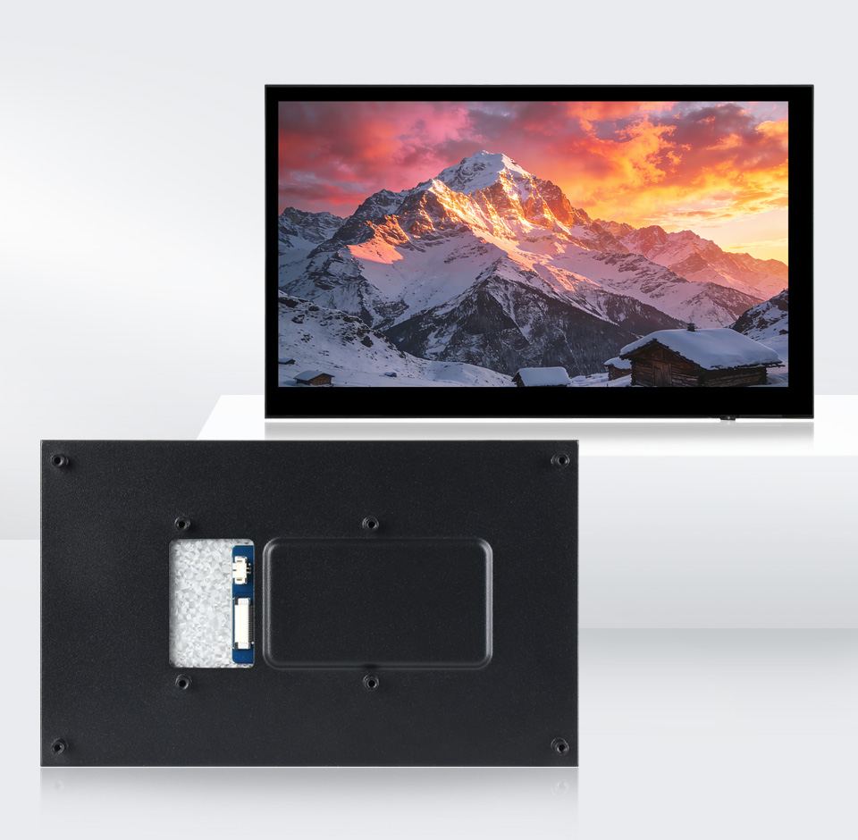

# Waveshare 7-DSI-TOUCH-C Development Guide


[**View Waveshare 7inch DSI Capacitive 5-Point Touch Display 1024 × 600 on OpenELAB**](https://openelab.io/products/waveshare-7inch-dsi-capacitive-5?variant=45611308155078)

**Model / option:** Default Title · **SKU:** `Waveshare-33259`


## Product overview

The **Waveshare 7-DSI-TOUCH-C** is a 7-inch 1024 × 600 IPS touchscreen for a host with a matching MIPI DSI interface. This guide takes a **Raspberry Pi 5** from powered-off wiring to a visible test interface with aligned touch coordinates. It also separates the documented CM5, Luckfox Omni3576 and ESP32-P4 routes: Raspberry Pi overlays are not firmware for the other processors.

### Product and supported first-run host

The assigned OpenELAB SKU is **Waveshare-33259**. The manufacturer's Raspberry Pi connection section specifies **Pi 5/CM5**, a **22-pin reversed-contact FFC** and separate 5V/GND wiring. A Pi 4 tutorial or a similarly sized HDMI screen is not an interchangeable setup. [Exact-model wiki](https://www.waveshare.com/wiki/7-DSI-TOUCH-C).

The store title says five-point touch while the currently reviewed manufacturer wiki advertises ten-point control with a GT911 controller. Treat the simultaneous-contact count as a documented source difference; the commissioning procedure proves single-pointer accuracy and does not depend on a ten-contact claim.



_Product images retained from the existing OpenELAB guide._

## Applications

* Raspberry Pi 5 control panel with local buttons and an on-screen keyboard.
* A kiosk or dashboard needing a fixed 1024 × 600 canvas and software-controlled brightness.
* A CM5 panel after checking the carrier exposes the matching DSI port and power connections.
* An ESP32-P4 HMI using its own MIPI-DSI driver/BSP and matching FPC/power cable.

Plan the actual panel outline, mounting holes and cable bend radius. A seven-inch diagonal does not specify the rear-cover size or the space needed by an installed Pi. The aluminum back cover is part of the panel assembly; it does not replace a host cooling assessment.

## Specifications

### Key specifications and interfaces

| Item                    | Exact-model manufacturer reference           | Engineering use                                                         |
| ----------------------- | -------------------------------------------- | ----------------------------------------------------------------------- |
| Panel                   | 7-inch IPS, 1024 × 600                       | Use native dimensions in the first UI                                   |
| Refresh                 | Up to 60Hz                                   | Host/driver must supply supported timings                               |
| Display controller      | EK79007                                      | Select this controller for the ESP32-P4 route                           |
| Touch controller        | GT911 over I2C                               | Check touch separately from video                                       |
| Supply                  | 5.00V nominal; 4.75–5.30V                    | Measure at display power input under load                               |
| Reference input current | 0.43A; maximum not specified                 | Add margin for wiring loss and host load; 0.43A is not a proven maximum |
| Operating temperature   | 0–60°C                                       | Dry environment, no condensation                                        |
| Storage temperature     | −10–70°C                                     | Avoid long high-temperature/high-humidity storage                       |
| Pi host connection      | Pi 5 or CM5, 22-pin DSI                      | Use exact reversed-contact cable and port selection                     |
| Mounting                | M2.5 hardware in the Pi installation example | Check screw length and drawing before tightening                        |

Source: [Waveshare electrical table, wiring and controller FAQ](https://www.waveshare.com/wiki/7-DSI-TOUCH-C). Supply voltage is independent of the host GPIO logic voltage. Never connect 5V to an I2C/GPIO signal because the display power connector uses 5V.

## Hardware and connections

### Hardware connection

1. Shut down the host, disconnect its supply and remove other power sources. Open each FFC latch before inserting the cable.
2. Match the **22PIN 200mm reversed-contact** cable to the manufacturer's Pi 5 connection image. Check exposed-contact orientation at **both** ends; do not infer orientation from the blue stiffener alone.
3. Connect the screen's DSI connector to the chosen Pi **CAM/DISP** connector. Record whether it is the port selected by the default DSI1 overlay or the `dsi0` variant.
4. Connect the panel's labeled **5V and GND** power inputs to Pi 5V and GND using the documented leads. The FFC alone is not the complete power connection. Check the host physical-pin reference and panel labels before applying power.
5. Fit the board using appropriate M2.5 hardware without straining the FFC or crushing components. Keep the cover clear of exposed conductive objects.

Use the [manufacturer connection diagrams](https://www.waveshare.com/wiki/7-DSI-TOUCH-C#Hardware_Connection) and [outline drawing](https://www.waveshare.com/img/devkit/LCD/7-DSI-TOUCH-C/7-DSI-TOUCH-C-details-size.jpg) as the physical reference. Their board labels and connector views matter more than the order of a list of wires.

### Host alternatives

| Host             | Separate requirements                                                                                                          |
| ---------------- | ------------------------------------------------------------------------------------------------------------------------------ |
| Pi 5 / CM5       | Correct Raspberry Pi OS overlay, 22-pin cable, separate panel power; CM5 needs a compatible carrier                            |
| Luckfox Omni3576 | Luckfox-supported image, its 22-pin connection and 5V/GND wiring; use the Rockchip display diagnostics rather than Pi overlays |
| ESP32-P4-NANO    | MIPI two-lane DSI, matching FPC and power leads, EK79007 component and board BSP                                               |

The vendor's Omni3576 example log shows 800 × 1280 for a different generic screen context; it is not the 7-DSI-TOUCH-C's native 1024 × 600 specification. Read the detected connector/mode on the actual board instead of copying that log.

## Software and development resources

### Software and driver resources

For the primary path use Raspberry Pi OS **Bookworm or Trixie** with the Waveshare panel-v2 overlay supplied by the selected image/kernel. On a running current OS, the boot file is normally `/boot/firmware/config.txt`; when editing the boot partition from another computer it appears as `config.txt` at that partition's root. Back up the original first.

The DSI1 setup uses `vc4-kms-dsi-waveshare-panel-v2,7_0_inch_c`. For physical DSI0, append `,dsi0`. The `7_0_inch_c` identifier is model-specific; substituting a generic seven-inch overlay can leave the backlight on without working video.

For ESP32-P4, [the official component](https://components.espressif.com/components/espressif/esp_lcd_ek79007) supplies the EK79007 driver. Add it using `idf.py add-dependency "espressif/esp_lcd_ek79007"` inside the selected P4 project, then use the P4 BSP's matching panel/touch configuration. The manufacturer describes backlight device **0x45**, register **0x96**, values **0x00–0xFF**. These are display-board I2C details, not a Pi GPIO-PWM interface. Use BSP brightness helpers where supported.

No screen firmware needs to be compiled for the Raspberry Pi first-result route. The original UI example below uses Python's standard Tk interface with the OS desktop; it does not replace the kernel display/touch drivers.

## Getting started

### Getting started on Raspberry Pi OS

1. Use Raspberry Pi Imager to install the selected Bookworm/Trixie image to the intended card. Keep a backup if the card contains an existing system.
2. Add the panel overlay to the boot configuration. Keep one KMS entry; do not duplicate it if already present:

```ini
dtoverlay=vc4-kms-v3d
dtoverlay=vc4-kms-dsi-waveshare-panel-v2,7_0_inch_c
```

For DSI0 use the panel line below **instead** of the default panel line:

```ini
dtoverlay=vc4-kms-dsi-waveshare-panel-v2,7_0_inch_c,dsi0
```

3. Finish the powered-off connections, boot, complete OS setup and allow the desktop to appear. Verify that the image fills the native landscape canvas.
4. Inspect the kernel's actual connectors and input devices:

```bash
for display_status in /sys/class/drm/card*-DSI-*/status; do
  [ -f "$display_status" ] || continue
  printf '%s: ' "$display_status"
  cat "$display_status"
done
cat /proc/bus/input/devices
```

5. Install Tk support if needed, save the original example below as `panel_check.py`, and launch it **inside the local graphical session**, not an SSH shell without display access:

```bash
sudo apt update
sudo apt install python3-tk
python3 panel_check.py
```

```python
import tkinter as tk

root = tk.Tk()
root.title("7-DSI-TOUCH-C coordinate check")
root.attributes("-fullscreen", True)
canvas = tk.Canvas(root, background="#102030", highlightthickness=0)
canvas.pack(fill="both", expand=True)
message = canvas.create_text(512, 300, fill="white", font=("Sans", 24),
                             text="Tap each target; Esc exits")

def draw_targets(event=None):
    canvas.delete("target")
    w, h = canvas.winfo_width(), canvas.winfo_height()
    for x, y in [(40, 40), (w-40, 40), (40, h-40), (w-40, h-40), (w//2, h//2)]:
        canvas.create_oval(x-18, y-18, x+18, y+18, outline="#46e0b0",
                           width=3, tags="target")
    canvas.coords(message, w//2, h//2 + 65)

def report(event):
    canvas.itemconfigure(message, text=f"x={event.x}, y={event.y}")
    canvas.delete("tap")
    canvas.create_oval(event.x-6, event.y-6, event.x+6, event.y+6,
                       fill="yellow", tags="tap")

canvas.bind("<Configure>", draw_targets)
canvas.bind("<Button-1>", report)
root.bind("<Escape>", lambda event: root.destroy())
root.mainloop()
```

**Expected result:** five targets remain visible, the yellow point follows each touched target and the coordinates span the current screen width/height. A small bezel margin is normal; a persistent reversed axis or a large systematic offset is a mapping error. This checks the desktop's pointer path, not the maximum simultaneous touch count.

### Brightness, orientation and touch mode <a href="#application-development" id="application-development"></a>

On Trixie use **Preferences → Control Center → Screens**, choose the actual DSI display, then set brightness and Apply. Bookworm uses **Screen Configuration**. When rotating, associate the Goodix touchscreen with the same display and rotate both together. Re-run the target check after every change.

For terminal brightness, identify one backlight directory, inspect `max_brightness`, then write a supported value to that exact device. Avoid a wildcard write when several displays are connected:

```bash
for panel_backlight in /sys/class/backlight/*; do
  [ -d "$panel_backlight" ] || continue
  printf '%s max=' "$panel_backlight"
  cat "$panel_backlight/max_brightness"
done
```

Use the GUI to choose the first brightness setting; a value of zero can make a working screen appear off. The vendor's documented 0–255 range applies to its driver, while inspecting the actual maximum keeps a future driver change visible.

Mouse-emulation mode supports desktop click/double-click/long-press behavior. Multitouch mode is intended for gestures and scrolling; applications must handle touch events accordingly. For keyboard input, use Squeekboard on current Pi OS and test automatic show/hide in a text field.

For a Lite/console rotation, keep `cmdline.txt` on one line and use the **actual connector name and 1024 × 600 native mode**. Back up the file first; the vendor's 720 × 1280 examples are generic. Touch transforms are separate from console rotation, so prefer the desktop's paired display/touch configuration when a desktop is available.

## Troubleshooting and FAQs <a href="#troubleshooting-and-faq" id="troubleshooting-and-faq"></a>

| Symptom                                | Ordered diagnosis and recovery                                                                                                  |
| -------------------------------------- | ------------------------------------------------------------------------------------------------------------------------------- |
| No light at all                        | Verify separate 5V/GND, polarity and voltage at the panel; inspect supply sag and cable seating                                 |
| Backlight but no image                 | Confirm Pi 5/CM5, physical DSI port, exact `7_0_inch_c` overlay and supported image; power down before reseating FFC            |
| Image but no touch                     | Check input enumeration for the Goodix controller, kernel messages and compositor touchscreen association                       |
| Touch moves the other screen           | Associate the touchscreen with the DSI display, then repeat corner checks                                                       |
| Touch wrong after rotation             | Undo the last rotation, restore paired screen/input settings and test all five targets before making permanent transforms       |
| Display vanished after brightness edit | Restore a nonzero value using SSH/another display and the exact backlight directory                                             |
| Gestures missing                       | Confirm desktop mode and application touch support; pointer emulation does not demonstrate multitouch                           |
| Pi 4 cable/settings fail               | This first-run route is documented for Pi 5/CM5; use exact supported host/cable rather than adapting by appearance              |
| P4 display remains dark                | Check matching FPC, separate supply, EK79007 driver and BSP backlight initialization; Pi overlays have no effect on P4 firmware |

To recover an invalid Pi boot setting, power down, mount the boot partition on another computer and restore the saved configuration. Avoid reinstalling the whole OS before testing that smaller recovery.

## Downloads and technical documents <a href="#technical-documents-and-software" id="technical-documents-and-software"></a>

| Resource                                                                                                   | Exact scope                                                                                                |
| ---------------------------------------------------------------------------------------------------------- | ---------------------------------------------------------------------------------------------------------- |
| [7-DSI-TOUCH-C manufacturer guide](https://www.waveshare.com/wiki/7-DSI-TOUCH-C)                           | Pi/CM5, Omni3576 and P4 connection diagrams, overlay, rotation, brightness, touch modes and controller FAQ |
| [Dimension drawing](https://www.waveshare.com/img/devkit/LCD/7-DSI-TOUCH-C/7-DSI-TOUCH-C-details-size.jpg) | Model-specific outline/mounting, retained from the existing guide                                          |
| [Official Brightness utility ZIP](https://files.waveshare.com/wiki/common/Brightness.zip)                  | Optional vendor GUI utility; inspect its installer before using it                                         |
| [EK79007 component](https://components.espressif.com/components/espressif/esp_lcd_ek79007)                 | ESP-IDF/P4 panel-driver path                                                                               |
| [Raspberry Pi Imager](https://www.raspberrypi.com/software/)                                               | Write a supported OS image to the correct removable medium                                                 |

The preconfigured-image option is linked from the manufacturer guide. This review does not label an unexamined image as tested. The ordinary supported Pi OS plus exact overlay is the reproducible first route.

| Resource                                                                     | Purpose and exact scope                                  |
| ---------------------------------------------------------------------------- | -------------------------------------------------------- |
| [Exact model wiki](https://www.waveshare.com/wiki/7-DSI-TOUCH-C)             | Electrical table, diagrams and all supported host routes |
| [Brightness utility](https://files.waveshare.com/wiki/common/Brightness.zip) | Optional official utility, download listed               |

## References and validation <a href="#official-documentation-and-development-resources" id="official-documentation-and-development-resources"></a>

Reviewed **24 November 2026** against the exact-model manufacturer guide and observed global-store listing. Source review covers the electrical table, cable/power path, controller identification, host-specific configuration, brightness, rotation, virtual keyboard and touch-mode distinctions.

**Validation:** original Python and shell procedures were reviewed, but OS installation, software execution, display/touch operation and electrical measurements were **not run**. The storefront/manufacturer contact-count difference is explicit; this commissioning path validates a single pointer. No fabricated touch-count result or generic-screen console log is presented as a measurement of this SKU.

* [Waveshare 7-DSI-TOUCH-C manufacturer reference](https://www.waveshare.com/wiki/7-DSI-TOUCH-C) — snapshot reviewed 24 November 2026.
* [OpenELAB exact SKU33259 and observed product page](https://openelab.io/products/waveshare-7inch-dsi-capacitive-5) — 23 November catalog; public page observed 24 November.

### Retained source links

* [_Image source_](https://www.waveshare.com/img/devkit/LCD/7-DSI-TOUCH-C/7-DSI-TOUCH-C-details-1.jpg)
* [product specifications and drawings](https://www.waveshare.com/7-dsi-touch-c.htm)
* [Product specifications](https://www.waveshare.com/7-dsi-touch-c.htm)
* [Interface illustration](https://www.waveshare.com/img/devkit/LCD/7-DSI-TOUCH-C/7-DSI-TOUCH-C-details-17.jpg)
