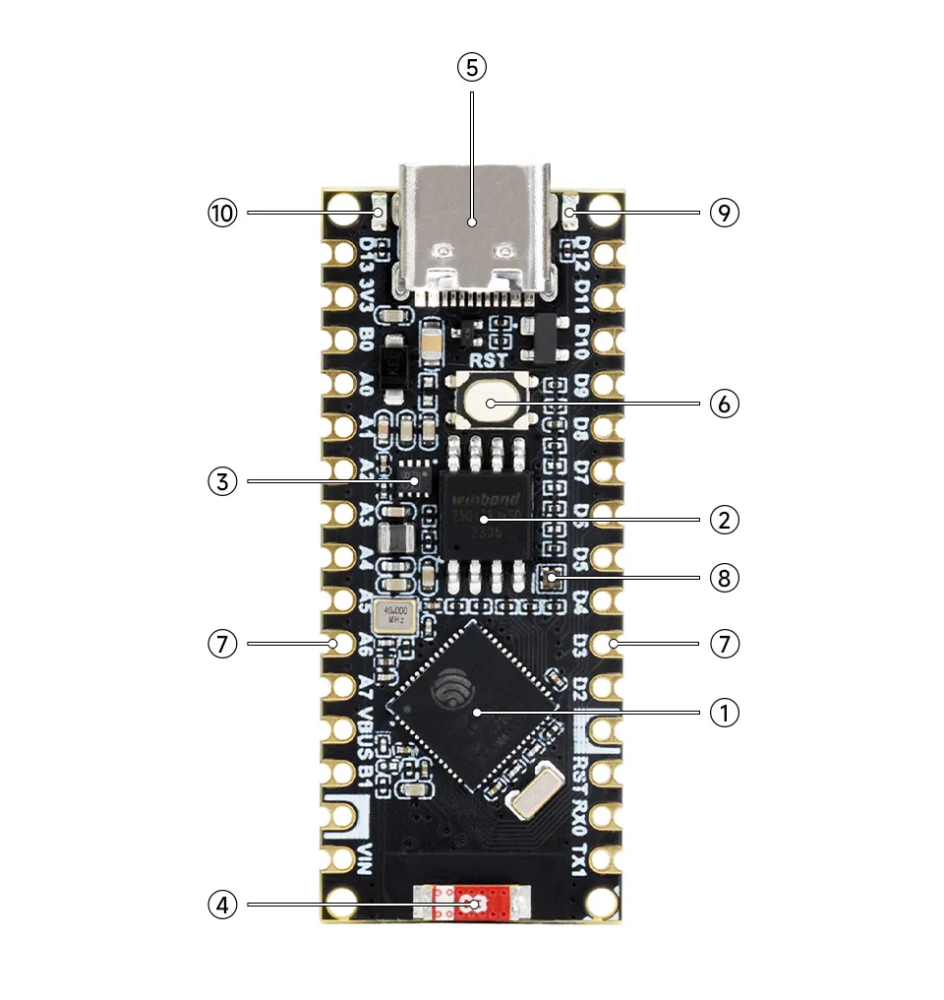
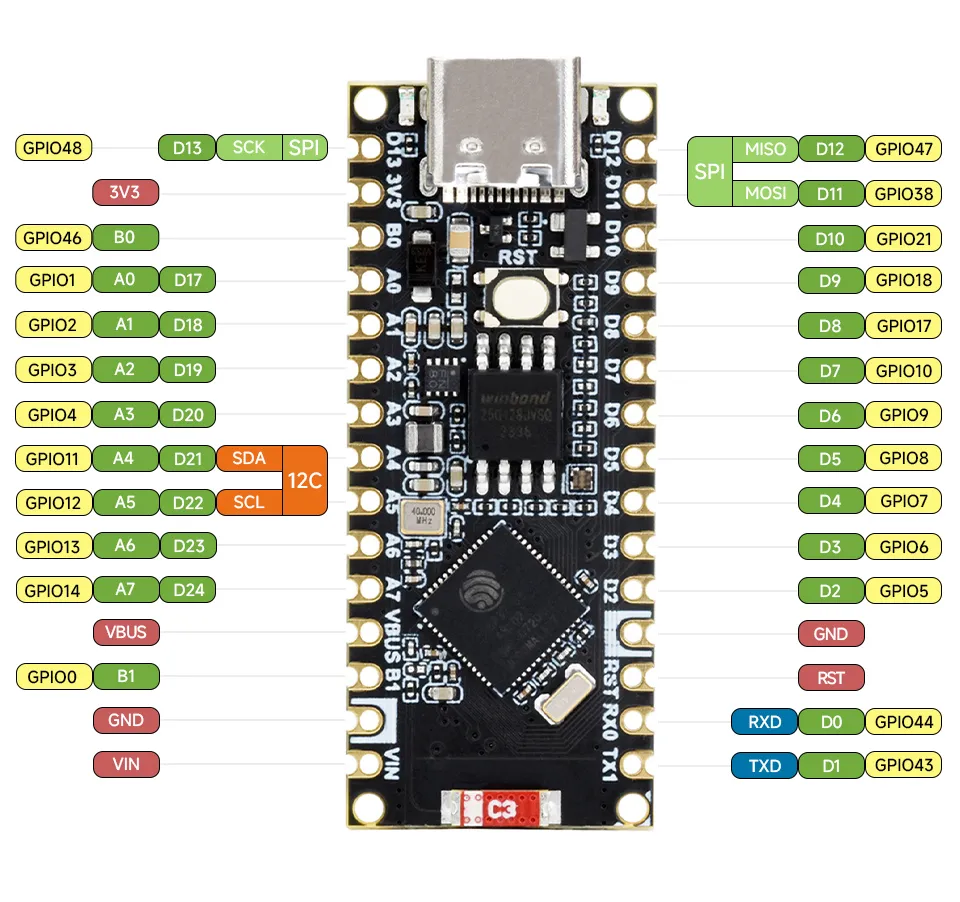
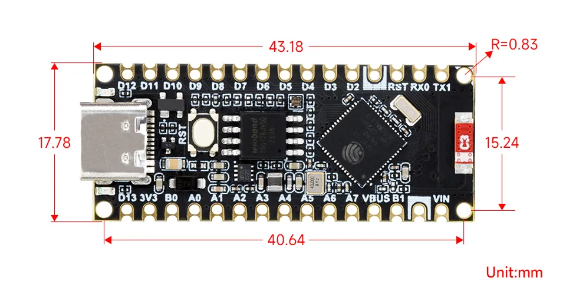

# Waveshare ESP32-S3-Nano Engineering Guide


[**View Waveshare ESP32-S3-Nano on OpenELAB**](https://openelab.io/products/esp32-s3-nano)

**Models:** ESP32-S3-Nano `Waveshare-26745`; ESP32-S3-Nano-M `Waveshare-26752` · Match the purchased header/assembly option. Wiring below uses the reviewed ESP32-S3-Nano schematic and Nano pin map.


## Product overview

Waveshare ESP32-S3-Nano is an ESP32-S3R8 development board in the Arduino Nano ESP32 interface format. This guide covers Arduino setup, the difference between Arduino labels and chip GPIOs, every supplied demonstration, MicroPython, radio development and firmware recovery. Establish USB and Blink before connecting an expansion or changing runtimes.

### Introduction

The [manufacturer overview](https://docs.waveshare.com/ESP32-S3-Nano) lists Arduino, MicroPython, Arduino IoT Cloud and USB HID development. These are software choices, not proof that a library for another Nano has compatible wiring or electrical levels. Its comparison with Uno R4 boards must not transfer their 5 V logic, DAC, CAN or power connectors to this board.

### Version Options

The manufacturer maps26745 to ESP32-S3-Nano and 26752 to ESP32-S3-Nano-M. Match the selected store/header assembly; neither option changes a 3.3 V GPIO into a 5 V interface.

## Applications

Use the board for a compact Wi-Fi sensor controller, a USB-connected interface or a MicroPython prototype. Reserve UART/I2C/SPI signals at design time, including their shared LED functions. A carrier designed around an older 5 V Nano needs an electrical review before reuse, even if the physical rows fit.

Keep a project record of the board option, schematic revision, board-package version, pin-numbering menu setting, power arrangement and a known working Blink result. This makes it possible to distinguish a core/configuration migration from a hardware fault.

## Specifications

### Features

| Item                    | ESP32-S3-Nano                                                            |
| ----------------------- | ------------------------------------------------------------------------ |
| Processor               | ESP32-S3R8, dual Xtensa LX7, up to 240 MHz                               |
| Memory                  | 512 KB SRAM, 384 KB ROM; 8 MB PSRAM and 16 MB flash                      |
| Radio                   | 2.4 GHz Wi-Fi and Bluetooth LE; ceramic antenna                          |
| Digital / analog labels | D0–D13; A0–A7                                                            |
| Common buses            | UART, I2C, SPI; native USB programming/data                              |
| Logic                   | 3.3 V; not a 5 V-tolerant Nano replacement                               |
| VIN reference           | Manufacturer lists 6–21 V external VIN; USB-only is the initial workflow |
| Dimensions              | Drawing: 43.18 × 17.78 mm, 2.54 mm header pitch                          |

Features: [official product reference](https://docs.waveshare.com/ESP32-S3-Nano). Routing/power: [board schematic](https://files.waveshare.com/wiki/ESP32-S3-Nano/ESP32-S3-Nano-Schematic.pdf). Dimensions: [original mechanical drawing](https://docs.waveshare.com/assets/images/ESP32-S3-Nano-details-size-d435914d61a0d43a84a1c96664de73b1.webp).

### Product Parameters Comparison

The vendor comparison lists output-current and 5 V supply figures, but those are not a per-pin operating recommendation or a guaranteed external-load budget. Use the chip/regulator limits and actual thermal conditions. There is no onboard DAC or CAN transceiver established by the comparison table. PWM is not a true analog voltage output.

## Hardware and connections

### Hardware Description



_Waveshare_ [_original board map_](https://docs.waveshare.com/assets/images/ESP32-S3-Nano-details-intro-2e86b6913463cf25410933bbf4a9db9a.webp)_: MCU, flash, regulator, antenna, USB-C, reset, Nano headers and indicators._ [_Resource descriptions_](https://docs.waveshare.com/ESP32-S3-Nano)_._

### Pinout Definition



_Waveshare_ [_original pinout_](https://docs.waveshare.com/assets/images/ESP32-S3-Nano-details-inter-1-c806cf5e83bb5f6f6f71fc5bad2239c7.webp)_. Read the USB orientation; header labels and native GPIOs are different namespaces._

| Nano label             | Native ESP32-S3 GPIO | Function / sharing                                           |
| ---------------------- | -------------------- | ------------------------------------------------------------ |
| D0 / D1                | 44 / 43              | UART RX / TX                                                 |
| D2 / D3 / D4 / D5      | 5 / 6 / 7 / 8        | General I/O                                                  |
| D6 / D7 / D8 / D9      | 9 / 10 / 17 / 18     | General I/O                                                  |
| D10                    | 21                   | Default SPI chip-select                                      |
| D11 / D12 / D13        | 38 / 47 / 48         | SPI MOSI / MISO / SCK; D13 also LED\_BUILTIN                 |
| A0 / A1 / A2 / A3      | 1 / 2 / 3 / 4        | ADC-capable inputs                                           |
| A4 / A5                | 11 / 12              | I2C SDA / SCL, also analog labels                            |
| A6 / A7                | 13 / 14              | Analog inputs                                                |
| B0 / B1                | 46 / 0               | Boot-related GPIOs; B1 is the documented recovery connection |
| RGB red / green / blue | 46 / 0 / 45          | Direct active-low channels on reviewed schematic             |

Mapping checked against [Waveshare schematic](https://files.waveshare.com/wiki/ESP32-S3-Nano/ESP32-S3-Nano-Schematic.pdf) and [Arduino Nano variant definitions](https://github.com/espressif/arduino-esp32/blob/master/variants/arduino_nano_nora/pins_arduino.h). ESP32-S3 GPIO0/3/45/46 are strapping pins; preserve required boot levels. Do not use GPIO33–37, occupied by octal-memory functions on R8, as generic expansion signals.

#### Numbering must follow the selected core setting

The Nano variant supports Arduino-style remapping and native-GPIO numbering. Prefer **`D2`, `A4`, `LED_RED`, `LED_BUILTIN`** rather than unexplained integers in Arduino code. Under remapping, literal `14` in the supplied RGB sketch represents a Nano LED index, not native GPIO14. In MicroPython, `Pin(14)` means the physical ESP32 GPIO14. [Variant source](https://github.com/espressif/arduino-esp32/blob/master/variants/arduino_nano_nora/pins_arduino.h).

#### Power and indicators

Disconnect power before wiring. Start with USB-C data/power; use 3.3 V-compatible signal levels. VIN, VBUS and 3V3 serve different power roles. Check the exact schematic and external supply/ground arrangement before combining sources or using VIN; never apply VIN voltage to a signal pin.

The reviewed schematic shows a separate SCK indicator and a **three-channel common-anode RGB LED**. Its active-low red/green/blue channels are46/0/45. Although the resource index links a WS2812 data sheet, that link does not establish an addressable pixel on this revision. Use the circuit and supplied RGB source; do not substitute a one-wire NeoPixel driver without confirming a different revision.

### Dimensions



_Waveshare_ [_drawing_](https://docs.waveshare.com/assets/images/ESP32-S3-Nano-details-size-d435914d61a0d43a84a1c96664de73b1.webp)_, mm. Check connector/board clearance and the actual soldered header option before enclosure design._

## Software and development resources

The manufacturer selects the **Nano ESP32 board package / Arduino Nano ESP32 target**, rather than importing settings from ESP32-S3-Zero. Install the selected package through Boards Manager and record its release. Its Arduino/MicroPython generic tutorials use Zero as their teaching board: adapt every physical pin to the table above. [Nano Arduino setup](https://docs.waveshare.com/ESP32-S3-Nano/Arduino), [MicroPython setup](https://docs.waveshare.com/ESP32-S3-Nano/MicroPython).

| Resource                      | Reviewed purpose                                                                 |
| ----------------------------- | -------------------------------------------------------------------------------- |
| `ESP32-S3-Nano-Demo-Code.zip` | Six Arduino demonstrations: RTC, GPIO, AP, STA, BLE UART, RGB                    |
| `Esp32-S3-Nano-Uart0.zip`     | Additional UART demonstration, with a receive-object inconsistency noted below   |
| MicroPython firmware ZIP      | Vendor runtime; inspect contained image and firmware instructions before writing |
| Factory firmware ZIP          | Separate bootloader, partition and application images; exact offsets matter      |

The [resource index](https://docs.waveshare.com/ESP32-S3-Nano/Resources-And-Documents) also supplies chip manuals, Arduino/Thonny/serial tools and firmware. Preserve complete archives and record their hashes; download URLs can change contents over time. ESP-IDF, PlatformIO, ESPHome and JavaScript runtimes are alternative ecosystems, not evidence that an arbitrary target definition has been validated on this board.

## Getting started

### User Guide

#### Environment Setting

#### Arduino

#### Software setup

1. Install Arduino IDE and the **Nano ESP32** board package through Boards Manager.
2. Select **Arduino Nano ESP32**, the actual connected port and the intended pin-numbering mode. Record the package and menu settings.
3. Open a fresh sketch with the complete Blink below. Keep header devices disconnected until it works.

### Hardware setup

Connect USB-C with a known data cable. The USB power light alone cannot establish enumeration or execution. Close competing serial monitors before upload. Compile, upload and inspect the board rather than assuming the package's generic example matches every Nano revision.

### Blink the LED

This original sketch uses the board alias, avoiding the ambiguity between Nano pin13 and native GPIO13:

```cpp
#include <Arduino.h>
void setup() {
  pinMode(LED_BUILTIN, OUTPUT);
  Serial.begin(115200);
}
void loop() {
  digitalWrite(LED_BUILTIN, HIGH);
  Serial.println("NANO_LED_ON");
  delay(500);
  digitalWrite(LED_BUILTIN, LOW);
  delay(500);
}
```

**Expected result:** the D13/SCK indicator changes at a half-second cadence, and the serial monitor reports activity when USB CDC is available in the selected package. A package-dependent port can change during upload. This is source-supported expected behavior; no physical board was tested for this guide. [Manufacturer Blink workflow](https://docs.waveshare.com/ESP32-S3-Nano/Arduino), [exact alias definitions](https://github.com/espressif/arduino-esp32/blob/master/variants/arduino_nano_nora/pins_arduino.h).

### Sample Demo

Paths below are relative to the [actual demo ZIP](https://files.waveshare.com/wiki/ESP32-S3-Nano/ESP32-S3-Nano-Demo-Code.zip), downloaded and inspected for this guide.

| Archive path                                    | Configuration and expected result                                                                                                                                                                                                                  |
| ----------------------------------------------- | -------------------------------------------------------------------------------------------------------------------------------------------------------------------------------------------------------------------------------------------------- |
| `Arduino/0.RTC/sketch_nov13c/sketch_nov13c.ino` | Experimental RTC/slow-clock code uses low-level registers and calibration calls. It is not an external-32 kHz-crystal guarantee for this schematic. Prefer the public timer-sleep recipe below; review target/version before porting register code |
| `Arduino/1.GPIO_TEST/main/main.ino`             | Sweeps literal2–13 plus A0–A7, with 100 ms steps. Requires the intended Arduino numbering; disconnect expansions and verify only selected unloaded pins                                                                                            |
| `Arduino/2.WiFi_AP/WiFi.ino`                    | Creates AP `ESP32_3` with demo password `88888888`; change both. Confirm a client can discover/join it; an AP does not automatically route Internet traffic                                                                                        |
| `Arduino/3.WIFI_STA/WIFISTA.ino`                | Replace the source's embedded network credentials with your own. Confirm connection and printed DHCP address; add a timeout rather than waiting forever                                                                                            |
| `Arduino/4.Bluetooth/BLE_uart/BLE_uart.ino`     | Advertises `AWA Service`; connect with a BLE GATT client, write RX and subscribe to TX; inspect both receive log and notifications                                                                                                                 |
| `Arduino/5.RGB/sketch_oct31a/sketch_oct31a.ino` | Direct active-low RGB channels using Nano indices14/15/16; use named aliases as in the corrected example below                                                                                                                                     |

Do not publish source-embedded Wi-Fi credentials or use them in a deployment. The GPIO sweep is an output test, not harmless discovery on an unidentified expansion. Preserve the last successful sketch before testing a new subsystem.

#### Corrected direct RGB test

```cpp
#include <Arduino.h>
const uint8_t channels[] = {LED_RED, LED_GREEN, LED_BLUE};
void setup() {
  for (auto channel : channels) {
    pinMode(channel, OUTPUT);
    digitalWrite(channel, HIGH);
  }
}
void loop() {
  for (auto channel : channels) {
    digitalWrite(channel, LOW);
    delay(400);
    digitalWrite(channel, HIGH);
  }
}
```

Expected result is red → green → blue, one channel at a time. The aliases must come from the Nano target, not a generic ESP32 profile. RGB green shares GPIO0, so do not force that signal low across a reset while trying to boot normally. [RGB source archive](https://files.waveshare.com/wiki/ESP32-S3-Nano/ESP32-S3-Nano-Demo-Code.zip), [schematic](https://files.waveshare.com/wiki/ESP32-S3-Nano/ESP32-S3-Nano-Schematic.pdf).

#### Wi-Fi connection with bounded failure

This original sketch replaces an indefinite station wait with an observable failure path. Use only a network you are authorized to join; keep its credentials out of shared project history.

```cpp
#include <WiFi.h>
const char* ssid = "YOUR_SSID";
const char* password = "YOUR_PASSWORD";
void setup() {
  Serial.begin(115200);
  WiFi.mode(WIFI_STA);
  WiFi.begin(ssid, password);
  unsigned long started = millis();
  while (WiFi.status() != WL_CONNECTED && millis() - started < 20000) delay(100);
  if (WiFi.status() == WL_CONNECTED) {
    Serial.print("STA_IP="); Serial.println(WiFi.localIP());
  } else {
    Serial.println("STA_TIMEOUT: inspect credentials, antenna surroundings and AP band");
  }
}
void loop() {}
```

For AP mode, configure `WiFi.softAP` with a new SSID/password, print `WiFi.softAPIP()`, join from a test device and compare its assigned subnet. The package's AP example only creates a hotspot; it does not implement an application web server. For a web project, add a server after verifying the link and define a response/timeout policy. [Official Wi-Fi APIs](https://docs.espressif.com/projects/arduino-esp32/en/latest/api/wifi.html).

#### BLE UART protocol and test

The archive implements Nordic-UART-style UUIDs:

| Role                                   | UUID                                   |
| -------------------------------------- | -------------------------------------- |
| Service                                | `6E400001-B5A3-F393-E0A9-E50E24DCCA9E` |
| RX, client writes                      | `6E400002-B5A3-F393-E0A9-E50E24DCCA9E` |
| TX, client subscribes to notifications | `6E400003-B5A3-F393-E0A9-E50E24DCCA9E` |

After upload, scan for the advertised service, connect, enable the TX notification subscription and send a small known byte sequence to RX. Expected results are changing one-byte notifications and the written bytes in Serial. The implementation delays10 ms in its notification loop, despite comments implying a slower interval. Do not use that as a throughput guarantee. Its callback's `std::string` assumes the example's core/API generation; a newer library may return a different string type. Reconcile that compile error with the installed core before diagnosing radio hardware. [Actual BLE source](https://files.waveshare.com/wiki/ESP32-S3-Nano/ESP32-S3-Nano-Demo-Code.zip).

#### UART without mixing USB and hardware receive queues

The separate [UART ZIP](https://files.waveshare.com/wiki/ESP32-S3-Nano/Esp32-S3-Nano-Uart0.zip) writes through `Serial0` but reads through `Serial`. When `Serial` is USB CDC, those are different queues. For a physical loopback, power off and connect **D1/TX → D0/RX**; initialize a hardware UART on those aliases and read the **same object** you write:

```cpp
#include <Arduino.h>
#include <HardwareSerial.h>
HardwareSerial externalPort(1);
void setup() {
  Serial.begin(115200);
  externalPort.begin(9600, SERIAL_8N1, D0, D1);
}
void loop() {
  externalPort.write('N');
  delay(20);
  while (externalPort.available()) {
    Serial.printf("UART_BYTE=0x%02X\n", externalPort.read());
  }
  delay(1000);
}
```

Expected received byte is `0x4E`; remove the jumper to verify the returned data depends on that connection. Use 3.3 V UART levels, not RS-232 voltage. USB `Serial` remains the diagnostic path. API: [Espressif UART reference](https://docs.espressif.com/projects/arduino-esp32/en/latest/api/serial.html).

#### ADC, I2C and SPI route selection

For ADC, use a sensor/divider within the selected attenuation's measurable range and the pin's electrical limit; call `analogReadResolution(12)` and record `analogReadMilliVolts(A0)` alongside raw counts. A0 is native GPIO1 here, not GPIO26 from a different board. [ADC API](https://docs.espressif.com/projects/arduino-esp32/en/latest/api/adc.html).

For I2C, wire a compatible device to A4/SDA and A5/SCL, initialize `Wire.begin(SDA, SCL)`, scan for its documented address, then initialize its exact driver. For SPI, use D11/MOSI, D12/MISO, D13/SCK and an explicitly assigned CS such as D10. The SCK indicator may react to bus traffic. Power, pull-ups, chip-select polarity and SPI mode must come from the attached device's data sheet. The board pin map establishes routes, not universal sensor compatibility.

#### Public timer-sleep alternative to the RTC register demo

```cpp
#include <Arduino.h>
#include <esp_sleep.h>
RTC_DATA_ATTR unsigned bootCount = 0;
void setup() {
  Serial.begin(115200);
  delay(1500);
  Serial.printf("boot=%u,wake=%d\n", ++bootCount, (int)esp_sleep_get_wakeup_cause());
  esp_sleep_enable_timer_wakeup(5ULL * 1000000ULL);
  Serial.flush();
  esp_deep_sleep_start();
}
void loop() {}
```

Expected result is periodic restart with a retained counter across timer deep sleep; full power loss resets retained state. USB may disappear/reappear. This tests a supported public API, not the archive's external-clock calibration logic or a measured standby current. [ESP32-S3 sleep API](https://docs.espressif.com/projects/esp-idf/en/stable/esp32s3/api-reference/system/sleep_modes.html).

### MicroPython

Back up required code/data and extract the [Nano MicroPython package](https://files.waveshare.com/wiki/ESP32-S3-Nano/ESP32-S3-Nano-mpy.zip). Its reviewed `mpy/configure/esp32s3/spi_download.conf` selects `mpy/bin/bootloader.bin` at **0x0**, `mpy/bin/partition-table.bin` at **0x8000** and `mpy/bin/micropython.bin` at **0x10000**. Use those local files in Flash Download Tool's ESP32-S3 configuration; replace the vendor's stored computer paths and port with your observed files/port. Do not reuse these offsets for an unrelated firmware image.

Enter B1/GND recovery mode as described below if needed, select the three rows/offsets, flash and remove the recovery short before reset. Then configure Thonny with an ESP32 MicroPython interpreter and the observed serial port. Confirm a REPL and print `sys.implementation` before connecting a peripheral. The ZIP also contains a combined image; use the reviewed separate-image layout unless a matching combined-image offset is explicitly established. [Vendor MicroPython route](https://docs.waveshare.com/ESP32-S3-Nano/MicroPython), [Thonny](https://thonny.org/).

In MicroPython, GPIOs are native numbers. This complete original RGB program therefore uses46/0/45 directly:

```python
from machine import Pin
from time import sleep
channels = [Pin(n, Pin.OUT, value=1) for n in (46, 0, 45)]
while True:
    for led in channels:
        led.value(0)
        sleep(0.4)
        led.value(1)
```

Run interactively, then save on the device as `main.py` if autonomous startup is intended. For MicroPython I2C use native SDA11/SCL12; for a UART use RX44/TX43. Choose a supported bus instance in the installed runtime. Check those against the schematic before adapting the vendor's generic Zero tutorials. A firmware change can replace the filesystem, so preserve source on the computer as well.

### Arduino IoT Cloud and USB HID

For an IoT Cloud prototype, first establish ordinary Arduino upload and Wi-Fi. Create the intended device/Thing, associate a variable with a simple indicator, install the required agent/library, then implement the generated change callback using `LED_BUILTIN`. Verify local output, cloud variable update and reconnect behavior separately. Cloud association does not establish a sensor's wiring or firmware recovery method. [Nano development overview](https://docs.waveshare.com/ESP32-S3-Nano).

For USB HID, use the **installed Nano ESP32 package's** compatible keyboard/mouse example, keep a recoverable serial/boot path, and require a deliberate physical trigger before generating input. Test in an empty editor on a controlled computer. Do not assume the USB Serial port is an HID interface or that a generic ESP32 board supports S3 native USB. Keep HID and USB-stack configuration with the exact package version; no HID or cloud test was performed for this guide.

### Firmware recovery and full erase

The [current factory flashing page](https://docs.waveshare.com/ESP32-S3-Nano/Firmware-Flashing) specifies **three images**, not one interchangeable address:

| Binary                              | Offset    |
| ----------------------------------- | --------- |
| `ESP32-S3-Nano_TEST_bootloader.bin` | `0x0`     |
| `ESP32-S3-Nano_TEST_partitions.bin` | `0x8000`  |
| `ESP32-S3-Nano_TEST.bin`            | `0x10000` |

Back up required data. Use the [factory archive](https://files.waveshare.com/wiki/ESP32-S3-Nano/ESP32-S3-NANO-Firmware.zip) and Espressif's [Flash Download Tool](https://dl.espressif.com/public/flash_download_tool.zip), select ESP32-S3/USB and the actual port, enable all required file rows with their matching offsets, then start and wait for completion. The page lists a maximum tool baud of1152000. Reset after a successful write.

For `dfu-util: No DFU capable USB device available`, the [FAQ](https://docs.waveshare.com/ESP32-S3-Nano/FAQ) describes entering recovery by shorting **B1 to GND** during power/reset, restoring firmware, then rebooting. Identify those labeled contacts on the exact board; remove the recovery short for normal operation. **ERASE removes the entire flash**, including firmware/configuration. Have a verified replacement set before erasing; a missing Wi-Fi connection alone is not an erase diagnosis.

## Troubleshooting and FAQs

| Symptom                           | Ordered checks                                                                                            |
| --------------------------------- | --------------------------------------------------------------------------------------------------------- |
| Power but no port                 | Data cable → direct USB port → selected target → recovery mode → newly enumerated port                    |
| Wrong LED or pin changes          | Confirm Nano label/native GPIO mode; replace literal indices with aliases; distinguish D13 from GPIO13    |
| NeoPixel example does nothing     | Check reviewed direct RGB circuit; linked WS2812 documentation alone does not identify the fitted LED     |
| UART log but no loopback          | Same hardware object for TX/RX; D1-to-D0 jumper; USB CDC separately; compatible logic                     |
| GPIO sweep disturbs a peripheral  | Remove expansion wiring and restore a known sketch; do not test outputs on unidentified devices           |
| BLE compile string-type error     | Match the archive's core/API generation; inspect callback types before rewriting radio code               |
| RTC example has missing registers | Treat it as version/target-specific low-level code; use the public timer recipe for an initial sleep test |
| MicroPython pin is wrong          | Use native GPIOs, not Nano labels; compare runtime pin table with the schematic                           |
| Factory image fails to boot       | Confirm chip, all three offsets/files and boot strap state; remove recovery short; inspect serial output  |

## Downloads and technical documents

| Resource                                                                                                                                                                                     | Contents                                                            |
| -------------------------------------------------------------------------------------------------------------------------------------------------------------------------------------------- | ------------------------------------------------------------------- |
| [Official resources](https://docs.waveshare.com/ESP32-S3-Nano/Resources-And-Documents)                                                                                                       | Manufacturer files, chip references and tools                       |
| [Schematic](https://files.waveshare.com/wiki/ESP32-S3-Nano/ESP32-S3-Nano-Schematic.pdf)                                                                                                      | Exact power, LED and header circuits                                |
| [Arduino demos](https://files.waveshare.com/wiki/ESP32-S3-Nano/ESP32-S3-Nano-Demo-Code.zip) / [UART demo](https://files.waveshare.com/wiki/ESP32-S3-Nano/Esp32-S3-Nano-Uart0.zip)            | Actual reviewed example code; limitations explained above           |
| [MicroPython firmware](https://files.waveshare.com/wiki/ESP32-S3-Nano/ESP32-S3-Nano-mpy.zip) / [factory firmware](https://files.waveshare.com/wiki/ESP32-S3-Nano/ESP32-S3-NANO-Firmware.zip) | Different image purposes; do not exchange offsets                   |
| [Arduino setup](https://docs.waveshare.com/ESP32-S3-Nano/Arduino) / [MicroPython setup](https://docs.waveshare.com/ESP32-S3-Nano/MicroPython)                                                | Model setup and broader tutorial links                              |
| [Flashing](https://docs.waveshare.com/ESP32-S3-Nano/Firmware-Flashing) / [FAQ](https://docs.waveshare.com/ESP32-S3-Nano/FAQ)                                                                 | Supported recovery workflow                                         |
| [Espressif Arduino core](https://github.com/espressif/arduino-esp32) / [Nano variant](https://github.com/espressif/arduino-esp32/blob/master/variants/arduino_nano_nora/pins_arduino.h)      | Core source and remapped/native aliases                             |
| [Technical support](https://docs.waveshare.com/ESP32-S3-Nano/Technical-Support)                                                                                                              | Supply exact option/revision, SDK, pin mode and minimal failing log |

### Resource

#### Document

Use the schematic and mechanical drawing above for the exact board.

#### Demo

The task map covers all six actual Arduino demo folders and the separate UART archive.

#### Software

The download table links the Arduino, MicroPython and factory tools/images with their distinct roles.

#### Datasheet

Chip-level electrical/API documentation complements the board schematic; a linked LED data sheet does not identify the fitted circuit.

### Existing illustrations

<figure><figcaption></figcaption></figure>

<figure><figcaption></figcaption></figure>

.png>)

.png>)

#### Legacy manufacturer illustration links

These original image URLs are retained for continuity. Some show comparison/reference boards and the host restricts automated access. Use the current exact-model diagrams above for wiring.

* [Legacy illustration: ESP32-S3-Nano\_Version.png](https://www.waveshare.com/w/upload/5/5a/ESP32-S3-Nano_Version.png)
* [Legacy illustration: ESP32-S3-Nano\_Version2.png](https://www.waveshare.com/w/upload/3/39/ESP32-S3-Nano_Version2.png)
* [Legacy illustration: ESP32-S3-Nano\_Version3.jpg](https://www.waveshare.com/w/upload/2/2d/ESP32-S3-Nano_Version3.jpg)
* [Legacy illustration: ESP32-S3-Nano\_Version4.jpg](https://www.waveshare.com/w/upload/4/49/ESP32-S3-Nano_Version4.jpg)
* [Legacy illustration: ESP32-S3-Pico\_35.jpg](https://www.waveshare.com/w/upload/f/f0/ESP32-S3-Pico_35.jpg)
* [Legacy illustration: ESP32-S3-Pico\_36.jpg](https://www.waveshare.com/w/upload/8/80/ESP32-S3-Pico_36.jpg)
* [Legacy illustration: ESP32-S3-Nano\_TEST\_01.png](https://www.waveshare.com/w/upload/7/79/ESP32-S3-Nano_TEST_01.png)
* [Legacy illustration: R7FA4\_PLUS\_B\_Example.jpg](https://www.waveshare.com/w/upload/3/36/R7FA4_PLUS_B_Example.jpg)
* [Legacy illustration: ESP32-S3-Nano\_TEST\_12.png](https://www.waveshare.com/w/upload/a/a0/ESP32-S3-Nano_TEST_12.png)
* [Legacy illustration: R7FA4\_PLUS\_B\_Example3.jpg](https://www.waveshare.com/w/upload/8/82/R7FA4_PLUS_B_Example3.jpg)
* [Legacy illustration: R7FA4\_PLUS\_A\_Open.jpg](https://www.waveshare.com/w/upload/f/f0/R7FA4_PLUS_A_Open.jpg)
* [Legacy illustration: ESP32-S3-Nano\_01.png](https://www.waveshare.com/w/upload/b/bf/ESP32-S3-Nano_01.png)
* [Legacy illustration: ESP32-C3-Zero\_09.jpg](https://www.waveshare.com/w/upload/4/41/ESP32-C3-Zero_09.jpg)
* [Legacy illustration: ESP32-S3-Nano\_01.png](https://www.waveshare.com/w/A6Y79bcq/Kdy80nYY.php?f=ESP32-S3-Nano_01.png\&width=1000)

## Official documentation and development resources

The indexed resources above identify exact-model hardware, software and original manufacturer figures. Record the selected release and observed results when reproducing a procedure.

## References and validation

Reviewed **23 November 2026**: official model/development/resource/flashing/FAQ pages, downloaded schematic, six actual Arduino demo sources, UART source and Nano variant definitions. The guide adds original examples and resolves pin-numbering, LED-circuit, UART-queue and factory-offset ambiguities. Manufacturer figures are attributed.

**Builds, uploads, radio/HID/cloud operation and hardware measurements: not run.** The low-level RTC calibration demo remains version/target-specific reference material; the public timer-sleep procedure is the supported first experiment. Confirm actual runtime/image details and physical revision before extending this source-reviewed workflow.
