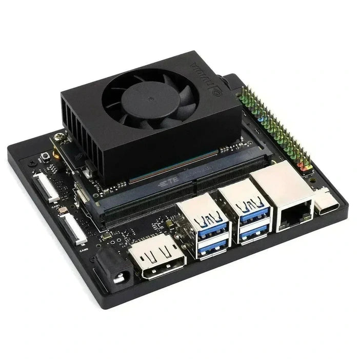

# Waveshare Jetson Orin NX 16GB Dev Kit Development Guide


[**View Waveshare NVIDIA Jetson Orin NX Dev Kit 16GB eMMC on OpenELAB**](https://openelab.io/products/jetson-orin-nx-dev-kit-16gb?variant=45931296424134)

**Model / option:** Dev Kit · **SKU:** `Waveshare-24212`


## Product overview

The **Waveshare Jetson Orin NX 16GB Dev Kit** is a Linux edge-computing system built from an NVIDIA production module, Waveshare carrier, active cooler and NVMe system disk. It is useful for learning JetPack, integrating cameras and developing GPU inference applications. The 16GB specification is **RAM**, while this kit's documented system disk is **256GB NVMe**. The legacy store title's “eMMC” wording does not establish an eMMC device: the manufacturer explicitly describes the NX module as having no built-in storage. [Kit guide](https://www.waveshare.com/wiki/JETSON-ORIN-NX-16G-DEV-KIT).

### Product identity and kit selection

This page retains the existing exact-model guide. It covers the purchased standard kit; a 16GB Kit B is a separate accessory bundle on the 16GB store page, not a firmware target. Do not assume that a camera, display or DP-to-HDMI cable is present in the standard kit.

The current store package names **JETSON-ORIN-IO-BASE**. Older Waveshare wiki passages name **JETSON-IO-BASE-B**, which is a different carrier family. The connection instructions below apply to a unit whose carrier label reads JETSON-ORIN-IO-BASE. If the received carrier differs, use its schematic and recovery drawing before attaching GPIO or entering recovery. This explicit carrier check prevents applying the old HDMI/Micro-USB layout to the current DisplayPort/USB-C board.



_Product images retained from the existing OpenELAB guide._

## Applications

* Camera-based inspection or robotics perception, beginning with one supported sensor and BSP before adding synchronized streams.
* A local inference gateway using the wired network and NVMe for model files, with capacity reserved for logs and updates.
* CUDA and TensorRT development on aarch64, preserving the image/runtime pairing for reproducible deployment.
* Carrier integration experiments using the 40-pin header, with each signal voltage and pinmux checked against the actual carrier/module reference.

TOPS is a platform arithmetic capability, not an application frame-rate promise. Sparse and dense INT8 numbers differ, and camera processing, memory traffic, power mode and cooling affect application results. Do not turn the headline rating into a latency estimate.

## Specifications

| Parameter                    | This 16GB kit                                                                      | Integration consequence                                                     |
| ---------------------------- | ---------------------------------------------------------------------------------- | --------------------------------------------------------------------------- |
| Compute module               | Jetson Orin NX 16GB                                                                | Select NX 16GB, not AGX Orin or the Nano SD-card kit                        |
| CPU                          | 8-core Arm Cortex-A78AE, 64-bit                                                    | Use aarch64 software; enabled cores depend on power mode                    |
| GPU                          | Ampere, 1024 CUDA cores, 32 Tensor Cores                                           | CUDA/TensorRT applications need the installed JetPack's runtime             |
| RAM                          | 16GB LPDDR5, 128-bit                                                               | Shared system/GPU memory; leave operating-system headroom                   |
| Original platform AI maximum | Up to 100 sparse INT8 TOPS                                                         | Original published mode; Super modes are a separate BSP/power qualification |
| Storage in this package      | 256GB NVMe SSD                                                                     | OS and datasets reside on external storage                                  |
| Module dimensions            | 69.6 × 45mm                                                                        | Module dimensions are not the assembled kit envelope                        |
| Current carrier DC jack      | 9–19V; 5.5 × 2.5mm mating plug                                                     | Use the supplied carrier adapter and verify its polarity marking            |
| Current carrier I/O          | 4 USB 3.2 Gen2 Type-A, Gigabit Ethernet, DP, USB-C device interface                | USB-C is for recovery/data; do not treat it as the main DC supply           |
| Carrier expansion            | 2 camera connectors, 40-pin header, M.2 Key-E and two Key-M sockets, 4-pin PWM fan | Lane routing and fitting constraints still depend on board revision         |

Module facts: [NVIDIA Orin NX datasheet v1.0](https://files.waveshare.com/wiki/common/Jetson_Orin_NX_DS-10712-001_v1.0.pdf), sections 1 and 6. Carrier connector/supply facts: [Waveshare JETSON-ORIN-IO-BASE product reference](https://www.waveshare.com/catalog/product/view/id/5610/s/jetson-orin-io-base/category/379/). Package storage and option: the exact OpenELAB listing above. The 9–19V input is a carrier rating; never apply it to a GPIO or bare module pin.

## Hardware and connections

### Hardware and revision scope

With power disconnected, inspect the module seating, NVMe retention, fan connector and carrier silkscreen. Keep the factory cooling assembly attached. The module's power-mode setting is not the rating of the external adapter: carrier, NVMe, USB peripherals and fan all consume additional power.

| Connection     | First-boot wiring                                                               | Avoid                                                                       |
| -------------- | ------------------------------------------------------------------------------- | --------------------------------------------------------------------------- |
| Display        | Carrier DisplayPort to a DP monitor, or an appropriate DP-to-HDMI adapter/cable | Assuming the USB-C socket carries video or that an old HDMI drawing matches |
| Network        | Known-good Ethernet cable to DHCP network                                       | Debugging Wi-Fi before proving Linux/network bring-up                       |
| Keyboard/mouse | USB Type-A ports                                                                | Connecting high-current loads before supply stability is established        |
| Power          | Supplied adapter into the labeled DC jack                                       | Feeding the DC-jack voltage into 40-pin power rails                         |
| Fan            | Fitted cooler to the specified PWM header                                       | Running sustained GPU load with a disconnected fan                          |
| CSI camera     | Exact supported sensor and correct 22-pin cable, connected with power removed   | Reversing the FFC or expecting a mechanical fit to prove driver support     |
| Recovery       | Carrier USB-C device port to Ubuntu host, FC REC/GND per exact drawing          | Leaving the recovery jumper installed for normal boot                       |

The 40-pin header includes multiple power and logic functions; its appearance does not establish Raspberry Pi peripheral compatibility. Use a level translator where the actual signal voltage requires one. No external GPIO wiring is needed for the first result.

For an IMX219 kit accessory, verify connector orientation and the driver/device-tree configuration for the installed L4T release before fitting it. USB UVC cameras and CSI cameras follow different driver pipelines; successful USB enumeration says nothing about CSI support.

## Software and development resources

### JetPack, BSP and target selection

A board support package (BSP) ties the boot firmware, kernel, device tree and drivers to the carrier and module. JetPack adds CUDA, cuDNN, TensorRT, multimedia and developer tools. Keep the BSP and userspace packages from the same supported JetPack/L4T release. An x86 CUDA installer or generic desktop Ubuntu image is not a substitute.

[Waveshare's kit guide](https://www.waveshare.com/wiki/JETSON-ORIN-NX-16G-DEV-KIT) documents Ubuntu **20.04/22.04 host** workflows and a JetPack **6.2 / L4T r36.4.3** script path for supported Orin configurations. Its older SDK Manager screenshots also show other boards and older application versions; use the **actual NX 16GB** module selection and carrier procedure. The guide's Super branch is deliberate configuration, not proof that every factory unit already uses Super power modes.

| Resource                           | Engineering use                                                                      |
| ---------------------------------- | ------------------------------------------------------------------------------------ |
| Carrier-matched factory image      | First boot and baseline; retain if it works                                          |
| NVIDIA SDK Manager                 | Host-side supported OS/SDK installation for the selected module                      |
| L4T r36.4.3 BSP + sample rootfs    | Reproducible manual image preparation; flash configuration must match carrier/module |
| Target `nvidia-jetpack` package    | Install SDK components after the matching target OS boots                            |
| `nvpmodel`, `tegrastats`           | Query configured power mode and live resource/thermal state                          |
| Jetson Linux release documentation | Camera, pinmux, storage, flashing and multimedia details for that release            |

Install project tools in a way that preserves the working BSP. Record the exact container architecture and L4T compatibility if using containers. A successful package installation does not establish GPU execution or model accuracy.

## Getting started

### First boot and a useful baseline

1. Prepare the exact kit, its supplied adapter, DP display connection, keyboard and wired network. Keep external GPIO, CSI expansion and extra storage disconnected initially.
2. Boot the factory NVMe image and finish the local account setup. Some older images have `jetson`/`jetson`; if that is present, change it before normal network use. Other images start first-run configuration and have no pre-created account.
3. On the **Jetson target**, open a terminal and run the following original inventory. It makes no storage changes:

```bash
python3 - <<'CHECK'
import pathlib, platform, shutil, subprocess
print("architecture:", platform.machine())
p = pathlib.Path('/etc/nv_tegra_release')
print("L4T:", p.read_text().strip() if p.exists() else 'not found')
for args in (['lsblk','-o','NAME,SIZE,TYPE,MOUNTPOINTS'],
             ['ip','-brief','address'],
             ['dpkg-query','-W','nvidia-l4t-core']):
    print('\nCHECK:', ' '.join(args))
    subprocess.run(args, check=False)
print("nvcc:", shutil.which('nvcc') or '/usr/local/cuda/bin/nvcc may be outside PATH')
CHECK
sudo nvpmodel -q
tegrastats --interval 1000
```

Stop `tegrastats` after several readings with Ctrl+C. **Expected result:** aarch64, an L4T release, an NVMe-backed root partition, an Ethernet address, a readable power-mode configuration and changing temperature/memory/CPU values. Disk sizes are reported in OS units and need not equal the decimal label. These are expected checkpoints, not measurements made for this guide.

If the target boots but CUDA development tools are absent, first confirm the package sources match its L4T release, then use the manufacturer's target-side SDK route:

```bash
sudo apt update
sudo apt install nvidia-jetpack
/usr/local/cuda/bin/nvcc --version
```

### Original GPU execution check

After the matched CUDA toolkit is installed, save this as `nx-check.cu` on the Jetson. It launches one bounded kernel, checks CUDA errors and verifies the computed result. It is a functional check, not a benchmark.

```cpp
#include <cstdio>
#include <cuda_runtime.h>
__global__ void twice(int *p) { if (threadIdx.x == 0) *p *= 2; }
int main() {
  int count = 0;
  cudaError_t e = cudaGetDeviceCount(&count);
  if (e != cudaSuccess || count < 1) {
    std::fprintf(stderr, "No CUDA device: %s\n", cudaGetErrorString(e));
    return 1;
  }
  int *p = nullptr;
  if (cudaMallocManaged(&p, sizeof(int)) != cudaSuccess) return 2;
  *p = 21;
  twice<<<1, 1>>>(p);
  e = cudaDeviceSynchronize();
  bool ok = e == cudaSuccess && *p == 42;
  std::printf("CUDA devices=%d value=%d status=%s\n", count, *p,
              ok ? "PASS" : "FAIL");
  cudaFree(p);
  return ok ? 0 : 3;
}
```

```bash
/usr/local/cuda/bin/nvcc nx-check.cu -o nx-check
./nx-check
```

**Expected result:** a positive device count and `value=42 status=PASS`. Stop and resolve a CUDA/runtime error before adding a model or camera pipeline. This example was source-reviewed; compilation and execution were not run.

### Getting the correct BSP and restoring the system

Back up the NVMe contents first. On an Ubuntu host, verify USB recovery enumeration with `lsusb` after shorting the actual carrier's **FC REC and GND** while powered off, applying the kit supply and attaching the USB-C data cable. An NVIDIA recovery device is the checkpoint before flashing.

For SDK Manager, select the detected **Jetson Orin NX 16GB**, the carrier-supported JetPack release, **Manual Setup** when required, and **NVMe** as target storage. Start with Jetson OS; add SDK components after a successful target boot. If the board/carrier selection does not agree, stop before writing. For the r36.4.3/Super script route use the complete matched package and configuration in [Waveshare's guide](https://www.waveshare.com/wiki/JETSON-ORIN-NX-16G-DEV-KIT); its QSPI and external-NVMe flash arguments must remain paired. Do not mix a QSPI configuration from one release with a root filesystem from another.

After completion remove the recovery jumper, boot normally, redo account setup if needed and repeat the inventory/GPU check. Record the image version and actual carrier revision with the project.

## Troubleshooting and FAQs

### Technical integration and troubleshooting

| Symptom                           | Ordered checks and recovery                                                                                                                                        |
| --------------------------------- | ------------------------------------------------------------------------------------------------------------------------------------------------------------------ |
| No normal boot                    | Check adapter and connector, fan/power indication, remove recovery jumper, confirm NVMe seating; use exact carrier recovery only after preserving recoverable data |
| Blank monitor                     | Select DP input, check the direction/type of DP adapter, try direct DP, confirm the system is not in USB recovery                                                  |
| RAM/storage confusion             | Read `free -h` for RAM and `lsblk`/`findmnt /` for root storage; the kit name's RAM value is not its disk capacity                                                 |
| `nvidia-jetpack` missing          | Query `nvidia-l4t-core`; a missing SDK metapackage does not mean Linux/BSP is absent                                                                               |
| CUDA binary or container fails    | Check aarch64 architecture, driver/runtime release pairing and GPU-device availability; do not replace target drivers with desktop packages                        |
| Camera missing                    | Check exact sensor, cable contact direction, driver/device tree and one-camera operation; list `/dev/video*` and kernel logs before changing pipeline code         |
| Slow inference or resets          | Check supply, fan, temperatures and `nvpmodel -q`; reduce workload and investigate storage/memory pressure before increasing power mode                            |
| Host loses the board during flash | Replace a charge-only/poor USB cable, ensure stable host USB attachment and recovery enumeration; virtual machines require USB passthrough across reconnects       |

### Fan control and workloads

Use the image's supported fan service/profile first. A third-party `jtop` installation is optional monitoring, not required for first boot; do not change global Python packages just to make a fan spin. Retain logs from a small workload before adding cameras, larger batches, TensorRT engine building or an accelerator-enabled container. Rebuild TensorRT engines for the actual supported runtime rather than assuming an engine built elsewhere is portable.

## Downloads and technical documents <a href="#technical-documents-and-software" id="technical-documents-and-software"></a>

| Direct official resource                                                                                                            | Scope and use                                                                                                 |
| ----------------------------------------------------------------------------------------------------------------------------------- | ------------------------------------------------------------------------------------------------------------- |
| [Orin NX datasheet v1.0](https://files.waveshare.com/wiki/common/Jetson_Orin_NX_DS-10712-001_v1.0.pdf)                              | Downloaded module electrical, mechanical and interface reference; module limits do not replace carrier limits |
| [Kit setup and recovery](https://www.waveshare.com/wiki/JETSON-ORIN-NX-16G-DEV-KIT)                                                 | NX 16GB kit guide, account setup, recovery and upgrade branches                                               |
| [Carrier component/connector reference](https://www.waveshare.com/catalog/product/view/id/5610/s/jetson-orin-io-base/category/379/) | JETSON-ORIN-IO-BASE, DC jack, DP, camera and M.2 connections                                                  |
| [Jetson Linux r36.4.3](https://developer.nvidia.com/embedded/jetson-linux-r3643)                                                    | BSP and sample-rootfs release downloads; select exact supported hardware                                      |
| [SDK Manager](https://developer.nvidia.com/sdk-manager)                                                                             | Host-side installation utility                                                                                |
| [r36.4.3 Quick Start](https://docs.nvidia.com/jetson/archives/r36.4.3/DeveloperGuide/IN/QuickStart.html)                            | Host requirements, release-specific preparation and flash context                                             |

The kit wiki's recovery photographs remain the authoritative orientation reference for its depicted carrier. Compare the physical board label and connectors first. The manufacturer-listed camera/display package is not evidence that those optional accessories were included with this standard SKU.

| Resource                                                                                              | Purpose and exact scope                           |
| ----------------------------------------------------------------------------------------------------- | ------------------------------------------------- |
| [module datasheet](https://files.waveshare.com/wiki/common/Jetson_Orin_NX_DS-10712-001_v1.0.pdf)      | Module electrical and mechanical reference        |
| [kit recovery](https://www.waveshare.com/wiki/JETSON-ORIN-NX-16G-DEV-KIT)                             | Exact kit boot, recovery and SDK instructions     |
| [carrier](https://www.waveshare.com/catalog/product/view/id/5610/s/jetson-orin-io-base/category/379/) | Current carrier connector and power specification |

## References and validation <a href="#official-documentation-and-development-resources" id="official-documentation-and-development-resources"></a>

Reviewed **24 November 2026** using the exact kit guide, current OpenELAB option, carrier specification and downloaded NVIDIA module datasheet. The carrier-version boundary, RAM-versus-NVMe distinction and original Linux/CUDA checks are part of this engineering procedure.

**Validation:** source review only. Compilation, flashing, CUDA execution, camera capture, power/thermal measurements and hardware operation were **not run**. Reproduce the steps on the actual labeled carrier and record observed results; the expected output is not a test claim.

* [Waveshare NX 16GB guide](https://www.waveshare.com/wiki/JETSON-ORIN-NX-16G-DEV-KIT) — manufacturer snapshot 23 November 2026; reviewed 24 November 2026.
* [NVIDIA Orin NX module datasheet](https://files.waveshare.com/wiki/common/Jetson_Orin_NX_DS-10712-001_v1.0.pdf) — DS-10712-001 v1.0, 2023.
* [Waveshare carrier reference](https://www.waveshare.com/catalog/product/view/id/5610/s/jetson-orin-io-base/category/379/) — live manufacturer page reviewed 24 November 2026.

### Retained source links

* [_Image source_](https://cdn.shopify.com/s/files/1/0621/0050/4774/files/01_jetson_orin_nx_devkit_16gb_angle.webp?v=1781147734)
* [manufacturer kit page](https://www.waveshare.com/jetson-orin-nx-16g-dev-kit.htm)
* [tegrastats reference](https://docs.nvidia.com/jetson/archives/r36.4.3/DeveloperGuide/AT/JetsonLinuxDevelopmentTools/TegrastatsUtility.html)
* [Manufacturer kit and package matrix](https://www.waveshare.com/jetson-orin-nx-16g-dev-kit.htm)
* [JetPack SDK](https://developer.nvidia.com/embedded/jetpack)

### Related retained references

* [NVIDIA Jetson Linux developer guide](https://docs.nvidia.com/jetson/archives/r36.4.3/DeveloperGuide/)
